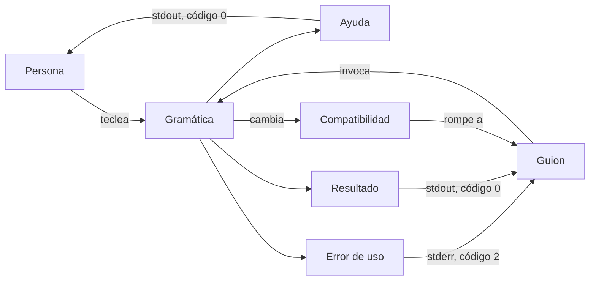
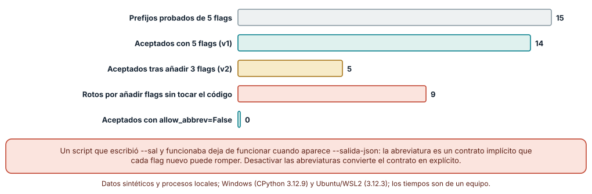
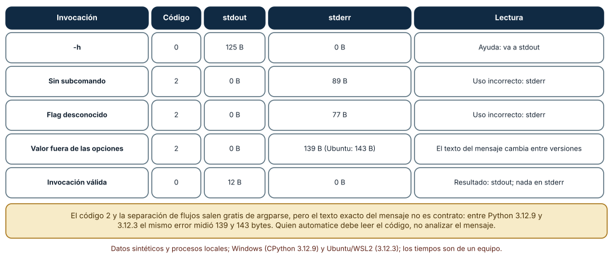
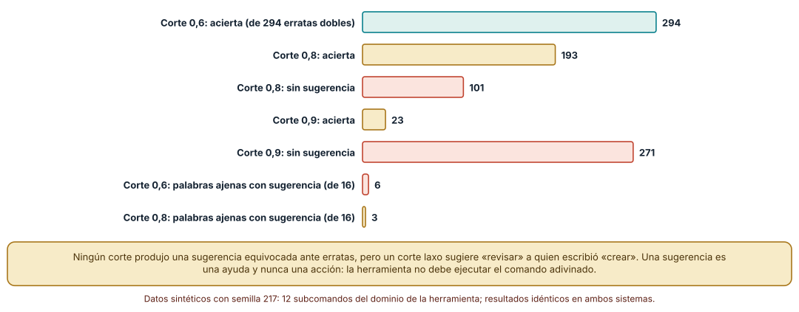

# SE-217 — Diseño de interfaces de línea de comandos

[← SE-216 — Proyecto: portal documental versionado](https://github.com/vladimiracunadev-create/modern-software-engineering-program/blob/main/classes/part-17-documentacion-y-conocimiento-tecnico/se-216-proyecto-portal-documental-versionado/README.md) · [↑ Parte 18](https://github.com/vladimiracunadev-create/modern-software-engineering-program/blob/main/classes/part-18-cli-tui-servicios-y-automatizacion/README.md) · [📚 Índice completo](https://github.com/vladimiracunadev-create/modern-software-engineering-program/blob/main/classes/README.md) · [🌐 Portal](https://vladimiracunadev-create.github.io/modern-software-engineering-program/classes/SE-217.html) · [SE-218 — Entrada estándar, salida y composición por pipes →](https://github.com/vladimiracunadev-create/modern-software-engineering-program/blob/main/classes/part-18-cli-tui-servicios-y-automatizacion/se-218-entrada-estandar-salida-y-composicion-por-pipes/README.md)

## Punto profesional y fundamento pedagógico

**Punto profesional.** La clase existe para diseñar una interfaz de línea de comandos como un contrato con dos lectores —una persona que escribe y un programa que invoca— de modo que cambiar un flag, un mensaje o un código no rompa ni a la persona que lo memorizó ni al guion que lo automatizó.

**Por qué aparece aquí.** Se sitúa después de **Proyecto: portal documental versionado** (`SE-216`), que dejó documentación que alguien debe poder seguir, y antes de **Entrada estándar, salida y composición por pipes** (`SE-218`). Aquí se fija la superficie de la herramienta `notas` de la plataforma de entregas —un caso sintético— y se pregunta qué prometen sus flags, su ayuda y sus errores; `SE-218` pregunta cómo fluyen los datos por esa superficie.

**Error conceptual que debe corregir.** Creer que una CLI es «un script con argumentos» y que sus flags, sus abreviaturas y el texto de sus errores son detalles internos que pueden cambiar sin aviso. Para quien la automatiza, cada flag aceptado es una promesa; el texto de un mensaje, en cambio, no lo es.

**Secuencia de aprendizaje.** Antes de leer la solución, predices cuántas abreviaturas de flags seguirán valiendo cuando la herramienta pase de cinco a ocho opciones; después mides el código de salida y el flujo de cada tipo de invocación y comparas dos umbrales de sugerencia ante errores de tecleo. La secuencia usa predicción, explicación propia, contraste y recuperación. [ICAP](https://icap.education.asu.edu/research) distingue participación de construcción de conocimiento; [How People Learn II](https://nap.nationalacademies.org/catalog/24783/how-people-learn-ii-learners-contexts-and-cultures) exige conectar conocimiento previo, contexto y transferencia; la [práctica de recuperación](https://pubmed.ncbi.nlm.nih.gov/16507066/) respalda producir de nuevo la explicación tras una demora; y [Education for Life and Work](https://nap.nationalacademies.org/resource/13398/dbasse_084153.pdf) exige devolución que explique la causa del error.

**Evidencia de aprendizaje.** `cli-contract.md` con la gramática de la herramienta, una tabla de invocaciones con código, flujo y tamaño de salida, la medición de abreviaturas antes y después de añadir flags y la política de sugerencias. Debe contener predicción previa, observación, explicación causal, contraejemplo y qué hallazgo haría retirar un flag.

**Límite de la conclusión.** Los experimentos usan `argparse` de CPython 3.12 y cinco a ocho flags inventados; no se auditó ninguna herramienta real, no se midió cómo leen la ayuda las personas y las erratas son sintéticas (semilla 217), no las de usuarios reales.

### Trazabilidad fuente → afirmación

| Fuente primaria u oficial | Afirmación que respalda | Lo que no prueba |
|---|---|---|
| [Command Line Interface Guidelines](https://clig.dev/) | Recoge principios de diseño: ayuda accesible, errores legibles, salida para personas y para programas, y no romper la compatibilidad. | Son recomendaciones de autores, no un estándar ni una medición. |
| [POSIX: Utility Conventions](https://pubs.opengroup.org/onlinepubs/9699919799/basedefs/V1_chap12.html) | Define la sintaxis de opciones de una sola letra, su agrupación, los argumentos de opción y el delimitador `--`. | No cubre las opciones largas ni los subcomandos modernos. |
| [GNU Coding Standards: Command-Line Interfaces](https://www.gnu.org/prep/standards/html_node/Command_002dLine-Interfaces.html) | Fija `--help` y `--version` como opciones estándar y recomienda opciones largas legibles. | Es una convención del proyecto GNU, no una norma universal. |
| [Python: `argparse`](https://docs.python.org/3/library/argparse.html) | Documenta `allow_abbrev`, los subanalizadores y el código de salida 2 de un uso incorrecto. | No dice cuándo conviene permitir abreviaturas. |

## Antes de empezar

Recupera lo aprendido en `SE-216`: una documentación vale por lo que una persona puede hacer siguiéndola. La pregunta activa es: **¿qué promete cada parte visible de la herramienta, a quién y durante cuánto tiempo?**

## Prerrequisitos

- Haber completado `SE-216` o poder explicar qué documentación necesita quien usa una herramienta.
- Python 3.11 o posterior y un terminal (PowerShell, bash o WSL2); la biblioteca estándar basta.
- Trabajar con la herramienta sintética `notas` y datos inventados.

## Problema auténtico

El equipo de operaciones de la plataforma de entregas usa `notas exportar` desde un guion nocturno. Un viernes se añaden tres opciones nuevas al comando y el guion, que escribía `--sal informe.csv` desde hacía meses, empieza a fallar con «ambiguous option». Nadie había leído la ayuda: el guion funcionaba por una abreviatura que nunca se prometió. Al revisar, se descubre además que la ayuda sale por el error estándar en una versión y que un script analiza el texto de un mensaje de error que cambió.

## Objetivos observables

Al terminar podrás:

1. describir la gramática de una herramienta (subcomandos, flags, argumentos) y distinguir lo que es contrato de lo que es presentación;
2. medir cuántas abreviaturas de flags dejan de valer cuando se añaden opciones y decidir si se permiten;
3. verificar qué código y qué flujo produce cada tipo de invocación y escribir la tabla que otra persona puede comprobar;
4. comparar umbrales de sugerencia ante errores de tecleo y justificar por qué una sugerencia no debe ejecutarse sola;
5. definir una política de compatibilidad para flags: añadir, deprecar y retirar.

## Mapa conceptual



El mapa se lee como un reparto: la gramática es el punto en que coinciden dos lectores; la ayuda y los errores tienen destinos distintos; y un cambio de gramática viaja hacia quien automatiza. No describe una secuencia de ejecución.

## Temas y por qué importan

| Tema | Por qué cambia una decisión profesional | Evidencia mínima |
|---|---|---|
| Gramática y convenciones | Seguir las convenciones reduce lo que hay que aprender y lo que hay que documentar. | Predicción, traza causal y contraejemplo de **Gramática** en `cli-contract.md` |
| Ayuda y descubribilidad | La ayuda es la primera documentación y debe poder consumirse sin romper una tubería. | Predicción, traza causal y contraejemplo de **Ayuda** en `cli-contract.md` |
| Errores de uso | Un código y un flujo estables permiten automatizar; un mensaje claro permite corregir. | Predicción, traza causal y contraejemplo de **Errores de uso** en `cli-contract.md` |
| Abreviaturas y sugerencias | Aceptar de más crea promesas implícitas; sugerir de más induce a error. | Predicción, traza causal y contraejemplo de **Abreviaturas** en `cli-contract.md` |
| Compatibilidad | Un flag aceptado es una promesa; retirarlo es un cambio de contrato. | Predicción, traza causal y contraejemplo de **Compatibilidad** en `cli-contract.md` |

## Conceptos y decisiones

### 1. Una CLI es una API con dos lectores

Una persona lee la ayuda, teclea con prisa y tolera un mensaje largo; un programa lee un código de salida, un flujo y, a veces, un formato. Los dos usan la misma gramática, pero esperan cosas distintas de ella. De ahí sale la primera regla de diseño: separar lo que es **contrato** (flags aceptados, significado, código de salida, destino de cada flujo) de lo que es **presentación** (el texto exacto de la ayuda y de los errores, el color, el ancho). El contrato se versiona y se prueba; la presentación puede mejorar sin aviso. Confundirlas es la causa de los guiones que analizan el texto de un mensaje.

### 2. Gramática: subcomandos, flags y argumentos

Las convenciones POSIX describen opciones de una letra (`-v`), su agrupación (`-vq`) y el delimitador `--` que indica «lo que sigue no son opciones»; las GNU añadieron opciones largas (`--verbose`) y `--help`/`--version`. Una herramienta con varias acciones suele organizarse en subcomandos (`notas exportar`, `notas validar`), cada uno con sus propias opciones. La decisión de diseño es de qué depende el significado: un flag global afecta a todo, uno de subcomando solo a ese. Una gramática regular —los mismos nombres para lo mismo— se aprende una vez; una irregular se consulta siempre. Los booleanos son otro punto delicado: `--force` activa, pero ¿cómo se desactiva algo que por defecto está activo? Diseñar el par (`--color` / `--no-color`) o un valor explícito evita que la ausencia de flag signifique dos cosas.

### 3. Ayuda y descubribilidad

La ayuda solicitada (`-h`, `--help`) es un resultado esperado, no un error: sale por el flujo estándar con código 0, de modo que se pueda paginar (`notas --help | less`) y que un guion pueda comprobar que la herramienta existe. Una buena ayuda trae uso, descripción de cada flag con su valor por defecto y uno o dos ejemplos reales: es lo que más se copia. La descubribilidad incluye lo que ocurre cuando la persona se equivoca: indicar qué se esperaba, mostrar el uso mínimo y apuntar a la ayuda completa. Un mensaje que solo dice «error» obliga a leer el código fuente.

### 4. Errores de uso: código y flujo antes que texto

Cuando la invocación es incorrecta, la herramienta escribe en el flujo de error y sale con un código distinto de 0; `argparse` usa 2. Esa pareja —código y flujo— es lo que un programa puede leer con seguridad. El texto, en cambio, cambia entre versiones del intérprete, de la biblioteca y del idioma. Esto fija una regla para quien automatiza: se comprueba el código, no se busca una frase. Y una para quien diseña: el mensaje debe decir qué falló, qué se esperaba y cómo corregirlo, y no incluir datos sensibles que el usuario escribió, porque los mensajes terminan en registros.

### 5. Compatibilidad: añadir es barato, retirar es caro

Añadir un flag nuevo no rompe a nadie… salvo que las abreviaturas estén activadas. Renombrar, cambiar un valor por defecto o cambiar el significado de un código sí rompe. Una política razonable: los flags se añaden con un nombre que no sea prefijo de otro; los retirados se **deprecan** primero (siguen funcionando, avisan por el flujo de error y se anuncian con fecha) y se eliminan en una versión mayor; los cambios de comportamiento se registran en el historial de cambios. El mismo principio reaparece en `SE-225` (versiones) y en la compatibilidad de contratos de `SE-164`.

### Cinco flags, ocho flags: las abreviaturas son un contrato implícito

La herramienta `notas exportar` tiene cinco opciones largas: `--formato`, `--salida`, `--desde`, `--hasta` y `--verboso`. Con `argparse` por defecto, cualquier prefijo no ambiguo vale. Se probaron los 15 prefijos de una o más letras que dejan sin escribir al menos tres letras del nombre (`--s`, `--sa`, `--sal`, `--f`, `--fo`…): **14 se aceptan** en la versión 1 (`--h` ya era ambiguo con `--help`). Se añadieron tres opciones (`--forzar`, `--salida-json`, `--verificar`) y se repitió la prueba: **solo 5 de esos 14 siguen aceptándose; 9 se rompieron** sin cambiar ni una línea del código que las usaba. Por ejemplo, `--sal` pasó a ser ambiguo entre `--salida` y `--salida-json`; siguen valiendo `--d`, `--de`, `--form`, `--ha` y `--verb`, y no por mérito: ningún flag nuevo empieza igual. Con `allow_abbrev=False` no se acepta ninguna abreviatura y no hay nada que romper.

```python
parser = argparse.ArgumentParser(prog="notas", allow_abbrev=False)
sub = parser.add_subparsers(dest="cmd", required=True)
# allow_abbrev no se hereda: hay que repetirlo en cada subanalizador
exportar = sub.add_parser("exportar", allow_abbrev=False)
```



**Cómo leer la figura.** La barra gris es el universo de prefijos probados; la teal, los que valían con cinco flags; la dorada, los que valen con ocho; la coral, los que se rompieron. **Dónde deja de valer:** el cálculo usa nombres inventados; el número de rotos depende de cómo se parezcan los nombres, no de una ley. Lo que generaliza es el mecanismo: un nombre nuevo que es prefijo de otro, o que lo tiene como prefijo, convierte en ambiguas las abreviaturas anteriores.

### Qué observa quien invoca: código, flujo y tamaño

Se ejecutó una herramienta con un subcomando `exportar` y una opción `--formato` limitada a `csv` y `json`. Se midieron cinco invocaciones desde un proceso padre. La ayuda (`-h`) salió con **código 0** y 125 bytes por stdout y ninguno por stderr. Los tres usos incorrectos —sin subcomando, flag desconocido y valor fuera de las opciones— salieron con **código 2**, sin nada en stdout y con 89, 77 y 139 bytes en stderr. La invocación válida escribió 12 bytes en stdout. En Ubuntu todo coincidió salvo el último mensaje, que midió **143 bytes en lugar de 139**: el texto del error cambió entre CPython 3.12.9 y 3.12.3, mientras el código y el flujo no.



**Cómo leer la figura.** Cada fila es una invocación; las columnas centrales son lo que un programa puede observar sin entender el idioma del mensaje. **Dónde deja de valer:** son cinco casos de una sola biblioteca; otra biblioteca (o una herramienta escrita a mano) puede usar otro código para el mismo error, y por eso el código se documenta en el contrato en lugar de suponerse.

### Sugerir sin adivinar

Un error de tecleo en un subcomando puede ayudarse con una sugerencia («¿quiso decir `exportar`?»). Con doce subcomandos del dominio de la herramienta y 294 erratas sintéticas de dos ediciones (borrar, insertar, sustituir o transponer una letra, dos veces), `difflib.get_close_matches` con **corte 0,6 acertó las 294**; con **corte 0,8 acertó 193 y no sugirió nada en 101**; con **0,9 acertó solo 23 y calló en 271**. Ninguno sugirió un comando equivocado ante una errata. Pero el criterio cambia con palabras que no son erratas: con 16 palabras ajenas (`borrar`, `delete`, `crear`, `list`, `export`…), el corte 0,6 produjo sugerencia para **6** —entre ellas `crear → revisar`, que no tiene relación— y el corte 0,8 para **3**.



**Cómo leer la figura.** Las barras teal son sugerencias correctas ante una errata; las coral, silencios; las de palabras ajenas cuentan sugerencias que no deberían existir. **Dónde deja de valer:** las erratas son sintéticas y uniformes; las reales se concentran en transposiciones y en teclas vecinas. El resultado enseña un equilibrio, no un umbral universal: más permisivo ayuda más al que se equivoca y confunde más al que busca algo que no existe.

## Definiciones de trabajo

- **contrato de línea de comandos:** conjunto de flags, argumentos, códigos de salida y destinos de flujo que la herramienta promete mantener.
- **subcomando:** acción con nombre propio dentro de una herramienta (`notas exportar`), con sus propias opciones.
- **abreviatura de flag:** prefijo no ambiguo de una opción larga que el analizador acepta si se activa `allow_abbrev`.
- **deprecación:** estado en que una opción sigue funcionando pero avisa de su retirada en una versión posterior.
- **sugerencia:** texto que propone una corrección sin ejecutarla.

Las definiciones son operativas para la herramienta `notas`. No convierten términos con historia más amplia en sinónimos y deben contrastarse con la documentación primaria enlazada al final.

## Ejemplo mínimo

El fragmento define la herramienta y comprueba qué ocurre con una abreviatura. Antes de ejecutarlo, predice si `--form` sigue valiendo después de añadir `--formulario`.

```python
import argparse, io, contextlib

def construir(flags, abrev):
    p = argparse.ArgumentParser(prog="notas", allow_abbrev=abrev)
    for f in flags:
        p.add_argument(f, default=None)
    return p

def acepta(p, argv):
    try:
        with contextlib.redirect_stderr(io.StringIO()):
            p.parse_args(argv)
        return True
    except SystemExit as e:
        return e.code == 0

v1 = construir(["--formato", "--salida"], True)
v2 = construir(["--formato", "--formulario", "--salida"], True)
print(acepta(v1, ["--form", "x"]), acepta(v2, ["--form", "x"]))
```

La segunda llamada devuelve `False`: la abreviatura es ahora ambigua. Registra la versión del intérprete y la salida, y repite con `abrev=False`.

## Ejemplo profesional

En la plataforma, `notas` documenta su contrato en un archivo corto: tabla de flags (nombre, tipo, valor por defecto, desde qué versión), tabla de códigos (0 éxito, 2 uso incorrecto, 65 datos inválidos, 75 fallo temporal), destino de cada flujo y política de deprecación. Las abreviaturas están desactivadas en todos los analizadores, incluidos los de subcomandos. Una prueba de contrato ejecuta la herramienta como lo haría un guion y comprueba código, flujo y presencia de ciertas cadenas en la ayuda; no compara el texto completo. Una segunda prueba falla si alguien añade un flag sin documentarlo.

Compara el caso normal con un flag deprecado, uno renombrado y uno retirado. El diseño es apropiado cuando cada uno de los tres tiene una entrada en el historial de cambios y un periodo en que ambos nombres funcionan; es peligroso cuando el único aviso es el mensaje de una versión mayor.

## Práctica guiada

1. Escribe en prosa qué promete cada flag de `notas exportar` y qué no promete.
2. Predice cuántas abreviaturas dejarán de valer al añadir tres flags; luego mídelo.
3. Mide código, flujo y bytes de las cinco invocaciones de la tabla desde un proceso padre.
4. Activa y desactiva `allow_abbrev` y repite la medición; recuerda repetirlo en el subanalizador.
5. Genera erratas con una semilla fija, prueba dos umbrales de sugerencia y cuenta aciertos, silencios y sugerencias a palabras ajenas.
6. Escribe el contrato (flags, códigos, flujos, deprecación) en `cli-contract.md`.
7. Pide a otra persona que escriba un guion solo desde `cli-contract.md` y comprueba si funciona.

## Ejercicios

1. **Nombres que no se pisan:** propón cuatro nombres de flag nuevos para `notas exportar` y comprueba, con la medición, cuáles no crean ambigüedad con los cinco existentes aun con abreviaturas activadas.
2. **Subanalizador:** demuestra con una invocación que `allow_abbrev=False` en el analizador raíz no impide `--form` dentro de un subcomando y corrige el defecto.
3. **Deprecación:** diseña el aviso de un flag que se retirará en la versión 2: texto, flujo, código (¿cambia?) y cuántas versiones convive.
4. **Umbral:** decide el corte de sugerencia para una herramienta de pocos comandos y otra de cincuenta; justifica con las tres cifras de la clase.

## Reto verificable

Entrega `cli-contract.md` con la gramática de `notas`, la tabla de invocaciones medida, la comparación de abreviaturas antes y después de añadir flags y la política de sugerencias. Se aprueba si otra persona ejecuta las mediciones desde un checkout limpio, obtiene los mismos conteos con la semilla indicada y puede señalar qué parte del documento es contrato y cuál es presentación. No se aprueba por el número de flags ni por un `--help` largo.

## Caso conductor

La herramienta `notas` de la plataforma de entregas es el caso conductor de la Parte 18. Esta clase deja su gramática y su contrato de errores. `SE-218` pregunta cómo entra y sale la información (entrada estándar, tuberías, codificación), `SE-219` cómo se configura y `SE-220` qué significan sus códigos. Cambia después un solo detalle, el nombre de `--salida` a `--destino`, y revisa qué guiones, ejemplos y documentación dependían de él.

## Preguntas frecuentes

### ¿Conviene permitir abreviaturas para ahorrar teclas?

Para uso interactivo ayudan; para guiones son un riesgo, porque convierten en promesa un prefijo que nadie decidió prometer. Una opción intermedia es dar alias explícitos y cortos (`-f` para `--formato`) que sí forman parte del contrato.

### ¿El mensaje de error forma parte del contrato?

No debería: se midió que el mismo error pesa 139 o 143 bytes entre dos versiones del intérprete. El contrato es el código y el flujo; el mensaje puede mejorar sin que nadie rompa. Si un guion necesita distinguir causas, la herramienta debe ofrecer códigos distintos o una salida estructurada.

### ¿Por qué la ayuda sale por stdout y no por stderr?

Porque pedirla es un uso correcto. Si saliera por stderr no podría paginarse con una tubería ni redirigirse a un archivo, y un guion que comprueba que la herramienta responde recibiría ruido en el canal de errores.

### ¿Hay que seguir las convenciones POSIX y GNU?

Sirven como lenguaje común: quien conoce `-h` y `--` no tiene que aprender nada nuevo. Cuando una herramienta se aparta de ellas debe decirlo en la ayuda. El criterio de decisión es el coste para quien llega por primera vez.

## Fallo controlado y diagnóstico

Reproduce el fallo clásico de la clase: **depender de un prefijo que nadie prometió**. Usa los cinco flags de la versión 1 y el guion que escribe `--sal x`.

Registra síntoma, entrada mínima, hipótesis, observación que descarta cada hipótesis, causa, corrección y prueba de regresión. **Síntoma:** tras desplegar la versión 2, el guion termina con código 2 y el mensaje de opción ambigua. **Hipótesis rivales:** (a) se eliminó `--salida`; (b) cambió el significado de `--sal`; (c) la abreviatura pasó a ser ambigua. **Prueba:** `notas exportar --salida x` funciona; `--sal x` falla; `--salida-json` existe desde la versión 2. **Conclusión:** la causa es la tercera: no cambió ningún comportamiento, cambió el conjunto de nombres. **Regresión:** desactiva las abreviaturas en el analizador raíz y en cada subanalizador, y añade una prueba que invoque un prefijo y espere código 2. No cambies a la vez los nombres y la política de abreviaturas.

## Errores comunes y cómo corregirlos

| Síntoma | Causa probable | Corrección |
|---|---|---|
| Un guion falla después de añadir un flag | Dependía de una abreviatura | Desactivar abreviaturas en todos los analizadores y probar un prefijo |
| `allow_abbrev=False` no surte efecto en un subcomando | La opción no se hereda en los subanalizadores | Pasarla en cada `add_parser` |
| Un guion analiza la frase del error | El mensaje se trató como contrato | Documentar códigos y ofrecer códigos distintos por causa |
| La ayuda rompe una tubería | Sale por stderr o con código distinto de 0 | Imprimirla en stdout y salir con 0 |
| La sugerencia convence al usuario de un comando equivocado | Corte demasiado laxo | Subir el corte, limitar a una sugerencia y no ejecutarla |

## Entorno y archivos clave

```text
work/SE-217/
├── README.md
├── notas_cli.py
├── experimentos/
│   ├── abreviaturas.py
│   ├── contrato.py
│   └── sugerencias.py
└── evidence/cli-contract.md
```

El `README` declara plataforma, versión de Python, semilla (217) y comandos. Los experimentos usan solo la biblioteca estándar (`argparse`, `difflib`, `subprocess`) y se ejecutaron con CPython 3.12.9 en Windows 11 y 3.12.3 en Ubuntu bajo WSL2: las salidas fueron idénticas salvo el tamaño del mensaje de un valor inválido (139 y 143 bytes). Si adoptas una biblioteca de línea de comandos, fija su procedencia y versión.

## Seguridad, ética y accesibilidad

- una CLI no debe aceptar un secreto como argumento sin advertir que otros procesos pueden leerlo (se mide en `SE-219`);
- los mensajes de error no deben repetir datos personales que la persona tecleó: terminan en registros;
- la ayuda debe poder leerse sin color y con lectores de pantalla: texto plano, sin dibujos hechos con símbolos, y con ejemplos copiables;
- la sugerencia de un comando nunca debe ejecutarse automáticamente: la acción es de quien decide;
- respeta las licencias de las bibliotecas de análisis de argumentos y atribuye las adaptaciones.

## Puente hacia el trabajo con agentes

Un agente al que se le pide «añade un flag `--formulario` a la herramienta» suele tocar solo el analizador raíz, no actualiza la documentación y no revisa qué abreviaturas dejan de valer. Pídele que liste todos los flags existentes y los nuevos, que ejecute una prueba de prefijos y que actualice el contrato y el historial de cambios. Revisa especialmente si dejó `allow_abbrev` activo en un subanalizador y si analizó el texto de un mensaje en una prueba: son los dos fallos de esta clase con apariencia de código correcto.

## Transferencia

Traslada el experimento a otra superficie con gramática propia (por ejemplo, la herramienta de despliegue de un equipo con subcomandos `plan`, `aplicar` y `revertir`): escribe su contrato, mide qué prefijos dejan de valer al añadir un subcomando y decide qué códigos prometer. La transferencia está lograda cuando puedes explicar qué parte del método dependía de `argparse` y cuál era general, no cuando el contrato se parece.

## Evaluación y evidencia

| Criterio | Evidencia para aprobar |
|---|---|
| comprensión | explicación de la diferencia entre contrato y presentación en una CLI |
| corrección | tabla reproducible de invocaciones con código, flujo y bytes |
| diseño | política de flags, abreviaturas y deprecación escrita y justificada |
| diagnóstico | reproducción del fallo «abreviatura no prometida» con regresión |
| incertidumbre | declaración de qué mediciones son de una biblioteca y de un equipo |
| reproducibilidad | versiones, semilla, comandos y límites declarados |

## Fuentes

- [Command Line Interface Guidelines](https://clig.dev/) — principios de diseño de interfaces de línea de comandos; autoridad: guía de autores, de uso extendido.
- [POSIX: Utility Conventions](https://pubs.opengroup.org/onlinepubs/9699919799/basedefs/V1_chap12.html) — sintaxis de opciones y argumentos; autoridad: The Open Group.
- [GNU Coding Standards: Command-Line Interfaces](https://www.gnu.org/prep/standards/html_node/Command_002dLine-Interfaces.html) — `--help`, `--version` y opciones largas; autoridad: proyecto GNU.
- [Python: `argparse`](https://docs.python.org/3/library/argparse.html) — `allow_abbrev`, subanalizadores y código de salida 2; autoridad: documentación de Python.
- [Python: `difflib`](https://docs.python.org/3/library/difflib.html) — `get_close_matches` y su umbral de similitud; autoridad: documentación de Python.

Cada fuente respalda el mecanismo indicado; ninguna demuestra que la gramática de `notas` sea la que la plataforma necesita. Esa afirmación depende de quién la usa y de qué automatiza.

- [Python: `subprocess`](https://docs.python.org/3/library/subprocess.html) — ejecución de la herramienta como proceso hijo para medir código y flujos.
- [Python: `random`](https://docs.python.org/3/library/random.html) — semilla de las erratas sintéticas.

## Límites y siguiente paso

Se ejecutaron tres experimentos con datos sintéticos en Windows y Ubuntu (WSL2), con resultados idénticos salvo el tamaño de un mensaje. No se usó ninguna herramienta real, no se midió a ninguna persona usando la ayuda y las erratas, los nombres de flags y los umbrales son supuestos del autor. La siguiente clase pregunta cómo entra y sale la información por la superficie que se acaba de definir.

## Glosario

- **contrato de línea de comandos:** conjunto de flags, argumentos, códigos de salida y destinos de flujo que la herramienta promete mantener.
- **subcomando:** acción con nombre propio dentro de una herramienta, con sus propias opciones.
- **abreviatura de flag:** prefijo no ambiguo de una opción larga que el analizador acepta si se activa `allow_abbrev`.
- **deprecación:** estado en que una opción sigue funcionando pero avisa de su retirada en una versión posterior.
- **sugerencia:** texto que propone una corrección sin ejecutarla.

---

[← SE-216 — Proyecto: portal documental versionado](https://github.com/vladimiracunadev-create/modern-software-engineering-program/blob/main/classes/part-17-documentacion-y-conocimiento-tecnico/se-216-proyecto-portal-documental-versionado/README.md) · [↑ Parte 18](https://github.com/vladimiracunadev-create/modern-software-engineering-program/blob/main/classes/part-18-cli-tui-servicios-y-automatizacion/README.md) · [📚 Índice completo](https://github.com/vladimiracunadev-create/modern-software-engineering-program/blob/main/classes/README.md) · [🌐 Portal](https://vladimiracunadev-create.github.io/modern-software-engineering-program/classes/SE-217.html) · [SE-218 — Entrada estándar, salida y composición por pipes →](https://github.com/vladimiracunadev-create/modern-software-engineering-program/blob/main/classes/part-18-cli-tui-servicios-y-automatizacion/se-218-entrada-estandar-salida-y-composicion-por-pipes/README.md)
