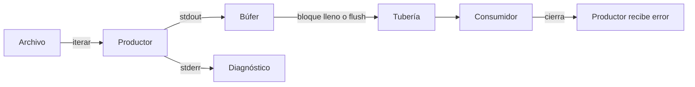
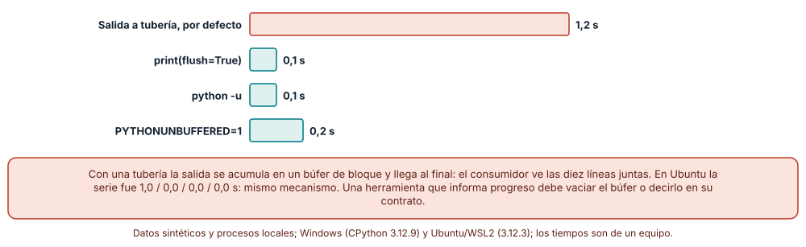
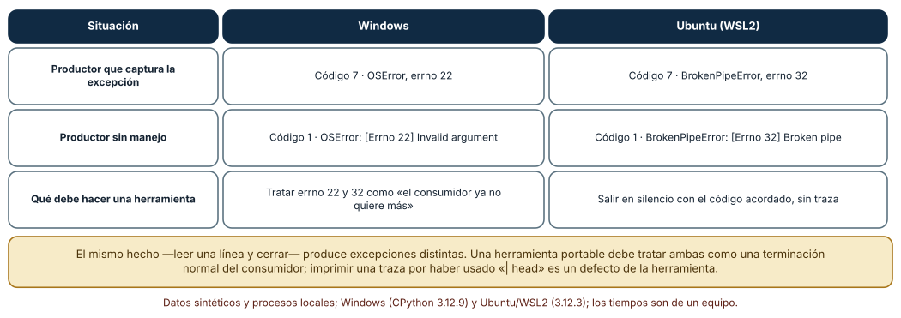
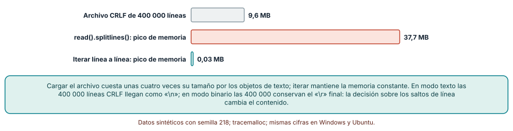

# SE-218 — Entrada estándar, salida y composición por pipes

[← SE-217 — Diseño de interfaces de línea de comandos](https://github.com/vladimiracunadev-create/modern-software-engineering-program/blob/main/classes/part-18-cli-tui-servicios-y-automatizacion/se-217-diseno-de-interfaces-de-linea-de-comandos/README.md) · [↑ Parte 18](https://github.com/vladimiracunadev-create/modern-software-engineering-program/blob/main/classes/part-18-cli-tui-servicios-y-automatizacion/README.md) · [📚 Índice completo](https://github.com/vladimiracunadev-create/modern-software-engineering-program/blob/main/classes/README.md) · [🌐 Portal](https://vladimiracunadev-create.github.io/modern-software-engineering-program/classes/SE-218.html) · [SE-219 — Configuración, flags, archivos y precedencia →](https://github.com/vladimiracunadev-create/modern-software-engineering-program/blob/main/classes/part-18-cli-tui-servicios-y-automatizacion/se-219-configuracion-flags-archivos-y-precedencia/README.md)

## Punto profesional y fundamento pedagógico

**Punto profesional.** La clase existe para que una herramienta se comporte bien como pieza de una tubería: lea de la entrada estándar sin cargar todo en memoria, escriba datos y diagnósticos en flujos distintos, entregue lo que produce a tiempo y termine en silencio cuando el consumidor ya no quiere más.

**Por qué aparece aquí.** Se sitúa después de **Diseño de interfaces de línea de comandos** (`SE-217`) y antes de **Configuración, flags, archivos y precedencia** (`SE-219`): `SE-217` fijó qué promete la superficie de `notas`; esta clase pregunta qué circula por ella cuando la herramienta se compone con otras. Deja una herramienta que lee `-` como entrada y se puede encadenar, y un conjunto de decisiones sobre búferes, codificación y cierre que `SE-220` convertirá en códigos de salida.

**Error conceptual que debe corregir.** Creer que `print` es «escribir en pantalla» y que leer un archivo es «leer el archivo». Una herramienta de línea de comandos escribe en un descriptor que puede ser un terminal, un archivo o una tubería, con comportamientos distintos de búfer, de cierre y de saltos de línea.

**Secuencia de aprendizaje.** Antes de leer la solución, predices cuánto tarda en llegar la primera línea de un productor lento cuando su salida va a una tubería, qué excepción recibe si el consumidor cierra, y cuánta memoria gasta cargar un archivo frente a iterarlo; después lo mides en Windows y en Ubuntu. La secuencia usa predicción, explicación propia, contraste y recuperación. [ICAP](https://icap.education.asu.edu/research) distingue participación de construcción de conocimiento; [How People Learn II](https://nap.nationalacademies.org/catalog/24783/how-people-learn-ii-learners-contexts-and-cultures) exige conectar conocimiento previo, contexto y transferencia; la [práctica de recuperación](https://pubmed.ncbi.nlm.nih.gov/16507066/) respalda producir de nuevo la explicación tras una demora; y [Education for Life and Work](https://nap.nationalacademies.org/resource/13398/dbasse_084153.pdf) exige devolución que explique la causa del error.

**Evidencia de aprendizaje.** `streams-log.md` con las tres mediciones (latencia de la primera línea, cierre de tubería, memoria y saltos de línea), la explicación de cada diferencia entre sistemas y una tabla de qué flujo usa cada salida de `notas`. Debe contener predicción previa, observación, explicación causal, contraejemplo y qué hallazgo haría cambiar la decisión de búfer.

**Límite de la conclusión.** Los tiempos son de un equipo y de un intérprete; el productor emite diez líneas cada 0,1 s, un caso elegido por el autor; el archivo es sintético (400 000 líneas); no se midieron tuberías de varias etapas, terminales interactivos ni redes.

### Trazabilidad fuente → afirmación

| Fuente primaria u oficial | Afirmación que respalda | Lo que no prueba |
|---|---|---|
| [POSIX: Shell Command Language, Pipelines](https://pubs.opengroup.org/onlinepubs/9699919799/utilities/V3_chap02.html) | Define la tubería como una secuencia de órdenes cuya salida estándar se conecta a la entrada estándar de la siguiente. | No dice nada del búfer interno de cada programa. |
| [Python: `io`](https://docs.python.org/3/library/io.html) | Describe el almacenamiento en búfer de texto y binario, `newline` y la traducción de saltos de línea. | No mide su coste en un caso concreto. |
| [Python: opciones de línea de comandos (`-u`)](https://docs.python.org/3/using/cmdline.html) | `-u` fuerza que stdout y stderr no tengan búfer; `PYTHONUNBUFFERED` hace lo mismo. | No indica cuándo conviene desactivarlo. |
| [Python: `signal`](https://docs.python.org/3/library/signal.html) | Documenta `SIGPIPE` y el tratamiento de las tuberías cerradas. | No cubre las diferencias exactas entre sistemas. |
| [Python: `tracemalloc`](https://docs.python.org/3/library/tracemalloc.html) | Permite medir el pico de memoria que reserva un bloque de código. | No incluye la memoria que no gestiona Python. |

## Antes de empezar

Recupera lo aprendido en `SE-217`: los flujos y los códigos de una herramienta forman parte del contrato. La pregunta activa es: **¿qué ve el consumidor de mi salida, cuándo lo ve y qué pasa cuando deja de leer?**

## Prerrequisitos

- Haber completado `SE-217` o poder explicar la diferencia entre stdout y stderr.
- Python 3.11 o posterior y un terminal; para la parte de Ubuntu, WSL2 con una distribución.
- Trabajar con la herramienta `notas` y archivos sintéticos.

## Problema auténtico

El equipo de la plataforma de entregas encadena `notas exportar - | sort | head -20` para ver las veinte peores notas. Funciona en una máquina y en otra imprime una traza larga de `OSError` al terminar. Un guion de monitoreo que lee el progreso de una exportación larga no ve nada durante un minuto y luego recibe todo de golpe. Y un archivo de 2 GB hace que el proceso consuma 8 GB. Los tres problemas son el mismo: nadie decidió cómo se comporta la herramienta como tubería.

## Objetivos observables

Al terminar podrás:

1. explicar cómo cambia el búfer de salida según el destino y decidir cuándo vaciarlo;
2. manejar el cierre anticipado del consumidor sin una traza y sin ocultar errores reales;
3. elegir entre cargar un archivo entero y procesarlo línea a línea, con la memoria medida;
4. decidir qué hace la herramienta con los saltos de línea y la codificación en modo texto y en modo binario;
5. declarar qué flujo usa cada salida de `notas` y comprobarlo con una prueba.

## Mapa conceptual



El mapa se lee de izquierda a derecha: el productor escribe en un búfer, el búfer entrega a la tubería cuando se llena o se vacía, y el consumidor puede cerrar en cualquier momento; el diagnóstico va por otro flujo. No describe el orden de las llamadas del sistema.

## Temas y por qué importan

| Tema | Por qué cambia una decisión profesional | Evidencia mínima |
|---|---|---|
| Flujos estándar | Separar datos y diagnóstico permite componer y automatizar. | Predicción, traza causal y contraejemplo de **Flujos** en `streams-log.md` |
| Búfer y latencia | Una salida retenida no sirve para mostrar progreso. | Predicción, traza causal y contraejemplo de **Búfer** en `streams-log.md` |
| Cierre de tubería | Una traza al terminar es un defecto que oculta los errores reales. | Predicción, traza causal y contraejemplo de **Cierre** en `streams-log.md` |
| Memoria y flujo | Iterar da memoria constante; cargar da memoria proporcional. | Predicción, traza causal y contraejemplo de **Memoria** en `streams-log.md` |
| Texto y bytes | Saltos de línea y codificación cambian el contenido sin avisar. | Predicción, traza causal y contraejemplo de **Texto y bytes** en `streams-log.md` |

## Conceptos y decisiones

### 1. Tres flujos y un contrato

Todo proceso arranca con tres flujos: entrada (0), salida (1) y error (2). La convención —heredada de Unix y descrita en POSIX— es que la salida estándar lleva el **resultado** y el error estándar lleva el **diagnóstico**. Esa separación permite redirigir uno sin el otro (`notas exportar - > notas.csv` guarda los datos y deja los avisos en pantalla) y componer herramientas sin que los avisos contaminen los datos. Una herramienta que escribe «Procesando…» en stdout rompe cualquier consumidor que espera datos. La decisión no es estética: es la que hace que la herramienta sea una pieza reutilizable.

### 2. La entrada es un flujo, no un archivo

Convencionalmente, un argumento `-` significa «lee de la entrada estándar», y la herramienta debe tratar un archivo y una tubería igual. La diferencia práctica: un archivo tiene tamaño, se puede releer y se puede saltar; una tubería no. Una herramienta que necesita dos pasadas sobre la entrada debe guardarla o rechazar la tubería con un mensaje claro. Procesar línea a línea convierte la memoria en una constante; cargar todo la hace proporcional al tamaño.

### 3. Búfer: cuándo se entrega lo escrito

Cuando la salida va a un terminal, el intérprete la entrega por líneas; cuando va a una tubería o a un archivo, la acumula en bloques de varios kilobytes y la entrega al llenarse o al terminar. El efecto es la latencia: un productor lento no se ve hasta que acaba. Las soluciones son `flush=True` en cada escritura relevante, ejecutar con `-u` o con `PYTHONUNBUFFERED=1`. Cada una tiene un coste en llamadas al sistema; vaciar tras cada línea de un volumen enorme es más lento que hacerlo cada cierto bloque. La decisión depende de quién consume y de cuándo lo necesita.

### 4. Cuando el consumidor se va

`producto | head -1` cierra la tubería tras la primera línea. Al seguir escribiendo, el productor recibe el aviso del sistema: en POSIX la señal `SIGPIPE` o el error `EPIPE`; en Python, `BrokenPipeError`. Si no se maneja, la herramienta imprime una traza y sale con un código de error, aunque el usuario obtuvo exactamente lo que pidió. El tratamiento correcto es terminar de forma silenciosa y con el código acordado, sin ocultar otros errores de escritura. Es una de las causas más frecuentes de «mi herramienta ruidosa» en uso real.

### 5. Texto, bytes y saltos de línea

El modo texto decodifica con una codificación y traduce saltos de línea; el modo binario no hace ninguna de las dos cosas. Un archivo con terminadores CRLF leído en modo texto entrega líneas que terminan en `\n`, y leído en binario entrega líneas que terminan en `\r\n`: el mismo archivo da dos contenidos. Escribir en Windows con el modo por defecto produce CRLF; en Linux, LF; el mismo programa genera archivos distintos. La herramienta debe decidir y documentar: codificación de entrada y de salida, tratamiento de la marca de orden de bytes, y saltos de línea de salida. Fijarlos evita que un archivo exportado en una máquina no coincida con el de otra.

### La primera línea llega cuando termina

Un productor emite diez líneas, una cada 0,1 s. Un consumidor lee la tubería y marca cuándo llega la primera línea. Con el comportamiento por defecto, **la primera línea llegó a los 1,2 s en Windows y a los 1,0 s en Ubuntu**: es decir, cuando el productor terminó y vació su búfer. Con `print(flush=True)` llegó a los **0,1 s** (0,0 s en Ubuntu); con `python -u`, a los 0,1 s; con `PYTHONUNBUFFERED=1`, a los 0,2 s (0,0 s). El tiempo total de las cuatro variantes fue el mismo: 1,1 a 1,2 s. Nada se hizo más rápido; lo que cambió es cuándo ve el resultado quien lo espera.

```python
for i in range(10):
    print("linea", i, flush=True)   # llega cuando se emite, no al final
    time.sleep(0.1)
```



**Cómo leer la figura.** Cada barra es la mediana de tres ejecuciones del tiempo hasta recibir la primera línea; la coral es el comportamiento por defecto y las teal, las variantes que vacían el búfer. **Dónde deja de valer:** el productor emite pocas líneas pequeñas; con un volumen grande el búfer se llena y se entrega antes, y vaciar cada línea cuesta llamadas al sistema que aquí no se midieron.

### Cuando el consumidor cierra tras una línea

Un productor escribe 200 000 líneas; el consumidor lee una y cierra la tubería. Si el productor captura la excepción, en **Windows recibió `OSError` con `errno` 22** y en **Ubuntu `BrokenPipeError` con `errno` 32**; los dos terminaron con el código que el productor eligió (7). Sin manejo, ambos salieron con código 1 y una traza (`OSError: [Errno 22] Invalid argument` y `BrokenPipeError: [Errno 32] Broken pipe`). Es el mismo hecho con dos excepciones distintas: una herramienta que solo capture `BrokenPipeError` seguirá imprimiendo trazas en Windows.

```python
try:
    sys.stdout.buffer.write(datos); sys.stdout.buffer.flush()
except OSError as exc:
    if exc.errno in (22, 32):   # EINVAL en Windows, EPIPE en Linux
        os.dup2(os.open(os.devnull, os.O_WRONLY), sys.stdout.fileno())
        return 0               # el consumidor ya no quiere más
    raise
```



**Cómo leer la figura.** Cada fila compara qué observó el productor en cada sistema; la última dice qué debe hacer una herramienta portable. **Dónde deja de valer:** se midió una tubería de dos procesos con un consumidor que cierra de inmediato; con varias etapas, `SIGPIPE` o un cierre tardío pueden producir otras combinaciones, y tratar todo `errno` 22 como tubería cerrada ocultaría un argumento inválido real, de modo que debe aplicarse solo al escribir en stdout.

### Cargar o iterar

Un archivo sintético de 9,6 MB con 400 000 líneas CRLF se procesó de dos formas. `open(...).read().splitlines()` tuvo un pico de **37,7 MB** de memoria (unas cuatro veces el tamaño del archivo); iterar línea a línea tuvo un pico de **0,03 MB**. En el modo texto por defecto la primera línea llegó como `'entrega 000000 nota 38\n'`; con `newline=''` conservó `'\r\n'`; en binario también `b'...\r\n'`. Al partir el contenido binario por `\n`, las 400 000 líneas conservaban un `\r` final.



**Cómo leer la figura.** La barra gris es el tamaño del archivo; la coral, el pico al cargarlo; la teal, el pico al iterar. **Dónde deja de valer:** la proporción de cuatro veces depende de la longitud de las líneas y de la versión del intérprete; el archivo es pequeño y cabe en memoria. Para archivos que no caben, la diferencia decide si el proceso termina o se cae.

## Definiciones de trabajo

- **flujo estándar:** canal numerado de un proceso: entrada (0), salida (1) y error (2).
- **tubería (pipe):** conexión de la salida estándar de un proceso con la entrada estándar de otro.
- **búfer:** memoria intermedia que acumula lo escrito antes de entregarlo al destino.
- **tubería rota:** condición en que se escribe en una tubería cuyo lector ya cerró.
- **modo texto y modo binario:** formas de abrir un flujo con o sin decodificación y traducción de saltos de línea.

Las definiciones son operativas para la herramienta `notas`. No convierten términos con historia más amplia en sinónimos y deben contrastarse con la documentación primaria enlazada al final.

## Ejemplo mínimo

El fragmento mide cuándo llega la primera línea. Antes de ejecutarlo, predice si llegará cerca de 0,1 s o de 1 s.

```python
import subprocess, sys, time
prod = "import time\nfor i in range(10):\n    print('linea', i)\n    time.sleep(0.1)\n"
t0 = time.perf_counter()
p = subprocess.Popen([sys.executable, "-c", prod], stdout=subprocess.PIPE)
p.stdout.readline()
print("primera linea tras %.1f s" % (time.perf_counter() - t0))
p.stdout.read(); p.wait()
```

Debería acercarse a 1 s. Añade `, flush=True` al `print` y observa la diferencia; registra versión, sistema y salida.

## Ejemplo profesional

`notas exportar` lee de un archivo o de `-`, procesa línea a línea, escribe los datos en stdout (o en `--salida`) y los avisos en stderr, vacía el búfer al terminar cada bloque lógico de diez mil filas y trata el cierre de la tubería como una terminación normal con código 0. La codificación de entrada es UTF-8 con o sin marca de orden de bytes, la de salida UTF-8 sin marca y el salto de línea de salida es siempre `\n`, fijado al abrir el destino. Una prueba ejecuta la herramienta con un consumidor que cierra tras la primera línea y falla si aparece la palabra «Traceback» en stderr.

Compara el caso normal con una entrada vacía, una con CRLF y BOM y una de 300 000 líneas. La decisión es apropiada cuando las cuatro producen una salida byte a byte idéntica en Windows y en Ubuntu; es peligrosa cuando solo se ha probado en la máquina de quien la escribió.

## Práctica guiada

1. Escribe en prosa qué flujo usa cada salida de `notas` y por qué.
2. Predice cuánto tarda en llegar la primera línea de un productor lento por una tubería; mídelo con cuatro variantes de vaciado.
3. Haz que el consumidor cierre tras una línea y registra la excepción y el `errno` en cada sistema.
4. Escribe el manejo de la tubería rota y comprueba que no aparece una traza.
5. Mide el pico de memoria de cargar frente a iterar un archivo de 400 000 líneas.
6. Lee el mismo archivo en modo texto, con `newline=''` y en binario, y compara la primera línea.
7. Pide a otra persona que reproduzca las tres mediciones solo desde `streams-log.md`.

## Ejercicios

1. **Progreso útil:** diseña una exportación de un minuto que muestre progreso por stderr sin mezclarlo con los datos y sin vaciar el búfer en cada fila; justifica el tamaño de bloque con una medición.
2. **Cierre ajeno:** escribe una prueba que lance `notas exportar` con un consumidor que cierra tras 3 líneas y compruebe código, ausencia de traza y que la herramienta no deja un archivo temporal.
3. **Dos pasadas:** una operación necesita conocer el máximo antes de normalizar; decide si guarda la entrada o rechaza la tubería, y mide el coste de cada decisión.
4. **Saltos de línea:** exporta el mismo conjunto de filas en Windows y en Ubuntu, calcula el SHA-256 y explica por qué difiere si no se fija `newline`.

## Reto verificable

Entrega `streams-log.md` con la tabla de flujos de `notas`, las tres mediciones con sus cifras y la explicación de cada diferencia entre Windows y Ubuntu. Se aprueba si otra persona ejecuta los experimentos desde un checkout limpio, obtiene las mismas tendencias (la primera línea llega al final por defecto, errno 22 frente a 32, memoria proporcional frente a constante) y puede señalar qué ajuste haría para su caso. No se aprueba por los segundos exactos ni por usar `-u` en todo.

## Caso conductor

La herramienta `notas` es el caso conductor de la Parte 18. Esta clase deja su comportamiento como pieza de una tubería: lectura de `-`, flujos separados, vaciado por bloques, tratamiento de la tubería rota y salida con `\n`. `SE-219` decidirá cómo se configura y `SE-220` qué significa cada código. Cambia después un solo detalle, el tamaño del bloque de vaciado de 10 000 a 100 filas, y mide qué ocurre con el rendimiento y con la latencia.

## Preguntas frecuentes

### ¿Siempre hay que usar `-u` o `flush=True`?

No: vaciar cuesta llamadas al sistema y, con salidas voluminosas, ralentiza. Se vacía donde alguien espera ver el resultado a tiempo (progreso, un servicio con registros) y no en cada línea de un volcado masivo.

### ¿Por qué mi herramienta funciona en Linux y falla con la tubería en Windows?

Porque la excepción es distinta (`OSError` con `errno` 22 frente a `BrokenPipeError` con `errno` 32). Manejarla solo por tipo deja sin cubrir uno de los dos sistemas; hay que contemplar ambos o comprobar el `errno`.

### ¿Es lo mismo `print` que escribir en `sys.stdout`?

`print` añade el separador y el salto de línea y escribe en `sys.stdout` en modo texto; escribir en `sys.stdout.buffer` entrega bytes sin traducción. Para datos binarios o salida byte a byte idéntica entre sistemas, se usa la segunda.

### ¿Cargar el archivo entero es siempre un error?

No: con archivos pequeños es más sencillo y, si hacen falta dos pasadas, puede ser lo correcto. El error es no saber el tamaño máximo esperado ni qué ocurre cuando se supera.

## Fallo controlado y diagnóstico

Reproduce el fallo clásico de la clase: **una traza al terminar por usar `| head`**. Usa el productor de 200 000 líneas sin manejo de excepciones.

Registra síntoma, entrada mínima, hipótesis, observación que descarta cada hipótesis, causa, corrección y prueba de regresión. **Síntoma:** `productor | head -1` imprime la línea esperada y luego una traza con `errno` 22 en Windows o 32 en Ubuntu. **Hipótesis rivales:** (a) los datos de entrada están corruptos; (b) el productor falla al escribir; (c) el consumidor cerró la tubería y el productor no lo esperaba. **Prueba:** con un consumidor que lee todo, no hay traza; con uno que cierra tras una línea, sí. **Conclusión:** la causa es la tercera; el consumidor obtuvo lo que pidió. **Regresión:** captura el error al escribir en stdout, trata `errno` 22 y 32 como terminación normal y añade una prueba que cierre la tubería y espere código 0 sin la palabra «Traceback». No cambies a la vez el búfer y el manejo de la tubería.

## Errores comunes y cómo corregirlos

| Síntoma | Causa probable | Corrección |
|---|---|---|
| El progreso aparece de golpe al final | El búfer de una tubería se vacía por bloques | `flush=True`, `-u` o vaciar por bloques lógicos |
| Traza al usar `head` al final de la tubería | No se maneja el cierre de la tubería | Capturar `OSError` con `errno` 22 o 32 al escribir y salir en silencio |
| Los avisos se mezclan con los datos | Se imprimió el aviso en stdout | Enviar diagnósticos a stderr |
| El proceso consume varias veces el tamaño del archivo | Se carga todo con `read()` | Iterar línea a línea |
| Un archivo exportado difiere entre sistemas | Se usó el salto de línea por defecto | Abrir el destino con `newline='\n'` y codificación explícita |

## Entorno y archivos clave

```text
work/SE-218/
├── README.md
├── productores/
│   ├── lento.py
│   └── masivo.py
├── experimentos/
│   ├── latencia.py
│   ├── tuberia_rota.py
│   └── memoria.py
└── evidence/streams-log.md
```

El `README` declara plataforma, versión de Python, semilla (218) y comandos. Los experimentos usan solo la biblioteca estándar (`subprocess`, `tracemalloc`, `io`) y se ejecutaron con CPython 3.12.9 en Windows 11 y 3.12.3 en Ubuntu bajo WSL2: las cifras de memoria y las líneas fueron idénticas; difirieron la excepción de la tubería rota y los tiempos, que se informan como medidas de un equipo.

## Seguridad, ética y accesibilidad

- una exportación que escribe datos personales en stdout puede acabar en un registro de terminal o de CI: declara qué contiene y permite redirigirla a un archivo con permisos;
- los avisos en stderr no deben incluir datos de las filas procesadas;
- una salida con progreso debe ofrecer un modo sin animación para lectores de pantalla y registros (se retoma en `SE-221`);
- la decisión de vaciar el búfer debe dejar constancia: afecta al rendimiento y al consumo de recursos;
- respeta las licencias de las herramientas con las que se compone la tubería y no distribuyas datos de ejemplo reales.

## Puente hacia el trabajo con agentes

Un agente al que se le pide «haz que el script procese archivos grandes» suele cambiar `read()` por una lectura por trozos sin revisar la tubería rota, la codificación ni los saltos de línea, y prueba solo con un archivo pequeño en una máquina. Pídele que mida el pico de memoria antes y después, que añada una prueba con un consumidor que cierra la tubería y que ejecute en Windows y en Ubuntu. Revisa especialmente si mezcló diagnósticos con datos en stdout y si dejó los saltos de línea al valor por defecto del sistema.

## Transferencia

Traslada el experimento a otro productor lento (por ejemplo, un registro de eventos que se sigue en vivo): mide cuándo llega la primera línea a un consumidor, qué ocurre cuando este cierra y cuánta memoria gasta guardar todo. La transferencia está lograda cuando puedes explicar qué parte de la decisión dependía de que el destino fuera una tubería y cuál del volumen, no cuando el código se parece.

## Evaluación y evidencia

| Criterio | Evidencia para aprobar |
|---|---|
| comprensión | explicación de por qué la salida llega al final y de qué cambia con `flush` |
| corrección | tres mediciones reproducibles con cifras y semillas |
| diseño | tabla de flujos de `notas` y manejo de la tubería rota |
| diagnóstico | reproducción del fallo «traza al usar head» con regresión |
| incertidumbre | declaración de qué mediciones son de un equipo y de dos sistemas |
| reproducibilidad | versiones, comandos, salida y límites declarados |

## Fuentes

- [POSIX: Shell Command Language](https://pubs.opengroup.org/onlinepubs/9699919799/utilities/V3_chap02.html) — tuberías, redirecciones y estado de salida; autoridad: The Open Group.
- [Python: `io`](https://docs.python.org/3/library/io.html) — búfer, modo texto y binario y saltos de línea; autoridad: documentación de Python.
- [Python: opciones de línea de comandos](https://docs.python.org/3/using/cmdline.html) — `-u` y variables de entorno; autoridad: documentación de Python.
- [Python: `signal`](https://docs.python.org/3/library/signal.html) — `SIGPIPE` y tuberías cerradas; autoridad: documentación de Python.
- [Python: `tracemalloc`](https://docs.python.org/3/library/tracemalloc.html) — medición del pico de memoria; autoridad: documentación de Python.
- [Command Line Interface Guidelines](https://clig.dev/) — salida para personas y para programas; autoridad: guía de autores.

Cada fuente respalda el mecanismo indicado; ninguna demuestra que la configuración de `notas` sea la adecuada para cada consumidor. Esa afirmación depende de quién lo compone y con qué.

- [Python: `subprocess`](https://docs.python.org/3/library/subprocess.html) — procesos hijo con tuberías para medir la latencia.
- [Python: `time.perf_counter`](https://docs.python.org/3/library/time.html) — reloj usado en las mediciones.

## Límites y siguiente paso

Se ejecutaron tres experimentos con datos sintéticos en Windows y Ubuntu (WSL2) con resultados idénticos salvo la excepción de la tubería y los tiempos. No se midió ninguna tubería de más de dos procesos, ningún terminal interactivo ni ningún consumidor de red; el productor, el tamaño del archivo y el tamaño de bloque son supuestos del autor. La siguiente clase pregunta de dónde sacar la configuración de la herramienta y qué gana cuando hay varias fuentes.

## Glosario

- **flujo estándar:** canal numerado de un proceso: entrada (0), salida (1) y error (2).
- **tubería (pipe):** conexión de la salida estándar de un proceso con la entrada estándar de otro.
- **búfer:** memoria intermedia que acumula lo escrito antes de entregarlo al destino.
- **tubería rota:** condición en que se escribe en una tubería cuyo lector ya cerró.
- **modo texto y modo binario:** formas de abrir un flujo con o sin decodificación y traducción de saltos de línea.

---

[← SE-217 — Diseño de interfaces de línea de comandos](https://github.com/vladimiracunadev-create/modern-software-engineering-program/blob/main/classes/part-18-cli-tui-servicios-y-automatizacion/se-217-diseno-de-interfaces-de-linea-de-comandos/README.md) · [↑ Parte 18](https://github.com/vladimiracunadev-create/modern-software-engineering-program/blob/main/classes/part-18-cli-tui-servicios-y-automatizacion/README.md) · [📚 Índice completo](https://github.com/vladimiracunadev-create/modern-software-engineering-program/blob/main/classes/README.md) · [🌐 Portal](https://vladimiracunadev-create.github.io/modern-software-engineering-program/classes/SE-218.html) · [SE-219 — Configuración, flags, archivos y precedencia →](https://github.com/vladimiracunadev-create/modern-software-engineering-program/blob/main/classes/part-18-cli-tui-servicios-y-automatizacion/se-219-configuracion-flags-archivos-y-precedencia/README.md)
