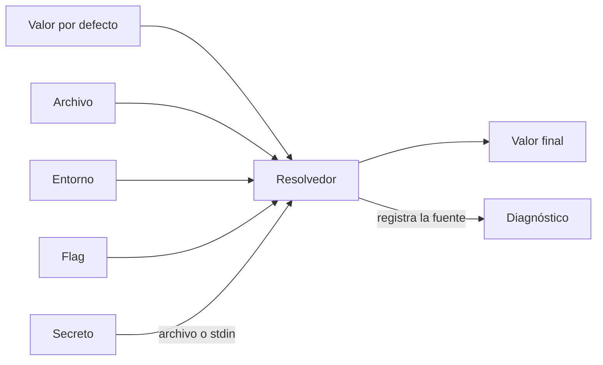
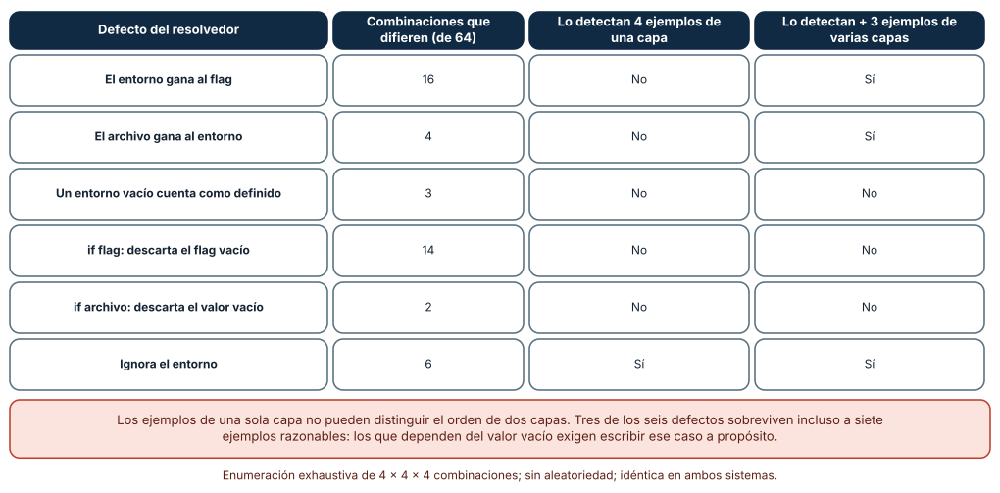
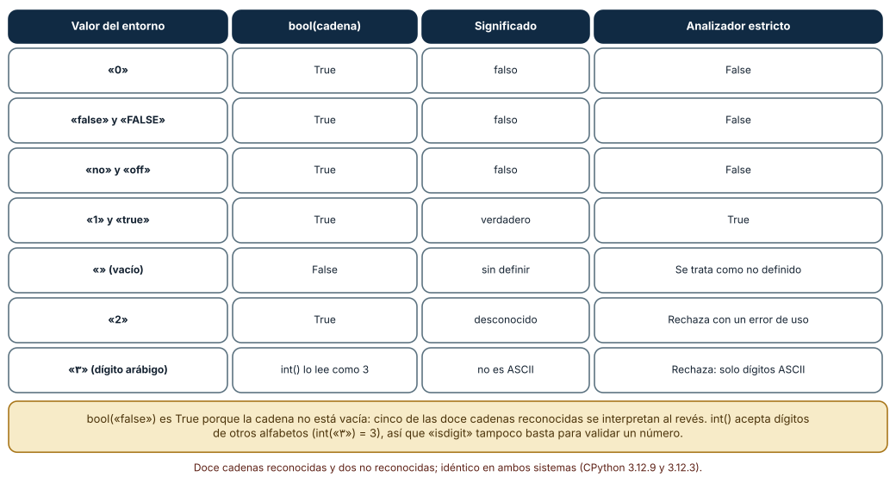
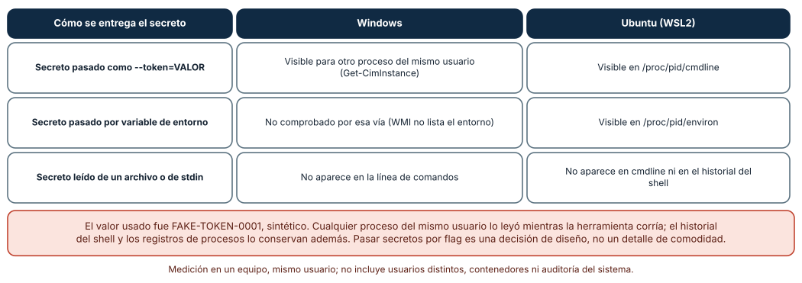

# SE-219 — Configuración, flags, archivos y precedencia

[← SE-218 — Entrada estándar, salida y composición por pipes](https://github.com/vladimiracunadev-create/modern-software-engineering-program/blob/main/classes/part-18-cli-tui-servicios-y-automatizacion/se-218-entrada-estandar-salida-y-composicion-por-pipes/README.md) · [↑ Parte 18](https://github.com/vladimiracunadev-create/modern-software-engineering-program/blob/main/classes/part-18-cli-tui-servicios-y-automatizacion/README.md) · [📚 Índice completo](https://github.com/vladimiracunadev-create/modern-software-engineering-program/blob/main/classes/README.md) · [🌐 Portal](https://vladimiracunadev-create.github.io/modern-software-engineering-program/classes/SE-219.html) · [SE-220 — Códigos de salida, errores y diagnóstico →](https://github.com/vladimiracunadev-create/modern-software-engineering-program/blob/main/classes/part-18-cli-tui-servicios-y-automatizacion/se-220-codigos-de-salida-errores-y-diagnostico/README.md)

## Punto profesional y fundamento pedagógico

**Punto profesional.** La clase existe para decidir de dónde obtiene una herramienta cada valor —valor por defecto, archivo, variable de entorno o flag—, en qué orden se imponen y cómo se comprueba que ese orden se cumple también en los casos extraños: valores vacíos, booleanos escritos de varias formas y secretos.

**Por qué aparece aquí.** Se sitúa después de **Entrada estándar, salida y composición por pipes** (`SE-218`) y antes de **Códigos de salida, errores y diagnóstico** (`SE-220`): `SE-218` dejó una herramienta que se compone; esta clase pregunta cómo se parametriza sin editar código y sin filtrar secretos, y deja los errores de configuración que `SE-220` convertirá en códigos.

**Error conceptual que debe corregir.** Creer que «el flag manda sobre el entorno y el entorno sobre el archivo» es una regla que se escribe una vez y listo. La regla se rompe en los bordes: un entorno vacío, un flag que vale cero, una cadena «false» interpretada como verdadera.

**Secuencia de aprendizaje.** Antes de leer la solución, predices cuántas de 64 combinaciones de valores distinguen un resolvedor correcto de seis defectuosos y qué defectos sobreviven a siete ejemplos razonables; después interpretas cadenas booleanas y observas dónde queda visible un secreto sintético. La secuencia usa predicción, explicación propia, contraste y recuperación. [ICAP](https://icap.education.asu.edu/research) distingue participación de construcción de conocimiento; [How People Learn II](https://nap.nationalacademies.org/catalog/24783/how-people-learn-ii-learners-contexts-and-cultures) exige conectar conocimiento previo, contexto y transferencia; la [práctica de recuperación](https://pubmed.ncbi.nlm.nih.gov/16507066/) respalda producir de nuevo la explicación tras una demora; y [Education for Life and Work](https://nap.nationalacademies.org/resource/13398/dbasse_084153.pdf) exige devolución que explique la causa del error.

**Evidencia de aprendizaje.** `config-log.md` con la tabla de precedencia, la enumeración de las 64 combinaciones, la tabla de interpretación de booleanos y la medición de visibilidad del secreto. Debe contener predicción previa, observación, explicación causal, contraejemplo y qué hallazgo haría cambiar la precedencia.

**Límite de la conclusión.** Los resolvedores defectuosos son seis variaciones escritas por el autor; la enumeración cubre cuatro valores por capa y no todos los tipos de dato; el secreto es un texto falso, y solo se miró la visibilidad para un proceso del mismo usuario, no para usuarios distintos, contenedores ni auditoría.

### Trazabilidad fuente → afirmación

| Fuente primaria u oficial | Afirmación que respalda | Lo que no prueba |
|---|---|---|
| [The Twelve-Factor App: Config](https://12factor.net/config) | Recomienda guardar la configuración que varía entre despliegues en variables de entorno, separada del código. | No ordena la precedencia entre entorno, archivo y flags. |
| [XDG Base Directory Specification](https://specifications.freedesktop.org/basedir-spec/latest/) | Define dónde buscan los programas su configuración, datos y caché en sistemas tipo Unix. | No aplica a Windows. |
| [NO_COLOR](https://no-color.org/) | Propone que una variable `NO_COLOR` no vacía desactive el color. | Es una convención de la comunidad, no un estándar formal. |
| [Console Do Not Track](https://consoledonottrack.com/) | Propone que `DO_NOT_TRACK=1` indique que no se envíe telemetría. | Es una convención voluntaria. |
| [CWE-214: Invocation of Process Using Visible Sensitive Information](https://cwe.mitre.org/data/definitions/214.html) | Describe el riesgo de pasar información sensible en argumentos de procesos visibles a otros. | No mide la exposición en un sistema concreto. |

## Antes de empezar

Recupera lo aprendido en `SE-218`: el destino de un flujo cambia el comportamiento. La pregunta activa es: **¿qué valor usa la herramienta cuando hay más de una fuente y quién puede ver ese valor?**

## Prerrequisitos

- Haber completado `SE-218` o poder explicar qué flujo usa cada salida de `notas`.
- Python 3.11 o posterior y un terminal; PowerShell o bash para definir variables de entorno.
- Trabajar con la herramienta `notas` y valores sintéticos (`FAKE-…`), nunca con credenciales reales.

## Problema auténtico

`notas exportar` tiene un formato por defecto (`csv`), un archivo `config.ini` del equipo (`formato = json`), una variable `NOTAS_FORMATO` que define el guion nocturno y un flag `--formato`. Un día, en producción se exporta en JSON cuando el guion pide CSV: el entorno estaba definido pero vacío, y el código lo trataba como «definido» y lo ignoraba. Otro día, `NOTAS_VERBOSE=false` activa los mensajes detallados. Y el token de acceso al sistema de entregas, pasado como `--token=…`, aparece en la lista de procesos.

## Objetivos observables

Al terminar podrás:

1. enumerar las fuentes de configuración de una herramienta, su orden y qué cuenta como «valor definido»;
2. detectar con una enumeración exhaustiva qué defectos de precedencia sobreviven a un conjunto de ejemplos;
3. interpretar booleanos y números del entorno de forma estricta y rechazar lo ambiguo;
4. decidir cómo recibe la herramienta un secreto y justificar por qué no es un flag;
5. escribir una prueba que fije la precedencia en los casos de borde.

## Mapa conceptual



El mapa se lee como un embudo: cuatro fuentes entran a un resolvedor que devuelve un valor y, idealmente, la fuente de la que salió; el secreto entra por un canal que no es visible a otros procesos. No describe el orden de lectura de los archivos.

## Temas y por qué importan

| Tema | Por qué cambia una decisión profesional | Evidencia mínima |
|---|---|---|
| Fuentes de configuración | Cada fuente tiene un dueño distinto (persona, equipo, despliegue). | Predicción, traza causal y contraejemplo de **Fuentes** en `config-log.md` |
| Precedencia | El orden decide quién gana cuando hay conflicto. | Predicción, traza causal y contraejemplo de **Precedencia** en `config-log.md` |
| Valores vacíos y falsy | El borde decide si «vacío» significa «no definido» o «definido en vacío». | Predicción, traza causal y contraejemplo de **Vacíos** en `config-log.md` |
| Tipos del entorno | Todo en el entorno es texto; interpretarlo mal invierte significados. | Predicción, traza causal y contraejemplo de **Tipos** en `config-log.md` |
| Secretos | Un secreto en un argumento es visible a otros procesos. | Predicción, traza causal y contraejemplo de **Secretos** en `config-log.md` |

## Conceptos y decisiones

### 1. Cuatro fuentes con dueños distintos

El valor por defecto lo decide quien escribe la herramienta; el archivo, el equipo que la despliega o la persona que la usa; la variable de entorno, quien lanza el proceso (un guion, un contenedor, un planificador); el flag, quien escribe esa invocación concreta. La precedencia habitual —flag, entorno, archivo, valor por defecto— sigue una idea: lo más cercano a la invocación manda sobre lo más general. Pero es una convención de diseño, no un hecho: algunas herramientas ponen el archivo del sistema por encima del de usuario, o permiten fijar valores que ningún flag puede cambiar (política de seguridad). Lo importante es decidirlo y escribirlo.

### 2. «Definido» necesita una definición

La pregunta que más defectos produce no es «quién gana» sino «¿qué cuenta como presente?». Tres respuestas tienen consecuencias distintas: `None`/ausente, cadena vacía y valor «falso» (`0`, `false`). Un flag `--limite 0` es una orden válida —cero filas— que un `if flag:` descarta. Una variable `NOTAS_FORMATO=` (vacía) suele ser un intento de «no definir», pero `is not None` la trata como definida. Una cadena vacía en el archivo puede significar «déjalo vacío» o «no tocar». Cada herramienta debe elegir y documentar; la prueba debe incluir el vacío y el cero.

### 3. El entorno es texto

Una variable de entorno es una cadena. `bool("false")` es `True` porque la cadena no está vacía; `int("٣")` es `3` porque Python acepta dígitos de otros alfabetos; `"1" == 1` es falso. Una interpretación estricta define el conjunto de formas aceptadas —por ejemplo, `1/true/yes/on` y `0/false/no/off`, sin distinguir mayúsculas ni espacios— y **rechaza el resto con un error de uso** en lugar de adivinar. Adivinar convierte un error de tipeo en un comportamiento silencioso.

### 4. Hacer visible de dónde salió el valor

Un resolvedor que devuelve solo el valor obliga a depurar a ciegas. Uno que devuelve también la fuente («formato = json, de `config.ini` línea 3») ahorra horas. Una opción `--print-config` o un modo detallado que muestre la configuración efectiva y su origen, **enmascarando los secretos**, es una herramienta de diagnóstico y también la mejor documentación de la precedencia.

### 5. Los secretos no viajan como flags

Un argumento de línea de comandos es visible para otros procesos del mismo usuario mientras el proceso corre, y queda en el historial del shell y en los registros de procesos. Una variable de entorno es visible para los procesos hijos y, en algunos sistemas, para quien pueda leer `/proc`. Las alternativas más seguras son un archivo con permisos restringidos, la entrada estándar o un gestor de secretos; incluso ellas dependen del resto de la seguridad del sistema. La decisión de diseño es qué canal ofrece la herramienta, y no ofrecer el peor.

### Seis resolvedores defectuosos frente a 64 combinaciones

Cada capa admite cuatro valores: ausente, cadena vacía, `"0"` y `"x"`; con tres capas opcionales (archivo, entorno y flag) hay 4 × 4 × 4 = **64 combinaciones**. Se escribió el resolvedor correcto (flag, entorno no vacío, archivo, valor por defecto) y seis variantes defectuosas, y se contó en cuántas combinaciones difieren: el entorno que gana al flag, **16**; el archivo que gana al entorno, **4**; el entorno vacío que cuenta como definido, **3**; `if flag:` que descarta el valor vacío, **14**; `if archivo:` que descarta el vacío, **2**; el que ignora el entorno, **6**. Cuatro ejemplos de una sola capa (todo ausente y un valor «x» en cada capa por separado) **solo detectan uno** de los seis (el que ignora el entorno); sumando tres ejemplos que combinan capas se detectan dos más (el entorno sobre el flag y el archivo sobre el entorno). Los otros tres **sobreviven a siete ejemplos razonables** y solo caen si se escribe el caso vacío.

```python
def resolver(flag, entorno, archivo, defecto):
    if flag is not None: return flag            # un 0 explícito es un valor
    if entorno not in (None, ""): return entorno  # vacío = no definido
    if archivo is not None: return archivo
    return defecto
```



**Cómo leer la figura.** Cada fila es un defecto; la segunda columna cuenta combinaciones de 64 donde su resultado difiere del correcto; las dos últimas dicen si una suite lo detecta. **Dónde deja de valer:** la enumeración es posible porque hay tres capas y cuatro valores; con diez capas habría un millón de combinaciones, y habría que muestrear o razonar por partes. Los seis defectos son una selección del autor, no un catálogo.

### «false» es verdadero

Se evaluaron catorce cadenas posibles de una variable booleana. De las doce que tienen un significado claro (`1`, `0`, `true`, `false`, `True`, `FALSE`, `yes`, `no`, `on`, `off`, `" true "` y `"TRUE\n"`), **`bool(cadena)` interpretó mal cinco**: `0`, `false`, `FALSE`, `no` y `off` dieron `True`. Un analizador estricto aceptó las ocho formas canónicas (sin importar mayúsculas ni espacios) y **rechazó dos**: la cadena vacía (tratada como no definida) y `"2"`. Además, `int("٣")` devolvió 3 y `int("１２")` devolvió 12: `str.isdigit()` también acepta ese dígito, mientras que `isascii()` lo rechaza.



**Cómo leer la figura.** Cada fila es una cadena; la columna de `bool()` muestra el error silencioso y la última, la decisión del analizador estricto. **Dónde deja de valer:** el conjunto aceptado (`yes`/`on`…) es una decisión del diseño, no un estándar; otra herramienta puede aceptar menos o distinguir mayúsculas. Lo que no cambia es que «no reconocido» debe ser un error de uso y no un valor por defecto.

### Dónde se ve un secreto

Se lanzó un proceso hijo con el argumento `--token=FAKE-TOKEN-0001` y la variable `SECRETO_SINTETICO=FAKE-ENV-0002`, y otro proceso del mismo usuario intentó leerlos. En **Windows**, `Get-CimInstance Win32_Process` mostró la línea de comandos completa, con el valor falso; la variable de entorno no se comprobó por esa vía (WMI no la lista). En **Ubuntu (WSL2)**, `/proc/pid/cmdline` mostró el argumento y `/proc/pid/environ` mostró la variable. Un secreto leído de un archivo o de la entrada estándar no aparece en ninguno de los dos.



**Cómo leer la figura.** Cada fila es un canal; las columnas son lo que se observó en cada sistema desde un segundo proceso del mismo usuario. **Dónde deja de valer:** solo se probó el mismo usuario; hay sistemas que restringen `/proc` (`hidepid`) o que aíslan procesos, y otros usuarios o administradores pueden ver más. La medición demuestra la exposición posible, no la que existe en tu entorno.

## Definiciones de trabajo

- **precedencia:** orden en que se consultan las fuentes de configuración cuando hay más de una para el mismo valor.
- **valor definido:** valor que una fuente aporta según el criterio documentado (presente, no vacío, etc.).
- **configuración efectiva:** valor final de cada opción tras aplicar la precedencia, con su fuente.
- **interpretación estricta:** conversión de texto a tipo que rechaza lo no reconocido en vez de adivinar.
- **secreto:** valor cuya divulgación da acceso o daña a alguien: contraseñas, tokens, claves.

Las definiciones son operativas para la herramienta `notas`. No convierten términos con historia más amplia en sinónimos y deben contrastarse con la documentación primaria enlazada al final.

## Ejemplo mínimo

El fragmento resuelve el formato con las cuatro capas. Antes de ejecutarlo, predice el resultado de la tercera llamada.

```python
def resolver(flag, entorno, archivo, defecto="csv"):
    if flag is not None: return flag
    if entorno not in (None, ""): return entorno
    if archivo is not None: return archivo
    return defecto

assert resolver(None, None, None) == "csv"
assert resolver(None, None, "json") == "json"
assert resolver(None, "", "json") == "json"      # entorno vacío = no definido
assert resolver("csv", "json", "json") == "csv"
```

La tercera afirmación pasa porque el entorno vacío se trata como no definido. Cambia la condición a `entorno is not None` y observa qué falla; registra versión y salida.

## Ejemplo profesional

`notas` carga el archivo de usuario (`~/.config/notas/config.ini` o el equivalente de Windows), después el del proyecto, lee las variables con prefijo `NOTAS_`, interpreta los booleanos con el analizador estricto y aplica los flags. El comando `notas config --efectiva` imprime cada opción con su valor y su fuente, con los secretos enmascarados. El token se lee de un archivo (`--token-file`) o de la entrada estándar; no existe `--token`. Una prueba parametrizada ejecuta las 64 combinaciones contra el resolvedor y compara con una tabla escrita a mano para los casos de borde; otra confirma que `--token` no es un flag aceptado.

Compara el caso normal con un entorno vacío, un `--limite 0` y un archivo con BOM. La configuración es apropiada cuando esos tres casos tienen una fila en la tabla de precedencia; es peligrosa cuando solo se ha probado «todo ausente» y «todo definido».

## Práctica guiada

1. Lista las fuentes de configuración de `notas` y quién es el dueño de cada una.
2. Escribe el resolvedor y la tabla de precedencia, y decide qué cuenta como «definido».
3. Enumera las 64 combinaciones y compara con seis resolvedores defectuosos.
4. Predice cuántos defectos detectan cuatro ejemplos de una capa; añade tres de varias capas y recalcula.
5. Interpreta catorce cadenas con `bool()` y con el analizador estricto y registra las diferencias.
6. Lanza un proceso hijo con un secreto falso y comprueba qué ve otro proceso en cada sistema.
7. Implementa `notas config --efectiva` con enmascarado de secretos y pide a otra persona que deduzca la precedencia solo de su salida.

## Ejercicios

1. **Cuarta capa:** añade una capa «política del sistema» que ningún flag pueda cambiar; extiende la enumeración y cuenta cuántas combinaciones cambian de resultado.
2. **Valores numéricos:** diseña la interpretación estricta de `NOTAS_LIMITE` (entero entre 0 y 10 000) y enumera diez entradas que debe rechazar, incluidos los dígitos no ASCII.
3. **Enmascarado:** escribe una prueba que garantice que `--efectiva` nunca imprime un valor de una opción marcada como secreta, ni siquiera en un mensaje de error.
4. **Fuente en el error:** cuando un valor es inválido, el mensaje debe decir de qué fuente vino; implementa y prueba el caso de un `config.ini` con `formato = xml`.

## Reto verificable

Entrega `config-log.md` con la tabla de precedencia, la enumeración de 64 combinaciones, la tabla de interpretación de catorce cadenas y la medición de visibilidad del secreto. Se aprueba si otra persona ejecuta el código desde un checkout limpio, obtiene los mismos conteos (16, 4, 3, 14, 2 y 6; cinco booleanos mal interpretados) y puede señalar qué caso de borde añadiría. No se aprueba por el número de fuentes soportadas ni por una cobertura de líneas.

## Caso conductor

La herramienta `notas` es el caso conductor de la Parte 18. Esta clase deja su resolvedor, su tabla de precedencia, el analizador estricto y la regla del secreto. `SE-220` convertirá los errores de configuración en códigos de salida con significado. Cambia después un solo detalle, la precedencia entre archivo y entorno, y revisa qué guiones, pruebas y documentación dependían del orden anterior.

## Preguntas frecuentes

### ¿Por qué el flag gana al entorno y no al revés?

Por cercanía a la invocación: quien escribe el flag lo hace ahora, para esta ejecución. Pero es una convención. Algunas herramientas ponen primero una política administrativa; lo esencial es que el orden esté escrito, probado y visible en la configuración efectiva.

### ¿Un entorno vacío es «no definido» o «definido en vacío»?

Depende de la herramienta, y por eso hay que decidirlo. Tratarlo como no definido permite desactivar una variable heredada sin tocar el entorno completo; tratarlo como definido permite fijar un valor vacío a propósito. Se documenta y se prueba en ambos sentidos.

### ¿Es peor el secreto en una variable de entorno que en un archivo?

Tienen exposiciones distintas: el entorno lo heredan los procesos hijos y es legible en `/proc` en Linux; un archivo depende de sus permisos y de dónde se guarde. Ninguno es seguro por sí mismo; el archivo con permisos restringidos o la entrada estándar son, en general, las opciones más prudentes.

### ¿Hay que soportar todas las fuentes?

No: cada fuente añade combinaciones que probar y explicar. Una herramienta pequeña puede ofrecer solo flags y valores por defecto, y añadir fuentes cuando alguien las necesita.

## Fallo controlado y diagnóstico

Reproduce el fallo clásico de la clase: **un entorno vacío que sobrescribe el archivo**. Usa el resolvedor con `entorno is not None`.

Registra síntoma, entrada mínima, hipótesis, observación que descarta cada hipótesis, causa, corrección y prueba de regresión. **Síntoma:** `NOTAS_FORMATO=` (vacío) en el guion y `formato = json` en el archivo producen un valor vacío y un error de formato desconocido. **Hipótesis rivales:** (a) el archivo no se leyó; (b) el archivo tiene el valor mal escrito; (c) el entorno vacío se consideró definido. **Prueba:** con la variable eliminada funciona; con una vacía, falla. **Conclusión:** la causa es la tercera. **Regresión:** trata el vacío como no definido, añade las tres combinaciones (entorno vacío con y sin archivo, con flag) a la tabla y a la prueba. No cambies a la vez la definición de «definido» y el orden.

## Errores comunes y cómo corregirlos

| Síntoma | Causa probable | Corrección |
|---|---|---|
| `--limite 0` se ignora | Se escribió `if flag:` en lugar de `is not None` | Distinguir ausencia de valor falso |
| `NOTAS_VERBOSE=false` activa el modo detallado | Se aplicó `bool()` a una cadena | Interpretación estricta con conjunto cerrado |
| Una variable vacía anula el archivo | El vacío se trata como definido | Decidir y probar el vacío en cada capa |
| Nadie sabe de dónde salió un valor | El resolvedor no informa de la fuente | Mostrar la configuración efectiva con su origen |
| El token aparece en la lista de procesos | Se aceptó como flag | Leerlo de un archivo o de la entrada estándar |

## Entorno y archivos clave

```text
work/SE-219/
├── README.md
├── notas_config.py
├── experimentos/
│   ├── precedencia.py
│   ├── booleanos.py
│   └── secreto.py
└── evidence/config-log.md
```

El `README` declara plataforma, versión de Python y comandos. Los experimentos usan solo la biblioteca estándar (`itertools`, `subprocess`, `os`) y se ejecutaron con CPython 3.12.9 en Windows 11 y 3.12.3 en Ubuntu bajo WSL2: la enumeración y la interpretación de booleanos fueron idénticas; la visibilidad del secreto difirió por el mecanismo de lectura (WMI y `/proc`), que se informa como medición de un equipo.

## Seguridad, ética y accesibilidad

- los secretos usados en pruebas son siempre sintéticos (`FAKE-…`); nunca ejecutes los experimentos con credenciales reales;
- el modo de configuración efectiva debe enmascarar los secretos y no imprimirlos ni siquiera en un error;
- los archivos de configuración con secretos necesitan permisos restringidos y no deben versionarse;
- documenta la precedencia con una tabla y una alternativa textual para lectores de pantalla;
- respeta las licencias de las bibliotecas de configuración y atribuye las adaptaciones.

## Puente hacia el trabajo con agentes

Un agente al que se le pide «lee la configuración del entorno» suele escribir `os.environ.get("X")` y `bool(...)`, y sugiere `--token` por comodidad. Pídele que enumere las fuentes y su orden, que escriba la tabla de precedencia con los casos vacío y cero, que interprete los booleanos de forma estricta y que no acepte secretos como flags. Revisa especialmente si tradujo `false` en `True`, si dejó un valor sin fuente en el diagnóstico y si registró el token en algún mensaje.

## Transferencia

Traslada el experimento a otra herramienta (por ejemplo, un cliente de despliegue con región, perfil y token): enumera las capas, decide qué cuenta como definido, escribe la tabla de combinaciones y mide qué defectos sobreviven. La transferencia está lograda cuando puedes explicar qué parte de la decisión dependía del número de capas y cuál del tipo de valor, no cuando la tabla se parece.

## Evaluación y evidencia

| Criterio | Evidencia para aprobar |
|---|---|
| comprensión | explicación de qué cuenta como «definido» y por qué importa |
| corrección | enumeración reproducible de 64 combinaciones y de catorce cadenas |
| diseño | tabla de precedencia con casos de borde y política de secretos |
| diagnóstico | reproducción del fallo «entorno vacío» con regresión |
| incertidumbre | declaración de qué defectos quedan fuera de las 64 combinaciones |
| reproducibilidad | versiones, comandos, salida y límites declarados |

## Fuentes

- [The Twelve-Factor App: Config](https://12factor.net/config) — configuración fuera del código; autoridad: guía de autores, de uso extendido.
- [XDG Base Directory Specification](https://specifications.freedesktop.org/basedir-spec/latest/) — ubicaciones de configuración en sistemas tipo Unix; autoridad: freedesktop.org.
- [NO_COLOR](https://no-color.org/) — convención para desactivar el color; autoridad: proyecto comunitario.
- [Console Do Not Track](https://consoledonottrack.com/) — convención `DO_NOT_TRACK`; autoridad: proyecto comunitario.
- [CWE-214: Invocation of Process Using Visible Sensitive Information](https://cwe.mitre.org/data/definitions/214.html) — riesgo de secretos en argumentos; autoridad: MITRE.
- [Python: `argparse`](https://docs.python.org/3/library/argparse.html) — valores por defecto y tipos de los argumentos; autoridad: documentación de Python.

Cada fuente respalda el mecanismo indicado; ninguna demuestra que la precedencia de `notas` sea la que el equipo necesita. Esa afirmación depende de quién despliega y de qué se debe poder sobrescribir.

- [Python: `itertools.product`](https://docs.python.org/3/library/itertools.html) — enumeración de las combinaciones.
- [Python: `subprocess`](https://docs.python.org/3/library/subprocess.html) — procesos hijo usados en la medición del secreto.

## Límites y siguiente paso

Se ejecutaron tres experimentos con datos sintéticos en Windows y Ubuntu (WSL2) con resultados idénticos salvo el mecanismo de lectura del secreto. Los seis defectos, los valores de cada capa, el conjunto de booleanos aceptados y el secreto falso son supuestos del autor; no se midió ningún despliegue real. La siguiente clase pregunta qué significa para quien invoca que la configuración o la ejecución fallen: los códigos de salida.

## Glosario

- **precedencia:** orden en que se consultan las fuentes de configuración cuando hay más de una para el mismo valor.
- **valor definido:** valor que una fuente aporta según el criterio documentado.
- **configuración efectiva:** valor final de cada opción tras aplicar la precedencia, con su fuente.
- **interpretación estricta:** conversión de texto a tipo que rechaza lo no reconocido en vez de adivinar.
- **secreto:** valor cuya divulgación da acceso o daña a alguien.

---

[← SE-218 — Entrada estándar, salida y composición por pipes](https://github.com/vladimiracunadev-create/modern-software-engineering-program/blob/main/classes/part-18-cli-tui-servicios-y-automatizacion/se-218-entrada-estandar-salida-y-composicion-por-pipes/README.md) · [↑ Parte 18](https://github.com/vladimiracunadev-create/modern-software-engineering-program/blob/main/classes/part-18-cli-tui-servicios-y-automatizacion/README.md) · [📚 Índice completo](https://github.com/vladimiracunadev-create/modern-software-engineering-program/blob/main/classes/README.md) · [🌐 Portal](https://vladimiracunadev-create.github.io/modern-software-engineering-program/classes/SE-219.html) · [SE-220 — Códigos de salida, errores y diagnóstico →](https://github.com/vladimiracunadev-create/modern-software-engineering-program/blob/main/classes/part-18-cli-tui-servicios-y-automatizacion/se-220-codigos-de-salida-errores-y-diagnostico/README.md)
