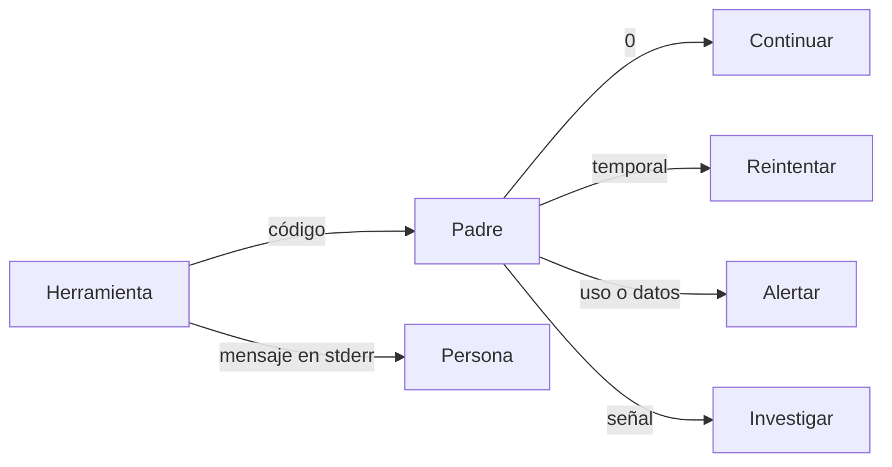
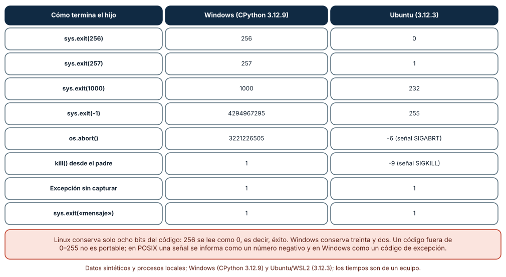
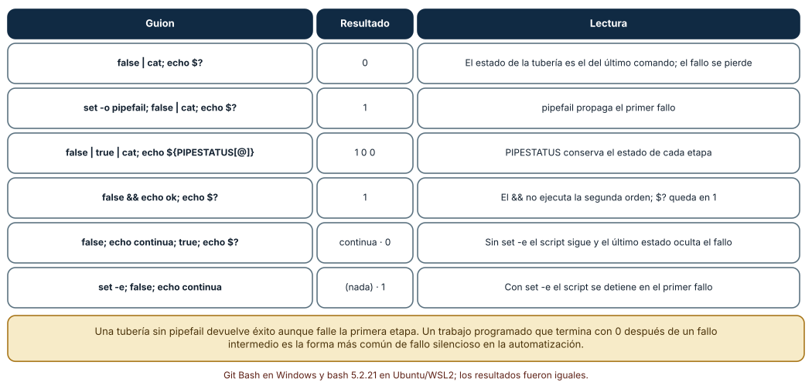
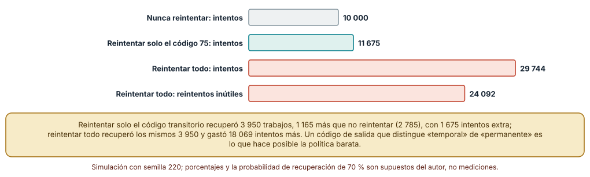

# SE-220 — Códigos de salida, errores y diagnóstico

[← SE-219 — Configuración, flags, archivos y precedencia](https://github.com/vladimiracunadev-create/modern-software-engineering-program/blob/main/classes/part-18-cli-tui-servicios-y-automatizacion/se-219-configuracion-flags-archivos-y-precedencia/README.md) · [↑ Parte 18](https://github.com/vladimiracunadev-create/modern-software-engineering-program/blob/main/classes/part-18-cli-tui-servicios-y-automatizacion/README.md) · [📚 Índice completo](https://github.com/vladimiracunadev-create/modern-software-engineering-program/blob/main/classes/README.md) · [🌐 Portal](https://vladimiracunadev-create.github.io/modern-software-engineering-program/classes/SE-220.html) · [SE-221 — TUI, terminales y accesibilidad →](https://github.com/vladimiracunadev-create/modern-software-engineering-program/blob/main/classes/part-18-cli-tui-servicios-y-automatizacion/se-221-tui-terminales-y-accesibilidad/README.md)

## Punto profesional y fundamento pedagógico

**Punto profesional.** La clase existe para que lo que una herramienta dice al terminar —un número y un mensaje— permita a una persona corregir y a un programa decidir si reintenta, alerta o se detiene, sin confundir éxito con silencio ni fallo permanente con fallo temporal.

**Por qué aparece aquí.** Se sitúa después de **Configuración, flags, archivos y precedencia** (`SE-219`) y antes de **TUI, terminales y accesibilidad** (`SE-221`): `SE-219` dejó errores de configuración con una fuente; esta clase les da un código y un diagnóstico, y deja una tabla de códigos de `notas` que `SE-223` y `SE-224` usarán para decidir reintentos y reanudaciones.

**Error conceptual que debe corregir.** Creer que «un código distinto de cero significa que falló» y «cero significa que salió bien». El código es un número de ocho bits (en Linux) con una convención débil; una tubería sin cuidado devuelve el estado de la última etapa; un código fuera de rango se trunca; y el mensaje no es el contrato.

**Secuencia de aprendizaje.** Antes de leer la solución, predices qué código ve el padre cuando el hijo sale con 256, con −1 o aborta, qué devuelve `false | cat` y cuántos intentos gasta una política que reintenta todo; después lo mides en Windows y en Ubuntu. La secuencia usa predicción, explicación propia, contraste y recuperación. [ICAP](https://icap.education.asu.edu/research) distingue participación de construcción de conocimiento; [How People Learn II](https://nap.nationalacademies.org/catalog/24783/how-people-learn-ii-learners-contexts-and-cultures) exige conectar conocimiento previo, contexto y transferencia; la [práctica de recuperación](https://pubmed.ncbi.nlm.nih.gov/16507066/) respalda producir de nuevo la explicación tras una demora; y [Education for Life and Work](https://nap.nationalacademies.org/resource/13398/dbasse_084153.pdf) exige devolución que explique la causa del error.

**Evidencia de aprendizaje.** `exit-codes-log.md` con la tabla de códigos de `notas`, las tres mediciones (códigos observados por sistema, estados de tubería, política de reintentos) y el diagnóstico de un fallo controlado. Debe contener predicción previa, observación, explicación causal, contraejemplo y qué hallazgo haría cambiar un código.

**Límite de la conclusión.** Los códigos se midieron con CPython y con bash; los trabajos y las probabilidades de la simulación (40 % transitorios, 70 % de recuperación) son supuestos del autor, no datos de un sistema; no se midió ningún planificador ni orquestador real.

### Trazabilidad fuente → afirmación

| Fuente primaria u oficial | Afirmación que respalda | Lo que no prueba |
|---|---|---|
| [POSIX: estado de salida de órdenes](https://pubs.opengroup.org/onlinepubs/9699919799/utilities/V3_chap02.html) | Define el estado de salida de una tubería y de una lista de órdenes, y que 0 indica éxito. | No fija qué significa cada código distinto de cero. |
| [sysexits(3)](https://man.freebsd.org/cgi/man.cgi?query=sysexits) | Propone nombres y valores para códigos como uso incorrecto (64), datos inválidos (65) y fallo temporal (75). | Es una convención de BSD, no un estándar universal. |
| [Python: `sys.exit`](https://docs.python.org/3/library/sys.html) | Documenta que un entero es el código de salida y que un valor no entero se imprime en stderr con código 1. | No describe el recorte que hace cada sistema. |
| [Bash: The Set Builtin](https://www.gnu.org/software/bash/manual/html_node/The-Set-Builtin.html) | Describe `set -e` y la opción `pipefail`. | No resume las excepciones de `set -e`. |
| [Microsoft: `ExitProcess`](https://learn.microsoft.com/en-us/windows/win32/api/processthreadsapi/nf-processthreadsapi-exitprocess) | Define el código de salida de un proceso en Windows como un valor de 32 bits. | No explica cómo lo interpretan los lenguajes. |

## Antes de empezar

Recupera lo aprendido en `SE-219`: un error de configuración debe decir de qué fuente vino. La pregunta activa es: **¿qué decide quien lee el código de salida y qué información necesita para decidirlo bien?**

## Prerrequisitos

- Haber completado `SE-219` o poder explicar cómo `notas` resuelve la configuración.
- Python 3.11 o posterior; bash (Git Bash en Windows o WSL2) para la parte de tuberías.
- Trabajar con la herramienta `notas` y trabajos sintéticos.

## Problema auténtico

El guion nocturno de la plataforma de entregas ejecuta `notas exportar | gzip > notas.gz` y avisa al equipo si el código no es cero. Una noche `notas` falló por datos inválidos y el correo nunca salió: el estado de la tubería fue el de `gzip`. Otro día, un reintento automático repitió 24 veces un trabajo cuyo archivo de entrada no existía. Y una función devolvió 256 como código de error y el guion lo leyó como éxito en Linux.

## Objetivos observables

Al terminar podrás:

1. diseñar una tabla de códigos de salida y distinguir fallos de uso, de datos, temporales y permanentes;
2. predecir qué código observa el padre en Windows y en Linux para valores fuera de 0–255 y para procesos terminados por señal;
3. propagar el fallo de cada etapa de una tubería o de un guion de shell;
4. diseñar mensajes de error con causa, contexto y acción posible, sin datos sensibles;
5. decidir una política de reintentos a partir de los códigos y medir su coste.

## Mapa conceptual



El mapa se lee como un reparto de decisiones: el código llega al padre y decide qué hacer; el mensaje llega a la persona y decide cómo corregir. No describe un orden de ejecución.

## Temas y por qué importan

| Tema | Por qué cambia una decisión profesional | Evidencia mínima |
|---|---|---|
| Convención de códigos | Un vocabulario común permite automatizar sin leer mensajes. | Predicción, traza causal y contraejemplo de **Convención** en `exit-codes-log.md` |
| Portabilidad del código | Windows y Linux no recortan igual; una señal no es un número positivo. | Predicción, traza causal y contraejemplo de **Portabilidad** en `exit-codes-log.md` |
| Tuberías y guiones | El estado de una tubería puede ocultar el fallo de una etapa. | Predicción, traza causal y contraejemplo de **Tuberías** en `exit-codes-log.md` |
| Mensajes de error | Un buen mensaje evita una consulta y no filtra datos. | Predicción, traza causal y contraejemplo de **Mensajes** en `exit-codes-log.md` |
| Reintentos | Reintentar lo permanente gasta recursos y retrasa el aviso. | Predicción, traza causal y contraejemplo de **Reintentos** en `exit-codes-log.md` |

## Conceptos y decisiones

### 1. Un vocabulario pequeño de códigos

El código 0 es éxito en todos los sistemas; el resto es convención. Un vocabulario mínimo y estable suele bastar: 0 éxito; 1 fallo genérico; 2 uso incorrecto (la convención de muchos analizadores); 65 datos de entrada inválidos; 73 conflicto al crear la salida; 75 fallo temporal que puede reintentarse. Los valores 64–78 vienen de `sysexits.h`, una convención de BSD que no es obligatoria, pero que ofrece nombres que ya existen. Lo decisivo es que cada código signifique una decisión distinta para quien lo lee: ¿reintento, aviso, corrección o abandono? Un código que no cambia ninguna decisión no hace falta.

### 2. Rango, truncado y señales

En Linux, el código de salida que ve el padre ocupa ocho bits: `exit(256)` se lee como 0 (éxito), `exit(257)` como 1 y `exit(-1)` como 255. En Windows el código es de treinta y dos bits y se conserva; `exit(-1)` se lee como 4 294 967 295. Cuando un proceso muere por una señal, Python en Linux informa un número negativo (−9 para `SIGKILL`, −6 para `SIGABRT`), mientras que un shell informa 128 + n (137, 134). En Windows no hay señales en ese sentido: un aborto devuelve un código de excepción (`0xC0000409`, 3 221 226 505) y una terminación forzada devuelve el valor que eligió quien la pidió. La consecuencia de diseño: usar solo 0–125, no devolver nunca una expresión sin acotar y documentar que una terminación por señal no es un código.

### 3. Las tuberías ocultan fallos

El estado de una tubería es, por defecto, el de la última orden. `false | cat` devuelve 0. Bash ofrece `set -o pipefail` (el estado es el del último comando que falló) y la variable `PIPESTATUS` (el estado de cada etapa). `set -e` detiene el guion en el primer fallo, con excepciones sutiles (condiciones de `if`, listas con `&&`/`||`). La regla práctica: un guion que automatiza debe activar `pipefail`, comprobar el estado de las etapas críticas y fallar de forma ruidosa. En Python, `subprocess` obliga a mirar el código de cada proceso; una tubería construida a mano necesita leer el de cada etapa.

### 4. El mensaje es para la persona

Un buen mensaje de error contesta tres preguntas: qué falló, por qué (la causa conocida) y qué hacer (la acción). «Error: nota fuera de rango» es peor que «línea 7: la nota 180 está fuera de 0–100; corrige el archivo o usa `--ignorar-invalidas`». Va a stderr, sin trazas por defecto (con una opción de depuración que las muestre), sin colores si no es un terminal, sin datos personales de las filas y con el mismo idioma que la ayuda. El código acompaña al mensaje pero no lo sustituye: el padre lee el código; la persona, el mensaje. Quien escribe un guion no debe depender de una frase.

### 5. Reintentar es una decisión de diseño

Reintentar un fallo transitorio (un tiempo de espera, un recurso ocupado) suele funcionar; reintentar uno permanente (un archivo que no existe, un dato inválido) gasta recursos y retrasa el aviso. La herramienta es quien mejor sabe cuál es cuál, y el código es el canal para decirlo: un código «temporal» (75) invita a reintentar; los demás, no. Un padre que reintenta todo con un código genérico consume intentos y puede agravar un problema (más carga sobre un servicio caído). Reintentar con espera creciente y límite, y registrar cada intento, es lo mínimo. `SE-222` y `SE-223` retoman la espera creciente.

### Lo que el padre ve: la misma salida, dos números

Trece formas de terminar un proceso hijo, vistas desde el padre con `subprocess`. `sys.exit(0)`, `1`, `2` y `255` dieron lo mismo en los dos sistemas. `sys.exit(256)` devolvió **256 en Windows y 0 en Ubuntu**; `257`, **257 y 1**; `1000`, **1000 y 232**; `-1`, **4 294 967 295 y 255**. `os.abort()` devolvió **3 221 226 505 en Windows y −6 en Ubuntu**; terminar al hijo con `kill()` devolvió **1 y −9**. Una excepción sin capturar y `sys.exit('mensaje')` devolvieron 1 en ambos.

```python
r = subprocess.run([sys.executable, "-c", "import sys; sys.exit(256)"])
print(r.returncode)   # Windows: 256 · Ubuntu: 0 (¡éxito!)
```



**Cómo leer la figura.** Cada fila es una forma de terminar; las dos últimas columnas son lo que lee el padre en cada sistema. **Dónde deja de valer:** son los resultados de un intérprete concreto; otro lenguaje, un shell intermedio o un contenedor pueden traducir los códigos de otra manera (un shell convierte una señal en 128 + n). El hallazgo transferible es que un código fuera de 0–125 no es portable.

### Tuberías y guiones: seis casos de bash

Seis guiones de bash, con los mismos resultados en Git Bash (Windows) y en bash 5.2.21 (Ubuntu): `false | cat; echo $?` imprimió **0** —el fallo desapareció—; con `set -o pipefail`, **1**; `false | true | cat` con `PIPESTATUS`, **1 0 0**; `false && echo ok; echo $?`, **1**; sin `set -e`, `false; echo continua; true; echo $?` imprimió «continua» y **0**; con `set -e`, `false; echo continua` no imprimió nada y salió con **1**.



**Cómo leer la figura.** Cada fila es un guion y su resultado; la última columna explica qué mecanismo produjo ese resultado. **Dónde deja de valer:** se probó bash 5.2; otros shells (`sh`, PowerShell, `cmd`) tienen reglas distintas, y `set -e` tiene excepciones que estos seis casos no cubren.

### El coste de reintentarlo todo

Una simulación con 10 000 trabajos y cinco tipos de fallo (40 % temporales, 15 % de uso, 20 % de datos, 10 % de conflicto y 15 % internos); un trabajo temporal se recupera con probabilidad 0,7 en cada intento y los demás nunca. Tres políticas con un máximo de 4 intentos: **nunca reintentar** recuperó 2 785 trabajos con 10 000 intentos; **reintentar solo el código 75** recuperó **3 950** con **11 675** intentos y ningún reintento inútil; **reintentar todo** recuperó los mismos 3 950 con **29 744** intentos, de los que **24 092** fueron reintentos inútiles sobre fallos permanentes.



**Cómo leer la figura.** Las barras son intentos totales; la coral final aisla los reintentos que no podían tener éxito. **Dónde deja de valer:** los porcentajes y la probabilidad de recuperación son supuestos del autor; con otra mezcla las cifras cambian, pero el mecanismo no: sin un código que distinga lo temporal, la única forma de recuperar lo recuperable es reintentar lo irrecuperable.

## Definiciones de trabajo

- **código de salida:** entero con que un proceso informa al padre cómo terminó; 0 es éxito por convención.
- **fallo temporal:** fallo que puede desaparecer si se repite más tarde sin cambiar la entrada.
- **fallo permanente:** fallo que se repetirá igual mientras no cambien la entrada o el entorno.
- **estado de una tubería:** valor de salida de una tubería, por defecto el de su última etapa.
- **mensaje accionable:** mensaje que dice qué falló, por qué y qué hacer.

Las definiciones son operativas para la herramienta `notas`. No convierten términos con historia más amplia en sinónimos y deben contrastarse con la documentación primaria enlazada al final.

## Ejemplo mínimo

El fragmento muestra la pérdida del fallo en una tubería. Antes de ejecutarlo, predice los dos números.

```bash
false | cat; echo "sin pipefail: $?"
set -o pipefail; false | cat; echo "con pipefail: $?"
```

Debería imprimir 0 y 1. Repite con `true | false` y con `PIPESTATUS`; registra la versión de bash y la salida.

## Ejemplo profesional

`notas` documenta cinco códigos: 0 éxito; 2 uso incorrecto; 65 datos inválidos (con número de línea); 73 no se pudo crear la salida; 75 fallo temporal (recurso ocupado, tiempo de espera). Nunca devuelve un valor mayor que 125. Los mensajes van a stderr, en una línea, con la causa y la acción; la opción `--debug` añade la traza. El guion nocturno activa `set -euo pipefail`, comprueba cada etapa con `PIPESTATUS` cuando hay una tubería y reintenta solo ante el código 75, con tres intentos y espera creciente. Una prueba de contrato ejecuta la herramienta con una entrada por cada código y falla si alguno devuelve otro.

Compara el caso normal con un archivo inexistente, una nota inválida y un directorio de salida bloqueado. El diseño es apropiado cuando los tres producen códigos distintos con acciones distintas; es peligroso cuando los tres devuelven 1 y el único modo de distinguirlos es leer el mensaje.

## Práctica guiada

1. Escribe la tabla de códigos de `notas` con la decisión que habilita cada uno.
2. Predice el código que verá el padre para diez formas de terminar un hijo; mídelo en cada sistema.
3. Ejecuta los seis guiones de bash y registra cuáles pierden el fallo.
4. Reescribe el guion nocturno con `pipefail` y comprobación de etapas.
5. Escribe tres mensajes de error con causa, contexto y acción, sin datos de las filas.
6. Simula 10 000 trabajos con tres políticas de reintento y registra intentos útiles e inútiles.
7. Pide a otra persona que deduzca qué hacer ante cada código solo desde `exit-codes-log.md`.

## Ejercicios

1. **Código 256:** escribe una función `salir(n)` que garantice que el código esté entre 0 y 125 y falle de forma ruidosa si recibe otro valor; pruébala en los dos sistemas.
2. **Etapas:** convierte `notas exportar | gzip > notas.gz` en un guion que falle si cualquiera de las dos etapas falla y que conserve el código de la primera.
3. **Mensaje:** reescribe «Error: formato» para cuatro causas distintas y decide cuál va a stderr, cuál se registra y cuál necesita `--debug`.
4. **Política:** con una mezcla de 10 % temporales y 90 % permanentes, calcula cómo cambia el coste de «reintentar todo» y qué ocurre con el valor de distinguir.

## Reto verificable

Entrega `exit-codes-log.md` con la tabla de códigos, la medición de trece formas de terminar, los seis guiones de bash y la simulación de reintentos con su semilla (220). Se aprueba si otra persona ejecuta el código desde un checkout limpio, obtiene las mismas cifras de la simulación (2 785, 3 950, 11 675 y 29 744) y los mismos números de la tabla de códigos en su sistema, y puede señalar qué código no es portable. No se aprueba por el número de códigos ni por mensajes extensos.

## Caso conductor

La herramienta `notas` es el caso conductor de la Parte 18. Esta clase deja su tabla de códigos, el manejo de tuberías en su guion nocturno y una política de reintentos. `SE-221` pasará de los códigos a la interfaz que ve una persona en un terminal, y `SE-222` a los procesos de larga vida que mueren y se reinician. Cambia después un solo detalle, el código de «datos inválidos» de 65 a 1, y revisa qué decisiones del guion dependían de la distinción.

## Preguntas frecuentes

### ¿Por qué no basta con devolver 1 para todo error?

Porque quien lee el código no puede decidir: reintentar un fallo permanente es inútil y no reintentar uno temporal pierde trabajo. Distinguir cuesta una tabla de cinco filas.

### ¿Se puede devolver cualquier número del 0 al 255?

En Linux sí, pero algunos tienen significados reservados en shells (126, 127, 128+n). Elegir entre 1 y 125 evita confusiones.

### ¿Los códigos de `sysexits` son obligatorios?

No. Son un vocabulario ya existente que ahorra inventar nombres. Si se adoptan, se documentan; si no, se define una tabla propia con la misma disciplina.

### ¿Un `try/except` global que imprime «error» y sale con 1 es suficiente?

Es mejor que una traza y peor que una clasificación: pierde la causa y, con ella, la decisión de reintentar. Una clasificación mínima de excepciones esperadas en códigos distintos añade pocas líneas.

## Fallo controlado y diagnóstico

Reproduce el fallo clásico de la clase: **un fallo que desaparece en una tubería**. Usa `notas exportar archivo-inexistente | gzip > salida.gz` sin `pipefail`.

Registra síntoma, entrada mínima, hipótesis, observación que descarta cada hipótesis, causa, corrección y prueba de regresión. **Síntoma:** el guion termina con 0 y `salida.gz` está vacío. **Hipótesis rivales:** (a) `gzip` falló al escribir; (b) la herramienta no leyó el archivo; (c) el estado de la tubería es el de `gzip`. **Prueba:** ejecutar la primera etapa sola devuelve 65 con el mensaje esperado; con `PIPESTATUS` se ve `65 0`. **Conclusión:** la causa es la tercera. **Regresión:** activar `pipefail`, comprobar `PIPESTATUS` y añadir una prueba que alimente una entrada inexistente y exija un código distinto de 0. No cambies a la vez el guion y la herramienta.

## Errores comunes y cómo corregirlos

| Síntoma | Causa probable | Corrección |
|---|---|---|
| El guion termina con 0 tras un fallo intermedio | El estado de la tubería es el de la última etapa | `set -o pipefail` y `PIPESTATUS` |
| El código 256 se lee como éxito en Linux | Se devolvió un valor fuera de 0–255 | Limitar a 0–125 y comprobar el rango |
| El reintento repite un fallo permanente | Todos los errores devuelven el mismo código | Distinguir un código temporal del resto |
| El mensaje filtra datos de una fila | Se interpoló la fila completa | Mencionar línea y columna, no el contenido |
| El guion depende de una frase del error | El mensaje se trató como contrato | Documentar códigos y probarlos |

## Entorno y archivos clave

```text
work/SE-220/
├── README.md
├── codigos.md
├── experimentos/
│   ├── codigos_por_sistema.py
│   ├── tuberias.sh
│   └── reintentos.py
└── evidence/exit-codes-log.md
```

El `README` declara plataforma, versiones de Python y de bash, semilla (220) y comandos. Los experimentos usan solo la biblioteca estándar y bash (Git Bash en Windows, bash 5.2.21 en Ubuntu bajo WSL2) y se ejecutaron con CPython 3.12.9 y 3.12.3: la simulación y las tuberías fueron idénticas; los códigos fuera de 0–255 y los de señales difirieron por sistema, que es el resultado.

## Seguridad, ética y accesibilidad

- un mensaje de error no debe incluir secretos, rutas internas ni contenido de filas: terminan en registros de CI y en tickets;
- un código «éxito» después de un fallo parcial es un riesgo de integridad: declara qué significa éxito parcial o no lo permitas;
- los reintentos automáticos sobre servicios ajenos deben tener límite y espera creciente para no agravar una caída;
- los mensajes deben poder leerse sin color y por un lector de pantalla: una línea, sin símbolos decorativos;
- respeta las convenciones que adoptes y atribuye las fuentes (`sysexits`) en la documentación.

## Puente hacia el trabajo con agentes

Un agente al que se le pide «haz que el script falle si algo va mal» suele añadir `set -e` y un `try/except` que imprime y sale con 1, sin `pipefail`, sin distinguir causas y sin documentar los códigos. Pídele la tabla de códigos con la decisión de cada uno, que active `pipefail`, que pruebe cada código con una entrada y que evite devolver valores fuera de 0–125. Revisa especialmente si trató todo error como reintentable y si el mensaje incluye contenido de la entrada.

## Transferencia

Traslada el experimento a otra herramienta (por ejemplo, un cliente de copias que usa un planificador): diseña su tabla de cinco códigos, mide qué ve el planificador ante cada uno y decide qué política de reintento corresponde. La transferencia está lograda cuando puedes explicar qué parte de la tabla dependía del dominio y cuál era una convención general, no cuando los números se parecen.

## Evaluación y evidencia

| Criterio | Evidencia para aprobar |
|---|---|
| comprensión | explicación de por qué un código fuera de rango no es portable |
| corrección | tabla reproducible de códigos por sistema y de estados de tubería |
| diseño | tabla de códigos con la decisión de cada uno y mensajes accionables |
| diagnóstico | reproducción del fallo «fallo oculto en tubería» con regresión |
| incertidumbre | declaración de qué supuestos tiene la simulación de reintentos |
| reproducibilidad | versiones, semilla, comandos y límites declarados |

## Fuentes

- [POSIX: Shell Command Language](https://pubs.opengroup.org/onlinepubs/9699919799/utilities/V3_chap02.html) — estado de salida de órdenes y tuberías; autoridad: The Open Group.
- [sysexits(3)](https://man.freebsd.org/cgi/man.cgi?query=sysexits) — vocabulario de códigos 64–78; autoridad: proyecto FreeBSD.
- [Python: `sys.exit`](https://docs.python.org/3/library/sys.html) — código de salida de un proceso Python; autoridad: documentación de Python.
- [Bash: The Set Builtin](https://www.gnu.org/software/bash/manual/html_node/The-Set-Builtin.html) — `set -e` y `pipefail`; autoridad: proyecto GNU.
- [Microsoft: `ExitProcess`](https://learn.microsoft.com/en-us/windows/win32/api/processthreadsapi/nf-processthreadsapi-exitprocess) — código de salida en Windows; autoridad: Microsoft Learn.
- [Command Line Interface Guidelines](https://clig.dev/) — mensajes de error y códigos de salida; autoridad: guía de autores.

Cada fuente respalda el mecanismo indicado; ninguna demuestra que la tabla de `notas` sea la adecuada para un planificador concreto. Esa afirmación depende de quién lee los códigos.

- [Python: `subprocess`](https://docs.python.org/3/library/subprocess.html) — `returncode` observado por el padre.
- [Python: `random`](https://docs.python.org/3/library/random.html) — semilla de la simulación.

## Límites y siguiente paso

Se ejecutaron tres experimentos en Windows y Ubuntu (WSL2) con resultados idénticos salvo los códigos fuera de 0–255 y los de señales. Los porcentajes de fallo, la probabilidad de recuperación y el máximo de intentos son supuestos del autor; no se midió ningún planificador, ni PowerShell ni `cmd`. La siguiente clase pasa de la salida de un proceso a la interfaz que una persona usa en un terminal.

## Glosario

- **código de salida:** entero con que un proceso informa al padre cómo terminó; 0 es éxito por convención.
- **fallo temporal:** fallo que puede desaparecer si se repite más tarde sin cambiar la entrada.
- **fallo permanente:** fallo que se repetirá igual mientras no cambien la entrada o el entorno.
- **estado de una tubería:** valor de salida de una tubería, por defecto el de su última etapa.
- **mensaje accionable:** mensaje que dice qué falló, por qué y qué hacer.

---

[← SE-219 — Configuración, flags, archivos y precedencia](https://github.com/vladimiracunadev-create/modern-software-engineering-program/blob/main/classes/part-18-cli-tui-servicios-y-automatizacion/se-219-configuracion-flags-archivos-y-precedencia/README.md) · [↑ Parte 18](https://github.com/vladimiracunadev-create/modern-software-engineering-program/blob/main/classes/part-18-cli-tui-servicios-y-automatizacion/README.md) · [📚 Índice completo](https://github.com/vladimiracunadev-create/modern-software-engineering-program/blob/main/classes/README.md) · [🌐 Portal](https://vladimiracunadev-create.github.io/modern-software-engineering-program/classes/SE-220.html) · [SE-221 — TUI, terminales y accesibilidad →](https://github.com/vladimiracunadev-create/modern-software-engineering-program/blob/main/classes/part-18-cli-tui-servicios-y-automatizacion/se-221-tui-terminales-y-accesibilidad/README.md)
