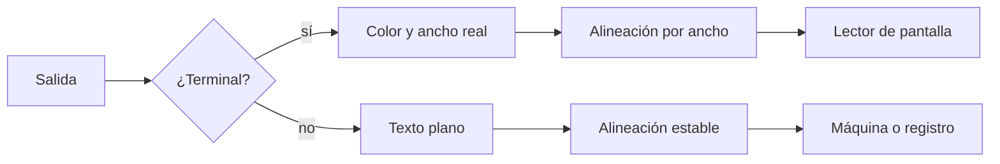
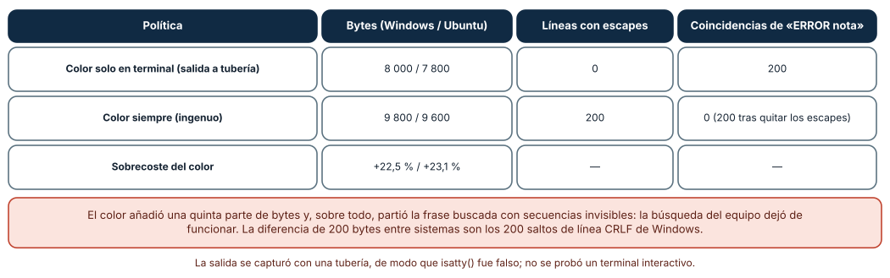
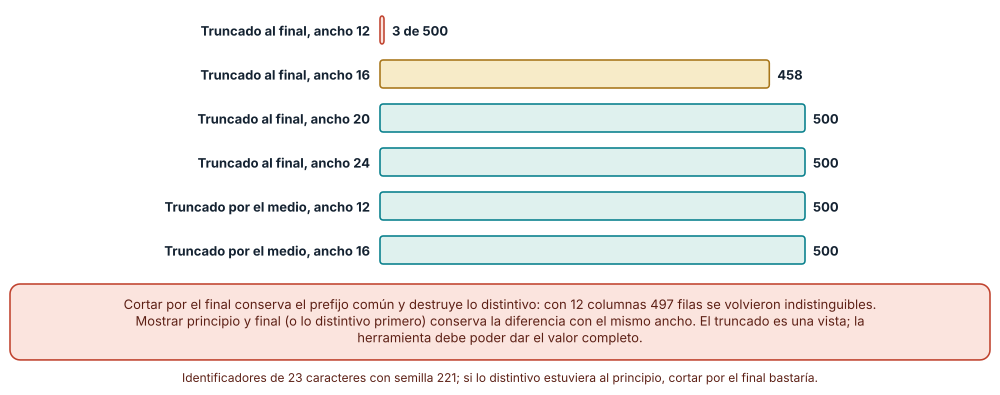
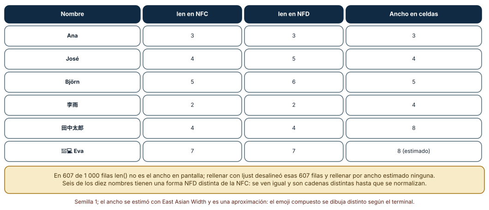

# SE-221 — TUI, terminales y accesibilidad

[← SE-220 — Códigos de salida, errores y diagnóstico](https://github.com/vladimiracunadev-create/modern-software-engineering-program/blob/main/classes/part-18-cli-tui-servicios-y-automatizacion/se-220-codigos-de-salida-errores-y-diagnostico/README.md) · [↑ Parte 18](https://github.com/vladimiracunadev-create/modern-software-engineering-program/blob/main/classes/part-18-cli-tui-servicios-y-automatizacion/README.md) · [📚 Índice completo](https://github.com/vladimiracunadev-create/modern-software-engineering-program/blob/main/classes/README.md) · [🌐 Portal](https://vladimiracunadev-create.github.io/modern-software-engineering-program/classes/SE-221.html) · [SE-222 — Daemons, servicios y ciclo de vida →](https://github.com/vladimiracunadev-create/modern-software-engineering-program/blob/main/classes/part-18-cli-tui-servicios-y-automatizacion/se-222-daemons-servicios-y-ciclo-de-vida/README.md)

## Punto profesional y fundamento pedagógico

**Punto profesional.** La clase existe para diseñar la interfaz que una persona ve en un terminal —color, anchos, tablas, caracteres— de modo que siga siendo legible en un registro de CI, con un lector de pantalla, en un terminal estrecho y con nombres que no son ASCII, y que nunca corrompa la salida que otro programa va a leer.

**Por qué aparece aquí.** Se sitúa después de **Códigos de salida, errores y diagnóstico** (`SE-220`) y antes de **Daemons, servicios y ciclo de vida** (`SE-222`): `SE-220` dejó mensajes que dicen qué hacer; esta clase pregunta cómo se presentan cuando quien los lee es una persona con un terminal real, y deja una política de presentación para `notas` (color solo en terminales, anchos, alineación) que `SE-228` incluirá en el contrato.

**Error conceptual que debe corregir.** Creer que un terminal es una pantalla de ancho fijo con color y que el texto mide lo que mide `len()`. Un terminal es un dispositivo con capacidades opcionales; la salida puede ir a un archivo; el ancho de un carácter no es su longitud; y una animación es ruido para un lector de pantalla.

**Secuencia de aprendizaje.** Antes de leer la solución, predices cuántos bytes añade el color a un informe, cuántos identificadores siguen siendo distintos tras truncarlos y cuántas filas se desalinean si se rellena con `len()`; después lo mides. La secuencia usa predicción, explicación propia, contraste y recuperación. [ICAP](https://icap.education.asu.edu/research) distingue participación de construcción de conocimiento; [How People Learn II](https://nap.nationalacademies.org/catalog/24783/how-people-learn-ii-learners-contexts-and-cultures) exige conectar conocimiento previo, contexto y transferencia; la [práctica de recuperación](https://pubmed.ncbi.nlm.nih.gov/16507066/) respalda producir de nuevo la explicación tras una demora; y [Education for Life and Work](https://nap.nationalacademies.org/resource/13398/dbasse_084153.pdf) exige devolución que explique la causa del error.

**Evidencia de aprendizaje.** `tui-log.md` con la política de presentación de `notas`, las tres mediciones (color en tuberías, truncado de identificadores, alineación con caracteres anchos) y la lista de casos accesibles comprobados. Debe contener predicción previa, observación, explicación causal, contraejemplo y qué hallazgo haría cambiar la política.

**Límite de la conclusión.** Se midió con una tubería, no con un terminal interactivo real; las 500 identificaciones y los nombres son sintéticos; el ancho de los caracteres se estimó con la propiedad `East Asian Width` y no con las tablas de un terminal concreto; no se probó ningún lector de pantalla.

### Trazabilidad fuente → afirmación

| Fuente primaria u oficial | Afirmación que respalda | Lo que no prueba |
|---|---|---|
| [ECMA-48: Control Functions for Coded Character Sets](https://ecma-international.org/publications-and-standards/standards/ecma-48/) | Define las secuencias de control (escape) que usan los terminales para color y cursor. | No dice qué terminales las soportan. |
| [NO_COLOR](https://no-color.org/) | Propone que el software desactive el color cuando la variable `NO_COLOR` no está vacía. | Es una convención voluntaria. |
| [Unicode UAX #11: East Asian Width](https://www.unicode.org/reports/tr11/) | Define la propiedad que clasifica caracteres como estrechos, anchos o ambiguos en celdas de terminal. | No resuelve secuencias de emoji ni depende de la fuente. |
| [Unicode UAX #15: Normalization Forms](https://www.unicode.org/reports/tr15/) | Define NFC y NFD: dos secuencias distintas pueden representar el mismo texto. | No dice cuál debe usar una herramienta. |
| [W3C: WCAG 2.2](https://www.w3.org/TR/WCAG22/) | Criterios de accesibilidad: no depender solo del color, contraste, alternativas textuales. | Está escrita para contenido web, no para terminales. |

## Antes de empezar

Recupera lo aprendido en `SE-220`: un mensaje debe decir qué falló y qué hacer. La pregunta activa es: **¿quién lo lee, con qué dispositivo y qué pierde si el dispositivo no es el que imaginé?**

## Prerrequisitos

- Haber completado `SE-220` o poder explicar qué va a stdout y qué a stderr en `notas`.
- Python 3.11 o posterior; un terminal real para observar, y herramientas para redirigir.
- Trabajar con identificadores y nombres sintéticos.

## Problema auténtico

El informe de `notas validar` usa color para marcar errores en rojo. En un registro de CI aparecen secuencias como `[31mERROR[0m` y el buscador de texto del equipo no encuentra «ERROR nota»; en un terminal de 60 columnas los identificadores de entrega se cortan y dos filas distintas parecen iguales; y la tabla de estudiantes con nombres como «李雨» y «José» queda torcida. Una persona con un lector de pantalla oye «corchete, tres, uno, eme» antes de cada línea.

## Objetivos observables

Al terminar podrás:

1. decidir cuándo emitir color y cuándo no, con detección de terminal y respeto de convenciones de entorno;
2. medir el coste del color en bytes y en búsquedas, y quitarlo con seguridad;
3. truncar identificadores sin perder la capacidad de distinguirlos;
4. alinear columnas con nombres que incluyen acentos, ideogramas y emoji;
5. verificar que la información no depende solo del color ni de una animación.

## Mapa conceptual



El mapa se lee de arriba abajo: la primera pregunta es si el destino es un terminal; de ahí cuelgan color, ancho y alineación; en cualquier caso, hay una persona o un programa al final. No describe el flujo interno de una biblioteca de interfaz.

## Temas y por qué importan

| Tema | Por qué cambia una decisión profesional | Evidencia mínima |
|---|---|---|
| Detección de terminal | El color en una tubería contamina la salida que otro programa lee. | Predicción, traza causal y contraejemplo de **Detección** en `tui-log.md` |
| Ancho disponible | Truncar mal oculta diferencias entre filas. | Predicción, traza causal y contraejemplo de **Ancho** en `tui-log.md` |
| Texto Unicode | `len()` no mide el ancho en pantalla; dos formas pueden ser el mismo texto. | Predicción, traza causal y contraejemplo de **Unicode** en `tui-log.md` |
| Accesibilidad | El color y la animación no deben ser el único canal. | Predicción, traza causal y contraejemplo de **Accesibilidad** en `tui-log.md` |
| Interfaz interactiva | Una TUI debe tener una versión no interactiva equivalente. | Predicción, traza causal y contraejemplo de **TUI** en `tui-log.md` |

## Conceptos y decisiones

### 1. Un terminal es un dispositivo opcional

Un terminal interpreta secuencias de escape (ECMA-48) para color, movimiento del cursor y borrado. Pero la salida de una herramienta puede ir a un archivo, a una tubería, a un contenedor sin terminal o a un registro de CI. La regla de oro: **emitir secuencias de control solo cuando la salida es un terminal** (`isatty()`), respetar `NO_COLOR` y ofrecer un interruptor explícito (`--color=auto|siempre|nunca`). Quien fuerza el color «siempre» acepta que su salida no es texto plano.

### 2. El ancho no se supone

Un terminal tiene un número de columnas que cambia cuando la persona redimensiona la ventana. Python lo consulta con `shutil.get_terminal_size()`, que prueba primero las variables `COLUMNS` y `LINES`, luego el terminal y, si no hay ninguno, usa un valor por defecto (80×24). Eso significa que **un informe redirigido a un archivo se formatea para 80 columnas** salvo que se diga otra cosa. La decisión de diseño: qué hace la herramienta cuando no cabe (envolver, truncar, ocultar columnas) y qué garantiza (que dos filas distintas sigan siendo distintas).

### 3. Truncar sin destruir la diferencia

Los identificadores suelen compartir un prefijo (`ent-2026-04-…`); cortar por el final conserva el prefijo y pierde justo lo que distingue. Cortar por el medio (conservar principio y final) o mostrar la parte distintiva primero mantiene la diferencia. Y la herramienta debe ofrecer una forma de obtener el valor completo (`--ancho-completo`, `--formato json`). Una columna truncada es una vista, no un dato.

### 4. Los caracteres no miden un carácter

Un acento puede ser un carácter (`é`, NFC) o dos (`e` más un diacrítico combinante, NFD): `len` da 1 o 2 para lo mismo que se ve. Un ideograma ocupa dos celdas; un emoji compuesto con un unión de ancho cero ocupa dos y varias posiciones de código. Alinear con `ljust()` y `len()` produce columnas torcidas. La alineación correcta usa el **ancho en pantalla** (propiedad `East Asian Width`, ignorando los combinantes y los de ancho cero) y, antes de comparar o agrupar, normaliza a una forma (NFC) para que «José» sea siempre la misma cadena.

### 5. Accesibilidad: no depender del color ni del movimiento

Un lector de pantalla lee texto: un rojo no dice nada y una barra de progreso que se reescribe con retorno de carro se lee como ruido. Las pautas de accesibilidad (WCAG) piden no usar el color como único medio de información y ofrecer alternativas: un prefijo textual («ERROR», «AVISO»), un modo sin animación y una salida estructurada equivalente. Una TUI (interfaz de texto interactiva) añade teclado, foco y, a menudo, redibujado continuo: debe poder usarse solo con el teclado, anunciar los cambios y tener un equivalente no interactivo para guiones.

### El color cuesta un 22 % y rompe la búsqueda

Un informe de 200 líneas, cada una con la palabra `ERROR` en rojo. Con detección de terminal y la salida a una tubería, el hijo emitió **8 000 bytes** (Windows; 7 800 en Ubuntu) y **ninguna secuencia de escape**; forzando el color, emitió **9 800 bytes** (9 600) y 200 líneas con escapes: un sobrecoste de **22,5 %** (23,1 %). Buscar la cadena `ERROR nota` en la salida con color encontró **0 coincidencias**, porque las secuencias de escape quedan en medio; después de quitar los escapes con una expresión regular encontró **200**.

```python
usar_color = sys.stdout.isatty() and "NO_COLOR" not in os.environ
rojo, fin = ("\x1b[31m", "\x1b[0m") if usar_color else ("", "")
print(f"entrega {i:03d}: {rojo}ERROR{fin} nota fuera de rango")
```



**Cómo leer la figura.** Cada fila es una política; las columnas son lo que observa un programa que lee la salida. **Dónde deja de valer:** el informe es sintético y el color afecta solo a una palabra; con más color el sobrecoste crece. No se probó un terminal interactivo real: `isatty()` fue falso en todas las ejecuciones porque la salida se capturó.

### Quinientos identificadores, cuatro anchos

Se generaron 500 identificadores sintéticos de 23 caracteres con la forma `ent-2026-04-0123-a1b2c3`. Truncados por el final con una marca de elipsis: con un ancho de **12** quedaron **3 distintos** de 500; con **16**, **458**; con **20** y **24**, los **500**. Truncados por el medio (principio y final): **500 distintos** en los cuatro anchos. En cuanto al ancho disponible, con la variable `COLUMNS=40` y la salida redirigida, `shutil.get_terminal_size()` devolvió **40 columnas**; con `COLUMNS=200`, **200**; sin variable y sin terminal, **80×24**.



**Cómo leer la figura.** Cada barra cuenta cuántos de 500 identificadores siguen siendo distintos tras el truncado; la coral es la pérdida grave. **Dónde deja de valer:** los identificadores comparten un prefijo largo por construcción; si lo distintivo estuviera al principio, cortar por el final bastaría. El resultado enseña a mirar dónde está la información distintiva, no a preferir siempre el medio.

### Nombres que no miden lo mismo

Se generaron 1 000 filas con diez nombres (`Ana`, `José`, `María`, `李雨`, `田中太郎`, `Renée`, `Ñuble`, `Zoë`, un emoji compuesto con «Eva»…), la mitad en NFD. Para **607 de las 1 000 filas** `len()` difiere del ancho en pantalla estimado. `José` mide 4 en NFC y **5 en NFD**; `李雨` mide 2 por `len` y **4 celdas**; `田中太郎`, 4 y **8**. Seis de los diez nombres tienen una forma NFD distinta de la NFC (son iguales a la vista y distintos como cadena); normalizar a NFC los iguala. Rellenar con `ljust(12)` desalineó **607** filas; rellenar por ancho estimado, **0**.



**Cómo leer la figura.** Cada fila es un nombre; las tres columnas numéricas son tres «medidas» del mismo texto. **Dónde deja de valer:** el ancho se estimó con `East Asian Width` y descartando los combinantes y la unión de ancho cero; el emoji compuesto aparece con 8 celdas pero los terminales lo muestran con anchos distintos (algunos como dos emoji), así que el 0 de desalineaciones es una estimación y no una garantía. Para una alineación exacta hay que probar el terminal de destino.

## Definiciones de trabajo

- **terminal (TTY):** dispositivo interactivo de texto; `isatty()` indica si un flujo está conectado a uno.
- **secuencia de escape:** par de caracteres de control con que un terminal recibe órdenes de color o de cursor.
- **ancho en pantalla:** número de celdas de terminal que ocupa un texto, distinto de su longitud en caracteres.
- **normalización Unicode:** conversión de un texto a una forma canónica (NFC o NFD) para poder compararlo.
- **TUI:** interfaz de usuario de texto interactiva que redibuja el terminal y recibe teclado.

Las definiciones son operativas para la herramienta `notas`. No convierten términos con historia más amplia en sinónimos y deben contrastarse con la documentación primaria enlazada al final.

## Ejemplo mínimo

El fragmento mide longitud y ancho de dos formas de la misma palabra. Antes de ejecutarlo, predice los cuatro números.

```python
import unicodedata

def ancho(s):
    return sum(0 if unicodedata.combining(c) else 2 if unicodedata.east_asian_width(c) in "WF" else 1 for c in s)

for forma in ("NFC", "NFD"):
    t = unicodedata.normalize(forma, "José")
    print(forma, len(t), ancho(t))
```

Debería imprimir 4 y 4 en NFC, y 5 y 4 en NFD: la longitud cambia y el ancho no. Añade `"李雨"` y registra la versión.

## Ejemplo profesional

`notas validar` decide su presentación así: color solo si `isatty()` y no existe `NO_COLOR`, con `--color` como interruptor; prefijos textuales (`ERROR`, `AVISO`, `OK`) que repiten lo que dice el color; ancho tomado de `shutil.get_terminal_size()` y respetado por una función de tabla que alinea por ancho en pantalla; identificadores truncados por el medio con una opción `--ancho-completo`; texto normalizado a NFC al leer; y un modo `--sin-animacion` (por defecto cuando no hay terminal) que escribe una línea por evento. Una prueba ejecuta el informe en tubería y falla si encuentra una secuencia de escape; otra compara la tabla con nombres NFC y NFD y exige igual alineación.

Compara el caso normal con un terminal de 40 columnas, un nombre en NFD y una salida a un archivo. La presentación es apropiada cuando los tres producen una tabla legible y un archivo sin escapes; es peligrosa cuando solo se ha probado en el terminal ancho de quien la escribió.

## Práctica guiada

1. Escribe la política de presentación de `notas`: cuándo hay color, qué ancho se usa y qué se trunca.
2. Predice el sobrecoste del color y comprueba cuántas coincidencias da una búsqueda con y sin escapes.
3. Genera 500 identificadores con prefijo compartido y mide cuántos siguen siendo distintos al truncarlos por el final y por el medio.
4. Comprueba qué ancho devuelve `get_terminal_size()` con y sin `COLUMNS`, y con la salida redirigida.
5. Construye una tabla con nombres NFC, NFD, ideogramas y un emoji compuesto, y alinea por ancho.
6. Revisa que cada color tenga su prefijo textual y que no haya animación sin alternativa.
7. Pide a otra persona que reconstruya la política solo desde `tui-log.md` y la compare con la salida real.

## Ejercicios

1. **`--color=auto`:** implementa los tres modos y una prueba que ejecute cada uno con la salida en terminal simulado y en tubería (con `NO_COLOR` definido y sin definir).
2. **Ancho de columna:** diseña una tabla que, con 40 columnas, oculte columnas de menor prioridad en lugar de truncar el identificador; justifica la prioridad.
3. **Normalización:** muestra que dos grupos de estudiantes que difieren solo en NFC y NFD se cuentan como distintos antes de normalizar y como iguales después.
4. **Lector de pantalla:** reescribe una línea con color y barra de progreso como texto plano que se pueda leer en voz alta y evalúa qué información se pierde.

## Reto verificable

Entrega `tui-log.md` con la política de presentación, las tres mediciones (sobrecoste y búsqueda, 500 identificadores en cuatro anchos, 1 000 filas con nombres) y una lista de comprobaciones de accesibilidad. Se aprueba si otra persona ejecuta el código desde un checkout limpio, obtiene las mismas cifras (200 y 0 coincidencias, 3/458/500/500 distintos, 607 filas) y puede señalar qué parte de la política depende del terminal. No se aprueba por usar una biblioteca de interfaz ni por el número de colores.

## Caso conductor

La herramienta `notas` es el caso conductor de la Parte 18. Esta clase deja su política de presentación: color condicionado, prefijos textuales, ancho consultado, truncado por el medio, normalización y modo sin animación. `SE-222` pasará de procesos que terminan a procesos que viven mucho tiempo y escriben registros. Cambia después un solo detalle, el ancho por defecto de 80 a 120 cuando no hay terminal, y revisa qué informes archivados y pruebas dependían del valor.

## Preguntas frecuentes

### ¿Hay que evitar el color por completo?

No: el color ayuda a escanear, siempre que no sea el único canal y no contamine la salida de un archivo o de una tubería. La regla es emitirlo solo cuando es útil y comprobar que la información se mantiene sin él.

### ¿Por qué `isatty()` es falso en un contenedor o en CI?

Porque la salida no está conectada a un terminal interactivo. Hay entornos de CI que sí interpretan color; para esos existe el interruptor explícito. La detección automática es la opción prudente por defecto.

### ¿Normalizar a NFC cambia lo que escribió la persona?

No cambia el texto visible, pero sí los puntos de código. Se normaliza para comparar y agrupar; si el dato debe conservarse tal cual, se guarda el original y se compara con la normalizada.

### ¿Vale la pena una TUI para una herramienta interna?

Cuando la tarea es exploratoria (revisar una cola, navegar entre decenas de elementos) sí; cuando es de ejecución repetible, una CLI con salida estructurada es más automatizable. Una TUI debe tener siempre una versión no interactiva equivalente.

## Fallo controlado y diagnóstico

Reproduce el fallo clásico de la clase: **escapes de color en un archivo de registro**. Usa el informe con el color forzado y busca `ERROR nota`.

Registra síntoma, entrada mínima, hipótesis, observación que descarta cada hipótesis, causa, corrección y prueba de regresión. **Síntoma:** `grep` no encuentra «ERROR nota» en el registro, aunque el informe lo muestra en pantalla. **Hipótesis rivales:** (a) el informe no escribió el error; (b) la codificación del archivo es otra; (c) hay secuencias de escape en medio de la frase. **Prueba:** mostrar el archivo con una vista de bytes revela `ESC [31m` antes de «ERROR». **Conclusión:** la causa es la tercera. **Regresión:** condicionar el color a `isatty()` y `NO_COLOR`, añadir el interruptor `--color` y una prueba que ejecute el informe en tubería y falle si encuentra el carácter de escape. No cambies a la vez el color y el ancho.

## Errores comunes y cómo corregirlos

| Síntoma | Causa probable | Corrección |
|---|---|---|
| Aparecen secuencias de escape en un archivo | El color no depende del destino | `isatty()`, `NO_COLOR` y `--color` |
| Dos filas distintas parecen iguales | Se truncó por el final un prefijo compartido | Truncar por el medio o mostrar primero lo distintivo |
| La tabla sale torcida con acentos o ideogramas | Se alineó con `len()` | Alinear por ancho en pantalla y normalizar |
| El mismo nombre aparece dos veces | Una forma NFC y otra NFD | Normalizar a NFC antes de comparar |
| Un lector de pantalla lee símbolos y progreso | La información va en color o animación | Prefijos textuales y modo sin animación |

## Entorno y archivos clave

```text
work/SE-221/
├── README.md
├── presentacion.py
├── experimentos/
│   ├── color.py
│   ├── truncado.py
│   └── ancho.py
└── evidence/tui-log.md
```

El `README` declara plataforma, versión de Python, semillas (221 y 1) y comandos. Los experimentos usan solo la biblioteca estándar (`unicodedata`, `shutil`, `subprocess`) y se ejecutaron con CPython 3.12.9 en Windows 11 y 3.12.3 en Ubuntu bajo WSL2: la medición de truncado, de anchos y de alineación fue idéntica; los bytes del informe difirieron en 200 por los saltos de línea (8 000 y 7 800 bytes), que es el resultado.

## Seguridad, ética y accesibilidad

- no incluyas datos personales en los identificadores que se truncan: el truncado es una vista, no una anonimización;
- un lector de pantalla debe poder obtener cada mensaje como texto lineal; evita dibujos hechos con símbolos y barras que se reescriben;
- no uses color como único indicador de estado ni combinaciones sin contraste suficiente;
- ofrece un modo sin interacción para quien no pueda usar teclado o terminal interactivo;
- respeta las licencias de las bibliotecas de interfaz de texto y atribuye las adaptaciones.

## Puente hacia el trabajo con agentes

Un agente al que se le pide «hazlo bonito con colores y una barra de progreso» suele añadir secuencias de escape sin comprobar el destino, medir el ancho con `len` y reescribir la línea con retorno de carro. Pídele que condicione el color a `isatty()` y a `NO_COLOR`, que alinee por ancho en pantalla, que ofrezca un modo plano y que pruebe la salida en tubería. Revisa especialmente si la información sigue siendo comprensible sin color y si los registros quedan con caracteres de control.

## Transferencia

Traslada el experimento a otra herramienta con tablas (por ejemplo, un listado de pedidos con direcciones multilingües): define su política de color, ancho y normalización y mide cuántas filas se desalinean con `len()`. La transferencia está lograda cuando puedes explicar qué parte de la política dependía del terminal y cuál del texto, no cuando la tabla se parece.

## Evaluación y evidencia

| Criterio | Evidencia para aprobar |
|---|---|
| comprensión | explicación de por qué `len()` no es el ancho y por qué el color no es el único canal |
| corrección | tres mediciones reproducibles con semilla |
| diseño | política de presentación con modo plano y prefijos textuales |
| diagnóstico | reproducción del fallo «escapes en un registro» con regresión |
| incertidumbre | declaración de que no se probó un terminal ni un lector de pantalla reales |
| reproducibilidad | versiones, semillas, comandos y límites declarados |

## Fuentes

- [ECMA-48: Control Functions for Coded Character Sets](https://ecma-international.org/publications-and-standards/standards/ecma-48/) — secuencias de control de los terminales; autoridad: Ecma International.
- [NO_COLOR](https://no-color.org/) — convención para desactivar el color; autoridad: proyecto comunitario.
- [Unicode UAX #11: East Asian Width](https://www.unicode.org/reports/tr11/) — clasificación de anchos de carácter; autoridad: Consorcio Unicode.
- [Unicode UAX #15: Normalization Forms](https://www.unicode.org/reports/tr15/) — NFC y NFD; autoridad: Consorcio Unicode.
- [W3C: WCAG 2.2](https://www.w3.org/TR/WCAG22/) — pautas de accesibilidad; autoridad: W3C.
- [Python: `unicodedata`](https://docs.python.org/3/library/unicodedata.html) — `normalize`, `combining` y `east_asian_width`; autoridad: documentación de Python.
- [Python: `shutil.get_terminal_size`](https://docs.python.org/3/library/shutil.html) — consulta del ancho del terminal; autoridad: documentación de Python.

Cada fuente respalda el mecanismo indicado; ninguna demuestra que la presentación de `notas` sea accesible para una persona concreta. Esa afirmación depende de probar con quienes la usan.

- [Python: `subprocess`](https://docs.python.org/3/library/subprocess.html) — captura de la salida de un hijo en una tubería.
- [Python: `random`](https://docs.python.org/3/library/random.html) — semilla de los identificadores y nombres sintéticos.

## Límites y siguiente paso

Se ejecutaron tres experimentos con datos sintéticos en Windows y Ubuntu (WSL2) con resultados idénticos salvo el tamaño en bytes. No se probó ningún terminal interactivo, ninguna biblioteca de interfaz de texto ni ningún lector de pantalla; el ancho se estimó con una propiedad Unicode. La siguiente clase pasa de la interfaz de un proceso corto a la de uno que vive mucho tiempo.

## Glosario

- **terminal (TTY):** dispositivo interactivo de texto; `isatty()` indica si un flujo está conectado a uno.
- **secuencia de escape:** par de caracteres de control con que un terminal recibe órdenes de color o de cursor.
- **ancho en pantalla:** número de celdas de terminal que ocupa un texto, distinto de su longitud en caracteres.
- **normalización Unicode:** conversión de un texto a una forma canónica (NFC o NFD) para poder compararlo.
- **TUI:** interfaz de usuario de texto interactiva que redibuja el terminal y recibe teclado.

---

[← SE-220 — Códigos de salida, errores y diagnóstico](https://github.com/vladimiracunadev-create/modern-software-engineering-program/blob/main/classes/part-18-cli-tui-servicios-y-automatizacion/se-220-codigos-de-salida-errores-y-diagnostico/README.md) · [↑ Parte 18](https://github.com/vladimiracunadev-create/modern-software-engineering-program/blob/main/classes/part-18-cli-tui-servicios-y-automatizacion/README.md) · [📚 Índice completo](https://github.com/vladimiracunadev-create/modern-software-engineering-program/blob/main/classes/README.md) · [🌐 Portal](https://vladimiracunadev-create.github.io/modern-software-engineering-program/classes/SE-221.html) · [SE-222 — Daemons, servicios y ciclo de vida →](https://github.com/vladimiracunadev-create/modern-software-engineering-program/blob/main/classes/part-18-cli-tui-servicios-y-automatizacion/se-222-daemons-servicios-y-ciclo-de-vida/README.md)
