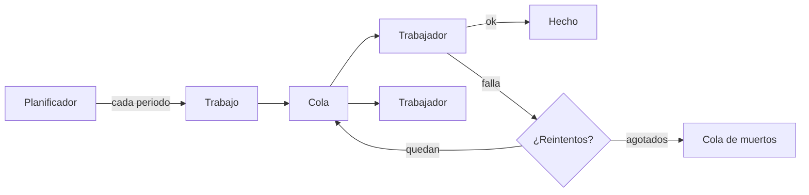
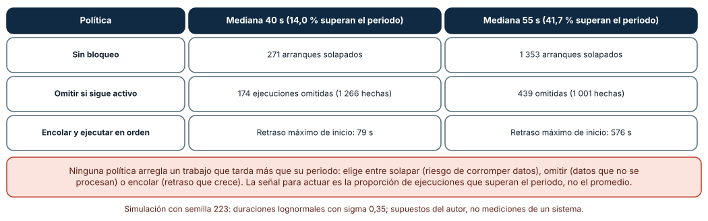
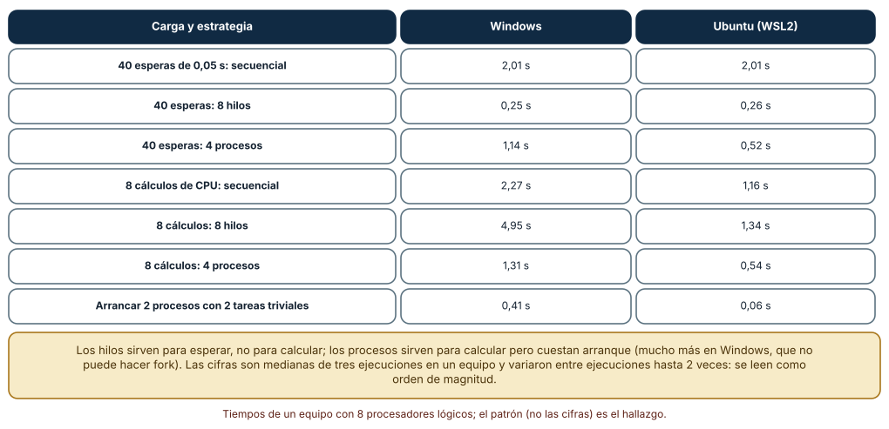
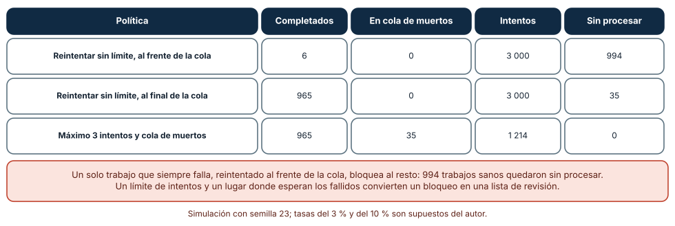

# SE-223 — Schedulers, workers y trabajos por lotes

[← SE-222 — Daemons, servicios y ciclo de vida](https://github.com/vladimiracunadev-create/modern-software-engineering-program/blob/main/classes/part-18-cli-tui-servicios-y-automatizacion/se-222-daemons-servicios-y-ciclo-de-vida/README.md) · [↑ Parte 18](https://github.com/vladimiracunadev-create/modern-software-engineering-program/blob/main/classes/part-18-cli-tui-servicios-y-automatizacion/README.md) · [📚 Índice completo](https://github.com/vladimiracunadev-create/modern-software-engineering-program/blob/main/classes/README.md) · [🌐 Portal](https://vladimiracunadev-create.github.io/modern-software-engineering-program/classes/SE-223.html) · [SE-224 — Automatización idempotente y reanudable →](https://github.com/vladimiracunadev-create/modern-software-engineering-program/blob/main/classes/part-18-cli-tui-servicios-y-automatizacion/se-224-automatizacion-idempotente-y-reanudable/README.md)

## Punto profesional y fundamento pedagógico

**Punto profesional.** La clase existe para decidir cómo se programa, se reparte y se acota el trabajo que un servicio hace por su cuenta —una ejecución periódica, un grupo de trabajadores, una cola de lotes— de modo que un trabajo lento no se pise a sí mismo, un trabajador adecuado haga cada tarea y un trabajo imposible no bloquee a los demás.

**Por qué aparece aquí.** Se sitúa después de **Daemons, servicios y ciclo de vida** (`SE-222`) y antes de **Automatización idempotente y reanudable** (`SE-224`): `SE-222` dejó un servicio que arranca y para con orden; esta clase pregunta qué trabajo hace mientras vive y cómo lo reparte, y deja las políticas de solape, de concurrencia y de fallos que `SE-224` hará repetibles sin duplicar efectos.

**Error conceptual que debe corregir.** Creer que «cada minuto» es una garantía de ejecución y que «más hilos» es más velocidad. Un planificador solo promete arrancar; la duración la decide el trabajo; y los hilos aceleran la espera, no el cálculo.

**Secuencia de aprendizaje.** Antes de leer la solución, predices cuántas ejecuciones se solapan si un trabajo de un minuto tarda a veces más de un minuto, qué estrategia (hilos o procesos) acelera cada carga y qué ocurre con un trabajo que siempre falla colocado al frente de la cola; después lo simulas y lo mides. La secuencia usa predicción, explicación propia, contraste y recuperación. [ICAP](https://icap.education.asu.edu/research) distingue participación de construcción de conocimiento; [How People Learn II](https://nap.nationalacademies.org/catalog/24783/how-people-learn-ii-learners-contexts-and-cultures) exige conectar conocimiento previo, contexto y transferencia; la [práctica de recuperación](https://pubmed.ncbi.nlm.nih.gov/16507066/) respalda producir de nuevo la explicación tras una demora; y [Education for Life and Work](https://nap.nationalacademies.org/resource/13398/dbasse_084153.pdf) exige devolución que explique la causa del error.

**Evidencia de aprendizaje.** `scheduling-log.md` con la política de solape, la comparación de hilos y procesos y la política de fallos, con las cifras y las semillas. Debe contener predicción previa, observación, explicación causal, contraejemplo y qué hallazgo haría cambiar la política.

**Límite de la conclusión.** Las duraciones (lognormales de mediana 40 y 55 s, sigma 0,35) y las tasas de trabajos venenosos (3 %) y transitorios (10 %) son supuestos del autor; los tiempos de hilos y procesos son de un equipo con 8 procesadores lógicos y variaron entre ejecuciones; no se usó cron, un planificador de contenedores ni una cola real.

### Trazabilidad fuente → afirmación

| Fuente primaria u oficial | Afirmación que respalda | Lo que no prueba |
|---|---|---|
| [POSIX: crontab](https://pubs.opengroup.org/onlinepubs/9699919799/utilities/crontab.html) | Define el formato de las entradas periódicas: la hora de arranque, no la duración ni el solape. | No dice qué hacer si la ejecución anterior no ha terminado. |
| [Google SRE: Distributed Periodic Scheduling with Cron](https://sre.google/sre-book/distributed-periodic-scheduling/) | Discute fallos de un cron distribuido: ejecuciones duplicadas, omitidas y el coste de cada decisión. | Describe un sistema de Google, no una herramienta ajena. |
| [Python: `concurrent.futures`](https://docs.python.org/3/library/concurrent.futures.html) | Documenta `ThreadPoolExecutor` y `ProcessPoolExecutor` y su diferencia. | No mide cuál conviene para una tarea concreta. |
| [Python: `multiprocessing`, contextos y métodos de inicio](https://docs.python.org/3/library/multiprocessing.html#contexts-and-start-methods) | Explica `spawn`, `fork` y `forkserver` y cuál usa cada sistema. | No dice cuánto cuesta cada uno. |
| [Amazon SQS: colas de mensajes fallidos](https://docs.aws.amazon.com/AWSSimpleQueueService/latest/SQSDeveloperGuide/sqs-dead-letter-queues.html) | Describe una cola de mensajes fallidos y un número máximo de recepciones. | Es documentación de un producto, no una norma. |

## Antes de empezar

Recupera lo aprendido en `SE-222`: un servicio necesita estados y un cierre ordenado. La pregunta activa es: **¿qué pasa cuando el trabajo programado dura más de lo previsto, cuando hay que repartirlo y cuando uno de los trabajos no se puede completar?**

## Prerrequisitos

- Haber completado `SE-222` o poder explicar qué es drenar.
- Python 3.11 o posterior; un equipo con varios procesadores para la parte de hilos y procesos.
- Trabajar con trabajos sintéticos de `notas`: exportaciones y revisiones simuladas.

## Problema auténtico

Cada minuto, el planificador de la plataforma lanza `notas sincronizar`. Un día de mucha carga la sincronización tarda 70 s y la siguiente arranca encima: ambas escriben el mismo archivo y la exportación sale mezclada. El equipo reparte 40 consultas a la base con ocho hilos y todo va bien; reparte 8 cálculos de informe con ocho hilos y va más lento que en secuencia. Y un archivo de entrada corrupto, reintentado indefinidamente al frente de la cola, deja sin procesar a los demás durante horas.

## Objetivos observables

Al terminar podrás:

1. decidir una política de solape (permitir, omitir o encolar) y medir sus consecuencias con una distribución de duraciones;
2. elegir entre hilos y procesos según la carga y declarar el coste de arranque;
3. diseñar una cola con límite de reintentos y un lugar para los trabajos fallidos;
4. identificar trabajos venenosos y evitar que bloqueen a los demás;
5. escribir un contrato del planificador: qué garantiza, qué no y qué mide.

## Mapa conceptual



El mapa se lee como un flujo: el planificador arranca trabajos, la cola los reparte a trabajadores y un fallo vuelve a la cola hasta agotar los reintentos. No describe la sincronización interna de los trabajadores.

## Temas y por qué importan

| Tema | Por qué cambia una decisión profesional | Evidencia mínima |
|---|---|---|
| Periodicidad y solape | Programar solo promete el arranque; el solape depende de la duración. | Predicción, traza causal y contraejemplo de **Solape** en `scheduling-log.md` |
| Concurrencia: hilos y procesos | La carga decide qué acelera; el arranque tiene coste. | Predicción, traza causal y contraejemplo de **Concurrencia** en `scheduling-log.md` |
| Colas y trabajadores | Desacoplan quien produce trabajo de quien lo hace. | Predicción, traza causal y contraejemplo de **Colas** en `scheduling-log.md` |
| Fallos y trabajos venenosos | Un trabajo imposible no debe bloquear a los posibles. | Predicción, traza causal y contraejemplo de **Venenosos** en `scheduling-log.md` |
| Lotes | Agrupar reduce coste por elemento pero aumenta la unidad de pérdida. | Predicción, traza causal y contraejemplo de **Lotes** en `scheduling-log.md` |

## Conceptos y decisiones

### 1. Un planificador promete arrancar, no terminar

`cron` y sus equivalentes ejecutan una orden en un instante o con un periodo. No saben cuánto tarda la orden, ni si la anterior sigue viva. Si la duración es variable, tarde o temprano una ejecución durará más que el periodo. Entonces hay tres políticas: **permitir el solape** (dos ejecuciones a la vez), **omitir** (no arrancar si la anterior sigue) y **encolar** (arrancar cuando termine). Ninguna es gratis: solapar arriesga la corrupción de datos compartidos; omitir deja trabajo sin hacer; encolar acumula retraso. La elección depende de qué se pierde con cada una.

### 2. La duración es una distribución

Con una duración media de 40 s y un periodo de 60 s «cabe de sobra»; pero si la duración varía, una fracción de ejecuciones superará los 60 s. Lo que importa para decidir no es el promedio sino la **proporción que supera el periodo** y cuánto la supera. Medir percentiles (p95, p99) y no solo la media es la base de un planificador honesto. Cuando esa proporción crece, hay que cambiar el diseño: dividir el trabajo, ampliar el periodo o poner un límite de tiempo por ejecución.

### 3. Hilos para esperar, procesos para calcular

En CPython, el bloqueo global del intérprete impide que dos hilos ejecuten código Python a la vez; por eso los hilos aceleran trabajo que **espera** (red, disco, base de datos) pero no cálculo puro. Los procesos sí lo paralelizan, a cambio de arrancar un intérprete por proceso: con `spawn` (el único método en Windows y el predeterminado en macOS desde Python 3.8; en Linux el predeterminado es `fork` en las versiones usadas aquí), cada trabajador importa el módulo principal otra vez, y por eso el código de arranque debe protegerse con `if __name__ == "__main__":`. El coste de arranque y de serializar los datos decide si un pool de procesos compensa.

### 4. Colas, reintentos y mensajes venenosos

Una cola desacopla a quien produce trabajo de quien lo ejecuta y permite repartirlo. Un trabajo que falla puede ser transitorio (se arregla reintentando) o **venenoso** (falla siempre: un archivo corrupto, un caso no previsto). Reintentarlo indefinidamente, y peor, al frente de la cola, consume el presupuesto de intentos sin avanzar. El patrón estándar: un **máximo de intentos** por trabajo, una **espera creciente** entre ellos y una **cola de mensajes fallidos** (o de muertos) donde se aparta el trabajo para su revisión, con una alerta cuando crece.

### 5. Lotes: la unidad de pérdida

Procesar de uno en uno es lento por la sobrecarga de cada operación; procesar todos en uno es rápido pero cualquier fallo pierde todo. Un lote es un compromiso: más grande reduce el coste por elemento, más pequeño reduce lo que se repite tras un fallo. El tamaño se decide con dos números: el coste fijo por lote y el coste de repetir uno. Y cada lote debe poder reintentarse sin duplicar efectos, lo que prepara `SE-224`.

### Un trabajo cada 60 s que a veces tarda más

Se simuló un día (1 440 ejecuciones) con duraciones lognormales (sigma 0,35, semilla 223). Con una **mediana de 40 s**, el **14,0 %** de las ejecuciones superó los 60 s. **Sin bloqueo** hubo **271 arranques solapados**; **omitiendo si seguía activo**, **174 ejecuciones omitidas** (1 266 hechas); **encolando**, un **retraso máximo de inicio de 79 s**. Con una **mediana de 55 s**, el **41,7 %** superó el periodo: **1 353 solapes**, **439 omitidas** (1 001 hechas) o un retraso máximo de **576 s** que sigue creciendo.

```python
def planificar(duraciones, politica, periodo=60.0):
    fin = 0.0
    for k, d in enumerate(duraciones):
        t = k * periodo
        if politica == "omitir" and t < fin:
            continue                      # la anterior sigue: no se arranca
        inicio = max(t, fin) if politica == "encolar" else t
        fin = inicio + d
```



**Cómo leer la figura.** Cada fila es una política y cada columna una duración mediana; los números cuentan solapes, ejecuciones omitidas o el mayor retraso. **Dónde deja de valer:** la distribución lognormal y sus parámetros son supuestos; una duración real puede tener colas más pesadas. El resultado no dice qué política elegir, dice qué pierde cada una y que ninguna sustituye a hacer más corto el trabajo.

### Hilos y procesos: esperar o calcular

Se midieron tres estrategias con la mediana de tres ejecuciones. **40 esperas de 0,05 s**: secuencial **2,01 s**; ocho hilos **0,25 s**; cuatro procesos **1,14 s** en Windows (0,52 s en Ubuntu). **8 cálculos de CPU** (1,5 millones de iteraciones cada uno): secuencial **2,27 s** en Windows (1,16 s en Ubuntu); ocho hilos **4,95 s** (1,34 s), es decir, **más lentos que en secuencia**; cuatro procesos **1,31 s** (0,54 s). Arrancar un pool de dos procesos con dos tareas triviales costó **0,41 s en Windows y 0,06 s en Ubuntu**. Entre ejecuciones, las cifras de procesos y de cálculo variaron hasta el doble en el equipo de pruebas.



**Cómo leer la figura.** Cada fila es una carga y una estrategia; las dos columnas son sistemas. **Dónde deja de valer:** son medianas de tres ejecuciones en un equipo con carga variable; los tiempos absolutos no se trasladan, pero el patrón sí: los hilos ayudan a esperar y perjudican a calcular, y los procesos ayudan a calcular a cambio de un arranque que en Windows cuesta mucho más que en Linux.

### Un trabajo imposible al frente de la cola

Mil trabajos, **35 venenosos** (que siempre fallan) y **110 con un fallo transitorio** (fallan solo la primera vez), con un presupuesto de 3 000 intentos. **Reintentar sin límite, volviendo al frente de la cola**: completó **6** trabajos y dejó **994** sin procesar. **Reintentar sin límite, volviendo al final**: completó **965** y dejó **35** venenosos circulando sin parar. **Máximo de 3 intentos y cola de muertos**: completó **965**, apartó **35** y usó **1 214** intentos.



**Cómo leer la figura.** Cada fila es una política; las columnas finales muestran el efecto: cuántos terminaron, cuántos se apartaron y cuántos quedaron sin tocar. **Dónde deja de valer:** los porcentajes (3 % y 10 %) son supuestos y el presupuesto de intentos es artificial; en una cola real el efecto depende del tamaño de la cola y de la concurrencia. Lo que generaliza es el orden: sin límite de intentos y sin un lugar donde apartar, un solo trabajo puede monopolizar el sistema.

## Definiciones de trabajo

- **planificador:** componente que arranca trabajos en instantes o periodos dados, sin garantizar cuándo terminan.
- **política de solape:** decisión sobre qué hacer cuando una ejecución arranca mientras la anterior sigue activa.
- **trabajador (worker):** proceso o hilo que toma trabajos de una cola y los ejecuta.
- **trabajo venenoso:** trabajo que falla en cada intento por una causa que reintentar no resuelve.
- **cola de muertos:** lugar donde se aparta un trabajo que agotó sus reintentos para su revisión.

Las definiciones son operativas para la herramienta `notas`. No convierten términos con historia más amplia en sinónimos y deben contrastarse con la documentación primaria enlazada al final.

## Ejemplo mínimo

El fragmento compara hilos y secuencia para tareas de espera. Antes de ejecutarlo, predice la razón entre ambos tiempos.

```python
import time
from concurrent.futures import ThreadPoolExecutor

def esperar(_):
    time.sleep(0.05)

t = time.perf_counter(); list(map(esperar, range(40))); seq = time.perf_counter() - t
t = time.perf_counter()
with ThreadPoolExecutor(8) as ex: list(ex.map(esperar, range(40)))
print("secuencial %.2f s, ocho hilos %.2f s" % (seq, time.perf_counter() - t))
```

Debería mostrar una razón cercana a ocho. Cambia `esperar` por un cálculo y observa la inversión; registra versión y sistema.

## Ejemplo profesional

`notas servir` programa tres trabajos: la sincronización cada 60 s con política de **omitir si sigue activa** y un límite de 50 s por ejecución, la exportación nocturna con un candado de archivo para que solo una instancia la ejecute, y un lote de revisiones con tamaño 200. Las consultas a la base se reparten con ocho hilos y los informes con cuatro procesos, que arrancan una vez y se reutilizan. La cola permite tres intentos con espera de 1, 4 y 16 s; tras ellos el trabajo pasa a una carpeta `muertos/` con el motivo y se avisa si hay más de cinco. Cada ejecución registra inicio, duración, resultado y si fue omitida. Una prueba simula una ejecución de 70 s y exige que la siguiente se omita, que quede registrada y que no haya dos escritores.

Compara el caso normal con una ejecución lenta, una entrada corrupta y un pico de trabajo. La configuración es apropiada cuando los tres casos tienen una respuesta distinta y medida; es peligrosa cuando todos terminan en «reintentar».

## Práctica guiada

1. Escribe en prosa qué promete el planificador de `notas` y qué no.
2. Simula 1 440 ejecuciones con dos medianas y mide solapes, omisiones y retraso con tres políticas.
3. Mide una carga de espera y una de cálculo con secuencia, hilos y procesos.
4. Protege el código de arranque con `if __name__ == "__main__":` y comprueba qué ocurre sin él en Windows.
5. Simula 1 000 trabajos con 3 % de venenosos y tres políticas de reintento.
6. Define el tamaño de un lote con el coste fijo y el de repetir uno.
7. Pide a otra persona que reproduzca las tres tablas solo desde `scheduling-log.md`.

## Ejercicios

1. **Límite de tiempo:** añade un límite de 50 s por ejecución a la política de omitir y recalcula el efecto en la proporción de ejecuciones que no terminan.
2. **Percentil:** con las duraciones simuladas, calcula p50, p95 y p99 y decide a partir de cuál el periodo de 60 s deja de ser razonable.
3. **Pool:** decide, con las cifras de la clase, cuántas tareas de 0,05 s hacen falta para que un pool de procesos compense su arranque en Windows.
4. **Cola de muertos:** diseña qué información guarda un trabajo apartado y quién la revisa; mide cuánto crece la cola con 3 % de venenosos y 1 000 trabajos por hora.

## Reto verificable

Entrega `scheduling-log.md` con la política de solape, la tabla de hilos y procesos y la simulación de la cola, con semillas (223 y 23). Se aprueba si otra persona ejecuta el código desde un checkout limpio, obtiene las mismas cifras de las simulaciones (271, 174, 79 s, 1 353, 439 y 576 s; 6, 965 y 1 214 intentos) y el mismo patrón en los tiempos, y puede señalar qué política cambiaría. No se aprueba por usar una biblioteca de colas ni por un número de trabajadores sin medición.

## Caso conductor

La herramienta `notas` es el caso conductor de la Parte 18. Esta clase deja sus políticas: omitir si sigue activa, hilos para consultas, procesos para informes y reintentos limitados con cola de muertos. `SE-224` hace que cada operación pueda repetirse sin duplicar efectos. Cambia después un solo detalle, el periodo de 60 a 90 s, y mide cuántos solapes y omisiones desaparecen.

## Preguntas frecuentes

### ¿Siempre hay que omitir si la ejecución anterior sigue?

No: omitir es la opción segura para tareas idempotentes y periódicas donde la siguiente recuperará lo perdido. Para un trabajo que no debe perder ninguna ejecución, encolar con alerta de retraso es mejor.

### ¿Más trabajadores arreglan una cola que crece?

Solo si el cuello de botella es la espera y los trabajadores no compiten por el mismo recurso. Si el límite es la CPU o una base de datos, más trabajadores empeoran la contención.

### ¿Por qué el pool de procesos tarda tanto en Windows?

Porque Windows no tiene `fork`: cada proceso hijo arranca un intérprete nuevo e importa los módulos. En Linux se copia el proceso padre. El coste fijo se amortiza con tareas largas.

### ¿Cuántos reintentos son razonables?

Los suficientes para cubrir los fallos transitorios de la dependencia (dos o tres, con espera creciente) y ninguno más: tras ellos, el motivo ya no es azar.

## Fallo controlado y diagnóstico

Reproduce el fallo clásico de la clase: **un trabajo venenoso que bloquea la cola**. Usa la política que reintenta al frente sin límite.

Registra síntoma, entrada mínima, hipótesis, observación que descarta cada hipótesis, causa, corrección y prueba de regresión. **Síntoma:** tras la llegada de un archivo corrupto, la cola deja de avanzar y el contador de procesados se queda en 6. **Hipótesis rivales:** (a) los trabajadores están caídos; (b) la base de datos está lenta; (c) un trabajo se reintenta siempre al frente. **Prueba:** los trabajadores responden y las consultas son rápidas; el registro muestra el mismo identificador una y otra vez. **Conclusión:** la causa es la tercera. **Regresión:** limitar a tres intentos con espera creciente, mover el trabajo a la cola de muertos con su motivo y añadir una prueba que inserte un trabajo venenoso y exija que el resto avance. No cambies a la vez el límite y la concurrencia.

## Errores comunes y cómo corregirlos

| Síntoma | Causa probable | Corrección |
|---|---|---|
| Dos ejecuciones escriben el mismo archivo | El planificador arranca sin comprobar la anterior | Política de solape con candado y límite de tiempo |
| Los hilos no aceleran un cálculo | El bloqueo global del intérprete serializa el código | Procesos para cálculo; hilos para espera |
| El pool de procesos falla al importar en Windows | Falta la protección `__main__` | Proteger el arranque; evitar efectos al importar |
| La cola deja de avanzar | Un trabajo venenoso se reintenta sin límite | Máximo de intentos y cola de muertos |
| El retraso de las ejecuciones crece cada día | La duración supera el periodo y se encola | Medir percentiles, acortar el trabajo o ampliar el periodo |

## Entorno y archivos clave

```text
work/SE-223/
├── README.md
├── planificador.py
├── experimentos/
│   ├── solapes.py
│   ├── pools.py
│   └── cola.py
└── evidence/scheduling-log.md
```

El `README` declara plataforma, versión de Python, semillas (223 y 23) y comandos. Los experimentos usan solo la biblioteca estándar (`concurrent.futures`, `random`, `time`) y se ejecutaron con CPython 3.12.9 en Windows 11 y 3.12.3 en Ubuntu bajo WSL2: las simulaciones fueron idénticas; los tiempos de hilos y procesos variaron y se informan como medianas de un equipo.

## Seguridad, ética y accesibilidad

- una ejecución solapada que escribe datos personales o notas puede corromperlos: protege los recursos compartidos con un candado o un archivo temporal;
- los trabajos apartados pueden contener datos de personas: la cola de muertos requiere los mismos controles de acceso que el original;
- un reintento automático sobre un servicio ajeno debe tener límite y espera para no agravar una caída;
- las alertas de retraso deben ser comprensibles y no depender solo del color;
- respeta las licencias de las bibliotecas de colas y de planificación y atribuye las adaptaciones.

## Puente hacia el trabajo con agentes

Un agente al que se le pide «haz que se ejecute en paralelo» suele cambiar `for` por `ThreadPoolExecutor` sin distinguir espera de cálculo, sin proteger el arranque para Windows y sin pensar en el solape ni en los trabajos que fallan. Pídele que mida antes y después con la misma carga, que justifique hilos o procesos, que defina la política de solape y que pruebe un trabajo venenoso. Revisa especialmente si el reintento tiene límite y si los datos compartidos están protegidos.

## Transferencia

Traslada el experimento a otro trabajo periódico (por ejemplo, una limpieza nocturna de archivos temporales): mide la distribución de su duración, decide la política de solape y diseña su cola de fallos. La transferencia está lograda cuando puedes explicar qué parte de la decisión dependía de la distribución de duraciones y cuál del tipo de carga, no cuando las tablas se parecen.

## Evaluación y evidencia

| Criterio | Evidencia para aprobar |
|---|---|
| comprensión | explicación de qué promete y qué no promete un planificador |
| corrección | simulaciones reproducibles con semillas y mediciones con su variabilidad |
| diseño | política de solape, de concurrencia y de fallos justificadas |
| diagnóstico | reproducción del fallo «trabajo venenoso» con regresión |
| incertidumbre | declaración de qué supuestos tiene cada simulación |
| reproducibilidad | versiones, semillas, comandos y límites declarados |

## Fuentes

- [POSIX: crontab](https://pubs.opengroup.org/onlinepubs/9699919799/utilities/crontab.html) — formato de las entradas periódicas; autoridad: The Open Group.
- [Google SRE: Distributed Periodic Scheduling with Cron](https://sre.google/sre-book/distributed-periodic-scheduling/) — fallos de la planificación periódica; autoridad: Google.
- [Python: `concurrent.futures`](https://docs.python.org/3/library/concurrent.futures.html) — pools de hilos y procesos; autoridad: documentación de Python.
- [Python: `multiprocessing`](https://docs.python.org/3/library/multiprocessing.html#contexts-and-start-methods) — métodos de inicio de procesos; autoridad: documentación de Python.
- [Amazon SQS: colas de mensajes fallidos](https://docs.aws.amazon.com/AWSSimpleQueueService/latest/SQSDeveloperGuide/sqs-dead-letter-queues.html) — patrón de cola de muertos; autoridad: documentación de AWS.

Cada fuente respalda el mecanismo indicado; ninguna demuestra que la política de `notas` sea la adecuada para un trabajo concreto. Esa afirmación depende de lo que pierde cada decisión.

- [Python: `random`](https://docs.python.org/3/library/random.html) — semillas de las simulaciones.
- [Python: `time.perf_counter`](https://docs.python.org/3/library/time.html) — reloj usado en las mediciones.

## Límites y siguiente paso

Se ejecutaron tres experimentos en Windows y Ubuntu (WSL2): las simulaciones fueron idénticas y los tiempos variaron entre ejecuciones. No se usó cron, ningún orquestador ni una cola real; las duraciones, las tasas de fallo y el presupuesto de intentos son supuestos del autor. La siguiente clase pregunta cómo hacer que cada operación pueda repetirse y reanudarse sin duplicar efectos.

## Glosario

- **planificador:** componente que arranca trabajos en instantes o periodos dados, sin garantizar cuándo terminan.
- **política de solape:** decisión sobre qué hacer cuando una ejecución arranca mientras la anterior sigue activa.
- **trabajador (worker):** proceso o hilo que toma trabajos de una cola y los ejecuta.
- **trabajo venenoso:** trabajo que falla en cada intento por una causa que reintentar no resuelve.
- **cola de muertos:** lugar donde se aparta un trabajo que agotó sus reintentos para su revisión.

---

[← SE-222 — Daemons, servicios y ciclo de vida](https://github.com/vladimiracunadev-create/modern-software-engineering-program/blob/main/classes/part-18-cli-tui-servicios-y-automatizacion/se-222-daemons-servicios-y-ciclo-de-vida/README.md) · [↑ Parte 18](https://github.com/vladimiracunadev-create/modern-software-engineering-program/blob/main/classes/part-18-cli-tui-servicios-y-automatizacion/README.md) · [📚 Índice completo](https://github.com/vladimiracunadev-create/modern-software-engineering-program/blob/main/classes/README.md) · [🌐 Portal](https://vladimiracunadev-create.github.io/modern-software-engineering-program/classes/SE-223.html) · [SE-224 — Automatización idempotente y reanudable →](https://github.com/vladimiracunadev-create/modern-software-engineering-program/blob/main/classes/part-18-cli-tui-servicios-y-automatizacion/se-224-automatizacion-idempotente-y-reanudable/README.md)
