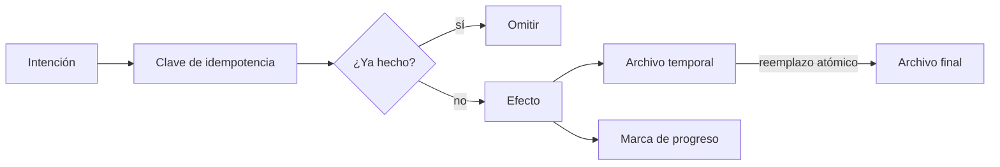
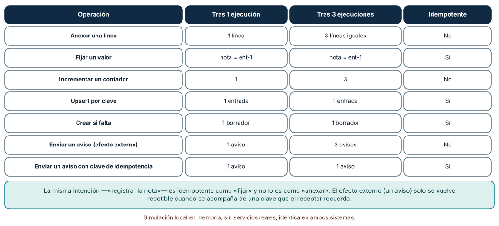
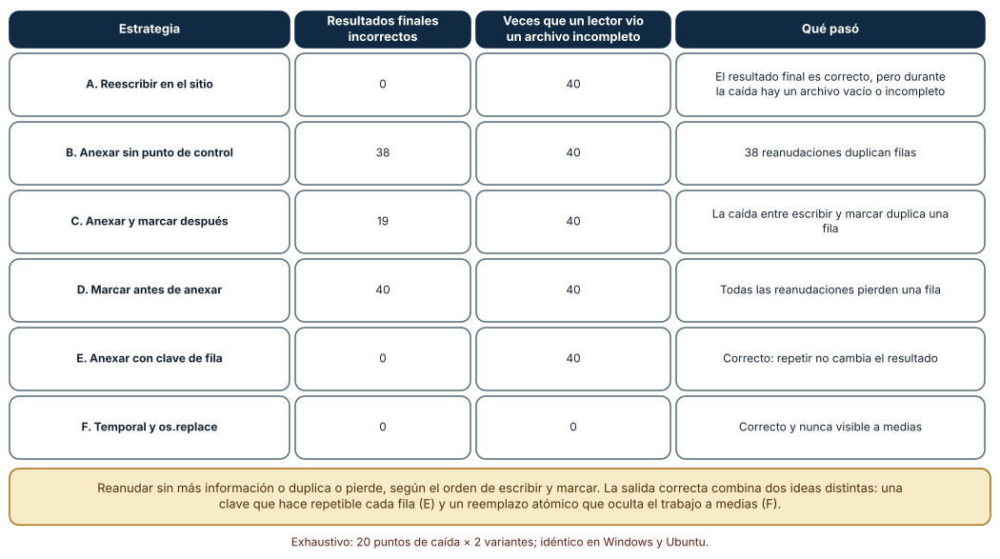
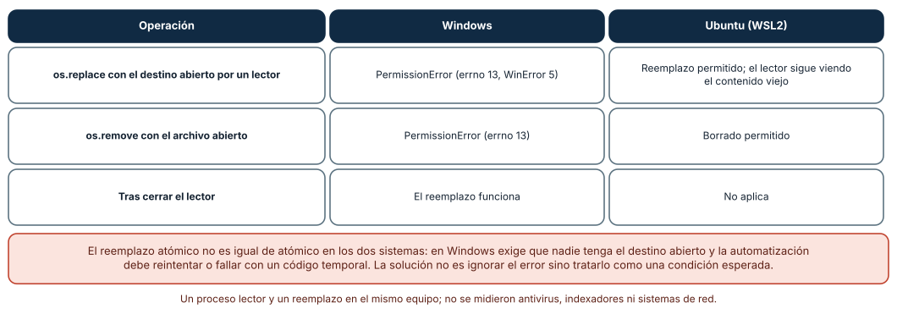

# SE-224 — Automatización idempotente y reanudable

[← SE-223 — Schedulers, workers y trabajos por lotes](https://github.com/vladimiracunadev-create/modern-software-engineering-program/blob/main/classes/part-18-cli-tui-servicios-y-automatizacion/se-223-schedulers-workers-y-trabajos-por-lotes/README.md) · [↑ Parte 18](https://github.com/vladimiracunadev-create/modern-software-engineering-program/blob/main/classes/part-18-cli-tui-servicios-y-automatizacion/README.md) · [📚 Índice completo](https://github.com/vladimiracunadev-create/modern-software-engineering-program/blob/main/classes/README.md) · [🌐 Portal](https://vladimiracunadev-create.github.io/modern-software-engineering-program/classes/SE-224.html) · [SE-225 — Distribución de binarios y actualizaciones →](https://github.com/vladimiracunadev-create/modern-software-engineering-program/blob/main/classes/part-18-cli-tui-servicios-y-automatizacion/se-225-distribucion-de-binarios-y-actualizaciones/README.md)

## Punto profesional y fundamento pedagógico

**Punto profesional.** La clase existe para diseñar automatizaciones que se pueden repetir y reanudar sin cambiar el resultado: que ejecutar dos veces lo mismo deje el mismo estado, que una caída en cualquier paso se recupere sin duplicar ni perder trabajo y que un archivo a medias nunca sea visible como si estuviera completo.

**Por qué aparece aquí.** Se sitúa después de **Schedulers, workers y trabajos por lotes** (`SE-223`) y antes de **Distribución de binarios y actualizaciones** (`SE-225`): `SE-223` dejó reintentos y colas, que solo son seguros si repetir es seguro; esta clase da esa garantía a las operaciones de `notas` y deja la técnica de escritura atómica y de claves de idempotencia que `SE-225` usará para actualizar binarios.

**Error conceptual que debe corregir.** Creer que «reanudar desde donde se quedó» basta, o que reintentar es siempre inocuo. Reanudar sin una clave duplica o pierde, según el orden de escribir y marcar; y un reemplazo «atómico» no lo es igual en todos los sistemas.

**Secuencia de aprendizaje.** Antes de leer la solución, predices cuáles de siete operaciones sobreviven a repetirse tres veces, cuántos de 40 escenarios de caída dejan un resultado incorrecto con cinco estrategias de escritura y qué ocurre al reemplazar un archivo abierto en Windows; después lo ejecutas. La secuencia usa predicción, explicación propia, contraste y recuperación. [ICAP](https://icap.education.asu.edu/research) distingue participación de construcción de conocimiento; [How People Learn II](https://nap.nationalacademies.org/catalog/24783/how-people-learn-ii-learners-contexts-and-cultures) exige conectar conocimiento previo, contexto y transferencia; la [práctica de recuperación](https://pubmed.ncbi.nlm.nih.gov/16507066/) respalda producir de nuevo la explicación tras una demora; y [Education for Life and Work](https://nap.nationalacademies.org/resource/13398/dbasse_084153.pdf) exige devolución que explique la causa del error.

**Evidencia de aprendizaje.** `idempotency-log.md` con la clasificación de las operaciones de `notas`, la matriz de 6 estrategias por 40 caídas y la comparación de reemplazo entre sistemas. Debe contener predicción previa, observación, explicación causal, contraejemplo y qué hallazgo haría rechazar una estrategia.

**Límite de la conclusión.** Las caídas se simulan con una excepción en un paso, no con un corte de energía ni un sistema de archivos que reordena escrituras; no se probó `fsync` ni almacenamiento en red; el reemplazo se probó entre un lector y un escritor en el mismo equipo.

### Trazabilidad fuente → afirmación

| Fuente primaria u oficial | Afirmación que respalda | Lo que no prueba |
|---|---|---|
| [POSIX: `rename`](https://pubs.opengroup.org/onlinepubs/9699919799/functions/rename.html) | Define que `rename` sustituye el destino de forma atómica dentro de un sistema de archivos. | No garantiza durabilidad tras un corte de energía. |
| [Python: `os.replace`](https://docs.python.org/3/library/os.html) | Documenta que sustituye el destino y que en Windows puede fallar si el destino está en uso. | No dice cómo recuperarse del fallo. |
| [RFC 9110: Idempotent Methods](https://www.rfc-editor.org/rfc/rfc9110.html#name-idempotent-methods) | Define método idempotente: varias peticiones idénticas tienen el mismo efecto que una. | Define el efecto previsto, no que el servidor lo cumpla. |
| [Pillai et al., «All File Systems Are Not Created Equal» (OSDI, 2014)](https://www.usenix.org/conference/osdi14/technical-sessions/presentation/pillai) | Muestra que las aplicaciones asumen propiedades de atomicidad y orden de los sistemas de archivos que no siempre se cumplen. | No cubre los sistemas de archivos actuales. |
| [Python: `tempfile`](https://docs.python.org/3/library/tempfile.html) | Documenta archivos temporales creados de forma segura. | No resuelve la durabilidad. |

## Antes de empezar

Recupera lo aprendido en `SE-223`: un trabajo que falla se reintenta. La pregunta activa es: **¿qué ocurre si la misma operación se ejecuta dos veces, o se interrumpe a la mitad y se reanuda?**

## Prerrequisitos

- Haber completado `SE-223` o poder explicar qué es un trabajo venenoso.
- Python 3.11 o posterior y un directorio de trabajo temporal.
- Trabajar con archivos sintéticos y un efecto externo simulado por un contador.

## Problema auténtico

El trabajo nocturno de `notas` publica las calificaciones: anexa cada fila a un archivo de salida y envía un aviso a cada estudiante. Una noche el servidor se reinicia a la mitad; el trabajo se relanza y las 400 primeras notas aparecen duplicadas en el archivo, y 400 estudiantes reciben dos avisos. Otro día el archivo quedó con la mitad de las filas mientras un informe lo leía. El equipo «arregla» añadiendo un archivo de control, y la siguiente caída pierde una fila.

## Objetivos observables

Al terminar podrás:

1. clasificar operaciones en idempotentes y no idempotentes y convertir las segundas con una clave;
2. enumerar los puntos de caída de un lote y evaluar estrategias de reanudación con una matriz;
3. escribir un archivo de modo que ningún lector vea un contenido parcial;
4. explicar por qué el orden entre escribir y marcar produce duplicados o pérdidas;
5. tratar el fallo de reemplazo de Windows como una condición esperada.

## Mapa conceptual



El mapa se lee como un filtro: la clave decide si el efecto ya se produjo; el efecto se escribe en un archivo temporal y se publica con un reemplazo atómico; la marca de progreso se actualiza después. No describe la durabilidad ante cortes de energía.

## Temas y por qué importan

| Tema | Por qué cambia una decisión profesional | Evidencia mínima |
|---|---|---|
| Idempotencia | Hace seguro el reintento. | Predicción, traza causal y contraejemplo de **Idempotencia** en `idempotency-log.md` |
| Claves de idempotencia | Convierten un efecto repetible en uno único. | Predicción, traza causal y contraejemplo de **Claves** en `idempotency-log.md` |
| Puntos de control | Evitan rehacer, pero crean ventanas de duplicado o pérdida. | Predicción, traza causal y contraejemplo de **Puntos de control** en `idempotency-log.md` |
| Escritura atómica | Oculta el trabajo a medias a los lectores. | Predicción, traza causal y contraejemplo de **Atomicidad** en `idempotency-log.md` |
| Diferencias de plataforma | El reemplazo no se comporta igual en Windows y Linux. | Predicción, traza causal y contraejemplo de **Plataformas** en `idempotency-log.md` |

## Conceptos y decisiones

### 1. Idempotente no es «sin efecto»

Una operación es idempotente si ejecutarla varias veces deja el mismo estado que ejecutarla una (RFC 9110 lo define para métodos HTTP: `PUT` y `DELETE` lo son, `POST` no necesariamente). «Fijar la nota de ent-1 a 80» lo es; «sumar 1 al contador» y «anexar una línea» no. La diferencia está en la intención: describir **el estado deseado** (fijar, crear si falta, upsert por clave) permite repetir; describir **un cambio relativo** (sumar, anexar) no. La primera decisión de diseño es reformular las operaciones como estado deseado cuando se pueda.

### 2. Efectos externos y claves de idempotencia

Cuando el efecto sale del sistema —un correo, un cobro, una llamada a otro servicio— no se puede «fijar»: se envió o no se envió. La técnica estándar es una **clave de idempotencia**: un identificador único de la intención («aviso-nota-ent-1-v3») que el emisor guarda y el receptor recuerda; si llega repetida, se devuelve el resultado anterior sin repetir el efecto. La clave debe derivarse de la intención y no de la ejecución (no una hora ni un número aleatorio nuevo en cada intento), porque entonces cada reintento parece una intención distinta.

### 3. Puntos de control: duplicar o perder

Reanudar «desde donde se quedó» requiere registrar el progreso. Pero escribir el resultado y marcar el progreso son dos pasos, y puede caer entre ambos. Si se **escribe y luego se marca**, una caída entre medias deja la fila escrita sin marcar: al reanudar se repite y se duplica (entrega **al menos una vez**). Si se **marca y luego se escribe**, la caída deja la marca sin la fila: se pierde (entrega **como máximo una vez**). No hay orden que dé «exactamente una vez» sin ayuda: hace falta que el paso sea idempotente (una clave por fila) o que escribir y marcar sean una sola operación atómica.

### 4. Escritura atómica: el trabajo a medias no se publica

La técnica clásica: escribir en un archivo temporal **en el mismo directorio y sistema de archivos** que el destino y publicarlo con `os.replace`, que sustituye el destino de una vez. Un lector ve el archivo viejo completo o el nuevo completo, nunca una mezcla. Para durabilidad ante cortes de energía hace falta además vaciar los búferes y el archivo (`flush` y `os.fsync`) y a veces el directorio; esta clase mide la visibilidad, no la durabilidad. La atomicidad no sustituye a la idempotencia: una caída antes del reemplazo deja un temporal que debe limpiarse y una reanudación que repite el trabajo.

### 5. El reemplazo depende del sistema

En Linux se puede reemplazar o borrar un archivo que otro proceso tiene abierto: el lector conserva su descriptor y ve el contenido viejo. En Windows, `os.replace` y `os.remove` fallan con `PermissionError` si algún proceso tiene el archivo abierto sin permiso de compartir el borrado (el comportamiento de `open` de Python). La automatización portable debe tratar ese fallo como una condición esperada: reintentar con espera breve y límite, o fallar con el código temporal acordado en `SE-220`.

### Siete operaciones, una y tres veces

Se ejecutó cada operación una vez y tres veces sobre un estado vacío. **Anexar una línea**: de 1 línea a 3 iguales (no idempotente). **Fijar un valor**: igual (idempotente). **Incrementar un contador**: de 1 a 3 (no). **Upsert por clave**: igual (sí). **Crear si falta**: igual (sí). **Enviar un aviso** (efecto contado): de 1 a 3 avisos (no). **Enviar un aviso con clave de idempotencia**: 1 aviso en ambos casos (sí).

```python
def enviar_aviso_con_clave(estado, clave):
    enviados = estado.setdefault("enviados", [])
    if clave not in enviados:          # la clave es la intención, no el intento
        enviados.append(clave)
        estado["avisos_ok"] = estado.get("avisos_ok", 0) + 1
```



**Cómo leer la figura.** Cada fila compara el estado tras una y tres ejecuciones; la última columna dice si coinciden. **Dónde deja de valer:** el estado es un diccionario en memoria y el «aviso» un contador; un servicio real puede aceptar la clave y fallar al guardarla, o expirar las claves, y esos casos no se modelaron. La tabla clasifica la intención de la operación, no su implementación.

### Seis estrategias, cuarenta caídas

Un lote escribe 20 filas. Para cada estrategia se provocó una caída en cada uno de los 20 pasos, con y sin una escritura parcial o una caída entre escribir y marcar (**40 escenarios**), se reanudó sin fallo y se comparó el resultado con las 20 filas esperadas. **A. Reescribir en el sitio**: 0 resultados incorrectos, pero tras la caída un lector vio un archivo **vacío o incompleto en los 40**. **B. Anexar sin punto de control**: **38** resultados incorrectos, todos con duplicados. **C. Anexar y marcar después**: **19** incorrectos (duplicados). **D. Marcar antes de anexar**: **40** incorrectos, todos con pérdidas. **E. Anexar con clave de fila**: **0** incorrectos. **F. Temporal y `os.replace`**: **0** incorrectos y **0** veces que un lector vio un archivo incompleto.



**Cómo leer la figura.** Cada fila es una estrategia; las columnas centrales cuentan escenarios con resultado final incorrecto y con un archivo parcial visible; la última explica el mecanismo. **Dónde deja de valer:** las caídas son excepciones simuladas en puntos discretos; no incluyen un reordenamiento del disco ni la pérdida de datos no vaciados. E y F resuelven problemas distintos (repetición y visibilidad) y la solución completa los combina.

### Reemplazar un archivo que alguien lee

Con un lector que tiene el archivo de destino abierto, `os.replace(tmp, destino)` en **Windows** falló con `PermissionError` (`errno` 13, `WinError` 5); en **Ubuntu** se permitió y el lector siguió viendo el contenido viejo. `os.remove` con el archivo abierto: **PermissionError** en Windows, **permitido** en Ubuntu. Tras cerrar el lector, el reemplazo funcionó en Windows.

```python
for intento in range(5):
    try:
        os.replace(tmp, destino); break
    except PermissionError:           # Windows: el destino está en uso
        time.sleep(0.05 * (intento + 1))
else:
    sys.exit(75)                      # fallo temporal acordado en SE-220
```



**Cómo leer la figura.** Cada fila es una operación sobre un archivo abierto; las columnas son los dos sistemas. **Dónde deja de valer:** un solo lector abierto con el modo por defecto de Python; antivirus, indexadores y archivos abiertos con permiso de compartir cambian el resultado en Windows, y los sistemas de archivos de red tienen sus propias reglas.

## Definiciones de trabajo

- **idempotencia:** propiedad de una operación cuyo efecto no cambia al repetirla con la misma entrada.
- **clave de idempotencia:** identificador de la intención que permite reconocer y omitir una repetición.
- **punto de control:** registro del progreso que permite reanudar sin empezar de cero.
- **escritura atómica:** publicación de un archivo de modo que un lector ve el contenido anterior o el nuevo completo, nunca una mezcla.
- **entrega al menos una vez / como máximo una vez:** garantías que duplican o pierden, respectivamente, ante una caída.

Las definiciones son operativas para la herramienta `notas`. No convierten términos con historia más amplia en sinónimos y deben contrastarse con la documentación primaria enlazada al final.

## Ejemplo mínimo

El fragmento publica un archivo de forma atómica. Antes de ejecutarlo, predice qué ve un lector si el proceso cae después de la segunda línea.

```python
import os, tempfile

def publicar(destino, filas):
    d = os.path.dirname(os.path.abspath(destino))
    fd, tmp = tempfile.mkstemp(dir=d, suffix=".tmp")
    try:
        with os.fdopen(fd, "w", encoding="utf-8", newline="\n") as f:
            for fila in filas:
                f.write(fila + "\n")
        os.replace(tmp, destino)
    finally:
        if os.path.exists(tmp):
            os.remove(tmp)
```

El lector ve el archivo anterior intacto. Prueba a lanzar una excepción tras la segunda fila y observa que el temporal se limpia; registra versión y sistema.

## Ejemplo profesional

La publicación nocturna de `notas` calcula una clave por fila (`ent-1:v3`), escribe las filas nuevas en un temporal del mismo directorio, vacía y reemplaza de forma atómica con reintentos ante `PermissionError`, y envía los avisos con la clave como cabecera de idempotencia. Un archivo de progreso (también reemplazado atómicamente) guarda la última clave publicada; al reanudar, la herramienta verifica contra el archivo final y no solo contra el de progreso. Una prueba recorre los 20 puntos de caída del lote y exige que el resultado final sea idéntico, que no haya temporales huérfanos y que cada aviso se envíe una sola vez.

Compara el caso normal con una caída en el paso 7, una reanudación doble y un lector con el archivo abierto en Windows. La publicación es apropiada cuando los tres terminan con el mismo contenido; es peligrosa cuando el único mecanismo es «volver a ejecutar».

## Práctica guiada

1. Clasifica las operaciones de `notas` en idempotentes y no, y reformula las segundas como estado deseado.
2. Ejecuta siete operaciones una y tres veces y compara los estados.
3. Implementa seis estrategias de escritura y provoca una caída en cada paso, con y sin escritura parcial.
4. Reanuda cada escenario y compara con el resultado esperado; cuenta duplicados, pérdidas y archivos parciales visibles.
5. Escribe la publicación atómica con temporal en el mismo directorio y reemplazo.
6. Reproduce el reemplazo con un lector abierto en Windows y en Ubuntu y añade el reintento acotado.
7. Pide a otra persona que reproduzca la matriz solo desde `idempotency-log.md`.

## Ejercicios

1. **Clave de aviso:** diseña la clave de idempotencia de «avisar a un estudiante de su nota» y explica por qué la hora del envío no sirve.
2. **Combinar E y F:** escribe una estrategia que use claves de fila y reemplazo atómico y demuestra con los 40 escenarios que no duplica, no pierde y no muestra archivos parciales.
3. **Temporal huérfano:** una caída deja `salida.csv.tmp`; diseña quién lo limpia, cuándo y con qué seguridad (¿y si otra instancia lo está escribiendo?).
4. **Durabilidad:** explica qué añadiría `os.fsync` a la estrategia F y qué escenario de corte de energía no se midió en esta clase.

## Reto verificable

Entrega `idempotency-log.md` con la clasificación de operaciones, la matriz de 6 × 40 y la comparación de reemplazo entre sistemas. Se aprueba si otra persona ejecuta el código desde un checkout limpio, obtiene la misma matriz (0, 38, 19, 40, 0 y 0 incorrectos; 40 archivos parciales visibles salvo en F) y el mismo contraste entre sistemas, y puede señalar qué estrategia usaría para su caso. No se aprueba por usar un archivo de control ni por reintentar «hasta que funcione».

## Caso conductor

La herramienta `notas` es el caso conductor de la Parte 18. Esta clase deja su publicación nocturna con claves por fila, escritura atómica y reanudación verificada. `SE-225` aplica la misma técnica a una actualización de binarios: descargar a un temporal, verificar y reemplazar. Cambia después un solo detalle, el tamaño del lote de 20 a 200 filas, y revisa si la matriz de caídas sigue dando los mismos resultados y cuánto cuesta repetir un lote.

## Preguntas frecuentes

### ¿Basta con borrar el archivo de salida antes de reintentar?

Funciona si nadie lo lee y si borrar es seguro; en el resto, abre una ventana en la que el archivo no existe o está vacío (en la matriz, la estrategia A mostró un archivo incompleto en los 40 escenarios). El reemplazo atómico evita esa ventana.

### ¿Todo debe ser idempotente?

No: algunas operaciones son inherentemente de efecto único (un cobro). Se hacen seguras con una clave y un receptor que la recuerde. Donde eso no es posible, hay que diseñar para «como máximo una vez» y aceptar la pérdida, o para «al menos una vez» y aceptar el duplicado, y decidirlo conscientemente.

### ¿Por qué el temporal debe estar en el mismo directorio?

Porque `rename` es atómico solo dentro de un sistema de archivos; entre dos volúmenes se convierte en copiar y borrar, y deja de serlo.

### ¿`os.replace` garantiza que el dato esté en el disco?

No: garantiza la sustitución del nombre. La durabilidad exige vaciar el archivo y, según el sistema, el directorio; y depende del sistema de archivos y de la caché de escritura.

## Fallo controlado y diagnóstico

Reproduce el fallo clásico de la clase: **filas duplicadas tras reanudar**. Usa la estrategia C (anexar y marcar después) y provoca una caída entre escribir y marcar.

Registra síntoma, entrada mínima, hipótesis, observación que descarta cada hipótesis, causa, corrección y prueba de regresión. **Síntoma:** tras una caída y una reanudación, la fila 7 aparece dos veces. **Hipótesis rivales:** (a) la fuente de datos tenía la fila repetida; (b) la reanudación empezó desde cero; (c) la fila se escribió pero la caída ocurrió antes de marcarla. **Prueba:** la fuente tiene una sola fila 7; el archivo de progreso decía 6; el archivo de salida ya contenía 7. **Conclusión:** la causa es la tercera. **Regresión:** derivar una clave por fila, comprobarla antes de escribir y publicar con reemplazo atómico; añadir una prueba que caiga en cada paso. No cambies a la vez el orden de escribir y marcar y la clave.

## Errores comunes y cómo corregirlos

| Síntoma | Causa probable | Corrección |
|---|---|---|
| Filas duplicadas tras reanudar | Se escribe y luego se marca | Clave de fila y verificación antes de escribir |
| Filas perdidas tras reanudar | Se marca antes de escribir | Escribir primero o hacer ambas cosas atómicas |
| Un lector ve un archivo a medias | Se escribe en el sitio | Temporal en el mismo directorio y `os.replace` |
| `PermissionError` en Windows al publicar | El destino está abierto | Reintento acotado con código temporal |
| El mismo aviso llega dos veces | La clave cambia en cada intento | Derivar la clave de la intención |

## Entorno y archivos clave

```text
work/SE-224/
├── README.md
├── publicar.py
├── experimentos/
│   ├── operaciones.py
│   ├── caidas.py
│   └── reemplazo.py
└── evidence/idempotency-log.md
```

El `README` declara plataforma, versión de Python y comandos. Los experimentos usan solo la biblioteca estándar (`os`, `tempfile`, `json`) y se ejecutaron con CPython 3.12.9 en Windows 11 y 3.12.3 en Ubuntu bajo WSL2: la clasificación de operaciones y la matriz de caídas fueron idénticas; el reemplazo con un archivo abierto difirió por sistema, que es el resultado.

## Seguridad, ética y accesibilidad

- los temporales pueden contener datos personales (notas, identificadores): créalos con permisos restringidos y límpialos;
- una clave de idempotencia no debe contener datos personales en claro: puede aparecer en registros y cabeceras;
- un aviso duplicado a una persona es un daño real, aunque pequeño: trata el duplicado como un incidente medible;
- la documentación de la reanudación debe usar texto y tablas, no solo diagramas;
- respeta las licencias de las bibliotecas de colas y de archivos atómicos y atribuye las adaptaciones.

## Puente hacia el trabajo con agentes

Un agente al que se le pide «haz que el script sea reanudable» suele añadir un archivo de progreso, marcarlo tras cada fila y reabrir el archivo de salida en modo anexar: la estrategia C. Pídele que enumere los puntos de caída, que pruebe cada uno, que derive una clave por fila y que publique con un reemplazo atómico, y que lo ejecute en Windows y en Linux. Revisa especialmente si el orden entre escribir y marcar produce duplicados y si trató `PermissionError` como un fallo fatal o lo ignoró.

## Transferencia

Traslada el experimento a otro proceso reanudable (por ejemplo, la importación de un archivo de pedidos): clasifica sus operaciones, enumera sus puntos de caída y mide cuántos escenarios dejan un resultado incorrecto con tu estrategia. La transferencia está lograda cuando puedes explicar qué parte del diseño dependía de la idempotencia y cuál de la atomicidad, no cuando el código se parece.

## Evaluación y evidencia

| Criterio | Evidencia para aprobar |
|---|---|
| comprensión | explicación de por qué escribir y marcar produce duplicados o pérdidas |
| corrección | matriz reproducible de estrategias frente a puntos de caída |
| diseño | claves de idempotencia y publicación atómica justificadas |
| diagnóstico | reproducción del fallo «filas duplicadas» con regresión |
| incertidumbre | declaración de qué no se simuló (corte de energía, `fsync`, red) |
| reproducibilidad | versiones, comandos, salida y límites declarados |

## Fuentes

- [POSIX: `rename`](https://pubs.opengroup.org/onlinepubs/9699919799/functions/rename.html) — sustitución atómica del destino; autoridad: The Open Group.
- [Python: `os`](https://docs.python.org/3/library/os.html) — `os.replace` y `os.fsync`; autoridad: documentación de Python.
- [RFC 9110: Idempotent Methods](https://www.rfc-editor.org/rfc/rfc9110.html#name-idempotent-methods) — definición de idempotencia; autoridad: IETF.
- [Pillai et al., «All File Systems Are Not Created Equal»](https://www.usenix.org/conference/osdi14/technical-sessions/presentation/pillai) — suposiciones de atomicidad de las aplicaciones; autoridad: USENIX OSDI 2014.
- [Python: `tempfile`](https://docs.python.org/3/library/tempfile.html) — archivos temporales seguros; autoridad: documentación de Python.

Cada fuente respalda el mecanismo indicado; ninguna demuestra que la estrategia de `notas` sea la adecuada para un sistema de archivos o un receptor concreto. Esa afirmación depende de las garantías que cada uno ofrezca.

- [Python: `random`](https://docs.python.org/3/library/random.html) — el experimento de caídas es determinista y no necesita semilla.
- [Python: `os.path`](https://docs.python.org/3/library/os.path.html) — rutas del mismo directorio para el temporal.

## Límites y siguiente paso

Se ejecutaron tres experimentos en Windows y Ubuntu (WSL2): la matriz fue idéntica y el reemplazo con un archivo abierto difirió. Las caídas son excepciones simuladas; no se midió durabilidad, `fsync`, sistemas de archivos de red ni cortes de energía, y las operaciones son juguetes del autor. La siguiente clase pregunta cómo distribuir y actualizar la herramienta con las mismas garantías.

## Glosario

- **idempotencia:** propiedad de una operación cuyo efecto no cambia al repetirla con la misma entrada.
- **clave de idempotencia:** identificador de la intención que permite reconocer y omitir una repetición.
- **punto de control:** registro del progreso que permite reanudar sin empezar de cero.
- **escritura atómica:** publicación de un archivo de modo que un lector ve el contenido anterior o el nuevo completo, nunca una mezcla.
- **entrega al menos una vez / como máximo una vez:** garantías que duplican o pierden, respectivamente, ante una caída.

---

[← SE-223 — Schedulers, workers y trabajos por lotes](https://github.com/vladimiracunadev-create/modern-software-engineering-program/blob/main/classes/part-18-cli-tui-servicios-y-automatizacion/se-223-schedulers-workers-y-trabajos-por-lotes/README.md) · [↑ Parte 18](https://github.com/vladimiracunadev-create/modern-software-engineering-program/blob/main/classes/part-18-cli-tui-servicios-y-automatizacion/README.md) · [📚 Índice completo](https://github.com/vladimiracunadev-create/modern-software-engineering-program/blob/main/classes/README.md) · [🌐 Portal](https://vladimiracunadev-create.github.io/modern-software-engineering-program/classes/SE-224.html) · [SE-225 — Distribución de binarios y actualizaciones →](https://github.com/vladimiracunadev-create/modern-software-engineering-program/blob/main/classes/part-18-cli-tui-servicios-y-automatizacion/se-225-distribucion-de-binarios-y-actualizaciones/README.md)
