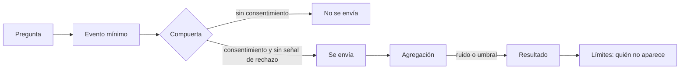
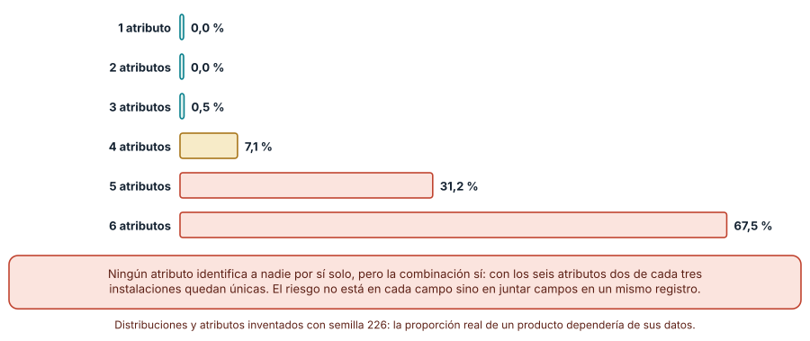
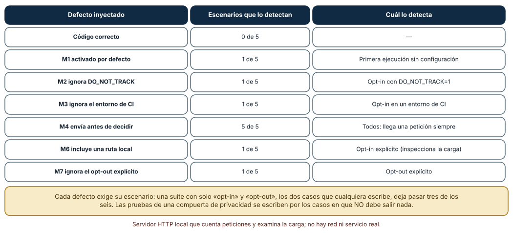
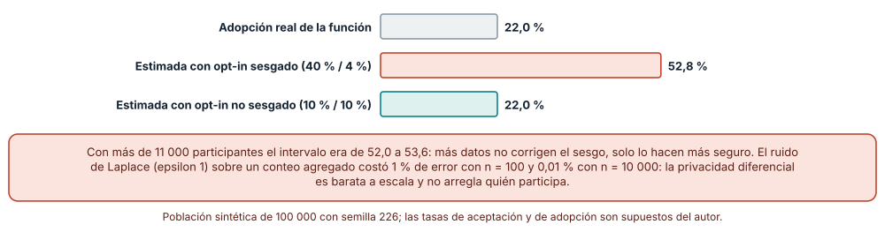

# SE-226 — Telemetría opt-in y privacidad en herramientas

[← SE-225 — Distribución de binarios y actualizaciones](https://github.com/vladimiracunadev-create/modern-software-engineering-program/blob/main/classes/part-18-cli-tui-servicios-y-automatizacion/se-225-distribucion-de-binarios-y-actualizaciones/README.md) · [↑ Parte 18](https://github.com/vladimiracunadev-create/modern-software-engineering-program/blob/main/classes/part-18-cli-tui-servicios-y-automatizacion/README.md) · [📚 Índice completo](https://github.com/vladimiracunadev-create/modern-software-engineering-program/blob/main/classes/README.md) · [🌐 Portal](https://vladimiracunadev-create.github.io/modern-software-engineering-program/classes/SE-226.html) · [SE-227 — Taller: endurecer una automatización frágil →](https://github.com/vladimiracunadev-create/modern-software-engineering-program/blob/main/classes/part-18-cli-tui-servicios-y-automatizacion/se-227-taller-endurecer-una-automatizacion-fragil/README.md)

## Punto profesional y fundamento pedagógico

**Punto profesional.** La clase existe para decidir qué se mide de una herramienta que corre en equipos ajenos, con qué consentimiento y cuánto se puede aprender sin identificar a nadie: una compuerta de consentimiento que se pueda probar, un conjunto mínimo de datos y una lectura honesta de lo que quienes aceptan no representan.

**Por qué aparece aquí.** Se sitúa después de **Distribución de binarios y actualizaciones** (`SE-225`) y antes de **Taller: endurecer una automatización frágil** (`SE-227`): `SE-225` necesitaba una señal de salud para los escalones; esta clase pregunta cómo obtenerla sin vigilar, y deja la política de telemetría que el taller y el proyecto integrarán en `notas`.

**Error conceptual que debe corregir.** Creer que «datos anónimos» son los que no llevan nombre. La combinación de atributos inocuos identifica; los datos de quienes aceptan no representan a quienes no aceptan; y el consentimiento no es una casilla marcada por defecto.

**Secuencia de aprendizaje.** Antes de leer la solución, predices qué fracción de 5 000 instalaciones queda única al combinar seis atributos que no identifican por separado, cuántos escenarios necesita una suite para detectar defectos de una compuerta de consentimiento y cuánto se equivoca una estimación hecha solo con quienes aceptan; después lo mides con datos sintéticos. La secuencia usa predicción, explicación propia, contraste y recuperación. [ICAP](https://icap.education.asu.edu/research) distingue participación de construcción de conocimiento; [How People Learn II](https://nap.nationalacademies.org/catalog/24783/how-people-learn-ii-learners-contexts-and-cultures) exige conectar conocimiento previo, contexto y transferencia; la [práctica de recuperación](https://pubmed.ncbi.nlm.nih.gov/16507066/) respalda producir de nuevo la explicación tras una demora; y [Education for Life and Work](https://nap.nationalacademies.org/resource/13398/dbasse_084153.pdf) exige devolución que explique la causa del error.

**Evidencia de aprendizaje.** `telemetry-log.md` con la política de telemetría de `notas` (qué se mide, con qué consentimiento, qué nunca se envía), las tres mediciones (unicidad, compuerta y sesgo) y el inventario de eventos con su justificación. Debe contener predicción previa, observación, explicación causal, contraejemplo y qué hallazgo haría eliminar un evento.

**Límite de la conclusión.** La población, los atributos y sus probabilidades son inventados; las tasas de aceptación y de adopción son supuestos del autor; el servidor de recepción es local y cuenta peticiones; no se midió ninguna telemetría real, no se evaluó cumplimiento normativo ni se pidió consentimiento a nadie.

### Trazabilidad fuente → afirmación

| Fuente primaria u oficial | Afirmación que respalda | Lo que no prueba |
|---|---|---|
| [Sweeney, «k-anonymity» (2002)](https://doi.org/10.1142/S0218488502001648) | Define k-anonimato: cada registro debe ser indistinguible de al menos k−1 por los atributos casi-identificadores. | No dice qué k es suficiente. |
| [Eckersley, «How Unique Is Your Web Browser?» (PETS, 2010)](https://doi.org/10.1007/978-3-642-14527-8_1) | Mostró que la combinación de atributos corrientes de un navegador identifica a la mayoría de los equipos. | Mide navegadores, no herramientas de línea de comandos. |
| [Dwork y Roth, «The Algorithmic Foundations of Differential Privacy»](https://www.cis.upenn.edu/~aaroth/Papers/privacybook.pdf) | Define la privacidad diferencial y el mecanismo de Laplace para conteos. | No elige el parámetro epsilon de un caso. |
| [EDPB: Directrices 05/2020 sobre el consentimiento](https://www.edpb.europa.eu/our-work-tools/our-documents/guidelines/guidelines-052020-consent-under-regulation-2016679_en) | Explica qué hace válido el consentimiento: libre, específico, informado e inequívoco, con acción afirmativa. | No es asesoría jurídica. |
| [Console Do Not Track](https://consoledonottrack.com/) | Propone `DO_NOT_TRACK=1` como señal para desactivar la telemetría de herramientas de línea de comandos. | Es una convención voluntaria. |

## Antes de empezar

Recupera lo aprendido en `SE-225`: un escalón necesita una señal de salud. La pregunta activa es: **¿qué necesito saber de la herramienta, qué es lo mínimo que lo responde y qué tengo derecho a recoger?**

## Prerrequisitos

- Haber completado `SE-225` o poder explicar qué es un despliegue escalonado.
- Python 3.11 o posterior; las pruebas usan un servidor en `127.0.0.1`.
- Trabajar con datos sintéticos: ninguna medición se hace sobre personas.

## Problema auténtico

El equipo de `notas` quiere saber qué subcomandos se usan para decidir qué mantener, y si el último lanzamiento arranca bien. Alguien propone enviar a un servidor propio, en cada ejecución, el sistema operativo, la versión de Python, el idioma, el número de núcleos, el ancho del terminal y la versión de la herramienta. Las cinco cifras «no son datos personales» y se activa por defecto. Un mes después, un análisis muestra que el 31 % de las instalaciones se pueden distinguir de las demás, y que la función más usada «según la telemetría» lo es solo entre usuarios que dejaron la telemetría activada.

## Objetivos observables

Al terminar podrás:

1. definir qué pregunta responde cada evento y eliminar los que no tienen pregunta;
2. medir cuántas instalaciones quedan únicas al combinar atributos y calcular el menor grupo;
3. diseñar una compuerta de consentimiento que respete la ausencia de decisión, las señales del entorno y los entornos automáticos, y probarla con defectos inyectados;
4. cuantificar el sesgo de un análisis hecho solo con quienes aceptan;
5. decidir qué datos se recogen, durante cuánto tiempo y cómo se agregan.

## Mapa conceptual



El mapa se lee de izquierda a derecha: cada evento responde una pregunta; la compuerta decide si se envía; el resultado se agrega y se lee con la advertencia de quién no está. No describe un sistema de analítica concreto.

## Temas y por qué importan

| Tema | Por qué cambia una decisión profesional | Evidencia mínima |
|---|---|---|
| Mínimo necesario | Cada dato recogido es un riesgo que hay que justificar. | Predicción, traza causal y contraejemplo de **Mínimo** en `telemetry-log.md` |
| Identificabilidad | Atributos inocuos por separado identifican en conjunto. | Predicción, traza causal y contraejemplo de **Identificabilidad** en `telemetry-log.md` |
| Consentimiento | Debe ser una acción afirmativa, informada y revocable. | Predicción, traza causal y contraejemplo de **Consentimiento** en `telemetry-log.md` |
| Compuerta comprobable | Una compuerta sin pruebas puede fallar sin que nadie lo sepa. | Predicción, traza causal y contraejemplo de **Compuerta** en `telemetry-log.md` |
| Sesgo de participación | Quien acepta no es representativo de quien no. | Predicción, traza causal y contraejemplo de **Sesgo** en `telemetry-log.md` |

## Conceptos y decisiones

### 1. Cada evento responde una pregunta

La telemetría empieza por la pregunta, no por el dato: «¿qué subcomandos se usan?» pide un contador por subcomando, no el historial de comandos con argumentos; «¿arranca bien el lanzamiento?» pide un evento de arranque con la versión y un código de resultado, no la ruta de trabajo. Un inventario de eventos con tres columnas —pregunta, campos, quién decide qué hacer con la respuesta— elimina de entrada la mitad de lo que se pensaba recoger. Y cada campo tiene una vida: cuánto se conserva y quién puede verlo.

### 2. Anónimo no es «sin nombre»

Un registro sin nombre, pero con sistema, versión, idioma, número de núcleos, ancho de terminal y versión de la herramienta, es difícil de distinguir de otro solo si muchos comparten esos valores. La medida es el **tamaño del menor grupo** que comparte una combinación (k-anonimato) y la fracción de registros **únicos**. Cuantos más atributos se combinan, más únicos aparecen. Y los datos pueden cruzarse con otras fuentes (un registro de acceso, un correo) para identificar. La regla práctica: recoger pocos atributos, redondearlos (versión mayor en lugar de la completa, ancho en intervalos) y no conservar identificadores estables.

### 3. Consentimiento: ausencia de decisión no es sí

Un consentimiento válido es una acción afirmativa, específica e informada, y se puede retirar. Una casilla marcada de antemano, un silencio o «seguir usando» no lo son. En una herramienta de línea de comandos esto se traduce en **opt-in**: la telemetría está apagada hasta que la persona la activa explícitamente (`notas telemetria activar`), con un texto que dice qué se envía; se puede desactivar con la misma facilidad; y se respetan señales ajenas: la variable `DO_NOT_TRACK=1` y los entornos automáticos (integración continua) la apagan aunque haya consentimiento en un archivo de configuración. Todo esto es diseño, no asesoría jurídica.

### 4. La compuerta se prueba por lo que no debe salir

La compuerta es una función pequeña con muchas ramas: sin configuración, con opt-out, con señal de rechazo, en CI, sin red. Sus defectos son silenciosos: no fallan, envían de más. Por eso se prueba con un servidor local que cuenta las peticiones y con casos negativos: lo que importa es que **no salga nada** cuando no debe. Y se prueba la carga: que no incluya rutas, nombres de usuario ni argumentos. Una prueba que solo comprueba que «con consentimiento, se envía» deja pasar casi todos los defectos.

### 5. Quién acepta no es quién usa

Quienes activan la telemetría suelen ser los usuarios más implicados. Un análisis hecho solo con ellos sobreestima el uso de las funciones avanzadas y subestima los problemas de quien abandonó. Más participantes no corrigen ese sesgo: lo hacen más seguro. Se corrige (en parte) con información sobre la población que no se mide —una encuesta, ponderación con datos de distribución— y, sobre todo, declarando en cada informe de qué población habla. Y al agregar, el ruido o el umbral mínimo de un grupo protegen a las personas, a costa de precisión en los grupos pequeños.

### Atributos inocuos que identifican en conjunto

Se generaron 5 000 instalaciones sintéticas (semilla 226) con seis atributos de distribución inventada: sistema (3 valores), versión de Python (6), idioma (12), núcleos (6), ancho del terminal (6) y versión de la herramienta (8). Para cada número de atributos se promedió sobre todas las combinaciones de ese tamaño. Con **1 o 2 atributos**, **0 %** de instalaciones únicas (el grupo menor mediano era de 250 y de 10). Con **3**, **0,5 %**; con **4**, **7,1 %**; con **5**, **31,2 %**; con los **seis**, **67,5 %**: dos de cada tres instalaciones quedaron únicas.

```python
c = collections.Counter(tuple(p[a] for a in combinacion) for p in poblacion)
unicos = sum(1 for v in c.values() if v == 1)       # instalaciones únicas
k = min(c.values())                                   # tamaño del menor grupo
```



**Cómo leer la figura.** Cada barra es el porcentaje medio de instalaciones únicas al combinar ese número de atributos; la coral marca más de una de cada cuatro. **Dónde deja de valer:** las distribuciones están inventadas; con una población mayor, menos únicas por atributo; con atributos más variados (una versión completa del sistema, una lista de módulos), más. La cifra no se traslada: lo que se traslada es el mecanismo de que la combinación identifica más que cada parte.

### Siete variantes de una compuerta frente a cinco escenarios

Una compuerta de consentimiento (código correcto y seis defectos) se ejecutó contra cinco escenarios, con un servidor HTTP local que cuenta las peticiones y busca rutas en la carga. **El código correcto**: 0 de 5 escenarios fallan. **M1 (activada por defecto)**: lo detecta solo la primera ejecución sin configuración. **M2 (ignora `DO_NOT_TRACK`)**: solo el escenario con `DO_NOT_TRACK=1`. **M3 (ignora el entorno de CI)**: solo el de CI. **M4 (envía antes de decidir)**: **los cinco**. **M6 (incluye una ruta local)**: solo el opt-in explícito, que inspecciona la carga. **M7 (ignora el opt-out explícito)**: solo el opt-out. Una suite con solo «opt-in» y «opt-out» deja pasar tres de los seis defectos (M1, M2 y M3).



**Cómo leer la figura.** Cada fila es un defecto inyectado; la tercera columna dice qué escenario lo revela. **Dónde deja de valer:** seis defectos escritos por el autor sobre una compuerta de juguete; una compuerta real tiene más ramas (revocación, expiración, errores de red). El hallazgo es de método: cada defecto tiene su escenario, y los más peligrosos son los que envían de más sin fallar.

### Quién acepta no representa a quien usa

Población sintética de 100 000: el 20 % son usuarios intensivos; la función F la adopta el 70 % de los intensivos y el 10 % del resto: **adopción real, 22,0 %**. Si aceptan telemetría el 40 % de los intensivos y el 4 % del resto (unos 11 000 participantes), la estimación a partir de los participantes es **52,8 %** (intervalo de 200 repeticiones, 52,0–53,6 %): un **sesgo de 30,8 puntos**. Si aceptaran igual todos los grupos (10 % y 10 %), la estimación es **22,0 %** (21,4–22,7). Añadir ruido de Laplace (epsilon 1) a un conteo costó un error relativo medio de **0,996 %** con n = 100, **0,103 %** con n = 1 000 y **0,010 %** con n = 10 000.



**Cómo leer la figura.** La barra gris es la verdad en la población; la coral es la estimación con aceptación desigual; la teal, con aceptación igual. **Dónde deja de valer:** las tasas de aceptación y de adopción son supuestos del autor; la dirección y el orden de magnitud del sesgo dependen de cuánto se parezcan los grupos. El ruido de Laplace protege la contribución de una persona a un conteo, no corrige quién participa.

## Definiciones de trabajo

- **telemetría:** datos de uso o de funcionamiento enviados por una herramienta a quien la mantiene.
- **opt-in:** modelo en que la recogida está apagada hasta que la persona la activa explícitamente.
- **k-anonimato:** propiedad de un conjunto de datos en que cada registro es indistinguible de al menos k−1 por los atributos casi-identificadores.
- **sesgo de participación:** diferencia entre quienes aceptan ser medidos y la población que se quiere conocer.
- **privacidad diferencial:** garantía matemática de que el resultado cambia poco por incluir o no a una persona, lograda con ruido calibrado.

Las definiciones son operativas para la herramienta `notas`. No convierten términos con historia más amplia en sinónimos y deben contrastarse con la documentación primaria enlazada al final.

## Ejemplo mínimo

El fragmento calcula el grupo menor de una combinación de atributos. Antes de ejecutarlo, predice si algún registro será único.

```python
import collections
poblacion = [
    {"so": "windows", "idioma": "es-CL"}, {"so": "windows", "idioma": "es-CL"},
    {"so": "linux", "idioma": "es-CL"}, {"so": "linux", "idioma": "ja-JP"},
]
c = collections.Counter((p["so"], p["idioma"]) for p in poblacion)
print(min(c.values()), sum(1 for v in c.values() if v == 1))   # grupo menor, únicos
```

Imprime 1 y 2: dos registros son únicos con solo dos atributos. Añade un tercer atributo y observa; registra versión y salida.

## Ejemplo profesional

`notas` es opt-in: la primera ejecución no envía nada y, si la persona lo pide, `notas telemetria activar` muestra la lista exacta de eventos y campos antes de aceptar; `notas telemetria estado` y `desactivar` están siempre disponibles. Los eventos son tres: arranque (versión mayor, sistema, código de resultado), subcomando usado (su nombre, sin argumentos) y error (código, sin mensaje). La compuerta respeta `DO_NOT_TRACK=1` y los entornos de CI aunque haya consentimiento. Los datos se agregan por semana, se descartan los grupos con menos de 20 instalaciones y el informe lleva siempre la nota «solo instalaciones con telemetría activada». Una suite de ocho escenarios con un servidor local cuenta las peticiones y falla si aparece una ruta o un usuario en la carga.

Compara el caso normal con una primera ejecución, una con `DO_NOT_TRACK=1` y una en CI. La política es apropiada cuando las tres no envían nada; es peligrosa cuando la única prueba es que «con consentimiento, se envía».

## Práctica guiada

1. Escribe el inventario de eventos de `notas`: pregunta, campos y decisión que habilita cada uno.
2. Genera 5 000 instalaciones sintéticas y mide únicas y grupo menor con uno a seis atributos.
3. Implementa la compuerta y seis defectos; ejecútalos contra cinco escenarios con un servidor local.
4. Comprueba que ninguna carga contiene rutas ni nombres de usuario.
5. Simula una población con aceptación desigual y estima la adopción solo con los participantes.
6. Añade ruido de Laplace a un conteo y mide el error con tres tamaños.
7. Pide a otra persona que reconstruya la política solo desde `telemetry-log.md`.

## Ejercicios

1. **Redondeo:** reduce la versión a mayor.menor y el ancho de terminal a tres intervalos; recalcula únicas y grupo menor y decide si es suficiente.
2. **Octavo escenario:** añade el escenario «sin red» y un mutante que lo rompa (por ejemplo, reintentar sin límite); escribe la prueba que lo detecta.
3. **Ponderación:** si conoces la proporción real de usuarios intensivos, propón cómo corregir la estimación y qué supuesto necesitas.
4. **Eliminar un evento:** elige un evento del inventario cuya pregunta no habilita ninguna decisión y justifica su eliminación.

## Reto verificable

Entrega `telemetry-log.md` con el inventario de eventos, las tres mediciones con su semilla (226) y la política de consentimiento. Se aprueba si otra persona ejecuta el código desde un checkout limpio, obtiene las mismas cifras (0 %, 0 %, 0,5 %, 7,1 %, 31,2 % y 67,5 % de únicas; un escenario por defecto; 52,8 % frente a 22,0 %) y puede señalar qué evento eliminaría. No se aprueba por añadir un aviso de privacidad ni por «anonimizar» quitando el nombre.

## Caso conductor

La herramienta `notas` es el caso conductor de la Parte 18. Esta clase deja su política de telemetría: opt-in, tres eventos mínimos, compuerta con señales y pruebas, agregación con umbral y límite declarado de la población. `SE-227` y `SE-228` integrarán la política en el taller y en el proyecto. Cambia después un solo detalle, un cuarto evento con el ancho del terminal, y recalcula cuántas instalaciones quedan únicas.

## Preguntas frecuentes

### ¿Es mejor opt-out si así tengo más datos?

Tendrías más datos y menos legitimidad: el silencio no es consentimiento, y las normas y las expectativas de quienes usan herramientas de línea de comandos van en sentido contrario. La menor muestra de un opt-in bien explicado es una consecuencia aceptada, no un fallo.

### ¿El ruido diferencial resuelve el problema del sesgo?

No: protege a las personas incluidas en el conteo, no corrige quiénes están incluidas. Son dos problemas distintos; el segundo se aborda declarando la población y complementando con otras fuentes.

### ¿Se puede enviar el identificador de instalación para contar usuarios únicos?

Un identificador estable permite seguir a una instalación en el tiempo y cruzar eventos; si se necesita, debe ser aleatorio, rotar y no derivarse de la máquina ni del usuario. Contar usuarios únicos suele ser menos importante de lo que parece.

### ¿Telemetría es lo mismo que registros locales?

No: los registros locales se quedan en el equipo de la persona y le sirven para depurar; la telemetría sale. Ofrecer buenos registros locales que la persona pueda compartir a voluntad es una alternativa que a veces responde la misma pregunta.

## Fallo controlado y diagnóstico

Reproduce el fallo clásico de la clase: **una telemetría que envía antes de preguntar**. Usa el defecto M4 (envía un evento de inicio antes de consultar la compuerta).

Registra síntoma, entrada mínima, hipótesis, observación que descarta cada hipótesis, causa, corrección y prueba de regresión. **Síntoma:** una persona con telemetría desactivada ve en su cortafuegos conexiones al servidor de recepción. **Hipótesis rivales:** (a) otra herramienta hace la conexión; (b) la configuración no se leyó; (c) un evento de arranque se envía antes de consultar la configuración. **Prueba:** con el servidor local, la herramienta produce una petición incluso en el escenario de opt-out; los cinco escenarios la detectan. **Conclusión:** la causa es la tercera. **Regresión:** mover la consulta de la compuerta antes de cualquier envío y añadir una prueba con un servidor local que exija cero peticiones cuando no hay consentimiento. No cambies a la vez la compuerta y el contenido de los eventos.

## Errores comunes y cómo corregirlos

| Síntoma | Causa probable | Corrección |
|---|---|---|
| La telemetría está activa sin que nadie la pidiera | Valor por defecto activado | Opt-in explícito y estado visible |
| Se envían datos con `DO_NOT_TRACK=1` | La compuerta ignora las señales del entorno | Respetar las señales y probarlas |
| La carga lleva rutas o nombres de usuario | Se envió información de contexto sin revisar | Inventario de campos y prueba de la carga |
| Un análisis sobreestima el uso de una función | Solo participan los usuarios más implicados | Declarar la población y complementar con otras fuentes |
| «Datos anónimos» que identifican | Se combinaron demasiados atributos | Medir únicas y grupo menor; redondear y recortar |

## Entorno y archivos clave

```text
work/SE-226/
├── README.md
├── telemetria.py
├── experimentos/
│   ├── unicidad.py
│   ├── compuerta.py
│   └── sesgo.py
└── evidence/telemetry-log.md
```

El `README` declara plataforma, versión de Python, semilla (226) y comandos. Los experimentos usan solo la biblioteca estándar (`http.server`, `urllib`, `random`, `collections`) y un servidor en `127.0.0.1`; se ejecutaron con CPython 3.12.9 en Windows 11 y 3.12.3 en Ubuntu bajo WSL2 y las salidas fueron idénticas.

## Seguridad, ética y accesibilidad

- no pruebes con datos de personas reales: todo en esta clase es sintético, y una prueba de telemetría real exige consentimiento y evaluación de impacto;
- el servidor de recepción debe tratar los datos como sensibles: acceso restringido, conservación limitada y borrado documentado;
- el texto de consentimiento debe ser claro, corto y accesible, sin depender del color ni de enlaces ocultos;
- una persona debe poder ver exactamente qué se enviaría (`notas telemetria ver`) antes de aceptar;
- esta clase no es asesoría jurídica: el cumplimiento depende de la jurisdicción y del caso, y requiere a una persona competente.

## Puente hacia el trabajo con agentes

Un agente al que se le pide «añade telemetría de uso» suele enviar un evento con muchos campos de contexto (sistema, rutas, argumentos), activarlo por defecto y no probar la compuerta. Pídele el inventario de eventos con la pregunta de cada uno, que implemente opt-in con `DO_NOT_TRACK` y CI, que pruebe los casos negativos con un servidor local y que mida cuántas instalaciones quedarían únicas. Revisa especialmente qué campos incluye y si hay conexiones antes de consultar el consentimiento.

## Transferencia

Traslada el experimento a otra herramienta (por ejemplo, un asistente de línea de comandos para un servicio de pagos de pruebas): escribe su inventario, mide la unicidad de sus atributos y prueba su compuerta con un servidor local. La transferencia está lograda cuando puedes explicar qué parte de la política dependía de los atributos y cuál del consentimiento, no cuando el inventario se parece.

## Evaluación y evidencia

| Criterio | Evidencia para aprobar |
|---|---|
| comprensión | explicación de por qué la combinación de atributos identifica |
| corrección | tres mediciones reproducibles con semilla |
| diseño | inventario de eventos y compuerta opt-in con señales del entorno |
| diagnóstico | reproducción del fallo «envía antes de preguntar» con regresión |
| incertidumbre | declaración de quién no aparece en los datos |
| reproducibilidad | versiones, semilla, comandos y límites declarados |

## Fuentes

- [Sweeney, «k-anonymity: a model for protecting privacy» (2002)](https://doi.org/10.1142/S0218488502001648) — k-anonimato; autoridad: International Journal of Uncertainty, Fuzziness and Knowledge-Based Systems.
- [Eckersley, «How Unique Is Your Web Browser?» (2010)](https://doi.org/10.1007/978-3-642-14527-8_1) — unicidad de configuraciones de navegador; autoridad: PETS 2010.
- [Dwork y Roth, «The Algorithmic Foundations of Differential Privacy»](https://www.cis.upenn.edu/~aaroth/Papers/privacybook.pdf) — privacidad diferencial y mecanismo de Laplace; autoridad: Foundations and Trends in Theoretical Computer Science.
- [EDPB: Directrices 05/2020 sobre el consentimiento](https://www.edpb.europa.eu/our-work-tools/our-documents/guidelines/guidelines-052020-consent-under-regulation-2016679_en) — condiciones del consentimiento válido; autoridad: Comité Europeo de Protección de Datos.
- [Console Do Not Track](https://consoledonottrack.com/) — convención `DO_NOT_TRACK`; autoridad: proyecto comunitario.
- [Command Line Interface Guidelines](https://clig.dev/) — recomendaciones sobre telemetría en herramientas; autoridad: guía de autores.

Cada fuente respalda el mecanismo indicado; ninguna demuestra que la política de `notas` sea suficiente para una jurisdicción o un grupo de usuarios concreto. Esa afirmación depende del contexto y de una persona competente.

- [Python: `http.server`](https://docs.python.org/3/library/http.server.html) — servidor local que cuenta las peticiones.
- [Python: `random`](https://docs.python.org/3/library/random.html) — semilla de las poblaciones sintéticas.

## Límites y siguiente paso

Se ejecutaron tres experimentos con datos sintéticos en Windows y Ubuntu (WSL2) con resultados idénticos. Las poblaciones, los atributos, las tasas de aceptación y de adopción y los seis defectos son supuestos del autor; no se midió ninguna telemetría real, no se evaluó el cumplimiento de ninguna norma y no se pidió consentimiento a nadie. La siguiente clase aplica todo lo anterior al endurecimiento de una automatización frágil.

## Glosario

- **telemetría:** datos de uso o de funcionamiento enviados por una herramienta a quien la mantiene.
- **opt-in:** modelo en que la recogida está apagada hasta que la persona la activa explícitamente.
- **k-anonimato:** propiedad de un conjunto de datos en que cada registro es indistinguible de al menos k−1 por los atributos casi-identificadores.
- **sesgo de participación:** diferencia entre quienes aceptan ser medidos y la población que se quiere conocer.
- **privacidad diferencial:** garantía matemática de que el resultado cambia poco por incluir o no a una persona, lograda con ruido calibrado.

---

[← SE-225 — Distribución de binarios y actualizaciones](https://github.com/vladimiracunadev-create/modern-software-engineering-program/blob/main/classes/part-18-cli-tui-servicios-y-automatizacion/se-225-distribucion-de-binarios-y-actualizaciones/README.md) · [↑ Parte 18](https://github.com/vladimiracunadev-create/modern-software-engineering-program/blob/main/classes/part-18-cli-tui-servicios-y-automatizacion/README.md) · [📚 Índice completo](https://github.com/vladimiracunadev-create/modern-software-engineering-program/blob/main/classes/README.md) · [🌐 Portal](https://vladimiracunadev-create.github.io/modern-software-engineering-program/classes/SE-226.html) · [SE-227 — Taller: endurecer una automatización frágil →](https://github.com/vladimiracunadev-create/modern-software-engineering-program/blob/main/classes/part-18-cli-tui-servicios-y-automatizacion/se-227-taller-endurecer-una-automatizacion-fragil/README.md)
