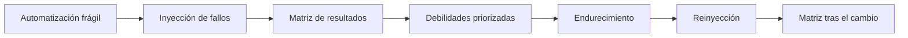
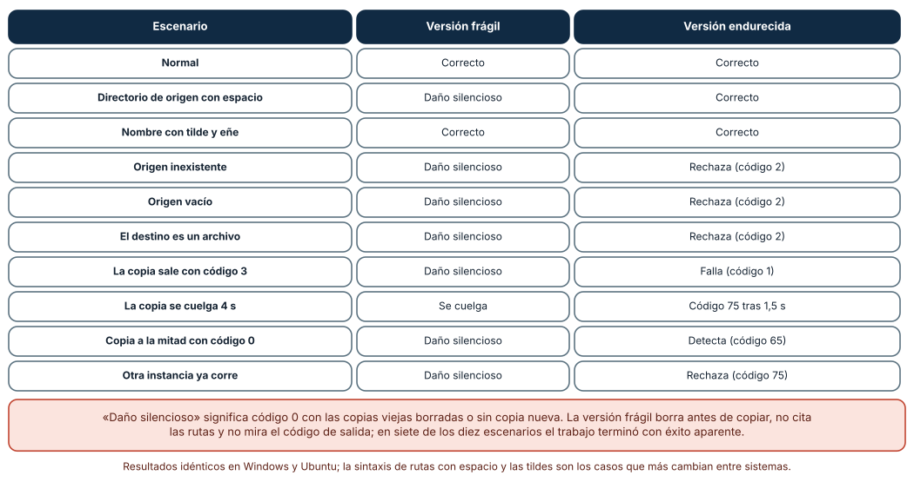
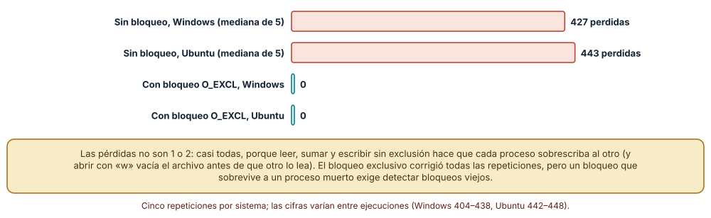
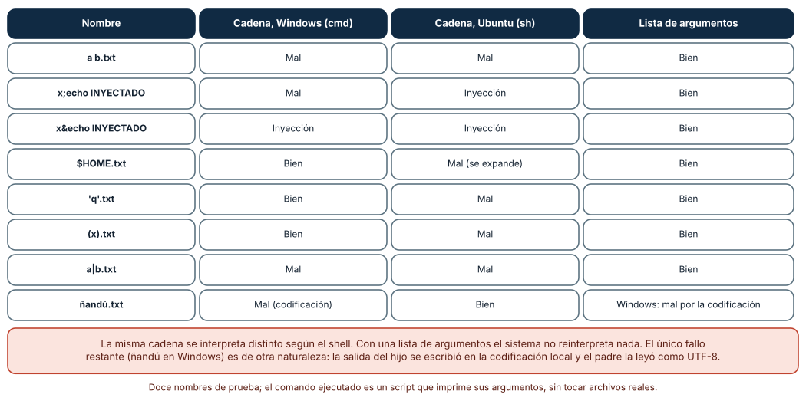

# SE-227 — Taller: endurecer una automatización frágil

[← SE-226 — Telemetría opt-in y privacidad en herramientas](https://github.com/vladimiracunadev-create/modern-software-engineering-program/blob/main/classes/part-18-cli-tui-servicios-y-automatizacion/se-226-telemetria-opt-in-y-privacidad-en-herramientas/README.md) · [↑ Parte 18](https://github.com/vladimiracunadev-create/modern-software-engineering-program/blob/main/classes/part-18-cli-tui-servicios-y-automatizacion/README.md) · [📚 Índice completo](https://github.com/vladimiracunadev-create/modern-software-engineering-program/blob/main/classes/README.md) · [🌐 Portal](https://vladimiracunadev-create.github.io/modern-software-engineering-program/classes/SE-227.html) · [SE-228 — Proyecto: herramienta operable multiplataforma →](https://github.com/vladimiracunadev-create/modern-software-engineering-program/blob/main/classes/part-18-cli-tui-servicios-y-automatizacion/se-228-proyecto-herramienta-operable-multiplataforma/README.md)

## Punto profesional y fundamento pedagógico

**Punto profesional.** El taller existe para recibir una automatización que «funciona en mi máquina», inyectarle los fallos que sufrirá en producción y endurecerla hasta que cada uno termine en un rechazo ruidoso con el estado intacto, aplicando juntas las técnicas de `SE-217` a `SE-226`.

**Por qué aparece aquí.** Se sitúa después de **Telemetría opt-in y privacidad en herramientas** (`SE-226`) y antes de **Proyecto: herramienta operable multiplataforma** (`SE-228`): las diez clases anteriores dieron mecanismos por separado; el taller las combina sobre un caso concreto y mide el resultado, y deja los hallazgos y las pruebas que `SE-228` integrará en un paquete.

**Error conceptual que debe corregir.** Creer que endurecer es «añadir manejo de errores» y que si el camino feliz funciona el resto es una cuestión de mala suerte. Los fallos de una automatización no son raros: son un conjunto finito y enumerable —entrada ausente, ruta con espacios, herramienta colgada, otra instancia, copia a medias— y se inyectan.

**Secuencia de aprendizaje.** Antes de leer la solución, predices en cuántos de diez fallos una copia de seguridad frágil termina con éxito aparente y daña las copias existentes; después los inyectas, endureces y repites, y pruebas dos fallos más profundos: la actualización perdida entre procesos y el citado de argumentos. La secuencia usa predicción, explicación propia, contraste y recuperación. [ICAP](https://icap.education.asu.edu/research) distingue participación de construcción de conocimiento; [How People Learn II](https://nap.nationalacademies.org/catalog/24783/how-people-learn-ii-learners-contexts-and-cultures) exige conectar conocimiento previo, contexto y transferencia; la [práctica de recuperación](https://pubmed.ncbi.nlm.nih.gov/16507066/) respalda producir de nuevo la explicación tras una demora; y [Education for Life and Work](https://nap.nationalacademies.org/resource/13398/dbasse_084153.pdf) exige devolución que explique la causa del error.

**Evidencia de aprendizaje.** `hardening-log.md` con la lista de debilidades encontradas, la matriz de diez fallos antes y después, la medición de la actualización perdida con y sin bloqueo y el cuadro de citado. Debe contener predicción previa, observación, explicación causal, contraejemplo y qué fallo queda sin cubrir.

**Límite de la conclusión.** La automatización, las copias y los diez fallos son del autor; la herramienta de copia es un script de Python que simula fallos con una variable de entorno; el bloqueo es de archivo en un equipo, no distribuido; no se probaron permisos, disco lleno real, red ni antivirus.

### Trazabilidad fuente → afirmación

| Fuente primaria u oficial | Afirmación que respalda | Lo que no prueba |
|---|---|---|
| [Python: `subprocess` y consideraciones de seguridad](https://docs.python.org/3/library/subprocess.html#security-considerations) | Advierte de la inyección de comandos con `shell=True` y recomienda pasar una lista de argumentos. | No dice cómo se cita en cada shell. |
| [OWASP: Command Injection](https://owasp.org/www-community/attacks/Command_Injection) | Describe la inyección de comandos: datos que el intérprete trata como órdenes. | No es específico de Python. |
| [CWE-78: OS Command Injection](https://cwe.mitre.org/data/definitions/78.html) | Cataloga la neutralización incorrecta de elementos especiales en comandos del sistema. | No mide la frecuencia en un código concreto. |
| [ShellCheck wiki](https://www.shellcheck.net/wiki/) | Explica errores típicos de los guiones de shell: variables sin comillas, ignorar códigos de salida. | Es una herramienta de análisis, no un estándar. |
| [Python: `os` y `O_EXCL`](https://docs.python.org/3/library/os.html) | Documenta `O_CREAT \| O_EXCL`: crear un archivo falla si ya existe, base de un bloqueo. | No resuelve los bloqueos huérfanos. |

## Antes de empezar

Recupera lo aprendido en `SE-226`: lo que no debe salir se prueba con casos negativos. La pregunta activa es: **¿qué fallos va a sufrir esta automatización, cómo los provoco a propósito y qué estado deja cada uno?**

## Prerrequisitos

- Haber completado `SE-226` o poder explicar cómo se prueba una compuerta con casos negativos.
- Python 3.11 o posterior; WSL2 con Ubuntu para el segundo sistema.
- Trabajar en directorios temporales y con archivos sintéticos.

## Problema auténtico

La copia de seguridad de `notas` es un script de cuarenta líneas que alguien escribió hace dos años: borra las copias más antiguas, copia el archivo del día con una orden de shell y termina. Funciona. Una noche el directorio de origen cambió de nombre a «mi origen»; el script no copió nada, borró una copia vieja y terminó con éxito. Nadie lo supo hasta que hizo falta restaurar. El taller reconstruye esa noche, diez veces, con diez fallos distintos.

## Objetivos observables

Al terminar podrás:

1. inventariar las debilidades de una automatización (entrada, salida, procesos, concurrencia, estado) y priorizarlas por daño;
2. inyectar fallos de forma controlada y clasificar el resultado en correcto, ruidoso con daño, silencioso con daño o colgado;
3. endurecer la automatización con validación previa, verificación, tiempo límite, bloqueo y reemplazo atómico, y volver a medir;
4. demostrar con una prueba de concurrencia la pérdida de actualizaciones y su corrección con un bloqueo;
5. citar argumentos de procesos hijos sin depender de un shell.

## Mapa conceptual



El mapa se lee como un ciclo: se mide el estado actual, se endurece y se vuelve a medir con los mismos fallos. El ciclo termina cuando cada fallo tiene un resultado esperado y una prueba. No describe un orden de implementación.

## Temas y por qué importan

| Tema | Por qué cambia una decisión profesional | Evidencia mínima |
|---|---|---|
| Inyección de fallos | Convierte «puede pasar» en «pasa y lo vemos». | Predicción, traza causal y contraejemplo de **Inyección** en `hardening-log.md` |
| Validación y verificación | Rechazar antes de dañar y comprobar después de hacer. | Predicción, traza causal y contraejemplo de **Validación** en `hardening-log.md` |
| Tiempo límite y bloqueo | Un proceso colgado o duplicado no debe romper el sistema. | Predicción, traza causal y contraejemplo de **Límites** en `hardening-log.md` |
| Concurrencia | Leer-modificar-escribir sin exclusión pierde casi todo. | Predicción, traza causal y contraejemplo de **Concurrencia** en `hardening-log.md` |
| Citado de argumentos | Una cadena la reinterpreta cada shell de una manera. | Predicción, traza causal y contraejemplo de **Citado** en `hardening-log.md` |

## Conceptos y decisiones

### 1. Un taller de endurecimiento tiene método

Primero se **lee** la automatización buscando debilidades conocidas: rutas sin comillas, códigos de salida ignorados, borrado antes de verificar, ausencia de tiempo límite y de bloqueo, escritura en el sitio. Segundo, se **define el resultado esperado** de cada fallo posible: ¿qué debe quedar si no hay origen? ¿Y si la copia está a medias? Tercero, se **inyecta** cada fallo y se compara. Cuarto, se **endurece** una debilidad por vez y se vuelve a inyectar. El método hace visible lo que antes era intuición y deja pruebas que evitan que vuelva.

### 2. Clasificar los resultados

Cada ejecución con un fallo cae en una de cuatro clases: **correcto** (éxito completo o rechazo ruidoso con el estado intacto), **ruidoso con daño** (falla y deja el sistema peor), **silencioso con daño** (termina con éxito aparente y deja el sistema peor) y **colgado** (no termina). La clase más peligrosa es la tercera: no deja rastro. Por eso el éxito aparente después de un fallo es la métrica central del taller. Y por eso cada operación termina con una **verificación** de que el resultado es el esperado, no con la ausencia de excepciones.

### 3. Validar antes, verificar después

Antes de tocar nada: el origen existe y no está vacío, el destino es un directorio, hay espacio (o al menos se detecta el fallo de escritura). Después de la copia: el tamaño coincide, el resumen coincide, el archivo está completo. Y el orden de las acciones destructivas importa: **primero se crea y se verifica lo nuevo; solo entonces se retira lo viejo**. La versión frágil hacía lo contrario, y por eso una copia fallida costaba una copia existente.

### 4. Tiempo límite, bloqueo y reemplazo atómico

Una herramienta externa puede colgarse: se le pone un **tiempo límite** y su vencimiento es un fallo temporal (código 75). Dos instancias simultáneas pueden pisarse: se toma un **bloqueo** (crear un archivo con `O_CREAT | O_EXCL`, que falla si ya existe) y se libera en un `finally`; un bloqueo huérfano, tras una caída, necesita detección de antigüedad. Y la copia se escribe en un temporal y se publica con un **reemplazo atómico** (`SE-224`), para que nadie vea una copia a medias.

### 5. El citado es del shell, no de Python

Cuando se construye una orden como cadena y se ejecuta con `shell=True`, la interpreta el shell del sistema: `cmd.exe` en Windows, `sh` en Linux. Cada uno trata distinto los espacios, `;`, `&`, `|`, `$`, las comillas y los paréntesis. Un nombre de archivo con uno de esos caracteres puede partir el argumento o ejecutar otra orden (inyección). La defensa es no usar el shell: pasar los argumentos como una **lista** que el sistema entrega al proceso sin reinterpretar. Si hace falta un shell, se cita con la función que corresponde a ese shell y se valida el valor.

### Diez fallos, dos versiones

Se construyó una copia de seguridad en dos versiones y se inyectaron diez escenarios: normal, directorio de origen con espacio, nombre con tilde y eñe, origen inexistente, origen vacío, destino que es un archivo, herramienta de copia que sale con 3, herramienta que se cuelga 4 s, copia que queda a la mitad y sale con 0, y otra instancia ya en marcha. La **versión frágil** (borra antes de copiar, no cita rutas, ignora el código de salida, sin tiempo límite ni bloqueo) acertó en **2** escenarios, se colgó en **1** y causó **daño silencioso** en **7**. La **versión endurecida** acertó en los **10**: rechazó con código 2 (origen inexistente, vacío, destino inválido), 1 (la copia sale con 3), 65 (la copia a medias, detectada por el resumen) o 75 (colgada tras 1,5 s, o ya hay otra instancia), siempre con las tres copias existentes intactas.

```python
fd = os.open(lock, os.O_CREAT | os.O_EXCL | os.O_WRONLY)   # falla si ya hay otra instancia
try:
    r = subprocess.run([PY, HELPER, src, tmp], timeout=1.5)  # lista, sin shell, con tiempo límite
    if r.returncode != 0: return 1
    if sha256(tmp) != sha256(src): return 65                 # verifica antes de publicar
    os.replace(tmp, final)                                    # publica; solo entonces limpia lo viejo
finally:
    os.close(fd); os.remove(lock)
```



**Cómo leer la figura.** Cada fila es un fallo; las columnas comparan el resultado de las dos versiones. **Dónde deja de valer:** los diez fallos los eligió el autor; un caso no inyectado (permisos, disco lleno real, un antivirus que bloquea) puede romper la versión endurecida. Los resultados fueron idénticos en Windows y en Ubuntu, pero el escenario del nombre con tilde depende de la codificación de la consola.

### Actualizaciones perdidas entre procesos

Tres procesos incrementan 150 veces cada uno un contador guardado en un archivo (leer, sumar, escribir): se esperan 450. **Sin bloqueo**, en cinco repeticiones, se perdieron en **Windows 404, 424, 427, 433 y 438** actualizaciones (mediana 427) y en **Ubuntu 442, 443, 443, 443 y 448** (mediana 443): casi todas, porque abrir el archivo con `"w"` lo vacía antes de que otro proceso lea y cada uno vuelve a escribir un valor viejo. **Con un archivo de bloqueo `O_EXCL`**, las cinco repeticiones perdieron **0** en ambos sistemas.



**Cómo leer la figura.** Cada barra es la mediana de cinco repeticiones; la coral es sin bloqueo y la teal con él. **Dónde deja de valer:** el contador en un archivo exagera el efecto por el vaciado al abrir; con un archivo temporal y reemplazo atómico las pérdidas serían menores pero no nulas. El bloqueo es de un equipo; entre máquinas hace falta otro mecanismo, y un bloqueo huérfano tras una caída no se midió.

### El mismo nombre, tres intérpretes

Se pasaron doce nombres de archivo a un proceso hijo que imprime sus argumentos, una vez como cadena con `shell=True` y otra como lista. Con `shell=True`, **seis nombres se interpretaron mal en Windows y ocho en Ubuntu**, con **una inyección de comando en Windows** (`x&echo INYECTADO`) y **dos en Ubuntu** (con `;` y con `&`). Entre los casos: `a b.txt` se partió en dos argumentos en ambos; `$HOME.txt` se expandió en Ubuntu y no en Windows; `'q'.txt` y `(x).txt` fallaron en Ubuntu y no en Windows. Con la lista de argumentos, los doce fueron correctos en Ubuntu y once en Windows: el fallo restante, `ñandú.txt`, fue de codificación de la salida del hijo (la consola usa la codificación local y el padre la leyó como UTF-8), no del citado.



**Cómo leer la figura.** Cada fila es un nombre; las tres columnas son el resultado con la cadena en Windows, con la cadena en Ubuntu y con la lista. **Dónde deja de valer:** son doce nombres elegidos por el autor y dos shells; PowerShell, bash en Windows u otros tienen reglas propias. La última fila es un recordatorio de que el citado no es el único problema de los nombres no ASCII.

## Definiciones de trabajo

- **inyección de fallos:** provocar deliberadamente una condición de error para observar cómo responde el sistema.
- **fallo silencioso:** terminación con éxito aparente después de un error que dejó el sistema en peor estado.
- **endurecimiento:** conjunto de cambios que hace que una automatización rechace o tolere condiciones adversas sin dañar el estado.
- **bloqueo (lock):** mecanismo de exclusión mutua; aquí, un archivo creado en exclusiva.
- **inyección de comandos:** ejecución de órdenes no previstas porque un dato se interpretó como parte de la orden.

Las definiciones son operativas para la herramienta `notas`. No convierten términos con historia más amplia en sinónimos y deben contrastarse con la documentación primaria enlazada al final.

## Ejemplo mínimo

El fragmento muestra cómo una ruta con espacio rompe una orden en forma de cadena. Antes de ejecutarlo, predice cuántos argumentos ve el hijo en cada caso.

```python
import subprocess, sys
hijo = "import sys; print(len(sys.argv) - 1)"
nombre = "mi origen.txt"
print(subprocess.run(f'"{sys.executable}" -c "{hijo}" {nombre}', shell=True, capture_output=True, text=True).stdout.strip())
print(subprocess.run([sys.executable, "-c", hijo, nombre], capture_output=True, text=True).stdout.strip())
```

Imprime 2 y 1: la cadena se partió en el espacio y la lista no. Añade `;` y observa qué más cambia; registra versión y sistema.

## Ejemplo profesional

El equipo adopta una lista de comprobación de endurecimiento para cada automatización: validar entradas antes de actuar, listas de argumentos sin shell, tiempo límite en cada proceso externo, bloqueo con `O_EXCL` y limpieza en `finally`, escritura en temporal con reemplazo atómico, verificación por resumen, orden «crear y verificar, luego retirar», códigos de salida de `SE-220` y un registro con inicio, fin y resultado. Una suite de diez fallos inyectados corre en cada cambio en Windows y en Ubuntu y falla si algún escenario termina con éxito aparente o con una copia menos. El registro del taller guarda la matriz antes y después.

Compara el caso normal con un origen movido, una herramienta colgada y dos instancias. El endurecimiento es apropiado cuando los tres terminan con un código distinto de 0 y las copias intactas; es peligroso cuando el único síntoma es que «hoy no hay copia nueva».

## Práctica guiada

1. Lee la automatización frágil y lista sus debilidades con la posible consecuencia de cada una.
2. Predice en cuántos de diez fallos terminará con éxito aparente y daño.
3. Implementa el inyector de diez fallos y clasifica cada resultado en las cuatro clases.
4. Endurece una debilidad por vez y vuelve a ejecutar la matriz hasta que cada fallo sea correcto.
5. Mide la actualización perdida de un contador con tres procesos, con y sin bloqueo.
6. Pasa doce nombres difíciles como cadena y como lista y compara con el esperado.
7. Pide a otra persona que reproduzca las dos matrices solo desde `hardening-log.md`.

## Ejercicios

1. **Bloqueo huérfano:** una caída deja el archivo de bloqueo; diseña la detección por antigüedad y el riesgo de quitar un bloqueo de una instancia aún viva.
2. **Undécimo fallo:** inventa un fallo que la versión endurecida no cubra (por ejemplo, el origen cambia durante la copia) y escribe el escenario y la defensa.
3. **Orden de acciones:** reordena la versión frágil para que borre al final y calcula cuántos de los diez fallos dejan de causar daño solo con ese cambio.
4. **Citado en shell:** si no queda más remedio que usar un shell, escribe la función de citado para `sh` y una prueba con los nombres difíciles.

## Reto verificable

Entrega `hardening-log.md` con las debilidades, la matriz de diez fallos antes y después, la medición del contador con y sin bloqueo y la tabla de citado. Se aprueba si otra persona ejecuta el código desde un checkout limpio, obtiene la misma matriz (2 correctos, 1 colgado y 7 con daño silencioso en la versión frágil; 10 correctos en la endurecida), el mismo patrón de pérdidas (casi todas sin bloqueo, ninguna con él) y puede señalar un fallo que el taller no cubrió. No se aprueba por añadir `try/except` ni por «probar en mi máquina».

## Caso conductor

La herramienta `notas` es el caso conductor de la Parte 18. El taller endurece su copia de seguridad con las técnicas de las clases anteriores: contrato de códigos (`SE-220`), tiempo límite y reinicios (`SE-222`), reemplazo atómico y reanudación (`SE-224`), verificación de integridad (`SE-225`) y compuerta de privacidad (`SE-226`). `SE-228` reúne todo en un paquete operable. Cambia después un solo detalle, el tiempo límite de 1,5 s a 10 s, y revisa cuántos escenarios cambian y qué pasa con un cuelgue real de 8 s.

## Preguntas frecuentes

### ¿Por qué inyectar fallos en lugar de revisar el código?

Porque la revisión descubre los fallos que ya imaginamos; la inyección descubre los que el código no maneja aunque nadie los imaginara. Y deja una prueba que se repite.

### ¿Cuántos fallos hay que inyectar?

Los que correspondan a las debilidades encontradas más los que el entorno ya produjo en incidentes pasados. Diez bien elegidos valen más que cien al azar; pero la lista nunca es completa y debe crecer con cada incidente.

### ¿Siempre hay que evitar `shell=True`?

Casi siempre. Su uso se justifica cuando se necesita una función del shell (redirecciones, comodines) que no se puede reproducir de otra manera, y entonces los valores externos se citan con la función del shell concreto y se validan.

### ¿Un bloqueo de archivo sirve entre máquinas?

No en general: depende del sistema de archivos y no es fiable en discos de red. Entre máquinas hace falta un servicio de coordinación o un mecanismo con garantías, y esa decisión excede esta clase.

## Fallo controlado y diagnóstico

Reproduce el fallo clásico de la clase: **éxito aparente tras borrar antes de copiar**. Usa la versión frágil con el directorio de origen «mi origen».

Registra síntoma, entrada mínima, hipótesis, observación que descarta cada hipótesis, causa, corrección y prueba de regresión. **Síntoma:** el trabajo terminó con código 0, no existe copia nueva y falta una copia vieja. **Hipótesis rivales:** (a) el disco estaba lleno; (b) la herramienta de copia falló por un permiso; (c) la ruta con espacio partió el argumento y la copia no encontró el origen. **Prueba:** el hijo recibió dos argumentos en lugar de uno; el código de la copia (distinto de 0) se ignoró; el borrado ocurrió antes. **Conclusión:** la causa es la tercera, agravada por ignorar el código y por el orden de las acciones. **Regresión:** pasar una lista de argumentos, comprobar el código, verificar el resumen y retirar copias viejas solo tras publicar la nueva; añadir una prueba con un origen con espacio. No cambies a la vez el citado y el orden de las acciones.

## Errores comunes y cómo corregirlos

| Síntoma | Causa probable | Corrección |
|---|---|---|
| El trabajo termina con 0 sin hacer nada | Se ignora el código de la herramienta externa | Comprobar el código y propagarlo |
| Se pierden copias existentes tras un fallo | Se borra antes de verificar lo nuevo | Crear y verificar primero; retirar después |
| Una ruta con espacio rompe la orden | Se construyó una cadena con `shell=True` | Lista de argumentos, sin shell |
| Dos instancias se pisan | No hay exclusión | Bloqueo con `O_EXCL` y limpieza en `finally` |
| El proceso externo se cuelga y bloquea el trabajo | No hay tiempo límite | `timeout` y código temporal |

## Entorno y archivos clave

```text
work/SE-227/
├── README.md
├── copia_fragil.py
├── copia_endurecida.py
├── experimentos/
│   ├── inyector.py
│   ├── contador.py
│   └── citado.py
└── evidence/hardening-log.md
```

El `README` declara plataforma, versión de Python y comandos. Los experimentos usan solo la biblioteca estándar (`subprocess`, `multiprocessing`, `hashlib`, `os`) y se ejecutaron con CPython 3.12.9 en Windows 11 y 3.12.3 en Ubuntu bajo WSL2: la matriz de diez fallos fue idéntica; las pérdidas del contador y el citado difirieron por sistema y se informan como resultados.

## Seguridad, ética y accesibilidad

- los experimentos operan en directorios temporales y con archivos sintéticos; nunca inyectes fallos sobre copias reales;
- la inyección de comandos de la tabla usa un `echo` inocuo; no pruebes cargas que borren o descarguen nada;
- una copia de seguridad es una promesa a las personas cuyos datos guarda: verifica que se puede restaurar, no solo que se creó;
- los registros del taller no deben incluir rutas reales ni nombres de usuario;
- respeta las licencias de las herramientas externas y atribuye las adaptaciones.

## Puente hacia el trabajo con agentes

Un agente al que se le pide «hazlo robusto» suele envolver el script en `try/except`, imprimir «error» y devolver 1, sin separar tipos de fallo, sin verificar y manteniendo `shell=True`. Pídele la lista de debilidades, el inyector de diez fallos, la matriz antes y después, el orden «crear, verificar, retirar» y una ejecución en los dos sistemas. Revisa especialmente si alguno de los diez escenarios sigue terminando con éxito aparente y si se añadió algún mensaje que oculte el código de la herramienta externa.

## Transferencia

Traslada el taller a otra automatización frágil (por ejemplo, un guion que sincroniza una carpeta con un servicio de almacenamiento de pruebas): lista sus debilidades, inyecta diez fallos y mide cuántos terminan con éxito aparente. La transferencia está lograda cuando puedes explicar qué parte del endurecimiento dependía del tipo de recurso y cuál era general, no cuando la lista de comprobación se parece.

## Evaluación y evidencia

| Criterio | Evidencia para aprobar |
|---|---|
| comprensión | explicación de por qué el éxito aparente tras un fallo es el peor resultado |
| corrección | matriz reproducible de diez fallos antes y después |
| diseño | endurecimiento con validación, verificación, límite, bloqueo y reemplazo |
| diagnóstico | reproducción del fallo «borrar antes de copiar» con regresión |
| incertidumbre | declaración de qué fallos no se inyectaron |
| reproducibilidad | versiones, comandos, salida y límites declarados |

## Fuentes

- [Python: `subprocess` y consideraciones de seguridad](https://docs.python.org/3/library/subprocess.html#security-considerations) — `shell=True` y listas de argumentos; autoridad: documentación de Python.
- [OWASP: Command Injection](https://owasp.org/www-community/attacks/Command_Injection) — inyección de comandos; autoridad: OWASP.
- [CWE-78: OS Command Injection](https://cwe.mitre.org/data/definitions/78.html) — catalogación de la debilidad; autoridad: MITRE.
- [ShellCheck wiki](https://www.shellcheck.net/wiki/) — errores típicos en guiones de shell; autoridad: proyecto ShellCheck.
- [Python: `os`](https://docs.python.org/3/library/os.html) — `O_EXCL`, `os.replace` y `os.open`; autoridad: documentación de Python.
- [Python: `multiprocessing`](https://docs.python.org/3/library/multiprocessing.html) — procesos del experimento del contador; autoridad: documentación de Python.

Cada fuente respalda el mecanismo indicado; ninguna demuestra que la lista de diez fallos sea la que tu automatización necesita. Esa afirmación depende de su historia de incidentes.

- [Python: `hashlib`](https://docs.python.org/3/library/hashlib.html) — verificación de la copia por resumen.
- [Python: `tempfile`](https://docs.python.org/3/library/tempfile.html) — directorios temporales de las pruebas.

## Límites y siguiente paso

Se ejecutaron tres experimentos en Windows y Ubuntu (WSL2): la matriz de fallos fue idéntica; el contador y el citado difirieron por sistema. Los diez fallos, las dos versiones y el contador son del autor; no se probaron permisos, disco lleno, red ni antivirus, ni bloqueos huérfanos. La siguiente clase reúne todo en un paquete operable y multiplataforma.

## Glosario

- **inyección de fallos:** provocar deliberadamente una condición de error para observar cómo responde el sistema.
- **fallo silencioso:** terminación con éxito aparente después de un error que dejó el sistema en peor estado.
- **endurecimiento:** conjunto de cambios que hace que una automatización rechace o tolere condiciones adversas sin dañar el estado.
- **bloqueo (lock):** mecanismo de exclusión mutua; aquí, un archivo creado en exclusiva.
- **inyección de comandos:** ejecución de órdenes no previstas porque un dato se interpretó como parte de la orden.

---

[← SE-226 — Telemetría opt-in y privacidad en herramientas](https://github.com/vladimiracunadev-create/modern-software-engineering-program/blob/main/classes/part-18-cli-tui-servicios-y-automatizacion/se-226-telemetria-opt-in-y-privacidad-en-herramientas/README.md) · [↑ Parte 18](https://github.com/vladimiracunadev-create/modern-software-engineering-program/blob/main/classes/part-18-cli-tui-servicios-y-automatizacion/README.md) · [📚 Índice completo](https://github.com/vladimiracunadev-create/modern-software-engineering-program/blob/main/classes/README.md) · [🌐 Portal](https://vladimiracunadev-create.github.io/modern-software-engineering-program/classes/SE-227.html) · [SE-228 — Proyecto: herramienta operable multiplataforma →](https://github.com/vladimiracunadev-create/modern-software-engineering-program/blob/main/classes/part-18-cli-tui-servicios-y-automatizacion/se-228-proyecto-herramienta-operable-multiplataforma/README.md)
