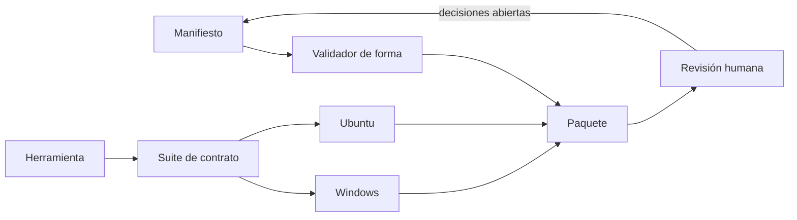
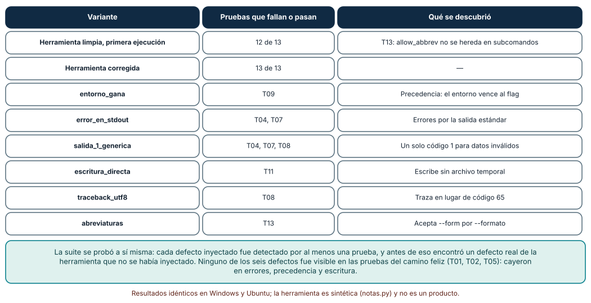
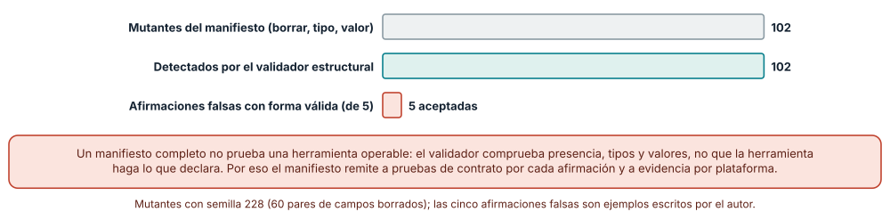
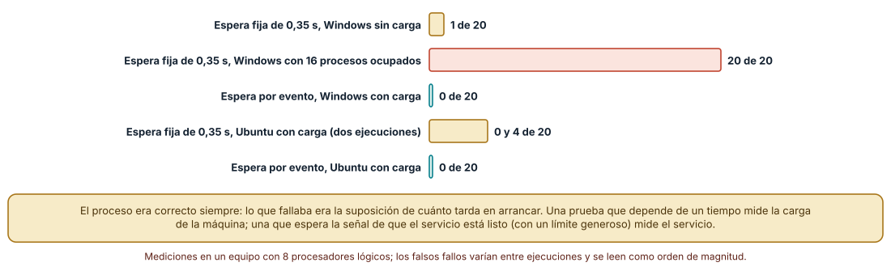

# SE-228 — Proyecto: herramienta operable multiplataforma

[← SE-227 — Taller: endurecer una automatización frágil](https://github.com/vladimiracunadev-create/modern-software-engineering-program/blob/main/classes/part-18-cli-tui-servicios-y-automatizacion/se-227-taller-endurecer-una-automatizacion-fragil/README.md) · [↑ Parte 18](https://github.com/vladimiracunadev-create/modern-software-engineering-program/blob/main/classes/part-18-cli-tui-servicios-y-automatizacion/README.md) · [📚 Índice completo](https://github.com/vladimiracunadev-create/modern-software-engineering-program/blob/main/classes/README.md) · [🌐 Portal](https://vladimiracunadev-create.github.io/modern-software-engineering-program/classes/SE-228.html) · [SE-229 — Plataforma web, HTML semántico y CSS →](https://github.com/vladimiracunadev-create/modern-software-engineering-program/blob/main/classes/part-19-web-frontend-y-aplicaciones-progresivas/se-229-plataforma-web-html-semantico-y-css/README.md)

## Punto profesional y fundamento pedagógico

**Punto profesional.** El proyecto existe para entregar una herramienta de línea de comandos con un paquete que otra persona pueda revisar sin ejecutar nada: contrato observable, configuración, códigos, ciclo de vida, entrega y privacidad declarados, con pruebas de contrato ejecutadas en dos sistemas y una lista honesta de lo que ningún manifiesto puede probar.

**Por qué aparece aquí.** Es la clase final de la Parte 18, después de **Taller: endurecer una automatización frágil** (`SE-227`). Reúne el contrato de `SE-217`, los flujos de `SE-218`, la precedencia de `SE-219`, los códigos de `SE-220`, la presentación de `SE-221`, el ciclo de vida de `SE-222`, la programación de `SE-223`, la reanudación de `SE-224`, la entrega de `SE-225` y la privacidad de `SE-226`, y deja un paquete que la Parte 19 (web y aplicaciones progresivas) podrá tomar como ejemplo de operabilidad.

**Error conceptual que debe corregir.** Creer que un manifiesto completo prueba una herramienta operable. Un manifiesto declara; las pruebas de contrato comprueban lo que se puede observar; y lo que ninguno ve —que la copia se pueda restaurar, que el usuario entienda el mensaje— exige a una persona.

**Secuencia de aprendizaje.** Antes de leer la solución, predices cuántos defectos de un manifiesto detecta un validador estructural y cuántas afirmaciones falsas acepta, qué defectos de la herramienta detecta una suite de trece pruebas de contrato y cuántos falsos fallos produce una prueba que espera un tiempo; después lo mides. La secuencia usa predicción, explicación propia, contraste y recuperación. [ICAP](https://icap.education.asu.edu/research) distingue participación de construcción de conocimiento; [How People Learn II](https://nap.nationalacademies.org/catalog/24783/how-people-learn-ii-learners-contexts-and-cultures) exige conectar conocimiento previo, contexto y transferencia; la [práctica de recuperación](https://pubmed.ncbi.nlm.nih.gov/16507066/) respalda producir de nuevo la explicación tras una demora; y [Education for Life and Work](https://nap.nationalacademies.org/resource/13398/dbasse_084153.pdf) exige devolución que explique la causa del error.

**Evidencia de aprendizaje.** El paquete `operable-package/` descrito más abajo, con `manifest`, herramienta, suite de contrato y registros de las dos plataformas. Debe contener predicción previa, observación, explicación causal, contraejemplo y la lista de decisiones humanas abiertas.

**Límite de la conclusión.** La herramienta `notas.py` es de 100 líneas y sintética; el manifiesto tiene 17 campos escritos por el autor; los 102 mutantes y las cinco afirmaciones falsas son supuestos; los falsos fallos de las pruebas con tiempo son de un equipo con 8 procesadores lógicos y variaron entre ejecuciones; no se firmó ni se publicó nada y no se probó en macOS.

### Trazabilidad fuente → afirmación

| Fuente primaria u oficial | Afirmación que respalda | Lo que no prueba |
|---|---|---|
| [Command Line Interface Guidelines](https://clig.dev/) | Reúne las prácticas de diseño de interfaces de línea de comandos que el paquete declara. | No mide su adopción ni su efecto. |
| [The Twelve-Factor App](https://12factor.net/config) | Configuración en el entorno, procesos desechables y registros como flujos. | No cubre herramientas locales de escritorio. |
| [SLSA](https://slsa.dev/) | Niveles de seguridad de la cadena de suministro de artefactos. | No certifica este paquete. |
| [Python: `unittest`](https://docs.python.org/3/library/unittest.html) | Marco de pruebas de la biblioteca estándar para ejecutar el contrato. | No decide qué probar. |
| [Semantic Versioning 2.0.0](https://semver.org/) | Reglas para versionar el contrato de la herramienta. | No decide cuándo un cambio es compatible. |

## Antes de empezar

Recupera lo aprendido en `SE-227`: se inyectan los fallos y se vuelve a medir. La pregunta activa es: **¿qué debe poder comprobar una persona sin ejecutar nada, qué debe poder comprobar una máquina al ejecutarla y qué solo puede juzgar un humano?**

## Prerrequisitos

- Haber completado `SE-217` a `SE-227`, o poder explicar la gramática, los flujos, la precedencia, los códigos, el ciclo de vida, la reanudación, la entrega y la privacidad de `notas`.
- Python 3.11 o posterior; Windows y WSL2 con Ubuntu para las dos plataformas.
- Trabajar con datos sintéticos y sin publicar nada.

## Problema auténtico

La plataforma de entregas quiere publicar `notas` para que otros equipos la usen. Hoy existen un script, una página de ayuda desactualizada y tres guiones que lo invocan. Antes de aceptarla, el comité técnico pide un paquete que responda: ¿qué promete la herramienta?, ¿cómo se configura y qué pasa si falla?, ¿cómo se arranca, se detiene y se actualiza?, ¿qué recoge y con qué consentimiento?, ¿en qué sistemas se comprobó y con qué resultado?, ¿qué queda sin comprobar y quién decide?

## Objetivos observables

Al terminar podrás:

1. entregar un paquete con un manifiesto de operabilidad, una herramienta y una suite de contrato, y poder explicar cada parte;
2. ejecutar la suite en Windows y en Ubuntu y comparar los resultados sin esconder las diferencias;
3. probar la suite con defectos inyectados en la herramienta y medir cuáles detecta;
4. validar la forma del manifiesto con mutantes y declarar lo que ese validador no puede ver;
5. separar lo observable por máquina, lo observable por revisión y lo que depende de una decisión humana.

## Mapa conceptual



El mapa se lee como un circuito: el manifiesto se valida por forma, la herramienta se prueba en dos sistemas, y el paquete llega a una revisión humana que puede devolver decisiones al manifiesto. No describe un orden obligatorio de trabajo.

## Temas y por qué importan

| Tema | Por qué cambia una decisión profesional | Evidencia mínima |
|---|---|---|
| Contrato observable | Lo que se promete debe poder ejecutarse. | Predicción, traza causal y contraejemplo de **Contrato** en el paquete |
| Manifiesto de operabilidad | Reúne las promesas para que otra persona las revise sin ejecutar. | Predicción, traza causal y contraejemplo de **Manifiesto** en el paquete |
| Dos plataformas | Lo que no se ejecutó en un sistema no se sabe. | Predicción, traza causal y contraejemplo de **Plataformas** en el paquete |
| Defectos inyectados | Una suite que nunca falla no prueba nada. | Predicción, traza causal y contraejemplo de **Mutantes** en el paquete |
| Pruebas sin flakiness | Una prueba que depende del tiempo mide la máquina. | Predicción, traza causal y contraejemplo de **Flakiness** en el paquete |

## Conceptos y decisiones

### 1. El paquete es lo que se revisa

El paquete tiene cuatro partes. **La herramienta** (`notas.py`, cien líneas) con la gramática de `SE-217`, la lectura de `-` de `SE-218`, la precedencia de `SE-219`, los códigos de `SE-220`, la escritura atómica de `SE-224`. **El manifiesto** (`operability.json`), de 17 campos: nombre y versión, destino de ayuda y de flujos, tabla de códigos, orden de precedencia, señales, bloqueo, escritura, telemetría, integridad, plataformas con su evidencia, actualización, registro, soporte, responsable y límites. **La suite de contrato** (trece pruebas) que ejecuta la herramienta como lo haría un guion. **La evidencia**: la salida de la suite en cada plataforma y el registro de decisiones abiertas. Quien revisa puede leer el manifiesto, abrir la evidencia y decidir sin ejecutar nada.

### 2. El manifiesto declara; la suite comprueba

Un manifiesto sin pruebas es una promesa; una suite sin manifiesto es un conjunto de comprobaciones que nadie sabe qué cubren. Cada fila del manifiesto con contenido observable debe remitir a una o más pruebas: los códigos de salida a T03, T04, T07 y T08; la precedencia a T09; la escritura atómica a T11; el cierre de la tubería a T12. Lo que no tiene prueba se declara como tal. Esa trazabilidad es lo que permite a la revisión saber qué se verificó por máquina y qué se afirma por escrito.

### 3. Dos plataformas, una tabla de diferencias

Ejecutar la suite en Windows y en Ubuntu y publicar solo «pasa» esconde lo interesante. Lo que se registra es una **tabla de diferencias**: qué salida cambió y por qué. En este proyecto, el hash de un archivo escrito con el modo de texto por defecto difirió (`a5b38bad23415ba9` en Windows y `9105e05b084e0394` en Ubuntu) porque Windows traduce los saltos de línea; con `newline` fijado a `\n` y la escritura en bytes, ambos dieron `9105e05b084e0394`. La tabla convierte una sorpresa de producción en una decisión de diseño documentada.

### 4. Una suite se prueba con defectos

Una suite que nunca falla puede ser ciega. Se prueba inyectando defectos conocidos en la herramienta y comprobando que alguna prueba falla. En este proyecto se inyectaron seis, activados con una variable de entorno de diagnóstico: el entorno que gana al flag, los errores por stdout, un único código genérico para datos inválidos, la escritura directa sin temporal, una traza ante una entrada no UTF-8 y las abreviaturas aceptadas. Cada uno debe caer en al menos una prueba, y si un defecto sobrevive, falta una prueba. El proceso encontró además un defecto no inyectado en la propia herramienta.

### 5. Las pruebas no dependen del reloj

Una prueba que arranca un proceso y «espera 0,35 s» antes de mirar si está listo mide la carga de la máquina. Una que espera el evento (la línea «listo» en la salida, un archivo, un puerto) con un límite generoso mide el servicio. La diferencia no es de estilo: con la CPU ocupada, la primera produce falsos fallos casi siempre. Y una suite con falsos fallos entrena al equipo a ignorar los fallos, que es peor que no tener suite.

### El paquete, la herramienta y la suite

La herramienta `notas.py` (sintética, de 100 líneas) expone un subcomando `exportar` que lee un CSV de archivo o de `-`, valida las notas, aplica la precedencia flag > entorno no vacío > archivo > valor por defecto, y escribe en stdout o, con `--salida`, en un temporal que se reemplaza de forma atómica. Los códigos son 0, 2 (uso), 65 (datos) y 75; no acepta abreviaturas; trata `errno` 22 y 32 como cierre del consumidor. La suite tiene trece pruebas (T01–T13): ayuda, versión, uso incorrecto, entrada inexistente, salida exacta con LF, BOM y CRLF de entrada, nota fuera de rango, entrada no UTF-8, precedencia en cuatro pasos, `--salida` con espacio y tilde, caída a mitad de escritura, cierre de la tubería y abreviaturas rechazadas.

```python
def resolver(flag, entorno, archivo, defecto):
    if flag is not None: return flag
    if entorno: return entorno          # entorno vacío = no definido
    if archivo is not None: return archivo
    return defecto
```

En la primera ejecución la suite pasó **12 de 13** pruebas: T13 reveló que `allow_abbrev=False` del analizador raíz **no se hereda en el subcomando**, de modo que `--form json` se aceptaba. Se corrigió pasándolo a `add_parser("exportar", allow_abbrev=False)` y la suite pasó **13 de 13** en Windows y en Ubuntu.



**Cómo leer la figura.** Cada fila es una variante de la herramienta; la segunda columna dice qué pruebas fallan o pasan y la tercera, qué se descubrió. **Dónde deja de valer:** seis defectos y trece pruebas escritos por el autor sobre una herramienta de cien líneas; una suite real tendría más defectos posibles que pruebas. Que los seis caigan no prueba que no haya un séptimo.

### Un manifiesto de 17 campos: 102 mutantes

El validador estructural comprueba presencia y tipo de los 17 campos y reglas de valor: la ayuda va a stdout, el diagnóstico a stderr, los códigos 0 y 2 existen, la precedencia es exactamente flag > entorno > archivo > defecto, `SIGTERM` está entre las señales, la telemetría está apagada por defecto y respeta `DO_NOT_TRACK`, el algoritmo de integridad es SHA-256 o SHA-512, hay al menos dos plataformas con evidencia, existe un camino de reversión y el registro no incluye datos personales. Se generaron **102 mutantes**: borrar cada uno de los 17 campos, cambiar el tipo de cada uno, seis valores semánticos incorrectos, una precedencia permutada, una sola plataforma y 60 pares de campos borrados (semilla 228). El validador detectó los **102**. Pero aceptó **las cinco afirmaciones falsas con forma válida** que se probaron: declarar `SIGTERM` sin manejarlo, declarar `sha256` y publicar `md5`, declarar `datos_personales: false` mientras se registran rutas, declarar evidencia de Windows que nunca se ejecutó y declarar una reversión que no se probó.



**Cómo leer la figura.** La barra gris son los mutantes generados; la teal, los detectados; la coral, las afirmaciones falsas que el validador acepta. **Dónde deja de valer:** los mutantes son cambios mecánicos del autor, y detectarlos es fácil porque el validador se escribió con esas reglas; las afirmaciones falsas son ejemplos, no un catálogo. El resultado delimita el alcance: el validador protege la forma, las pruebas protegen la conducta y la revisión humana protege el sentido.

### Esperar un tiempo o esperar un evento

Una prueba arranca un proceso que tarda 0,15 s en estar listo y comprueba que lo está. Con **espera fija de 0,35 s**, en Windows falló **1 de 20** sin carga y **20 de 20** con 16 procesos ocupando la CPU; esperando la línea «listo» (con un límite de 10 s) falló **0 de 20** en ambos casos. En Ubuntu con la misma carga, la espera fija falló **0 y 4 de 20** en dos ejecuciones y la espera por evento **0**.



**Cómo leer la figura.** Cada barra cuenta falsos fallos en 20 intentos; la coral es la espera fija con carga. **Dónde deja de valer:** el hijo siempre arranca; lo que falla es la suposición del tiempo. Las cifras son de un equipo con 8 procesadores lógicos y cambian entre ejecuciones; Windows arranca Python más despacio que Ubuntu y se ve más afectado.

## Definiciones de trabajo

- **manifiesto de operabilidad:** documento estructurado que declara las promesas operativas de una herramienta.
- **prueba de contrato:** prueba que ejecuta la herramienta como lo haría un consumidor y comprueba código, flujos y efectos.
- **mutante:** copia del código o del manifiesto con un defecto inyectado para comprobar que una prueba lo detecta.
- **tabla de diferencias:** registro de qué salidas cambian entre plataformas y por qué.
- **decisión humana abierta:** punto que el paquete no puede resolver y que debe tomar una persona con autoridad.

Las definiciones son operativas para la herramienta `notas`. No convierten términos con historia más amplia en sinónimos y deben contrastarse con la documentación primaria enlazada al final.

## Ejemplo mínimo

El fragmento ejecuta una prueba de contrato sobre la herramienta. Antes de ejecutarlo, predice el código y el flujo.

```python
import subprocess, sys
r = subprocess.run([sys.executable, "notas.py", "exportar", "-", "--zzz"],
                   input=b"id,nota\nent-1,80\n", capture_output=True)
assert r.returncode == 2 and not r.stdout and r.stderr
print("contrato de uso incorrecto: ok")
```

Debería imprimir «ok». Cambia `--zzz` por `--form` con y sin `allow_abbrev=False` en el subcomando; registra versión y sistema.

## Ejemplo profesional

El paquete `operable-package/` contiene: `README.md` (qué es y cómo revisarlo en diez minutos), `notas.py`, `operability.json`, `tests/contract_suite.py`, `evidence/windows.txt` y `evidence/ubuntu.txt` (salida de la suite con versiones), `evidence/diferencias.md` (tabla de diferencias), `evidence/mutantes.md` (defectos inyectados y qué prueba los detecta), `evidence/humano.md` (decisiones abiertas: quién firma, qué ventana de soporte, qué se hace si el hash no coincide) y una huella SHA-256 de todos los archivos con el salto de línea fijado. Un validador comprueba el manifiesto y que cada fila observable remite a una prueba existente.

Compara el caso normal con una revisión que solo lee el manifiesto, una que ejecuta la suite en una sola plataforma y una que inyecta un defecto. El paquete es apropiado cuando cada una llega a una conclusión coherente con las demás; es peligroso cuando la única evidencia de Windows es una frase en el manifiesto.

## Práctica guiada

1. Ejecuta la herramienta y escribe, a mano, su contrato (gramática, flujos, códigos, precedencia).
2. Ejecuta la suite de trece pruebas en Windows y en Ubuntu y guarda la salida de cada una.
3. Compara las salidas y escribe la tabla de diferencias con su explicación.
4. Inyecta los seis defectos, ejecuta la suite y registra qué pruebas fallan.
5. Escribe el manifiesto de 17 campos y valídalo; después genera mutantes y mide la detección.
6. Añade cinco afirmaciones falsas con forma válida y registra cuáles acepta el validador.
7. Reemplaza una espera fija por una espera por evento y mide los falsos fallos con y sin carga.
8. Calcula la huella SHA-256 del paquete con el salto de línea fijado y compárala entre sistemas.
9. Pide a otra persona que revise el paquete en diez minutos sin ejecutar nada y registra qué preguntas le quedan.

## Ejercicios

1. **Prueba nueva:** añade una prueba T14 para una propiedad del manifiesto sin cobertura (por ejemplo, que la telemetría está apagada por defecto) y un defecto que la haga fallar.
2. **Trazabilidad:** escribe un validador que compruebe que cada fila observable del manifiesto cita una prueba existente, y genera un mutante que cite una inexistente.
3. **macOS:** decide qué evidencia pedirías para añadir una tercera plataforma y qué diferencias esperas (señales, rutas, codificación).
4. **Decisión humana:** redacta la decisión abierta «qué ventana de soporte ofrecemos» con opciones, costes y quién decide.

## Reto verificable

Entrega el paquete `operable-package/` con herramienta, manifiesto, suite, evidencia de las dos plataformas, tabla de diferencias, registro de mutantes y decisiones abiertas. Se aprueba si otra persona, desde un checkout limpio, ejecuta la suite en su sistema y obtiene 13 de 13, reproduce el resultado de los seis defectos (1, 2, 3, 1, 1 y 1 pruebas que fallan), valida el manifiesto (102 de 102 mutantes detectados) y puede señalar al menos una afirmación del paquete que no puede comprobarse por máquina. No se aprueba por un paquete extenso ni por una suite que pasa solo en el sistema de quien la escribió.

## Caso conductor

La herramienta `notas` es el caso conductor de la Parte 18, y este proyecto la cierra: contrato, flujos, configuración, códigos, presentación, ciclo de vida, programación, reanudación, entrega y privacidad, en un paquete revisable. La Parte 19 pasa de herramientas de terminal a la plataforma web, y tomará la misma pregunta —qué se promete, cómo se comprueba y qué queda a juicio humano— para aplicaciones con interfaz. Cambia después un solo detalle, un nuevo subcomando `validar`, y revisa qué filas del manifiesto, qué pruebas y qué evidencia deben cambiar.

## Preguntas frecuentes

### ¿Para qué un manifiesto si ya hay documentación?

La documentación explica; el manifiesto declara en forma estructurada lo que una revisión o una herramienta puede comprobar. Es la parte de la documentación que se puede validar y vincular a pruebas.

### ¿Basta con pasar la suite en un sistema?

No: lo que no se ejecutó en un sistema no se sabe. Se vio que el hash de un archivo cambió por el salto de línea, que el código 256 se lee distinto y que la excepción de la tubería rota difiere. Cada sistema declarado necesita su evidencia.

### ¿Cuántos defectos hay que inyectar a la suite?

Los suficientes para cubrir cada propiedad del contrato y los que corresponden a incidentes pasados. Seis defectos cubrieron seis propiedades; la suite sigue sin probar muchas otras, y esa lista se declara.

### ¿Quién decide lo que el paquete deja abierto?

Una persona con autoridad sobre el producto: quién firma el artefacto, cuánto tiempo se soporta una versión, qué hacer ante un fallo de integridad. El paquete debe nombrar la decisión, las opciones y el responsable, no tomarla en silencio.

## Fallo controlado y diagnóstico

Reproduce el fallo clásico de la clase: **una afirmación del manifiesto que el validador acepta y que es falsa**. Usa «declara `SIGTERM` pero no lo maneja».

Registra síntoma, entrada mínima, hipótesis, observación que descarta cada hipótesis, causa, corrección y prueba de regresión. **Síntoma:** el paquete pasa el validador y, al detener la herramienta con una exportación en curso en Windows, el archivo queda incompleto. **Hipótesis rivales:** (a) el validador tiene una regla mal escrita; (b) el manifiesto no menciona las señales; (c) el manifiesto menciona `SIGTERM` y la herramienta no lo maneja. **Prueba:** el validador exige que la lista de señales contenga `SIGTERM`, y la contiene; ejecutar la herramienta y enviarle la señal no deja marca de limpieza. **Conclusión:** la causa es la tercera: el validador comprueba presencia, no conducta. **Regresión:** añadir una prueba de contrato que envíe la señal (o `CTRL_BREAK_EVENT`) con trabajo en curso y exija un archivo completo, y hacer que la fila del manifiesto cite esa prueba. No cambies a la vez el manifiesto y la herramienta.

## Errores comunes y cómo corregirlos

| Síntoma | Causa probable | Corrección |
|---|---|---|
| El manifiesto dice una cosa y la herramienta hace otra | El validador comprueba forma, no conducta | Remitir cada fila observable a una prueba que se ejecute |
| La suite pasa en un sistema y falla en otro | Solo se probó en el sistema de quien la escribió | Ejecutar y registrar en dos sistemas, con tabla de diferencias |
| La suite nunca falla | No se ha probado con defectos | Inyectar defectos y comprobar que cada uno cae |
| Falsos fallos intermitentes | Una prueba espera un tiempo fijo | Esperar un evento con un límite generoso |
| La huella del paquete cambia entre sistemas | Se escribió con el salto de línea por defecto | Fijar `newline` y calcular el resumen sobre bytes |

## Entorno y archivos clave

```text
operable-package/
├── README.md
├── notas.py
├── operability.json
├── tests/
│   └── contract_suite.py
└── evidence/
    ├── windows.txt
    ├── ubuntu.txt
    ├── diferencias.md
    ├── mutantes.md
    └── humano.md
```

El `README` declara plataforma, versión de Python, semilla (228) y comandos. Los experimentos usan solo la biblioteca estándar (`argparse`, `csv`, `subprocess`, `hashlib`, `threading`) y se ejecutaron con CPython 3.12.9 en Windows 11 y 3.12.3 en Ubuntu bajo WSL2: la suite, los mutantes y el validador dieron resultados idénticos; el hash con el modo de texto por defecto y los falsos fallos con tiempo difirieron, y se informan como resultados.

## Seguridad, ética y accesibilidad

- el paquete no debe contener secretos, rutas reales ni datos personales; las huellas se calculan sobre bytes con el salto de línea fijado;
- una afirmación de seguridad (firma, integridad, telemetría apagada) sin prueba es una promesa que puede dañar a quien confía en ella: márcala como no comprobada;
- las decisiones humanas abiertas deben tener responsable y fecha, no quedar como una nota;
- el manifiesto y la evidencia deben poder leerse como texto, con tablas y sin depender del color;
- respeta las licencias de las herramientas incluidas y atribuye las adaptaciones; esta clase no es asesoría jurídica ni de seguridad.

## Puente hacia el trabajo con agentes

Un agente al que se le pide «prepara el paquete de la herramienta» suele producir un manifiesto bien formado, una suite que pasa en su máquina y un README entusiasta, sin ejecutar en dos sistemas ni inyectar defectos. Pídele la tabla de qué prueba respalda cada fila, la salida de la suite en ambos sistemas, los seis defectos inyectados con los resultados y una lista de lo que no se comprobó. Revisa especialmente las afirmaciones de seguridad y de plataforma que no tienen prueba y cualquier prueba que espere un tiempo fijo.

## Transferencia

Traslada el proyecto a otra herramienta de línea de comandos (por ejemplo, un asistente de despliegue de un equipo): escribe su manifiesto, su suite de contrato, inyecta defectos y ejecútala en dos sistemas. La transferencia está lograda cuando puedes explicar qué parte del paquete dependía de la herramienta y cuál era una estructura general, no cuando los archivos se parecen.

## Evaluación y evidencia

| Criterio | Evidencia para aprobar |
|---|---|
| comprensión | explicación de qué comprueba cada capa: validador, suite y revisión humana |
| corrección | suite de contrato que pasa en dos sistemas y mutantes detectados |
| diseño | manifiesto con filas que remiten a pruebas y paquete revisable en diez minutos |
| diagnóstico | reproducción del fallo «afirmación falsa con forma válida» con regresión |
| incertidumbre | lista de decisiones humanas abiertas y de lo no comprobado |
| reproducibilidad | versiones, semilla, comandos, huella del paquete y límites declarados |

## Fuentes

- [Command Line Interface Guidelines](https://clig.dev/) — prácticas de diseño de interfaces de línea de comandos; autoridad: guía de autores.
- [The Twelve-Factor App](https://12factor.net/config) — configuración, procesos y registros; autoridad: guía de autores, de uso extendido.
- [SLSA](https://slsa.dev/) — seguridad de la cadena de suministro; autoridad: OpenSSF.
- [Python: `unittest`](https://docs.python.org/3/library/unittest.html) — marco de pruebas; autoridad: documentación de Python.
- [Semantic Versioning 2.0.0](https://semver.org/) — versionado del contrato; autoridad: especificación de la comunidad.
- [Python: `subprocess`](https://docs.python.org/3/library/subprocess.html) — ejecución de la herramienta como consumidor.

Cada fuente respalda el mecanismo indicado; ninguna demuestra que el paquete sea suficiente para una organización concreta. Esa afirmación depende de quien lo revisa y de la decisión humana.

- [Python: `hashlib`](https://docs.python.org/3/library/hashlib.html) — huella del paquete.
- [Python: `threading`](https://docs.python.org/3/library/threading.html) — lectura de la salida del hijo en las pruebas con espera por evento.

## Límites y siguiente paso

Se ejecutaron tres experimentos en Windows y Ubuntu (WSL2): la suite, los mutantes y el validador fueron idénticos; el hash con el modo de texto por defecto y los falsos fallos con tiempo difirieron. La herramienta, el manifiesto, los 102 mutantes y las cinco afirmaciones falsas son supuestos del autor; no se firmó ni se publicó nada, no se probó macOS ni una cadena de entrega real, y la lista de decisiones humanas no está resuelta. La siguiente parte pasa de las herramientas de terminal a la plataforma web y las aplicaciones progresivas.

## Glosario

- **manifiesto de operabilidad:** documento estructurado que declara las promesas operativas de una herramienta.
- **prueba de contrato:** prueba que ejecuta la herramienta como lo haría un consumidor y comprueba código, flujos y efectos.
- **mutante:** copia del código o del manifiesto con un defecto inyectado para comprobar que una prueba lo detecta.
- **tabla de diferencias:** registro de qué salidas cambian entre plataformas y por qué.
- **decisión humana abierta:** punto que el paquete no puede resolver y que debe tomar una persona con autoridad.

---

[← SE-227 — Taller: endurecer una automatización frágil](https://github.com/vladimiracunadev-create/modern-software-engineering-program/blob/main/classes/part-18-cli-tui-servicios-y-automatizacion/se-227-taller-endurecer-una-automatizacion-fragil/README.md) · [↑ Parte 18](https://github.com/vladimiracunadev-create/modern-software-engineering-program/blob/main/classes/part-18-cli-tui-servicios-y-automatizacion/README.md) · [📚 Índice completo](https://github.com/vladimiracunadev-create/modern-software-engineering-program/blob/main/classes/README.md) · [🌐 Portal](https://vladimiracunadev-create.github.io/modern-software-engineering-program/classes/SE-228.html) · [SE-229 — Plataforma web, HTML semántico y CSS →](https://github.com/vladimiracunadev-create/modern-software-engineering-program/blob/main/classes/part-19-web-frontend-y-aplicaciones-progresivas/se-229-plataforma-web-html-semantico-y-css/README.md)
