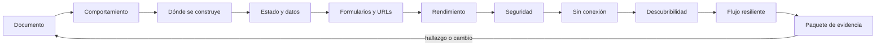

# Parte 19 — Web, frontend y aplicaciones progresivas

La Parte 18 terminó con herramientas que otras personas operan desde un terminal o un servicio. La pregunta cambia de «quién ejecuta mi programa» a «qué agente interpreta mi documento y qué le prometo»: el navegador, las tecnologías de apoyo y los buscadores leen la misma página con propósitos distintos. Esta parte trabaja sobre **una aplicación web de entregas de tareas que debe seguir funcionando con una conexión que va y viene**, un caso sintético que recorre las doce clases: un formulario con estructura accesible, un manejador de eventos que no depende del orden de carga, una decisión de dónde se construye el HTML, un estado con identidad, una validación que no excluye, URLs que sobreviven a un rediseño, un presupuesto de rendimiento, una política de seguridad, un service worker con una cola de envíos idempotentes, metadatos que se auditan, un flujo con fallos modelado como máquina de estados y un paquete de evidencia que otra persona puede revisar.

## Pregunta rectora

> ¿Qué promete este documento a quien lo lee sin verlo, qué hace cuando falla la red y cómo se comprueba cada promesa?

## Antes del recorrido clase por clase

Esta parte no enseña un marco. Enseña a medir qué defectos de estructura encuentra una regla y cuáles solo ve una persona, a predecir el orden de ejecución de un programa con microtareas, a decidir dónde se construye una página con bytes medidos, a elegir identidad para los elementos de una lista, a validar sin excluir a nadie, a decidir qué viaja en la URL, a fijar un presupuesto con un percentil y una muestra, a codificar por contexto, a asignar una estrategia de caché por recurso, a contener las URLs que un rastreador ve, a modelar un flujo con fallos y a entregar un paquete con su declaración de límites. Cada clase ejecuta experimentos con datos sintéticos que muestran un mecanismo (un linter que detecta 200 de 220 defectos y ninguno de los 20 que cambian el significado, una cadena de microtareas que deja sin turno a un temporizador, un estado copiado que diverge de su fuente, un reintento sincronizado que tarda 902 segundos) y declaran lo que ese experimento no demuestra.

El diagrama se lee de izquierda a derecha y no es un proceso obligatorio. El retorno indica que un hallazgo de la revisión, un cambio de política o un defecto en una costura reabre el documento; un paquete aprobado no cierra la aplicación, la fecha.

## Resultados acumulativos

Podrás distinguir el HTML válido del accesible y medir qué detecta un linter acotado; calcular razones de contraste y especificidad; predecir el orden de ejecución de microtareas y tareas y atender eventos con delegación sin perder los de un hijo; elegir entre renderizado en cliente, servidor, estático y regenerado con bytes medidos y supuestos explícitos; reconocer un desajuste de hidratación; elegir la clave de una lista y derivar en lugar de copiar estado; descartar respuestas fuera de orden; comparar validadores de correo con un corpus etiquetado, normalizar Unicode y decidir cuándo mostrar un error; normalizar URLs, resolver rutas sin ambigüedad y llevar estado a la URL; estimar un percentil con su intervalo y comprobar un presupuesto; codificar por contexto, evaluar una política de contenido y cerrar la vía de falsificación entre sitios; comparar estrategias de caché, versionar por huella y reintentar con claves de idempotencia; entender qué controla `robots.txt` frente a `noindex`; modelar un flujo con fallos, mutarlo y simular reintentos con dispersión; y entregar un manifiesto, unas cabeceras y una matriz de pruebas con su cobertura y su lista de límites.

Al finalizar podrás defender una aplicación web con estructura accesible, comportamiento predecible, estrategias elegidas con evidencia, un flujo con fallos modelado, comprobadores con sus límites medidos, un responsable y una lista de lo que ninguna herramienta ve, y podrás indicar qué parte de tu conclusión es observación, cuál es inferencia y cuál es suposición.

## Prerrequisitos enlazados

- [Parte 3 — Redes, Internet y protocolos](https://github.com/vladimiracunadev-create/modern-software-engineering-program/blob/main/classes/part-03-redes-internet-y-protocolos/): HTTP, caché, compresión y la cadena de peticiones que una página dispara.
- [Parte 6 — Paradigmas de programación](https://github.com/vladimiracunadev-create/modern-software-engineering-program/blob/main/classes/part-06-paradigmas-de-programacion/): eventos, estado y funciones que sustentan el modelo de un componente.
- [Parte 7 — Estructuras de datos y algoritmos](https://github.com/vladimiracunadev-create/modern-software-engineering-program/blob/main/classes/part-07-estructuras-de-datos-y-algoritmos/): árboles, búsqueda y complejidad, usadas en el enrutador y en la reconciliación de listas.
- [Parte 13 — Especificaciones, contratos y modelos](https://github.com/vladimiracunadev-create/modern-software-engineering-program/blob/main/classes/part-13-especificaciones-contratos-y-modelos/): máquinas de estados, esquemas y contratos que el flujo de esta parte reutiliza.
- [Parte 18 — CLI, TUI, servicios y automatización](https://github.com/vladimiracunadev-create/modern-software-engineering-program/blob/main/classes/part-18-cli-tui-servicios-y-automatizacion/): herramientas operables y servicios con reintentos y tiempos de espera.
- Python 3.11+ y terminal; Node.js 20+ para el experimento del bucle de eventos. Los experimentos usan solo bibliotecas estándar y datos sintéticos.

## Bloques y progresión

1. **El documento y su comportamiento:** las clases 229–230 fijan la estructura accesible y la cascada, y el modelo de ejecución y de eventos del navegador.
2. **Construir y mantener la interfaz:** las clases 231–233 deciden dónde se produce el HTML, qué estado vive dónde y cómo se aceptan y se avisan los datos que escribe una persona.
3. **Direcciones, rendimiento y seguridad:** las clases 234–236 definen las URLs, el presupuesto de rendimiento y las defensas del navegador.
4. **Sin conexión y descubrible:** las clases 237–238 hacen que la aplicación siga funcionando sin red y que se pueda encontrar sin engañar.
5. **Aplicar e integrar:** las clases 239–240 reúnen todo en un flujo con fallos modelado y en un paquete de evidencia con su declaración de límites.

## Evidencia medida y límites

Las figuras y los ejemplos de esta parte usan experimentos ejecutados con CPython 3.12.9 y Node.js 24.11 en Windows 11 y repetidos con CPython 3.12.3 y Node.js 20.20 en Ubuntu bajo WSL2. Los datos son **sintéticos** y las semillas están fijadas: las salidas fueron idénticas en ambos sistemas salvo los tiempos de compresión y de render en Python, que se informan como medidas de un equipo y no entran en ninguna conclusión. En la comparación entre Node 24 y Node 20 de la clase `SE-230` los 300 programas generados dieron el mismo orden de salida con el modelo de dos colas.

Los experimentos son: un linter semántico de ocho reglas aplicado a 220 mutaciones, razones de contraste de 5000 pares de colores y una guerra de especificidad con una calculadora verificada con once ejemplos de la especificación (`SE-229`); un modelo de dos colas frente al motor sobre 300 programas, un modelo mínimo de DOM con delegación de eventos y la simulación de debounce y throttle sobre 1000 pulsaciones (`SE-230`); los bytes de una página de 500 filas, un modelo de tiempo hasta el primer contenido, el desajuste de hidratación por zona horaria y la obsolescencia de una página regenerada (`SE-231`); un reconciliador con clave por posición y por identidad, un total copiado frente a derivado y las respuestas fuera de orden de una búsqueda (`SE-232`); seis validadores de correo frente a un corpus de 64 direcciones, nombres con Unicode normalizado y una validación en cada pulsación (`SE-233`); doce maneras de escribir 200 URLs, un enrutador por lista y por árbol y la ida y vuelta de 2000 estados por la URL (`SE-234`); la compresión de cinco activos con cuatro algoritmos, una cascada de seis recursos y la estimación de un percentil 75 con 30, 300 y 3000 visitas (`SE-235`); una matriz de dieciséis cargas en cinco contextos, un linter de políticas de contenido y las reglas de SameSite y de CORS (`SE-236`); cinco estrategias de caché sobre 20 000 peticiones, descargas por versión y duplicados al reintentar (`SE-237`); dos analizadores de `robots.txt`, las URLs de una navegación facetada y un auditor de metadatos con 120 mutaciones (`SE-238`); una máquina de ocho estados con 18 mutaciones, 1000 clientes que reintentan a la vez y nueve defectos de accesibilidad frente a seis reglas (`SE-239`); y un validador de manifiesto con 120 mutaciones, una auditoría de cabeceras de un servidor local y una suite de pares frente a 60 defectos de tres factores (`SE-240`).

Los parámetros (las 220 mutaciones y las once clases de defecto, la población lognormal de tiempos, el 20 % de confirmaciones perdidas, los desvíos de reloj de dos minutos, el 8 % de olvidos, las latencias de 120 y 200 ms, los perfiles de red de tres niveles, los 60 defectos de tres factores) son supuestos del autor, no datos de un producto, una institución ni de personas reales. Las reglas de los linters y los auditores se escribieron sabiendo qué mutaciones se aplicarían y se evaluaron sin casos nuevos: su exactitud real en páginas existentes es desconocida. No se usó ningún navegador, lector de pantalla, herramienta de auditoría de producción, marco de interfaz, service worker real, buscador ni servicio de correo, no se atacó ningún sistema y no se midió a ninguna persona. Esta parte no tiene laboratorio propio en `labs/`; el proyecto integrador `SE-240` define el paquete y la evidencia. Cada clase termina con un puente hacia el trabajo con agentes.

## Guía razonada clase por clase

La aplicación de entregas mantiene un formulario, una cola de envíos y un paquete estables mientras cambian las decisiones. Cada clase explica qué defecto reduce, qué experimento lo muestra, qué no demuestra y qué evidencia permite abandonar la conclusión.

### Bloque 1 — El documento y su comportamiento

#### SE-229 — Plataforma web, HTML semántico y CSS

Un documento que se ve bien puede ser inoperable: el navegador construye un árbol de accesibilidad a partir de la semántica, no del aspecto. La clase mide qué detecta un linter de ocho reglas sobre 220 mutaciones y qué no (un texto alternativo engañoso), calcula razones de contraste para mostrar que el tono no predice el cumplimiento y simula la carrera de especificidad frente a las capas.

El estudiante entrega la página base, el linter y una paleta con contraste anotado. `SE-230` pregunta qué ocurre cuando el documento se vuelve dinámico.

#### SE-230 — JavaScript, DOM y eventos del navegador

Un solo hilo con dos colas explica por qué una cadena de microtareas deja sin turno a un temporizador y por qué un clic en un icono no llega a un delegado que compara el destino. La clase predice el orden de 300 programas, simula una delegación en un modelo de DOM y cuenta las llamadas que deja pasar cada técnica de ritmo.

El estudiante entrega el modelo de colas, la delegación con `closest` y una política de ritmo. `SE-231` pregunta dónde conviene construir el documento.

### Bloque 2 — Construir y mantener la interfaz

#### SE-231 — Renderizado cliente, servidor, estático e híbrido

Cada estrategia mueve costo entre la red, el servidor y el dispositivo, y una diferencia de zona horaria basta para que servidor y cliente no coincidan. La clase mide los bytes de una página de 500 filas, alimenta un modelo de tiempo con supuestos explícitos, reproduce un desajuste de hidratación y calcula cuántas visitas ven una página regenerada ya desactualizada.

El estudiante entrega la tabla de estrategias por página con su caducidad. `SE-232` pasa a qué datos necesita una interfaz viva.

#### SE-232 — Estado, componentes y gestión de datos

La identidad de un elemento no es su posición, una copia es una promesa que alguna rama olvidará y la última respuesta que llega no es la última consulta. La clase mide seis cambios de una lista con dos claves, simula cuándo un total copiado diverge y cuenta cuántas búsquedas terminan mostrando una consulta vieja.

El estudiante entrega el reconciliador, la clasificación del estado y una política de respuestas. `SE-233` aplica esas reglas al dato que escribe una persona.

#### SE-233 — Formularios, validación y experiencia de error

Una expresión regular no define qué es un correo válido, y un error en cada pulsación avisa de que la entrada no ha terminado. La clase compara seis validadores sobre un corpus etiquetado, cuenta cuántas personas ve un sistema según normalice Unicode y mide en qué fracción de pulsaciones muestra un error una validación inmediata.

El estudiante entrega el corpus, la política de validación y el envío idempotente. `SE-234` pregunta cómo se llega a cada pantalla.

### Bloque 3 — Direcciones, rendimiento y seguridad

#### SE-234 — Navegación, routing y URLs durables

Muchas URLs nombran un recurso, el orden de declaración decide una ruta ambigua y lo que va en la URL se comparte. La clase normaliza 2400 variantes de 200 recursos en cuatro niveles, compara una búsqueda lineal con un árbol de segmentos y recupera 2000 estados de filtro con cuatro codificaciones.

El estudiante entrega la tabla de URLs, la política de normalización y la de redirecciones. `SE-235` pregunta cuánto cuesta servir esas páginas.

#### SE-235 — Rendimiento web y presupuestos

Optimizar es cortar la cadena que decide, y declarar que se cumple con pocas visitas es una apuesta. La clase mide la compresión de cinco activos, modela una cascada de seis recursos para mostrar qué optimización acorta la ruta crítica y estima un percentil 75 con 30, 300 y 3000 visitas.

El estudiante entrega el presupuesto con su comprobador y la justificación de cada optimización. `SE-236` pregunta qué puede hacer la página con lo que recibe.

#### SE-236 — Seguridad del navegador y políticas de contenido

El mismo dato es inofensivo o ejecutable según el contexto, una política laxa casi no restringe y CORS no protege al servidor. La clase ejecuta 16 cargas en cinco contextos con cuatro codificaciones, evalúa un linter de políticas de contenido y construye las tablas de cuándo viaja una cookie y qué petición requiere una comprobación previa.

El estudiante entrega una función de salida por contexto, una política probada en solo informe y la configuración de cookie y de CORS. `SE-237` hace que la aplicación siga funcionando sin red.

### Bloque 4 — Sin conexión y descubrible

#### SE-237 — PWA, caché, offline y sincronización

Cada estrategia de caché cambia obsolescencia por velocidad, el nombre de la caché decide cuánto se vuelve a descargar y reintentar sin identificar la operación la duplica. La clase simula cinco estrategias sobre 20 000 peticiones, compara descargas por versión y mide los duplicados y las ediciones perdidas al sincronizar.

El estudiante entrega la estrategia por recurso, el versionado por huella y la cola con claves de idempotencia. `SE-238` pregunta cómo se descubre la aplicación.

#### SE-238 — SEO, metadatos y descubribilidad

Rastrear no es indexar, y la forma de una etiqueta no es su verdad. La clase compara dos analizadores de `robots.txt`, calcula cuántas URLs expone una navegación facetada y audita metadatos de 120 páginas con mutaciones, declarando que no detecta un título que no corresponde a la página.

El estudiante entrega la política de rastreo, las canónicas y el auditor. `SE-239` integra todo en un flujo.

### Bloque 5 — Aplicar e integrar

#### SE-239 — Taller: construir un flujo web resiliente

La forma de una máquina de estados no protege contra las transiciones que faltan, y reintentar de forma sincronizada convierte un fallo en una avalancha. El taller modela el flujo de entrega con ocho estados, muta cada una de sus 18 transiciones, simula 1000 clientes con tres políticas de reintento y reparte nueve defectos de accesibilidad entre reglas y revisión humana.

El estudiante deja la tabla de estados, la política de reintentos y el plan de escenarios. `SE-240` los verifica de punta a punta.

#### SE-240 — Proyecto: aplicación web accesible y offline

Un manifiesto válido no es una aplicación instalable, unas cabeceras correctas no garantizan que una versión nueva llegue y una suite de pares no cubre las interacciones de tres factores. El proyecto valida un manifiesto con 120 mutaciones, audita las cabeceras de un servidor local y reduce una matriz de 108 casos a 12 midiendo los defectos que escapan, y entrega todo con una declaración de límites.

El estudiante entrega el paquete con `verify.py` y `LIMITES.md`. Con él cierra la Parte 19.

## Criterios de salida

Una persona puede considerar completa esta parte cuando puede demostrar, sin consultar la solución, que:

- explica con un ejemplo y un contraejemplo la diferencia entre HTML válido, accesible y bien presentado;
- predice el orden de ejecución de un programa con microtareas y temporizadores y atiende un evento delegado sin perder el de un hijo;
- elige la estrategia de renderizado de cada página con bytes medidos y declara qué dato obsoleto no tolera;
- usa la identidad como clave, deriva en lugar de copiar y descarta respuestas obsoletas;
- valida con un corpus etiquetado, normaliza Unicode y decide cuándo y cómo mostrar un error;
- escribe una tabla de URLs con su normalización, resuelve rutas sin ambigüedad y lleva estado a la URL con un esquema;
- fija un presupuesto con un percentil y declara cuántas visitas sostienen la afirmación;
- codifica por contexto, evalúa una política de contenido y justifica la configuración de cookies y de CORS;
- asigna una estrategia de caché por recurso, versiona por huella y reintenta con claves de idempotencia;
- separa rastrear, indexar y mostrar y contiene las URLs de una navegación facetada;
- modela un flujo con fallos, muta la tabla de estados y justifica su política de reintentos con una simulación;
- entrega un paquete reproducible con una declaración explícita de lo que no se verificó.

Estos criterios no sustituyen la revisión cualitativa de cada clase: son el conjunto de capacidades que la parte busca dejar demostradas.
