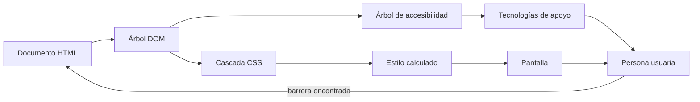
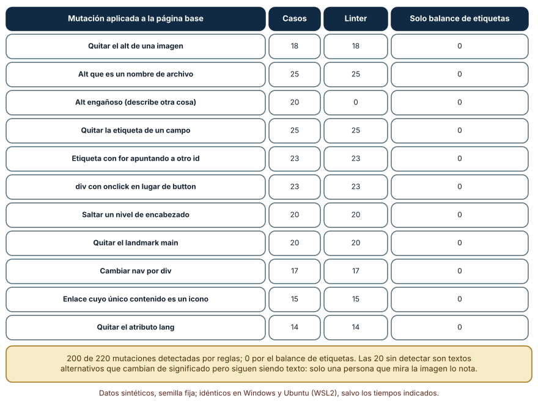
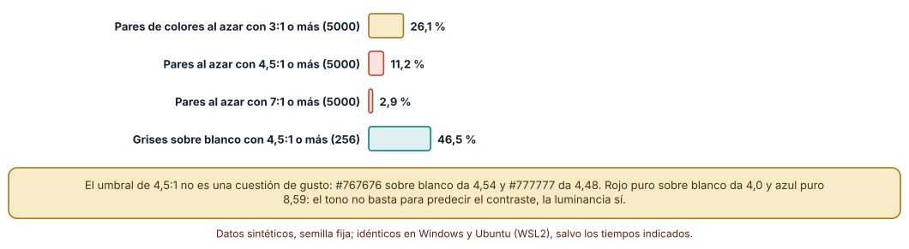
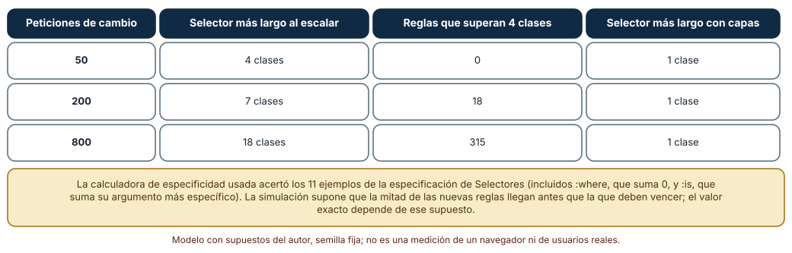

# SE-229 — Plataforma web, HTML semántico y CSS

[← SE-228 — Proyecto: herramienta operable multiplataforma](https://github.com/vladimiracunadev-create/modern-software-engineering-program/blob/main/classes/part-18-cli-tui-servicios-y-automatizacion/se-228-proyecto-herramienta-operable-multiplataforma/README.md) · [↑ Parte 19](https://github.com/vladimiracunadev-create/modern-software-engineering-program/blob/main/classes/part-19-web-frontend-y-aplicaciones-progresivas/README.md) · [📚 Índice completo](https://github.com/vladimiracunadev-create/modern-software-engineering-program/blob/main/classes/README.md) · [🌐 Portal](https://vladimiracunadev-create.github.io/modern-software-engineering-program/classes/SE-229.html) · [SE-230 — JavaScript, DOM y eventos del navegador →](https://github.com/vladimiracunadev-create/modern-software-engineering-program/blob/main/classes/part-19-web-frontend-y-aplicaciones-progresivas/se-230-javascript-dom-y-eventos-del-navegador/README.md)

## Punto profesional y fundamento pedagógico

**Punto profesional.** La clase existe para que trates el HTML y el CSS como un contrato con el navegador y con las tecnologías de apoyo, no como una capa de decoración: un `button` real ya trae foco, teclado y rol; un `div` con `onclick` obliga a reconstruirlo, y a menudo se reconstruye mal. Aprenderás a medir qué defectos de estructura puede encontrar una regla automática y cuáles solo ve una persona.

**Por qué aparece aquí.** Se sitúa después de **Proyecto: herramienta operable multiplataforma** y antes de **JavaScript, DOM y eventos del navegador**: la Parte 18 terminó con programas que se operan desde un terminal o un servicio; la Parte 19 abre una superficie distinta, el navegador, donde quien ejecuta tu software es un agente de usuario que interpreta tu documento. Esta clase fija ese contrato mínimo (estructura, nombre accesible, cascada, contraste) y presenta el caso que recorrerá las doce clases: un **formulario web para entregar una tarea que debe seguir funcionando con conectividad irregular**.

**Error conceptual que debe corregir.** Creer que «si se ve bien, está bien» o que un HTML válido es un HTML accesible: el navegador construye un árbol de accesibilidad a partir de la semántica, no del aspecto, y un documento de etiquetas bien balanceadas puede tener todos los defectos de estructura que importan.

**Secuencia de aprendizaje.** Antes de leer los resultados, predices cuántas de 220 mutaciones de una página detectaría un linter de ocho reglas y cuántas un simple chequeo de etiquetas balanceadas; después calculas razones de contraste, comprobarás el umbral de 4,5:1 en grises y simulas qué pasa con la especificidad cuando cada autor «gana» subiéndola.

**Evidencia de aprendizaje.** `web-log.md` con la página base, el linter, las mutaciones aplicadas, la tabla de contraste de una paleta y la simulación de especificidad, con predicción previa, observación, explicación causal, contraejemplo y qué hallazgo te haría abandonar una regla.

**Límite de la conclusión.** La página, las once mutaciones y la paleta son inventadas por el autor; el linter tiene ocho reglas y no usa un navegador real. Ninguno de los experimentos comprueba cómo un lector de pantalla concreto anuncia la página ni mide personas.

### Trazabilidad fuente → afirmación

| Fuente primaria u oficial | Afirmación que respalda | Lo que no prueba |
|---|---|---|
| [WCAG 2.2 (W3C)](https://www.w3.org/TR/WCAG22/) | Define criterios verificables como el contraste mínimo de 4,5:1 para texto normal (1.4.3), el contraste de 3:1 de componentes (1.4.11) y el reflujo a 320 px de ancho (1.4.10). | No garantiza que una página que cumple los criterios sea utilizable por todas las personas. |
| [HTML Standard (WHATWG)](https://html.spec.whatwg.org/multipage/) | Define los elementos, sus roles de contenido y su comportamiento nativo (formularios, botones, etiquetas). | No dice cómo anuncia cada lector de pantalla un elemento. |
| [CSS Selectors Level 4 (W3C)](https://www.w3.org/TR/selectors-4/#specificity-rules) | Define el cálculo de la especificidad de un selector, incluidos `:is`, `:not` y `:where`. | No dice cómo organizar una hoja de estilos grande. |
| [Using ARIA (W3C)](https://www.w3.org/TR/using-aria/) | Establece que, si hay un elemento HTML nativo con la semántica necesaria, se use en lugar de reconstruirla con ARIA. | No enumera todos los casos en que ARIA es imprescindible. |

## Antes de empezar

Esta clase abre la **Parte 19 sobre una aplicación web de entregas con conectividad irregular**. Recupera de la Parte 18 que una herramienta que otros operan necesita contratos explícitos; en el navegador, el contrato del documento lo interpretan agentes que no son tu código. La pregunta activa es: **¿qué promete mi HTML a quien no ve la pantalla, qué decide mi CSS y qué defectos me enseñaría una máquina frente a los que solo ve una persona?**

## Prerrequisitos

- Haber completado `SE-228` o poder explicar qué evidencia mostró que una herramienta era operable.
- Python 3.11 o posterior y un terminal; los experimentos usan solo la biblioteca estándar (`html.parser`, `re`, `random`).
- Un navegador con herramientas de desarrollo para contrastar la teoría con el árbol de accesibilidad real.

## Problema auténtico

La plataforma de entregas necesita un formulario para subir una tarea. La primera versión la escribió alguien con prisa: encabezados elegidos por tamaño, un `div` con `onclick` como botón de enviar, campos sin etiqueta porque «el placeholder ya lo dice» y un gris claro de texto sobre blanco que «queda elegante». Funciona con ratón, en un monitor bueno y con vista perfecta. Una estudiante que usa el teclado no puede enviar, un lector de pantalla anuncia «campo de edición» sin nombre y en un teléfono al sol el texto desaparece. Nadie probó nada de eso porque en la pantalla del autor se veía bien.

## Objetivos observables

Al terminar podrás:

1. distinguir un elemento con semántica nativa de uno que solo la imita, y justificar con un ejemplo y un contraejemplo cuándo ARIA es necesario;
2. escribir y ejecutar un linter acotado de estructura y medir qué fracción de defectos inyectados detecta y cuáles quedan fuera;
3. calcular la razón de contraste de WCAG y explicar por qué el tono no predice el cumplimiento;
4. calcular la especificidad de un selector y explicar cómo la subida de especificidad se acumula como deuda frente al uso de capas;
5. decidir qué parte de la calidad de un documento se automatiza y qué parte exige revisión humana.

## Mapa conceptual



El mapa se lee desde el documento hacia la persona: el mismo árbol alimenta dos caminos, el visual y el de apoyo, y un defecto de estructura solo es visible en uno de ellos. La flecha de retorno indica que lo que una persona no puede hacer vuelve a corregir el documento, no solo la hoja de estilos.

## Temas y por qué importan

| Tema | Por qué cambia una decisión profesional | Evidencia mínima |
|---|---|---|
| Documento y árbol de accesibilidad | El nombre, el rol y el estado de cada control salen de la semántica; sin ellos no hay nada que anunciar. | Predicción, traza causal y contraejemplo de **Documento y árbol de accesibilidad** en `web-log.md` |
| Semántica nativa frente a ARIA | Un elemento nativo trae comportamiento gratis; reconstruirlo cuesta teclado, foco y estados. | Predicción, traza causal y contraejemplo de **Semántica nativa frente a ARIA** en `web-log.md` |
| Cascada, capas y especificidad | Quien gana una declaración se decide por origen, capa, especificidad y orden; ignorarlo produce escaladas. | Predicción, traza causal y contraejemplo de **Cascada, capas y especificidad** en `web-log.md` |
| Diseño adaptable y reflujo | El contenido debe adaptarse a anchos pequeños y a zoom sin pérdida ni desplazamiento en dos dimensiones. | Predicción, traza causal y contraejemplo de **Diseño adaptable y reflujo** en `web-log.md` |
| Contraste y color como dato | El contraste se calcula, no se opina; el color no puede ser el único canal de información. | Predicción, traza causal y contraejemplo de **Contraste y color como dato** en `web-log.md` |

## Conceptos y decisiones

### 1. Documento y árbol de accesibilidad

El navegador analiza el HTML y construye el DOM; a partir de él deriva un árbol de accesibilidad con, para cada nodo relevante, un **rol** (botón, campo de texto, encabezado), un **nombre accesible** (lo que se anuncia) y **estados** (marcado, deshabilitado). Una etiqueta `label` asociada con `for` aporta el nombre de un campo; un `alt` el de una imagen; el texto interior el de un enlace. Un `div` no aporta nada de eso: es un contenedor sin rol. Por eso la semántica no es una preferencia estética: es el insumo del que depende todo lo que no sea mirar la pantalla.

### 2. Semántica nativa frente a ARIA

La primera regla de ARIA es no usarla cuando existe un elemento nativo equivalente. Un `button` recibe foco con el teclado, se activa con Enter y espacio, aparece en la lista de controles y se anuncia como botón; un `div role="button"` solo declara el rol, y quien lo escribe debe añadir `tabindex`, los manejadores de teclado y los estados. ARIA no añade comportamiento, solo cambia lo que se anuncia: usarla mal es peor que no usarla porque promete algo que el elemento no hace. Se justifica cuando no hay elemento nativo (una pestaña, un menú de acciones) y se sigue entonces el patrón documentado.

### 3. Cascada, capas y especificidad

Cuando varias declaraciones compiten, la cascada decide en este orden: origen e importancia (agente de usuario, usuario, autor, `!important`), capa (`@layer`), especificidad y, por último, orden de aparición. La especificidad es una tupla (identificadores, clases/atributos/pseudoclases, tipos/pseudoelementos): `#a` supera a `.a.b.c.d`, no se suman como un número decimal. `:where()` suma cero y `:is()` y `:not()` suman su argumento más específico. Una consecuencia práctica: quien no puede ganar por orden gana subiendo la especificidad, y la siguiente persona debe subirla más. Las capas rompen esa carrera, porque una capa posterior gana a una anterior sin importar la especificidad.

### 4. Diseño adaptable y reflujo

El criterio de reflujo pide que el contenido se presente a 320 píxeles CSS de ancho (equivalente a 1280 píxeles con zoom del 400 %) sin desplazamiento en dos dimensiones, salvo contenidos que lo necesiten por su naturaleza, como una tabla de datos. Se logra con unidades relativas (`rem`, `%`, `fr`), diseños que fluyen y consultas de ancho que cambian la disposición, no con anchos fijos en píxeles. El mejor diseño no es el que se ve idéntico en cada pantalla, sino el que conserva el contenido y las funciones cuando la pantalla es pequeña, el texto es grande o el usuario ha cambiado el tamaño de letra del sistema.

### 5. Contraste y color como dato

El contraste se calcula con la luminancia relativa de dos colores: `(L1 + 0,05) / (L2 + 0,05)`, con `L1` la mayor. WCAG exige 4,5:1 para texto normal (3:1 para texto grande) y 3:1 para componentes de interfaz y gráficos. El color tampoco debe ser el único canal: un error marcado solo en rojo no existe para quien no distingue rojo y verde. La luminancia es una medida perceptual aproximada; los criterios son umbrales de cumplimiento y no garantizan lectura cómoda para todas las personas.

### Qué encuentra un linter de estructura y qué no

El linter de la clase usa `html.parser` y ocho reglas: imagen sin `alt`, `alt` con aspecto de nombre de archivo, campo sin etiqueta asociada, `div` o `span` con `onclick`, encabezados que saltan de nivel, falta del landmark `main` o `nav`, `lang` ausente y enlace sin nombre. La página base cumple las ocho. Se aplicaron 220 mutaciones con semilla fija, cada una de uno de once tipos (quitar el `alt`, cambiar `nav` por `div`, romper el `for` de una etiqueta, etc.).

```python
class Lint(HTMLParser):
    def handle_starttag(self, tag, attrs):
        a = dict(attrs)
        if tag == "img" and "alt" not in a: self.issues.add("img sin alt")
        if tag in ("div", "span") and "onclick" in a: self.issues.add("div clicable sin rol")
        ...
    def finish(self):
        for i in self.inputs:
            if i.get("id") not in self.labels_for and "aria-label" not in i:
                self.issues.add("campo sin etiqueta")
```

Resultado, idéntico en Windows (CPython 3.12.9) y en Ubuntu bajo WSL2 (3.12.3): el linter detecta **200 de las 220 mutaciones**; las 20 que no detecta son todas del tipo «alt engañoso» (el texto alternativo existe pero describe otra cosa). Un chequeo de etiquetas balanceadas detecta **ninguna**: todas las mutaciones dejan el HTML bien formado.



**Cómo leer la figura.** Cada fila es un tipo de mutación, con el número de casos y cuántos detecta cada comprobación; la columna de balance de etiquetas es cero en todas. **Dónde deja de valer:** las reglas se escribieron sabiendo qué mutaciones se aplicarían, así que la tasa de detección del 91 % está inflada respecto de una página real con defectos que el autor no imaginó. Un alt «Gráfico de ventas» sobre una captura de un formulario pasa cualquier regla: solo una persona que ve la imagen sabe que es falso.

### Contraste: el tono no predice el cumplimiento

La función de contraste implementa la fórmula de WCAG con la luminancia relativa y se verificó con valores conocidos: negro sobre blanco 21:1, `#767676` sobre blanco 4,54:1 (apenas cumple) y `#777777` 4,48:1 (apenas falla). Con 5000 pares de colores aleatorios y semilla fija, **solo el 26,1 % alcanza 3:1, el 11,2 % alcanza 4,5:1 y el 2,9 % alcanza 7:1**. En los 256 grises sobre blanco, 119 (el 46,5 %) pasan 4,5:1; el primer gris que falla es `#777777`. Rojo puro sobre blanco da 4,0 y azul puro 8,59: dos colores igual de saturados tienen contrastes que difieren por más del doble. Una paleta de marca sintética de ocho colores muestra el efecto práctico: el `teal` `#087f8c` sobre blanco da 4,75 y cumple, pero sobre negro da 4,42 y no; el `gold` `#a8761a` sobre blanco da 3,98 y no cumple para texto normal.



**Cómo leer la figura.** Cada barra es el porcentaje de combinaciones que cumple un umbral; la última barra es el porcentaje de los 256 grises que pasa sobre blanco. **Dónde deja de valer:** los colores aleatorios no se parecen a los que elige un diseñador, que parte de una paleta pensada; la cifra del 11 % no es «cuántos diseños fallan» sino un aviso de que cumplir no ocurre por azar. La fórmula de WCAG 2.x es una aproximación: para texto muy fino o sobre fondos con degradado el criterio no captura la legibilidad real, y los métodos alternativos más recientes dan resultados distintos.

### La guerra de especificidad

Se implementó una calculadora de especificidad y se verificó con los once ejemplos de la especificación de Selectores (`#s12:not(p)` da (1,0,1), `li.red.level` da (0,2,1), `:where(.a, #b) p` da (0,0,1), `:is(.a, #b) p` da (1,0,1)): acertó los 11. Después se simuló una hoja con 40 elementos en la que cada nueva petición de cambio debe ganar a la regla existente; en la mitad de los casos (supuesto del autor) la regla nueva llega antes y pierde por orden. Si se gana subiendo la especificidad, con 50 peticiones el selector más largo tiene 4 clases, con 200 tiene 7 (y 18 reglas superan 4 clases) y con 800 tiene 18 clases (y 315 superan las 4). Con capas, el selector más largo sigue siendo de una clase en los tres casos.



**Cómo leer la figura.** Cada fila es un tamaño de historial; las dos columnas centrales cuentan lo que ocurre si cada cambio sube el selector, y la última lo que ocurre si se ordena con capas. **Dónde deja de valer:** el 50 % de pérdidas por orden y la elección uniforme de elementos son supuestos; una hoja real tiene menos conflictos en unos sitios y más en otros. La simulación no mide mantenimiento real: muestra que la estrategia de subir selectores crece sin cota natural y que las capas la eliminan, pero exigen acordar el orden de las capas desde el principio.

## Definiciones de trabajo

- **elemento semántico:** elemento HTML cuyo significado y comportamiento por defecto describe su función (botón, enlace, etiqueta, encabezado) y no solo su aspecto.
- **nombre accesible:** texto que una tecnología de apoyo anuncia para un control, derivado de su etiqueta, su `alt`, su contenido o un atributo ARIA.
- **especificidad:** tupla que mide cuánto se concentra un selector en identificadores, clases y tipos y que decide entre declaraciones de igual origen y capa.
- **capa de cascada:** agrupación con nombre (`@layer`) cuyo orden de declaración decide entre estilos antes de comparar la especificidad.
- **razón de contraste:** cociente `(L1 + 0,05) / (L2 + 0,05)` entre las luminancias relativas del color claro y del oscuro.

Las definiciones son operativas para esta clase y deben contrastarse con las especificaciones enlazadas al final.

## Ejemplo mínimo

Calcula la razón de contraste de un gris sobre blanco y predice antes si cumple 4,5:1.

```python
def lin(c):
    c /= 255
    return c / 12.92 if c <= 0.03928 else ((c + 0.055) / 1.055) ** 2.4

def lum(rgb):
    return 0.2126 * lin(rgb[0]) + 0.7152 * lin(rgb[1]) + 0.0722 * lin(rgb[2])

def razon(a, b):
    la, lb = sorted((lum(a), lum(b)), reverse=True)
    return (la + 0.05) / (lb + 0.05)

assert round(razon((0x76,) * 3, (255, 255, 255)), 2) == 4.54
assert round(razon((0x77,) * 3, (255, 255, 255)), 2) == 4.48
```

Registra versión del intérprete y salida. Cambia el umbral de linealización de `0,03928` a `0,04045` (la versión corregida del estándar sRGB) y predice si alguna de las dos aserciones deja de cumplirse.

## Ejemplo profesional

El formulario de entrega del caso conductor se publica con una estructura revisable: un `header` con `nav`, un `main` con un único `h1` («Entregar tarea») y `h2` por bloque, un `form` con dos campos, cada uno con su `label for`, un `button type="submit"` y un mensaje de estado en una región con `role="status"`. Los colores salen de variables CSS con la razón de contraste anotada junto a cada par. La hoja usa `@layer base, componentes, utilidades;` de modo que un ajuste puntual no necesita subir selectores.

Compara el formulario con la versión apresurada: mismos píxeles, otro árbol. Una persona con teclado llega al botón con Tab, un lector de pantalla anuncia «Nombre, campo de edición» y el enlace de ayuda supera 4,5:1 porque su razón se calculó al elegir el color. La estructura es apropiada cuando esos tres hechos se pueden comprobar sin mirar la pantalla; es peligrosa cuando solo se demuestran con una captura.

## Práctica guiada

1. Escribe la página base del formulario y comprueba que el linter no emite hallazgos.
2. Predice cuántas de 220 mutaciones detectará el linter y cuántas un chequeo de etiquetas balanceadas; escribe los números antes de ejecutar.
3. Aplica las mutaciones con semilla fija y registra el resultado por tipo.
4. Calcula la razón de contraste de tu paleta sobre blanco y sobre negro y marca qué pares de texto normal fallan.
5. Implementa la calculadora de especificidad y compárala con los once ejemplos de la especificación.
6. Reescribe tres reglas con `@layer` y explica por qué ya no necesitan subir el selector.
7. Abre la página en el navegador, inspecciona el árbol de accesibilidad y pide a otra persona que reconstruya la estructura solo desde esa vista.

## Ejercicios

1. **Regla nueva:** añade una novena regla (por ejemplo, controles `button` sin texto ni `aria-label`) y calcula cuántas mutaciones nuevas necesitas para mostrar que no se solapa con las existentes.
2. **Paleta:** busca el color más claro del mismo tono que `#087f8c` que sigue cumpliendo 4,5:1 sobre blanco, avanzando en pasos de luminosidad, y justifica el criterio de parada.
3. **Especificidad:** dados diez selectores del caso conductor, calcula su especificidad a mano y comprueba el resultado con tu calculadora; incluye un `:is()` y un `:where()`.
4. **Alt engañoso:** diseña una comprobación semiautomática (no una regla) que permita a una persona revisar los textos alternativos de veinte imágenes en cinco minutos y explica qué parte sigue siendo juicio humano.

## Reto verificable

Entrega `web-log.md` con la página base, el linter con sus ocho reglas, el resultado de las 220 mutaciones por tipo, la tabla de contraste de tu paleta y la simulación de especificidad con capas y sin ellas. Se aprueba si otra persona ejecuta el código desde un checkout limpio, obtiene las mismas cifras con las mismas semillas y puede señalar qué defecto del linter te haría añadir una regla. No se aprueba por la cantidad de reglas ni por una paleta que cumple porque se probaron pocos colores.

## Caso conductor

La aplicación web de entregas con conectividad irregular es el caso conductor de la Parte 19. Esta clase deja el primer artefacto: un formulario con estructura semántica, nombres accesibles y colores con contraste verificado. Las clases siguientes añadirán comportamiento con JavaScript (`SE-230`), decidirán dónde se renderiza (`SE-231`), gestionarán estado y datos (`SE-232`), validarán el formulario con mensajes de error (`SE-233`), definirán sus URLs (`SE-234`) y lo harán rápido, seguro, instalable y descubrible. Cambia después un solo dato, el color de acento de la marca, y revisa qué pares de color dejan de cumplir.

## Preguntas frecuentes

### ¿Basta con pasar un validador de HTML?

No: un validador comprueba que el documento sea conforme a la sintaxis, no que tenga etiquetas, encabezados con sentido ni nombres accesibles. Las 220 mutaciones de la clase dejan el HTML bien formado y aun así rompen la estructura.

### ¿Cuándo es correcto usar ARIA?

Cuando no existe un elemento nativo con la semántica que necesitas (una pestaña, un árbol, un menú de acciones) y vas a implementar también el comportamiento: foco, teclado y estados. Si existe el nativo, úsalo y no añadas un rol redundante.

### ¿Un contraste de 4,5:1 garantiza que el texto se lea bien?

No: es el umbral mínimo de cumplimiento. Una tipografía muy fina, un fondo con degradado o una pantalla con reflejos pueden dificultar la lectura con un contraste que cumple. Y la fórmula usa un modelo aproximado de percepción.

### ¿Por qué no usar `!important` para ganar una declaración?

Porque traslada el problema: la siguiente persona que necesite ganar debe usar otro `!important` en un selector más específico. Las capas dan un orden explícito y evitan la escalada; `!important` queda para casos como utilidades que deben ganar siempre.

## Fallo controlado y diagnóstico

Reproduce el fallo clásico de la clase: **creer que una página que se ve correcta es operable**. Toma la versión apresurada del formulario y ejecuta contra ella el linter y una revisión con el teclado.

Registra síntoma, entrada mínima, hipótesis, observación que descarta cada hipótesis, causa, corrección y prueba de regresión. **Síntoma:** una estudiante informa de que no puede enviar la tarea con el teclado. **Hipótesis rivales:** (a) el servidor rechaza la petición; (b) el control de enviar no recibe foco. **Prueba:** pulsa Tab desde el campo del archivo y observa si el foco llega al «botón»; el linter marca «div clicable sin rol». **Conclusión:** la causa es un `div` con `onclick` que no es focalizable. **Regresión:** sustituye el `div` por `button type="submit"` y añade al linter una prueba que falle si reaparece un `div` con `onclick`. No cambies a la vez el HTML y la hoja de estilos: no sabrás qué corrigió el problema.

## Errores comunes y cómo corregirlos

| Síntoma | Causa probable | Corrección |
|---|---|---|
| Un lector de pantalla anuncia «campo de edición» sin nombre | Campo con `placeholder` pero sin `label` asociada | Añadir `label for` con el `id` del campo; el `placeholder` no es un nombre fiable |
| Los encabezados se eligieron por tamaño y la lista de encabezados no tiene sentido | `h3` usado porque «se ve más pequeño» | Elegir el nivel por la estructura y dar tamaño con CSS |
| Un componente se estiliza «a la fuerza» con selectores cada vez más largos | Carrera de especificidad por no ordenar con capas | Introducir `@layer` y mover las reglas a la capa que les corresponde |
| El enlace de ayuda tiene un gris elegante que no se lee al sol | Contraste elegido a ojo | Calcular la razón y fijar un mínimo de 4,5:1 para texto normal |
| La página se desplaza en horizontal a 320 px | Ancho fijo en píxeles o tabla sin contenedor | Usar unidades relativas y envolver contenidos anchos para que se desplacen solos |

## Entorno y archivos clave

```text
work/SE-229/
├── README.md
├── web/
│   ├── pagina_base.html
│   ├── linter.py
│   ├── contraste.py
│   └── especificidad.py
├── tests/test_linter.py
└── evidence/web-log.md
```

El `README` declara plataforma, versión de Python, semillas y comandos. Los experimentos usan solo la biblioteca estándar y se ejecutaron con CPython 3.12.9 en Windows 11 y 3.12.3 en Ubuntu bajo WSL2: las salidas fueron idénticas. No se usó ningún navegador, lector de pantalla ni herramienta de auditoría de producción.

## Seguridad, ética y accesibilidad

- una barrera de accesibilidad impide a una persona entregar su trabajo: es un problema de equidad y, según el contexto, un incumplimiento normativo;
- el `alt` de una imagen es una afirmación sobre ella: un texto engañoso es peor que no tener ninguno porque da una falsa seguridad;
- los ejemplos usan una paleta y una página inventadas; no incluyas capturas de plataformas reales ni datos de estudiantes en la evidencia;
- no basta con el contraste: ofrece también alternativas al color y comprueba el uso con teclado y con zoom;
- una herramienta automática no certifica la accesibilidad de una página; registra qué se revisó y qué no.

## Puente hacia el trabajo con agentes

Un agente al que se le pide «maqueta el formulario de entrega» producirá HTML que se ve bien y con frecuencia estructura mínima: `div` con clases, enlaces sin nombre, estilos con selectores profundos. Pídele que justifique la estructura (qué landmark, qué encabezado, qué etiqueta para cada campo), que entregue la razón de contraste de cada par de colores y que ejecute el linter contra su propio resultado. Revisa especialmente los textos alternativos: un agente que no ve la imagen escribe una descripción verosímil, y es el defecto que ninguna regla detecta.

## Transferencia

Traslada el experimento a otra superficie con estructura y estilo (un correo HTML, un informe PDF accesible, una aplicación móvil): cambia las reglas del linter por las de ese medio y conserva el método de inyectar defectos y medir qué se detecta. La transferencia está lograda cuando puedes explicar qué parte de tu linter depende de HTML y cuál de la idea de comprobar estructura, no cuando el código se parece.

## Evaluación y evidencia

| Criterio | Evidencia para aprobar |
|---|---|
| comprensión | explicación de la diferencia entre HTML válido, accesible y bien presentado con un ejemplo cada uno |
| corrección | cifras reproducibles de mutaciones detectadas, razones de contraste y especificidad con las mismas semillas |
| diseño | página con landmarks, encabezados, etiquetas y paleta con contraste anotado |
| diagnóstico | reproducción del fallo «se ve bien, no es operable» con regresión |
| incertidumbre | declaración de lo que el linter no ve (alt engañoso) y de los supuestos de la simulación |
| reproducibilidad | versiones, comandos, salida y límites declarados |

## Fuentes

- [WCAG 2.2 (W3C)](https://www.w3.org/TR/WCAG22/) — criterios de contraste, reflujo y contenido no textual; autoridad: W3C.
- [Understanding SC 1.4.3 Contrast (Minimum) (W3C)](https://www.w3.org/WAI/WCAG22/Understanding/contrast-minimum.html) — fórmula de la razón de contraste y umbrales; autoridad: W3C WAI.
- [HTML Standard (WHATWG)](https://html.spec.whatwg.org/multipage/) — elementos, roles de contenido y comportamiento nativo; autoridad: WHATWG.
- [CSS Selectors Level 4: Specificity (W3C)](https://www.w3.org/TR/selectors-4/#specificity-rules) — cálculo de especificidad; autoridad: W3C.
- [CSS Cascading and Inheritance Level 5: Layering (W3C)](https://www.w3.org/TR/css-cascade-5/#layering) — orden de la cascada y capas; autoridad: W3C.
- [Using ARIA (W3C)](https://www.w3.org/TR/using-aria/) — primera regla de ARIA y cuándo usarla; autoridad: W3C.

Cada fuente respalda el mecanismo indicado; ninguna demuestra que el linter de la clase detecte los defectos de una página real ni que una paleta que cumple sea cómoda de leer.

- [Python: `html.parser`](https://docs.python.org/3/library/html.parser.html) — analizador usado por el linter.
- [Python: `random`](https://docs.python.org/3/library/random.html) — generador con semilla para las mutaciones y los pares de colores.

## Límites y siguiente paso

Se ejecutaron tres experimentos con datos sintéticos en Windows y Ubuntu (WSL2) con resultados idénticos. No se midió a ninguna persona ni se usó un lector de pantalla: la página, las once mutaciones, la paleta y la simulación de especificidad son construcciones del autor. La siguiente clase pregunta qué ocurre cuando el documento deja de ser estático y un programa en JavaScript lo modifica en respuesta a eventos.

## Glosario

- **elemento semántico:** elemento HTML cuyo significado y comportamiento por defecto describe su función (botón, enlace, etiqueta, encabezado) y no solo su aspecto.
- **nombre accesible:** texto que una tecnología de apoyo anuncia para un control, derivado de su etiqueta, su `alt`, su contenido o un atributo ARIA.
- **especificidad:** tupla que mide cuánto se concentra un selector en identificadores, clases y tipos y que decide entre declaraciones de igual origen y capa.
- **capa de cascada:** agrupación con nombre (`@layer`) cuyo orden de declaración decide entre estilos antes de comparar la especificidad.
- **razón de contraste:** cociente `(L1 + 0,05) / (L2 + 0,05)` entre las luminancias relativas del color claro y del oscuro.

---

[← SE-228 — Proyecto: herramienta operable multiplataforma](https://github.com/vladimiracunadev-create/modern-software-engineering-program/blob/main/classes/part-18-cli-tui-servicios-y-automatizacion/se-228-proyecto-herramienta-operable-multiplataforma/README.md) · [↑ Parte 19](https://github.com/vladimiracunadev-create/modern-software-engineering-program/blob/main/classes/part-19-web-frontend-y-aplicaciones-progresivas/README.md) · [📚 Índice completo](https://github.com/vladimiracunadev-create/modern-software-engineering-program/blob/main/classes/README.md) · [🌐 Portal](https://vladimiracunadev-create.github.io/modern-software-engineering-program/classes/SE-229.html) · [SE-230 — JavaScript, DOM y eventos del navegador →](https://github.com/vladimiracunadev-create/modern-software-engineering-program/blob/main/classes/part-19-web-frontend-y-aplicaciones-progresivas/se-230-javascript-dom-y-eventos-del-navegador/README.md)
