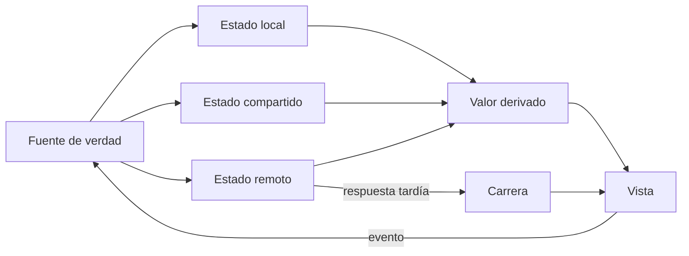
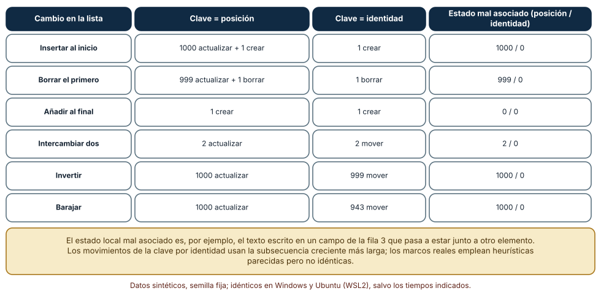
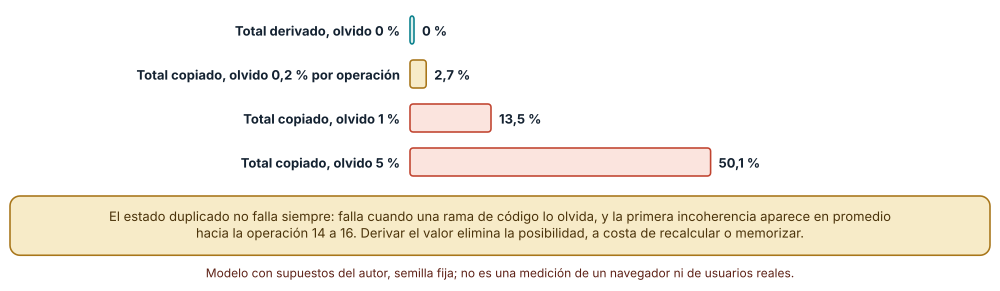
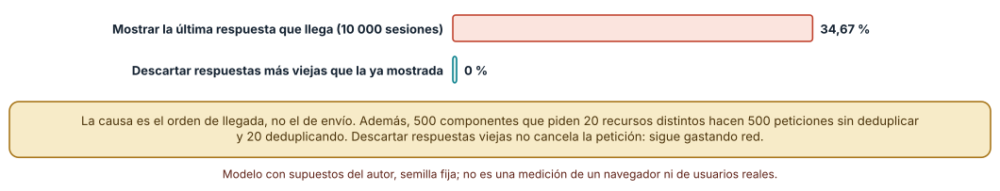

# SE-232 — Estado, componentes y gestión de datos

[← SE-231 — Renderizado cliente, servidor, estático e híbrido](https://github.com/vladimiracunadev-create/modern-software-engineering-program/blob/main/classes/part-19-web-frontend-y-aplicaciones-progresivas/se-231-renderizado-cliente-servidor-estatico-e-hibrido/README.md) · [↑ Parte 19](https://github.com/vladimiracunadev-create/modern-software-engineering-program/blob/main/classes/part-19-web-frontend-y-aplicaciones-progresivas/README.md) · [📚 Índice completo](https://github.com/vladimiracunadev-create/modern-software-engineering-program/blob/main/classes/README.md) · [🌐 Portal](https://vladimiracunadev-create.github.io/modern-software-engineering-program/classes/SE-232.html) · [SE-233 — Formularios, validación y experiencia de error →](https://github.com/vladimiracunadev-create/modern-software-engineering-program/blob/main/classes/part-19-web-frontend-y-aplicaciones-progresivas/se-233-formularios-validacion-y-experiencia-de-error/README.md)

## Punto profesional y fundamento pedagógico

**Punto profesional.** La clase existe para que decidas dónde vive cada dato de una interfaz (en un componente, compartido, en el servidor, en la URL o derivado de otro) y sepas qué falla cuando lo guardas dos veces, lo identificas mal o aceptas respuestas en el orden en que llegan, de modo que «la pantalla muestra algo raro» tenga una causa que se pueda buscar.

**Por qué aparece aquí.** Se sitúa después de **Renderizado cliente, servidor, estático e híbrido** y antes de **Formularios, validación y experiencia de error**: `SE-231` decidió dónde se construye el HTML; esta clase pregunta qué datos necesita una interfaz viva para mantenerse coherente. Fija tres reglas que las clases siguientes reutilizan: una fuente de verdad por dato, identidad estable para cada elemento y tratamiento explícito de las respuestas fuera de orden.

**Error conceptual que debe corregir.** Creer que el estado es «lo que el componente recuerda» y que más estado en más sitios hace la interfaz más rápida: cada copia es una promesa de mantenerla sincronizada, y la identidad de un elemento no es su posición en la lista.

**Secuencia de aprendizaje.** Antes de leer los resultados, predices cuántos nodos toca una reconciliación por posición al insertar un elemento al principio de una lista de 1000 y qué estado queda mal asociado; después mides seis cambios de lista con dos claves, simulas con qué frecuencia un total copiado diverge de la suma real y cuentas cuántas búsquedas terminan mostrando una consulta vieja cuando se acepta la última respuesta que llega.

**Evidencia de aprendizaje.** `state-log.md` con las predicciones, el reconciliador con ambas claves, la simulación de estado duplicado y derivado y la de respuestas fuera de orden, con explicación causal, contraejemplo y qué hallazgo te haría abandonar una de las políticas.

**Límite de la conclusión.** El reconciliador es un algoritmo mínimo y no reproduce el de ningún marco; los índices de olvido y las latencias son supuestos del autor. Ningún experimento mide una aplicación real, un marco concreto ni personas.

### Trazabilidad fuente → afirmación

| Fuente primaria u oficial | Afirmación que respalda | Lo que no prueba |
|---|---|---|
| [React: Preserving and Resetting State](https://react.dev/learn/preserving-and-resetting-state) | Explica que el estado de un componente se asocia a su posición y a su clave, y que cambiar la clave lo reinicia. | No describe el algoritmo de reconciliación interno de cada versión. |
| [React: Choosing the State Structure](https://react.dev/learn/choosing-the-state-structure) | Recomienda evitar el estado duplicado y derivar lo que pueda calcularse de otro estado. | No fija cuándo conviene memorizar un valor derivado. |
| [MDN: AbortController](https://developer.mozilla.org/en-US/docs/Web/API/AbortController) | Documenta la cancelación de peticiones `fetch` mediante una señal. | No dice qué hace el servidor con la petición ya recibida. |
| [Redux: Normalizing State Shape](https://redux.js.org/usage/structuring-reducers/normalizing-state-shape) | Propone guardar entidades por identificador y referenciarlas para no duplicarlas. | No demuestra que la normalización compense en cualquier aplicación. |

## Antes de empezar

Recupera de `SE-231` que el HTML puede construirse en distintos lugares y que lo que depende del entorno debe cuidarse. La pregunta activa es: **¿de qué dato depende cada pieza de la pantalla, dónde vive ese dato y qué pasa cuando cambia mientras otra petición sigue en vuelo?**

## Prerrequisitos

- Haber completado `SE-231` o poder explicar qué es la hidratación y por qué importa el determinismo.
- Python 3.11 o posterior; los experimentos usan solo la biblioteca estándar.
- Nociones de componentes que reciben datos y emiten eventos, y de peticiones asíncronas.

## Problema auténtico

La lista de entregas del formulario permite escribir un comentario en cada fila. Se añade un orden «más recientes primero» y, al llegar una entrega nueva, los comentarios que la persona estaba escribiendo se quedan donde estaban: ahora pertenecen a otra fila. El total de adjuntos que muestra la cabecera es una copia que se actualiza al añadir, pero no al quitar. Y un buscador de entregas muestra a veces resultados de lo que la persona escribió hace un segundo. Nadie cambió la lógica «de negocio»: cambió la identidad, la copia y el orden de llegada.

## Objetivos observables

Al terminar podrás:

1. clasificar un dato como local, compartido, remoto, de URL o derivado y justificar dónde debe vivir;
2. explicar por qué la clave de una lista debe ser la identidad y no la posición, y medir el efecto sobre el estado local;
3. mostrar que un valor copiado puede divergir de la fuente y decidir cuándo derivarlo;
4. reconocer una carrera entre peticiones y aplicar una política que descarte respuestas obsoletas;
5. deduplicar peticiones idénticas y declarar el límite de esa deduplicación.

## Mapa conceptual



El mapa se lee desde la fuente de verdad hacia la vista: todo lo que se pueda calcular se deriva, y las únicas entradas son los eventos de la persona y las respuestas del servidor. La rama de la carrera muestra por dónde entra el desorden: una respuesta tardía puede sobrescribir un estado más reciente.

## Temas y por qué importan

| Tema | Por qué cambia una decisión profesional | Evidencia mínima |
|---|---|---|
| Tipos de estado | Dónde vive un dato decide quién puede cambiarlo y qué se debe sincronizar. | Predicción, traza causal y contraejemplo de **Tipos de estado** en `state-log.md` |
| Componentes y flujo de datos | Datos hacia abajo y eventos hacia arriba hacen trazable quién cambió qué. | Predicción, traza causal y contraejemplo de **Componentes y flujo de datos** en `state-log.md` |
| Identidad y claves | Sin identidad estable, el estado local se asocia al elemento equivocado al reordenar. | Predicción, traza causal y contraejemplo de **Identidad y claves** en `state-log.md` |
| Estado derivado y fuente única | Cada copia es una promesa de sincronización que alguna rama del código olvidará. | Predicción, traza causal y contraejemplo de **Estado derivado y fuente única** en `state-log.md` |
| Datos remotos | Caché, deduplicación y carreras convierten una petición en un problema de concurrencia. | Predicción, traza causal y contraejemplo de **Datos remotos** en `state-log.md` |

## Conceptos y decisiones

### 1. Tipos de estado

El **estado local** pertenece a un componente (el texto de un campo); el **compartido**, a varios (la persona identificada); el **remoto** es una copia en el navegador de un dato que vive en el servidor, con su propia vida (puede estar cargando, fallida o vieja); el **de URL** describe la vista que se puede compartir (filtro, página); y el **derivado** se calcula de los anteriores. Mezclarlos produce la mayoría de los errores: tratar un dato remoto como local lo deja viejo, y copiar un derivado lo deja inconsistente.

### 2. Componentes y flujo de datos

Un componente recibe datos por entrada y comunica cambios por eventos. Cuando los datos fluyen hacia abajo y los eventos hacia arriba, cada cambio tiene un camino rastreable; cuando dos componentes se modifican entre sí, el orden de las actualizaciones importa y nadie puede razonar sobre el resultado. «Elevar el estado» al ancestro común más cercano es la forma de compartir sin duplicar: el ancestro posee el dato y los hijos lo reciben.

### 3. Identidad y claves

Al repintar una lista, el marco decide qué elemento nuevo corresponde a cuál antiguo para conservar su estado local, su foco y sus animaciones. Con una clave igual a la posición, «el elemento 3» siempre es el mismo hueco aunque el dato que lo ocupa cambie; con una clave igual a la identidad, el elemento sigue al dato. Insertar al principio es el caso que lo distingue: por posición, todos los elementos reciben datos distintos y arrastran el estado de otra fila; por identidad, solo se crea uno nuevo.

### 4. Estado derivado y fuente única

Si el total de adjuntos se puede calcular de la lista, guardarlo aparte crea una segunda verdad que hay que actualizar en cada operación que toque la lista: añadir, quitar, vaciar, restaurar. Basta que una rama lo olvide para que el valor diverja, y la divergencia aparece lejos del olvido. Derivar el valor (calcularlo al leer, o memorizarlo con la lista como dependencia) elimina esa clase de fallo; cuesta un cálculo y se mitiga con memorización solo si se mide que importa.

### 5. Datos remotos

Un dato remoto no es una variable: es una caché con estados (cargando, éxito, error, viejo) y reglas (cuándo revalidar, cuánto durar, cuándo descartar). Varios componentes que piden el mismo recurso deben compartir una petición; una petición que ya no interesa debe cancelarse o, al menos, ignorarse; y una respuesta que llega después de otra más reciente no debe pisarla. Los clientes de datos como TanStack Query implementan estas reglas; adoptarlos no exime de entender el problema que resuelven.

### Clave por posición frente a clave por identidad

Se escribió un reconciliador mínimo: con clave por posición, el elemento `i` de la lista nueva reutiliza el nodo `i` y lo actualiza si el dato difiere; con clave por identidad, se emparejan nodos por identificador y se mueven los que cambian de sitio (calculando los movimientos mínimos con la subsecuencia creciente más larga). Se probaron seis cambios sobre una lista de 1000 elementos con semilla fija para el barajado.

```python
def ops_indice(old, new):
    n = min(len(old), len(new))
    return {"actualizar": sum(1 for i in range(n) if old[i] != new[i]), ...}

def ops_clave(old, new):
    pos = {k: i for i, k in enumerate(old)}
    comunes = [pos[k] for k in new if k in pos]
    return {"mover": len(comunes) - lis_len(comunes), ...}
```

Resultado, idéntico en Windows (CPython 3.12.9) y en Ubuntu bajo WSL2 (3.12.3): al **insertar al inicio**, la clave por posición actualiza 1000 nodos y deja 1000 estados locales mal asociados, mientras la clave por identidad crea 1; al **borrar el primero**, 999 actualizaciones y 999 asociaciones erróneas frente a 1 borrado; al **añadir al final**, ambas crean 1; al **intercambiar dos**, 2 actualizaciones frente a 2 movimientos; al **invertir**, 1000 actualizaciones frente a 999 movimientos; al **barajar**, 1000 frente a 943.



**Cómo leer la figura.** Cada fila es un cambio de la lista; las columnas muestran qué hace cada clave y, a la derecha, cuántos estados locales quedan asociados a otro elemento. **Dónde deja de valer:** el número de operaciones no es tiempo: actualizar un nodo con el mismo contenido puede costar casi nada y mover uno puede costar el foco; y los marcos reales incluyen optimizaciones que este modelo omite. Lo que la figura sí establece es la asociación errónea: es una propiedad del algoritmo, no de la implementación.

### El total copiado diverge

Se simularon 3000 secuencias de 30 operaciones sobre una lista de precios (agregar, quitar, cambiar cantidad, descuento, vaciar) con dos implementaciones del total: una **deriva** el total de la lista, otra lo **guarda aparte** y lo actualiza en cada operación, salvo que con una probabilidad `p` de olvido una rama lo omite. El total derivado nunca diverge; el copiado diverge al final de una secuencia en el **2,7 %** de los casos con `p = 0,2 %`, en el **13,5 %** con `p = 1 %` y en el **50,1 %** con `p = 5 %`. La primera incoherencia aparece en promedio entre la operación 14 y la 16.

```python
if q.random() >= p_olvido:
    total_dup += delta          # la copia solo se actualiza si no se olvidó
divergio = total_dup != sum(items)
```



**Cómo leer la figura.** Cada barra es el porcentaje de 3000 secuencias de 30 operaciones que acaban incoherentes; la barra verde es el total derivado. **Dónde deja de valer:** la probabilidad de olvido es un supuesto, no una tasa medida; una base de código con cinco operaciones bien cubiertas por pruebas tendría una tasa mucho menor. La conclusión que sí se sostiene es cualitativa: una copia obliga a tocar todas las ramas, y derivar elimina la posibilidad.

### La última respuesta no es la última consulta

Se simuló una búsqueda en la que la persona envía seis consultas, una cada 120 ms, y cada respuesta tarda un tiempo lognormal de mediana 200 ms. Si la interfaz muestra la **última respuesta que llega**, en el **34,67 %** de 10 000 sesiones el resultado final corresponde a una consulta anterior a la última. Si la interfaz **descarta las respuestas más viejas que la ya mostrada** (por ejemplo, con un contador de petición), el resultado es 0 %. Además, 500 componentes que piden 20 recursos distintos generan 500 peticiones sin deduplicar y 20 deduplicando.

```python
if politica == "ignorar_obsoletas":
    mostrado = -1
    for _, i in sorted(resp):       # en orden de llegada
        if i > mostrado: mostrado = i
```



**Cómo leer la figura.** Cada barra es el porcentaje de 10 000 sesiones cuyo resultado final no corresponde a la última consulta; la verde descarta respuestas viejas. **Dónde deja de valer:** las latencias lognormales de mediana 200 ms y el espaciado de 120 ms son supuestos; con latencias mucho menores o consultas más espaciadas el porcentaje cae. Descartar una respuesta vieja no cancela la petición: sigue gastando red y servidor, y para eso hace falta `AbortController`.

## Definiciones de trabajo

- **estado derivado:** valor que se calcula a partir de otro estado y no se almacena como dato independiente.
- **fuente de verdad:** lugar único donde vive un dato y desde el que se obtienen sus copias.
- **clave de lista:** identificador estable que permite emparejar un elemento nuevo con su antecesor para conservar su estado.
- **carrera entre peticiones:** situación en la que el resultado depende del orden de llegada de respuestas, no del orden de envío.
- **deduplicación de peticiones:** reutilización de una petición en vuelo por varias partes que piden el mismo recurso.

Las definiciones son operativas para esta clase y deben contrastarse con la documentación enlazada al final.

## Ejemplo mínimo

Comprueba cuántos elementos quedan emparejados con su dato original al insertar uno al principio de una lista con clave por posición.

```python
viejo = ["a", "b", "c"]
nuevo = ["x", "a", "b", "c"]
por_posicion = [i for i in range(len(viejo)) if viejo[i] == nuevo[i]]
assert por_posicion == []
```

Ningún elemento conserva su dato: todos los nodos recibirían un contenido distinto y arrastrarían el estado local de otro. Registra versión del intérprete y salida; si usas `nuevo = viejo + ["x"]`, predice cuántos coinciden.

## Ejemplo profesional

La lista de entregas de la plataforma usa el identificador de entrega como clave, deriva el total de adjuntos y el estado «con comentarios pendientes» de la lista, y obtiene los datos de un cliente que comparte una sola petición entre los componentes que la necesitan. El buscador asocia a cada consulta un contador y una señal de cancelación: la respuesta solo se aplica si su contador es el mayor visto. El comentario a medias vive en el estado local de la fila, que sigue al identificador.

Compara el caso normal con una entrega nueva que llega mientras se escribe, una consulta anterior que responde tarde y un adjunto que se quita desde otra pestaña. El diseño es apropiado cuando esos tres casos tienen una regla escrita; es frágil cuando cada uno se resuelve con un parche.

## Práctica guiada

1. Lista los datos de la pantalla de entregas y clasifica cada uno como local, compartido, remoto, de URL o derivado.
2. Predice cuántos nodos actualiza cada clave al insertar al principio y escribe el número antes de ejecutar.
3. Implementa el reconciliador con las dos claves y mide los seis cambios.
4. Simula el total derivado y el copiado con tres probabilidades de olvido y registra la primera operación incoherente.
5. Simula la búsqueda con y sin descarte de respuestas obsoletas y compara los porcentajes.
6. Añade cancelación con una señal y mide cuántas peticiones siguen vivas tras la última consulta.
7. Entrega `state-log.md` y pide a otra persona que identifique qué dato tiene más de una fuente.

## Ejercicios

1. **Claves:** añade un séptimo cambio (mover un elemento del final al principio) y calcula las operaciones con cada clave.
2. **Derivado:** identifica en tu aplicación un valor guardado que pueda derivarse y estima cuántas ramas lo actualizan.
3. **Carrera:** cambia la mediana de latencia a 60 ms y el espaciado a 400 ms y calcula cuánto cae el porcentaje de resultados obsoletos.
4. **Deduplicación:** diseña una política para que dos peticiones con los mismos parámetros en orden distinto cuenten como una y explica cómo se normaliza la clave.

## Reto verificable

Entrega `state-log.md` con el reconciliador y sus seis cambios, la simulación del total copiado frente al derivado y la de respuestas fuera de orden. Se aprueba si otra persona ejecuta el código desde un checkout limpio, obtiene las mismas cifras con las mismas semillas y puede indicar qué supuesto cambiaría tus porcentajes. No se aprueba por una simulación sin las políticas comparadas ni por afirmar que «un gestor de estado lo arregla».

## Caso conductor

La aplicación de entregas con conectividad irregular fija en esta clase la identidad de cada entrega, el total derivado y la política de respuestas. Esas reglas son las que `SE-233` necesita para validar sin perder lo escrito, `SE-234` para dar URL a la vista y `SE-237` para sincronizar tras estar sin conexión. Cambia después una sola decisión, la clave de la lista de posición a identificador, y revisa qué comentarios a medias se conservan.

## Preguntas frecuentes

### ¿Siempre debo usar un gestor de estado global?

No: la mayor parte del estado es local o derivado. Un almacén global se justifica para lo realmente compartido por componentes lejanos; moverlo todo allí vuelve cada cambio un efecto global.

### ¿Por qué no usar el índice como clave si la lista nunca cambia de orden?

Porque rara vez es verdad durante toda la vida de la interfaz: un filtro, un orden o una entrega nueva basta para que cambie. Y un error de clave no falla, produce estado asociado a otro elemento, que es difícil de ver.

### ¿Memorizar un valor derivado es lo mismo que guardarlo?

No: la memoria se invalida cuando cambian las dependencias y no puede quedar desactualizada; un valor guardado aparte depende de que cada rama lo actualice.

### ¿Cancelar una petición basta para evitar la carrera?

No siempre: la respuesta puede estar ya en camino, y cancelar solo corta la espera del cliente. Conviene además aplicar la respuesta solo si corresponde a la consulta vigente.

## Fallo controlado y diagnóstico

Reproduce el fallo clásico de la clase: **usar el índice como clave en una lista que cambia de orden**. Toma la lista de entregas con un campo de comentario por fila y una ordenación «más recientes primero».

Registra síntoma, entrada mínima, hipótesis, observación que descarta cada hipótesis, causa, corrección y prueba de regresión. **Síntoma:** al llegar una entrega nueva, el comentario que se estaba escribiendo aparece en otra fila. **Hipótesis rivales:** (a) el comentario se guarda en el dato equivocado; (b) el estado local se asocia por posición. **Prueba:** inserta una entrega al inicio con el comentario de la fila 0 a medias y comprueba a qué fila pertenece el texto tras repintar; observa que el dato guardado es correcto y el campo mostrado no. **Conclusión:** la causa es la clave por posición. **Regresión:** usa el identificador de la entrega como clave y añade una prueba que inserte al inicio con un comentario a medias. No cambies a la vez la clave y el orden: no sabrás qué corrigió el problema.

## Errores comunes y cómo corregirlos

| Síntoma | Causa probable | Corrección |
|---|---|---|
| El texto escrito aparece en otra fila tras reordenar | Clave igual a la posición | Usar un identificador estable como clave |
| El total de la cabecera no coincide con la lista | Valor guardado aparte y una rama que no lo actualiza | Derivarlo de la lista |
| La búsqueda muestra resultados de una consulta anterior | Se aplica la última respuesta recibida | Asociar un contador a cada petición y descartar las obsoletas |
| Cada componente pide lo mismo al servidor | Peticiones sin compartir ni deduplicar | Centralizar la petición en un cliente de datos con clave de consulta |
| Una acción cambia datos en tres sitios y uno se queda viejo | Varias fuentes de verdad para el mismo dato | Elegir una fuente y derivar el resto |

## Entorno y archivos clave

```text
work/SE-232/
├── README.md
├── estado/
│   ├── reconciliar.py
│   ├── derivado.py
│   └── carreras.py
├── tests/test_reconciliar.py
└── evidence/state-log.md
```

El `README` declara plataforma, versión de Python, semillas y comandos. Los experimentos usan solo la biblioteca estándar (`random`, `bisect`) y se ejecutaron con CPython 3.12.9 en Windows 11 y 3.12.3 en Ubuntu bajo WSL2: las salidas fueron idénticas. No se usó ningún marco ni cliente de datos de producción.

## Seguridad, ética y accesibilidad

- un comentario asociado a otra fila puede mostrar texto privado de una persona junto a la entrega de otra: la identidad errónea es también un problema de privacidad;
- una interfaz que cambia el contenido bajo el foco sin avisarlo desorienta a quien usa tecnologías de apoyo: anuncia los cambios con una región de estado;
- los datos remotos viejos pueden mostrar un estado de entrega falso con consecuencias académicas: indica cuándo se cargaron;
- los ejemplos usan elementos y latencias sintéticos; no incluyas entregas ni comentarios de estudiantes reales en la evidencia;
- una caché de datos en el navegador puede conservar información personal tras cerrar sesión: límpiala al salir.

## Puente hacia el trabajo con agentes

Un agente al que se le pide «añade el orden por fecha a la lista» producirá código que funciona con datos de ejemplo y suele usar el índice como clave o guardar el total aparte «para no recalcular». Pídele que declare la fuente de verdad de cada dato, que use el identificador como clave y que muestre una prueba con inserción al principio. Revisa especialmente cualquier valor que el agente guarde y que podría derivarse, y cualquier `fetch` dentro de un efecto sin cancelación ni descarte de respuestas obsoletas.

## Transferencia

Traslada el experimento a otro entorno con identidad y sincronización (una hoja de cálculo colaborativa, una aplicación móvil, una cola de tareas): cambia el reconciliador por el algoritmo de ese medio, pero conserva la pregunta de qué identifica a cada elemento y qué dato tiene dos fuentes. La transferencia está lograda cuando puedes explicar qué parte del experimento dependía de la interfaz y cuál de la idea de identidad y de fuente única.

## Evaluación y evidencia

| Criterio | Evidencia para aprobar |
|---|---|
| comprensión | clasificación de los datos de una pantalla por tipo de estado con su fuente de verdad |
| corrección | cifras reproducibles de reconciliación, divergencia y carreras con las mismas semillas |
| diseño | claves por identidad, valores derivados y política de respuestas documentada |
| diagnóstico | reproducción del fallo de clave por posición con regresión |
| incertidumbre | declaración de los supuestos de la simulación (olvido, latencias) y del límite del algoritmo mínimo |
| reproducibilidad | versiones, comandos, salida y límites declarados |

## Fuentes

- [React: Preserving and Resetting State](https://react.dev/learn/preserving-and-resetting-state) — estado asociado a posición y clave; autoridad: documentación de React.
- [React: Choosing the State Structure](https://react.dev/learn/choosing-the-state-structure) — evitar el estado duplicado y derivar valores; autoridad: documentación de React.
- [React: You Might Not Need an Effect](https://react.dev/learn/you-might-not-need-an-effect) — derivar en lugar de sincronizar con efectos; autoridad: documentación de React.
- [MDN: AbortController](https://developer.mozilla.org/en-US/docs/Web/API/AbortController) — cancelación de peticiones; autoridad: MDN.
- [Redux: Normalizing State Shape](https://redux.js.org/usage/structuring-reducers/normalizing-state-shape) — entidades por identificador; autoridad: documentación de Redux.
- [TanStack Query: Important Defaults](https://tanstack.com/query/latest/docs/framework/react/guides/important-defaults) — caducidad, reintentos y deduplicación de consultas; autoridad: documentación de TanStack Query.

Cada fuente respalda el mecanismo indicado; ninguna demuestra que el reconciliador mínimo de la clase reproduzca el de un marco real ni que las probabilidades de olvido de la simulación correspondan a un proyecto concreto.

- [Python: `bisect`](https://docs.python.org/3/library/bisect.html) — búsqueda binaria usada para la subsecuencia creciente.
- [Python: `random`](https://docs.python.org/3/library/random.html) — generador con semilla para las secuencias y las latencias.

## Límites y siguiente paso

Se ejecutaron tres experimentos con datos sintéticos en Windows y Ubuntu (WSL2) con resultados idénticos. No se usó ningún marco real ni se midió una aplicación: el reconciliador es mínimo y las probabilidades de olvido y las latencias son construcciones del autor. La siguiente clase pregunta cómo se capturan y validan los datos que la persona escribe, y qué le decimos cuando algo falla.

## Glosario

- **estado derivado:** valor que se calcula a partir de otro estado y no se almacena como dato independiente.
- **fuente de verdad:** lugar único donde vive un dato y desde el que se obtienen sus copias.
- **clave de lista:** identificador estable que permite emparejar un elemento nuevo con su antecesor para conservar su estado.
- **carrera entre peticiones:** situación en la que el resultado depende del orden de llegada de respuestas, no del orden de envío.
- **deduplicación de peticiones:** reutilización de una petición en vuelo por varias partes que piden el mismo recurso.

---

[← SE-231 — Renderizado cliente, servidor, estático e híbrido](https://github.com/vladimiracunadev-create/modern-software-engineering-program/blob/main/classes/part-19-web-frontend-y-aplicaciones-progresivas/se-231-renderizado-cliente-servidor-estatico-e-hibrido/README.md) · [↑ Parte 19](https://github.com/vladimiracunadev-create/modern-software-engineering-program/blob/main/classes/part-19-web-frontend-y-aplicaciones-progresivas/README.md) · [📚 Índice completo](https://github.com/vladimiracunadev-create/modern-software-engineering-program/blob/main/classes/README.md) · [🌐 Portal](https://vladimiracunadev-create.github.io/modern-software-engineering-program/classes/SE-232.html) · [SE-233 — Formularios, validación y experiencia de error →](https://github.com/vladimiracunadev-create/modern-software-engineering-program/blob/main/classes/part-19-web-frontend-y-aplicaciones-progresivas/se-233-formularios-validacion-y-experiencia-de-error/README.md)
