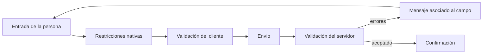
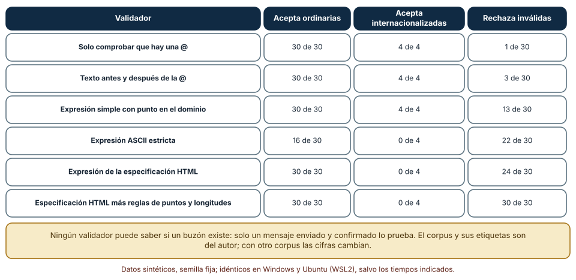
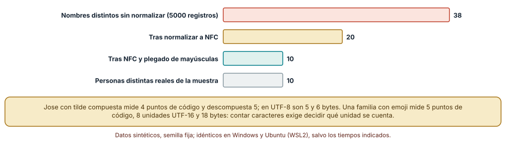
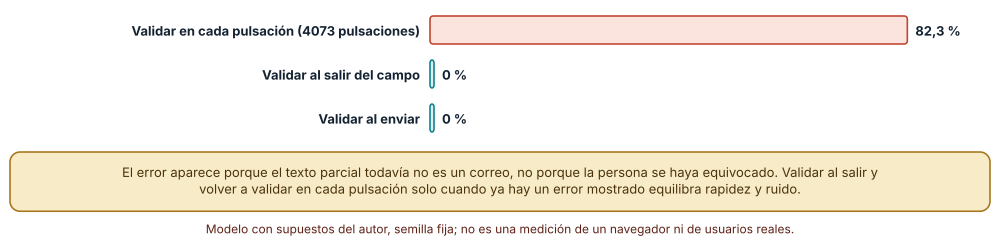

# SE-233 — Formularios, validación y experiencia de error

[← SE-232 — Estado, componentes y gestión de datos](https://github.com/vladimiracunadev-create/modern-software-engineering-program/blob/main/classes/part-19-web-frontend-y-aplicaciones-progresivas/se-232-estado-componentes-y-gestion-de-datos/README.md) · [↑ Parte 19](https://github.com/vladimiracunadev-create/modern-software-engineering-program/blob/main/classes/part-19-web-frontend-y-aplicaciones-progresivas/README.md) · [📚 Índice completo](https://github.com/vladimiracunadev-create/modern-software-engineering-program/blob/main/classes/README.md) · [🌐 Portal](https://vladimiracunadev-create.github.io/modern-software-engineering-program/classes/SE-233.html) · [SE-234 — Navegación, routing y URLs durables →](https://github.com/vladimiracunadev-create/modern-software-engineering-program/blob/main/classes/part-19-web-frontend-y-aplicaciones-progresivas/se-234-navegacion-routing-y-urls-durables/README.md)

## Punto profesional y fundamento pedagógico

**Punto profesional.** La clase existe para que diseñes un formulario como un contrato entre una persona, el navegador y el servidor: qué se puede escribir, quién valida qué, cuándo se muestra un error y cómo se recupera lo escrito, de modo que «validar el correo» deje de significar una expresión regular copiada de internet.

**Por qué aparece aquí.** Se sitúa después de **Estado, componentes y gestión de datos** y antes de **Navegación, routing y URLs durables**: `SE-232` fijó dónde vive cada dato y cómo se tratan las respuestas; esta clase aplica esas reglas al dato más delicado de una interfaz, el que escribe una persona. Fija tres ideas que las siguientes reutilizan: el servidor es la única validación que protege, el texto humano no es ASCII y un error mal mostrado es una barrera.

**Error conceptual que debe corregir.** Creer que una validación correcta es una expresión regular que acepta lo bueno y rechaza lo malo: el problema de «lo bueno» no está bien definido para correos y nombres, y el momento en que se muestra un error pesa tanto como la regla que lo produce.

**Secuencia de aprendizaje.** Antes de leer los resultados, predices cuántas de 30 direcciones inválidas rechaza una comprobación que solo busca una arroba y cuántas direcciones válidas rechaza una expresión ASCII estricta; después mides seis validadores sobre un corpus etiquetado, cuentas cuántos nombres distintos ve un sistema según cómo compare cadenas Unicode y calculas en qué proporción de pulsaciones muestra un error una validación inmediata.

**Evidencia de aprendizaje.** `forms-log.md` con las predicciones, los seis validadores, el corpus etiquetado con su criterio, la tabla de normalización Unicode y la simulación de validación mientras se escribe, con explicación causal, contraejemplo y qué hallazgo te haría cambiar de política.

**Límite de la conclusión.** El corpus de 64 direcciones y sus etiquetas son del autor; los diez nombres son inventados; la simulación de escritura aplica una regla mecánica y no mide cómo reacciona nadie. Ningún validador sabe si un buzón existe, y nada de esto sustituye un envío de confirmación.

### Trazabilidad fuente → afirmación

| Fuente primaria u oficial | Afirmación que respalda | Lo que no prueba |
|---|---|---|
| [HTML Standard: dirección de correo válida (WHATWG)](https://html.spec.whatwg.org/multipage/input.html#valid-e-mail-address) | Define una expresión ASCII para `input type="email"` y reconoce que es una violación deliberada de la sintaxis completa del correo. | No define qué hace cada navegador con direcciones internacionalizadas. |
| [Unicode UAX #15: formas de normalización](https://unicode.org/reports/tr15/) | Define las formas NFC, NFD, NFKC y NFKD y por qué cadenas visualmente iguales pueden tener secuencias distintas. | No decide qué forma debe guardar un sistema concreto. |
| [WCAG 2.2: Identificación de errores (3.3.1)](https://www.w3.org/WAI/WCAG22/Understanding/error-identification.html) | Exige identificar el campo en error y describirlo en texto. | No fija cuándo mostrar el error ni su redacción. |
| [RFC 6531: correo internacionalizado](https://www.rfc-editor.org/rfc/rfc6531) | Extiende el correo para admitir caracteres no ASCII en la parte local y el dominio. | No dice qué proveedores lo aceptan en la práctica. |

## Antes de empezar

Recupera de `SE-232` que cada dato necesita una fuente de verdad y una política para respuestas fuera de orden. La pregunta activa es: **¿qué acepto de lo que escribe una persona, quién lo comprueba de verdad y qué le digo, cuándo, cuando algo no cuadra?**

## Prerrequisitos

- Haber completado `SE-232` o poder explicar por qué una copia del estado puede divergir.
- Python 3.11 o posterior; los experimentos usan solo la biblioteca estándar (`re`, `unicodedata`, `random`).
- Nociones de expresiones regulares y de cómo un formulario envía datos al servidor.

## Problema auténtico

El formulario de entrega pide nombre, correo y un comentario. Alguien añadió una expresión para el correo que rechaza `ana+entregas@example.org` porque «el signo más no es válido», un estudiante con apóstrofo en el apellido recibe un error incomprensible y otro cuyo nombre tiene una tilde escrita en forma descompuesta aparece como duplicado en la plataforma. La validación se dispara en cada pulsación: al escribir el correo, aparece un error rojo desde la primera letra. Una estudiante con lector de pantalla oye «error» sin saber de qué campo. Nadie cambió la regla de negocio: cambió cómo se acepta y se avisa.

## Objetivos observables

Al terminar podrás:

1. distinguir validación del navegador, del cliente y del servidor y decir cuál protege;
2. evaluar un validador con un corpus etiquetado y reportar falsos positivos y negativos con el criterio usado;
3. explicar por qué los nombres y correos no son ASCII y qué decisiones de normalización y de longitud se toman;
4. elegir el momento en que se muestra un error y asociarlo al campo de forma accesible;
5. diseñar el envío para que no se pierda lo escrito y no se duplique una entrega.

## Mapa conceptual



El mapa se lee de izquierda a derecha, pero solo la validación del servidor decide: las anteriores existen para dar respuesta rápida. La flecha de retorno indica que un error vuelve a la persona con el campo identificado y con lo que ya escribió.

## Temas y por qué importan

| Tema | Por qué cambia una decisión profesional | Evidencia mínima |
|---|---|---|
| El formulario como contrato | Nombres, tipos y restricciones nativas dan comportamiento y accesibilidad gratis. | Predicción, traza causal y contraejemplo de **El formulario como contrato** en `forms-log.md` |
| Dónde se valida | El cliente da respuesta rápida; solo el servidor protege, porque el cliente lo controla quien escribe. | Predicción, traza causal y contraejemplo de **Dónde se valida** en `forms-log.md` |
| Texto humano y Unicode | Un nombre puede tener acentos descompuestos, no tener apellido o medir distinto según la unidad. | Predicción, traza causal y contraejemplo de **Texto humano y Unicode** en `forms-log.md` |
| Cuándo y cómo se muestra un error | El momento y la forma del aviso deciden si es una ayuda o una barrera. | Predicción, traza causal y contraejemplo de **Cuándo y cómo se muestra un error** en `forms-log.md` |
| Recuperación y envío | Perder lo escrito o enviarlo dos veces convierte un error pequeño en uno grande. | Predicción, traza causal y contraejemplo de **Recuperación y envío** en `forms-log.md` |

## Conceptos y decisiones

### 1. El formulario como contrato

Un `form` con campos que tienen `name`, `type`, `autocomplete` y restricciones (`required`, `maxlength`, `pattern`) ya describe qué se espera. El navegador usa esa información para mostrar el teclado adecuado, autocompletar, validar y anunciar. `type="email"` no valida «un correo», aplica la regla del estándar; `autocomplete="email"` permite que quien lo tiene guardado lo rellene sin escribir, algo que además ayuda a quien tiene dificultades motoras. Cada atributo que se omite se reconstruye después con código, y casi siempre peor.

### 2. Dónde se valida

Hay tres lugares: las restricciones nativas (inmediatas, sin código), la validación del cliente (reglas propias, mensajes propios) y la del servidor. Las dos primeras son comodidades; el cliente lo controla quien escribe, y cualquiera puede enviar una petición sin pasar por él. Por eso la validación del servidor es obligatoria y las otras dos son una mejora de la experiencia. La consecuencia de diseño: las reglas deben definirse una vez y aplicarse en ambos lados (o repetirse con una prueba que las compare), y el servidor debe devolver errores con el mismo formato que el cliente sabe mostrar.

### 3. Texto humano y Unicode

Un nombre no es una cadena ASCII ni una secuencia de «letras»: `José` puede escribirse con una `é` compuesta (4 puntos de código) o con una `e` y un acento combinante (5), y los dos se ven igual pero no son iguales como cadenas. La **normalización** (NFC compone, NFD descompone) permite compararlas. Además, «longitud» es ambigua: puntos de código, unidades UTF-16 de JavaScript, bytes de UTF-8 o grafemas que ve la persona. Y hay personas con un solo nombre, con apóstrofos, guiones o espacios: una regla que lo asume todo falla con personas reales.

### 4. Cuándo y cómo se muestra un error

WCAG exige identificar el campo en error y describir el error en texto; no dice cuándo. Validar en cada pulsación muestra errores sobre entradas que simplemente están incompletas; validar solo al enviar retrasa el aviso; validar al salir del campo y volver a validar mientras se corrige equilibra ambos. Un buen mensaje dice qué ocurrió y cómo arreglarlo, se asocia al campo con `aria-describedby`, se anuncia sin mover el foco por sorpresa (una región con `role="alert"` o un resumen al que se lleva el foco) y no depende solo del color.

### 5. Recuperación y envío

Un error no debe borrar lo escrito: conservar los valores y devolver el foco al primer campo con problema. El envío debe ser seguro de repetir: la persona pulsa dos veces, el navegador reintenta o la red falla tras recibir. Se resuelve deshabilitando el botón mientras se envía (con cuidado de no dejar el formulario inutilizable si falla) y, sobre todo, con una clave de idempotencia que el servidor use para reconocer la repetición. Un formulario que pierde lo escrito o envía dos entregas castiga a quien tiene peor conexión.

### Seis validadores de correo frente a un corpus etiquetado

Se armó un corpus de 64 direcciones etiquetadas por el autor: 30 ordinarias que deben aceptarse (con signo más, apóstrofo, subdominios, mayúsculas, TLD largos y otros caracteres permitidos por el estándar en la parte local), 4 internacionalizadas que deben aceptarse (`josé@ejemplo.org`, dominios no ASCII) y 30 inválidas (sin arroba, dos arrobas, espacios, puntos consecutivos, guiones al borde de una etiqueta, parte local de 65 caracteres, etiqueta de dominio de 64, etc.). Se compararon seis validadores.

```python
LOCAL = r"[a-zA-Z0-9.!#$%&'*+/=?^_`{|}~-]+"
ETIQUETA = r"[a-zA-Z0-9]" + r"(?:[a-zA-Z0-9-]{0,61}[a-zA-Z0-9])?"
WHATWG = re.compile("^" + LOCAL + "@" + ETIQUETA + r"(?:\." + ETIQUETA + ")*$")
```

Resultado, idéntico en Windows (CPython 3.12.9) y en Ubuntu bajo WSL2 (3.12.3): solo comprobar que hay una arroba acepta las 30 y 4 válidas y **rechaza 1 de 30** inválidas; exigir texto a ambos lados rechaza 3; una expresión simple con punto en el dominio rechaza 13; una expresión ASCII estricta rechaza 22 inválidas pero **rechaza 14 de las 30 válidas** (las que llevan `'`, `!`, `#`, `=` y otros caracteres) y las 4 internacionalizadas; la expresión del estándar HTML acepta las 30, rechaza 24 de 30 inválidas y rechaza las 4 internacionalizadas; y añadir reglas de puntos y longitudes rechaza las 30 inválidas. Ningún validador acepta a la vez las 4 internacionalizadas y rechaza las inválidas, porque esa pareja exige más que una expresión.



**Cómo leer la figura.** Cada fila es un validador; las columnas son aciertos sobre cada categoría del corpus. **Dónde deja de valer:** las etiquetas son decisiones del autor sobre qué debe aceptarse; otro criterio (por ejemplo, aceptar `a@b` sin punto, que el estándar HTML permite) cambia las cifras. Un validador perfecto sobre este corpus no demuestra que el buzón exista ni que la persona sea su dueña: eso solo lo prueba un mensaje de confirmación.

### Cuántas personas ve el sistema

Se generaron 5000 registros de diez nombres con acentos (`José`, `María`, `Zoé`, `Ångström`, `Renée`…), 30 % de ellos en forma descompuesta y 30 % en mayúsculas. Sin normalizar, el sistema cuenta **38** nombres distintos; tras normalizar a NFC, **20**; tras normalizar y plegar mayúsculas (`casefold`), **10**, que son las diez personas. Se midieron también longitudes: `José` con tilde compuesta tiene 4 puntos de código y 5 bytes UTF-8; descompuesta, 5 y 6. Una familia con emoji (`👨‍👩‍👧`) tiene 5 puntos de código, 8 unidades UTF-16 y 18 bytes; `Straße` plegada es `strasse`, y `lower()` no la iguala a `STRASSE` pero `casefold()` sí.

```python
unicodedata.normalize("NFC", s).casefold()
```



**Cómo leer la figura.** Cada barra es el número de nombres que cuenta el sistema para las mismas diez personas; la última es la verdad conocida. **Dónde deja de valer:** el experimento solo tiene diez nombres con acentos latinos; otros sistemas de escritura plantean otros problemas (mayúsculas sin equivalente, nombres con una sola letra, orden de nombre y apellido). Plegar mayúsculas para comparar no es lo mismo que guardarlas: se guarda el nombre tal como lo escribió la persona.

### Un error por cada pulsación

Se tomaron 200 correos válidos sintéticos (de 4 a 9 letras antes de la arroba y tres dominios) y se simuló la escritura letra a letra con la regla del estándar más reglas de puntos y longitudes. En cada estado parcial («a», «an», «ana», «ana@»…) se registró si la validación inmediata habría mostrado un error: en **3354 de 4073 pulsaciones (82,3 %)** habría mostrado error y **los 200 correos** mostraron error al menos una vez, aunque el correo final era válido. Validar al salir del campo o al enviar no muestra ningún error mientras se escribe.

```python
for i in range(1, len(texto) + 1):
    errores += (not valida(texto[:i]))     # estado parcial de la escritura
```



**Cómo leer la figura.** Cada barra es el porcentaje de pulsaciones con error visible; las barras verdes validan en un momento posterior. **Dónde deja de valer:** la simulación aplica una regla mecánica a prefijos de un correo válido y no mide cómo se siente la persona ni si lee el error; tampoco compara con la validación al salir del campo en cuanto a errores no detectados a tiempo. El hallazgo es sobre la señal: un error que aparece cuando la entrada simplemente no ha terminado es ruido.

## Definiciones de trabajo

- **validación del servidor:** comprobación que se ejecuta donde la persona no puede alterarla y que decide si un dato se acepta.
- **normalización Unicode:** transformación de una cadena a una forma canónica para que secuencias equivalentes se comparen como iguales.
- **plegado de mayúsculas (`casefold`):** transformación para comparar sin distinguir mayúsculas, más completa que pasar a minúsculas.
- **clave de idempotencia:** identificador enviado con una operación para que el servidor reconozca y no repita un reintento.
- **mensaje de error asociado:** texto de error vinculado programáticamente a su campo para que lo anuncien las tecnologías de apoyo.

Las definiciones son operativas para esta clase y deben contrastarse con las especificaciones enlazadas al final.

## Ejemplo mínimo

Comprueba que dos escrituras de `José` no son iguales hasta normalizarlas; predice antes la longitud de cada una.

```python
import unicodedata
a, b = "José", "José"
assert a != b and len(a) == 4 and len(b) == 5
assert unicodedata.normalize("NFC", b) == a
```

Registra versión del intérprete y salida. Añade `casefold()` y predice si `JOSÉ` en forma descompuesta coincide con `josé` compuesta tras normalizar.

## Ejemplo profesional

El formulario de entrega usa `type="email"` y `autocomplete="email"`, valida en el cliente al salir del campo y de nuevo en cada cambio solo si ya hay un error mostrado, y el servidor aplica las mismas reglas con una prueba que compara ambas implementaciones con el corpus de la clase. Los nombres se guardan tal como se escriben y se comparan normalizados y plegados; la longitud máxima se define en grafemas y se comprueba en bytes en el servidor. Los errores se muestran junto al campo y en un resumen al enviar, con un mensaje que dice qué falta y cómo arreglarlo, y el envío lleva una clave de idempotencia por intento.

Compara el caso normal con una persona con un solo nombre, otra con un apóstrofo en el apellido y otra cuyo teclado escribe tildes descompuestas. El diseño es apropiado cuando esos tres casos se aceptan y se identifican correctamente; es frágil cuando alguno exige explicar a la persona cómo «escribirlo bien».

## Práctica guiada

1. Arma un corpus etiquetado de correos con al menos tres categorías y escribe el criterio de cada etiqueta.
2. Predice cuántas inválidas rechazará cada uno de seis validadores y escribe los números antes de ejecutar.
3. Evalúa los validadores y registra falsos positivos y negativos por categoría.
4. Mide los nombres distintos con y sin normalización y plegado y las longitudes en cuatro unidades.
5. Simula la escritura letra a letra y cuenta las pulsaciones con error visible.
6. Diseña la política de errores (cuándo, dónde y cómo) y verifica el mensaje con un lector de pantalla.
7. Entrega `forms-log.md` y pide a otra persona que añada una dirección que tu criterio clasifique mal.

## Ejercicios

1. **Corpus:** añade diez direcciones propias de tu contexto y calcula cómo cambia la tabla de validadores.
2. **Unicode:** encuentra dos cadenas distintas que `NFKC` iguala y `NFC` no, y explica cuándo conviene cada una.
3. **Momento:** diseña una política que valide al salir del campo y revalide en cada pulsación solo tras un error, y calcula las pulsaciones con error visible en la simulación.
4. **Idempotencia:** simula un reintento de envío sin y con clave de idempotencia y cuenta entregas duplicadas con 20 % de confirmaciones perdidas.

## Reto verificable

Entrega `forms-log.md` con el corpus y su criterio, los seis validadores con sus resultados, la comparación de nombres normalizados y la simulación de escritura. Se aprueba si otra persona ejecuta el código desde un checkout limpio, obtiene las mismas cifras con las mismas semillas y puede indicar qué dirección o nombre rompería tu política. No se aprueba por una expresión regular «completa» ni por afirmar que el correo es válido porque pasa la validación.

## Caso conductor

El formulario de entrega de la aplicación con conectividad irregular fija en esta clase qué acepta, cuándo avisa y cómo se recupera. Esas decisiones son las que `SE-234` necesita para que el estado del formulario sobreviva a una recarga, `SE-236` para no aceptar entradas peligrosas y `SE-237` para que un envío sin conexión no se pierda ni se repita. Cambia después una sola decisión, la longitud máxima del nombre de 20 a 40, y revisa cuántas comprobaciones hay que tocar en cliente y servidor.

## Preguntas frecuentes

### ¿Basta con la validación del navegador?

No: quien controla la petición puede evitarla. La validación nativa mejora la experiencia, y la que protege es la del servidor.

### ¿Puedo rechazar nombres con caracteres «raros»?

No sin un motivo concreto: los nombres reales incluyen apóstrofos, guiones, espacios, acentos y alfabetos no latinos. Rechazarlos excluye personas; si hay una restricción técnica real (un sistema heredado), se declara y se ofrece una alternativa.

### ¿Por qué no enviar un correo de confirmación y olvidarme de validar?

La confirmación comprueba que el buzón existe y es de la persona; la validación evita enviar a direcciones imposibles y da respuesta inmediata. Se complementan.

### ¿Deshabilitar el botón al enviar basta para evitar duplicados?

No: no cubre el reintento tras una red caída ni la doble entrega por dos pestañas. Hace falta una clave de idempotencia reconocida por el servidor.

## Fallo controlado y diagnóstico

Reproduce el fallo clásico de la clase: **creer que una expresión regular de correo «válida» acepta todo lo válido**. Toma el formulario con la expresión ASCII estricta de la clase.

Registra síntoma, entrada mínima, hipótesis, observación que descarta cada hipótesis, causa, corrección y prueba de regresión. **Síntoma:** una persona con la dirección `o'brien@example.org` recibe «correo inválido». **Hipótesis rivales:** (a) hay un error tipográfico en la dirección; (b) la expresión rechaza el apóstrofo. **Prueba:** valida la dirección con la expresión del estándar HTML y comprueba que la acepta, y con la estricta y comprueba que la rechaza. **Conclusión:** la causa es una expresión más estricta que el estándar sin motivo. **Regresión:** sustituye la expresión por la del estándar con las reglas de longitud, añade `o'brien@example.org` al corpus y comprueba la tabla completa. No cambies a la vez la expresión y el mensaje de error: no sabrás qué corrigió el problema.

## Errores comunes y cómo corregirlos

| Síntoma | Causa probable | Corrección |
|---|---|---|
| Una dirección con `+` o apóstrofo es rechazada | Expresión más estricta que el estándar | Usar la del estándar con reglas de longitud y probar con un corpus |
| La misma persona aparece dos veces en el sistema | Nombres con acentos en formas Unicode distintas | Normalizar y plegar para comparar; guardar el nombre tal como se escribió |
| El campo muestra error desde la primera letra | Validación inmediata sobre entradas incompletas | Validar al salir del campo y revalidar solo tras un error |
| El lector de pantalla dice «error» sin decir dónde | Mensaje sin asociar al campo ni al resumen | Usar `aria-describedby` y un resumen al que se mueve el foco |
| El envío duplica la entrega tras un fallo de red | Reintento sin clave de idempotencia | Enviar una clave por intento y que el servidor la reconozca |

## Entorno y archivos clave

```text
work/SE-233/
├── README.md
├── formularios/
│   ├── correo.py
│   ├── unicode_nombres.py
│   └── escritura.py
├── tests/test_correo.py
└── evidence/forms-log.md
```

El `README` declara plataforma, versión de Python, semillas y comandos. Los experimentos usan solo la biblioteca estándar y se ejecutaron con CPython 3.12.9 en Windows 11 y 3.12.3 en Ubuntu bajo WSL2: las salidas fueron idénticas. No se usó ningún navegador, biblioteca de validación ni servicio de correo.

## Seguridad, ética y accesibilidad

- rechazar una dirección o un nombre legítimos excluye a una persona de un servicio: es un problema de equidad, no solo de calidad de datos;
- el mensaje de error no debe revelar si un correo ya está registrado a quien no es su dueño: puede facilitar enumerar cuentas;
- toda entrada se trata como no confiable en el servidor, se valida en el contexto en que se usará y no se interpreta como código (`SE-236`);
- los ejemplos usan correos y nombres sintéticos con dominios reservados para pruebas; no pongas datos reales de estudiantes en la evidencia;
- ofrece el error en texto, con asociación programática y sin depender del color, y prueba el formulario con teclado y con un lector de pantalla.

## Puente hacia el trabajo con agentes

Un agente al que se le pide «valida el correo del formulario» pegará una expresión popular, normalmente la estricta de ASCII, y validará solo en el cliente. Pídele que use el estándar o la validación nativa, que declare qué cae fuera (internacionalizados, sin punto en el dominio), que valide también en el servidor con las mismas reglas y que entregue el corpus con el que probó. Revisa especialmente los mensajes de error que genera: suelen ser genéricos («Entrada inválida») y rara vez dicen cómo corregirla ni se asocian al campo.

## Transferencia

Traslada el experimento a otro dato de texto humano (una dirección postal, un número de teléfono, un identificador nacional): cambia el corpus y las reglas, pero conserva el método de etiquetar con un criterio explícito y medir falsos positivos y negativos. La transferencia está lograda cuando puedes explicar qué parte del corpus dependía del correo y cuál de la idea de contrastar un validador con casos etiquetados, no cuando la expresión se parece.

## Evaluación y evidencia

| Criterio | Evidencia para aprobar |
|---|---|
| comprensión | explicación de por qué el servidor valida y del problema de «longitud» y «igualdad» en Unicode |
| corrección | cifras reproducibles de validadores, nombres y pulsaciones con las mismas semillas |
| diseño | política de validación con momento, mensaje, asociación y recuperación documentados |
| diagnóstico | reproducción del rechazo de una dirección válida con regresión |
| incertidumbre | declaración del criterio de etiquetas y de lo que ningún validador puede saber |
| reproducibilidad | versiones, comandos, salida y límites declarados |

## Fuentes

- [HTML Standard: dirección de correo válida (WHATWG)](https://html.spec.whatwg.org/multipage/input.html#valid-e-mail-address) — expresión y advertencia sobre su alcance; autoridad: WHATWG.
- [Unicode UAX #15: formas de normalización](https://unicode.org/reports/tr15/) — NFC, NFD, NFKC y NFKD; autoridad: Unicode Consortium.
- [Unicode UAX #29: segmentación de texto](https://unicode.org/reports/tr29/) — grafemas y límites de texto; autoridad: Unicode Consortium.
- [WCAG 2.2: Identificación de errores](https://www.w3.org/WAI/WCAG22/Understanding/error-identification.html) — requisito de identificar y describir errores; autoridad: W3C WAI.
- [W3C WAI: tutorial de formularios](https://www.w3.org/WAI/tutorials/forms/) — etiquetas, instrucciones y mensajes accesibles; autoridad: W3C WAI.
- [RFC 6531: SMTP Extension for Internationalized Email](https://www.rfc-editor.org/rfc/rfc6531) — direcciones no ASCII; autoridad: IETF.

Cada fuente respalda el mecanismo indicado; ninguna demuestra que el corpus de la clase represente las direcciones o los nombres de una población real ni que una política de validación sea adecuada para la plataforma de entregas.

- [Python: `unicodedata`](https://docs.python.org/3/library/unicodedata.html) — normalización usada en el experimento.
- [Python: `re`](https://docs.python.org/3/library/re.html) — expresiones regulares de los validadores.

## Límites y siguiente paso

Se ejecutaron tres experimentos con datos sintéticos en Windows y Ubuntu (WSL2) con resultados idénticos. El corpus y sus etiquetas son del autor, los diez nombres son inventados y la simulación de escritura es mecánica: no se midió a ninguna persona ni se usó un navegador. La siguiente clase pregunta cómo se identifica cada pantalla del formulario con una dirección que sobreviva a una recarga y a un enlace compartido.

## Glosario

- **validación del servidor:** comprobación que se ejecuta donde la persona no puede alterarla y que decide si un dato se acepta.
- **normalización Unicode:** transformación de una cadena a una forma canónica para que secuencias equivalentes se comparen como iguales.
- **plegado de mayúsculas (`casefold`):** transformación para comparar sin distinguir mayúsculas, más completa que pasar a minúsculas.
- **clave de idempotencia:** identificador enviado con una operación para que el servidor reconozca y no repita un reintento.
- **mensaje de error asociado:** texto de error vinculado programáticamente a su campo para que lo anuncien las tecnologías de apoyo.

---

[← SE-232 — Estado, componentes y gestión de datos](https://github.com/vladimiracunadev-create/modern-software-engineering-program/blob/main/classes/part-19-web-frontend-y-aplicaciones-progresivas/se-232-estado-componentes-y-gestion-de-datos/README.md) · [↑ Parte 19](https://github.com/vladimiracunadev-create/modern-software-engineering-program/blob/main/classes/part-19-web-frontend-y-aplicaciones-progresivas/README.md) · [📚 Índice completo](https://github.com/vladimiracunadev-create/modern-software-engineering-program/blob/main/classes/README.md) · [🌐 Portal](https://vladimiracunadev-create.github.io/modern-software-engineering-program/classes/SE-233.html) · [SE-234 — Navegación, routing y URLs durables →](https://github.com/vladimiracunadev-create/modern-software-engineering-program/blob/main/classes/part-19-web-frontend-y-aplicaciones-progresivas/se-234-navegacion-routing-y-urls-durables/README.md)
