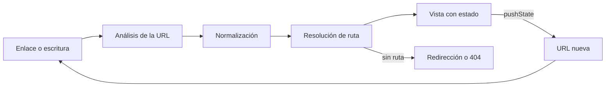
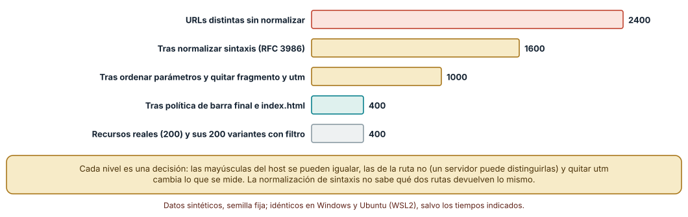
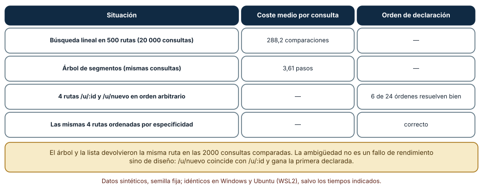
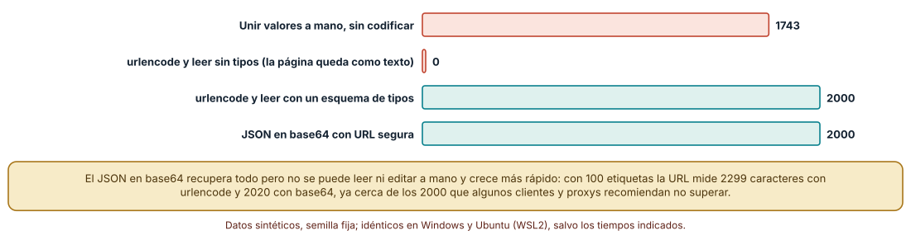

# SE-234 — Navegación, routing y URLs durables

[← SE-233 — Formularios, validación y experiencia de error](https://github.com/vladimiracunadev-create/modern-software-engineering-program/blob/main/classes/part-19-web-frontend-y-aplicaciones-progresivas/se-233-formularios-validacion-y-experiencia-de-error/README.md) · [↑ Parte 19](https://github.com/vladimiracunadev-create/modern-software-engineering-program/blob/main/classes/part-19-web-frontend-y-aplicaciones-progresivas/README.md) · [📚 Índice completo](https://github.com/vladimiracunadev-create/modern-software-engineering-program/blob/main/classes/README.md) · [🌐 Portal](https://vladimiracunadev-create.github.io/modern-software-engineering-program/classes/SE-234.html) · [SE-235 — Rendimiento web y presupuestos →](https://github.com/vladimiracunadev-create/modern-software-engineering-program/blob/main/classes/part-19-web-frontend-y-aplicaciones-progresivas/se-235-rendimiento-web-y-presupuestos/README.md)

## Punto profesional y fundamento pedagógico

**Punto profesional.** La clase existe para que trates la URL como una interfaz pública y duradera: lo que otras personas, otros sistemas y tú mismo guardan, comparten y enlazan. Aprenderás a decidir qué identifica un recurso, qué estado de la vista merece estar en la URL y cómo se resuelve una ruta sin ambigüedades, de modo que «el botón de atrás no funciona» o «el enlace se rompió con el rediseño» tengan una causa conocida.

**Por qué aparece aquí.** Se sitúa después de **Formularios, validación y experiencia de error** y antes de **Rendimiento web y presupuestos**: `SE-233` definió cómo se acepta y se avisa lo que escribe una persona; esta clase pregunta cómo se llega a cada pantalla y cómo se vuelve a ella. Fija tres decisiones que las siguientes reutilizan: la identidad de las URLs (rendimiento y caché), su normalización (SEO) y su estabilidad (PWA y enlaces profundos).

**Error conceptual que debe corregir.** Creer que la URL es un detalle del enrutador: es un contrato que sobrevive a la aplicación. Muchas URLs distintas pueden nombrar lo mismo, un mismo orden de declaración puede resolver rutas de forma distinta y el estado que se pone en la URL se vuelve parte de lo que se comparte.

**Secuencia de aprendizaje.** Antes de leer los resultados, predices cuántas URLs distintas escriben doce maneras 200 recursos y cuántas comparaciones cuesta resolver una ruta entre 500; después normalizas con cuatro niveles, comparas una búsqueda lineal con un árbol de segmentos, cuentas en cuántos órdenes de declaración se resuelve bien una ruta ambigua y recuperas 2000 estados de filtro tras pasarlos por la URL con cuatro codificaciones.

**Evidencia de aprendizaje.** `urls-log.md` con las predicciones, el normalizador con sus cuatro niveles, el enrutador con sus dos algoritmos, la prueba de ambigüedad y el viaje de ida y vuelta de los estados, con explicación causal, contraejemplo y qué hallazgo te haría cambiar una decisión.

**Límite de la conclusión.** Las 2400 URLs, las 500 rutas y los 2000 estados son sintéticos; el enrutador es un algoritmo mínimo sin la API de historial real. Ningún experimento mide el comportamiento de un servidor, un navegador o un buscador concretos ni a personas que comparten enlaces.

### Trazabilidad fuente → afirmación

| Fuente primaria u oficial | Afirmación que respalda | Lo que no prueba |
|---|---|---|
| [RFC 3986: URI, sintaxis genérica (IETF)](https://www.rfc-editor.org/rfc/rfc3986) | Define la sintaxis de una URI y la normalización por sintaxis (mayúsculas, codificación porcentual, segmentos de punto). | No define cuándo dos rutas devuelven el mismo recurso. |
| [URL Standard (WHATWG)](https://url.spec.whatwg.org/) | Define cómo los navegadores analizan y serializan URLs, que difiere en detalles de las RFC. | No dice cómo un servidor concreto interpreta el camino. |
| [HTML Standard: la interfaz de historial (WHATWG)](https://html.spec.whatwg.org/multipage/nav-history-apis.html#the-history-interface) | Define `pushState`, `replaceState` y el evento `popstate` que usan los enrutadores del cliente. | No dice qué hace un marco concreto ante un enlace profundo. |
| [W3C: Cool URIs don't change](https://www.w3.org/Provider/Style/URI) | Argumenta que una URL debe seguir funcionando y que cambiarla rompe a quien la guardó. | No mide cuánto cuesta mantener una URL antigua. |

## Antes de empezar

Recupera de `SE-233` que un formulario necesita recuperarse de un error sin perder lo escrito. La pregunta activa es: **¿qué dirección tiene cada pantalla, cuántas direcciones distintas nombran lo mismo y qué parte del estado de la vista debe viajar en ella?**

## Prerrequisitos

- Haber completado `SE-233` o poder explicar por qué un error no debe borrar lo escrito.
- Python 3.11 o posterior; los experimentos usan solo la biblioteca estándar (`urllib.parse`, `json`, `base64`, `itertools`).
- Nociones de HTTP (códigos 301, 302, 404) y de cómo un servidor responde a una ruta.

## Problema auténtico

La plataforma muestra una lista de entregas con filtros. Una profesora envía por correo el enlace a «entregas tardías del curso 3» y la persona que lo recibe ve la lista sin filtrar: el estado de los filtros no estaba en la URL. Otra persona comparte la misma página con y sin barra final, y el panel de métricas cuenta dos páginas. Tras un rediseño, `/u/nuevo` empieza a abrir el perfil de un usuario llamado «nuevo» porque la ruta con parámetro se declaró antes. Y los enlaces guardados en un documento de hace dos años devuelven 404.

## Objetivos observables

Al terminar podrás:

1. descomponer una URL, decir qué parte identifica el recurso y qué parte describe la vista;
2. normalizar URLs en niveles justificados y contar cuántas variantes nombran un recurso;
3. comparar la resolución de rutas por lista y por árbol y detectar rutas ambiguas;
4. decidir qué estado va en la URL, cómo se codifica y qué límites de tamaño y de privacidad respetar;
5. diseñar una política de cambios de URL con redirecciones que preserve los enlaces antiguos.

## Mapa conceptual



El mapa se lee como un ciclo: una dirección se analiza, se normaliza, se resuelve a una vista y la vista, al cambiar, produce otra dirección. La rama inferior es la política de lo que ya no existe: redirigir o responder que no está.

## Temas y por qué importan

| Tema | Por qué cambia una decisión profesional | Evidencia mínima |
|---|---|---|
| La URL como interfaz pública | Lo que se enlaza y se guarda es un contrato que sobrevive a la implementación. | Predicción, traza causal y contraejemplo de **La URL como interfaz pública** en `urls-log.md` |
| Normalización y equivalencia | Muchas URLs pueden nombrar un recurso; decidir cuáles son iguales afecta cachés, métricas y SEO. | Predicción, traza causal y contraejemplo de **Normalización y equivalencia** en `urls-log.md` |
| Enrutado en el cliente | La API de historial permite cambiar la URL sin recargar, y exige que el servidor sepa responder en profundidad. | Predicción, traza causal y contraejemplo de **Enrutado en el cliente** en `urls-log.md` |
| Estado en la URL | Lo que está en la URL se comparte, se guarda y se registra; conviene decidir qué y cómo. | Predicción, traza causal y contraejemplo de **Estado en la URL** en `urls-log.md` |
| Cambios y redirecciones | Mover una página sin dejar una redirección rompe los enlaces de quien no controlas. | Predicción, traza causal y contraejemplo de **Cambios y redirecciones** en `urls-log.md` |

## Conceptos y decisiones

### 1. La URL como interfaz pública

Una URL tiene esquema, autoridad (servidor y puerto), ruta, consulta y fragmento. La **ruta** identifica el recurso («la entrega 123»); la **consulta** suele describir una vista de él («ordenada por fecha, página 2»); el **fragmento** apunta a un lugar dentro del documento y no llega al servidor. Esta separación guía el diseño: lo que identifica va en la ruta, lo que filtra o presenta, en la consulta, y lo que es privado no va en ninguna, porque las URLs terminan en historiales, registros de servidores, cabeceras de referencia y mensajes copiados.

### 2. Normalización y equivalencia

La RFC 3986 define una normalización por sintaxis que no cambia el significado: el esquema y el host se escriben en minúsculas, el puerto por defecto se omite, los segmentos `.` y `..` se resuelven y la codificación porcentual se uniformiza (mayúsculas hexadecimales y decodificar caracteres no reservados). Más allá de la sintaxis hay decisiones: si la barra final importa, si el orden de los parámetros importa, si `index.html` equivale a la carpeta, si los parámetros de seguimiento cuentan. Esas son decisiones de política y de servidor, no de sintaxis: la ruta puede distinguir mayúsculas.

### 3. Enrutado en el cliente

Un enrutador del cliente intercepta los enlaces internos, cambia la URL con `history.pushState` y pinta la vista correspondiente sin recargar; el evento `popstate` cubre atrás y adelante. Dos obligaciones nacen de ello: el servidor debe responder con la aplicación en cualquier ruta válida (si no, una recarga da 404) y la lista de rutas debe resolverse sin ambigüedad. Si `/u/:id` se declara antes que `/u/nuevo`, un enrutador que toma la primera coincidencia nunca llega a la segunda. La regla estable es declarar de más específica a menos, o resolver por especificidad.

### 4. Estado en la URL

Poner filtros, orden y página en la consulta hace la vista compartible, recargable y navegable con atrás; esconderlos en memoria los pierde. Tiene costos: hay que **codificar** bien (espacios, `&`, `=`, Unicode), **tipar** al leer (todo llega como texto), limitar el **tamaño** (RFC 9110 recomienda que los clientes y servidores admitan al menos 8000 octetos, pero intermediarios antiguos y herramientas aplican límites menores) y no incluir datos personales. Se pone en la URL lo que ayuda a repetir la vista; no se pone lo que identifica a la persona ni lo que cambia con cada pulsación.

### 5. Cambios y redirecciones

Cuando una página se mueve, la URL antigua debe seguir llevando al nuevo lugar. Una redirección permanente (301 o 308) indica a clientes y buscadores que actualicen su referencia; una temporal (302 o 307) dice que el cambio no es definitivo. Las redirecciones encadenadas añaden viajes de ida y vuelta y se pierden entre versiones: se mantiene una tabla de equivalencias y se prueba contra una lista de URLs antiguas. Una URL no debería depender de la tecnología («.php»), del autor ni del estado de una reorganización.

### Doce maneras de escribir un mismo recurso

Se generaron, para 200 recursos, doce variantes de su URL, la forma base incluida: con y sin barra final, host en mayúsculas, puerto 443 explícito, fragmento, parámetros en dos órdenes, un parámetro `utm_source`, `index.html`, barra duplicada, segmento `.` y segmento `..`. Son 2400 URLs. Se aplicaron cuatro niveles de normalización: **L1**, la sintaxis de la RFC 3986 (host en minúsculas, puerto por defecto, segmentos de punto, codificación porcentual); **L2**, además, ordenar parámetros, quitar el fragmento y los parámetros `utm_`; **L3**, además, la política de barra final e `index.html` y barras duplicadas.

```python
def L2(u):
    s = urlsplit(L1(u))
    q = sorted((k, v) for k, v in parse_qsl(s.query) if not k.startswith("utm_"))
    return urlunsplit((s.scheme, s.netloc, s.path, urlencode(q), ""))
```

Resultado, idéntico en Windows (CPython 3.12.9) y en Ubuntu bajo WSL2 (3.12.3): las 2400 URLs son **2400** distintas sin normalizar, **1600** tras L1, **1000** tras L2 y **400** tras L3. Las 400 restantes son los 200 recursos con y sin el filtro de la consulta, que son vistas distintas por decisión.



**Cómo leer la figura.** Cada barra es el número de URLs distintas que sigue contando un sistema para los mismos recursos; la última es el número de vistas realmente distintas. **Dónde deja de valer:** el mayor paso es una decisión del autor (ignorar el orden de los parámetros y los `utm_`), y no todo servidor la comparte: en un servidor que distingue mayúsculas en la ruta o que trata `/a` y `/a/` como recursos distintos, la política cambia lo que significa «igual». La normalización de sintaxis no sabe qué dos rutas devuelven el mismo contenido.

### Buscar una ruta entre 500

Se declararon 500 rutas (480 con un parámetro y 20 estáticas) y se resolvieron 20 000 consultas con semilla fija de dos maneras: una búsqueda lineal que devuelve la primera coincidencia y un árbol de segmentos con prioridad de la coincidencia exacta sobre el parámetro. Los dos devolvieron la misma ruta en las 2000 consultas comparadas. La búsqueda lineal hizo en promedio **288,2 comparaciones** por consulta; el árbol, **3,61 pasos**. Con cuatro rutas (`/u/:id`, `/u/nuevo`, `/u/:id/editar`, `/u/nuevo/editar`), solo **6 de los 24 órdenes** de declaración resuelven correctamente tanto `/u/nuevo` como `/u/nuevo/editar`; ordenarlas por especificidad (menos parámetros primero) lo resuelve siempre.

```python
ord_esp = sorted(base, key=lambda r: (sum(1 for s in r.split("/") if s.startswith(":")), r))
```



**Cómo leer la figura.** Las dos primeras filas comparan el coste por consulta; las dos últimas, cuántos órdenes de declaración resuelven bien cuatro rutas ambiguas. **Dónde deja de valer:** 288 comparaciones son microsegundos; el coste solo importa en un enrutador con miles de rutas o en un entorno limitado. La ambigüedad, en cambio, es un defecto de diseño que ningún rendimiento compensa: el comportamiento no debe depender del orden en que alguien declaró las rutas.

### Llevar el estado a la URL y traerlo de vuelta

Se generaron 2000 estados de filtro con un texto (con espacios, `&`, `=`, `%`, `+`, `/`, Ñ o vacío), una lista de 0 a 3 estados, un booleano, una página y una nota mínima opcional. Se probaron cuatro codificaciones y se contó cuántos estados se recuperan **exactamente** tras ir a la URL y volver: unir los valores a mano sin codificar recupera **1743**; `urlencode` y leer sin tipos recupera **0** (los números y los booleanos vuelven como texto); `urlencode` con un esquema de tipos recupera **2000**; JSON en base64 con alfabeto seguro para URL recupera **2000**. La longitud media es de 68,6 caracteres con `urlencode` y 115 con base64; con 100 etiquetas seleccionadas, 2299 y 2020.

```python
def udec_tipada(t):
    d = parse_qs(t, keep_blank_values=True)
    return {"q": d.get("q", [""])[0], "estados": d.get("estados", []),
            "pagina": int(d["pagina"][0]), ...}
```



**Cómo leer la figura.** Cada barra es el número de estados, de 2000, que vuelven idénticos; el esquema de tipos es lo que distingue las barras verdes de las rojas. **Dónde deja de valer:** los estados son sintéticos y tienen cinco campos; un estado real con listas anidadas o fechas exige un esquema más rico. La codificación en base64 recupera todo pero no se puede leer ni editar a mano, no se puede enlazar por partes y crece más rápido con las listas largas: es una opción, no una mejora.

## Definiciones de trabajo

- **URL canónica:** forma elegida de una URL entre varias que nombran el mismo recurso, a la que se redirige o se refiere.
- **normalización por sintaxis:** transformación que no cambia el significado de una URL (minúsculas del host, codificación porcentual, segmentos de punto).
- **enlace profundo:** URL que lleva directamente a una vista interior de la aplicación, no a su portada.
- **ruta ambigua:** ruta que coincide con más de un patrón declarado de modo que el resultado depende del orden.
- **redirección permanente:** respuesta (301 o 308) que indica que un recurso cambió de dirección de forma definitiva.

Las definiciones son operativas para esta clase y deben contrastarse con las especificaciones enlazadas al final.

## Ejemplo mínimo

Escribe un normalizador mínimo y predice cuántas de estas cuatro URLs quedan tras aplicarlo.

```python
from urllib.parse import urlsplit, urlunsplit
def n(u):
    s = urlsplit(u)
    return urlunsplit((s.scheme.lower(), s.hostname.lower(), s.path.rstrip("/") or "/", s.query, ""))
urls = ["https://EJEMPLO.test/a", "https://ejemplo.test/a/", "https://ejemplo.test/a#x", "https://ejemplo.test/A"]
assert len({n(u) for u in urls}) == 2
```

Quedan dos: la ruta distingue mayúsculas y `/A` es otro recurso. Registra versión del intérprete y salida; añade `?b=2&a=1` y `?a=1&b=2` y predice si el normalizador los iguala.

## Ejemplo profesional

La plataforma publica una tabla de URLs: `/entregas/:id` identifica una entrega, `/entregas?estado=tarde&curso=3&pagina=2` describe una vista de la lista, y los parámetros de la vista se leen con un esquema de tipos que ignora lo desconocido. Las rutas se declaran ordenadas por especificidad y una prueba comprueba que cada URL de una lista de ejemplos se resuelve a la vista esperada en cualquier orden de declaración. El servidor devuelve la aplicación en toda ruta válida y 404 en las demás; las URLs antiguas del rediseño tienen una tabla de redirecciones permanentes que se prueba en cada versión.

Compara el caso normal con un enlace compartido con filtros, una recarga en una ruta profunda y un enlace guardado hace dos años. La política es apropiada cuando esos tres casos devuelven la vista correcta sin intervención; es frágil cuando alguno depende de que la persona vuelva a elegir los filtros.

## Práctica guiada

1. Descompón diez URLs de la plataforma en esquema, host, ruta, consulta y fragmento y marca qué identifica y qué describe la vista.
2. Predice cuántas variantes distintas quedarán tras cada nivel de normalización y escribe los números antes de ejecutar.
3. Implementa los tres niveles y mide las 2400 variantes de los 200 recursos.
4. Implementa el enrutador por lista y por árbol; compara su resultado en 2000 consultas y mide el coste.
5. Prueba las 24 permutaciones de cuatro rutas ambiguas y comprueba qué orden las resuelve.
6. Serializa 2000 estados con cuatro codificaciones y cuenta los recuperados exactamente.
7. Entrega `urls-log.md` y pide a otra persona que añada un estado que tu serialización rompa.

## Ejercicios

1. **Política:** decide, y justifica con un caso del producto, si `/a` y `/a/` son el mismo recurso, y calcula cuánto cambian las 400 URLs de la figura.
2. **Ambigüedad:** diseña tres rutas ambiguas distintas de `/u/nuevo` y comprueba que el orden por especificidad las resuelve.
3. **Estado:** añade al esquema un rango de fechas y diseña su codificación; mide el tamaño con 10 y con 100 rangos.
4. **Redirecciones:** dada una lista de 50 URLs antiguas y sus nuevas, escribe una prueba que detecte cadenas de redirección y bucles.

## Reto verificable

Entrega `urls-log.md` con el normalizador y sus cuatro niveles, el enrutador con ambos algoritmos y la prueba de ambigüedad, y la serialización de estados con su comprobación. Se aprueba si otra persona ejecuta el código desde un checkout limpio, obtiene las mismas cifras con las mismas semillas y puede indicar qué política de URL te haría cambiar. No se aprueba por un enrutador que funciona con las rutas del ejemplo ni por una normalización sin criterios escritos.

## Caso conductor

La aplicación de entregas con conectividad irregular fija en esta clase la tabla de URLs: qué identifica cada ruta, qué vista describe cada consulta y cómo se resuelven. Esa tabla es la que `SE-235` usa para decidir qué se cachea, `SE-238` para los metadatos y las canónicas, y `SE-237` para que el service worker responda a rutas profundas sin conexión. Cambia después una sola decisión, la barra final, y revisa cuántas rutas, redirecciones y métricas cambian.

## Preguntas frecuentes

### ¿Todo el estado de la vista debe ir en la URL?

No: va lo que ayuda a repetir o compartir la vista (filtro, orden, página). Lo que cambia con cada pulsación o lo privado se queda fuera, y lo muy grande se guarda aparte con un identificador.

### ¿Por qué mi servidor devuelve 404 al recargar una ruta del enrutador del cliente?

Porque la ruta solo existe en el navegador: el servidor no sabe que `/entregas/3` debe devolver la aplicación. Se configura para responder con el documento de la aplicación en toda ruta válida y con 404 verdadero en las demás.

### ¿Redirección 301 o 302?

301 o 308 para movimientos definitivos, que los buscadores y clientes recuerdan; 302 o 307 para cambios temporales. Usar 302 en un movimiento definitivo retrasa que se actualicen los enlaces.

### ¿Las mayúsculas de la ruta son iguales a las minúsculas?

No necesariamente: el host no distingue mayúsculas, pero la ruta depende del servidor, y muchos sistemas de archivos las distinguen. Se decide una forma, se redirige a ella y no se asume.

## Fallo controlado y diagnóstico

Reproduce el fallo clásico de la clase: **declarar una ruta con parámetro antes que una ruta fija**. Declara `/u/:id` y luego `/u/nuevo` en un enrutador de primera coincidencia.

Registra síntoma, entrada mínima, hipótesis, observación que descarta cada hipótesis, causa, corrección y prueba de regresión. **Síntoma:** al abrir `/u/nuevo`, la aplicación muestra el perfil de un usuario llamado «nuevo» que no existe. **Hipótesis rivales:** (a) la base de datos tiene un usuario con ese nombre; (b) la ruta con parámetro captura la dirección antes de la fija. **Prueba:** resuelve `/u/nuevo` imprimiendo qué patrón coincide primero y comprueba que es `/u/:id`; invierte el orden y observa que cambia. **Conclusión:** la causa es el orden de declaración. **Regresión:** ordena por especificidad, o resuelve prefiriendo el patrón con menos parámetros, y añade una prueba que pruebe las permutaciones. No cambies a la vez el orden y los nombres de las rutas: no sabrás qué corrigió el problema.

## Errores comunes y cómo corregirlos

| Síntoma | Causa probable | Corrección |
|---|---|---|
| Los filtros se pierden al compartir el enlace | El estado vive solo en memoria | Llevar a la consulta lo que repite la vista |
| La misma página cuenta como dos en las métricas | Variantes de la URL sin normalizar (barra final, mayúsculas, utm) | Elegir una forma canónica y redirigir a ella |
| Una recarga en una ruta profunda da 404 | El servidor no devuelve la aplicación para esa ruta | Configurar el servidor para responder en toda ruta válida |
| Una ruta fija es capturada por una con parámetro | Orden de declaración sin criterio de especificidad | Ordenar de más específica a menos o resolver por especificidad |
| Los enlaces antiguos devuelven 404 tras el rediseño | URLs cambiadas sin tabla de redirecciones | Redirigir de forma permanente y probar la tabla en cada versión |

## Entorno y archivos clave

```text
work/SE-234/
├── README.md
├── urls/
│   ├── normalizar.py
│   ├── enrutar.py
│   └── estado.py
├── tests/test_normalizar.py
└── evidence/urls-log.md
```

El `README` declara plataforma, versión de Python, semillas y comandos. Los experimentos usan solo la biblioteca estándar y se ejecutaron con CPython 3.12.9 en Windows 11 y 3.12.3 en Ubuntu bajo WSL2: las salidas fueron idénticas. No se usó ningún enrutador de un marco, servidor web ni buscador.

## Seguridad, ética y accesibilidad

- una URL con datos personales (nombre, correo, identificador de sesión) queda en historiales, registros y cabeceras de referencia: no los pongas en la URL;
- un enlace que cambia la vista debe ser alcanzable con teclado y anunciar el cambio de página a las tecnologías de apoyo (título y foco);
- las redirecciones abiertas (`?siguiente=...` sin validar) permiten enviar a una persona a un sitio malicioso desde un dominio de confianza: valida el destino contra una lista;
- los ejemplos usan dominios reservados para pruebas y recursos sintéticos; no pongas enlaces reales de estudiantes en la evidencia;
- mantener URLs antiguas es un servicio a quienes enlazaron tu trabajo, incluidas personas que no conoces.

## Puente hacia el trabajo con agentes

Un agente al que se le pide «añade filtros a la lista» los guardará en memoria o los pondrá en la URL sin codificar, declarará rutas en el orden en que se le ocurrieron y no pensará en las URLs antiguas. Pídele que declare qué identifica la ruta y qué describe la consulta, que use un esquema de tipos al leer, que ordene las rutas por especificidad y que entregue la tabla de redirecciones del cambio. Revisa especialmente cualquier valor que pase a la URL sin codificar y cualquier destino de redirección que venga de un parámetro.

## Transferencia

Traslada el experimento a otra superficie con direcciones (rutas de una API, enlaces profundos de una aplicación móvil, nombres de recursos en un sistema de archivos): cambia el esquema pero conserva el método de contar cuántas direcciones nombran lo mismo, resolver sin ambigüedad y recuperar el estado con un esquema. La transferencia está lograda cuando puedes explicar qué parte de tu normalizador dependía de HTTP y cuál de la idea de formas canónicas, no cuando el código se parece.

## Evaluación y evidencia

| Criterio | Evidencia para aprobar |
|---|---|
| comprensión | explicación de qué identifica la ruta, qué describe la consulta y por qué la URL es un contrato |
| corrección | cifras reproducibles de normalización, enrutado y estado con las mismas semillas |
| diseño | tabla de URLs, política de normalización y de redirecciones documentadas |
| diagnóstico | reproducción de la ruta capturada por un parámetro con regresión |
| incertidumbre | declaración de las decisiones de política (barra final, orden de parámetros) y de lo que no se midió |
| reproducibilidad | versiones, comandos, salida y límites declarados |

## Fuentes

- [RFC 3986: URI, sintaxis genérica](https://www.rfc-editor.org/rfc/rfc3986) — sintaxis y normalización de URIs; autoridad: IETF.
- [URL Standard (WHATWG)](https://url.spec.whatwg.org/) — análisis y serialización de URLs en los navegadores; autoridad: WHATWG.
- [HTML Standard: la interfaz de historial (WHATWG)](https://html.spec.whatwg.org/multipage/nav-history-apis.html#the-history-interface) — `pushState` y `popstate`; autoridad: WHATWG.
- [RFC 9110: HTTP Semantics](https://www.rfc-editor.org/rfc/rfc9110) — códigos de redirección y longitud mínima soportada de URIs; autoridad: IETF.
- [W3C: Cool URIs don't change](https://www.w3.org/Provider/Style/URI) — por qué una URL debe perdurar; autoridad: W3C.
- [Google Search Central: URLs duplicadas y canónicas](https://developers.google.com/search/docs/crawling-indexing/consolidate-duplicate-urls) — consolidación de URLs duplicadas; autoridad: Google Search Central.

Cada fuente respalda el mecanismo indicado; ninguna demuestra que la política de normalización de la clase sea la adecuada para un servidor concreto ni que los límites de longitud citados rijan en todos los intermediarios.

- [Python: `urllib.parse`](https://docs.python.org/3/library/urllib.parse.html) — análisis y construcción de URLs usados en los experimentos.
- [Python: `itertools`](https://docs.python.org/3/library/itertools.html) — permutaciones de las rutas ambiguas.

## Límites y siguiente paso

Se ejecutaron tres experimentos con datos sintéticos en Windows y Ubuntu (WSL2) con resultados idénticos. Las URLs, las rutas y los estados son construcciones del autor, el enrutador es un algoritmo mínimo y no se probó contra un navegador, un servidor ni un buscador. La siguiente clase pregunta cuánto pesan y cuánto tardan las páginas a las que esas URLs llevan, y cómo se pone un presupuesto.

## Glosario

- **URL canónica:** forma elegida de una URL entre varias que nombran el mismo recurso, a la que se redirige o se refiere.
- **normalización por sintaxis:** transformación que no cambia el significado de una URL (minúsculas del host, codificación porcentual, segmentos de punto).
- **enlace profundo:** URL que lleva directamente a una vista interior de la aplicación, no a su portada.
- **ruta ambigua:** ruta que coincide con más de un patrón declarado de modo que el resultado depende del orden.
- **redirección permanente:** respuesta (301 o 308) que indica que un recurso cambió de dirección de forma definitiva.

---

[← SE-233 — Formularios, validación y experiencia de error](https://github.com/vladimiracunadev-create/modern-software-engineering-program/blob/main/classes/part-19-web-frontend-y-aplicaciones-progresivas/se-233-formularios-validacion-y-experiencia-de-error/README.md) · [↑ Parte 19](https://github.com/vladimiracunadev-create/modern-software-engineering-program/blob/main/classes/part-19-web-frontend-y-aplicaciones-progresivas/README.md) · [📚 Índice completo](https://github.com/vladimiracunadev-create/modern-software-engineering-program/blob/main/classes/README.md) · [🌐 Portal](https://vladimiracunadev-create.github.io/modern-software-engineering-program/classes/SE-234.html) · [SE-235 — Rendimiento web y presupuestos →](https://github.com/vladimiracunadev-create/modern-software-engineering-program/blob/main/classes/part-19-web-frontend-y-aplicaciones-progresivas/se-235-rendimiento-web-y-presupuestos/README.md)
