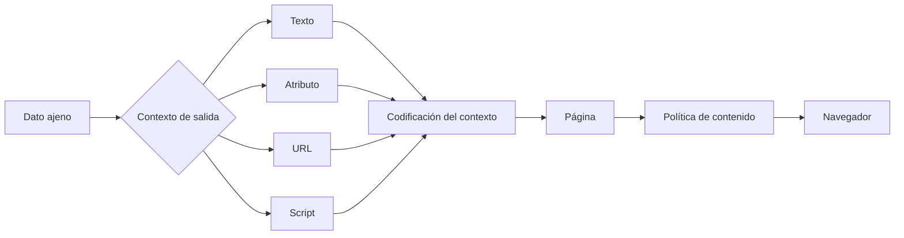
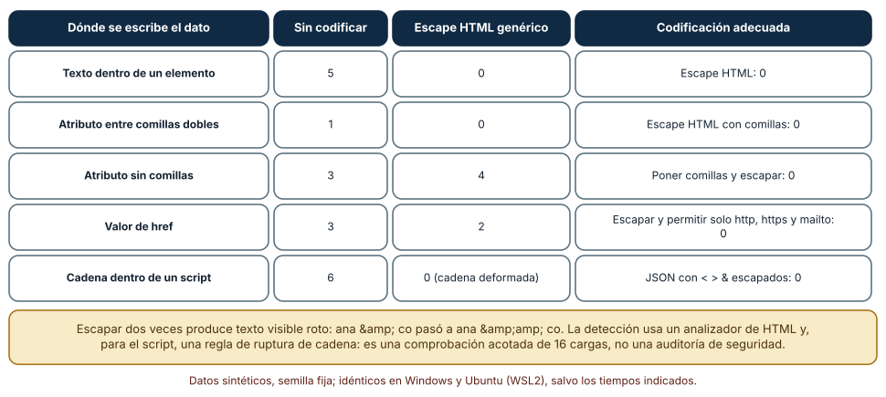
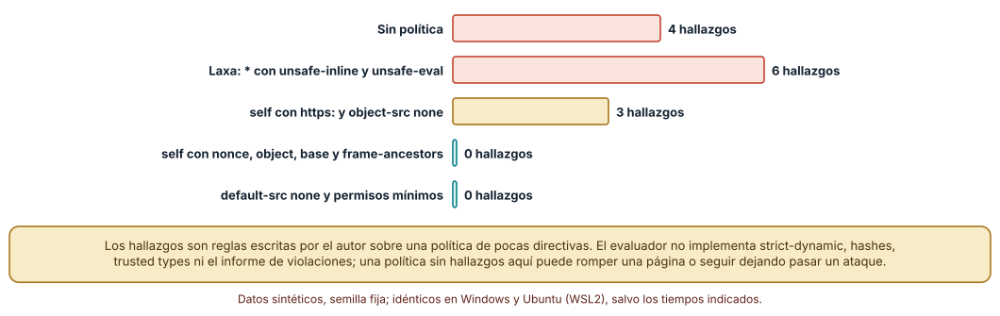
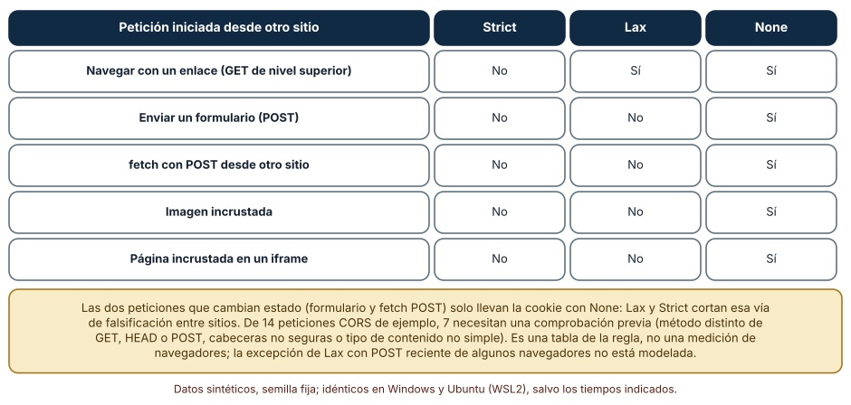

# SE-236 — Seguridad del navegador y políticas de contenido

[← SE-235 — Rendimiento web y presupuestos](https://github.com/vladimiracunadev-create/modern-software-engineering-program/blob/main/classes/part-19-web-frontend-y-aplicaciones-progresivas/se-235-rendimiento-web-y-presupuestos/README.md) · [↑ Parte 19](https://github.com/vladimiracunadev-create/modern-software-engineering-program/blob/main/classes/part-19-web-frontend-y-aplicaciones-progresivas/README.md) · [📚 Índice completo](https://github.com/vladimiracunadev-create/modern-software-engineering-program/blob/main/classes/README.md) · [🌐 Portal](https://vladimiracunadev-create.github.io/modern-software-engineering-program/classes/SE-236.html) · [SE-237 — PWA, caché, offline y sincronización →](https://github.com/vladimiracunadev-create/modern-software-engineering-program/blob/main/classes/part-19-web-frontend-y-aplicaciones-progresivas/se-237-pwa-cache-offline-y-sincronizacion/README.md)

## Punto profesional y fundamento pedagógico

**Punto profesional.** La clase existe para que entiendas qué defiende el navegador por sí mismo (el aislamiento por origen), qué dejas abierto al incluir datos ajenos en una página y qué políticas puedes declarar para reducir el daño (codificación por contexto, política de seguridad de contenido, atributos de cookie, comprobación de origen), de modo que «hemos añadido seguridad» sea una afirmación con casos probados y límites declarados.

**Por qué aparece aquí.** Se sitúa después de **Rendimiento web y presupuestos** y antes de **PWA, caché, offline y sincronización**: `SE-235` fijó cuánto puede costar una página; esta clase pregunta qué puede hacer con lo que recibe y qué le impide el navegador. Fija el modelo de amenazas que la clase de PWA reutiliza, porque un service worker es código con privilegios que se instala una vez y vive mucho.

**Error conceptual que debe corregir.** Creer que «escapar» o «tener CSP» son interruptores: cada contexto de salida pide su propia codificación, una política laxa da una falsa sensación de seguridad y CORS no protege al servidor, solo decide qué páginas ajenas pueden leer una respuesta.

**Secuencia de aprendizaje.** Antes de leer los resultados, predices cuántas de 16 cargas útiles se vuelven código en cada contexto sin codificar y con un escape genérico; después ejecutas la matriz de contextos y codificaciones con un analizador de HTML, evalúas un simplificador de CSP con 16 casos y cinco políticas, y construyes la tabla de cuándo viaja una cookie desde otro sitio y qué peticiones necesitan una comprobación previa de CORS.

**Evidencia de aprendizaje.** `security-log.md` con las predicciones, la matriz de contextos, el evaluador y el linter de políticas, las tablas de SameSite y de CORS, con explicación causal, contraejemplo y qué hallazgo te haría retirar una política.

**Límite de la conclusión.** Las 16 cargas útiles y las cinco políticas son una muestra escogida por el autor; el analizador de HTML no ejecuta código y la detección en un script es una regla de ruptura de cadena. Ninguna comprobación equivale a una auditoría de seguridad ni a probar un ataque real; no se atacó ningún sistema.

### Trazabilidad fuente → afirmación

| Fuente primaria u oficial | Afirmación que respalda | Lo que no prueba |
|---|---|---|
| [OWASP: Cross Site Scripting Prevention Cheat Sheet](https://cheatsheetseries.owasp.org/cheatsheets/Cross_Site_Scripting_Prevention_Cheat_Sheet.html) | Establece que la codificación de salida depende del contexto (texto HTML, atributo, JavaScript, URL, CSS). | No enumera todos los contextos de un marco concreto. |
| [CSP Level 3 (W3C)](https://www.w3.org/TR/CSP3/) | Define las directivas de política de seguridad de contenido, los nonces y los hashes. | No garantiza que una política concreta bloquee un ataque concreto. |
| [Fetch Standard: protocolo CORS (WHATWG)](https://fetch.spec.whatwg.org/#http-cors-protocol) | Define qué peticiones son simples, cuáles requieren comprobación previa y qué cabeceras de respuesta permiten la lectura. | No cubre las decisiones de autorización del servidor. |
| [web.dev: SameSite cookies explained](https://web.dev/articles/samesite-cookies-explained) | Explica los valores Strict, Lax y None y cuándo se envía una cookie en peticiones entre sitios. | No describe cada excepción de cada navegador. |

## Antes de empezar

Recupera de `SE-235` que cada recurso que una página pide tiene un coste y un origen. La pregunta activa es: **¿qué datos ajenos entran en mi página, en qué contexto se escriben y qué puede hacer cada origen con lo que recibe?**

## Prerrequisitos

- Haber completado `SE-235` o poder explicar qué recursos pide una página y de qué orígenes.
- Python 3.11 o posterior; los experimentos usan solo la biblioteca estándar (`html`, `html.parser`, `urllib.parse`, `json`).
- Nociones de cookies, de cabeceras HTTP y de qué es un origen (esquema, host y puerto).

## Problema auténtico

El formulario de entrega muestra el nombre que la estudiante escribió en un saludo, el comentario del profesor en la lista y un enlace «ver trabajo» construido con la dirección que el estudiante indicó. Un estudiante escribe como nombre `` y el saludo ejecuta código en el navegador de quien lo ve. Otro pone `javascript:...` como dirección de su trabajo y el enlace ejecuta código al pulsarlo. El equipo escapa el nombre con una función genérica y el problema reaparece en un atributo sin comillas. Alguien añade una cabecera de política de contenido copiada de internet con `*` y `unsafe-inline`, «para que no rompa nada».

## Objetivos observables

Al terminar podrás:

1. explicar el modelo de origen y qué aísla el navegador por defecto;
2. aplicar la codificación adecuada a cada contexto de salida y reconocer por qué una sola no basta;
3. leer y evaluar una política de seguridad de contenido y detectar la que no protege;
4. decir cuándo una cookie viaja en una petición entre sitios según su atributo SameSite y qué cierra la vía de falsificación;
5. distinguir qué hace y qué no hace CORS y qué peticiones necesitan comprobación previa.

## Mapa conceptual



El mapa se lee de izquierda a derecha: un dato ajeno entra en un contexto concreto, debe codificarse para ese contexto y la página resultante la limita, como segunda barrera, una política que declara qué puede cargar y ejecutar. La política no sustituye a la codificación: solo reduce lo que un fallo de codificación puede hacer.

## Temas y por qué importan

| Tema | Por qué cambia una decisión profesional | Evidencia mínima |
|---|---|---|
| Origen y aislamiento | La política de mismo origen es la base de todo lo demás; entenderla evita falsas expectativas. | Predicción, traza causal y contraejemplo de **Origen y aislamiento** en `security-log.md` |
| Inyección y codificación por contexto | El mismo dato es inofensivo o ejecutable según dónde se escribe. | Predicción, traza causal y contraejemplo de **Inyección y codificación por contexto** en `security-log.md` |
| Política de seguridad de contenido | Una política estricta limita qué código se ejecuta incluso cuando hay una inyección. | Predicción, traza causal y contraejemplo de **Política de seguridad de contenido** en `security-log.md` |
| Cookies y falsificación entre sitios | SameSite decide cuándo viaja la cookie; sin ella, otro sitio puede hacer peticiones con tu sesión. | Predicción, traza causal y contraejemplo de **Cookies y falsificación entre sitios** en `security-log.md` |
| CORS y sus límites | CORS regula la lectura entre orígenes, no protege el servidor ni autentica. | Predicción, traza causal y contraejemplo de **CORS y sus límites** en `security-log.md` |

## Conceptos y decisiones

### 1. Origen y aislamiento

Un origen es la tupla (esquema, host, puerto). Por defecto, una página de un origen no puede leer los datos de otro (política de mismo origen): puede enviar peticiones, incrustar recursos y mostrar un marco, pero no leer el resultado. Todo lo demás se construye sobre esa regla: CORS la relaja de forma explícita, las cookies tienen su propio criterio (sitio, no origen) y la política de seguridad de contenido restringe qué puede cargar la propia página. Un origen es una frontera de confianza: todo el código que corre en él, incluido el de bibliotecas de terceros, puede leer lo que la página lee.

### 2. Inyección y codificación por contexto

Una inyección ocurre cuando un dato se interpreta como código. La defensa principal es codificar la salida **para el contexto** donde se escribe: en texto HTML se escapan `<`, `>` y `&`; en un atributo entre comillas, además, la comilla; en un atributo sin comillas, cualquier espacio rompe el valor y la solución es poner comillas; en una URL se valida el esquema (solo `http`, `https`, `mailto`) y se codifica; en una cadena dentro de un script se serializa como JSON y se escapan `<`, `>` y `&`. Escapar para un contexto y usar el resultado en otro falla en silencio, y escapar dos veces rompe el texto sin proteger nada.

### 3. Política de seguridad de contenido

La política de seguridad de contenido (CSP) es una cabecera que declara de dónde puede cargar la página scripts, estilos, imágenes y conexiones y si puede ejecutar código en línea. Una política con `script-src 'self'` y sin `'unsafe-inline'` bloquea el código en línea que inyectaría un ataque; con un `nonce` por respuesta se permite el código propio en línea. Una política con `*`, `'unsafe-inline'` o `'unsafe-eval'` casi no restringe. Es una **segunda barrera**: no reemplaza la codificación, y una política demasiado estricta puede romper la página, por lo que se introduce en modo de solo informe antes de aplicarla.

### 4. Cookies y falsificación entre sitios

La falsificación de petición entre sitios (CSRF) abusa de que el navegador adjunta las cookies a una petición aunque la inicie otro sitio. El atributo `SameSite` limita ese envío: con `Strict`, la cookie no viaja nunca en una petición iniciada desde otro sitio; con `Lax`, solo en una navegación de nivel superior con método seguro (un GET desde un enlace); con `None` (y `Secure`), siempre. Los navegadores han ido adoptando `Lax` como valor por defecto, pero no conviene suponerlo: se declara. SameSite no sustituye a una comprobación de origen o un token en las operaciones que cambian estado.

### 5. CORS y sus límites

CORS es un mecanismo para que un servidor permita a páginas de otros orígenes **leer** sus respuestas. No impide que la petición llegue: una petición «simple» (GET, HEAD o POST con ciertas cabeceras y tipos de contenido) se envía igual y solo se bloquea la lectura de la respuesta. Las peticiones con otro método, cabeceras no seguras o un tipo de contenido como JSON requieren una **comprobación previa** (`OPTIONS`) que el servidor debe contestar. Por eso CORS no es autenticación ni un cortafuegos: un cliente que no es un navegador ignora CORS, y una operación que cambia estado debe protegerse con autorización y una comprobación de origen o un token.

### Un dato, cinco contextos

Se preparó una lista de 16 cargas útiles (elementos con manejadores, comillas rotas, `javascript:`, `data:`, entidades ya escapadas y textos legítimos con `&`, `<` y comillas) y se escribió cada una en cinco contextos con cuatro codificaciones. La detección usa `html.parser` para ver si aparece un elemento ejecutable, un atributo `on…` o una URL ejecutable, y, en el contexto de script, una regla de ruptura de cadena.

```python
class Detect(HTMLParser):
    def handle_starttag(self, tag, attrs):
        if tag in ("script", "svg", "iframe"): self.found.add(f"elemento <{tag}>")
        for k, v in attrs:
            if k.startswith("on"): self.found.add(f"atributo {k}")
            if k in ("href", "src") and v.strip().lower().startswith(("javascript:", "data:text/html")):
                self.found.add("url ejecutable")
```

Resultado, idéntico en Windows (CPython 3.12.9) y en Ubuntu bajo WSL2 (3.12.3): **sin codificar**, 5 de las 16 cargas se vuelven código en texto HTML, 1 en un atributo entre comillas dobles, 3 en un atributo sin comillas, 3 en un `href` y 6 en una cadena de script. El **escape HTML con comillas** deja 0 en texto y en atributo con comillas, pero **4 en un atributo sin comillas** (las cargas con espacios) y **2 en un `href`** (`javascript:` y `data:`), y en el script no hay ruptura pero la cadena queda deformada. Escapar y además permitir solo los esquemas `http`, `https` y `mailto` deja 0 en el `href`; serializar como JSON y escapar `<`, `>` y `&` deja 0 en el script. Escapar dos veces convirtió `ana & co` en `ana &amp;amp; co`.



**Cómo leer la figura.** Cada fila es un contexto de salida; las columnas muestran cuántas de 16 cargas se ejecutan sin codificar, con un escape HTML genérico y con la codificación propia de ese contexto. **Dónde deja de valer:** son 16 cargas elegidas por el autor y un analizador que no ejecuta nada; una carga que explote una mutación del analizador del navegador o un contexto no cubierto (CSS, comentarios, plantillas del lado del cliente) no aparece. Es una comprobación acotada: demuestra el mecanismo, no que una página esté a salvo.

### ¿Esta política protege algo?

Se escribió un evaluador simplificado de `script-src` (con `'self'`, `'none'`, hosts, comodines, esquemas, `'unsafe-inline'` y nonces) y se verificó con 16 casos de ejemplo: acertó los 16. Después se escribió un linter con ocho reglas (sin `script-src` ni `default-src`, `unsafe-inline` efectivo, `unsafe-eval`, origen amplio, `data:` en scripts, falta de `object-src`, de `base-uri` y de `frame-ancestors`) y se aplicó a cinco políticas: la **ausencia de política** (4 hallazgos), una **laxa** con `*`, `'unsafe-inline'` y `'unsafe-eval'` (6), una de `'self'` con `https:` (3), una de `'self'` con nonce, `object-src`, `base-uri` y `frame-ancestors` (0) y una con `default-src 'none'` y permisos mínimos (0).

```python
if "'unsafe-inline'" in s and not any(x.startswith(("'nonce-", "'sha")) for x in s):
    malos.append("unsafe-inline efectivo")
if "*" in s or "https:" in s or "http:" in s:
    malos.append("origen demasiado amplio")
```



**Cómo leer la figura.** Cada barra es el número de hallazgos del linter sobre una política; las verdes no tienen ninguno. **Dónde deja de valer:** las reglas las escribió el autor y el evaluador no implementa `strict-dynamic`, los hashes, los tipos de confianza ni el informe de violaciones. Una política sin hallazgos aquí puede romper una página real o seguir permitiendo un origen de terceros comprometido; una política con hallazgos puede ser la mejor posible para un sistema heredado. Se prueba en modo de solo informe antes de imponerla.

### Cuándo viaja la cookie y qué pide una comprobación previa

La regla de SameSite se escribió como una función de (valor del atributo, relación entre sitios, tipo de petición) y se evaluó en una petición iniciada desde otro sitio: con `Strict`, la cookie no viaja en ninguna de las cinco peticiones (navegación con enlace, formulario POST, `fetch` POST, imagen, iframe); con `Lax`, solo en la navegación con enlace (GET de nivel superior); con `None`, en las cinco. Las dos peticiones que cambian estado (formulario y `fetch` con POST) solo llevan la cookie con `None`. Para CORS se clasificaron 14 peticiones según la regla de la especificación (método, cabeceras permitidas sin comprobación y tipos de contenido simples): **7 de 14** necesitan comprobación previa (las que usan `PUT`, `DELETE` o `PATCH`, la cabecera `Authorization` o un token propio, o un `application/json`).

```python
def cookie_enviada(samesite, mismo_sitio, tipo):
    if mismo_sitio: return True
    if samesite == "Strict": return False
    if samesite == "Lax": return tipo == "navegacion_GET"
    return True
```



**Cómo leer la figura.** Cada fila es un tipo de petición iniciada desde otro sitio; cada columna, un valor del atributo; la respuesta es si la cookie viaja. **Dónde deja de valer:** es una tabla de la regla escrita en código, no una medición de navegadores; no modela la excepción de algunos navegadores que permite con `Lax` un POST reciente tras una navegación, ni los bloqueos de cookies de terceros, ni la diferencia entre «sitio» y «origen». Y SameSite no protege de un ataque que ocurre dentro del mismo sitio.

## Definiciones de trabajo

- **origen:** tupla de esquema, host y puerto que delimita qué datos puede leer una página.
- **codificación de salida por contexto:** transformación de un dato para que, en el lugar donde se escribe, se interprete como texto y no como código.
- **política de seguridad de contenido (CSP):** cabecera que declara de dónde puede cargar recursos una página y si puede ejecutar código en línea.
- **SameSite:** atributo de cookie que limita su envío en peticiones iniciadas desde otro sitio.
- **comprobación previa de CORS (`preflight`):** petición `OPTIONS` que el navegador envía para saber si el servidor permite una petición no simple.

Las definiciones son operativas para esta clase y deben contrastarse con las especificaciones enlazadas al final.

## Ejemplo mínimo

Comprueba el efecto de escapar un nombre con una etiqueta antes de insertarlo en HTML; predice cómo queda.

```python
import html
nombre = ""
assert html.escape(nombre) == "&lt;img src=x onerror=alert(1)&gt;"
```

El texto se muestra tal cual y no se interpreta. Registra versión del intérprete y salida; prueba el mismo valor dentro de un atributo sin comillas y predice si el escape basta.

## Ejemplo profesional

La plataforma escribe cada dato ajeno con la codificación de su contexto, mediante una función por contexto y sin concatenar HTML a mano. Los enlaces de «ver trabajo» pasan por una lista de esquemas permitidos. La respuesta lleva una política `default-src 'none'; script-src 'self'; style-src 'self'; connect-src 'self'; base-uri 'none'; frame-ancestors 'none'; form-action 'self'` probada primero en modo de solo informe. La cookie de sesión es `Secure; HttpOnly; SameSite=Lax`, las operaciones que cambian estado comprueban el origen y un token, y la API devuelve cabeceras CORS solo para los orígenes de la lista.

Compara el caso normal con un nombre con una etiqueta, un enlace con `javascript:` y una petición de formulario enviada desde otro sitio. La defensa es apropiada cuando esos tres casos tienen una respuesta probada; es frágil cuando existe solo una cabecera copiada.

## Práctica guiada

1. Prepara 16 cargas útiles (ejecutables y legítimas) y los cinco contextos de salida.
2. Predice cuántas se ejecutan en cada contexto sin codificar y con un escape genérico y escribe los números antes de ejecutar.
3. Implementa la detección con un analizador de HTML y ejecuta la matriz.
4. Escribe un evaluador de `script-src` y compruébalo con 16 casos; escribe el linter de políticas y evalúa cinco.
5. Implementa la función de envío de cookie y la de comprobación previa de CORS y completa las dos tablas.
6. Introduce una política en modo de solo informe en una página propia y revisa qué violaciones aparecen.
7. Entrega `security-log.md` y pide a otra persona que proponga una carga útil que tu detección no vea.

## Ejercicios

1. **Contexto:** añade el contexto «valor de una hoja de estilos en línea» y mide qué codificación lo protege.
2. **Política:** amplía el linter con `strict-dynamic` y explica por qué cambia el significado de `'self'`.
3. **SameSite:** diseña un ataque en papel contra una cookie `None` y muestra qué comprobación lo detiene sin SameSite.
4. **CORS:** clasifica diez peticiones de tu API y decide cuáles necesitan comprobación previa; explica qué haría una petición `PUT` sin ella.

## Reto verificable

Entrega `security-log.md` con la matriz de contextos y codificaciones, el evaluador y el linter de políticas con sus casos, y las tablas de SameSite y de CORS. Se aprueba si otra persona ejecuta el código desde un checkout limpio, obtiene las mismas cifras y puede indicar qué evidencia te haría retirar una política. No se aprueba por una política copiada ni por declarar «seguro» sin casos de prueba.

## Caso conductor

La aplicación de entregas con conectividad irregular escribe en esta clase sus datos ajenos con codificación por contexto y define su política, su cookie y su CORS. Esas decisiones son las que `SE-237` necesita para que el service worker no sirva contenido de otro origen ni respuestas con datos personales, `SE-238` para los metadatos y `SE-239` para el taller. Cambia después una sola decisión, quitar `unsafe-inline` de los estilos, y revisa qué se rompe.

## Preguntas frecuentes

### ¿Basta con escapar siempre con la misma función?

No: la codificación depende del contexto. Una función de escape HTML basta en el texto y en un atributo entre comillas, pero no en un atributo sin comillas, un `href`, un script ni una hoja de estilos.

### ¿Una CSP me protege si ya escapo todo?

Reduce el daño de un escape olvidado, pero puede romper la página si es estricta y no sustituye a la codificación. Se usa como segunda barrera y se despliega primero en modo de solo informe.

### ¿CORS impide que otro sitio envíe una petición a mi API?

No: impide que su página lea la respuesta de una petición entre orígenes. Una petición simple llega al servidor igual, y un cliente que no es un navegador la envía sin comprobación. La autorización y la comprobación de origen son del servidor.

### ¿`HttpOnly` protege contra XSS?

Evita que un script lea la cookie, pero no impide que el script haga peticiones con ella desde la página. Reduce un daño, no elimina la inyección.

## Fallo controlado y diagnóstico

Reproduce el fallo clásico de la clase: **escapar con una función genérica y usar el resultado en otro contexto**. Escribe el nombre de la estudiante en un atributo sin comillas con `html.escape`.

Registra síntoma, entrada mínima, hipótesis, observación que descarta cada hipótesis, causa, corrección y prueba de regresión. **Síntoma:** pese a escapar el nombre, un valor como `x onfocus=alert(1) autofocus` ejecuta código al cargar. **Hipótesis rivales:** (a) la función de escape tiene un error; (b) el contexto es un atributo sin comillas donde el espacio basta para añadir atributos. **Prueba:** analiza el HTML resultante con un analizador y comprueba que aparece un atributo `onfocus`; añade comillas al atributo y observa que desaparece. **Conclusión:** la causa es el contexto, no la función. **Regresión:** usa siempre comillas en los atributos, una función por contexto y una prueba con las 16 cargas. No cambies a la vez el contexto y la política: no sabrás qué cerró el problema.

## Errores comunes y cómo corregirlos

| Síntoma | Causa probable | Corrección |
|---|---|---|
| Un nombre ejecuta código en un atributo | Atributo sin comillas con escape genérico | Poner comillas y usar la codificación del contexto |
| Un enlace ejecuta `javascript:` al pulsarlo | Dirección aceptada sin validar el esquema | Permitir solo `http`, `https` y `mailto` y codificar |
| La CSP no bloquea nada | Política con `*`, `unsafe-inline` o `unsafe-eval` | Restringir orígenes, usar nonces y probar en solo informe |
| Otro sitio hace acciones con la sesión de una persona | Cookie con `SameSite=None` y sin comprobación de origen | Usar `Lax` o `Strict` y verificar origen o token en las operaciones que cambian estado |
| Se cree que CORS protege la API | Se confunde la lectura entre orígenes con la autorización | Autorizar en el servidor y tratar CORS como una relajación explícita |

## Entorno y archivos clave

```text
work/SE-236/
├── README.md
├── seguridad/
│   ├── contextos.py
│   ├── csp.py
│   └── samesite_cors.py
├── tests/test_contextos.py
└── evidence/security-log.md
```

El `README` declara plataforma, versión de Python, comandos y el aviso de que todo se probó sobre texto local. Los experimentos usan solo la biblioteca estándar y se ejecutaron con CPython 3.12.9 en Windows 11 y 3.12.3 en Ubuntu bajo WSL2: las salidas fueron idénticas. No se atacó ningún sistema ni se usó un navegador.

## Seguridad, ética y accesibilidad

- las cargas útiles de la clase se ejecutan solo como texto sobre un analizador local; no las pruebes contra sistemas ajenos ni de producción sin autorización;
- una política de contenido o una cookie mal configuradas pueden dejar a personas sin acceso a la plataforma: prueba con tecnologías de apoyo y en modo de solo informe antes de imponer;
- un mensaje de error que refleja la entrada sin codificar es a la vez un riesgo y una barrera: codifícalo siempre;
- los ejemplos usan nombres y enlaces sintéticos; no incluyas datos reales de estudiantes en la evidencia;
- una declaración de seguridad sin casos es una promesa: registra qué se probó y qué no.

## Puente hacia el trabajo con agentes

Un agente al que se le pide «endurece la seguridad de la página» tenderá a pegar cabeceras populares, una función de escape única y `Access-Control-Allow-Origin: *` «para que funcione». Pídele que enumere los contextos donde entra cada dato, que use una codificación por contexto con una prueba para cada uno, que explique qué hace cada directiva de la política y que declare qué ataques siguen posibles. Revisa especialmente cualquier `unsafe-inline`, comodín o `Allow-Origin: *` con credenciales: son parches que silencian errores y abren la puerta.

## Transferencia

Traslada el experimento a otra superficie que interpreta datos (una consulta SQL, un comando de terminal, una plantilla de correo): cambia los contextos y las codificaciones, pero conserva el método de inventariar dónde entra un dato y probar cada contexto con casos. La transferencia está lograda cuando puedes explicar qué parte de tu matriz dependía de HTML y cuál de la idea de codificar por contexto, no cuando las cargas se parecen.

## Evaluación y evidencia

| Criterio | Evidencia para aprobar |
|---|---|
| comprensión | explicación del origen, la codificación por contexto y la diferencia entre CORS y autorización |
| corrección | matriz, evaluador y tablas reproducibles con los mismos casos |
| diseño | una función de salida por contexto, política probada en solo informe y cookie con atributos |
| diagnóstico | reproducción del escape en un contexto equivocado con regresión |
| incertidumbre | declaración de las cargas, contextos y directivas que no se probaron |
| reproducibilidad | versiones, comandos, salida y límites declarados |

## Fuentes

- [OWASP: Cross Site Scripting Prevention Cheat Sheet](https://cheatsheetseries.owasp.org/cheatsheets/Cross_Site_Scripting_Prevention_Cheat_Sheet.html) — codificación por contexto; autoridad: OWASP.
- [CSP Level 3 (W3C)](https://www.w3.org/TR/CSP3/) — directivas, nonces y hashes; autoridad: W3C.
- [Fetch Standard: protocolo CORS (WHATWG)](https://fetch.spec.whatwg.org/#http-cors-protocol) — peticiones simples y comprobación previa; autoridad: WHATWG.
- [MDN: política de mismo origen](https://developer.mozilla.org/en-US/docs/Web/Security/Same-origin_policy) — qué aísla el navegador por origen; autoridad: MDN.
- [web.dev: SameSite cookies explained](https://web.dev/articles/samesite-cookies-explained) — valores de SameSite y envío entre sitios; autoridad: Google web.dev.
- [OWASP: Cross-Site Request Forgery Prevention Cheat Sheet](https://cheatsheetseries.owasp.org/cheatsheets/Cross-Site_Request_Forgery_Prevention_Cheat_Sheet.html) — defensas contra CSRF; autoridad: OWASP.

Cada fuente respalda el mecanismo indicado; ninguna demuestra que las 16 cargas útiles de la clase representen los ataques reales ni que una política que supera el linter bloquee un ataque concreto.

- [Python: `html`](https://docs.python.org/3/library/html.html) — escape de HTML usado en el experimento.
- [Python: `html.parser`](https://docs.python.org/3/library/html.parser.html) — analizador usado para detectar código inyectado.

## Límites y siguiente paso

Se ejecutaron tres experimentos con datos sintéticos en Windows y Ubuntu (WSL2) con resultados idénticos. Las 16 cargas útiles y las cinco políticas son una muestra del autor, el analizador no ejecuta código y las tablas de SameSite y CORS reflejan la regla, no un navegador: no se atacó ningún sistema. La siguiente clase pregunta cómo hacer que la aplicación siga funcionando sin conexión y qué se debe sincronizar después.

## Glosario

- **origen:** tupla de esquema, host y puerto que delimita qué datos puede leer una página.
- **codificación de salida por contexto:** transformación de un dato para que, en el lugar donde se escribe, se interprete como texto y no como código.
- **política de seguridad de contenido (CSP):** cabecera que declara de dónde puede cargar recursos una página y si puede ejecutar código en línea.
- **SameSite:** atributo de cookie que limita su envío en peticiones iniciadas desde otro sitio.
- **comprobación previa de CORS (`preflight`):** petición `OPTIONS` que el navegador envía para saber si el servidor permite una petición no simple.

---

[← SE-235 — Rendimiento web y presupuestos](https://github.com/vladimiracunadev-create/modern-software-engineering-program/blob/main/classes/part-19-web-frontend-y-aplicaciones-progresivas/se-235-rendimiento-web-y-presupuestos/README.md) · [↑ Parte 19](https://github.com/vladimiracunadev-create/modern-software-engineering-program/blob/main/classes/part-19-web-frontend-y-aplicaciones-progresivas/README.md) · [📚 Índice completo](https://github.com/vladimiracunadev-create/modern-software-engineering-program/blob/main/classes/README.md) · [🌐 Portal](https://vladimiracunadev-create.github.io/modern-software-engineering-program/classes/SE-236.html) · [SE-237 — PWA, caché, offline y sincronización →](https://github.com/vladimiracunadev-create/modern-software-engineering-program/blob/main/classes/part-19-web-frontend-y-aplicaciones-progresivas/se-237-pwa-cache-offline-y-sincronizacion/README.md)
