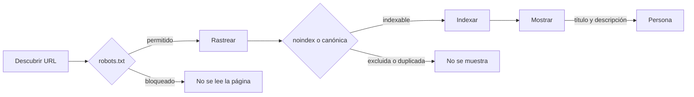
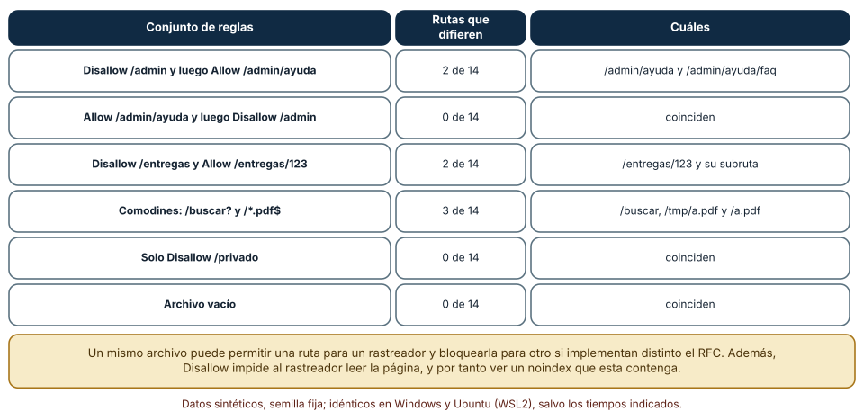
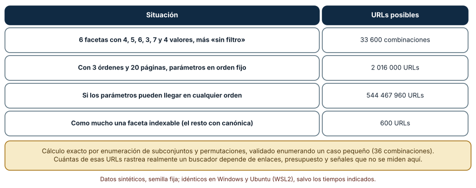
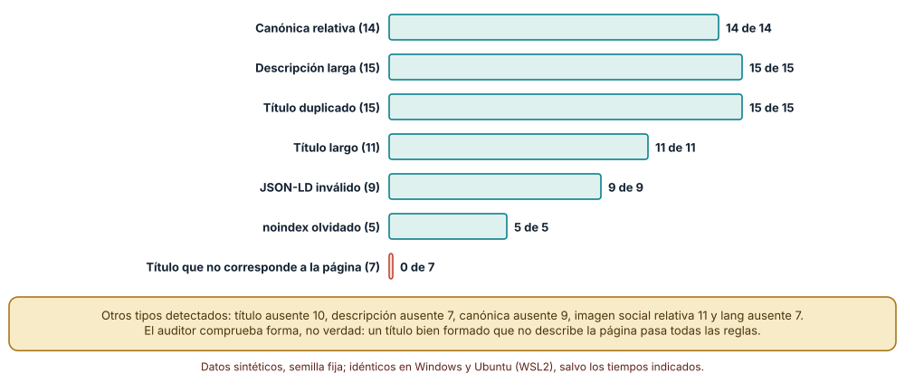

# SE-238 — SEO, metadatos y descubribilidad

[← SE-237 — PWA, caché, offline y sincronización](https://github.com/vladimiracunadev-create/modern-software-engineering-program/blob/main/classes/part-19-web-frontend-y-aplicaciones-progresivas/se-237-pwa-cache-offline-y-sincronizacion/README.md) · [↑ Parte 19](https://github.com/vladimiracunadev-create/modern-software-engineering-program/blob/main/classes/part-19-web-frontend-y-aplicaciones-progresivas/README.md) · [📚 Índice completo](https://github.com/vladimiracunadev-create/modern-software-engineering-program/blob/main/classes/README.md) · [🌐 Portal](https://vladimiracunadev-create.github.io/modern-software-engineering-program/classes/SE-238.html) · [SE-239 — Taller: construir un flujo web resiliente →](https://github.com/vladimiracunadev-create/modern-software-engineering-program/blob/main/classes/part-19-web-frontend-y-aplicaciones-progresivas/se-239-taller-construir-un-flujo-web-resiliente/README.md)

## Punto profesional y fundamento pedagógico

**Punto profesional.** La clase existe para que trates la descubribilidad como una propiedad técnica de la web con tres etapas distintas (rastrear, indexar, mostrar), con herramientas que controlan cosas distintas (robots.txt, `noindex`, canónicas, mapas del sitio, datos estructurados) y con límites que conviene declarar, de modo que «hacer SEO» no signifique añadir etiquetas sin saber qué problema resuelve cada una.

**Por qué aparece aquí.** Se sitúa después de **PWA, caché, offline y sincronización** y antes de **Taller: construir un flujo web resiliente**: `SE-237` hizo que la aplicación funcione sin red; esta clase pregunta cómo se enteran de ella quienes no la conocen y cómo se evita que un buscador vea miles de URLs que no son páginas. Reutiliza las decisiones de URL de `SE-234` y de renderizado de `SE-231`, porque lo que un rastreador ve depende de ambas.

**Error conceptual que debe corregir.** Creer que bloquear una página en `robots.txt` la quita del índice, que una etiqueta bien formada describe bien la página o que un mismo archivo `robots.txt` significa lo mismo para todos los rastreadores: rastrear no es indexar, la forma no es la verdad y las implementaciones difieren.

**Secuencia de aprendizaje.** Antes de leer los resultados, predices en cuántas de 14 rutas coincide el analizador de Python con la regla de coincidencia más larga del RFC 9309 y cuántas URLs expone una navegación facetada; después comparas ambos algoritmos sobre seis archivos, calculas el número de URLs de seis filtros con y sin política y aplicas un auditor de metadatos a 120 páginas con una mutación cada una.

**Evidencia de aprendizaje.** `seo-log.md` con las predicciones, la comparación de analizadores de `robots.txt`, el cálculo de URLs facetadas y el auditor con sus mutaciones, con explicación causal, contraejemplo y qué hallazgo te haría cambiar una política.

**Límite de la conclusión.** No se midió posicionamiento, tráfico ni el comportamiento de ningún buscador: el auditor revisa forma y los números de URLs son combinatoria. Las 120 páginas son sintéticas y los dominios son reservados para pruebas. Nada de esto garantiza aparecer en un resultado de búsqueda.

### Trazabilidad fuente → afirmación

| Fuente primaria u oficial | Afirmación que respalda | Lo que no prueba |
|---|---|---|
| [RFC 9309: Robots Exclusion Protocol](https://www.rfc-editor.org/rfc/rfc9309) | Define la sintaxis de `robots.txt` y la regla de coincidencia más larga entre `Allow` y `Disallow`. | No obliga a ningún rastreador a obedecer y no protege contenido privado. |
| [Google Search Central: gestionar la navegación facetada](https://developers.google.com/search/docs/crawling-indexing/crawling-managing-faceted-navigation) | Describe cómo la navegación facetada genera URLs casi infinitas y cómo contenerlas. | No fija cuántas URLs rastrea realmente un buscador de un sitio. |
| [Google Search Central: consolidar URLs duplicadas](https://developers.google.com/search/docs/crawling-indexing/consolidate-duplicate-urls) | Explica cómo indicar una URL canónica y por qué se señalan duplicados. | No garantiza que el buscador elija la canónica indicada. |
| [Sitemaps XML (sitemaps.org)](https://www.sitemaps.org/protocol.html) | Define el formato para listar las URLs que se quiere que se descubran. | No obliga a rastrear ni a indexar las URLs listadas. |

## Antes de empezar

Recupera de `SE-237` que la aplicación puede responder sin red y de `SE-234` que cada recurso tiene una URL y muchas variantes. La pregunta activa es: **¿qué ve un rastreador, qué le digo que haga con ello y qué parte de lo que declaro no puedo verificar?**

## Prerrequisitos

- Haber completado `SE-237` o poder explicar qué guarda un service worker y cómo se actualiza.
- Python 3.11 o posterior; los experimentos usan solo la biblioteca estándar (`urllib.robotparser`, `re`, `json`, `itertools`).
- Nociones de HTML (`head`, `title`, `meta`, `link`) y de cómo se publican URLs.

## Problema auténtico

La plataforma tiene un catálogo de cursos público. El equipo bloquea en `robots.txt` la carpeta `/admin` para que «no salga en Google» y, tras publicar una página de ayuda que quiere ocultar, añade `Disallow` y un `noindex` dentro de ella. La lista de cursos tiene filtros por estado, curso, profesor, semana, nota y etiqueta, y el rastreador pasa días en combinaciones de filtros sin llegar a las páginas de curso. En producción se descubre que una plantilla dejó `noindex` en todas las páginas. Una persona de comunicación pide «mejorar el título» y alguien pone uno de 90 caracteres con una palabra clave repetida.

## Objetivos observables

Al terminar podrás:

1. distinguir rastrear, indexar y mostrar, y decir qué mecanismo controla cada etapa;
2. escribir un `robots.txt` y evaluar su efecto con más de un analizador, sabiendo en qué difieren;
3. calcular cuántas URLs expone una navegación facetada y diseñar la política que la contiene;
4. auditar metadatos y datos estructurados de una página y distinguir lo que una herramienta ve de lo que no;
5. relacionar el renderizado y las URLs de la aplicación con lo que un rastreador recibe.

## Mapa conceptual



El mapa se lee de izquierda a derecha: una URL se descubre, se decide si se puede rastrear, se lee y se decide si se indexa, y solo entonces puede mostrarse. El bloqueo en `robots.txt` corta antes de leer la página, por eso impide ver un `noindex` que esta contenga.

## Temas y por qué importan

| Tema | Por qué cambia una decisión profesional | Evidencia mínima |
|---|---|---|
| Rastrear, indexar y mostrar | Tres etapas, tres mecanismos; confundirlos deja páginas visibles que se quería ocultar o invisibles que se quería mostrar. | Predicción, traza causal y contraejemplo de **Rastrear, indexar y mostrar** en `seo-log.md` |
| robots.txt y noindex | Uno limita la lectura y el otro la inclusión; combinarlos mal anula al segundo. | Predicción, traza causal y contraejemplo de **robots.txt y noindex** en `seo-log.md` |
| URLs duplicadas y canónicas | Las variantes y los filtros multiplican las URLs; las señales de canonicidad reducen el ruido. | Predicción, traza causal y contraejemplo de **URLs duplicadas y canónicas** en `seo-log.md` |
| Metadatos y datos estructurados | Título, descripción y datos estructurados describen la página; su forma se comprueba y su verdad no. | Predicción, traza causal y contraejemplo de **Metadatos y datos estructurados** en `seo-log.md` |
| Contenido visible para el rastreador | Lo que existe solo tras ejecutar código puede no verse; los enlaces deben ser enlaces. | Predicción, traza causal y contraejemplo de **Contenido visible para el rastreador** en `seo-log.md` |

## Conceptos y decisiones

### 1. Rastrear, indexar y mostrar

Un buscador descubre URLs (por enlaces y mapas del sitio), las **rastrea** (pide la página), las **indexa** (decide si la guarda y con qué contenido) y las **muestra** (la ordena entre los resultados de una consulta). Cada etapa tiene sus controles: `robots.txt` actúa sobre rastrear; `noindex` y las canónicas, sobre indexar; el título y la descripción, sobre cómo se muestra. Que una página no se rastree no significa que no pueda aparecer: si otras páginas la enlazan, el buscador puede listar la URL sin su contenido.

### 2. robots.txt y noindex

`robots.txt` pide a los rastreadores no leer ciertas rutas; es una convención de cortesía, no una barrera de seguridad, y cada rastreador la interpreta con su implementación. El RFC 9309 fija que, entre reglas que coinciden, gana la de ruta más larga y, a igualdad, `Allow`. `noindex` (en una etiqueta `meta` o una cabecera) pide no incluir la página en el índice, pero para que se obedezca el rastreador tiene que **leer** la página: si se bloquea en `robots.txt`, no ve el `noindex`. Para ocultar contenido privado no se usa ninguno de los dos: se usa autenticación.

### 3. URLs duplicadas y canónicas

Una navegación facetada (filtros combinables) produce una explosión de URLs que muestran subconjuntos de lo mismo; un buscador puede gastar su presupuesto de rastreo en ellas sin llegar a lo importante. Se contiene combinando medidas: enlaces de filtro que no se siguen, `canonical` hacia la lista base, `noindex` en las combinaciones sin valor propio, `robots.txt` para patrones que nunca interesan y un orden fijo de parámetros. La canónica es una **señal**, no una orden: el buscador puede ignorarla si la considera incoherente.

### 4. Metadatos y datos estructurados

El `title` y la `meta description` describen la página en los resultados; la longitud que se muestra depende del ancho en píxeles y no de un número de caracteres. La etiqueta `canonical` declara la forma preferida; las etiquetas Open Graph controlan la vista previa al compartir; y los datos estructurados (JSON-LD con vocabulario de schema.org) describen entidades. Todo esto se puede comprobar en su forma (¿existe? ¿es JSON válido? ¿la URL es absoluta?) y no en su verdad (¿el título describe la página?).

### 5. Contenido visible para el rastreador

Un rastreador moderno puede ejecutar JavaScript, pero con límites y con retraso; el contenido que existe en el primer HTML se procesa antes y con menos riesgo. Los enlaces deben ser elementos `a` con `href` reales, no `div` con un manejador; la navegación por JavaScript sin URL no es descubrible. La decisión de renderizado de `SE-231` y las URLs de `SE-234` son aquí SEO: una página con contenido en el HTML inicial y una URL canónica estable es más fácil de descubrir, de compartir y de mantener.

### Dos lecturas del mismo robots.txt

Se escribieron seis conjuntos de reglas (`Disallow` seguido de `Allow`, al revés, un `Disallow` amplio con un `Allow` estrecho, comodines, un `Disallow` simple y un archivo vacío) y se evaluaron 14 rutas con dos implementaciones: el analizador `urllib.robotparser` de la biblioteca estándar de Python y una función escrita con la regla de coincidencia más larga del RFC 9309, con soporte de `*` y `$`.

```python
def rfc9309(reglas, path):
    mejor = None
    for tipo, pat in reglas:
        p = re.escape(pat).replace(r"\*", ".*")
        if p.endswith(r"\$"): p = p[:-2] + "$"
        if re.match(p, path):
            clave = (len(pat), tipo == "allow")
            if mejor is None or clave > mejor[0]: mejor = (clave, tipo)
    return mejor is None or mejor[1] == "allow"
```

Resultado, idéntico en Windows (CPython 3.12.9) y en Ubuntu bajo WSL2 (3.12.3): de las 84 decisiones (6 conjuntos × 14 rutas) **difieren 7**. Con `Disallow: /admin` antes de `Allow: /admin/ayuda`, el analizador de Python, que aplica la primera regla que coincide, bloquea `/admin/ayuda` y `/admin/ayuda/faq` y la regla del RFC los permite; con `Disallow: /entregas` y `Allow: /entregas/123` difieren `/entregas/123` y su subruta; con los comodines `/buscar?` y `/*.pdf$`, difieren `/buscar`, `/tmp/a.pdf` y `/a.pdf` (el analizador de Python no interpreta comodines y descarta la `?` vacía). Con `Allow` antes de `Disallow`, `Disallow` solo o un archivo vacío no hay diferencias.



**Cómo leer la figura.** Cada fila es un archivo de reglas; las columnas cuentan en cuántas de 14 rutas difieren los dos algoritmos y cuáles son. **Dónde deja de valer:** son dos implementaciones, no todos los rastreadores; cada buscador tiene la suya y puede documentar variaciones. El archivo es el mismo, el resultado no: por eso se evita el orden ambiguo (poner el `Allow` más específico y comprobar con los rastreadores que importan). El experimento no mide si un rastreador real obedece.

### Cuántas URLs expone una navegación facetada

Se tomó una lista con seis filtros de 4, 5, 6, 3, 7 y 4 valores (más «sin filtro»), tres órdenes y veinte páginas. Con los parámetros siempre en el mismo orden hay 5 × 6 × 7 × 4 × 8 × 5 = **33 600** combinaciones de filtros, y con orden y paginación, **2 016 000** URLs. Si los parámetros pueden llegar en cualquier orden, cada subconjunto de filtros activos admite además todas sus permutaciones y el total es **544 467 960**. Si solo se permite indexar **como mucho una faceta** (y el resto lleva `canonical` a la lista base), quedan **600** URLs. La fórmula se validó contra la enumeración de un caso pequeño (36 combinaciones).

```python
def distintas_con_orden(facetas):
    total = 0; ks = list(facetas.values())
    for r in range(0, len(ks) + 1):
        for sub in itertools.combinations(ks, r):
            prod = 1
            for k in sub: prod *= k
            fact = 1
            for i in range(2, r + 1): fact *= i
            total += prod * fact
    return total
```



**Cómo leer la figura.** Cada fila es una política; la cifra es el número de URLs que quedan al alcance de un rastreador. **Dónde deja de valer:** es combinatoria de lo que se puede formar, no lo que un buscador rastrea: sin enlaces que lleven a las combinaciones raras, no las descubre. Pero la cifra explica por qué una política de URLs (`SE-234`) es una decisión de descubribilidad: ordenar los parámetros multiplica por cientos lo que hay que rastrear.

### Qué detecta un auditor de metadatos

Se generaron 120 páginas sintéticas, cada una con una mutación de entre doce tipos (título ausente, largo o duplicado, descripción ausente o larga, canónica ausente o relativa, `noindex` olvidado, JSON-LD inválido por una coma final, imagen social relativa, `lang` ausente y un título que no corresponde a la página), con semilla fija. El auditor tiene reglas de forma para todos los tipos salvo el último: **detecta 113 de 120**; las 7 que no detecta son las páginas cuyo título describe otra cosa (por ejemplo, «Cómo hacer pasta fresca en casa» en la página de una entrega).

```python
j = re.findall(r'ld\+json">(.*?)</script>', src)
for x in j:
    try: json.loads(x)
    except ValueError: prob.add("jsonld invalido")
```



**Cómo leer la figura.** Cada barra es el número de páginas con un defecto de ese tipo que el auditor señaló; la barra roja es el único tipo que no detecta. **Dónde deja de valer:** el auditor se escribió sabiendo qué mutaciones se aplicarían y comprueba longitudes en caracteres, no en píxeles, que es lo que realmente corta un resultado; no valida el vocabulario de schema.org ni que los datos estructurados sean ciertos. Un título bien formado y falso pasa todas las reglas.

## Definiciones de trabajo

- **rastrear:** pedir una página para leer su contenido y sus enlaces.
- **indexar:** decidir qué guardar de una página rastreada para poder devolverla en búsquedas.
- **URL canónica:** URL preferida de un conjunto de duplicados, declarada con `rel="canonical"` o con una redirección.
- **`noindex`:** directiva que pide no incluir una página en el índice; solo se obedece si el rastreador puede leerla.
- **navegación facetada:** conjunto de filtros combinables que produce muchas URLs de listas que se solapan.

Las definiciones son operativas para esta clase y deben contrastarse con la documentación enlazada al final.

## Ejemplo mínimo

Evalúa con el analizador de Python un `robots.txt` con `Disallow` y `Allow` y predice si `/admin/ayuda` queda permitida.

```python
from urllib.robotparser import RobotFileParser
rp = RobotFileParser()
rp.parse(["User-agent: *", "Disallow: /admin", "Allow: /admin/ayuda"])
print(rp.can_fetch("*", "https://ejemplo.test/admin/ayuda"))
```

Con el orden dado, el analizador de Python aplica la primera regla que coincide y responde `False`, mientras que la regla del RFC 9309 (la más larga) la permitiría. Registra versión del intérprete y salida; invierte el orden de las dos líneas y predice el resultado.

## Ejemplo profesional

La plataforma publica un `robots.txt` que bloquea solo patrones que nunca interesan (`/buscar?`, `/api/`) con los `Allow` más específicos primero y lo comprueba con dos analizadores. Las páginas privadas se protegen con autenticación y devuelven `noindex` en la cabecera, sin estar bloqueadas, para que el rastreador pueda leer esa directiva. La lista de cursos tiene un orden fijo de parámetros, una canónica a la lista base en cada combinación de filtros y enlaces de filtro con `rel="nofollow"`. El mapa del sitio lista solo las URLs canónicas, y un auditor revisa en la integración continua que cada página tenga título, descripción, canónica absoluta y JSON-LD válido.

Compara el caso normal con una página de ayuda que se quiere ocultar, una combinación de seis filtros y una plantilla que deja un `noindex`. La política es apropiada cuando esos tres casos tienen una respuesta probada; es frágil cuando alguien «añade etiquetas» sin saber qué etapa controla cada una.

## Práctica guiada

1. Escribe seis conjuntos de reglas de `robots.txt` y 14 rutas de la plataforma.
2. Predice en cuántas de las 84 decisiones difieren el analizador de Python y la regla del RFC 9309 y escribe el número antes de ejecutar.
3. Implementa la regla de coincidencia más larga con `*` y `$` y compara con el analizador.
4. Calcula las URLs de tu lista de filtros con orden fijo, con orden variable y con una faceta indexable.
5. Escribe un auditor de metadatos con ocho reglas y aplícalo a 120 páginas con mutaciones de semilla fija.
6. Identifica qué mutación no detecta ninguna regla y qué haría falta para verla.
7. Entrega `seo-log.md` y pide a otra persona que proponga un defecto de metadatos que tu auditor no vea.

## Ejercicios

1. **Rastreo:** diseña un `robots.txt` para ocultar `/admin` y mostrar `/admin/ayuda` y comprueba con ambos algoritmos.
2. **Facetas:** calcula las URLs si la lista añade un séptimo filtro de 5 valores y decide qué política mantienes.
3. **Canónicas:** escribe una regla que, dada una URL con filtros, devuelva su canónica y compruébala con las 2400 variantes de `SE-234`.
4. **Metadatos:** diseña una revisión humana de títulos de 20 páginas en cinco minutos y explica qué parte sigue siendo juicio.

## Reto verificable

Entrega `seo-log.md` con la comparación de analizadores, el cálculo de URLs facetadas con su política y el auditor con sus mutaciones. Se aprueba si otra persona ejecuta el código desde un checkout limpio, obtiene las mismas cifras con las mismas semillas y puede señalar qué evidencia te haría cambiar una política. No se aprueba por una lista de etiquetas ni por afirmar que una página «posiciona mejor».

## Caso conductor

La aplicación de entregas con conectividad irregular es sobre todo privada, pero tiene un catálogo y una ayuda públicos. Esta clase deja su política de rastreo, sus canónicas y su auditor de metadatos. `SE-239` los integra en el taller y `SE-240` los comprueba en el proyecto. Cambia después una sola decisión, el orden de los parámetros de la lista, de libre a fijo, y recalcula las URLs expuestas.

## Preguntas frecuentes

### ¿Si bloqueo una página en `robots.txt` desaparece de los resultados?

No necesariamente: el buscador puede listar la URL si otras páginas la enlazan, sin contenido. Para sacarla del índice hay que dejarla rastreable con `noindex` o eliminarla; para protegerla, autenticarla.

### ¿Cuántos caracteres debe tener el título?

No hay un número: los resultados cortan por ancho en píxeles, que depende de las letras. Una referencia habitual es mantenerlo corto y descriptivo y que lo esencial vaya al principio; lo que importa es que describa la página.

### ¿La URL canónica es una orden?

No: es una señal que el buscador puede ignorar si es incoherente (por ejemplo, una canónica a una página con otro contenido). Se refuerza con enlaces internos coherentes y redirecciones.

### ¿Los datos estructurados mejoran la posición?

Ayudan a entender la página y pueden dar resultados enriquecidos, pero no hay garantía de posición. Deben describir contenido visible y verdadero: marcar algo que la página no dice puede ser contraproducente.

## Fallo controlado y diagnóstico

Reproduce el fallo clásico de la clase: **bloquear en `robots.txt` una página con `noindex`**. Escribe `Disallow: /ayuda/interna` y añade un `noindex` en esa página.

Registra síntoma, entrada mínima, hipótesis, observación que descarta cada hipótesis, causa, corrección y prueba de regresión. **Síntoma:** la URL de la página interna aparece en un buscador sin contenido. **Hipótesis rivales:** (a) el `noindex` no está bien escrito; (b) el rastreador no puede leer la página y por tanto no ve el `noindex`. **Prueba:** evalúa la URL con el analizador y comprueba que está bloqueada; quita el `Disallow` y observa que el rastreador puede leer el `noindex`. **Conclusión:** la causa es el bloqueo que impide ver la directiva. **Regresión:** deja la página rastreable con `noindex` (o autenticada) y añade una prueba que falle si una URL con `noindex` aparece bloqueada. No cambies a la vez el bloqueo y la canónica: no sabrás qué corrigió el problema.

## Errores comunes y cómo corregirlos

| Síntoma | Causa probable | Corrección |
|---|---|---|
| Una URL bloqueada aparece sin contenido | `Disallow` en vez de `noindex` o autenticación | Dejar rastreable con `noindex` o proteger con autenticación |
| El rastreador se pierde en filtros | Navegación facetada sin contención | Orden fijo de parámetros, canónica a la lista base y `noindex` en combinaciones |
| Todo el sitio desaparece tras un despliegue | Plantilla con `noindex` heredada de preproducción | Auditar metadatos en la integración continua |
| `robots.txt` se comporta distinto según el rastreador | Orden ambiguo de `Allow` y `Disallow` o comodines | Escribir el `Allow` más específico y probar con los rastreadores que importan |
| El título del resultado no corresponde a la página | Título genérico o de otra plantilla | Un título descriptivo y único por página y una revisión humana |

## Entorno y archivos clave

```text
work/SE-238/
├── README.md
├── seo/
│   ├── robots.py
│   ├── facetas.py
│   └── metadatos.py
├── tests/test_robots.py
└── evidence/seo-log.md
```

El `README` declara plataforma, versión de Python, semillas y comandos. Los experimentos usan solo la biblioteca estándar y se ejecutaron con CPython 3.12.9 en Windows 11 y 3.12.3 en Ubuntu bajo WSL2: las salidas fueron idénticas. No se contactó con ningún buscador ni se rastreó ningún sitio real.

## Seguridad, ética y accesibilidad

- `robots.txt` es público: listar en él rutas sensibles las revela; protege el contenido con autenticación, no con una petición de cortesía;
- una página que solo se descubre por JavaScript y no tiene un enlace real tampoco es accesible por teclado ni por lectores de pantalla: la descubribilidad y la accesibilidad comparten causas;
- no uses datos estructurados que prometan algo falso (valoraciones, precios) ni ocultes texto para rastreadores: es engaño y puede acarrear sanciones;
- los ejemplos usan dominios reservados para pruebas y páginas sintéticas; no incluyas direcciones reales de estudiantes ni de la plataforma en la evidencia;
- un título claro y un texto alternativo útil benefician a todas las personas, no solo a los buscadores.

## Puente hacia el trabajo con agentes

Un agente al que se le pide «mejora el SEO» añadirá etiquetas, un `robots.txt` genérico y a veces un `noindex` o un `Disallow` que contradicen otra parte, sin comprobar cuál controla qué etapa. Pídele que explique qué etapa controla cada cambio, que compruebe el `robots.txt` con más de un analizador, que calcule las URLs expuestas por la navegación y que ejecute el auditor sobre su propio resultado. Revisa especialmente cualquier título o descripción generados: son verosímiles y pueden no describir la página, que es lo que ninguna regla de forma detecta.

## Transferencia

Traslada el experimento a otra superficie que otros descubren (el índice de un repositorio, un catálogo de datos, la documentación de una API): cambia las señales, pero conserva el método de separar etapas, calcular cuántas direcciones se exponen y auditar metadatos con mutaciones. La transferencia está lograda cuando puedes explicar qué parte de tu política dependía de los buscadores web y cuál de la idea de separar descubrir, leer y mostrar.

## Evaluación y evidencia

| Criterio | Evidencia para aprobar |
|---|---|
| comprensión | explicación de rastrear, indexar y mostrar y del mecanismo que controla cada etapa |
| corrección | cifras reproducibles de decisiones de robots, URLs facetadas y mutaciones detectadas con las mismas semillas |
| diseño | política de rastreo, canónicas y auditoría de metadatos documentadas |
| diagnóstico | reproducción del bloqueo con `noindex` con regresión |
| incertidumbre | declaración de lo que no se midió (buscadores reales, posicionamiento) y de lo que el auditor no ve |
| reproducibilidad | versiones, comandos, salida y límites declarados |

## Fuentes

- [RFC 9309: Robots Exclusion Protocol](https://www.rfc-editor.org/rfc/rfc9309) — sintaxis y regla de coincidencia más larga; autoridad: IETF.
- [Google Search Central: introducción a robots.txt](https://developers.google.com/search/docs/crawling-indexing/robots/intro) — qué hace y qué no hace `robots.txt`; autoridad: Google Search Central.
- [Google Search Central: gestionar la navegación facetada](https://developers.google.com/search/docs/crawling-indexing/crawling-managing-faceted-navigation) — contener URLs generadas por filtros; autoridad: Google Search Central.
- [Google Search Central: consolidar URLs duplicadas](https://developers.google.com/search/docs/crawling-indexing/consolidate-duplicate-urls) — canónicas como señal; autoridad: Google Search Central.
- [Sitemaps XML (sitemaps.org)](https://www.sitemaps.org/protocol.html) — formato del mapa del sitio; autoridad: sitemaps.org.
- [Open Graph protocol](https://ogp.me/) — metadatos de vista previa al compartir; autoridad: Open Graph.

Cada fuente respalda el mecanismo indicado; ninguna demuestra que la política de la clase mejore la posición de la plataforma en un buscador ni que un rastreador concreto obedezca un archivo.

- [Python: `urllib.robotparser`](https://docs.python.org/3/library/urllib.robotparser.html) — analizador usado en el experimento.
- [Python: `itertools`](https://docs.python.org/3/library/itertools.html) — combinaciones y permutaciones de filtros.

## Límites y siguiente paso

Se ejecutaron tres experimentos con datos sintéticos en Windows y Ubuntu (WSL2) con resultados idénticos. No se rastreó ningún sitio ni se consultó ningún buscador: las 14 rutas, los seis filtros y las 120 páginas son construcciones del autor y el auditor comprueba forma, no verdad. La siguiente clase reúne lo aprendido en un taller para construir un flujo web resiliente de punta a punta.

## Glosario

- **rastrear:** pedir una página para leer su contenido y sus enlaces.
- **indexar:** decidir qué guardar de una página rastreada para poder devolverla en búsquedas.
- **URL canónica:** URL preferida de un conjunto de duplicados, declarada con `rel="canonical"` o con una redirección.
- **`noindex`:** directiva que pide no incluir una página en el índice; solo se obedece si el rastreador puede leerla.
- **navegación facetada:** conjunto de filtros combinables que produce muchas URLs de listas que se solapan.

---

[← SE-237 — PWA, caché, offline y sincronización](https://github.com/vladimiracunadev-create/modern-software-engineering-program/blob/main/classes/part-19-web-frontend-y-aplicaciones-progresivas/se-237-pwa-cache-offline-y-sincronizacion/README.md) · [↑ Parte 19](https://github.com/vladimiracunadev-create/modern-software-engineering-program/blob/main/classes/part-19-web-frontend-y-aplicaciones-progresivas/README.md) · [📚 Índice completo](https://github.com/vladimiracunadev-create/modern-software-engineering-program/blob/main/classes/README.md) · [🌐 Portal](https://vladimiracunadev-create.github.io/modern-software-engineering-program/classes/SE-238.html) · [SE-239 — Taller: construir un flujo web resiliente →](https://github.com/vladimiracunadev-create/modern-software-engineering-program/blob/main/classes/part-19-web-frontend-y-aplicaciones-progresivas/se-239-taller-construir-un-flujo-web-resiliente/README.md)
