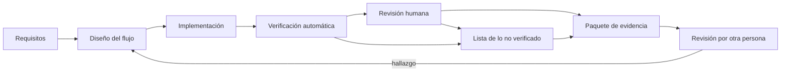
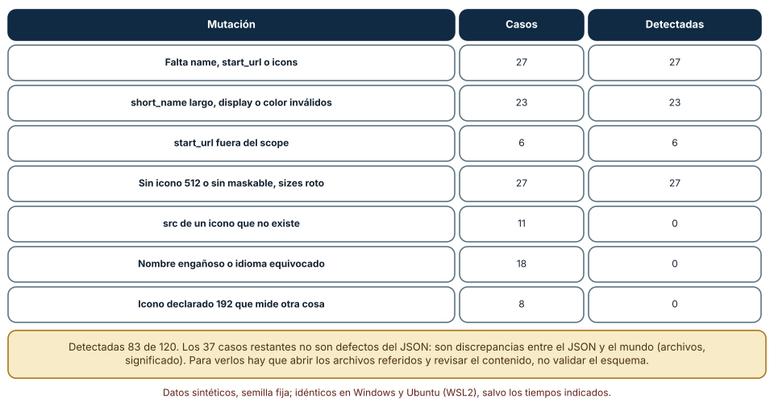
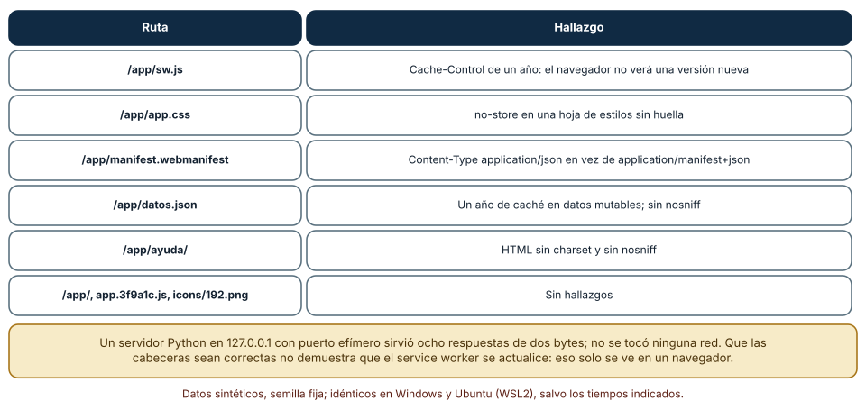
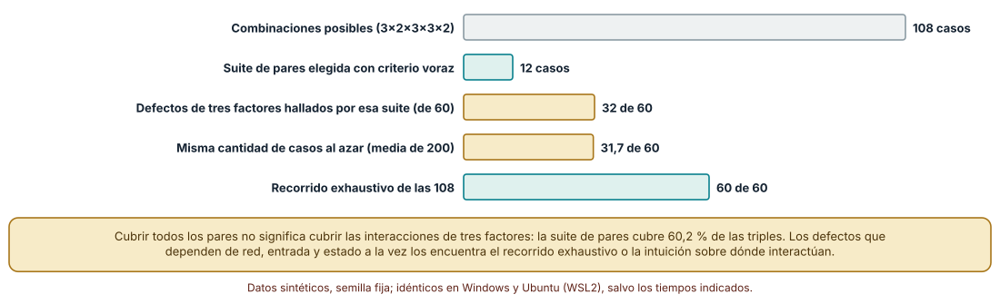

# SE-240 — Proyecto: aplicación web accesible y offline

[← SE-239 — Taller: construir un flujo web resiliente](https://github.com/vladimiracunadev-create/modern-software-engineering-program/blob/main/classes/part-19-web-frontend-y-aplicaciones-progresivas/se-239-taller-construir-un-flujo-web-resiliente/README.md) · [↑ Parte 19](https://github.com/vladimiracunadev-create/modern-software-engineering-program/blob/main/classes/part-19-web-frontend-y-aplicaciones-progresivas/README.md) · [📚 Índice completo](https://github.com/vladimiracunadev-create/modern-software-engineering-program/blob/main/classes/README.md) · [🌐 Portal](https://vladimiracunadev-create.github.io/modern-software-engineering-program/classes/SE-240.html) · [SE-241 — Responsabilidades y fronteras del backend →](https://github.com/vladimiracunadev-create/modern-software-engineering-program/blob/main/classes/part-20-backend-apis-y-procesamiento-asincrono/se-241-responsabilidades-y-fronteras-del-backend/README.md)

## Punto profesional y fundamento pedagógico

**Punto profesional.** El proyecto existe para que entregues una aplicación web de entregas accesible y utilizable sin conexión **junto con un paquete de evidencia que otra persona pueda revisar**: el manifiesto, las estrategias de caché, la tabla de estados, las URLs, las cabeceras, el presupuesto, el informe de accesibilidad con sus dos columnas y una matriz de pruebas con sus límites. Un proyecto profesional no se evalúa por lo que funciona en tu máquina, sino por lo que otra persona puede comprobar y por lo que declaras que no comprobaste.

**Por qué aparece aquí.** Cierra la **Parte 19** después de **Taller: construir un flujo web resiliente**: las clases `SE-229` a `SE-238` aportaron las piezas y `SE-239` las ensambló en un flujo; este proyecto las empaqueta como un entregable con criterios de aceptación. Introduce además tres verificaciones que cierran la parte: un validador del manifiesto con mutaciones, una auditoría de cabeceras contra un servidor local y una matriz de pruebas reducida con cobertura de pares, cuyo límite se mide.

**Error conceptual que debe corregir.** Creer que una aplicación «pasa» porque el manifiesto es válido, las cabeceras son correctas y la matriz de pruebas es pequeña: cada una de esas comprobaciones deja fuera una clase de defecto (archivos que no existen, un service worker que no se actualiza, interacciones de tres factores) y el paquete debe decir cuáles.

**Secuencia de aprendizaje.** Antes de verificar, predices cuántas de 120 mutaciones de un manifiesto detectará un validador de forma, cuántas de ocho rutas de un servidor local tendrán un problema de cabeceras y cuántos defectos de tres factores encontrará una suite de pares; después ejecutas las tres comprobaciones, miras qué no vieron y las reflejas en el informe de límites.

**Evidencia de aprendizaje.** `project-log.md` y un paquete con el manifiesto validado, la tabla de estrategias por recurso, la tabla de estados con sus escenarios, la tabla de URLs, la auditoría de cabeceras, el presupuesto, el informe de accesibilidad de dos columnas, la matriz de pruebas con su cobertura y una lista explícita de lo que no se verificó.

**Límite de la conclusión.** Los experimentos usan un manifiesto sintético, un servidor local con ocho respuestas de dos bytes y una matriz de 108 combinaciones elegidas por el autor. No se instaló ninguna aplicación ni se ejecutó un service worker en un navegador, y no se evaluó con personas con discapacidad. El paquete no certifica accesibilidad ni seguridad.

### Trazabilidad fuente → afirmación

| Fuente primaria u oficial | Afirmación que respalda | Lo que no prueba |
|---|---|---|
| [Web Application Manifest (W3C)](https://www.w3.org/TR/appmanifest/) | Define los campos del manifiesto (`name`, `start_url`, `scope`, `icons`, `display`) y su semántica. | No garantiza que cada navegador ofrezca instalar la aplicación ni que los iconos existan. |
| [MDN: Cache-Control](https://developer.mozilla.org/en-US/docs/Web/HTTP/Reference/Headers/Cache-Control) | Documenta las directivas de caché (`no-cache`, `no-store`, `max-age`, `immutable`) y su efecto. | No dice qué valor conviene a cada recurso. |
| [NIST SP 800-142: Practical Combinatorial Testing](https://csrc.nist.gov/pubs/sp/800/142/final) | Describe las pruebas combinatorias de pares y de t factores y su uso para reducir casos. | No garantiza que dos factores basten para una aplicación concreta. |
| [WCAG-EM (W3C)](https://www.w3.org/TR/WCAG-EM/) | Describe una metodología para evaluar la conformidad de un sitio y documentar el alcance y los resultados. | No sustituye a una auditoría de conformidad independiente. |

## Antes de empezar

Recupera de `SE-239` la tabla de estados, la política de reintentos y el reparto entre accesibilidad automática y humana. La pregunta activa es: **¿qué debo entregar para que otra persona compruebe mi aplicación sin fiarse de mí y qué debo declarar que no comprobé?**

## Prerrequisitos

- Haber completado `SE-239` o poder explicar la diferencia entre la forma de una máquina de estados y su comportamiento.
- Haber visto las diez clases anteriores de la parte; el proyecto las integra.
- Python 3.11 o posterior; los experimentos usan solo la biblioteca estándar (`http.server`, `urllib`, `json`, `itertools`).

## Problema auténtico

La plataforma de entregas quiere publicar su aplicación web. Quien la revisa recibe un repositorio, un manifiesto que «valida», una captura de una herramienta de accesibilidad y un mensaje: «funciona offline». No sabe qué estrategia usa cada recurso, no puede comprobar que el service worker se actualiza, no sabe qué se probó con teclado y qué no, y ve que la matriz de pruebas tiene doce casos para cinco factores sin saber qué dejan fuera. Cada afirmación es verosímil y ninguna es comprobable.

## Objetivos observables

Al terminar podrás:

1. entregar un paquete con criterios de aceptación comprobables y su evidencia por cada criterio;
2. validar un manifiesto y reconocer qué defectos no puede ver un validador de forma;
3. auditar las cabeceras de un servidor y explicar qué configuraciones impiden que una versión nueva llegue;
4. reducir una matriz de pruebas con cobertura de pares y medir qué defectos de más factores se escapan;
5. redactar una lista de lo que no se verificó y qué haría falta para verificarlo.

## Mapa conceptual



El mapa se lee de los requisitos al paquete, con dos tipos de verificación (automática y humana) que alimentan tanto la evidencia como la lista de lo que no se verificó. La flecha de retorno indica que un hallazgo de la persona que revisa vuelve al diseño: el paquete no cierra el trabajo, lo fecha.

## Temas y por qué importan

| Tema | Por qué cambia una decisión profesional | Evidencia mínima |
|---|---|---|
| Criterios de aceptación comprobables | Un criterio que no se puede comprobar es una intención; cada uno necesita evidencia y un límite. | Predicción, traza causal y contraejemplo de **Criterios de aceptación comprobables** en `project-log.md` |
| Manifiesto y capacidad de instalación | El manifiesto es un contrato; su forma se valida y su coherencia con los archivos, no. | Predicción, traza causal y contraejemplo de **Manifiesto y capacidad de instalación** en `project-log.md` |
| Cabeceras y despliegue | Las cabeceras de caché y de tipo deciden si una versión nueva llega y si los datos se sirven bien. | Predicción, traza causal y contraejemplo de **Cabeceras y despliegue** en `project-log.md` |
| Matriz de pruebas y cobertura | Reducir casos ahorra tiempo y deja fuera interacciones que hay que declarar. | Predicción, traza causal y contraejemplo de **Matriz de pruebas y cobertura** en `project-log.md` |
| Paquete revisable y límites | Una persona ajena debe poder repetir la verificación y ver qué no se hizo. | Predicción, traza causal y contraejemplo de **Paquete revisable y límites** en `project-log.md` |

## Conceptos y decisiones

### 1. Criterios de aceptación comprobables

Cada requisito se traduce en un criterio que una persona puede comprobar y cada criterio en una evidencia: «la entrega no se duplica con una confirmación perdida» se comprueba con un escenario que simula la pérdida y cuenta efectos en el servidor; «el formulario es operable con teclado» se comprueba con una lista de pasos y una persona; «el JavaScript no supera 170 KB comprimidos» se comprueba con un comprobador automático. Los criterios se redactan con un valor, un método y un responsable, y los que no se pueden automatizar dicen quién y cómo los revisa.

### 2. Manifiesto y capacidad de instalación

El manifiesto declara nombre, nombre corto, URL de inicio, alcance, modo de visualización, colores e iconos de varios tamaños (por lo general uno de 192 y uno de 512 píxeles, y uno «maskable» para recortes de plataforma). Un validador de forma comprueba que los campos estén y tengan el tipo correcto, que la URL de inicio esté dentro del alcance y que los colores sean válidos. No comprueba que los archivos de icono existan ni midan lo declarado, ni que el nombre describa la aplicación: esas son discrepancias entre el manifiesto y el mundo, que solo se ven abriendo los archivos y mirando.

### 3. Cabeceras y despliegue

Las cabeceras de respuesta deciden cosas que ningún código del cliente corrige: el script del service worker con una caché de un año impide que el navegador vea una versión nueva; una hoja de estilos con `no-store` pierde la caché sin ganar nada; un manifiesto servido con el tipo de contenido equivocado puede no reconocerse; datos que cambian, servidos con caché larga, se ven viejos; la ausencia de `nosniff` permite que el navegador adivine tipos. Se auditan con un comprobador que pide cada ruta y compara la respuesta con la política declarada.

### 4. Matriz de pruebas y cobertura

Probar todas las combinaciones de red, dispositivo, entrada, estado e idioma son 108 casos; una suite que cubre todos los **pares** de valores necesita menos de una décima parte. Pero cubrir todos los pares no cubre las interacciones de **tres** factores: un defecto que solo aparece con red lenta, entrada táctil y estado de borrador no está garantizado en la suite. La reducción es una decisión de costo y se declara con su cobertura de tres factores y con los casos que se añaden a mano donde se sospecha una interacción.

### 5. Paquete revisable y límites

El paquete reúne las evidencias con enlaces y huellas, y una lista de lo que **no** se verificó con el motivo y lo que haría falta para verificarlo. Una persona que revisa debe poder ejecutar los comprobadores desde un checkout limpio, obtener las mismas cifras y encontrar la declaración de límites sin pedirla. Un paquete honesto dice «no se probó con un lector de pantalla concreto» y «no se ejecutó el service worker en un navegador»; uno que calla esas cosas parece más completo y es menos fiable.

### Un validador de manifiesto frente a 120 mutaciones

Se escribió un manifiesto sintético válido (nombre, nombre corto, URL de inicio dentro del alcance, `display: standalone`, colores y tres iconos: 192, 512 y 512 «maskable») y un validador de forma con una docena de comprobaciones. Se aplicaron 120 mutaciones con semilla fija, cada una de catorce tipos: quitar campos, nombre corto largo, `display` inválido, color inválido, `start_url` fuera del alcance, falta de icono 512 o maskable, `sizes` roto, y cuatro defectos que no están en la forma del JSON: un `src` de icono que apunta a un archivo inexistente, un nombre engañoso, un idioma equivocado y un icono declarado de 192 píxeles que en realidad mide 96.

```python
def valida(m):
    p = set()
    for k in ("name", "short_name", "start_url", "display", "icons"):
        if k not in m: p.add(f"falta {k}")
    if isinstance(m.get("scope"), str) and not m["start_url"].startswith(m["scope"].rstrip("/") + "/"):
        p.add("start_url fuera de scope")
    ...
```

Resultado, idéntico en Windows (CPython 3.12.9) y en Ubuntu bajo WSL2 (3.12.3): el validador **detecta 83 de las 120 mutaciones**: las 27 que quitan `name`, `start_url` o `icons`, las 23 de nombre corto, `display` o color, las 6 de `start_url` fuera del alcance y las 27 de icono 512, maskable o `sizes` roto. **No detecta las 37 restantes**: 11 con un `src` inexistente, 18 con nombre engañoso o idioma equivocado y 8 con un icono declarado de 192 que mide otra cosa (la mutación no cambia el JSON).



**Cómo leer la figura.** Cada fila agrupa tipos de mutación; las columnas son el número de casos y cuántos detecta el validador. **Dónde deja de valer:** el validador tiene una docena de comprobaciones que el autor eligió sabiendo qué mutaría y no usa la especificación completa (por ejemplo, no valida `id`, `orientation` ni los `shortcuts`). Los 37 casos no detectados no son «defectos del JSON»: exigen abrir los archivos de iconos, leer el nombre y comprobar el idioma, pasos que el paquete debe incluir como comprobaciones aparte.

### Auditar cabeceras contra un servidor local

Se arrancó un servidor HTTP de la biblioteca estándar en `127.0.0.1` con un puerto efímero que sirve ocho rutas de dos bytes con cabeceras definidas en una tabla: cinco rutas llevan una configuración errónea a propósito. Un comprobador pidió cada ruta con `urllib` y comparó las respuestas con siete reglas (el service worker no debe tener caché larga, los recursos con huella deben ser `immutable`, el manifiesto debe usar su tipo, los datos mutables no deben tener un año de caché, una hoja sin `no-store`, el HTML con `charset` y `X-Content-Type-Options: nosniff`).

```python
if path.endswith("sw.js") and "max-age=31536000" in cc: p.append("service worker con cache larga")
if path.endswith(".webmanifest") and "manifest+json" not in ct: p.append("tipo MIME del manifiesto")
if h.get("X-Content-Type-Options") != "nosniff": p.append("sin nosniff")
```

Resultado, idéntico en ambos sistemas: el comprobador encontró **7 hallazgos en 5 de las 8 rutas**: `/app/sw.js` con un año de caché, `/app/app.css` con `no-store`, `/app/manifest.webmanifest` con `application/json`, `/app/datos.json` con un año de caché y sin `nosniff`, y `/app/ayuda/` sin `charset` y sin `nosniff`. Las tres rutas restantes (`/app/`, `app.3f9a1c.js` y `icons/192.png`) no tuvieron hallazgos.



**Cómo leer la figura.** Cada fila es una ruta con el hallazgo que produjo; la última agrupa las que no tuvieron ninguno. **Dónde deja de valer:** el servidor es un bucle local de dos bytes por respuesta; no hay CDN, compresión ni TLS, y las reglas las escribió el autor. Que las cabeceras sean correctas no demuestra que el service worker se actualice: eso solo se observa en un navegador, y es una de las cosas que el paquete declara sin comprobar.

### Cuántos defectos escapan a una suite de pares

Se enumeraron las 108 combinaciones de red (buena, lenta, sin conexión), dispositivo (móvil, escritorio), entrada (teclado, táctil, lector), estado (nuevo, borrador, enviado) e idioma (español, inglés) y se construyó con un algoritmo voraz una suite que cubre **todos los pares** de valores: necesita **12 casos**. Después se inyectaron 60 defectos que solo se manifiestan con una combinación concreta de **tres** factores (elegidos con semilla fija) y se contó cuántos encuentra cada suite.

```python
suite = []
while no_cubiertos:
    mejor = max(todos, key=lambda c: len(pares(c) & no_cubiertos))
    suite.append(mejor); no_cubiertos -= pares(mejor)
```

Resultado: los 12 casos cubren todos los pares y el **60,2 %** de las combinaciones de tres factores; la suite de pares encuentra **32 de los 60** defectos de tres factores, 12 casos elegidos al azar encuentran **31,7** de media (200 repeticiones) y las 108 combinaciones los encuentran los **60**. En este experimento la suite de pares no es mejor que la azar para los defectos de tres factores: es mejor solo para los de dos.



**Cómo leer la figura.** Cada barra es un número de casos o de defectos encontrados; las doradas comparan la suite de pares con una suite al azar de igual tamaño. **Dónde deja de valer:** los 60 defectos de tres factores se eligieron al azar entre todas las combinaciones y la suite se construyó por pares, de modo que la cifra mide la cobertura de triples y no la probabilidad real de un defecto. Si los defectos de tu aplicación son casi todos de uno o dos factores, la suite de pares basta; si hay interacciones conocidas de tres factores (red, entrada y estado), se añaden a mano.

## Definiciones de trabajo

- **criterio de aceptación:** condición comprobable, con valor, método y responsable, que debe cumplirse para dar por entregado un requisito.
- **manifiesto de aplicación web:** archivo JSON que declara el nombre, los iconos, la URL de inicio y el alcance de una aplicación instalable.
- **cobertura de pares:** propiedad de una suite en la que cada par de valores de dos factores aparece en al menos un caso.
- **paquete de evidencia:** conjunto de artefactos y comprobaciones con enlaces y huellas que permite repetir una verificación.
- **declaración de límites:** lista de lo que no se verificó, con el motivo y lo que haría falta para verificarlo.

Las definiciones son operativas para esta clase y deben contrastarse con las especificaciones enlazadas al final.

## Ejemplo mínimo

Comprueba que una URL de inicio está dentro del alcance declarado; predice el resultado de cada caso.

```python
def dentro(scope, start):
    return start == scope or start.startswith(scope.rstrip("/") + "/")

assert dentro("/app/", "/app/?origen=pwa")
assert not dentro("/app/", "/otra/")
assert not dentro("/app/", "/application/")
```

El tercer caso es la trampa: `/application/` empieza con el mismo texto que `/app/` pero no está dentro. Registra versión del intérprete y salida; prueba `/app` sin barra final y predice el resultado.

## Ejemplo profesional

La entrega del proyecto es un repositorio con la aplicación y una carpeta `evidence/` que contiene: el manifiesto con su validación, la tabla de estrategias por recurso, la tabla de estados con un escenario por transición, la tabla de URLs con sus redirecciones, el informe de cabeceras generado contra un servidor local, el presupuesto con su comprobador, el informe de accesibilidad con las columnas «lo vio una regla» y «lo vio una persona» y la matriz de pruebas con su cobertura de pares y la lista de casos añadidos a mano. Un archivo `LIMITES.md` enumera lo que no se verificó y por qué. Un script `verify.py` ejecuta todos los comprobadores y escribe sus salidas con sus semillas.

Compara el caso normal con un manifiesto cuyo icono no existe, un service worker servido con caché larga y una interacción de tres factores que la suite de pares omite. El paquete es apropiado cuando esos tres casos tienen una respuesta escrita (un comprobador o una declaración de límite); es una intención cuando solo existe «funciona offline».

## Práctica guiada

El proyecto se organiza en seis fases de aproximadamente una hora y media.

1. **Criterios (1,5 h):** escribe diez criterios de aceptación con valor, método y responsable.
2. **Manifiesto (1,5 h):** escribe el manifiesto, el validador y las 120 mutaciones; añade las comprobaciones de archivos que el validador no ve.
3. **Cabeceras (1,5 h):** define la política de cabeceras por ruta, arranca el servidor local y audita las respuestas.
4. **Matriz (1,5 h):** enumera las combinaciones, construye la suite de pares y mide cuántos defectos de tres factores deja pasar; añade los casos manuales.
5. **Informe de accesibilidad (1 h):** completa las dos columnas con una revisión con teclado y con lector de pantalla y registra lo no revisado.
6. **Paquete y revisión (1 h):** reúne la evidencia, escribe `LIMITES.md` y pide a otra persona que ejecute `verify.py` y objete una conclusión.

## Ejercicios

1. **Criterios:** reescribe tres criterios vagos («es rápido», «es accesible», «funciona offline») en una forma comprobable y di quién los comprueba.
2. **Manifiesto:** añade al validador la comprobación de que cada `src` de icono existe en un directorio y de que sus dimensiones coinciden con `sizes` y calcula cuántas de las 120 mutaciones detectaría ahora.
3. **Cabeceras:** añade una regla para `Content-Security-Policy` y decide en qué rutas es obligatoria.
4. **Matriz:** elige tres interacciones de tres factores que sospeches y añádelas a la suite de pares; calcula la cobertura de triples resultante.

## Reto verificable

Entrega el paquete completo con `verify.py` y `LIMITES.md`. Se aprueba si otra persona ejecuta `verify.py` desde un checkout limpio, obtiene las mismas cifras con las mismas semillas, puede localizar cada criterio con su evidencia y encuentra en `LIMITES.md` al menos tres cosas que no se verificaron con su motivo. No se aprueba por un paquete sin declaración de límites ni por criterios que solo se comprueban «a ojo».

## Caso conductor

El proyecto cierra el caso conductor de la Parte 19: la aplicación web de entregas con conectividad irregular queda empaquetada con su evidencia. Las partes siguientes del programa (por ejemplo, las que tratan de aplicaciones móviles y de escritorio) reutilizan el método: criterios comprobables, verificadores con mutaciones, declaración de límites. Cambia después una sola decisión, el icono maskable, y revisa qué comprobaciones y qué evidencias hay que repetir.

## Preguntas frecuentes

### ¿Basta con una herramienta de auditoría del navegador para dar por buena la aplicación?

Es una buena señal y no un criterio de aceptación: cubre una parte de lo calculable, tiene su propia versión y puntuación, y no revisa lo que exige entender. El paquete cita lo que la herramienta comprobó y lo que no.

### ¿Cuántos casos debe tener la matriz de pruebas?

Los que cubran lo que sabes que puede fallar: pares como base, casos manuales para interacciones sospechadas y exploración para las demás. El número importa menos que declarar su cobertura y qué queda fuera.

### ¿Por qué comprobar las cabeceras si ya probé la aplicación?

Porque las cabeceras deciden cosas que una prueba local no muestra: que una versión nueva llegue, que un recurso se cachee un año o que un manifiesto se reconozca. Una prueba en tu máquina rara vez las ejercita con una caché fría y una caliente.

### ¿Se puede entregar el proyecto sin ejecutar un service worker en un navegador?

Con una declaración honesta de que no se hizo, sí; no con la afirmación de que funciona sin conexión. El criterio correspondiente se marca como no verificado y se indica cómo verificarlo.

## Fallo controlado y diagnóstico

Reproduce el fallo clásico de la clase: **declarar que una versión nueva llega cuando el service worker se sirve con caché larga**. Sirve `sw.js` con `Cache-Control: public, max-age=31536000, immutable` y publica una versión nueva.

Registra síntoma, entrada mínima, hipótesis, observación que descarta cada hipótesis, causa, corrección y prueba de regresión. **Síntoma:** semanas después de publicar, parte de los dispositivos sigue con la versión anterior. **Hipótesis rivales:** (a) el service worker nuevo está mal escrito; (b) el navegador no descarga el nuevo script porque la respuesta del anterior se considera fresca. **Prueba:** pide `sw.js` con el comprobador y observa la cabecera de un año de caché; compara con la respuesta de `/app/` (`no-cache`). **Conclusión:** la causa es la caché larga del script del service worker. **Regresión:** sirve `sw.js` con `no-cache` y añade al comprobador una regla que falle si el script tiene un `max-age` largo. No cambies a la vez la cabecera y la estrategia de caché: no sabrás qué corrigió el problema.

## Errores comunes y cómo corregirlos

| Síntoma | Causa probable | Corrección |
|---|---|---|
| El manifiesto valida pero la aplicación no es instalable | Iconos inexistentes o de tamaño distinto al declarado | Comprobar que los archivos existen y miden lo declarado |
| Una versión nueva no llega a los dispositivos | `sw.js` servido con caché larga | Servirlo con `no-cache` y añadir una regla al comprobador |
| La suite reducida pasa y una interacción real falla | Cobertura de pares sin los casos de tres factores sospechosos | Añadir casos manuales y declarar la cobertura de triples |
| El informe de accesibilidad solo cita una herramienta | Se confunde lo automatizable con todo | Completar la columna «lo vio una persona» y listar lo no revisado |
| El paquete «lo prueba todo» y nadie puede repetirlo | Evidencia sin comandos ni semillas | Un `verify.py` con versiones, semillas y salidas, ejecutable desde cero |

## Entorno y archivos clave

```text
work/SE-240/
├── README.md
├── app/
│   ├── index.html
│   ├── manifest.webmanifest
│   ├── sw.js
│   └── icons/
├── verify.py
├── tests/
│   ├── test_manifiesto.py
│   ├── test_cabeceras.py
│   └── test_matriz.py
├── evidence/
│   ├── project-log.md
│   ├── estados.md
│   ├── urls.md
│   └── accesibilidad.md
└── LIMITES.md
```

El `README` declara plataforma, versión de Python, semillas y comandos. Los experimentos usan solo la biblioteca estándar y se ejecutaron con CPython 3.12.9 en Windows 11 y 3.12.3 en Ubuntu bajo WSL2: las salidas fueron idénticas. El servidor local escucha solo en `127.0.0.1` con un puerto efímero; no se usó un navegador, una herramienta de auditoría ni una red real.

## Seguridad, ética y accesibilidad

- el paquete no debe contener datos reales de estudiantes, nombres de host, direcciones ni claves: usa dominios reservados para pruebas y datos sintéticos;
- una aplicación instalable con un service worker mal servido puede quedar fijada con una versión vulnerable en dispositivos de terceros: la política de actualización es un asunto de seguridad;
- declarar que la aplicación es accesible sin una revisión con tecnologías de apoyo es una afirmación sobre las personas que dependen de ellas: indica el alcance real de lo revisado;
- una suite reducida que deja fuera, por ejemplo, el uso con lector de pantalla en un estado concreto convierte un ahorro de tiempo en una exclusión: decide qué casos no se recortan;
- ejecuta los comprobadores solo contra el servidor local del proyecto; no los apuntes a sistemas ajenos.

## Puente hacia el trabajo con agentes

Un agente al que se le pide «prepara el proyecto para entregarlo» generará un manifiesto válido, un service worker con una estrategia única y un informe optimista que dice que todo cumple. Pídele que entregue los criterios con su método y evidencia, que ejecute los comprobadores sobre su propio resultado y que redacte `LIMITES.md` con lo que no verificó. Revisa especialmente los iconos declarados que no existen, las cabeceras del service worker y la afirmación «es accesible»: son los tres puntos donde un resultado verosímil oculta la ausencia de comprobación.

## Transferencia

Traslada el proyecto a otra superficie con un paquete de evidencia (una aplicación móvil que se publica en una tienda, una biblioteca que se publica en un registro, un servicio que se despliega): cambia los comprobadores, pero conserva el método de criterios comprobables, mutaciones para medir qué ve cada comprobador, matriz reducida con su cobertura declarada y una lista de límites. La transferencia está lograda cuando puedes explicar qué parte del paquete dependía de la web y cuál del método.

## Evaluación y evidencia

| Criterio | Evidencia para aprobar |
|---|---|
| comprensión | explicación de qué comprueba y qué deja fuera cada verificador del paquete |
| corrección | `verify.py` reproduce las cifras de manifiesto, cabeceras y cobertura con las mismas semillas |
| diseño | criterios de aceptación con valor, método y responsable, y evidencia por criterio |
| diagnóstico | reproducción de la caché larga del service worker con regresión |
| incertidumbre | `LIMITES.md` con lo no verificado, su motivo y cómo verificarlo |
| reproducibilidad | versiones, comandos, semillas, salidas y límites declarados, y revisión por otra persona |

## Fuentes

- [Web Application Manifest (W3C)](https://www.w3.org/TR/appmanifest/) — campos y semántica del manifiesto; autoridad: W3C.
- [MDN: hacer instalables las PWA](https://developer.mozilla.org/en-US/docs/Web/Progressive_web_apps/Guides/Making_PWAs_installable) — requisitos de instalación de una aplicación web progresiva; autoridad: MDN.
- [MDN: Cache-Control](https://developer.mozilla.org/en-US/docs/Web/HTTP/Reference/Headers/Cache-Control) — directivas de caché y su efecto; autoridad: MDN.
- [RFC 9111: HTTP Caching](https://www.rfc-editor.org/rfc/rfc9111) — frescura y revalidación; autoridad: IETF.
- [NIST SP 800-142: Practical Combinatorial Testing](https://csrc.nist.gov/pubs/sp/800/142/final) — pruebas combinatorias de pares y t factores; autoridad: NIST.
- [Kuhn, Wallace y Gallo, «Software fault interactions and implications for software testing» (IEEE TSE, 2004)](https://doi.org/10.1109/TSE.2004.24) — distribución de defectos por número de factores que interactúan; autoridad: IEEE Transactions on Software Engineering.
- [W3C: WCAG-EM](https://www.w3.org/TR/WCAG-EM/) — metodología de evaluación de conformidad; autoridad: W3C.

Cada fuente respalda el mecanismo indicado; ninguna demuestra que la matriz de 108 combinaciones de la clase represente los factores de la plataforma de entregas ni que un manifiesto válido garantice una aplicación instalable.

- [Python: `http.server`](https://docs.python.org/3/library/http.server.html) — servidor local usado para auditar cabeceras.
- [Python: `urllib.request`](https://docs.python.org/3/library/urllib.request.html) — cliente que pide cada ruta al servidor local.

## Límites y siguiente paso

Se ejecutaron tres experimentos con datos sintéticos en Windows y Ubuntu (WSL2) con resultados idénticos. El manifiesto, el servidor de ocho respuestas y los 60 defectos de tres factores son construcciones del autor; no se instaló la aplicación, no se ejecutó un service worker en un navegador y no se evaluó con personas con discapacidad. Este proyecto cierra la Parte 19; la siguiente parte del programa cambia de superficie.

## Glosario

- **criterio de aceptación:** condición comprobable, con valor, método y responsable, que debe cumplirse para dar por entregado un requisito.
- **manifiesto de aplicación web:** archivo JSON que declara el nombre, los iconos, la URL de inicio y el alcance de una aplicación instalable.
- **cobertura de pares:** propiedad de una suite en la que cada par de valores de dos factores aparece en al menos un caso.
- **paquete de evidencia:** conjunto de artefactos y comprobaciones con enlaces y huellas que permite repetir una verificación.
- **declaración de límites:** lista de lo que no se verificó, con el motivo y lo que haría falta para verificarlo.

---

[← SE-239 — Taller: construir un flujo web resiliente](https://github.com/vladimiracunadev-create/modern-software-engineering-program/blob/main/classes/part-19-web-frontend-y-aplicaciones-progresivas/se-239-taller-construir-un-flujo-web-resiliente/README.md) · [↑ Parte 19](https://github.com/vladimiracunadev-create/modern-software-engineering-program/blob/main/classes/part-19-web-frontend-y-aplicaciones-progresivas/README.md) · [📚 Índice completo](https://github.com/vladimiracunadev-create/modern-software-engineering-program/blob/main/classes/README.md) · [🌐 Portal](https://vladimiracunadev-create.github.io/modern-software-engineering-program/classes/SE-240.html) · [SE-241 — Responsabilidades y fronteras del backend →](https://github.com/vladimiracunadev-create/modern-software-engineering-program/blob/main/classes/part-20-backend-apis-y-procesamiento-asincrono/se-241-responsabilidades-y-fronteras-del-backend/README.md)
