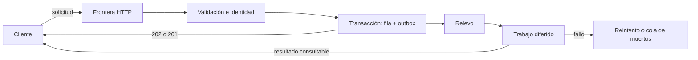
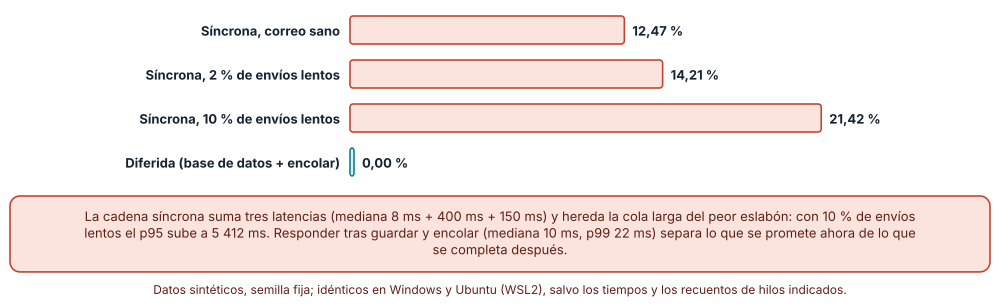
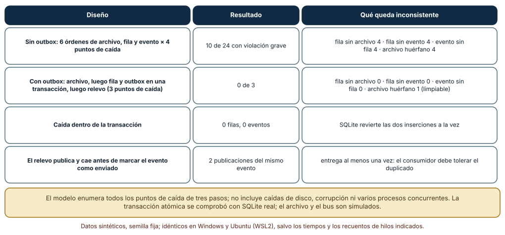
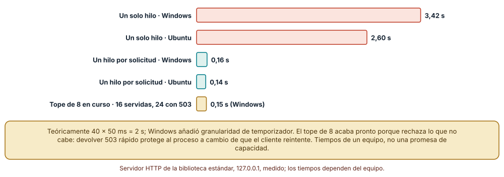

# SE-241 — Responsabilidades y fronteras del backend

[← SE-240 — Proyecto: aplicación web accesible y offline](https://github.com/vladimiracunadev-create/modern-software-engineering-program/blob/main/classes/part-19-web-frontend-y-aplicaciones-progresivas/se-240-proyecto-aplicacion-web-accesible-y-offline/README.md) · [↑ Parte 20](https://github.com/vladimiracunadev-create/modern-software-engineering-program/blob/main/classes/part-20-backend-apis-y-procesamiento-asincrono/README.md) · [📚 Índice completo](https://github.com/vladimiracunadev-create/modern-software-engineering-program/blob/main/classes/README.md) · [🌐 Portal](https://vladimiracunadev-create.github.io/modern-software-engineering-program/classes/SE-241.html) · [SE-242 — REST y semántica de recursos →](https://github.com/vladimiracunadev-create/modern-software-engineering-program/blob/main/classes/part-20-backend-apis-y-procesamiento-asincrono/se-242-rest-y-semantica-de-recursos/README.md)

## Punto profesional y fundamento pedagógico

**Punto profesional.** La clase existe para que decidas qué trabajo cabe dentro de una solicitud, qué se promete al responder y qué se difiere, y para que puedas medir qué ocurre con esa promesa cuando algo cae a mitad del camino. Un backend no es «el código que está detrás de la pantalla»: es el lugar donde un contrato público se convierte en estado persistente.

**Por qué aparece aquí.** Se sitúa después de **Proyecto: aplicación web accesible y offline** y antes de **REST y semántica de recursos**: la Parte 19 terminó con una aplicación web que se comporta bien sin red; la Parte 20 pregunta qué hay al otro lado de esa conexión. Esta clase fija las fronteras (qué responde el servidor ahora, qué hace después, qué guarda y qué avisa) y el caso de la plataforma de entregas que las once clases siguientes endurecerán: interfaz, validación, identidad, reintentos, trabajos, archivos, protección, operación, reparación y entrega de un servicio contractual.

**Error conceptual que debe corregir.** Creer que un backend correcto es el que ejecuta todos los pasos antes de responder. Esa cadena síncrona hereda la latencia del peor eslabón y deja estados a medias cuando algo cae entre dos pasos; la frontera correcta decide qué se confirma ahora y qué se completa después.

**Secuencia de aprendizaje.** Antes de ver cifras, predices qué porcentaje de solicitudes superará un tiempo máximo de 1 s si el alta de una entrega hace base de datos, análisis de archivo y correo en la misma solicitud; después enumeras todos los puntos de caída de un alta de tres pasos y mides qué estado deja cada orden, y por último observas un servidor real de un hilo frente a uno concurrente y uno con tope. La secuencia usa predicción, explicación propia, contraste y recuperación. [ICAP](https://icap.education.asu.edu/research) distingue participación de construcción de conocimiento; [How People Learn II](https://nap.nationalacademies.org/catalog/24783/how-people-learn-ii-learners-contexts-and-cultures) exige conectar conocimiento previo, contexto y transferencia; la [práctica de recuperación](https://pubmed.ncbi.nlm.nih.gov/16507066/) respalda producir de nuevo la explicación tras una demora; y [Education for Life and Work](https://nap.nationalacademies.org/resource/13398/dbasse_084153.pdf) exige devolución que explique la causa del error.

**Evidencia de aprendizaje.** `boundary-log.md` con la lista de responsabilidades del servicio (qué hace cada capa), la predicción previa, la tabla de puntos de caída con sus invariantes, la comparación de servidores con versión de Python y sistema, y una nota de qué hallazgo movería una responsabilidad al otro lado de la frontera.

**Límite de la conclusión.** Las latencias (medianas de 8, 400 y 150 ms), la proporción de envíos lentos y el tiempo de 50 ms por solicitud son parámetros del autor, no mediciones de un servicio. El modelo de caídas solo enumera caídas entre pasos; no cubre corrupción de disco ni varias réplicas. Nadie fue medido.

### Trazabilidad fuente → afirmación

| Fuente primaria u oficial | Afirmación que respalda | Lo que no prueba |
|---|---|---|
| [HTTP Semantics (RFC 9110)](https://www.rfc-editor.org/rfc/rfc9110) | Define qué significan los códigos de estado y los métodos: 202 Accepted indica que la solicitud fue aceptada para procesarse sin que el procesamiento haya terminado. | No dice cuánto debe tardar el procesamiento ni cómo consultar su resultado: eso lo define el contrato propio. |
| [Dean y Barroso, «The tail at scale» (CACM, 2013)](https://doi.org/10.1145/2408776.2408794) | Muestra que la latencia de un servicio compuesto está dominada por la cola (los percentiles altos) de sus dependencias. | No mide la plataforma de entregas ni fija un presupuesto de latencia. |
| [Python: sqlite3](https://docs.python.org/3/library/sqlite3.html) | Documenta que una transacción confirma o revierte todas sus sentencias a la vez. | No garantiza consistencia entre la base de datos y un archivo o un bus externos. |

## Antes de empezar

Esta clase abre la **Parte 20 sobre el backend de la plataforma de entregas de tareas**. Recupera la Parte 19: una aplicación que sobrevive a la falta de red envía solicitudes que pueden perderse, repetirse o llegar tarde. La pregunta activa es: **¿qué efecto se promete, cuándo se confirma y cómo se evita duplicarlo o perderlo?**

## Prerrequisitos

- Haber completado `SE-240` o poder explicar qué evidencia entregó y qué quedó abierto.
- Python 3.11 o posterior y un terminal; los experimentos usan solo la biblioteca estándar (`random`, `sqlite3`, `threading`, `http.server`).
- Leer una tabla de percentiles (p50, p95, p99) y distinguir mediana de media.
- Trabajar con entregas, notas y archivos sintéticos: ningún experimento necesita datos reales.

## Problema auténtico

Al subir una entrega, el servicio guarda el archivo, inserta la fila, analiza el archivo en busca de contenido malicioso y envía un correo de acuse. Un día el proveedor de correo tarda cinco segundos en el 2 % de los envíos y los estudiantes ven errores de tiempo agotado; otro día el proceso se reinicia entre guardar el archivo y escribir la fila, y aparece un archivo sin entrega. Nadie cambió una línea del contrato: cambió dónde cae la frontera entre lo que se hace antes de responder y lo que se hace después.

## Objetivos observables

Al terminar podrás:

1. distinguir las responsabilidades de un backend (contrato, validación, identidad, estado, trabajo diferido, operación) y asignar cada paso del alta de una entrega a una de ellas;
2. medir qué porcentaje de solicitudes supera un tiempo máximo en una cadena síncrona y en una versión que guarda y encola, y explicar por qué la cola larga domina;
3. enumerar los puntos de caída de un alta de varios pasos y decidir qué orden y qué mecanismo (transacción, outbox) deja cada invariante intacto;
4. comparar un servidor de un hilo, uno concurrente y uno con tope de solicitudes y decir qué compra cada diseño;
5. declarar qué promete la respuesta (aceptada, confirmada, completada) y qué evidencia permite comprobarlo.

## Mapa conceptual



El mapa se lee de izquierda a derecha por el camino de una solicitud: lo que ocurre antes de la respuesta (validar, identificar, guardar de forma atómica) y lo que ocurre después (relevo, trabajo, reintento). No es una arquitectura obligatoria; sirve para decidir en qué lado de la respuesta va cada paso. La flecha hacia el cliente desde el trabajo muestra que el resultado debe poder consultarse: un 202 sin forma de saber qué pasó no es un contrato.

## Temas y por qué importan

| Tema | Por qué cambia una decisión profesional | Evidencia mínima |
|---|---|---|
| Responsabilidades del backend | Si no se nombra quién valida, quién identifica y quién persiste, esas tareas se duplican o se omiten entre capas. | Tabla paso → responsabilidad del alta de una entrega en `boundary-log.md` |
| Frontera síncrona y diferida | Todo paso que está antes de la respuesta suma su latencia y su cola larga al tiempo que ve el cliente. | Porcentaje de solicitudes sobre el límite en las dos versiones |
| Estado y consistencia entre pasos | Una caída entre dos efectos deja estados que ningún código posterior puede distinguir de uno válido. | Escenarios de caída enumerados con su violación |
| Procesos, hilos y capacidad | El modelo de concurrencia fija cuántas solicitudes avanzan a la vez y qué ocurre con las que no caben. | Tiempos y códigos 503 de tres servidores locales |
| Qué promete la respuesta | 201, 202 y 200 prometen cosas distintas; el cliente decide reintentar, esperar o seguir según lo que entienda. | Una frase por código: qué se garantiza y cómo consultar el resultado |

## Conceptos y decisiones

### 1. Responsabilidades del backend

Un backend recibe un contrato (la interfaz que otros programas usan) y lo convierte en cambios de estado. Eso implica al menos seis responsabilidades: **contrato** (qué formas de solicitud y respuesta existen), **validación** (rechazar lo que no cumple las precondiciones), **identidad y autorización** (quién pide y qué le corresponde), **estado** (qué se guarda y con qué garantías), **trabajo diferido** (lo que no cabe en la solicitud) y **operación** (cómo se observa, se despliega y se apaga). Nombrarlas importa porque los fallos aparecen en las costuras: una validación hecha solo en la interfaz de usuario se salta llamando a la API; una autorización hecha solo en la pantalla no protege el recurso.

### 2. Frontera síncrona y diferida

La respuesta HTTP es un punto de compromiso: lo que ocurrió antes puede contarse como hecho, lo que ocurre después solo como intención. El criterio no es «lo lento va a una cola» sino **qué necesita saber el cliente para continuar**. Que la entrega quedó registrada es información que el estudiante necesita ahora; que el análisis de archivo terminó no lo es. Mover un paso al otro lado cambia el contrato: ya no se garantiza que el análisis haya terminado cuando llega la respuesta, y hay que ofrecer un recurso donde consultarlo.

### 3. Estado y consistencia entre pasos

Cada paso con efecto externo (escribir un archivo, insertar una fila, publicar un evento) puede fallar o quedar sin ejecutar si el proceso cae justo después. Con tres pasos hay cuatro puntos de caída por orden, y el estado resultante puede violar invariantes como «toda fila tiene su archivo» o «todo evento corresponde a una fila». Una transacción protege solo lo que ocurre dentro de una base de datos; para lo demás hace falta ordenar los pasos de modo que el único estado inconsistente posible sea reparable (un archivo huérfano que una limpieza borra) y no uno invisible (una fila sin evento).

### 4. Procesos, hilos y capacidad

Un servidor de un solo hilo atiende una solicitud a la vez: si cada una tarda 50 ms, 40 clientes simultáneos tardan unos 2 s en total y el último espera casi todo. Un hilo por solicitud reparte la espera pero no pone límite: con mil clientes habría mil hilos disputando memoria y base de datos. Un tope de solicitudes en curso devuelve 503 a las que no caben, lo que protege al proceso y traslada la decisión de reintentar al cliente. Ninguno es «el correcto»: cada uno fija qué se degrada primero.

### 5. Qué promete la respuesta

**201 Created** promete que el recurso existe y dónde está; **202 Accepted** promete que la solicitud fue aceptada para procesarse y nada más; **200** promete que la operación se completó. Elegir uno es escribir el contrato. La diferencia se nota en el cliente: ante un 202 debe poder consultar el estado; ante un 201 puede continuar; ante un tiempo agotado no sabe cuál de los tres ocurrió, y de eso trata la clase `SE-246`.

### Cadena síncrona frente a trabajo diferido: la cola larga

El alta síncrona hace cuatro pasos: base de datos (mediana 8 ms, dispersión log-normal 0,4), análisis de archivo (mediana 400 ms, 0,6), envío de correo (mediana 150 ms, 0,5, y una proporción de envíos que tardan 5 s) y respuesta. La versión diferida solo hace base de datos y encolado (mediana 2 ms). Se simulan 100 000 solicitudes por escenario con semilla 241 y un tiempo máximo del cliente de 1 s.

```python
db   = rng.lognormvariate(math.log(0.008), 0.4)
scan = rng.lognormvariate(math.log(0.400), 0.6)
mail = 5.0 if rng.random() < p_slow else rng.lognormvariate(math.log(0.150), 0.5)
sync = db + scan + mail          # frente a  db + enqueue
```

Resultado, idéntico en Windows (CPython 3.12.9) y en Ubuntu bajo WSL2 (3.12.3): la cadena síncrona supera 1 s en el **12,47 %** de las solicitudes con el correo sano, en el **14,21 %** con 2 % de envíos lentos y en el **21,42 %** con 10 %; el p95 pasa de 1 267 ms a 5 412 ms y el p99 llega a 5 866 ms. La versión diferida tiene mediana de 10,1 ms, p99 de 22,4 ms y 0 % de tiempos agotados en los tres casos. Dean y Barroso explican el mecanismo: la latencia de un servicio compuesto la fija la cola de sus dependencias, no su mediana.



**Cómo leer la figura.** Cada barra es el porcentaje de 100 000 solicitudes simuladas que tardan más que el tiempo máximo del cliente; las coral son la cadena síncrona y la verde la versión que guarda y encola. **Dónde deja de valer:** las latencias son supuestos: un análisis de archivo de 40 ms o un correo en proceso cambiaría los porcentajes. Diferir tampoco es gratis: el correo y el análisis siguen ocurriendo, y si fallan hay que avisar de otra manera. Y la figura no mide la carga que el trabajo diferido añade a otros componentes.

### Puntos de caída: qué estado deja cada orden

El alta tiene tres efectos: guardar el **archivo**, insertar la **fila** y publicar el **evento** de «entrega recibida». Hay 3! = 6 órdenes y, para cada una, cuatro puntos de caída (antes del primer paso, tras el primero, tras el segundo y al terminar): 24 escenarios. Tras cada uno se comprueban cuatro condiciones: fila sin archivo, fila sin evento, evento sin fila y archivo huérfano.

Sin ningún mecanismo, **10 de los 24 escenarios** dejan una violación grave (fila sin archivo, fila sin evento o evento sin fila); cada una de las cuatro condiciones aparece en 4 escenarios. El diseño con **outbox** ordena así: guarda el archivo, abre una transacción que inserta la fila y una fila de `outbox` y confirma, y un relevo publica los eventos pendientes. Con ese diseño los tres puntos de caída posibles dejan 0 violaciones graves y, a lo sumo, un archivo huérfano (1 caso), que una limpieza periódica puede borrar. Una caída dentro de la transacción deja 0 filas y 0 eventos porque SQLite revierte las dos inserciones juntas.

```python
with db:                                    # una transacción
    cur = db.execute("insert into sub values (1)")
    db.execute("insert into outbox(id) values (1)")
```

Queda un costo que el diseño no elimina: si el relevo publica el evento y cae antes de marcarlo como enviado, lo publicará otra vez. El resultado es **entrega al menos una vez**: dos publicaciones del mismo evento, y el consumidor debe tolerarlo (`SE-246` y `SE-247`).



**Cómo leer la figura.** Cada fila es un diseño; la columna central cuenta los escenarios con violación grave y la derecha dice qué queda inconsistente y si es reparable. **Dónde deja de valer:** enumera caídas entre pasos de un proceso, no fallos parciales dentro de un paso (un archivo escrito a medias), ni réplicas concurrentes. El archivo y el bus se simularon; solo la atomicidad de la transacción se comprobó con SQLite real.

### Un hilo, un hilo por solicitud y un tope: capacidad frente a degradación

Se levanta un servidor HTTP local de la biblioteca estándar (`127.0.0.1`, puerto efímero) cuyo manejador tarda 50 ms, y 40 hilos cliente lanzan una solicitud simultánea. Tres variantes: `HTTPServer` (un hilo), `ThreadingHTTPServer` (un hilo por solicitud) y esta última con un semáforo que admite 8 solicitudes en curso y devuelve 503 al resto. La cola de conexiones pendientes se fijó en 128 para que el sistema operativo no rechace conexiones.

Tiempo total medido: un solo hilo **3,42 s en Windows y 2,60 s en Ubuntu** (el mínimo teórico es 40 × 50 ms = 2 s; Windows añade granularidad de temporizador), un hilo por solicitud **0,16 s y 0,14 s**, y con tope de 8 **0,15 s y 0,13 s** pero con **16 respuestas 200 y 24 respuestas 503**. Sin esa cola de 128 el primer intento de la clase dio errores de conexión rechazada en Windows: el límite de pendientes del sistema operativo también es una frontera.



**Cómo leer la figura.** Cada barra es el tiempo hasta que terminan los 40 clientes; la última variante termina pronto porque rechaza lo que no cabe, no porque sirva más. **Dónde deja de valer:** los tiempos son de un equipo y de un manejador que duerme; un manejador que usa CPU o una base de datos real se comportaría distinto, y con la interpretación de Python el paralelismo de CPU está limitado por el GIL. Para decidir una capacidad hay que medir con la carga real.

## Definiciones de trabajo

- **frontera de confirmación:** punto de la secuencia de una solicitud a partir del cual lo anterior se cuenta como hecho y lo posterior como intención.
- **outbox transaccional:** tabla escrita en la misma transacción que el cambio de estado, de la que un relevo lee los eventos pendientes para publicarlos después.
- **entrega al menos una vez:** garantía de que un mensaje llega una o más veces; exige que quien lo recibe tolere duplicados.
- **cola larga:** porción de las solicitudes más lentas de una distribución, que domina el tiempo que perciben los clientes en servicios compuestos.
- **tope de solicitudes en curso:** límite de solicitudes simultáneas que un proceso acepta; las que exceden reciben 503 y no consumen recursos.

Las definiciones son operativas para la plataforma de entregas. No convierten términos con una historia técnica más amplia en sinónimos y deben contrastarse con la documentación primaria enlazada al final.

## Ejemplo mínimo

El fragmento enumera los puntos de caída de un orden concreto y cuenta las violaciones. Antes de ejecutarlo, predice cuántos de los cuatro puntos de caída dejan una fila sin archivo en el orden `fila → archivo → evento`.

```python
orden = ["fila", "archivo", "evento"]
for caida in range(4):
    hechos = set(orden[:caida])
    print(caida, "fila sin archivo" if "fila" in hechos and "archivo" not in hechos else "ok")
```

Solo la caída tras el primer paso (`caida == 1`) deja una fila sin archivo. Registra versión del intérprete, comando y salida; si cambias el orden a `archivo → fila → evento`, predice qué violación aparece ahora y si es reparable.

## Ejemplo profesional

La plataforma publica el alta de una entrega con este reparto: la frontera HTTP valida el cuerpo y la identidad; una transacción guarda la fila y una fila de outbox; el archivo se escribe antes con un nombre derivado de su huella; la respuesta es 201 con la ubicación del recurso y un campo `estado: recibida`; el análisis de archivo y el correo se encolan. Compara este diseño con el original en tres casos: una caída entre archivo y fila, un correo que tarda 5 s y una avalancha de 40 entregas simultáneas al cierre del plazo. Es apropiado cuando cada caso tiene una respuesta escrita y una comprobación; es peligroso cuando la respuesta depende de «el código lo maneja».

## Práctica guiada

1. Lista cada paso del alta de una entrega y asigna cada uno a una responsabilidad (contrato, validación, identidad, estado, trabajo diferido, operación).
2. Predice el porcentaje de solicitudes sobre 1 s en la cadena síncrona y escribe el número antes de simular.
3. Ejecuta la simulación con las tres proporciones de envíos lentos y compara con tu predicción; anota qué percentil predice mejor la queja del usuario.
4. Enumera los 24 escenarios de caída y cuenta las violaciones; después rediseña con outbox y repite.
5. Levanta el servidor local en sus tres variantes y mide tiempo y códigos; cambia el tope de 8 a 20 y predice cuántos 503 quedarán.
6. Escribe qué promete cada código de estado del alta y cómo consulta el cliente el resultado del análisis.
7. Entrega `boundary-log.md` y pide a otra persona que reconstruya la frontera solo desde él.

## Ejercicios

1. **Fronteras:** mueve el análisis de archivo a la rama diferida y justifica qué cambia en el contrato: qué estado ve el estudiante mientras el análisis no termina y cómo se entera del resultado.
2. **Caídas:** añade un cuarto paso (invalidar una caché) al alta y calcula cuántos escenarios hay; decide si el paso nuevo puede ir antes, dentro o después de la transacción.
3. **Capacidad:** con 50 ms por solicitud y 8 en curso, calcula el rendimiento máximo en solicitudes por segundo y compáralo con la medición.
4. **Cola larga:** calcula la probabilidad de que una solicitud que depende de 5 servicios, cada uno con un 1 % de respuestas lentas, sea lenta, y compárala con la de uno solo.

## Reto verificable

Entrega `boundary-log.md` con las responsabilidades del alta asignadas, la simulación de latencias con tus parámetros declarados, la tabla de 24 escenarios con y sin outbox y la comparación de servidores. Se aprueba si otra persona ejecuta tu código desde un checkout limpio, obtiene los mismos porcentajes y escenarios, y señala qué medición haría que movieras un paso al otro lado de la respuesta. No se aprueba por usar una cola: debe mostrarse qué invariante protege.

## Caso conductor

La plataforma de entregas de tareas es el caso conductor de la Parte 20. Esta clase deja el primer artefacto: el reparto de responsabilidades del alta y su frontera de confirmación. Las clases siguientes lo concretarán: la interfaz (`SE-242` y `SE-243`), el contrato de errores (`SE-244`), la identidad (`SE-245`), los reintentos (`SE-246`), el trabajo diferido (`SE-247`), los archivos (`SE-248`), la protección (`SE-249`) y la operación (`SE-250`). Cambia después una sola decisión, mover el análisis de archivo al lado diferido, y revisa qué artefactos hay que tocar.

## Preguntas frecuentes

### ¿Todo lo lento debe ir a una cola?

No. Va a la cola lo que el cliente no necesita saber para continuar y puede completarse después. Una validación rápida que decide si la entrega es aceptable debe quedar antes de la respuesta; llevarla a la cola obligaría a explicar al estudiante, minutos después, que su entrega no era válida.

### ¿Un 202 no es simplemente un 200 más lento?

Es otra promesa. 200 dice que se completó; 202 dice que se aceptó. El cliente que recibe 202 debe tener un recurso o un canal para conocer el resultado, y debe prepararse para que el resultado sea un fallo.

### ¿Una transacción no resuelve las caídas entre pasos?

Solo dentro de una base de datos. Escribir un archivo o publicar en un bus no participa en ella; el outbox acerca el evento a la transacción escribiéndolo como fila, y el orden archivo antes que fila hace que el único estado huérfano sea reparable.

### ¿Por qué no usar siempre un hilo por solicitud?

Porque no limita nada: bajo carga el número de hilos y de conexiones a la base de datos crece hasta degradar el proceso entero. Un tope devuelve un fallo rápido y legible a una parte de los clientes para que el resto sea atendido.

## Fallo controlado y diagnóstico

Reproduce el fallo de la clase: **reintentar una operación no idempotente tras un tiempo agotado y duplicar efectos**. Haz que el correo tarde 5 s en el 10 % de las altas y que el cliente reintente al pasar 1 s. **Síntoma:** al final hay más filas que entregas distintas y estudiantes que reciben dos acuses. **Hipótesis rivales:** (a) el cliente envió dos veces por error de interfaz; (b) el servidor completó la primera solicitud después de que el cliente se rindió. **Prueba:** registra un identificador de correlación por solicitud y comprueba que las dos filas llegaron con el mismo identificador de intento original. **Causa:** el reintento es indistinguible de una solicitud nueva porque el servidor no puede reconocer la repetición. **Corrección:** esta clase solo mueve la frontera (responder tras guardar y encolar reduce los tiempos agotados al 0 %); la defensa completa, una clave de idempotencia, se construye en `SE-246`. **Regresión:** una prueba que provoque el reintento y cuente filas.

## Errores comunes y cómo corregirlos

| Síntoma | Causa probable | Corrección |
|---|---|---|
| Estudiantes ven «tiempo agotado» pero la entrega existe | La cadena síncrona termina después de que el cliente se rindió | Responder tras guardar y encolar; devolver el identificador para consultar el estado |
| Hay archivos sin fila en el almacenamiento | El archivo se escribe y el proceso cae antes de insertar la fila | Escribir el archivo con nombre por huella y limpiar huérfanos con una tarea periódica |
| Una fila existe pero nadie recibió el evento | El evento se publica fuera de la transacción | Escribir una fila de outbox en la misma transacción y publicar desde un relevo |
| Con pocos usuarios todo va bien y al cierre del plazo cae | Se probó con una solicitud a la vez | Medir con clientes simultáneos y definir un tope con 503 |
| El 202 llega pero nadie sabe cómo ver el resultado | Se diferió el trabajo sin recurso de consulta | Devolver la URL del estado y documentar sus valores |

## Entorno y archivos clave

```text
work/SE-241/
├── README.md
├── sim/
│   ├── cadena.py
│   ├── caidas.py
│   └── servidores.py
├── tests/test_caidas.py
└── evidence/boundary-log.md
```

El `README` declara plataforma, versión de Python, semillas y comandos. Los experimentos usan solo la biblioteca estándar y se ejecutaron con CPython 3.12.9 en Windows 11 y 3.12.3 en Ubuntu bajo WSL2: las simulaciones dieron salidas idénticas y los tiempos del servidor fueron los indicados. Los puertos son efímeros y el servidor solo escucha en `127.0.0.1`. Limpieza: los servidores se detienen con `shutdown()` y `server_close()` al terminar cada medición.

## Seguridad, ética y accesibilidad

- el servidor de laboratorio escucha solo en `127.0.0.1`; no lo expongas a la red ni lo uses con datos reales;
- el 503 por tope debe indicar que se puede reintentar y no revelar detalles internos;
- los acuses por correo contienen datos de estudiantes: en producción son datos personales y deben minimizarse;
- documenta quién puede consultar el estado de una entrega aceptada: es la primera frontera de autorización (`SE-245`);
- un mensaje de error de tiempo agotado debe ser comprensible y accesible, no un código técnico.

## Puente hacia el trabajo con agentes

Un agente al que se le pide «hazlo más rápido» tenderá a mover pasos a una cola sin avisar de que cambia el contrato. Pídele en cambio que liste las responsabilidades de cada paso, que diga qué invariante protege cada orden de los efectos y que proponga el recurso donde se consulta el resultado. Revisa especialmente si dejó un paso con efecto fuera de la transacción: es la misma costura que dejó 10 de 24 escenarios con violación, ahora con apariencia de código ordenado.

## Transferencia

Traslada el experimento a otro de los dominios persistentes (por ejemplo, un servicio de pedidos que cobra, reserva existencias y envía un aviso): cambia los pasos y conserva el procedimiento de enumerar los puntos de caída y medir la cola larga. La transferencia está lograda cuando explicas qué parte dependía del alta de entregas y cuál es el patrón general, no cuando el código se parece.

## Evaluación y evidencia

| Criterio | Evidencia para aprobar |
|---|---|
| comprensión | asignación de cada paso a una responsabilidad y explicación de la diferencia entre 200, 201 y 202 |
| corrección | porcentajes y escenarios reproducibles con las mismas semillas |
| diseño | frontera justificada con invariante, orden de pasos y mecanismo |
| diagnóstico | reproducción del reintento con efecto duplicado, hipótesis y prueba de regresión |
| incertidumbre | parámetros declarados como supuestos y límites del modelo de caídas |
| reproducibilidad | versiones, comandos, salida y límites declarados |

## Fuentes

- [HTTP Semantics (RFC 9110)](https://www.rfc-editor.org/rfc/rfc9110) — significado de 201, 202 y 503 y de los métodos HTTP; autoridad: IETF.
- [Dean y Barroso, «The tail at scale» (CACM, 2013)](https://doi.org/10.1145/2408776.2408794) — latencia de servicios compuestos y cola larga; autoridad: Communications of the ACM.
- [Python: sqlite3](https://docs.python.org/3/library/sqlite3.html) — transacciones, `with` y revertir; autoridad: Python Software Foundation.
- [Python: http.server](https://docs.python.org/3/library/http.server.html) — servidores HTTP de laboratorio; autoridad: Python Software Foundation.
- [Python: threading](https://docs.python.org/3/library/threading.html) — hilos y semáforos del experimento de capacidad; autoridad: Python Software Foundation.
- [Python: random](https://docs.python.org/3/library/random.html) — generador con semilla de la simulación; autoridad: Python Software Foundation.
- [SWEBOK Guide v4.0a](https://www.computer.org/education/bodies-of-knowledge/software-engineering) — diseño y construcción como áreas de conocimiento; autoridad: IEEE Computer Society.
- Microservices.io: Transactional outbox (enlace no verificado en esta ejecución; búscalo por título) — patrón de fila transaccional para eventos; autoridad: Chris Richardson.
- Kleppmann, Designing Data-Intensive Applications (O'Reilly, ISBN 978-1-4493-7332-0) (enlace no verificado en esta ejecución; búscalo por título) — consistencia, transacciones y entrega de mensajes; autoridad: O'Reilly.

Cada fuente respalda el mecanismo indicado; ninguna demuestra que las cifras sintéticas de esta clase describan un sistema real. Las fuentes marcadas como no verificadas se citan por título porque no se pudo comprobar su enlace en esta ejecución (sin acceso de red autorizado); se verificaron las demás por haberse comprobado en clases publicadas de otras partes.

## Límites y siguiente paso

Se ejecutaron tres experimentos con datos sintéticos en Windows y Ubuntu (WSL2): dos simulaciones idénticas en ambos sistemas y una medición de servidores locales con tiempos propios de cada equipo. No se midió ningún servicio real, proveedor de correo ni a personas: las latencias y las proporciones de fallo son construcciones del autor. La siguiente clase pregunta cómo se nombran y se tratan los recursos que esta frontera expone.

## Glosario

- **backend:** parte del sistema que recibe solicitudes de otros programas, aplica reglas y modifica estado persistente.
- **contrato público:** conjunto de solicitudes, respuestas, códigos y garantías de las que dependen quienes llaman al servicio.
- **trabajo diferido:** tarea que se acepta ahora y se ejecuta después, fuera de la solicitud que la originó.
- **invariante:** condición que debe cumplirse en todo estado alcanzable, como que toda fila tenga su archivo.
- **relevo:** proceso que lee eventos pendientes de una tabla y los publica, marcándolos como enviados.

---

[← SE-240 — Proyecto: aplicación web accesible y offline](https://github.com/vladimiracunadev-create/modern-software-engineering-program/blob/main/classes/part-19-web-frontend-y-aplicaciones-progresivas/se-240-proyecto-aplicacion-web-accesible-y-offline/README.md) · [↑ Parte 20](https://github.com/vladimiracunadev-create/modern-software-engineering-program/blob/main/classes/part-20-backend-apis-y-procesamiento-asincrono/README.md) · [📚 Índice completo](https://github.com/vladimiracunadev-create/modern-software-engineering-program/blob/main/classes/README.md) · [🌐 Portal](https://vladimiracunadev-create.github.io/modern-software-engineering-program/classes/SE-241.html) · [SE-242 — REST y semántica de recursos →](https://github.com/vladimiracunadev-create/modern-software-engineering-program/blob/main/classes/part-20-backend-apis-y-procesamiento-asincrono/se-242-rest-y-semantica-de-recursos/README.md)
