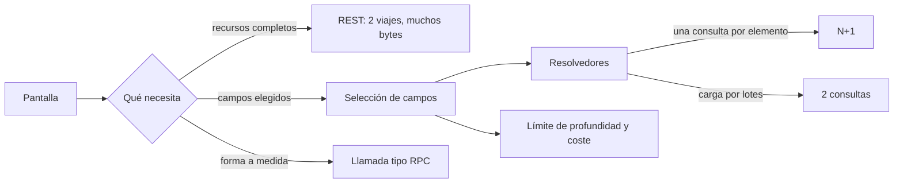
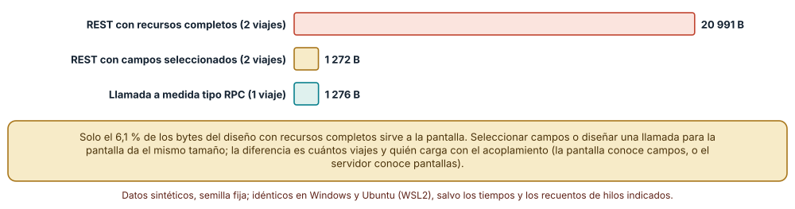
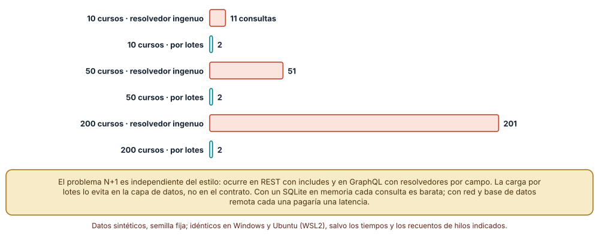
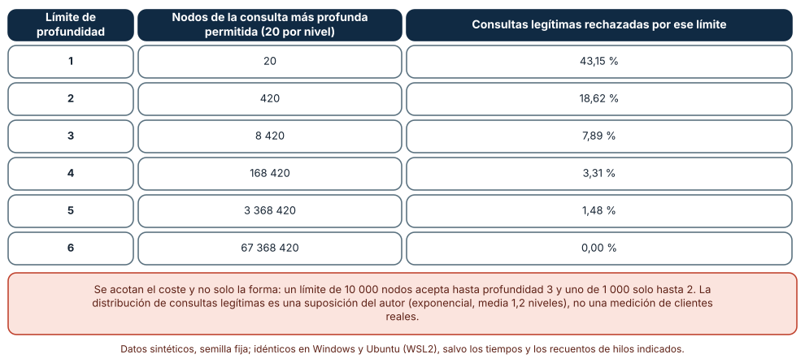

# SE-243 — RPC, GraphQL y selección de interfaz

[← SE-242 — REST y semántica de recursos](https://github.com/vladimiracunadev-create/modern-software-engineering-program/blob/main/classes/part-20-backend-apis-y-procesamiento-asincrono/se-242-rest-y-semantica-de-recursos/README.md) · [↑ Parte 20](https://github.com/vladimiracunadev-create/modern-software-engineering-program/blob/main/classes/part-20-backend-apis-y-procesamiento-asincrono/README.md) · [📚 Índice completo](https://github.com/vladimiracunadev-create/modern-software-engineering-program/blob/main/classes/README.md) · [🌐 Portal](https://vladimiracunadev-create.github.io/modern-software-engineering-program/classes/SE-243.html) · [SE-244 — Validación, errores y contratos consistentes →](https://github.com/vladimiracunadev-create/modern-software-engineering-program/blob/main/classes/part-20-backend-apis-y-procesamiento-asincrono/se-244-validacion-errores-y-contratos-consistentes/README.md)

## Punto profesional y fundamento pedagógico

**Punto profesional.** La clase existe para que elijas el estilo de interfaz (recursos HTTP, llamadas a procedimientos o consultas con selección de campos) por lo que cada uno cuesta y por lo que traslada al cliente o al servidor, y para que midas cuántos bytes, viajes y consultas a la base de datos produce una pantalla concreta en cada estilo.

**Por qué aparece aquí.** Se sitúa después de **REST y semántica de recursos** y antes de **Validación, errores y contratos consistentes**: `SE-242` dejó la plataforma modelada como recursos. Esta clase pregunta cuándo esa forma deja de ser la mejor: una pantalla que necesita datos de tres recursos hace tres viajes, y una consulta flexible puede hacer que el servidor ejecute miles de consultas internas. La elección informa el contrato de errores de `SE-244` y la protección de `SE-249`.

**Error conceptual que debe corregir.** Creer que un estilo de interfaz es «más moderno» que otro. Cada uno mueve el costo de sitio: REST con recursos completos manda bytes que la pantalla no usa; una llamada a medida acopla el servidor a las pantallas; una consulta flexible traslada al servidor el costo de resolver cualquier forma que el cliente pida.

**Secuencia de aprendizaje.** Antes de medir, predices qué fracción de los bytes de una lista de entregas usa realmente la pantalla del curso; después cuentas las consultas SQL que hace un resolvedor ingenuo al crecer el número de cursos y compruebas qué cambia con la carga por lotes; por último calculas cuántos nodos puede resolver una consulta anidada y qué consultas legítimas rechazaría un límite. La secuencia usa predicción, explicación propia, contraste y recuperación. [ICAP](https://icap.education.asu.edu/research) distingue participación de construcción de conocimiento; [How People Learn II](https://nap.nationalacademies.org/catalog/24783/how-people-learn-ii-learners-contexts-and-cultures) exige conectar conocimiento previo, contexto y transferencia; la [práctica de recuperación](https://pubmed.ncbi.nlm.nih.gov/16507066/) respalda producir de nuevo la explicación tras una demora; y [Education for Life and Work](https://nap.nationalacademies.org/resource/13398/dbasse_084153.pdf) exige devolución que explique la causa del error.

**Evidencia de aprendizaje.** `interface-log.md` con la pantalla estudiada, los bytes y viajes en tres estilos, el recuento de consultas SQL con y sin lotes, la tabla de profundidad y coste con el porcentaje de consultas legítimas rechazadas, y la decisión de estilo justificada con una condición que la revertiría.

**Límite de la conclusión.** Los tamaños dependen de los datos sintéticos (descripciones de 400 caracteres, comentarios de 300) y de que la pantalla use 2 de 6 campos. La distribución de profundidades de consulta es una suposición del autor. No se levantó ningún servidor GraphQL, gRPC ni REST real: se midieron estructuras y consultas con SQLite.

### Trazabilidad fuente → afirmación

| Fuente primaria u oficial | Afirmación que respalda | Lo que no prueba |
|---|---|---|
| [GraphQL Specification](https://spec.graphql.org/) | Define que el cliente declara los campos que quiere y el servidor resuelve cada campo, y especifica las operaciones de consulta, mutación y suscripción. | No dice cómo implementar los resolvedores ni qué límites de coste aplicar. |
| [OWASP GraphQL Cheat Sheet](https://cheatsheetseries.owasp.org/cheatsheets/GraphQL_Cheat_Sheet.html) | Recoge riesgos propios de una consulta flexible: profundidad, coste, alias repetidos y exposición del esquema. | No cuantifica cuánto rechaza un límite en una aplicación concreta. |
| gRPC: conceptos básicos | Describe llamadas a procedimientos remotos con contrato en un lenguaje de definición y transporte binario. | No demuestra que una llamada a medida sea mejor para ninguna pantalla concreta. |

## Antes de empezar

Recupera `SE-242`: la entrega y la colección son recursos con métodos de semántica conocida. La pregunta activa es: **¿cuántos viajes, cuántos bytes y cuántas consultas internas cuesta una pantalla real, y quién carga con el acoplamiento entre pantalla y servidor?**

## Prerrequisitos

- Haber completado `SE-242` o poder explicar qué evidencia entregó y qué quedó abierto.
- Python 3.11 o posterior; los experimentos usan `sqlite3`, `json` y `random`.
- Haber clasificado las operaciones de la plataforma en `SE-242`.
- Leer una consulta SQL sencilla con `where` y `in`.

## Problema auténtico

La pantalla «entregas de un curso» necesita el nombre del curso y, de cada entrega, solo el identificador y la nota. Con recursos REST completos, el cliente pide el curso y después la lista de entregas, que trae alumno, comentario y ruta de archivo que la pantalla ignora; en un móvil con red débil esos kilobytes se notan. El equipo duda: ¿una llamada a medida, selección de campos o una capa GraphQL? Un compañero recuerda que una vez un resolvedor hacía una consulta por curso y tumbó la base de datos.

## Objetivos observables

Al terminar podrás:

1. medir los bytes y los viajes que necesita una pantalla con recursos completos, con campos seleccionados y con una llamada a medida;
2. reconocer y medir el problema N+1 en un resolvedor y comprobar el efecto de la carga por lotes;
3. calcular el coste en nodos de una consulta anidada y decidir un límite sin rechazar la mayoría de las consultas legítimas;
4. elegir un estilo de interfaz para una pantalla con criterios (acoplamiento, caché, evolución, herramientas) y una condición que lo revierta;
5. declarar qué estilo conviene a la API pública, al panel interno y a la comunicación entre servicios.

## Mapa conceptual



El mapa se lee desde la pantalla: lo que necesita determina cuántos viajes y qué forma. La rama de la selección de campos añade un riesgo que las otras no tienen: el cliente fija la forma de la consulta y el servidor debe ejecutar cualquier forma, de ahí los resolvedores, el N+1 y los límites. No es una jerarquía de calidad.

## Temas y por qué importan

| Tema | Por qué cambia una decisión profesional | Evidencia mínima |
|---|---|---|
| REST, RPC y consultas con selección | Cada estilo reparte el costo entre bytes, viajes, acoplamiento y evolución de forma distinta. | Tabla de pantalla × estilo con bytes y viajes |
| Sobreobtención y subobtención | Pedir de más desperdicia ancho de banda; pedir de menos obliga a viajes adicionales. | Fracción de bytes útiles de la pantalla del curso |
| Resolvedores y N+1 | Resolver por campo convierte una lista de N en N+1 consultas si no se agrupan. | Número de consultas SQL con y sin lotes para 10, 50 y 200 cursos |
| Coste y profundidad de una consulta | Una consulta pequeña en texto puede resolver millones de nodos si se anida. | Tabla de profundidad, nodos y porcentaje de consultas legítimas rechazadas |
| Elección del estilo | La decisión depende de quién consume la interfaz, cuánto cambia y quién puede acotar el coste. | Decisión con criterios y condición de reversión |

## Conceptos y decisiones

### 1. REST, RPC y consultas con selección

En el estilo de **recursos** (`SE-242`) el servidor decide la forma de cada representación y las URL organizan el espacio. En el estilo **RPC** el cliente invoca una operación con nombre (`resumenDelCurso(id)`), cuya forma de respuesta se diseña para un uso concreto; es compacto para ese uso y rígido para otros. En el estilo de **consulta con selección** (GraphQL) el cliente describe qué campos quiere de un grafo de tipos y el servidor los resuelve. No es una escala de madurez: gRPC suele ser buena elección entre servicios internos con contrato estricto, REST para API públicas con caché de intermediarios, y la selección de campos para pantallas variadas que cambian a menudo.

### 2. Sobreobtención y subobtención

La **sobreobtención** ocurre cuando la representación trae campos que el cliente no usa; la **subobtención**, cuando una pantalla necesita datos de varios recursos y hace varios viajes. Los dos son costos reales en redes lentas, pero tienen remedios distintos: seleccionar campos reduce lo primero, componer en el servidor reduce lo segundo. El riesgo de optimizar la pantalla actual es acoplar el servidor a ella: cada rediseño de la pantalla pide un cambio de servidor.

### 3. Resolvedores y N+1

Un resolvedor es la función que obtiene el valor de un campo. Si la lista de cursos se resuelve con una consulta y cada curso resuelve sus entregas con otra, se hacen 1 + N consultas: la que trae los cursos y una por curso. Con poco dato no se nota; con 200 cursos son 201 consultas por cada pantalla. La solución es agrupar: reunir los identificadores pedidos en la misma ronda y hacer una sola consulta con `in (...)`. El patrón existe en REST con inclusión de relaciones y en cualquier mapeador objeto-relacional, no es exclusivo de GraphQL.

### 4. Coste y profundidad de una consulta

En una interfaz donde el cliente anida campos (`curso { entregas { alumno { entregas { ... } } } }`), el número de nodos crece como la fanout elevada a la profundidad. Con 20 elementos por nivel, profundidad 3 son 8 420 nodos y profundidad 6 más de 67 millones. Los límites típicos son de profundidad, de número de nodos estimado y de tiempo; cada uno rechaza algún tráfico legítimo. El límite se elige mirando las consultas que las pantallas hacen de verdad, no una cifra redonda.

### 5. Elección del estilo

La elección se documenta con criterios: quién consume (equipo propio, terceros), cuánto cambian las pantallas, si los intermediarios deben cachear, qué herramientas tiene el equipo y quién acota el coste. Para la plataforma: el panel docente cambia cada semana y lo consume el propio equipo (candidato a selección de campos con límites); la API pública para integraciones cambia poco y se beneficia de caché (recursos); la comunicación entre el servicio de entregas y el de notas es interna y de contrato estricto (RPC).

### Bytes y viajes de una pantalla en tres estilos

Se generan 20 cursos con 50 entregas cada uno (semilla 243). Cada curso lleva una descripción de 400 caracteres y cada entrega alumno, nota, un comentario de 300 caracteres y una ruta de archivo. La pantalla necesita el nombre del curso y, por entrega, identificador y nota.

```python
rest = len(json.dumps(curso)) + len(json.dumps(entregas))               # 2 viajes
sel  = len(json.dumps({"id": 3, "nombre": ...})) + len(json.dumps(campos))  # 2 viajes
rpc  = len(json.dumps({"entregas": campos, "curso": nombre}))          # 1 viaje
```

Resultado, idéntico en Windows (CPython 3.12.9) y en Ubuntu (3.12.3): REST con recursos completos **20 991 B** en 2 viajes; con campos seleccionados **1 272 B** en 2 viajes; llamada a medida **1 276 B** en 1 viaje. La pantalla aprovecha el **6,1 %** de los bytes del primer diseño. La selección de campos y la llamada a medida pesan lo mismo; el RPC ahorra un viaje porque el servidor ya compone la respuesta.



**Cómo leer la figura.** Cada barra es el total de bytes de JSON que recibe la pantalla; el número de viajes va en la etiqueta de cada estilo. **Dónde deja de valer:** los bytes dependen de los datos sintéticos y no incluyen cabeceras ni compresión; con gzip la diferencia se reduce porque los comentarios repetidos comprimen bien. Tampoco mide latencia: un viaje de más cuesta distinto en una red local y en un móvil.

### El problema N+1 con un contador de consultas

Con 200 cursos de 5 entregas, un resolvedor ingenuo pide los cursos y después las entregas de cada curso; el resolvedor por lotes reúne los identificadores y hace una sola consulta con `in`. Un contador envuelve cada ejecución de SQL.

Resultado: para 10 cursos el ingenuo hace **11 consultas** y el de lotes **2**; para 50, **51** y **2**; para 200, **201** y **2**. La cuenta crece linealmente con los cursos pedidos en el primer caso y se mantiene constante en el segundo.

```python
ids = [x[0] for x in c2.q("select id,nombre from curso limit ?", (n,))]
c2.q(f"select id,curso_id,nota from entrega where curso_id in ({','.join('?' * len(ids))})", ids)
```



**Cómo leer la figura.** Cada par de barras compara el resolvedor ingenuo (coral) con el que agrupa (verde) para el mismo número de cursos. **Dónde deja de valer:** SQLite en memoria hace barata cada consulta; con una base de datos remota cada consulta suma una latencia de red y el efecto sería mayor. La carga por lotes tiene su propio costo: una lista de identificadores muy larga o una consulta que no usa un índice puede ser peor que varias pequeñas.

### Cuántos nodos cuesta una consulta anidada

Se calculan los nodos resueltos por una consulta con 20 elementos por nivel: 20 en profundidad 1, 420 en 2, 8 420 en 3, 168 420 en 4, 3 368 420 en 5 y 67 368 420 en 6. Después se simulan 10 000 consultas legítimas de pantallas con profundidad exponencial de media 1,2 niveles recortada en 6 (semilla 243) y se cuenta qué porcentaje rechazaría cada límite.

Un límite de profundidad 1 rechaza el **43,15 %**; 2, el **18,62 %**; 3, el **7,89 %**; 4, el **3,31 %**; 5, el **1,48 %**; 6, el **0 %**. Un límite de coste de 1 000 nodos acepta consultas de hasta profundidad 2 y uno de 10 000 nodos, de hasta 3. Un límite estricto de profundidad rechaza muchas consultas legítimas, y uno holgado deja pasar consultas que cuestan millones de nodos: el límite de coste en nodos es más justo que el de profundidad porque tiene en cuenta cuántos elementos hay por nivel.



**Cómo leer la figura.** Cada fila es un límite de profundidad; la columna del medio muestra cuánto cuesta la consulta más profunda permitida y la derecha cuánto tráfico legítimo se rechaza. **Dónde deja de valer:** la distribución de consultas legítimas es una suposición, no una medición de pantallas reales; las consultas reales tienen niveles con fanouts distintos y listas acotadas con paginación. El coste en nodos tampoco captura una consulta lenta por un campo caro.

## Definiciones de trabajo

- **sobreobtención:** recibir más campos de los que la pantalla utiliza.
- **N+1:** patrón en el que una lista de N elementos genera N consultas adicionales además de la inicial.
- **resolvedor:** función que obtiene el valor de un campo de la consulta.
- **carga por lotes:** agrupación en una consulta de las peticiones de datos que se producen en la misma ronda de resolución.
- **coste de una consulta:** estimación del trabajo que exige resolverla, por ejemplo el número de nodos del grafo que visita.

Las definiciones son operativas para la plataforma de entregas. No convierten términos con una historia técnica más amplia en sinónimos y deben contrastarse con la documentación primaria enlazada al final.

## Ejemplo mínimo

El fragmento calcula los nodos de una consulta anidada. Antes de ejecutarlo, predice el valor para profundidad 4 con 20 elementos por nivel.

```python
def nodos(prof, fan):
    return sum(fan ** d for d in range(1, prof + 1))
print(nodos(4, 20))
```

Resultado: 168 420. Registra versión y salida; cambia la fanout a 10 y predice el valor para profundidad 6 antes de comprobarlo.

## Ejemplo profesional

La plataforma publica tres superficies: una API de recursos para integraciones externas, con caché y paginación por clave; un punto de consulta con selección de campos para el panel docente, con límite de 10 000 nodos, paginación obligatoria en toda lista anidada y carga por lotes en los resolvedores; y llamadas con contrato estricto entre el servicio de entregas y el de notas. Compara el diseño con el original en tres casos: un móvil con red débil, un rediseño del panel y un cliente que anida cinco niveles de golpe.

## Práctica guiada

1. Elige una pantalla de la plataforma y lista los campos que realmente usa.
2. Predice la fracción de bytes útiles en el diseño de recursos completos.
3. Calcula bytes y viajes en tres estilos con tus datos sintéticos.
4. Implementa un resolvedor ingenuo y uno por lotes y cuenta las consultas con un contador.
5. Calcula la tabla de nodos por profundidad y fija un límite justificado con consultas de ejemplo.
6. Escribe la decisión de estilo por superficie con una condición que la revertiría.
7. Entrega `interface-log.md` y pide a otra persona que reconstruya el criterio solo con él.

## Ejercicios

1. **Bytes:** recalcula los bytes con compresión gzip y explica por qué la ventaja de seleccionar campos se reduce.
2. **N+1:** añade un tercer nivel (entregas con archivos) y cuenta las consultas ingenuas y por lotes; indica cuándo la consulta por lotes deja de ser mejor.
3. **Coste:** modifica la fanout por nivel (20, 5, 50) y recalcula nodos; propón un coste ponderado y compáralo con el límite de profundidad.
4. **Decisión:** elige estilo para el servicio de notificaciones a docentes y justifica con tres criterios y una condición de reversión.

## Reto verificable

Entrega `interface-log.md` con la pantalla, la medición de tres estilos, el recuento de consultas ingenuo y por lotes y la tabla de límites con el porcentaje de consultas legítimas rechazadas. Se aprueba si otra persona obtiene las mismas cifras desde un checkout limpio y puede decir qué medición cambiaría tu elección de estilo.

## Caso conductor

La plataforma de entregas queda con tres superficies y un criterio para cada una. Retoma `SE-242`: los recursos siguen siendo la base y la selección de campos se apoya en ellos. La clase siguiente fija cómo se valida lo que llega por cualquiera de esas superficies y cómo se comunican los errores. Cambia después una sola decisión, el límite de nodos, y revisa qué artefactos hay que tocar.

## Preguntas frecuentes

### ¿GraphQL reemplaza a REST?

No. Resuelve bien pantallas variadas con un cliente propio, pero pierde la caché de intermediarios sobre URL y exige defender el servidor de consultas costosas. Muchas plataformas combinan recursos para integraciones y consultas para su propio panel.

### ¿El N+1 desaparece con una caché?

Se disimula si los datos están en caché, pero reaparece en la primera carga y cuando la caché expira. Agrupar las lecturas resuelve la causa; la caché es una optimización aparte.

### ¿Un límite de profundidad basta para proteger el servidor?

Es insuficiente por sí solo: una consulta de profundidad 2 con alias repetidos o listas enormes puede ser muy costosa. Se combina con límite de nodos, paginación obligatoria y tiempo máximo.

### ¿Por qué no hacer siempre una llamada a medida por pantalla?

Es lo más compacto para el presente y lo más caro para cambiar: cada pantalla nueva exige un cambio en el servidor, y las llamadas se multiplican. Conviene cuando la pantalla es crítica y estable.

## Fallo controlado y diagnóstico

Reproduce el fallo de la clase: **un resolvedor ingenuo que multiplica consultas con el tamaño de la lista**. Pide 200 cursos con sus entregas usando el resolvedor sin lotes. **Síntoma:** la pantalla tarda segundos y la base de datos registra cientos de consultas casi idénticas por solicitud. **Hipótesis rivales:** (a) falta un índice en `entrega.curso_id`; (b) se hace una consulta por elemento. **Prueba:** cuenta las consultas por solicitud con un contador y comprueba que crecen linealmente con los cursos mientras el plan de cada una es correcto. **Causa:** el resolvedor consulta dentro de un bucle. **Corrección:** cargar por lotes con `in`. **Regresión:** una prueba que fije el máximo de consultas por solicitud y falle si crece con N.

## Errores comunes y cómo corregirlos

| Síntoma | Causa probable | Corrección |
|---|---|---|
| La pantalla es lenta con muchos elementos y rápida con pocos | Una consulta por elemento (N+1) | Contar consultas por solicitud y cargar por lotes |
| El móvil descarga megabytes para mostrar una lista corta | Recursos completos que la pantalla no usa | Seleccionar campos o diseñar una respuesta para la pantalla |
| Un cliente tumba el servidor con una consulta pequeña | Anidamiento sin límite de coste | Límite de nodos, paginación obligatoria y tiempo máximo |
| Cada rediseño de pantalla pide un cambio de servidor | Llamadas a medida demasiado acopladas | Mover a selección de campos las pantallas que cambian a menudo |
| Un límite de profundidad rechaza consultas legítimas | Cifra elegida sin mirar el tráfico real | Medir la distribución de consultas y ponderar por fanout |

## Entorno y archivos clave

```text
work/SE-243/
├── README.md
├── sim/
│   ├── bytes.py
│   ├── n_mas_1.py
│   └── coste.py
├── tests/test_consultas.py
└── evidence/interface-log.md
```

El `README` declara plataforma, versión de Python, semilla (243) y comandos. Los experimentos usan `sqlite3`, `json` y `random`; las salidas fueron idénticas en CPython 3.12.9 (Windows 11) y 3.12.3 (Ubuntu bajo WSL2). No se instaló ningún servidor GraphQL ni gRPC: se midieron estructuras de datos y consultas para aislar el mecanismo.

## Seguridad, ética y accesibilidad

- una consulta con selección de campos puede exponer campos que no deberían salir: la autorización se aplica por campo, no solo por consulta (`SE-245`);
- la introspección del esquema revela la forma de la API; decide si se desactiva fuera de desarrollo;
- limita alias y operaciones por solicitud: repetir un campo costoso cien veces es una forma de denegación de servicio;
- los mensajes de error de un resolvedor no deben incluir SQL ni rutas internas;
- documenta los límites de coste de forma accesible para quienes integran.

## Puente hacia el trabajo con agentes

Un agente al que se le pide «expón esta información con GraphQL» generará resolvedores que consultan dentro de bucles y no pondrá límites de coste. Pídele el recuento de consultas por solicitud para 10, 50 y 200 elementos, exige carga por lotes y un límite de nodos justificado, y que enumere qué campos requieren autorización propia. Revisa especialmente si el resolvedor hace una consulta por elemento: es el mismo N+1 que pasó de 11 a 201 consultas.

## Transferencia

Traslada el experimento a otro de los dominios persistentes (por ejemplo, un catálogo de comercio con productos y valoraciones): cambia las entidades y conserva el procedimiento de medir bytes y viajes, contar consultas y calcular nodos. La transferencia está lograda cuando explicas qué dependía de la pantalla del curso y qué es un mecanismo general de las interfaces con selección.

## Evaluación y evidencia

| Criterio | Evidencia para aprobar |
|---|---|
| comprensión | explicación de sobreobtención, subobtención y N+1 con un ejemplo de la plataforma |
| corrección | bytes, consultas y nodos reproducibles con las mismas semillas |
| diseño | estilo elegido por superficie con criterios y condición de reversión |
| diagnóstico | reproducción del N+1 con prueba que fija el número de consultas |
| incertidumbre | declaración de lo que no se midió: latencia real, compresión y tráfico real |
| reproducibilidad | versiones, comandos, salida y límites declarados |

## Fuentes

- [GraphQL Specification](https://spec.graphql.org/) — modelo de consulta y resolución de campos; autoridad: GraphQL Foundation.
- [OWASP GraphQL Cheat Sheet](https://cheatsheetseries.owasp.org/cheatsheets/GraphQL_Cheat_Sheet.html) — riesgos de profundidad, coste y exposición del esquema; autoridad: OWASP.
- gRPC: conceptos básicos (enlace no verificado en esta ejecución; búscalo por título) — llamadas a procedimientos con contrato; autoridad: gRPC.
- [HTTP Semantics (RFC 9110)](https://www.rfc-editor.org/rfc/rfc9110) — semántica de métodos y representaciones; autoridad: IETF.
- [OpenAPI Specification](https://spec.openapis.org/oas/latest.html) — descripción de interfaces de recursos; autoridad: OpenAPI Initiative.
- [Python: sqlite3](https://docs.python.org/3/library/sqlite3.html) — consultas parametrizadas del experimento; autoridad: Python Software Foundation.
- [Python: json](https://docs.python.org/3/library/json.html) — serialización usada para medir bytes; autoridad: Python Software Foundation.
- [SWEBOK Guide v4.0a](https://www.computer.org/education/bodies-of-knowledge/software-engineering) — diseño de interfaces como área de conocimiento; autoridad: IEEE Computer Society.

Cada fuente respalda el mecanismo indicado; ninguna demuestra que las cifras sintéticas de esta clase describan un sistema real. Las fuentes marcadas como no verificadas se citan por título porque no se pudo comprobar su enlace en esta ejecución (sin acceso de red autorizado); se verificaron las demás por haberse comprobado en clases publicadas de otras partes.

## Límites y siguiente paso

Se ejecutaron tres experimentos con datos sintéticos en Windows y Ubuntu (WSL2) con resultados idénticos. No se midió ninguna red ni servidor real, y ningún cliente: las descripciones, los comentarios y la distribución de profundidades son construcciones del autor. La siguiente clase pregunta cómo se valida lo que llega y cómo se comunican los errores de forma consistente.

## Glosario

- **selección de campos:** mecanismo por el que el cliente declara qué campos de un recurso quiere recibir.
- **fanout:** número de elementos hijos que devuelve cada nivel de una consulta anidada.
- **llamada a procedimiento remoto:** invocación de una operación con nombre en otro proceso, con contrato de entrada y salida.
- **introspección:** capacidad de consultar la propia descripción del esquema de una API.
- **alias:** nombre alternativo que permite pedir el mismo campo varias veces en una consulta.

---

[← SE-242 — REST y semántica de recursos](https://github.com/vladimiracunadev-create/modern-software-engineering-program/blob/main/classes/part-20-backend-apis-y-procesamiento-asincrono/se-242-rest-y-semantica-de-recursos/README.md) · [↑ Parte 20](https://github.com/vladimiracunadev-create/modern-software-engineering-program/blob/main/classes/part-20-backend-apis-y-procesamiento-asincrono/README.md) · [📚 Índice completo](https://github.com/vladimiracunadev-create/modern-software-engineering-program/blob/main/classes/README.md) · [🌐 Portal](https://vladimiracunadev-create.github.io/modern-software-engineering-program/classes/SE-243.html) · [SE-244 — Validación, errores y contratos consistentes →](https://github.com/vladimiracunadev-create/modern-software-engineering-program/blob/main/classes/part-20-backend-apis-y-procesamiento-asincrono/se-244-validacion-errores-y-contratos-consistentes/README.md)
