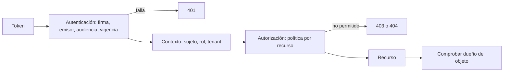
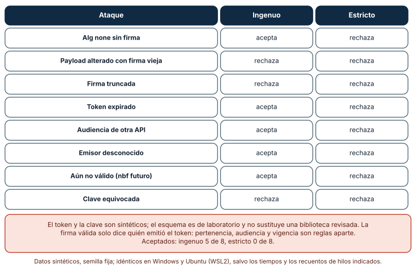
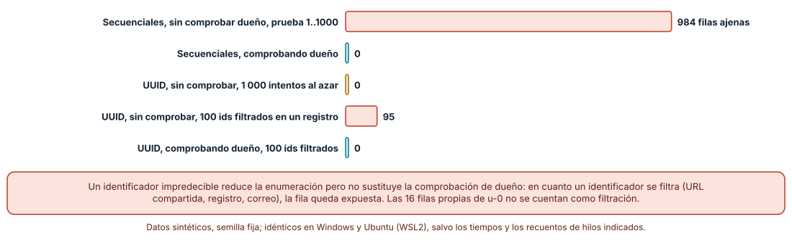
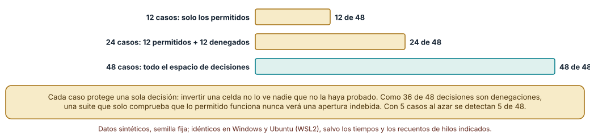

# SE-245 — Autenticación, autorización y contexto

[← SE-244 — Validación, errores y contratos consistentes](https://github.com/vladimiracunadev-create/modern-software-engineering-program/blob/main/classes/part-20-backend-apis-y-procesamiento-asincrono/se-244-validacion-errores-y-contratos-consistentes/README.md) · [↑ Parte 20](https://github.com/vladimiracunadev-create/modern-software-engineering-program/blob/main/classes/part-20-backend-apis-y-procesamiento-asincrono/README.md) · [📚 Índice completo](https://github.com/vladimiracunadev-create/modern-software-engineering-program/blob/main/classes/README.md) · [🌐 Portal](https://vladimiracunadev-create.github.io/modern-software-engineering-program/classes/SE-245.html) · [SE-246 — Idempotencia, reintentos y deduplicación →](https://github.com/vladimiracunadev-create/modern-software-engineering-program/blob/main/classes/part-20-backend-apis-y-procesamiento-asincrono/se-246-idempotencia-reintentos-y-deduplicacion/README.md)

## Punto profesional y fundamento pedagógico

**Punto profesional.** La clase existe para que distingas quién hace la solicitud (autenticación), qué le corresponde (autorización) y en qué contexto actúa (tenant, rol, solicitud), para que verifiques un token con todas sus comprobaciones y para que midas cuánto de una política de acceso protege realmente una suite de pruebas. Un token válido solo dice quién lo emitió; no dice que pueda leer esta entrega.

**Por qué aparece aquí.** Se sitúa después de **Validación, errores y contratos consistentes** y antes de **Idempotencia, reintentos y deduplicación**: `SE-244` garantizó que lo que entra está bien formado; esta clase pregunta de quién es y qué puede hacer. Sus resultados (verificación estricta, comprobación de dueño por recurso y política con pruebas) son prerrequisito de la idempotencia de `SE-246`, que liga una clave a una identidad, y del taller de `SE-251`.

**Error conceptual que debe corregir.** Creer que autenticar es autorizar y que un identificador impredecible protege el recurso. Un token con firma válida puede estar vencido, ser de otra audiencia o de otro emisor; y un UUID filtrado en un registro abre la fila a cualquiera si el servidor no comprueba el dueño.

**Secuencia de aprendizaje.** Antes de ejecutar, predices cuántos de ocho ataques a un token aceptará un verificador que solo comprueba la firma; después mides cuántas filas ajenas obtiene un alumno que prueba identificadores secuenciales y aleatorios con y sin comprobación de dueño, y por último cuentas qué decisiones de una política de 48 celdas protege cada suite de pruebas. La secuencia usa predicción, explicación propia, contraste y recuperación. [ICAP](https://icap.education.asu.edu/research) distingue participación de construcción de conocimiento; [How People Learn II](https://nap.nationalacademies.org/catalog/24783/how-people-learn-ii-learners-contexts-and-cultures) exige conectar conocimiento previo, contexto y transferencia; la [práctica de recuperación](https://pubmed.ncbi.nlm.nih.gov/16507066/) respalda producir de nuevo la explicación tras una demora; y [Education for Life and Work](https://nap.nationalacademies.org/resource/13398/dbasse_084153.pdf) exige devolución que explique la causa del error.

**Evidencia de aprendizaje.** `access-log.md` con la tabla de ataques y resultados de dos verificadores, las cifras de filas ajenas en cinco escenarios, la política de 3 roles × 4 recursos × 4 acciones con la cobertura de cada suite y una nota de qué hallazgo cambiaría un permiso.

**Límite de la conclusión.** El token, la clave y el emisor son sintéticos; el esquema de laboratorio no sustituye una biblioteca revisada ni un proveedor de identidad. Los tiempos de comparación de firmas son ruido de un intérprete y no prueban ausencia de canales laterales. La política y los roles son de la plataforma ficticia.

### Trazabilidad fuente → afirmación

| Fuente primaria u oficial | Afirmación que respalda | Lo que no prueba |
|---|---|---|
| JSON Web Token (RFC 7519) | Define la estructura de un token firmado y los campos registrados de emisor, audiencia, expiración y no antes de. | No obliga a una aplicación a comprobarlos: eso lo exige el verificador. |
| JSON Web Token Best Current Practices (RFC 8725) | Recoge prácticas para verificar tokens: fijar el algoritmo, comprobar emisor y audiencia y no aceptar el algoritmo `none`. | No sustituye la revisión de una biblioteca concreta. |
| OWASP API Security Top 10 (2023) | Sitúa la autorización rota a nivel de objeto entre los principales riesgos de las API y recomienda comprobarla en cada acceso por identificador. | No mide su frecuencia en la plataforma de entregas. |

## Antes de empezar

Recupera `SE-244`: la plataforma rechaza lo mal formado y devuelve errores con forma única. La pregunta activa es: **¿quién pide esto, qué le corresponde y qué información del contexto debe viajar con la solicitud sin que el cliente pueda falsificarla?**

## Prerrequisitos

- Haber completado `SE-244` o poder explicar qué evidencia entregó y qué quedó abierto.
- Python 3.11 o posterior; los experimentos usan `hmac`, `hashlib`, `base64`, `json` y `uuid`.
- Saber qué es una firma HMAC de forma conceptual.
- Haber definido en `SE-244` la forma de error y su clasificación.

## Problema auténtico

Una docente consulta `GET /entregas/9812` y ve la entrega de otro curso: el servicio comprobó que el token era válido, no que la entrega fuera suya. Un integrador descubre que cambiando el último número recorre todas. Otro día, un token emitido para la API de notas se acepta en la API de entregas. Y una revisión de seguridad pide la lista de qué puede hacer cada rol, que nadie sabe responder sin leer todo el código.

## Objetivos observables

Al terminar podrás:

1. distinguir autenticación, autorización y contexto de la solicitud con un ejemplo de la plataforma;
2. implementar y atacar un verificador de tokens y comprobar qué ataques acepta uno que solo mira la firma;
3. medir cuántas filas ajenas obtiene un alumno con identificadores secuenciales o aleatorios con y sin comprobación de dueño;
4. expresar una política de acceso como tabla con denegación por defecto y medir qué suite la protege;
5. declarar qué información de identidad es fiable en el servidor y cuál viene del cliente.

## Mapa conceptual



El mapa se lee de la solicitud al recurso: la autenticación produce un sujeto, el contexto lo acompaña y la política decide por recurso y acción; la comprobación del dueño del objeto es un paso aparte que no deriva de la política general. El 404 en lugar del 403 puede ocultar la existencia de un recurso ajeno. No es una secuencia de pantallas: cada paso puede fallar por separado.

## Temas y por qué importan

| Tema | Por qué cambia una decisión profesional | Evidencia mínima |
|---|---|---|
| Autenticación | Sin una verificación completa, un token falsificado o ajeno se acepta como si fuera válido. | Tabla de ocho ataques con dos verificadores |
| Autorización por recurso | Estar autenticado no da derecho a todo; cada acceso a un objeto exige comprobar el dueño o el rol. | Filas ajenas obtenidas con y sin comprobación |
| Contexto de la solicitud | Rol, tenant y sujeto deben venir del token verificado y no de campos que el cliente controla. | Lista de campos de identidad y su origen |
| Política como datos | Una tabla de decisiones permite revisar y probar quién puede qué; esparcida en el código, no. | Matriz 3 × 4 × 4 con denegación por defecto |
| Cobertura de la política | Un permiso no probado puede abrirse o cerrarse sin que nadie lo note. | Decisiones protegidas por cada suite |

## Conceptos y decisiones

### 1. Autenticación

Autenticar es establecer *quién* hace la solicitud. Un token firmado transporta un sujeto y unas afirmaciones, y su verificación exige varias comprobaciones: que el algoritmo sea el esperado (no el que declara la cabecera), que la firma coincida con la clave del emisor, que el emisor y la audiencia sean los de esta API, y que la hora actual esté entre `nbf` y `exp`. Cada comprobación omitida es un ataque: `alg: none` evita la firma, un token expirado se acepta para siempre, uno de otra audiencia funciona en esta API.

### 2. Autorización por recurso

Autorizar es decidir *qué puede hacer* ese sujeto sobre este recurso. Hay dos niveles: el de **rol** (los docentes pueden leer entregas de sus cursos) y el de **objeto** (esta entrega es de ese estudiante). La autorización rota a nivel de objeto es la omisión de la segunda: el servidor trae la fila por identificador y no comprueba si pertenece al sujeto. Devolver 404 en lugar de 403 ante una entrega ajena impide que el atacante distinga entre «no existe» y «existe pero no es tuya».

### 3. Contexto de la solicitud

El **contexto** es la información que acompaña cada solicitud y condiciona su tratamiento: el sujeto, el rol, el curso o institución (tenant) y el identificador de correlación. La regla es que todo dato de identidad sale del token verificado en el servidor; un encabezado `X-Rol: docente` enviado por el cliente es una afirmación sin respaldo. El contexto se propaga a las capas inferiores (consulta, cola, registro) para que cada una pueda aplicar la misma política.

### 4. Política como datos

Una política legible es una tabla de tuplas permitidas (rol, recurso, acción) con **denegación por defecto**: lo que no está en la tabla se niega. La tabla puede revisarse en una reunión, compararse con la anterior y probarse celda a celda. Con 3 roles, 4 recursos y 4 acciones hay 48 decisiones; en la plataforma, 12 son permitidas y 36 son denegaciones. Esa asimetría importa para las pruebas.

### 5. Cobertura de la política

Cada decisión de la tabla es un caso de prueba posible: «el alumno no puede borrar notas». Invertir una celda (abrir un permiso o cerrarlo) solo lo detecta una prueba que la ejercite. Una suite que comprueba que los permisos concedidos funcionan nunca ve una apertura indebida, que es el fallo más grave. La suite que protege la política cubre denegaciones tanto como permisos.

### Ocho ataques a un token firmado

Se implementa un token de laboratorio de tres partes (cabecera, carga, firma HMAC-SHA-256 con una clave sintética) y dos verificadores. El ingenuo confía en la cabecera (acepta `alg: none`) y compara la firma, y no mira emisor, audiencia ni vigencia. El estricto fija el algoritmo, compara con `hmac.compare_digest` y comprueba emisor, audiencia y `nbf <= ahora < exp`. Los ocho ataques: `alg: none` sin firma, payload alterado con firma antigua, firma truncada, token expirado, audiencia ajena, emisor desconocido, aún no válido y clave equivocada.

```python
if cab["alg"] == "none":
    return pay                       # el verificador ingenuo confía en la cabecera
esperado = b64(hmac.new(CLAVE, f"{h}.{p}".encode(), hashlib.sha256).digest())
```

Resultado, idéntico en Windows y Ubuntu: el ingenuo acepta **5 de 8** (`alg: none`, expirado, audiencia ajena, emisor desconocido y `nbf` futuro); rechaza la alteración, la firma truncada y la clave equivocada. El estricto rechaza los **8**. La comparación de firmas con `==` frente a `compare_digest` midió entre 70 y 190 ns por comparación en un caso y entre 130 y 300 ns en el otro, sin diferencia interpretable entre el primer y el último carácter: a esta escala el ruido de CPython domina.



**Cómo leer la figura.** Cada fila es un token malicioso; la columna central es el verificador que solo comprueba la firma y confía en la cabecera, y la derecha el que comprueba todo. **Dónde deja de valer:** el token y el esquema son de laboratorio, no una biblioteca. La medida de tiempos de comparación no demuestra que `==` sea seguro ni que el canal lateral no exista: solo que este experimento no lo detecta. En producción se usa una biblioteca revisada y claves gestionadas.

### Identificadores secuenciales, aleatorios y comprobación de dueño

Hay 1 000 entregas de 50 usuarios (16 son de `u-0`, el atacante autenticado). Se prueban cinco escenarios (semilla 245).

Con identificadores secuenciales y sin comprobar el dueño, recorrer 1 a 1 000 devuelve **984 filas ajenas**; comprobando el dueño, **0**. Con UUID aleatorios, adivinar 1 000 valores al azar devuelve **0** aunque no se compruebe el dueño; pero si **100 UUID** se filtran (en un registro, en un enlace compartido), sin comprobación el atacante obtiene **95 filas ajenas**; con comprobación, **0**. Las 5 que faltan son entregas del propio `u-0` entre los filtrados.



**Cómo leer la figura.** Cada barra cuenta filas de otros usuarios que obtiene el alumno `u-0` en un escenario; las verdes son los casos protegidos por la comprobación de dueño. **Dónde deja de valer:** un UUID reduce la enumeración, no sustituye la comprobación: en cuanto un identificador se filtra, la fila queda expuesta. El experimento no mide cuánto se filtran en la práctica y supone que el atacante conoce el formato.

### Qué decisiones de la política protege una suite

La política es una tabla de 12 permisos (rol, recurso, acción) sobre un espacio de 3 × 4 × 4 = 48 decisiones; los otros 36 son denegaciones. Cada «mutación» invierte una celda. Una prueba protege una sola decisión: si la suite no la ejercita, la mutación pasa sin ser vista.

Con 5, 12 y 20 casos tomados al azar se detectan **5, 12 y 20** mutaciones; con 48 casos, **las 48**. Una suite de los **12 permisos** detecta 12 de 48 y deja sin ver cualquier apertura indebida; una de 12 permisos más 12 denegaciones detecta 24; para detectar las 48 hay que ejercitar las 48 decisiones.



**Cómo leer la figura.** Cada barra es el número de decisiones, de 48, que una suite protege; cada caso de prueba protege exactamente una. **Dónde deja de valer:** el resultado es casi aritmético porque cada prueba cubre una celda; en una política con comodines o jerarquías de roles, un caso puede proteger varias decisiones y otras interactuar. Tampoco mide si la tabla describe lo que la institución quiere.

## Definiciones de trabajo

- **autenticación:** establecimiento de la identidad de quien hace una solicitud.
- **autorización:** decisión de si un sujeto puede realizar una acción sobre un recurso.
- **autorización a nivel de objeto:** comprobación de que el sujeto tiene derecho sobre la instancia concreta que pide.
- **audiencia:** destinatario previsto de un token; la API debe rechazar los emitidos para otra.
- **denegación por defecto:** regla por la que todo lo que la política no permite explícitamente se niega.

Las definiciones son operativas para la plataforma de entregas. No convierten términos con una historia técnica más amplia en sinónimos y deben contrastarse con la documentación primaria enlazada al final.

## Ejemplo mínimo

El fragmento compara dos firmas con `compare_digest`. Antes de ejecutarlo, predice el resultado de la segunda llamada.

```python
import hmac, hashlib
firma = hmac.new(b"clave-sintetica", b"mensaje", hashlib.sha256).hexdigest()
print(hmac.compare_digest(firma, firma), hmac.compare_digest(firma, firma[:-1] + "0"))
```

Resultado: `True` y `False` (salvo que el último carácter ya fuera `0`). `compare_digest` recorre las dos cadenas completas sin cortar en la primera diferencia. Registra versión y salida; cambia la clave y predice qué ocurre con la primera comparación.

## Ejemplo profesional

La plataforma verifica cada token con algoritmo fijado, emisor, audiencia y vigencia; extrae sujeto y rol del token; y aplica una política en tabla con denegación por defecto. Cada lectura de una entrega comprueba que el sujeto sea su dueño o un docente del curso, y devuelve 404 si no. El contexto (sujeto, curso, correlación) viaja a la capa de datos y al trabajo diferido. Compara este diseño con el original en tres casos: un token de otra API, un identificador filtrado en un registro y un rol nuevo (ayudante) que se añade a la tabla.

## Práctica guiada

1. Implementa el verificador ingenuo y escribe los ocho ataques; predice cuántos aceptará.
2. Ejecuta los ataques y compara; implementa el estricto y repite.
3. Construye 1 000 entregas de 50 usuarios y mide las filas ajenas con y sin comprobación, con identificadores secuenciales y aleatorios.
4. Escribe la política de roles × recursos × acciones y la regla de denegación por defecto.
5. Escribe una suite que mida cuántas mutaciones de la política detecta; amplíala hasta cubrir las denegaciones.
6. Decide qué información de identidad es fiable y cuál no, y dónde se verifica.
7. Entrega `access-log.md` y pide a otra persona que añada un rol y que diga qué pruebas debe añadir.

## Ejercicios

1. **Ataques:** añade un noveno ataque (algoritmo cambiado a uno asimétrico con la clave pública como secreto) y explica qué comprobación lo detiene.
2. **Objeto:** diseña la comprobación para una entrega con dos dueños (alumno y docente) y decide qué devuelve ante un tercero.
3. **Política:** añade el rol «ayudante» con lectura de entregas y comentarios, y calcula cuántas decisiones nuevas aparecen y cuántas serán denegaciones.
4. **Cobertura:** escribe la suite mínima que detecta cualquier apertura indebida de la política y justifica su tamaño.

## Reto verificable

Entrega `access-log.md` con los ocho ataques y los dos verificadores, las filas ajenas en cinco escenarios y la política con la cobertura de tres suites. Se aprueba si otra persona obtiene las mismas cifras desde un checkout limpio y puede señalar qué decisión de la tabla no está protegida por ninguna prueba. No se aprueba por usar tokens: debe mostrarse qué ataque detiene cada comprobación.

## Caso conductor

La plataforma de entregas ya sabe quién llama y qué le corresponde. Recupera `SE-244`: los errores 401 y 403 comparten forma, y el 404 por entrega ajena evita revelar su existencia. La clase siguiente ata una clave de idempotencia a una identidad. Cambia después una sola decisión, la vigencia del token de 10 a 60 minutos, y revisa qué artefactos hay que tocar.

## Preguntas frecuentes

### ¿Por qué 404 y no 403 ante una entrega ajena?

Porque 403 confirma que la entrega existe. Con 404 el atacante no distingue entre una entrega inexistente y una ajena. A cambio, un docente legítimo sin permiso recibe un mensaje menos informativo; la elección se documenta.

### ¿Un token de larga vida es más cómodo?

Sí, y su robo es más grave: un token robado sirve hasta que expire. Los tokens cortos se renuevan con un mecanismo propio y revocable; la vigencia es una decisión de riesgo, no solo de comodidad.

### ¿Puedo guardar el rol en un campo que envía el cliente?

No. Todo dato de identidad debe derivar del token verificado o de la base de datos del servidor. Un campo que el cliente controla es una opinión del cliente.

### ¿Con UUID ya no necesito comprobar el dueño?

Sí lo necesitas. El UUID dificulta adivinar identificadores, pero se filtran en registros, correos y enlaces; la comprobación es la que protege la fila cuando eso ocurre.

## Fallo controlado y diagnóstico

Reproduce el fallo de la clase: **leer la entrega de otra persona cambiando un número**. Con identificadores secuenciales y sin comprobar el dueño, recorre `1..1000` como alumno. **Síntoma:** 984 respuestas 200 con datos de otros. **Hipótesis rivales:** (a) los datos eran públicos; (b) el servidor no comprueba el dueño. **Prueba:** repite la solicitud con un token de otro alumno y con un token falso, y observa que las dos devuelven lo mismo. **Causa:** autorización rota a nivel de objeto. **Corrección:** comprobar sujeto = dueño o rol docente del curso y devolver 404 en caso contrario. **Regresión:** una prueba que lee una entrega ajena y espera 404.

## Errores comunes y cómo corregirlos

| Síntoma | Causa probable | Corrección |
|---|---|---|
| Un token vencido sigue funcionando | El verificador no comprueba `exp` | Comprobar vigencia con un margen de reloj acotado |
| Un token de otra API funciona aquí | No se comprueba la audiencia | Exigir audiencia y emisor |
| Un alumno lee entregas ajenas | Falta la comprobación de dueño | Comprobar por objeto en cada acceso |
| Se abre un permiso sin que ninguna prueba falle | La suite no ejercita denegaciones | Probar las celdas denegadas |
| El rol llega en un encabezado del cliente | Contexto tomado de datos controlados por el cliente | Derivar rol y sujeto del token verificado |

## Entorno y archivos clave

```text
work/SE-245/
├── README.md
├── acceso/
│   ├── tokens.py
│   ├── objetos.py
│   └── politica.py
├── tests/test_politica.py
└── evidence/access-log.md
```

El `README` declara plataforma, versión de Python, semilla (245) y comandos. Los experimentos usan `hmac`, `hashlib`, `base64`, `json`, `uuid` y `random`; las salidas deterministas fueron idénticas en CPython 3.12.9 (Windows 11) y 3.12.3 (Ubuntu bajo WSL2); los tiempos de comparación son medidas de un equipo. La clave del laboratorio es una constante sintética: nunca uses claves reales en ejemplos.

## Seguridad, ética y accesibilidad

- no incluyas claves ni tokens reales en el repositorio, los registros ni la evidencia;
- los mensajes de autenticación fallida no deben indicar qué comprobación falló;
- registra decisiones de acceso (sujeto, recurso, resultado) sin guardar el token;
- limita los intentos de autenticación para dificultar la enumeración y la fuerza bruta;
- revisa la política con personas de producto y de soporte: una tabla que nadie entiende no se mantiene.

## Puente hacia el trabajo con agentes

Un agente al que se le pide «protege el endpoint» tiende a añadir una comprobación de token y olvidar el dueño del objeto. Pídele la lista de comprobaciones del verificador, la tabla de política con denegación por defecto y una prueba por celda denegada. Revisa especialmente si el rol sale de un campo del cuerpo: es el mismo defecto que dejó 984 filas ajenas a la vista.

## Transferencia

Traslada el experimento a otro de los dominios persistentes (por ejemplo, un sistema de historias clínicas ficticio): cambia roles y recursos y conserva el procedimiento de atacar el verificador, probar el dueño y medir la cobertura de la política. La transferencia está lograda cuando explicas qué dependía del token de laboratorio y qué es un principio general.

## Evaluación y evidencia

| Criterio | Evidencia para aprobar |
|---|---|
| comprensión | explicación de autenticación, autorización y contexto con un ejemplo de la plataforma |
| corrección | ataques aceptados, filas ajenas y cobertura reproducibles |
| diseño | política con denegación por defecto y origen de cada dato de identidad |
| diagnóstico | reproducción de la lectura ajena con hipótesis, prueba y regresión |
| incertidumbre | declaración de lo que no se probó: biblioteca real, revocación y canales laterales |
| reproducibilidad | versiones, comandos, salida y límites declarados |

## Fuentes

- JSON Web Token (RFC 7519) (enlace no verificado en esta ejecución; búscalo por título) — estructura y campos registrados de un token firmado; autoridad: IETF.
- JSON Web Token Best Current Practices (RFC 8725) (enlace no verificado en esta ejecución; búscalo por título) — prácticas de verificación de tokens; autoridad: IETF.
- OWASP API Security Top 10 (2023) (enlace no verificado en esta ejecución; búscalo por título) — autorización rota a nivel de objeto; autoridad: OWASP.
- [OWASP Application Security Verification Standard](https://owasp.org/www-project-application-security-verification-standard/) — requisitos de verificación de control de acceso; autoridad: OWASP.
- [OWASP Secrets Management Cheat Sheet](https://cheatsheetseries.owasp.org/cheatsheets/Secrets_Management_Cheat_Sheet.html) — gestión de claves y secretos; autoridad: OWASP.
- [Python: hmac](https://docs.python.org/3/library/hmac.html) — HMAC y comparación en tiempo constante; autoridad: Python Software Foundation.
- [Python: hashlib](https://docs.python.org/3/library/hashlib.html) — funciones hash del experimento; autoridad: Python Software Foundation.
- [HTTP Semantics (RFC 9110)](https://www.rfc-editor.org/rfc/rfc9110) — códigos 401, 403 y 404; autoridad: IETF.

Cada fuente respalda el mecanismo indicado; ninguna demuestra que las cifras sintéticas de esta clase describan un sistema real. Las fuentes marcadas como no verificadas se citan por título porque no se pudo comprobar su enlace en esta ejecución (sin acceso de red autorizado); se verificaron las demás por haberse comprobado en clases publicadas de otras partes.

## Límites y siguiente paso

Se ejecutaron tres experimentos con datos sintéticos en Windows y Ubuntu (WSL2); las cifras deterministas son idénticas, los tiempos de comparación son de cada equipo. No se auditó ninguna API ni biblioteca real, ni se midió a ninguna persona: los tokens, los usuarios y los roles son construcciones del autor. La siguiente clase pregunta qué ocurre cuando una solicitud autenticada y autorizada se repite.

## Glosario

- **token:** credencial firmada que transporta afirmaciones sobre un sujeto y su vigencia.
- **tenant:** unidad aislada (institución o curso) a la que pertenecen los datos y que limita el alcance de un sujeto.
- **sujeto:** identidad autenticada que realiza la solicitud.
- **política de acceso:** conjunto de reglas que determinan quién puede hacer qué sobre qué recurso.
- **enumeración de identificadores:** recorrido sistemático de identificadores para descubrir recursos accesibles.

---

[← SE-244 — Validación, errores y contratos consistentes](https://github.com/vladimiracunadev-create/modern-software-engineering-program/blob/main/classes/part-20-backend-apis-y-procesamiento-asincrono/se-244-validacion-errores-y-contratos-consistentes/README.md) · [↑ Parte 20](https://github.com/vladimiracunadev-create/modern-software-engineering-program/blob/main/classes/part-20-backend-apis-y-procesamiento-asincrono/README.md) · [📚 Índice completo](https://github.com/vladimiracunadev-create/modern-software-engineering-program/blob/main/classes/README.md) · [🌐 Portal](https://vladimiracunadev-create.github.io/modern-software-engineering-program/classes/SE-245.html) · [SE-246 — Idempotencia, reintentos y deduplicación →](https://github.com/vladimiracunadev-create/modern-software-engineering-program/blob/main/classes/part-20-backend-apis-y-procesamiento-asincrono/se-246-idempotencia-reintentos-y-deduplicacion/README.md)
