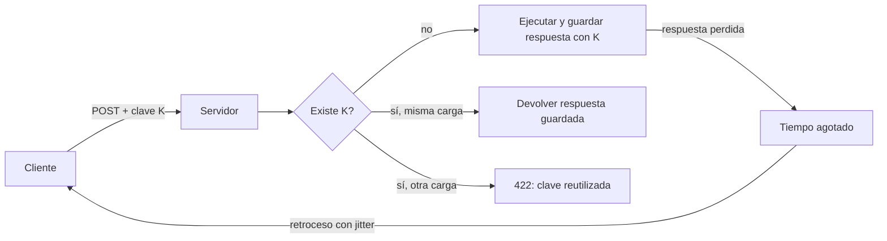
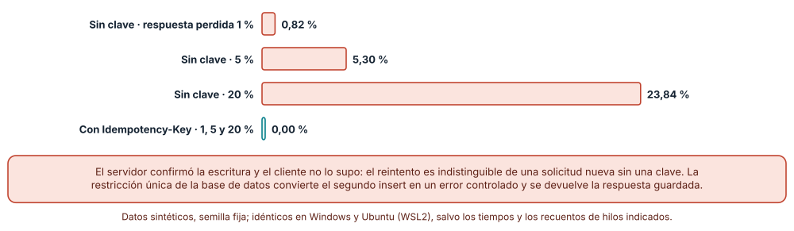
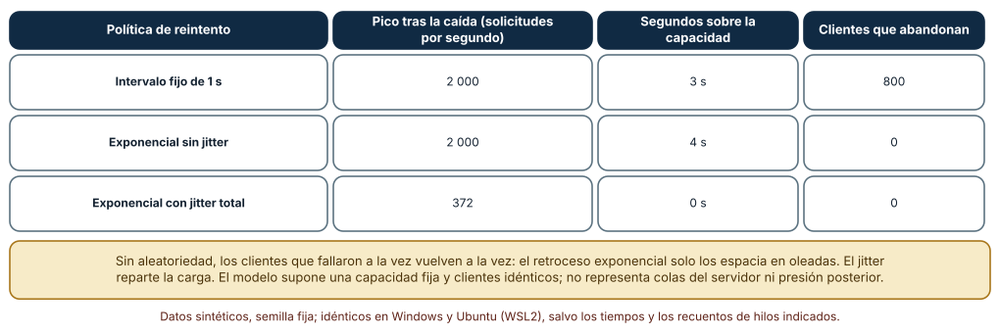
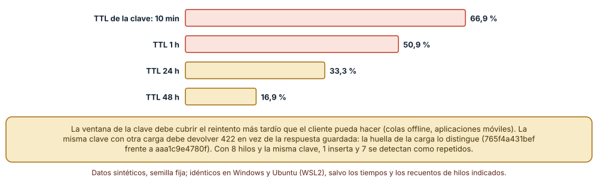

# SE-246 — Idempotencia, reintentos y deduplicación

[← SE-245 — Autenticación, autorización y contexto](https://github.com/vladimiracunadev-create/modern-software-engineering-program/blob/main/classes/part-20-backend-apis-y-procesamiento-asincrono/se-245-autenticacion-autorizacion-y-contexto/README.md) · [↑ Parte 20](https://github.com/vladimiracunadev-create/modern-software-engineering-program/blob/main/classes/part-20-backend-apis-y-procesamiento-asincrono/README.md) · [📚 Índice completo](https://github.com/vladimiracunadev-create/modern-software-engineering-program/blob/main/classes/README.md) · [🌐 Portal](https://vladimiracunadev-create.github.io/modern-software-engineering-program/classes/SE-246.html) · [SE-247 — Jobs, colas y procesamiento diferido →](https://github.com/vladimiracunadev-create/modern-software-engineering-program/blob/main/classes/part-20-backend-apis-y-procesamiento-asincrono/se-247-jobs-colas-y-procesamiento-diferido/README.md)

## Punto profesional y fundamento pedagógico

**Punto profesional.** La clase existe para que diseñes una operación que se pueda repetir sin duplicar su efecto, midas cuántos duplicados produce un reintento tras perder la respuesta, elijas una política de reintento que no agrave una caída y fijes cuánto tiempo recuerda el servicio una clave. El servidor no puede distinguir un reintento de una solicitud nueva sin ayuda del contrato.

**Por qué aparece aquí.** Se sitúa después de **Autenticación, autorización y contexto** y antes de **Jobs, colas y procesamiento diferido**: `SE-245` ató cada solicitud a una identidad; esta clase ata cada intento a una intención. Sus mecanismos (clave de idempotencia con restricción única, retroceso con jitter y ventana de la clave) alimentan el trabajo diferido de `SE-247`, donde las entregas al menos una vez hacen inevitable el duplicado, y el taller de `SE-251`.

**Error conceptual que debe corregir.** Creer que reintentar es siempre seguro porque «la operación ya falló». Un tiempo agotado no dice que la operación no ocurrió: el servidor pudo confirmar y perder la respuesta, y el reintento crea un segundo efecto.

**Secuencia de aprendizaje.** Antes de simular, predices qué porcentaje de entregas se duplicará si el 5 % de las respuestas se pierde y el cliente reintenta hasta tres veces; después comparas tres políticas de reintento en una caída de 5 s con 2 000 clientes y calculas qué fracción de los reintentos llega después de que una clave caducó. La secuencia usa predicción, explicación propia, contraste y recuperación. [ICAP](https://icap.education.asu.edu/research) distingue participación de construcción de conocimiento; [How People Learn II](https://nap.nationalacademies.org/catalog/24783/how-people-learn-ii-learners-contexts-and-cultures) exige conectar conocimiento previo, contexto y transferencia; la [práctica de recuperación](https://pubmed.ncbi.nlm.nih.gov/16507066/) respalda producir de nuevo la explicación tras una demora; y [Education for Life and Work](https://nap.nationalacademies.org/resource/13398/dbasse_084153.pdf) exige devolución que explique la causa del error.

**Evidencia de aprendizaje.** `retry-log.md` con la predicción, las cifras de duplicados con y sin clave, la tabla de picos de carga por política de reintento, el porcentaje de reintentos fuera de ventana según el tiempo de vida, el diseño de la clave con su huella y el resultado de la carrera con restricción única.

**Límite de la conclusión.** La probabilidad de perder la respuesta (1, 5, 20 %), los 400 solicitudes por segundo de capacidad y la distribución de retardos de reintento (1 min a 7 días) son parámetros del autor. El modelo de la tormenta supone clientes idénticos y una capacidad fija; no incluye colas del servidor. No se midió ningún servicio real.

### Trazabilidad fuente → afirmación

| Fuente primaria u oficial | Afirmación que respalda | Lo que no prueba |
|---|---|---|
| [Timeouts, retries and backoff with jitter](https://aws.amazon.com/builders-library/timeouts-retries-and-backoff-with-jitter/) | Explica que los reintentos sin aleatoriedad sincronizan a los clientes y que el retroceso exponencial con jitter reparte la carga. | No fija los parámetros adecuados para la plataforma de entregas. |
| The Idempotency-Key HTTP Header Field (borrador del IETF httpapi) | Propone un encabezado `Idempotency-Key` para que el servidor reconozca repeticiones de una solicitud no idempotente. | Es un borrador: no define la ventana de retención ni la gestión de colisiones de cada servicio. |
| [HTTP Semantics (RFC 9110)](https://www.rfc-editor.org/rfc/rfc9110) | Define qué métodos son idempotentes y que un cliente puede repetir una solicitud idempotente tras un fallo de comunicación. | No hace idempotente un POST ni dice cómo recordar una clave. |

## Antes de empezar

Recupera `SE-245`: la plataforma sabe quién llama. La pregunta activa es: **si la respuesta se pierde, ¿cómo sabe el servidor que esta solicitud es la misma que ya hizo y no una entrega nueva?**

## Prerrequisitos

- Haber completado `SE-245` o poder explicar qué evidencia entregó y qué quedó abierto.
- Python 3.11 o posterior; los experimentos usan `sqlite3`, `random`, `hashlib`, `json` y `threading`.
- Saber que un índice único hace fallar un segundo `insert` con la misma clave.
- Haber visto en `SE-241` que un tiempo agotado no revela si la operación ocurrió.

## Problema auténtico

Una estudiante sube su tarea y la red móvil cae justo cuando el servidor responde. Ve «error», pulsa de nuevo y ahora hay dos entregas; el docente recibe dos correos y la nota se calcula dos veces. En otra ocasión, tras una caída de cinco segundos del servicio, dos mil clientes reintentan al segundo exacto y el servicio vuelve a caer. Y un cliente móvil que reintenta tres días después crea un duplicado porque la clave ya había caducado.

## Objetivos observables

Al terminar podrás:

1. explicar por qué un reintento tras perder la respuesta es indistinguible de una solicitud nueva sin una clave;
2. implementar una clave de idempotencia con restricción única y medir los duplicados con y sin ella;
3. comparar intervalo fijo, retroceso exponencial y retroceso con jitter ante una caída corta;
4. elegir el tiempo de vida de la clave según el reintento más tardío posible y manejar la misma clave con otra carga;
5. declarar qué operaciones son idempotentes por naturaleza y cuáles necesitan clave.

## Mapa conceptual



El mapa se lee desde el cliente: la clave `K` viaja con la solicitud; el servidor decide entre ejecutar, devolver lo guardado o rechazar por reutilización. La flecha de retroceso con jitter cierra el ciclo y muestra que el reintento es parte del contrato, no un detalle del cliente. No es un protocolo único: la clave puede ser de cliente o derivarse de la carga.

## Temas y por qué importan

| Tema | Por qué cambia una decisión profesional | Evidencia mínima |
|---|---|---|
| Idempotencia | Una operación idempotente puede repetirse tras un fallo sin cambiar el resultado; si no lo es, hay que hacerla. | Clasificación de las operaciones de la plataforma en `retry-log.md` |
| Clave de idempotencia | Reconoce la intención del cliente; sin ella el servidor no distingue repetición de novedad. | Duplicados con y sin clave en tres tasas de pérdida |
| Reintentos con retroceso y jitter | Reintentar sin aleatoriedad sincroniza a los clientes y convierte una caída corta en una larga. | Picos de carga y abandonos de tres políticas |
| Ventana de retención | Una clave que caduca antes del reintento más tardío deja pasar el duplicado. | Porcentaje de reintentos fuera de ventana por tiempo de vida |
| Deduplicación y carrera | Dos solicitudes con la misma clave llegan a la vez; solo una debe ejecutar. | Resultado de 8 hilos con restricción única |

## Conceptos y decisiones

### 1. Idempotencia

Una operación es idempotente si ejecutarla una vez o varias deja el sistema en el mismo estado. `PUT /entregas/42` con el cuerpo completo lo es; `POST /entregas` no lo es, porque cada llamada crea una entrega distinta; «sumar 1 a un contador» no lo es y «fijar el contador a 5» sí. Se puede convertir una operación no idempotente en idempotente asociándole una **clave**: la segunda llamada con la misma clave devuelve lo que devolvió la primera sin repetir el efecto.

### 2. Clave de idempotencia

La clave la genera el cliente por *intención* (una por cada «quiero crear esta entrega»), y se reutiliza en cada intento de esa intención. El servidor la guarda junto con el efecto y la respuesta, **en la misma transacción**, y una restricción única impide dos filas con la misma clave. Si la misma clave llega con una carga distinta, es un error del cliente (422) y no una repetición. La huella de la carga (un hash de su contenido canónico) permite distinguirlos.

### 3. Reintentos con retroceso y jitter

El cliente que reintenta debe esperar, y esperar mal es peor que no reintentar. Un intervalo fijo concentra a todos los clientes en los mismos instantes; el retroceso exponencial (1, 2, 4, 8 s) los dispersa en el tiempo pero mantiene el sincronismo si todos fallaron a la vez; añadir **jitter** (aleatoriedad en cada espera) rompe la sincronía. Se limita además el número de intentos y el tiempo total, y se respeta `Retry-After` cuando el servidor lo envía.

### 4. Ventana de retención

El servidor no puede recordar claves para siempre. El tiempo de vida debe cubrir el reintento más tardío que un cliente legítimo pueda hacer (una aplicación móvil sin conexión puede reintentar horas o días después). Si la clave caduca antes, el reintento crea un duplicado indistinguible de una solicitud nueva. Alargar la ventana cuesta almacenamiento, y se compensa con claves compactas y limpieza periódica.

### 5. Deduplicación y carrera

Dos reintentos pueden llegar casi a la vez desde dos conexiones. Comprobar «¿existe la clave?» y después insertar deja una ventana de carrera; la restricción única de la base de datos la cierra: el segundo `insert` falla y el servidor devuelve la respuesta ya guardada (o espera a que termine la primera). La unicidad se garantiza donde está el estado, no en el código de la aplicación.

### Duplicados tras perder la respuesta

Se crean 5 000 entregas; después de confirmar la escritura, la respuesta se pierde con probabilidad *p* y el cliente reintenta hasta tres veces (semilla 246, SQLite real). Con clave de idempotencia y un índice único parcial, el segundo `insert` falla con `IntegrityError` y se devuelve la respuesta guardada.

```python
db.execute("create unique index uq_clave on entrega(clave) where clave is not null")
try:
    db.execute("insert into entrega(alumno,tarea,clave) values (?,?,?)", (n % 50, n, clave))
except sqlite3.IntegrityError:
    pass          # misma clave: se devuelve la respuesta guardada
```

Resultado, idéntico en Windows y Ubuntu: sin clave, la pérdida de respuesta del 1 % duplica el **0,82 %** de las entregas (41 filas), la del 5 % el **5,30 %** (265) y la del 20 % el **23,84 %** (1 192); con clave, el **0 %** en los tres casos. El porcentaje de duplicados sin clave es un poco mayor que la tasa de pérdida porque un duplicado puede a su vez perder la respuesta y reintentarse.



**Cómo leer la figura.** Cada barra es el porcentaje de las 5 000 entregas que acaban duplicadas; la verde es el diseño con clave y restricción única. **Dónde deja de valer:** la clave protege el efecto en la base de datos; un efecto externo (un correo, un cobro) que ocurra fuera de la transacción puede repetirse igualmente. El modelo supone que el cliente reutiliza la misma clave en cada intento: un cliente que genera una clave nueva por intento no está protegido.

### Tormenta de reintentos tras una caída corta

Dos mil clientes fallan a la vez en t = 0 durante una caída de 5 s; el servicio tiene capacidad de 400 solicitudes por segundo y cada cliente se rinde tras 8 intentos. Se simula segundo a segundo con tres políticas (semilla 246): intervalo fijo de 1 s, retroceso exponencial (2^k s hasta 30) y exponencial con jitter total (espera uniforme entre 0 y 2^k).

Tras la caída, el intervalo fijo produce un pico de **2 000** solicitudes por segundo, **3 s por encima de la capacidad** y **800 clientes que abandonan**; el exponencial sin jitter mantiene el pico en **2 000** y **4 s** por encima de la capacidad (sin abandonos, porque las oleadas se espacian pero siguen siendo sincronizadas); con jitter total el pico baja a **372** y no se supera la capacidad en ningún segundo.



**Cómo leer la figura.** Cada fila es una política; el pico y los segundos sobre la capacidad miden la carga que el reintento devuelve al servicio recién recuperado. **Dónde deja de valer:** el modelo supone clientes idénticos y capacidad fija; no incluye colas ni que el servicio empeore con la carga. Con 2 000 clientes el efecto es claro; con 20 todas las políticas serían inocuas.

### Cuánto debe vivir la clave y qué pasa con una carga distinta

Se simulan 6 000 reintentos con retardos tomados al azar entre 1 minuto, 10 minutos, 1 hora, 24 horas, 48 horas y 7 días (semilla 246). El porcentaje que llega después de que la clave caducó, y que por tanto crea un duplicado, es **66,9 %** con un tiempo de vida de 10 minutos, **50,9 %** con 1 hora, **33,3 %** con 24 horas y **16,9 %** con 48 horas.

Además, la huella de la carga distingue dos casos con la misma clave: con la misma carga (huella `765f4a431bef`) se devuelve la respuesta guardada; con otra carga (huella `aaa1c9e4780f`) se responde 422, porque es una reutilización indebida. Y en una carrera de 8 hilos con la misma clave y restricción única, **1 crea** y **7 detectan la repetición**.



**Cómo leer la figura.** Cada barra es el porcentaje de reintentos de la distribución supuesta que llega fuera de la ventana y crea un duplicado. **Dónde deja de valer:** la distribución de retardos es una suposición, no una medición de clientes: lo útil es el método, medir el reintento más tardío legítimo. Una ventana larga no ayuda si el cliente genera una clave nueva en cada arranque.

## Definiciones de trabajo

- **clave de idempotencia:** identificador generado por el cliente para una intención que permite al servidor reconocer repeticiones.
- **jitter:** aleatoriedad añadida a la espera entre reintentos para evitar que los clientes se sincronicen.
- **tormenta de reintentos:** carga adicional causada por muchos clientes que reintentan a la vez tras un fallo.
- **ventana de retención:** tiempo durante el cual el servidor recuerda una clave y su respuesta.
- **huella de la carga:** hash del contenido canónico de una solicitud, usado para detectar reutilización de una clave con otros datos.

Las definiciones son operativas para la plataforma de entregas. No convierten términos con una historia técnica más amplia en sinónimos y deben contrastarse con la documentación primaria enlazada al final.

## Ejemplo mínimo

El fragmento muestra la restricción única como mecanismo de idempotencia. Antes de ejecutarlo, predice cuántas filas habrá al final.

```python
import sqlite3
db = sqlite3.connect(":memory:")
db.execute("create table e(clave text primary key, texto text)")
for _ in range(3):
    try: db.execute("insert into e values ('K1', 'mi tarea')")
    except sqlite3.IntegrityError: pass
print(db.execute("select count(*) from e").fetchone()[0])
```

Resultado: 1. Registra versión y salida; cambia la clave en la segunda iteración y predice el nuevo recuento.

## Ejemplo profesional

La plataforma exige `Idempotency-Key` en `POST /entregas` y en `POST /entregas/{id}/apelaciones`; guarda la clave, la huella de la carga y la respuesta en la misma transacción que el efecto; devuelve 422 si la clave llega con otra carga; la retiene 7 días, el reintento más tardío del cliente móvil. El cliente reintenta solo 429, 503 y tiempos agotados, con retroceso exponencial, jitter total, un máximo de 5 intentos y respeto de `Retry-After`. Compara este diseño con el original en tres casos: respuesta perdida, caída de cinco segundos con miles de clientes y reintento tres días después.

## Práctica guiada

1. Clasifica las operaciones de la plataforma en idempotentes por naturaleza y las que necesitan clave.
2. Predice el porcentaje de duplicados sin clave con pérdida del 5 % y escríbelo.
3. Simula la pérdida de respuesta con y sin clave y compara con tu predicción.
4. Simula la caída de 5 s con las tres políticas de reintento y anota pico y abandonos.
5. Calcula con tu distribución de reintentos el tiempo de vida de la clave que deja pasar menos del 10 % de duplicados.
6. Prueba la misma clave con otra carga y 8 hilos con la misma clave.
7. Entrega `retry-log.md` y pide a otra persona que identifique una operación cuyo efecto externo no queda protegido por la clave.

## Ejercicios

1. **Clasificación:** clasifica `PUT /entregas/{id}`, `POST /entregas`, `DELETE /entregas/{id}` y «sumar un punto de bono» y diseña la clave para las que lo necesitan.
2. **Ventana:** mide con tu distribución el tiempo de vida mínimo para menos del 10 % de duplicados y estima el costo de almacenamiento por 10 000 entregas diarias.
3. **Jitter:** compara jitter total y jitter parcial (mitad fija, mitad aleatoria) y mide el pico de cada uno.
4. **Efectos externos:** diseña la protección del correo de acuse para que no se envíe dos veces aunque la clave caduque.

## Reto verificable

Entrega `retry-log.md` con la clasificación de operaciones, la medición de duplicados, la simulación de la tormenta con tus parámetros declarados, el cálculo de la ventana y la carrera con restricción única. Se aprueba si otra persona obtiene las mismas cifras desde un checkout limpio y puede señalar un efecto que no protege la clave. No se aprueba por usar un encabezado: debe mostrarse qué duplicado evita.

## Caso conductor

La plataforma de entregas hace repetibles sus operaciones de escritura. Recupera `SE-245`: la clave se liga a la identidad (la misma clave de otra persona no recupera la respuesta de la primera). La clase siguiente aplica la misma idea al trabajo diferido, donde el duplicado es inevitable. Cambia después una sola decisión, la retención de 7 a 24 horas, y revisa qué artefactos hay que tocar.

## Preguntas frecuentes

### ¿Un identificador generado por el servidor no basta?

No: el servidor lo crea después de recibir la solicitud, y si la respuesta se pierde el cliente no lo conoce. La clave debe existir antes del primer envío y la genera el cliente.

### ¿El reintento automático no es peligroso?

Lo es si la operación no es idempotente o si todos los clientes reintentan a la vez. Con clave y retroceso con jitter es una herramienta para convertir fallos transitorios en retardos.

### ¿Cuánto tiempo guardo la clave?

Lo que tarde el reintento más tardío legítimo, medido o acordado con el cliente, más un margen. Más tiempo cuesta almacenamiento; menos deja pasar duplicados.

### ¿Y si la misma clave llega a la vez desde dos conexiones?

Gana la primera en insertar; la segunda recibe la respuesta guardada o espera a que la primera termine. Esa garantía la da la restricción única de la base de datos, no una comprobación previa.

## Fallo controlado y diagnóstico

Reproduce el fallo de la clase: **reintentar una operación no idempotente y duplicar efectos**. Haz que el 20 % de las respuestas se pierda y que el cliente reintente sin clave. **Síntoma:** 1 192 filas extra y correos dobles. **Hipótesis rivales:** (a) el cliente envía dos veces por un error de interfaz; (b) el servidor procesó la primera y perdió la respuesta. **Prueba:** registra por solicitud el momento de confirmación y el de envío de la respuesta, y comprueba que cada duplicado tiene una confirmación sin respuesta entregada. **Causa:** el reintento no se distingue de una solicitud nueva. **Corrección:** clave de idempotencia con restricción única y respuesta guardada en la misma transacción. **Regresión:** una prueba que provoca la pérdida de respuesta y cuenta filas.

## Errores comunes y cómo corregirlos

| Síntoma | Causa probable | Corrección |
|---|---|---|
| Entregas duplicadas tras un error de red | POST sin clave de idempotencia | Clave por intención y restricción única |
| El servicio vuelve a caer al recuperarse | Reintentos sincronizados sin jitter | Retroceso exponencial con jitter y límite de intentos |
| Aparecen duplicados días después | La clave caduca antes que el reintento más tardío | Fijar la retención con el reintento máximo legítimo |
| Dos filas con la misma clave | Comprobación previa sin restricción única | Índice único en la base de datos |
| Se devuelve la respuesta de otra solicitud | Misma clave con otra carga aceptada | Guardar la huella de la carga y responder 422 |

## Entorno y archivos clave

```text
work/SE-246/
├── README.md
├── retry/
│   ├── duplicados.py
│   ├── tormenta.py
│   └── ventana.py
├── tests/test_claves.py
└── evidence/retry-log.md
```

El `README` declara plataforma, versión de Python, semilla (246) y comandos. Los experimentos usan `sqlite3` en memoria, `random`, `hashlib`, `json` y `threading`; las salidas fueron idénticas en CPython 3.12.9 (Windows 11) y 3.12.3 (Ubuntu bajo WSL2); el orden de impresión de la carrera de hilos cambia entre sistemas.

## Seguridad, ética y accesibilidad

- liga la clave a la identidad: una clave de otra persona no debe devolver su respuesta;
- no uses datos personales como clave; usa un identificador aleatorio;
- la respuesta guardada puede contener datos personales: aplica la misma retención y control de acceso;
- limita los reintentos del cliente para no convertirlo en una herramienta de denegación de servicio;
- informa a la persona con un mensaje claro cuando se reutiliza una clave con otros datos.

## Puente hacia el trabajo con agentes

Un agente al que se le pide «añade reintentos» tenderá a reintentar con un intervalo fijo y sin clave. Pídele la clasificación de errores reintentables, el retroceso con jitter y un límite de intentos, y que diga dónde se guarda la clave y qué protege. Revisa especialmente si generó una clave nueva en cada intento: es el mismo defecto que dejó 1 192 duplicados.

## Transferencia

Traslada el experimento a otro de los dominios persistentes (por ejemplo, un pedido con cobro ficticio): cambia la operación y conserva el procedimiento de medir duplicados, simular la tormenta y calcular la retención. La transferencia está lograda cuando explicas qué parte dependía de la entrega y cuál es el patrón de la clave.

## Evaluación y evidencia

| Criterio | Evidencia para aprobar |
|---|---|
| comprensión | explicación de idempotencia y de por qué un tiempo agotado no dice si la operación ocurrió |
| corrección | duplicados, picos y porcentajes reproducibles con las mismas semillas |
| diseño | clave, huella, retención y política de reintento justificadas |
| diagnóstico | reproducción del duplicado con hipótesis, prueba y regresión |
| incertidumbre | declaración de los supuestos de pérdida, capacidad y retardos |
| reproducibilidad | versiones, comandos, salida y límites declarados |

## Fuentes

- [Timeouts, retries and backoff with jitter](https://aws.amazon.com/builders-library/timeouts-retries-and-backoff-with-jitter/) — retroceso exponencial y jitter; autoridad: Amazon Builders' Library.
- Making retries safe with idempotent APIs (enlace no verificado en esta ejecución; búscalo por título) — reintentos seguros con API idempotentes; autoridad: Amazon Builders' Library.
- Stripe: Idempotent requests (enlace no verificado en esta ejecución; búscalo por título) — una implementación publicada de claves de idempotencia; autoridad: Stripe.
- The Idempotency-Key HTTP Header Field (borrador del IETF httpapi) (enlace no verificado en esta ejecución; búscalo por título) — encabezado propuesto; autoridad: IETF.
- [HTTP Semantics (RFC 9110)](https://www.rfc-editor.org/rfc/rfc9110) — métodos idempotentes y reintentos; autoridad: IETF.
- Additional HTTP Status Codes (RFC 6585) (enlace no verificado en esta ejecución; búscalo por título) — código 429 y `Retry-After`; autoridad: IETF.
- [Python: sqlite3](https://docs.python.org/3/library/sqlite3.html) — restricciones únicas y transacciones; autoridad: Python Software Foundation.
- [Python: threading](https://docs.python.org/3/library/threading.html) — hilos de la prueba de carrera; autoridad: Python Software Foundation.

Cada fuente respalda el mecanismo indicado; ninguna demuestra que las cifras sintéticas de esta clase describan un sistema real. Las fuentes marcadas como no verificadas se citan por título porque no se pudo comprobar su enlace en esta ejecución (sin acceso de red autorizado); se verificaron las demás por haberse comprobado en clases publicadas de otras partes.

## Límites y siguiente paso

Se ejecutaron tres experimentos con datos sintéticos en Windows y Ubuntu (WSL2) con resultados idénticos. No se midió ningún servicio, cliente ni red reales: las pérdidas, la capacidad y los retardos son construcciones del autor. La siguiente clase pregunta qué pasa cuando el trabajo ocurre fuera de la solicitud y se entrega al menos una vez.

## Glosario

- **idempotente:** dicho de una operación cuyo efecto repetido es el mismo que el de una ejecución.
- **restricción única:** regla de la base de datos que impide dos filas con el mismo valor en una columna o conjunto de columnas.
- **retroceso exponencial:** estrategia que multiplica la espera entre reintentos por un factor fijo.
- **Retry-After:** encabezado con el que el servidor indica cuánto esperar antes de reintentar.
- **intención:** acción única que quiere lograr el cliente, identificada por una clave.

---

[← SE-245 — Autenticación, autorización y contexto](https://github.com/vladimiracunadev-create/modern-software-engineering-program/blob/main/classes/part-20-backend-apis-y-procesamiento-asincrono/se-245-autenticacion-autorizacion-y-contexto/README.md) · [↑ Parte 20](https://github.com/vladimiracunadev-create/modern-software-engineering-program/blob/main/classes/part-20-backend-apis-y-procesamiento-asincrono/README.md) · [📚 Índice completo](https://github.com/vladimiracunadev-create/modern-software-engineering-program/blob/main/classes/README.md) · [🌐 Portal](https://vladimiracunadev-create.github.io/modern-software-engineering-program/classes/SE-246.html) · [SE-247 — Jobs, colas y procesamiento diferido →](https://github.com/vladimiracunadev-create/modern-software-engineering-program/blob/main/classes/part-20-backend-apis-y-procesamiento-asincrono/se-247-jobs-colas-y-procesamiento-diferido/README.md)
