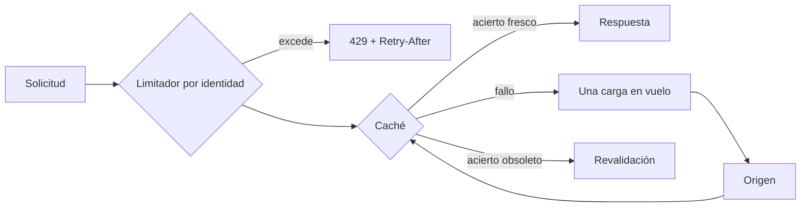
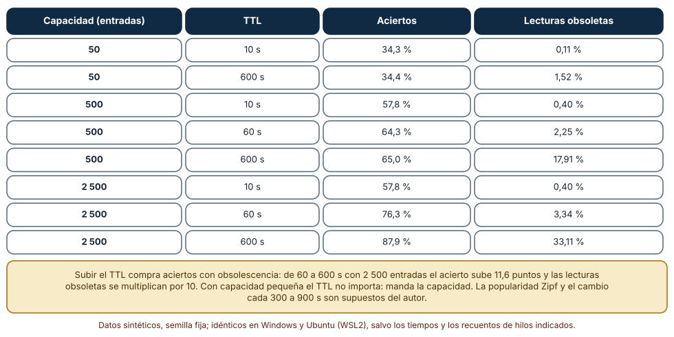
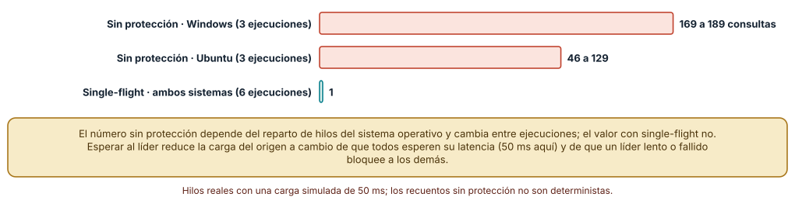
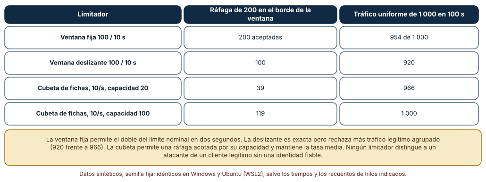

# SE-249 — Caching, rate limiting y protección

[← SE-248 — Archivos, streaming y cargas extensas](https://github.com/vladimiracunadev-create/modern-software-engineering-program/blob/main/classes/part-20-backend-apis-y-procesamiento-asincrono/se-248-archivos-streaming-y-cargas-extensas/README.md) · [↑ Parte 20](https://github.com/vladimiracunadev-create/modern-software-engineering-program/blob/main/classes/part-20-backend-apis-y-procesamiento-asincrono/README.md) · [📚 Índice completo](https://github.com/vladimiracunadev-create/modern-software-engineering-program/blob/main/classes/README.md) · [🌐 Portal](https://vladimiracunadev-create.github.io/modern-software-engineering-program/classes/SE-249.html) · [SE-250 — Health, readiness y shutdown ordenado →](https://github.com/vladimiracunadev-create/modern-software-engineering-program/blob/main/classes/part-20-backend-apis-y-procesamiento-asincrono/se-250-health-readiness-y-shutdown-ordenado/README.md)

## Punto profesional y fundamento pedagógico

**Punto profesional.** La clase existe para que decidas qué se guarda en caché y por cuánto tiempo, midas qué compras en aciertos y qué pagas en lecturas obsoletas, evites que una clave caliente que expira haga caer el origen y elijas un limitador de tasa sabiendo qué deja pasar en el borde de su ventana. Proteger el servicio es aceptar menos para poder responder bien.

**Por qué aparece aquí.** Se sitúa después de **Archivos, streaming y cargas extensas** y antes de **Health, readiness y shutdown ordenado**: `SE-248` limitó lo que puede entrar por archivo; esta clase limita cuánto y con qué frecuencia. La caché y el limitador son la primera defensa de capacidad que combina con la cola de `SE-247` y con los sondeos de `SE-250`, y el taller de `SE-251` reutilizará sus límites como parte de la reparación.

**Error conceptual que debe corregir.** Creer que una caché con TTL largo es «solo más rápida» y que un límite de «100 por 10 segundos» permite exactamente 100 por 10 segundos. El TTL largo sirve datos obsoletos; la ventana fija permite el doble del límite en dos segundos; y una clave que expira con cientos de lectores simultáneos los manda todos al origen.

**Secuencia de aprendizaje.** Antes de simular, predices cuántas solicitudes aceptará un limitador de ventana fija de 100 por 10 segundos ante 200 solicitudes agrupadas alrededor del cambio de ventana; después mides aciertos y lecturas obsoletas de una caché LRU con nueve combinaciones de capacidad y tiempo de vida, y cuentas cuántas consultas llegan al origen cuando 200 hilos piden la misma clave caducada. La secuencia usa predicción, explicación propia, contraste y recuperación. [ICAP](https://icap.education.asu.edu/research) distingue participación de construcción de conocimiento; [How People Learn II](https://nap.nationalacademies.org/catalog/24783/how-people-learn-ii-learners-contexts-and-cultures) exige conectar conocimiento previo, contexto y transferencia; la [práctica de recuperación](https://pubmed.ncbi.nlm.nih.gov/16507066/) respalda producir de nuevo la explicación tras una demora; y [Education for Life and Work](https://nap.nationalacademies.org/resource/13398/dbasse_084153.pdf) exige devolución que explique la causa del error.

**Evidencia de aprendizaje.** `protection-log.md` con la predicción, la tabla de aciertos y obsolescencia, las consultas al origen con y sin protección contra estampida, la comparación de cuatro limitadores en una ráfaga en el borde y con tráfico uniforme, y una nota de qué medición cambiaría el TTL o el límite.

**Límite de la conclusión.** La popularidad Zipf, la frecuencia de cambio de las entregas (300 a 900 s) y los límites de 100 por 10 s son supuestos del autor. La estampida usó hilos reales y un origen simulado de 50 ms; el recuento sin protección cambia entre ejecuciones y sistemas. Ningún limitador distingue a un atacante de un cliente legítimo sin una identidad fiable.

### Trazabilidad fuente → afirmación

| Fuente primaria u oficial | Afirmación que respalda | Lo que no prueba |
|---|---|---|
| [HTTP Caching (RFC 9111)](https://www.rfc-editor.org/rfc/rfc9111) | Describe la frescura de una respuesta, el almacenamiento compartido y privado, y la revalidación condicional. | No elige el TTL de ningún recurso de la plataforma. |
| [Google SRE Book: Handling Overload](https://sre.google/sre-book/handling-overload/) | Explica la limitación de tasa y la degradación elegante como defensas de un servicio sobrecargado. | No define los valores de tasa que corresponden a cada cliente. |
| RateLimit header fields for HTTP (borrador del IETF httpapi) | Propone campos de cabecera para informar al cliente del límite, lo restante y cuándo se reinicia. | Es un borrador: no obliga a ningún servidor a implementarlo igual. |

## Antes de empezar

Recupera `SE-248`: los archivos se procesan por trozos con límites. La pregunta activa es: **¿qué respuesta puede reutilizarse sin engañar al lector, qué ocurre cuando muchas solicitudes piden lo mismo a la vez y cuántas solicitudes aceptamos de cada cliente?**

## Prerrequisitos

- Haber completado `SE-248` o poder explicar qué evidencia entregó y qué quedó abierto.
- Python 3.11 o posterior; los experimentos usan `collections.OrderedDict`, `threading`, `random` y `time`.
- Haber clasificado en `SE-242` qué respuestas son cacheables.
- Saber leer una tabla con porcentajes de aciertos.

## Problema auténtico

Al cierre del plazo, el panel docente consulta el estado de las mismas entregas cada pocos segundos. La base de datos se satura. El equipo añade una caché de 10 minutos y los docentes ven notas desactualizadas; la baja a 10 segundos y la carga vuelve. En otro momento, un script de un integrador manda 200 solicitudes por segundo a la API y bloquea al resto; el limitador de «100 por 10 segundos» lo deja pasar 200 justo al cambio de ventana. Y cuando expira la clave del resumen del curso, 200 lectores la piden a la vez y el origen recibe 200 consultas.

## Objetivos observables

Al terminar podrás:

1. medir aciertos y lecturas obsoletas de una caché según capacidad y tiempo de vida y elegir un punto razonable;
2. reproducir una estampida de caché y reducirla a una consulta con una única carga en vuelo;
3. comparar ventana fija, ventana deslizante y cubeta de fichas ante una ráfaga en el borde y ante tráfico uniforme;
4. declarar qué se cachea, dónde, por cuánto y cómo se invalida, y qué límite se aplica a cada identidad;
5. comunicar los límites al cliente con 429 y `Retry-After` y registrar los rechazos.

## Mapa conceptual



El mapa se lee de la solicitud a la respuesta: primero el limitador decide si se atiende a esta identidad; después la caché decide si hay una respuesta fresca; si no, una sola carga en vuelo consulta el origen y todos los lectores esperan su resultado. El acierto obsoleto abre la revalidación. No es un orden obligatorio: algunas respuestas privadas se cachean después de identificar.

## Temas y por qué importan

| Tema | Por qué cambia una decisión profesional | Evidencia mínima |
|---|---|---|
| Caché y frescura | Cada respuesta guardada compra velocidad con el riesgo de servir un dato que ya cambió. | Tabla de aciertos y obsolescencia en nueve configuraciones |
| Capacidad y política de expulsión | Con poco espacio manda la capacidad, no el TTL. | Aciertos con 50, 500 y 2 500 entradas |
| Estampida de caché | Una clave caliente que expira manda a todos los lectores al origen a la vez. | Consultas al origen con y sin protección |
| Limitadores de tasa | Cada algoritmo deja pasar un patrón distinto en el borde y bajo ráfagas legítimas. | Aceptadas en una ráfaga y con tráfico uniforme |
| Comunicar el límite | Un 429 sin información invita al reintento ciego; con `Retry-After` lo ordena. | Contrato de 429 y cabeceras en `protection-log.md` |

## Conceptos y decisiones

### 1. Caché y frescura

Una caché guarda la respuesta a una solicitud para reutilizarla. Es **fresca** mientras no supere su tiempo de vida (TTL) y **obsoleta** después; una respuesta obsoleta puede revalidarse con una solicitud condicional (`SE-242`). La decisión de cuánto cachear equilibra tres cosas: aciertos (carga que se evita), obsolescencia (datos que el lector ve desactualizados) y la regla de invalidación. Las respuestas privadas (una nota) no deben ir a una caché compartida; las públicas (el enunciado de una tarea) sí.

### 2. Capacidad y política de expulsión

La caché tiene espacio finito y expulsa entradas (por ejemplo, la usada hace más tiempo: LRU). Si la popularidad de las claves está muy concentrada (pocas entregas muy consultadas), unas pocas entradas dan muchos aciertos; si es plana, hace falta mucho espacio. En la simulación con 5 000 claves y popularidad Zipf, 50 entradas dan 34 % de aciertos con cualquier TTL, 500 dan entre 58 y 65 % y 2 500 llegan a 88 % con TTL largo. Aumentar el TTL con poca capacidad no compra aciertos.

### 3. Estampida de caché

Cuando una clave muy pedida expira, los lectores simultáneos encuentran el hueco a la vez y cada uno consulta el origen. El remedio habitual es la **única carga en vuelo** (single-flight): el primero que encuentra el hueco carga y los demás esperan su resultado. Variantes: renovar antes de expirar con una probabilidad creciente, o servir el valor obsoleto mientras se renueva. Cada remedio acepta un costo: esperar a un líder lento, o servir un dato algo viejo.

### 4. Limitadores de tasa

Un **limitador de ventana fija** cuenta solicitudes por intervalos alineados al reloj: simple, pero permite el doble del límite si la ráfaga cae a ambos lados del cambio de ventana. La **ventana deslizante** cuenta las últimas N segundos: exacta, con más memoria y más rechazos de tráfico legítimo agrupado. La **cubeta de fichas** acumula fichas a ritmo constante hasta una capacidad: permite ráfagas acotadas y mantiene la tasa media. La elección depende de si importa más el máximo instantáneo o la tasa sostenida.

### 5. Comunicar el límite

Un rechazo por tasa se responde con **429** y, si es posible, `Retry-After` (cuánto esperar) y cabeceras con el límite y lo restante. El cliente que respeta esa información reintenta con retroceso (`SE-246`). Los rechazos se registran por identidad para distinguir un cliente defectuoso de un ataque. El límite se aplica por identidad autenticada (`SE-245`) y por origen cuando no hay identidad; contar solo por dirección castiga a quienes comparten una red.

### Aciertos y lecturas obsoletas según capacidad y TTL

Se generan 200 000 lecturas (100 por segundo) de 5 000 entregas con popularidad Zipf de exponente 1,0 (semilla 249); cada entrega cambia cada 300 a 900 s. Una caché LRU con capacidad de 50, 500 o 2 500 entradas y TTL de 10, 60 o 600 s cuenta aciertos y lecturas obsoletas (un acierto cuya versión ya cambió).

Con 50 entradas el acierto es de **34,3–34,4 %** con cualquier TTL (obsoletas: 0,11 % a 10 s y 1,52 % a 600 s). Con 500 entradas: **57,8 %** a 10 s (0,40 % obsoletas), **64,3 %** a 60 s (2,25 %) y **65,0 %** a 600 s (**17,91 %**). Con 2 500 entradas: **57,8 %** a 10 s, **76,3 %** a 60 s (3,34 %) y **87,9 %** a 600 s, con **33,11 %** de lecturas obsoletas. Pasar de 60 a 600 s con 2 500 entradas suma 11,6 puntos de acierto y multiplica por diez las obsoletas.



**Cómo leer la figura.** Cada fila es una configuración; los aciertos son la carga que se evita y las obsoletas el precio que se paga en frescura. **Dónde deja de valer:** la popularidad Zipf y el cambio de cada entrega son supuestos; si los datos cambian al azar o hay invalidación explícita, la obsolescencia es otra. Tampoco modela el costo de expulsar ni el tamaño de cada entrada.

### Estampida de caché con y sin una sola carga en vuelo

Doscientos hilos reales piden a la vez una clave que acaba de expirar; la carga al origen tarda 50 ms (simulada con `sleep`). Sin protección, cada hilo que encuentra el hueco carga; con una única carga en vuelo, un líder carga y los demás esperan un evento. Se repite tres veces por sistema.

Sin protección, el origen recibió **169, 169 y 189** consultas en Windows y **46, 118 y 129** en Ubuntu; con una carga en vuelo, **1** en las seis ejecuciones. La diferencia entre sistemas y ejecuciones no es un error: depende de cómo el planificador reparte los 200 hilos mientras el primero carga.

```python
with lock:
    ev = vuelo.get("k"); lider = ev is None
    if lider: ev = vuelo["k"] = threading.Event()
if lider: cache["k"] = carga(); ev.set()
else:     ev.wait()
```



**Cómo leer la figura.** Cada barra muestra el máximo de consultas al origen observado en tres ejecuciones; la etiqueta da el intervalo. **Dónde deja de valer:** el recuento sin protección no es determinista y no predice la carga de un sistema real. Con una carga en vuelo, un líder lento o fallido bloquea a los demás: hace falta un tiempo máximo de espera y una política para el fallo del líder.

### Cuatro limitadores ante una ráfaga en el borde y ante tráfico uniforme

El límite nominal es de 100 solicitudes por 10 s. Se envían 200 solicitudes agrupadas entre t = 9 y t = 11 (100 antes y 100 después del cambio de la ventana de 10 s), y por separado 1 000 solicitudes uniformes en 100 s (semilla 249). Se comparan ventana fija, ventana deslizante y cubeta de fichas de 10 por segundo con capacidad 20 y con capacidad 100.

Ante la ráfaga, la ventana fija acepta **200** (el doble del nominal en dos segundos); la deslizante, **100**; la cubeta de capacidad 20, **39**; la de capacidad 100, **119**. Con tráfico uniforme (10 por segundo en media) aceptan **954**, **920**, **966** y **1 000** de 1 000.



**Cómo leer la figura.** Cada fila es un limitador; la columna central mide el peor caso de borde y la derecha cuánto tráfico legítimo rechaza. **Dónde deja de valer:** el tráfico uniforme aleatorio es un modelo simple; los clientes reales envían en ráfagas periódicas. Ningún limitador distingue a un atacante de un cliente legítimo sin identidad, y un limitador por dirección castiga a quienes comparten una red.

## Definiciones de trabajo

- **TTL:** tiempo durante el cual una respuesta guardada se considera fresca.
- **lectura obsoleta:** lectura de una caché cuyo dato ya cambió en el origen.
- **single-flight:** mecanismo por el que, ante varios fallos de la misma clave, solo uno carga y los demás esperan.
- **cubeta de fichas:** limitador que acumula fichas a ritmo constante y consume una por solicitud, con una capacidad máxima.
- **429:** código de estado que indica que el cliente superó su tasa permitida.

Las definiciones son operativas para la plataforma de entregas. No convierten términos con una historia técnica más amplia en sinónimos y deben contrastarse con la documentación primaria enlazada al final.

## Ejemplo mínimo

El fragmento implementa una ventana fija. Antes de ejecutarlo, predice cuántas de las cuatro solicitudes acepta.

```python
def fija(ts, limite, ventana):
    cuenta, ok = {}, 0
    for t in ts:
        w = int(t // ventana)
        if cuenta.get(w, 0) < limite:
            cuenta[w] = cuenta.get(w, 0) + 1; ok += 1
    return ok
print(fija([9.8, 9.9, 10.0, 10.1], 2, 10))
```

Resultado: 4. Las dos primeras caen en la ventana 0 y las dos siguientes en la ventana 1, y cada una admite 2. Registra versión y salida; cambia el límite a 1 y predice el resultado.

## Ejemplo profesional

La plataforma cachea el enunciado de la tarea durante una hora con validador, el estado de una entrega en la caché privada durante 10 s con revalidación y no cachea las notas. La clave del resumen del curso se renueva con una única carga en vuelo y servirá el valor obsoleto hasta 5 s mientras se renueva. Cada identidad tiene una cubeta de 10 solicitudes por segundo con capacidad 20; el exceso recibe 429 con `Retry-After`. Compara con el original en tres casos: cierre de plazo, expiración de una clave caliente y un script mal configurado.

## Práctica guiada

1. Lista lo que la plataforma puede y no puede cachear y dónde (compartida, privada).
2. Predice los aciertos de una caché de 500 entradas con TTL de 60 s y anótalos.
3. Simula las nueve configuraciones de capacidad y TTL y compara con tu predicción.
4. Reproduce la estampida con 200 hilos y mide las consultas al origen; añade la carga única.
5. Implementa los cuatro limitadores y mide la ráfaga en el borde y el tráfico uniforme.
6. Define el contrato del 429 y las cabeceras.
7. Entrega `protection-log.md` y pide a otra persona que elija un TTL para el estado de una entrega.

## Ejercicios

1. **TTL:** elige el TTL del estado de una entrega si se tolera como mucho 1 % de lecturas obsoletas y justifica con la tabla.
2. **Estampida:** añade a la carga única un tiempo máximo de espera de 100 ms y decide qué devuelven los lectores que lo superan.
3. **Limitador:** calcula la ráfaga máxima que permite una cubeta de 10 por segundo con capacidad 20 durante 2 s y compárala con la medición.
4. **Invalidación:** diseña la invalidación de la caché del estado de una entrega cuando cambia la nota.

## Reto verificable

Entrega `protection-log.md` con la tabla de aciertos y obsolescencia, la estampida con y sin protección, los cuatro limitadores y el contrato del 429. Se aprueba si otra persona obtiene las mismas cifras deterministas desde un checkout limpio y puede decir qué TTL y qué límite cambiaría ante datos que cambian más a menudo. No se aprueba por tener una caché: debe medirse su obsolescencia.

## Caso conductor

La plataforma de entregas acota su carga con caché y límites por identidad. Recupera `SE-245`: el límite se aplica por sujeto verificado. La clase siguiente pregunta cómo se observa y se apaga el servicio. Cambia después una sola decisión, el TTL del estado de una entrega de 10 a 60 s, y revisa qué artefactos hay que tocar.

## Preguntas frecuentes

### ¿Cachear no es siempre bueno?

No. Cachear respuestas privadas en una caché compartida filtra datos, y un TTL largo en datos que cambian sirve información falsa. La caché es una decisión de contrato, no una optimización silenciosa.

### ¿Por qué no uso solo una ventana fija?

Porque permite hasta el doble del límite en el cambio de ventana. Si el límite protege un recurso frágil, el doble puede bastar para tumbarlo; una cubeta o una ventana deslizante acotan el máximo.

### ¿El limitador debe contar por dirección IP?

Solo cuando no hay identidad. Detrás de una red compartida (una escuela) muchas personas comparten la dirección y el límite las castiga a todas; por identidad autenticada es más justo.

### ¿Qué hago con la estampida si el origen es muy lento?

Servir el valor obsoleto mientras se renueva en segundo plano evita que los lectores esperen; a cambio, aceptas un dato algo viejo durante la renovación.

## Fallo controlado y diagnóstico

Reproduce el fallo de la clase: **una estampida cuando expira una clave caliente**. Ejecuta 200 hilos contra una clave vacía sin protección. **Síntoma:** el origen registra entre 46 y 189 consultas idénticas en medio segundo. **Hipótesis rivales:** (a) la caché no funciona; (b) todos encontraron el hueco a la vez. **Prueba:** registra el instante de cada consulta y comprueba que las consultas se solapan con la carga de la primera. **Causa:** cada lector que encuentra el hueco carga por su cuenta. **Corrección:** una sola carga en vuelo con tiempo máximo de espera. **Regresión:** una prueba con 200 hilos que exige una consulta al origen.

## Errores comunes y cómo corregirlos

| Síntoma | Causa probable | Corrección |
|---|---|---|
| Los docentes ven notas viejas | TTL largo en datos que cambian | TTL corto o invalidación al cambiar; revalidación condicional |
| La caché no mejora la carga | Capacidad menor que la popularidad concentrada | Medir aciertos y dimensionar la capacidad |
| El origen cae cuando expira una clave | Estampida de lectores | Una carga en vuelo y servir obsoleto mientras se renueva |
| El límite permite el doble en el cambio de ventana | Ventana fija | Cubeta de fichas o ventana deslizante |
| Una escuela entera recibe 429 | Límite por dirección compartida | Límite por identidad autenticada |

## Entorno y archivos clave

```text
work/SE-249/
├── README.md
├── proteccion/
│   ├── cache.py
│   ├── estampida.py
│   └── limitadores.py
├── tests/test_limitadores.py
└── evidence/protection-log.md
```

El `README` declara plataforma, versión de Python, semilla (249) y comandos. Los experimentos usan `collections.OrderedDict`, `threading`, `random` y `time`; las salidas deterministas fueron idénticas en CPython 3.12.9 (Windows 11) y 3.12.3 (Ubuntu bajo WSL2); el recuento sin protección de la estampida cambia entre ejecuciones y sistemas.

## Seguridad, ética y accesibilidad

- no guardes respuestas privadas en cachés compartidas; revisa `Cache-Control: private`;
- la clave de caché debe incluir todo lo que varía la respuesta (identidad, idioma) para no servir datos de otra persona;
- un limitador es una defensa de disponibilidad, no de autenticación;
- registra los rechazos sin guardar datos personales y revisa si un patrón apunta a un ataque o a un cliente defectuoso;
- ofrece a quienes integran la documentación de los límites en un formato accesible.

## Puente hacia el trabajo con agentes

Un agente al que se le pide «añade caché y rate limiting» suele escoger un TTL largo y una ventana fija sin medir. Pídele la tabla de aciertos y obsolescencia, el efecto de la estampida y la ráfaga en el borde del limitador elegido. Revisa especialmente si cacheó una respuesta que depende de la identidad sin incluirla en la clave: es un error de seguridad que no falla ninguna prueba funcional.

## Transferencia

Traslada el experimento a otro de los dominios persistentes (por ejemplo, un catálogo con ofertas): cambia las claves y la frecuencia de cambio y conserva el procedimiento de medir aciertos, reproducir la estampida y probar el borde del limitador. La transferencia está lograda cuando explicas qué parte dependía de la popularidad Zipf y cuál es el método.

## Evaluación y evidencia

| Criterio | Evidencia para aprobar |
|---|---|
| comprensión | explicación de frescura, obsolescencia, estampida y ventanas con un ejemplo de la plataforma |
| corrección | tablas y recuentos deterministas reproducibles con las mismas semillas |
| diseño | política de caché y límites por recurso e identidad justificada |
| diagnóstico | reproducción de la estampida con hipótesis, prueba y regresión |
| incertidumbre | declaración de los supuestos de popularidad y de cambio |
| reproducibilidad | versiones, comandos, salida y límites declarados |

## Fuentes

- [HTTP Caching (RFC 9111)](https://www.rfc-editor.org/rfc/rfc9111) — frescura, almacenes de caché y revalidación; autoridad: IETF.
- [Google SRE Book: Handling Overload](https://sre.google/sre-book/handling-overload/) — limitación de tasa y degradación; autoridad: Google.
- RateLimit header fields for HTTP (borrador del IETF httpapi) (enlace no verificado en esta ejecución; búscalo por título) — cabeceras para comunicar el límite; autoridad: IETF.
- Additional HTTP Status Codes (RFC 6585) (enlace no verificado en esta ejecución; búscalo por título) — código 429; autoridad: IETF.
- Vattani et al., «Optimal probabilistic cache stampede prevention» (VLDB, 2015) (enlace no verificado en esta ejecución; búscalo por título) — prevención probabilística de la estampida; autoridad: VLDB Endowment.
- [Dean y Barroso, «The tail at scale» (CACM, 2013)](https://doi.org/10.1145/2408776.2408794) — latencia de cola en servicios compuestos; autoridad: Communications of the ACM.
- [Python: collections](https://docs.python.org/3/library/collections.html) — `OrderedDict` usado como LRU; autoridad: Python Software Foundation.
- [Python: threading](https://docs.python.org/3/library/threading.html) — hilos y eventos del experimento; autoridad: Python Software Foundation.

Cada fuente respalda el mecanismo indicado; ninguna demuestra que las cifras sintéticas de esta clase describan un sistema real. Las fuentes marcadas como no verificadas se citan por título porque no se pudo comprobar su enlace en esta ejecución (sin acceso de red autorizado); se verificaron las demás por haberse comprobado en clases publicadas de otras partes.

## Límites y siguiente paso

Se ejecutaron tres experimentos con datos sintéticos en Windows y Ubuntu (WSL2): dos deterministas e idénticos y uno con hilos reales cuyo recuento cambia. No se midió ningún tráfico real ni cliente: la popularidad, los cambios y las ráfagas son construcciones del autor. La siguiente clase pregunta cómo se sabe que el servicio está vivo, listo y cómo se apaga sin perder trabajo.

## Glosario

- **LRU:** política que expulsa la entrada usada hace más tiempo.
- **revalidación:** comprobación con el origen de si una respuesta obsoleta sigue siendo válida.
- **clave de caché:** valor que identifica una respuesta guardada e incluye todo lo que la hace variar.
- **ráfaga:** grupo de solicitudes concentradas en un intervalo corto.
- **degradación elegante:** reducción controlada de funciones para mantener lo esencial bajo sobrecarga.

---

[← SE-248 — Archivos, streaming y cargas extensas](https://github.com/vladimiracunadev-create/modern-software-engineering-program/blob/main/classes/part-20-backend-apis-y-procesamiento-asincrono/se-248-archivos-streaming-y-cargas-extensas/README.md) · [↑ Parte 20](https://github.com/vladimiracunadev-create/modern-software-engineering-program/blob/main/classes/part-20-backend-apis-y-procesamiento-asincrono/README.md) · [📚 Índice completo](https://github.com/vladimiracunadev-create/modern-software-engineering-program/blob/main/classes/README.md) · [🌐 Portal](https://vladimiracunadev-create.github.io/modern-software-engineering-program/classes/SE-249.html) · [SE-250 — Health, readiness y shutdown ordenado →](https://github.com/vladimiracunadev-create/modern-software-engineering-program/blob/main/classes/part-20-backend-apis-y-procesamiento-asincrono/se-250-health-readiness-y-shutdown-ordenado/README.md)
