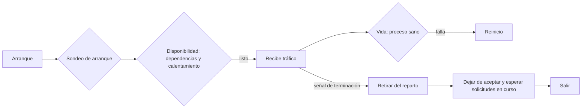
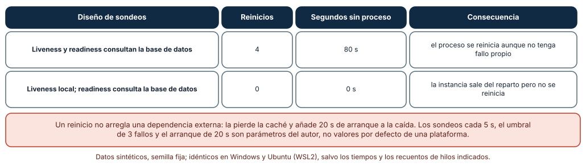
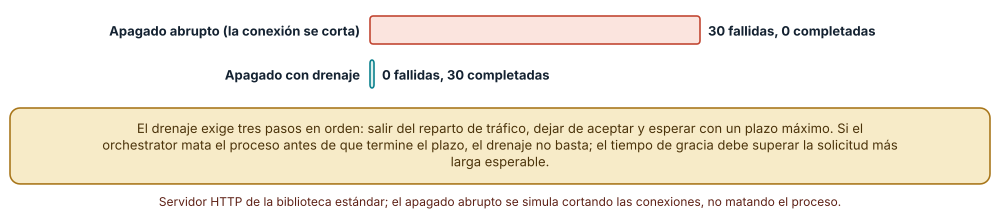
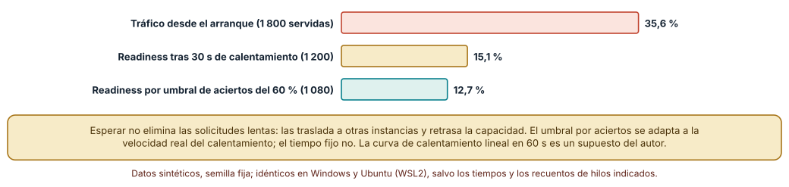

# SE-250 — Health, readiness y shutdown ordenado

[← SE-249 — Caching, rate limiting y protección](https://github.com/vladimiracunadev-create/modern-software-engineering-program/blob/main/classes/part-20-backend-apis-y-procesamiento-asincrono/se-249-caching-rate-limiting-y-proteccion/README.md) · [↑ Parte 20](https://github.com/vladimiracunadev-create/modern-software-engineering-program/blob/main/classes/part-20-backend-apis-y-procesamiento-asincrono/README.md) · [📚 Índice completo](https://github.com/vladimiracunadev-create/modern-software-engineering-program/blob/main/classes/README.md) · [🌐 Portal](https://vladimiracunadev-create.github.io/modern-software-engineering-program/classes/SE-250.html) · [SE-251 — Taller: reparar una API insegura e inconsistente →](https://github.com/vladimiracunadev-create/modern-software-engineering-program/blob/main/classes/part-20-backend-apis-y-procesamiento-asincrono/se-251-taller-reparar-una-api-insegura-e-inconsistente/README.md)

## Punto profesional y fundamento pedagógico

**Punto profesional.** La clase existe para que distingas tres preguntas que un orquestador hace al servicio —¿sigues vivo?, ¿puedes atender?, ¿ya arrancaste?—, diseñes sondeos que no conviertan la caída de una dependencia en un ciclo de reinicios, calientes una instancia antes de darle tráfico y apagues el proceso sin cortar las solicitudes en curso.

**Por qué aparece aquí.** Se sitúa después de **Caching, rate limiting y protección** y antes de **Taller: reparar una API insegura e inconsistente**: `SE-249` limitó la carga que el servicio acepta; esta clase decide cuándo una instancia debe recibirla y cuándo no, y cómo se retira. Reúne lo que las anteriores producen (trabajos en curso de `SE-247`, cachés de `SE-249`, estado consultable de `SE-242`) en un comportamiento operable y prepara el taller de `SE-251` y el proyecto de `SE-252`.

**Error conceptual que debe corregir.** Creer que un único endpoint de salud que consulta todas las dependencias sirve para todo. Si el sondeo de vida depende de la base de datos, una caída de la base de datos reinicia todas las instancias aunque no tengan ningún fallo propio, y el reinicio añade tiempo de arranque a la caída.

**Secuencia de aprendizaje.** Antes de simular, predices cuántos reinicios provoca una caída de 120 s de la base de datos si el sondeo de vida la consulta; después mides con un servidor local real cuántas de 30 solicitudes en curso fallan al apagarlo de golpe y al drenarlo, y por último comparas tres criterios para empezar a enviar tráfico a una instancia con la caché fría. La secuencia usa predicción, explicación propia, contraste y recuperación. [ICAP](https://icap.education.asu.edu/research) distingue participación de construcción de conocimiento; [How People Learn II](https://nap.nationalacademies.org/catalog/24783/how-people-learn-ii-learners-contexts-and-cultures) exige conectar conocimiento previo, contexto y transferencia; la [práctica de recuperación](https://pubmed.ncbi.nlm.nih.gov/16507066/) respalda producir de nuevo la explicación tras una demora; y [Education for Life and Work](https://nap.nationalacademies.org/resource/13398/dbasse_084153.pdf) exige devolución que explique la causa del error.

**Evidencia de aprendizaje.** `ops-log.md` con la predicción, el número de reinicios y de segundos sin proceso en los dos diseños de sondeos, las solicitudes completadas y fallidas con apagado abrupto y con drenaje, el porcentaje de solicitudes lentas con tres criterios de disponibilidad, y el contrato de apagado (señal, plazo y orden).

**Límite de la conclusión.** Los intervalos de sondeo (5 s), el umbral de fallos (3), el arranque de 20 s y la curva lineal de calentamiento en 60 s son parámetros del autor, no valores por defecto de ninguna plataforma. El apagado abrupto se simula cortando conexiones; no se mató un proceso ni se usó un orquestador real. En Windows no se probó la entrega de la señal de terminación.

### Trazabilidad fuente → afirmación

| Fuente primaria u oficial | Afirmación que respalda | Lo que no prueba |
|---|---|---|
| Kubernetes: liveness, readiness and startup probes | Distingue sondeos de vida, de disponibilidad y de arranque, y advierte que consultar dependencias externas en el de vida puede provocar reinicios en cascada. | No fija los intervalos que conviene a la plataforma. |
| Kubernetes: Pod termination | Describe la secuencia de terminación: retirar del reparto, enviar la señal, esperar un plazo de gracia y, si no basta, terminar a la fuerza. | No dice cuánto debe durar el plazo para las solicitudes de la plataforma. |
| [Google SRE Book: Monitoring Distributed Systems](https://sre.google/sre-book/monitoring-distributed-systems/) | Propone medir las señales doradas (latencia, tráfico, errores, saturación) y alertar sobre síntomas visibles al usuario. | No define las alertas concretas de este servicio. |

## Antes de empezar

Recupera `SE-249`: la plataforma acota la carga que acepta. La pregunta activa es: **¿cómo sabe quien orquesta el servicio si esta instancia puede recibir tráfico, si debe reiniciarla y cómo la retira sin cortar una subida a mitad?**

## Prerrequisitos

- Haber completado `SE-249` o poder explicar qué evidencia entregó y qué quedó abierto.
- Python 3.11 o posterior; los experimentos usan `http.server`, `threading`, `urllib` y `random`.
- Saber qué es un orquestador a nivel de «quien arranca, para y reparte tráfico entre instancias».
- Haber definido en `SE-247` los estados de un trabajo y en `SE-249` un tope de solicitudes en curso.

## Problema auténtico

La base de datos de la plataforma tarda dos minutos en recuperarse de un mantenimiento. Las instancias del servicio responden al sondeo de salud con un error porque el sondeo prueba la conexión a la base de datos; el orquestador las reinicia, y cuando la base de datos vuelve, todas las instancias están arrancando a la vez con la caché fría. Más tarde, al desplegar una versión nueva, 30 estudiantes pierden una subida en curso porque el proceso se terminó mientras la atendía.

## Objetivos observables

Al terminar podrás:

1. distinguir vida, disponibilidad y arranque y asignar a cada sondeo lo que puede comprobar;
2. medir los reinicios que causa un sondeo de vida que consulta una dependencia externa y compararlo con uno local;
3. apagar un servidor local con y sin drenaje y contar las solicitudes perdidas;
4. elegir un criterio de disponibilidad para una instancia con caché fría y medir el efecto en las solicitudes lentas;
5. declarar el contrato de apagado: señal, plazo de gracia, orden de pasos y estado de los trabajos.

## Mapa conceptual



El mapa se lee a lo largo de la vida de una instancia: arranque, disponibilidad (con dependencias y calentamiento), vida y, al final, retirada, drenaje y salida. La vida solo comprueba que el proceso no está bloqueado; la disponibilidad decide si recibe tráfico. No son tres versiones del mismo sondeo: responden preguntas distintas y producen acciones distintas.

## Temas y por qué importan

| Tema | Por qué cambia una decisión profesional | Evidencia mínima |
|---|---|---|
| Vida, disponibilidad y arranque | Cada sondeo desencadena una acción diferente: reiniciar, retirar del reparto o esperar. | Tabla sondeo → pregunta → acción en `ops-log.md` |
| Dependencias y cascadas | Un sondeo de vida que consulta una dependencia convierte su caída en una caída del servicio. | Reinicios y segundos sin proceso en dos diseños |
| Calentamiento | Una instancia con caché fría atiende peor que una caliente; el criterio de disponibilidad lo reconoce o lo ignora. | Solicitudes lentas con tres criterios |
| Apagado ordenado | Terminar el proceso corta lo que está haciendo; retirar, dejar de aceptar y esperar no. | Solicitudes completadas con apagado abrupto y con drenaje |
| Observabilidad mínima | Sin correlación y señales básicas, nadie sabe por qué un sondeo falló. | Lista de señales y su origen |

## Conceptos y decisiones

### 1. Vida, disponibilidad y arranque

El sondeo de **vida** responde «¿está el proceso atascado?» y su fallo provoca un **reinicio**: debe depender solo del propio proceso (por ejemplo, que el bucle de eventos responda). El de **disponibilidad** responde «¿puede atender solicitudes ahora?», incluye las dependencias necesarias y su fallo **retira** la instancia del reparto sin reiniciarla. El de **arranque** da tiempo a una instancia lenta de iniciarse sin que el de vida la mate. Confundirlos produce tanto reinicios innecesarios como instancias rotas que siguen recibiendo tráfico.

### 2. Dependencias y cascadas

Si el sondeo de vida consulta la base de datos y esta cae durante 120 s, cada instancia falla tres sondeos seguidos y se reinicia; al volver la base de datos, las instancias están arrancando y el servicio sigue caído 20 s más por cada reinicio. El reinicio no arregla una dependencia externa y además pierde cachés y conexiones. La regla: la vida mira hacia dentro, la disponibilidad mira hacia las dependencias, y un fallo de dependencia retira del reparto en vez de reiniciar.

### 3. Calentamiento

Una instancia nueva tiene la caché fría, conexiones sin abrir y código sin compilar; sus primeras solicitudes son más lentas. Hay tres estrategias: recibir tráfico desde el arranque (simple, con solicitudes lentas), esperar un tiempo fijo (predecible, ignora la velocidad real) o declararse lista al alcanzar un umbral de aciertos (adaptable, exige instrumentar). El calentamiento traslada el costo: las otras instancias absorben más tráfico mientras tanto.

### 4. Apagado ordenado

Cuando el orquestador quiere retirar una instancia envía una señal de terminación y espera un plazo de gracia antes de forzar la salida. El servicio debe, en orden: dejar de declararse disponible para que le retiren el tráfico, dejar de aceptar conexiones nuevas, esperar las solicitudes en curso hasta un máximo, interrumpir o devolver a la cola los trabajos largos y salir. Si el plazo de gracia es menor que la solicitud más larga esperable, el drenaje no basta.

### 5. Observabilidad mínima

Cada sondeo fallido debe dejar rastro: qué comprobación falló, desde cuándo y con qué identificador de correlación. Las señales básicas (latencia, tráfico, errores y saturación) permiten decidir si un reinicio ayudó. La información de salud no debe filtrar versiones ni topología al exterior: el endpoint de salud es público para el orquestador, no para cualquiera.

### Un sondeo de vida que consulta la base de datos

Se simulan 600 s con sondeos cada 5 s; la base de datos cae entre los 100 s y los 220 s. Una instancia se reinicia tras 3 sondeos de vida fallidos y tarda 20 s en arrancar. En el primer diseño el sondeo de vida consulta la base de datos; en el segundo es local y solo el de disponibilidad la consulta.

```python
vivo = bd_ok if liveness_depende else True
fallos = 0 if vivo else fallos + 1
if fallos >= 3:
    reinicios += 1; arranque_hasta = t + 20
```

Con la vida dependiente de la base de datos hay **4 reinicios** y **80 s sin proceso**; con la vida local, **0 reinicios** y **0 s**: la instancia sale del reparto mientras la base de datos está caída, pero sigue viva y responde en cuanto vuelve. La salida es idéntica en Windows y Ubuntu.



**Cómo leer la figura.** Cada fila es un diseño de sondeos; los reinicios y los segundos sin proceso son el daño que añade el propio mecanismo de salud. **Dónde deja de valer:** los intervalos y umbrales son parámetros del autor y el modelo trata las instancias como una sola; con varias instancias y un reparto de tráfico el efecto agregado es mayor. Tampoco modela una base de datos que se recupera gradualmente.

### Apagado abrupto o con drenaje en un servidor local real

Se levanta un `ThreadingHTTPServer` cuyo manejador tarda 200 ms (diez pausas de 20 ms) y 30 clientes envían una solicitud a la vez. A los 80 ms se detiene el servidor de dos maneras. **Abrupto:** se activa una bandera que corta las conexiones en curso sin responder (el efecto visto desde el cliente de un proceso que muere). **Con drenaje:** `shutdown()` deja de aceptar conexiones y `server_close()` espera a los hilos en curso.

Con el apagado abrupto, **30 de 30** solicitudes fallan; con drenaje, **30 de 30** se completan. La salida es idéntica en Windows y Ubuntu, pero el apagado abrupto aquí es una simulación: un proceso real terminado por el sistema operativo cierra sus conexiones de formas distintas según el sistema y el momento.



**Cómo leer la figura.** Cada barra cuenta las 30 solicitudes en curso que fallaron al detener el servidor. **Dónde deja de valer:** el drenaje funcionó porque el plazo no limitó la espera; en un orquestador real el plazo de gracia termina y fuerza la salida. No se probó la entrega de señales en Windows ni la integración con un balanceador, que debe retirar la instancia del reparto antes de que empiece el drenaje.

### Cuándo declararse lista con la caché fría

Se simula una instancia nueva cuya tasa de aciertos de caché sube linealmente de 0 a 0,95 en 60 s (semilla 250); una solicitud con fallo de caché tarda 400 ms (más que el objetivo de 250 ms) y 20 solicitudes por segundo llegan durante 90 s. Tres criterios: recibir tráfico desde el arranque, esperar 30 s y declararse lista al llegar a un 60 % de aciertos.

Desde el arranque se sirven 1 800 solicitudes y **640 (35,6 %)** superan el objetivo; con espera de 30 s, 1 200 servidas y **181 (15,1 %)**; con umbral de aciertos del 60 %, 1 080 servidas y **137 (12,7 %)**. Esperar no elimina las solicitudes lentas: las traslada a las otras instancias y retrasa la capacidad.



**Cómo leer la figura.** Cada barra es el porcentaje de solicitudes servidas por la instancia nueva que superan el objetivo de latencia; las servidas se indican en la etiqueta. **Dónde deja de valer:** la curva lineal de calentamiento es un supuesto: las cachés reales se calientan según la popularidad de las claves. El modelo ignora la carga extra sobre las otras instancias, que es el costo real de esperar.

## Definiciones de trabajo

- **sondeo de vida:** comprobación de que el proceso no está bloqueado; su fallo provoca un reinicio.
- **sondeo de disponibilidad:** comprobación de que la instancia puede atender solicitudes; su fallo la retira del reparto.
- **drenaje:** espera controlada a que terminen las solicitudes en curso antes de salir.
- **plazo de gracia:** tiempo que el orquestador concede entre la señal de terminación y la salida forzada.
- **calentamiento:** periodo en que una instancia nueva llena sus cachés y conexiones antes de rendir con normalidad.

Las definiciones son operativas para la plataforma de entregas. No convierten términos con una historia técnica más amplia en sinónimos y deben contrastarse con la documentación primaria enlazada al final.

## Ejemplo mínimo

El fragmento ilustra un servidor que se detiene sin cortar lo que atiende. Antes de ejecutarlo, predice qué imprime.

```python
import threading, time
from http.server import ThreadingHTTPServer, BaseHTTPRequestHandler
class H(BaseHTTPRequestHandler):
    def do_GET(self):
        time.sleep(0.1); self.send_response(200); self.send_header("Content-Length", "0"); self.end_headers()
    def log_message(self, *a): pass
s = ThreadingHTTPServer(("127.0.0.1", 0), H)
threading.Thread(target=s.serve_forever, daemon=True).start()
s.shutdown(); s.server_close(); print("salí sin colgarme")
```

Resultado: imprime la frase tras detener el servidor. Registra versión y salida; cambia `time.sleep(0.1)` por 2 y mide cuánto tarda `server_close()` si hay una solicitud en curso.

## Ejemplo profesional

La plataforma expone tres sondeos: `/salud/viva` (local, sin dependencias, usado para reiniciar), `/salud/lista` (comprueba base de datos, cola y que la caché alcance el 60 % de aciertos, usado para retirar del reparto) y `/salud/arranque` (permite hasta 60 s de inicio). Al recibir la señal de terminación, la instancia se declara no lista, deja de aceptar conexiones, espera hasta 25 s a las solicitudes en curso, devuelve a la cola los trabajos largos y sale con código 0. El plazo de gracia del orquestador es 30 s. Compara con el original en tres casos: mantenimiento de la base de datos, despliegue y subida de un archivo grande en curso.

## Práctica guiada

1. Lista qué comprueba cada sondeo de la plataforma y qué acción provoca su fallo.
2. Predice los reinicios de una caída de 120 s con el sondeo de vida dependiente y escríbelos.
3. Simula los dos diseños de sondeos y compara con tu predicción.
4. Levanta el servidor local y mide solicitudes fallidas con apagado abrupto y con drenaje.
5. Simula tres criterios de disponibilidad con caché fría y mide las lentas.
6. Escribe el contrato de apagado con el plazo y el orden de pasos.
7. Entrega `ops-log.md` y pide a otra persona que identifique la dependencia que no debe estar en el sondeo de vida.

## Ejercicios

1. **Sondeos:** clasifica la conexión a la base de datos, el espacio en disco, la cola de trabajos y la caché según qué sondeo deben afectar y por qué.
2. **Plazo:** si la solicitud más larga dura 25 s y el orquestador espera 30 s, calcula el margen para el drenaje y qué haces con los trabajos más largos.
3. **Calentamiento:** cambia la curva de calentamiento a 120 s y recalcula los tres criterios; decide cuál elegirías.
4. **Señales:** elige cuatro señales para decidir si un reinicio ayudó y dónde se leen.

## Reto verificable

Entrega `ops-log.md` con la tabla de sondeos, la simulación de reinicios, la medición de apagado, la comparación de criterios de disponibilidad y el contrato de apagado. Se aprueba si otra persona obtiene las mismas cifras deterministas desde un checkout limpio y puede decir qué comprobación quitaría del sondeo de vida. No se aprueba por tener un `/health`: debe verse qué acción produce cada sondeo.

## Caso conductor

La plataforma de entregas queda con un comportamiento operable: tres sondeos con propósito distinto, calentamiento declarado y apagado ordenado. Recupera `SE-247`: los trabajos largos vuelven a la cola al apagar. La clase siguiente aplica todo lo aprendido a una API deliberadamente defectuosa. Cambia después una sola decisión, el plazo de gracia de 30 a 10 s, y revisa qué artefactos hay que tocar.

## Preguntas frecuentes

### ¿Por qué no consultar la base de datos en el sondeo de vida?

Porque reiniciar la instancia no repara la base de datos y sí pierde cachés y conexiones; además todas las instancias fallarían a la vez. La base de datos pertenece al sondeo de disponibilidad, que retira sin reiniciar.

### ¿Cuánto debe durar el plazo de gracia?

Más que la solicitud más larga esperable más el tiempo de retirar el tráfico, y menos de lo que tolera el despliegue. Se mide, no se supone.

### ¿Qué hago con un trabajo largo cuando me apagan?

Lo devuelves a la cola con su estado, o lo marcas para reanudar. La entrega al menos una vez de `SE-247` hace seguro repetirlo si el handler es idempotente.

### ¿Es seguro exponer el estado de las dependencias en el endpoint?

No hacia fuera. Para el orquestador basta un código de estado; el detalle va a los registros internos con correlación.

## Fallo controlado y diagnóstico

Reproduce el fallo de la clase: **un sondeo de vida que depende de la base de datos**. Haz que el sondeo `/salud/viva` abra una conexión a la base de datos y apágala 120 s. **Síntoma:** todas las instancias se reinician en minutos y el servicio tarda más en volver que la propia base de datos. **Hipótesis rivales:** (a) las instancias tienen un fallo propio; (b) el sondeo falla por la dependencia. **Prueba:** ejecuta el sondeo a mano contra la instancia con la base de datos caída y contra una con la base de datos sana, y observa el mismo proceso sano con resultados distintos. **Causa:** la vida depende de algo externo. **Corrección:** vida local y disponibilidad con dependencias. **Regresión:** una prueba que apaga la base de datos y exige cero reinicios.

## Errores comunes y cómo corregirlos

| Síntoma | Causa probable | Corrección |
|---|---|---|
| Todas las instancias se reinician cuando cae la base de datos | El sondeo de vida consulta una dependencia externa | Vida local; dependencias en disponibilidad |
| Una instancia recién arrancada responde con errores | Recibe tráfico sin estar lista | Sondeo de disponibilidad y de arranque |
| Estudiantes pierden una subida al desplegar | Terminación sin drenaje | Retirar, dejar de aceptar y esperar con plazo |
| El drenaje no termina nunca | No hay plazo máximo ni trabajos que se devuelvan a la cola | Plazo acotado y devolver los trabajos largos |
| El endpoint de salud revela versiones y hosts | Detalle interno en una respuesta pública | Código de estado simple; detalle en registros internos |

## Entorno y archivos clave

```text
work/SE-250/
├── README.md
├── ops/
│   ├── sondeos.py
│   ├── apagado.py
│   └── calentamiento.py
├── tests/test_apagado.py
└── evidence/ops-log.md
```

El `README` declara plataforma, versión de Python, semilla (250) y comandos. Los experimentos usan `http.server`, `threading`, `urllib` y `random`; las salidas fueron idénticas en CPython 3.12.9 (Windows 11) y 3.12.3 (Ubuntu bajo WSL2). El servidor escucha solo en `127.0.0.1` en un puerto efímero y se cierra al terminar cada prueba. No se usa ningún orquestador real.

## Seguridad, ética y accesibilidad

- el endpoint de salud no debe revelar versiones, nombres de hosts ni estado detallado de las dependencias;
- limita quién puede llamar a los sondeos si el orquestador no es el único que los alcanza;
- al apagar, no registres datos personales de las solicitudes en curso;
- una instancia que no se retira del reparto sigue sirviendo datos con una versión antigua: revisa la política de despliegue;
- documenta el procedimiento de recuperación de forma que lo pueda seguir una persona de guardia sin conocer el código.

## Puente hacia el trabajo con agentes

Un agente al que se le pide «añade un health check» suele escribir un único endpoint que consulta todo y devuelve el detalle. Pídele tres sondeos con la acción de cada uno, la prueba de la caída de la base de datos con cero reinicios y el contrato de apagado con el plazo. Revisa especialmente si la vida consulta una dependencia: es el defecto que causó cuatro reinicios y 80 s sin proceso.

## Transferencia

Traslada el experimento a otro de los dominios persistentes (por ejemplo, un servicio de pagos ficticio): cambia las dependencias y conserva el procedimiento de separar los sondeos, medir el drenaje y elegir el criterio de calentamiento. La transferencia está lograda cuando explicas qué dependía de la plataforma de entregas y cuál es el patrón de los tres sondeos.

## Evaluación y evidencia

| Criterio | Evidencia para aprobar |
|---|---|
| comprensión | explicación de vida, disponibilidad y arranque con la acción de cada uno |
| corrección | reinicios, solicitudes perdidas y porcentajes reproducibles |
| diseño | sondeos, calentamiento y contrato de apagado justificados |
| diagnóstico | reproducción de la cascada de reinicios con hipótesis, prueba y regresión |
| incertidumbre | declaración de los supuestos de intervalos, plazos y calentamiento |
| reproducibilidad | versiones, comandos, salida y límites declarados |

## Fuentes

- Kubernetes: liveness, readiness and startup probes (enlace no verificado en esta ejecución; búscalo por título) — sondeos de vida, disponibilidad y arranque; autoridad: Kubernetes.
- Kubernetes: Pod termination (enlace no verificado en esta ejecución; búscalo por título) — secuencia de terminación y plazo de gracia; autoridad: Kubernetes.
- The Twelve-Factor App: Disposability (enlace no verificado en esta ejecución; búscalo por título) — procesos desechables y apagado ordenado; autoridad: Heroku / 12factor.net.
- [Google SRE Book: Monitoring Distributed Systems](https://sre.google/sre-book/monitoring-distributed-systems/) — señales de monitorización; autoridad: Google.
- [Python: http.server](https://docs.python.org/3/library/http.server.html) — servidor local del experimento; autoridad: Python Software Foundation.
- [Python: threading](https://docs.python.org/3/library/threading.html) — hilos y su espera al cerrar; autoridad: Python Software Foundation.
- [Python: signal](https://docs.python.org/3/library/signal.html) — señales del sistema en Python; autoridad: Python Software Foundation.
- [W3C Trace Context](https://www.w3.org/TR/trace-context/) — propagación de la correlación entre servicios; autoridad: W3C.

Cada fuente respalda el mecanismo indicado; ninguna demuestra que las cifras sintéticas de esta clase describan un sistema real. Las fuentes marcadas como no verificadas se citan por título porque no se pudo comprobar su enlace en esta ejecución (sin acceso de red autorizado); se verificaron las demás por haberse comprobado en clases publicadas de otras partes.

## Límites y siguiente paso

Se ejecutaron tres experimentos con datos sintéticos en Windows y Ubuntu (WSL2) con resultados idénticos; el apagado abrupto es simulado. No se usó un orquestador real ni se midió ningún servicio o persona: los intervalos, plazos y curvas son construcciones del autor. La siguiente clase aplica todo el recorrido a una API defectuosa.

## Glosario

- **orquestador:** sistema que arranca, para y reparte tráfico entre instancias de un servicio.
- **señal de terminación:** aviso del sistema operativo a un proceso para que termine de forma ordenada.
- **retirar del reparto:** dejar de enviar tráfico a una instancia sin detenerla.
- **sondeo de arranque:** comprobación que da tiempo a una instancia lenta a iniciarse sin que se la considere muerta.
- **cascada de reinicios:** efecto por el que el fallo de una dependencia provoca reinicios de todas las instancias.

---

[← SE-249 — Caching, rate limiting y protección](https://github.com/vladimiracunadev-create/modern-software-engineering-program/blob/main/classes/part-20-backend-apis-y-procesamiento-asincrono/se-249-caching-rate-limiting-y-proteccion/README.md) · [↑ Parte 20](https://github.com/vladimiracunadev-create/modern-software-engineering-program/blob/main/classes/part-20-backend-apis-y-procesamiento-asincrono/README.md) · [📚 Índice completo](https://github.com/vladimiracunadev-create/modern-software-engineering-program/blob/main/classes/README.md) · [🌐 Portal](https://vladimiracunadev-create.github.io/modern-software-engineering-program/classes/SE-250.html) · [SE-251 — Taller: reparar una API insegura e inconsistente →](https://github.com/vladimiracunadev-create/modern-software-engineering-program/blob/main/classes/part-20-backend-apis-y-procesamiento-asincrono/se-251-taller-reparar-una-api-insegura-e-inconsistente/README.md)
