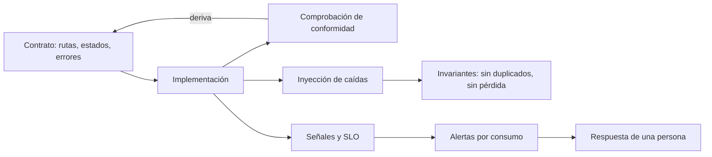
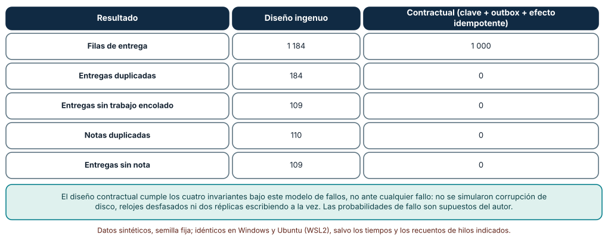
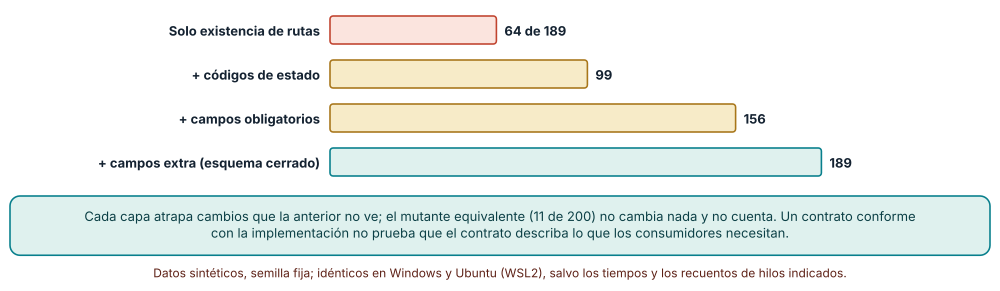

# SE-252 — Proyecto: servicio contractual operable

[← SE-251 — Taller: reparar una API insegura e inconsistente](https://github.com/vladimiracunadev-create/modern-software-engineering-program/blob/main/classes/part-20-backend-apis-y-procesamiento-asincrono/se-251-taller-reparar-una-api-insegura-e-inconsistente/README.md) · [↑ Parte 20](https://github.com/vladimiracunadev-create/modern-software-engineering-program/blob/main/classes/part-20-backend-apis-y-procesamiento-asincrono/README.md) · [📚 Índice completo](https://github.com/vladimiracunadev-create/modern-software-engineering-program/blob/main/classes/README.md) · [🌐 Portal](https://vladimiracunadev-create.github.io/modern-software-engineering-program/classes/SE-252.html) · [SE-253 — Modelos de aplicación móvil y de escritorio →](https://github.com/vladimiracunadev-create/modern-software-engineering-program/blob/main/classes/part-21-software-movil-escritorio-y-multiplataforma/se-253-modelos-de-aplicacion-movil-y-de-escritorio/README.md)

## Punto profesional y fundamento pedagógico

**Punto profesional.** El proyecto existe para que entregues un servicio pequeño pero completo cuyo contrato se pueda comprobar y cuyo comportamiento ante fallos se pueda demostrar: alta con clave de idempotencia, trabajo diferido con outbox, errores con forma única, política de acceso, límites y sondeos. La evidencia no es que funcione, sino cuántas caídas inyectadas sobrevive sin violar sus invariantes y qué alertas dispararía.

**Por qué aparece aquí.** Se sitúa después de **Taller: reparar una API insegura e inconsistente** y antes de **Modelos de aplicación móvil y de escritorio**: `SE-251` reparó una API existente; este proyecto integra en un servicio nuevo los mecanismos de `SE-241` a `SE-250` y declara cuánto de lo que promete se ha comprobado. Es el cierre de la Parte 20 y la base operativa que la Parte 21 supone cuando lleva el producto a móviles y escritorio.

**Error conceptual que debe corregir.** Creer que un servicio es «contractual» porque tiene un archivo OpenAPI, y «operable» porque tiene un endpoint de salud. El contrato solo vale si una comprobación detecta que la implementación se aparta de él, y la operabilidad solo vale si hay alertas que salten a tiempo ante los incidentes que importan.

**Secuencia de aprendizaje.** Antes de ejecutar, predices cuántas entregas duplicadas, sin trabajo o sin nota quedan en un servicio ingenuo y en uno contractual tras 1 000 entregas con caídas inyectadas; después calculas cuándo saltarían las alertas de consumo del presupuesto de error en tres incidentes y mides qué capas de comprobación detectan 189 mutaciones de una implementación frente a su contrato. La secuencia usa predicción, explicación propia, contraste y recuperación. [ICAP](https://icap.education.asu.edu/research) distingue participación de construcción de conocimiento; [How People Learn II](https://nap.nationalacademies.org/catalog/24783/how-people-learn-ii-learners-contexts-and-cultures) exige conectar conocimiento previo, contexto y transferencia; la [práctica de recuperación](https://pubmed.ncbi.nlm.nih.gov/16507066/) respalda producir de nuevo la explicación tras una demora; y [Education for Life and Work](https://nap.nationalacademies.org/resource/13398/dbasse_084153.pdf) exige devolución que explique la causa del error.

**Evidencia de aprendizaje.** `service-log.md` con la predicción, la tabla de invariantes tras la inyección de caídas en dos diseños, el cálculo de alertas por incidente, la tabla de detección de deriva por capa, el contrato (rutas, estados, errores, reintentos, límites, sondeos) y la lista de lo que el servicio no promete.

**Límite de la conclusión.** El servicio y las caídas inyectadas son un modelo en proceso con SQLite en memoria: no hay red, procesos separados ni corrupción de disco, y las probabilidades de fallo (8 %, 8 %, 10 %) son supuestos. El SLO, los umbrales de alerta y los incidentes son sintéticos. Que 189 de 189 mutaciones se detecten vale para ese catálogo. Nadie fue evaluado.

### Trazabilidad fuente → afirmación

| Fuente primaria u oficial | Afirmación que respalda | Lo que no prueba |
|---|---|---|
| [Google SRE Book: Service Level Objectives](https://sre.google/sre-book/service-level-objectives/) | Define indicadores, objetivos y presupuesto de error como base para decidir qué fallos importan y cuándo alertar. | No fija el objetivo de la plataforma de entregas. |
| [OpenAPI Specification](https://spec.openapis.org/oas/latest.html) | Describe un contrato de API legible por personas y máquinas, con rutas, métodos, esquemas y respuestas. | No garantiza que la implementación lo cumpla: eso exige una comprobación. |
| Microservices.io: Transactional outbox | Describe la fila transaccional para publicar eventos de forma fiable junto a un cambio de estado. | No elimina los duplicados: entrega al menos una vez. |

## Antes de empezar

Recupera `SE-251`: la API defectuosa se reparó con pruebas que detectan cada defecto reintroducido. La pregunta activa es: **¿qué promete este servicio, cómo demuestro que lo cumple aun cuando algo cae y cómo me entero a tiempo de que dejó de cumplirlo?**

## Prerrequisitos

- Haber completado `SE-251` o poder explicar qué evidencia entregó y qué quedó abierto.
- Haber completado la Parte 20 hasta `SE-251` o poder explicar qué mecanismo aporta cada clase.
- Python 3.11 o posterior; el servicio usa `sqlite3`, `random` y `json`.
- Saber qué es un objetivo de nivel de servicio (SLO) a nivel de «porcentaje de solicitudes buenas en una ventana».

## Problema auténtico

El equipo debe entregar el servicio que recibe entregas, las califica en segundo plano y las publica. El responsable pide «un servicio que no pierda ni duplique entregas, con un contrato que otra persona pueda comprobar y con alertas que salten antes de que los docentes llamen». Ningún componente falla aislado: las caídas ocurren entre pasos, las respuestas se pierden y los trabajos se entregan dos veces.

## Objetivos observables

Al terminar podrás:

1. integrar clave de idempotencia, outbox y efecto idempotente y medir con inyección de caídas cuatro invariantes del servicio;
2. definir un SLO, calcular el presupuesto de error y decidir qué alertas por tasa de consumo saltan ante tres incidentes;
3. comprobar la conformidad de la implementación con su contrato con capas de comprobación y medir qué mutaciones detecta cada una;
4. escribir el contrato completo del servicio y la lista de lo que no promete;
5. justificar con evidencia qué parte de cada promesa está comprobada y cuál depende de una persona.

## Mapa conceptual



El mapa se lee desde el contrato: la implementación debe cumplirlo, y la comprobación de conformidad devuelve la deriva al contrato o a la implementación; la inyección de caídas verifica los invariantes; las señales alimentan el SLO y las alertas, que terminan en una persona. No es un orden de entrega: las tres ramas (contrato, caídas, operación) se construyen en paralelo y se juntan en la evidencia.

## Temas y por qué importan

| Tema | Por qué cambia una decisión profesional | Evidencia mínima |
|---|---|---|
| Contrato del servicio | Un contrato que se puede comprobar es lo único que impide que contrato e implementación diverjan en silencio. | Contrato de 12 rutas y comprobación por capas |
| Invariantes bajo fallos | Sin duplicados, sin pérdida y sin notas repetidas es lo que el servicio promete aunque algo caiga. | Tabla de invariantes en dos diseños tras 1 000 entregas |
| SLO y presupuesto de error | Un objetivo explícito decide qué fallos importan y cuándo conviene alertar. | SLO de 99,5 % a 30 días y presupuesto |
| Alertas por consumo | Una alerta por tasa de consumo detecta incidentes que una alerta por umbral absoluto no ve. | Alertas en tres incidentes simulados |
| Límites de la promesa | Declarar lo que no se promete evita que el contrato prometa por omisión. | Lista de lo no cubierto con su motivo |

## Conceptos y decisiones

### 1. Contrato del servicio

El contrato reúne lo que el servicio promete: las rutas y métodos (`SE-242`), los esquemas cerrados de entrada y salida (`SE-244`), la forma de error y su clasificación (`SE-244`), la identidad exigida (`SE-245`), la clave de idempotencia (`SE-246`), el recurso de estado del trabajo (`SE-247`), los límites (`SE-248`, `SE-249`) y los sondeos (`SE-250`). Un archivo OpenAPI lo describe; solo una comprobación que compare la implementación con él lo mantiene vivo. Con 12 rutas, una comprobación que mira solo si existen detecta 64 de 189 mutaciones; añadir estados, campos obligatorios y campos extra sube a 99, 156 y 189.

### 2. Invariantes bajo fallos

Un **invariante** es una condición que debe cumplirse en todo estado alcanzable. El servicio declara cuatro: ninguna entrega duplicada para la misma intención, ninguna entrega sin trabajo encolado, ninguna nota repetida y ninguna entrega sin nota (tras completarse el procesamiento). Se comprueban inyectando caídas: caída antes de encolar, respuesta perdida y trabajo entregado dos veces. El diseño con clave, outbox y efecto idempotente (`SE-246`, `SE-247`) las mantiene en el modelo; el ingenuo, no.

### 3. SLO y presupuesto de error

Un **indicador de nivel de servicio** (SLI) mide la fracción de solicitudes buenas (respuesta correcta en menos de un segundo); el **objetivo** (SLO) fija el mínimo aceptable en una ventana (99,5 % en 30 días); el **presupuesto de error** es lo que queda (0,5 %). Un incidente consume presupuesto: una caída total de 10 minutos consume el 14,6 % del mes. El presupuesto convierte «el servicio debe ser fiable» en una cantidad que se gasta y que obliga a elegir entre cambiar y estabilizar.

### 4. Alertas por consumo

Alertar cuando el error pasa de un umbral absoluto avisa tarde o con ruido. La **tasa de consumo** (burn rate) divide el error observado entre el presupuesto: una tasa de 14,4 significa que, de seguir así, el presupuesto del mes se agota en dos días. Se combinan dos ventanas (por ejemplo una hora y cinco minutos) para detectar rápido y evitar falsos positivos, y una ventana lenta para incidentes que consumen despacio. Aun así hay incidentes que ninguna alerta ve si consumen justo por debajo del umbral.

### 5. Límites de la promesa

Todo contrato omite algo. Declarar lo que no promete (por ejemplo, orden entre entregas del mismo curso, latencia del trabajo diferido por encima de 10 minutos, comportamiento con corrupción de disco) evita que otra persona lo suponga. La lista de límites es parte del contrato y se revisa con él. Una promesa sin comprobación se marca como tal: «declarada, no comprobada».

### Inyección de caídas en el flujo entrega → trabajo → nota

Se simulan 1 000 entregas (semilla 252) con SQLite en memoria. En el diseño **ingenuo**, la entrega se guarda, el proceso puede caer antes de encolar el trabajo (8 %), el cliente reintenta sin clave si no recibe respuesta (8 %) y el trabajo se entrega dos veces en el 10 % de los casos con un handler que inserta la nota sin comprobar. En el diseño **contractual**, la entrega y el outbox se escriben en una transacción con clave de idempotencia, y el handler inserta la nota solo si no existe.

El ingenuo termina con **1 184 filas** (**184 entregas duplicadas**), **109 entregas sin trabajo encolado**, **110 notas duplicadas** y **109 entregas sin nota**. El contractual termina con **1 000 filas** y **0** en todos los demás conteos. La salida es idéntica en Windows y Ubuntu.

```python
with db:                                     # fila y outbox en una transacción
    cur = db.execute("insert into sub(alumno,tarea,clave) values (?,?,?)", (alumno, tarea, clave))
    db.execute("insert into outbox(sub_id) values (?)", (cur.lastrowid,))
```



**Cómo leer la figura.** Cada fila es un conteo de violaciones de invariantes tras 1 000 entregas; la columna central es el diseño ingenuo y la derecha el contractual. **Dónde deja de valer:** el modelo solo inyecta tres tipos de fallo; no incluye corrupción de disco, relojes desfasados ni dos réplicas escribiendo a la vez. Las probabilidades son supuestos. Cero violaciones en este modelo no es cero en producción.

### Presupuesto de error y alertas por tasa de consumo

El SLO es 99,5 % de solicitudes buenas en 30 días (presupuesto 0,5 %), con tráfico constante y un error de base del 0,05 %. Tres incidentes sintéticos comienzan el día 20: una **caída total de 10 minutos**, **5 % de errores durante 6 horas** y una **degradación lenta del 0,8 %** que nadie corrige. Se evalúan dos alertas: la **rápida** salta si la tasa de consumo supera 14,4 en una hora y en cinco minutos; la **lenta**, si supera 6 en seis horas y en 30 minutos.

La caída total consume el **14,6 %** del presupuesto y la alerta rápida salta a los **4 minutos**; los errores del 5 % consumen el **18,3 %**, la rápida no salta y la lenta lo hace a los **215 minutos**; la degradación lenta consume el **63,3 %** y **ninguna** de las dos alertas salta, porque su tasa de consumo (unas 1,7 veces) queda por debajo de ambos umbrales.


**Cómo leer la figura.** Cada fila es un incidente; las dos columnas de la derecha dicen cuándo saltó cada alerta, contado desde el inicio. **Dónde deja de valer:** los incidentes y los umbrales son sintéticos. La degradación lenta muestra que hace falta una tercera ventana (por ejemplo, 3 días con tasa mayor que 1) o un informe periódico del presupuesto; no se simuló ninguna otra combinación.

### Deriva entre contrato e implementación: capas de comprobación

El contrato lista 12 rutas con su método, su estado de éxito y los campos de la respuesta. Se generan 200 mutaciones de la implementación con semilla 252 (cambiar el código de estado, quitar un campo, añadir un campo, quitar una ruta, añadir una ruta no declarada o renombrar un campo); 11 no cambian nada y quedan **189** mutaciones reales.

Una comprobación que solo mira si existen las rutas detecta **64**; añadir los códigos de estado, **99**; añadir los campos obligatorios, **156**; y añadir los campos extra (esquema cerrado), **189**. Las rutas añadidas sin declarar (como `/admin/volcado`) solo se detectan comparando el conjunto de rutas en ambos sentidos.



**Cómo leer la figura.** Cada barra suma lo que detecta esa capa; la última detecta todo el catálogo. **Dónde deja de valer:** detectar el 100 % es un resultado sobre el catálogo del autor; un cambio de significado con la misma forma (la nota pasa de 0–100 a 0–10) pasa por todas las capas. Un contrato conforme con la implementación tampoco prueba que cubra lo que los consumidores necesitan.

## Definiciones de trabajo

- **indicador de nivel de servicio:** medida de la fracción de solicitudes que cumplen un criterio de calidad.
- **objetivo de nivel de servicio:** valor mínimo del indicador que se compromete a mantener en una ventana de tiempo.
- **presupuesto de error:** fracción de solicitudes que pueden fallar sin incumplir el objetivo.
- **tasa de consumo:** cociente entre el error observado y el presupuesto; mide la velocidad a la que se agota.
- **conformidad:** grado en que la implementación cumple lo que el contrato declara.

Las definiciones son operativas para la plataforma de entregas. No convierten términos con una historia técnica más amplia en sinónimos y deben contrastarse con la documentación primaria enlazada al final.

## Ejemplo mínimo

El fragmento calcula el presupuesto de error y el consumo de un incidente. Antes de ejecutarlo, predice el porcentaje.

```python
slo = 0.995
presupuesto = 1 - slo                      # 0,5 %
minutos_mes = 30 * 24 * 60
caida = 10                                 # minutos con 100 % de errores
consumo = (caida / minutos_mes) / presupuesto
print(f"{consumo:.1%}")
```

Resultado: aproximadamente 4,6 %. Con el error de base del 0,05 % durante todo el mes, la simulación de la clase consume el 14,6 %: los 10 puntos restantes los consume el error de base de 0,05 % durante todo el mes. Registra versión y salida; calcula cuánto duraría una caída total que consuma el presupuesto entero del mes.

## Ejemplo profesional

El servicio de la plataforma ofrece 12 rutas: alta con clave de idempotencia (201), lectura, listado paginado por clave, edición con `If-Match`, anulación, apelación (202), estado de trabajo, cancelación, nota, resumen del curso y dos sondeos de salud. Entrega tres artefactos: el contrato OpenAPI con esquemas cerrados, el comprobador que lo compara con las rutas reales y el informe de inyección de caídas con los cuatro invariantes. Se opera con un SLO de 99,5 %, dos alertas por tasa de consumo y un informe semanal del presupuesto. Compara con el servicio original en tres casos: respuesta perdida, trabajo entregado dos veces y degradación lenta.

## Práctica guiada

1. Escribe el contrato de las 12 rutas con estados, esquemas y errores, y la lista de lo que no promete.
2. Predice los conteos de violaciones del diseño ingenuo bajo caídas y escríbelos.
3. Implementa los dos diseños y ejecuta la inyección de caídas con la misma semilla.
4. Define el SLO y el presupuesto; simula tres incidentes y registra cuándo saltan las alertas.
5. Implementa el comprobador de conformidad por capas y mide sus mutaciones.
6. Marca cada promesa como comprobada, declarada o supuesta, con su evidencia.
7. Entrega `service-log.md` y pide a otra persona que reconstruya cada promesa desde el contrato y la evidencia.

## Ejercicios

1. **Invariantes:** añade un quinto invariante (una apelación solo existe para una entrega calificada) y diseña la inyección que lo pondría a prueba.
2. **Alertas:** diseña una tercera alerta para la degradación lenta y calcula cuándo saltaría con la simulación de la clase.
3. **Conformidad:** añade la mutación «la nota cambia de escala» y razona qué comprobación podría detectarla.
4. **Límites:** escribe tres cosas que el servicio no promete y el riesgo de que alguien las suponga.

## Reto verificable

Entrega `service-log.md` con el contrato, la inyección de caídas en dos diseños, el SLO con sus alertas, la tabla de conformidad por capas y la lista de promesas comprobadas, declaradas y supuestas. Se aprueba si otra persona ejecuta todo desde un checkout limpio, obtiene las mismas cifras y puede señalar una promesa que el servicio no cumpliría ante un fallo que no se inyectó. No se aprueba por tener un contrato: debe verse qué deriva detecta.

## Caso conductor

El proyecto cierra la Parte 20 sobre la plataforma de entregas. Retoma cada clase: `SE-241` para la frontera, `SE-242` y `SE-243` para la interfaz, `SE-244` para los errores, `SE-245` para la identidad, `SE-246` para las claves, `SE-247` para el trabajo, `SE-248` para los archivos, `SE-249` para la protección, `SE-250` para la operación y `SE-251` para la verificación. La Parte 21 lleva el producto a móviles y escritorio, donde el cliente impone nuevas restricciones de conectividad y de actualización. Cambia una sola decisión, el SLO de 99,5 % a 99,9 %, y revisa qué artefactos hay que tocar.

## Preguntas frecuentes

### ¿Un archivo OpenAPI basta como contrato?

Describe la promesa; no la hace cumplir. Hace falta una comprobación que compare la implementación con él, y una política de cambio para que los dos evolucionen juntos.

### ¿Por qué un SLO de 99,5 % y no de 100 %?

Porque el 100 % no es alcanzable ni útil: cada nueve adicional cuesta más y deja menos presupuesto para cambiar. El SLO se elige con el coste de un fallo para quien usa el servicio.

### ¿Qué hago con una degradación que no dispara ninguna alerta?

Añade una ventana larga (días) con un umbral bajo o un informe periódico del presupuesto. Ninguna alerta cubre todo; las ventanas largas detectan lo que consume despacio.

### ¿Cero violaciones en la inyección demuestra que el servicio es correcto?

Demuestra que no las hubo bajo los tres tipos de fallo inyectados. Fallos no inyectados (corrupción, relojes, réplicas concurrentes) pueden violar los invariantes.

## Fallo controlado y diagnóstico

Reproduce el fallo de la clase: **creer que el servicio cumple su contrato porque existe el archivo del contrato**. Cambia en la implementación el campo `estado` por `status` en una ruta. **Síntoma:** las pruebas funcionales del propio servicio pasan y un consumidor deja de ver el estado. **Hipótesis rivales:** (a) el consumidor tiene un error; (b) la implementación se apartó del contrato. **Prueba:** ejecuta el comprobador de conformidad con campos obligatorios y comprueba que señala la ruta y el campo. **Causa:** nadie comparaba contrato e implementación. **Corrección:** el comprobador en la integración continua con esquema cerrado. **Regresión:** una mutación por cada tipo de deriva que el comprobador debe detectar.

## Errores comunes y cómo corregirlos

| Síntoma | Causa probable | Corrección |
|---|---|---|
| El contrato y el código divergen | No hay comprobación de conformidad | Comparador en la integración continua con esquema cerrado |
| Hay entregas duplicadas o sin nota tras un reinicio | Efectos fuera de la transacción y handler no idempotente | Clave, outbox y efecto idempotente |
| Los docentes avisan antes que las alertas | Alertas solo por umbral absoluto | Alertas por tasa de consumo con dos ventanas |
| Una degradación consume el mes sin alertas | Solo ventanas cortas | Ventana larga e informe del presupuesto |
| Otra persona supone una garantía que no existe | El contrato calla sus límites | Lista de promesas comprobadas, declaradas y supuestas |

## Entorno y archivos clave

```text
work/SE-252/
├── README.md
├── servicio/
│   ├── contrato.yaml
│   ├── servicio.py
│   ├── conformidad.py
│   └── caidas.py
├── tests/test_invariantes.py
└── evidence/service-log.md
```

El `README` declara plataforma, versión de Python, semillas (252) y comandos. El servicio y las simulaciones usan `sqlite3` en memoria, `random` y `json`; las salidas fueron idénticas en CPython 3.12.9 (Windows 11) y 3.12.3 (Ubuntu bajo WSL2). No hay red ni puertos, y todos los datos son sintéticos.

## Seguridad, ética y accesibilidad

- el contrato y la evidencia no deben incluir claves, tokens ni datos de estudiantes reales;
- declara quién tiene acceso al estado de un trabajo y a la lista de rechazados;
- las alertas deben llegar a una persona de guardia con instrucciones comprensibles;
- revisa si el informe de presupuesto expone datos de usuarios;
- la lista de lo que el servicio no promete es una obligación de transparencia con quienes lo usan.

## Puente hacia el trabajo con agentes

Un agente al que se le pide «entrega el servicio con su documentación» tiende a generar el contrato y el código por separado y a declarar que coinciden. Pídele el comprobador de conformidad con sus mutaciones, la inyección de caídas con los invariantes y el cálculo de alertas por incidente, y que marque cada promesa como comprobada, declarada o supuesta. Revisa especialmente si afirma «cumple el contrato» sin ejecutar el comprobador.

## Transferencia

Traslada el proyecto a otro de los dominios persistentes (por ejemplo, un servicio de reservas ficticio): cambia las rutas y los invariantes y conserva el procedimiento de contrato comprobable, inyección de caídas y alertas por consumo. La transferencia está lograda cuando explicas qué parte dependía de las entregas y cuál es el método general de entregar una promesa con evidencia.

## Evaluación y evidencia

| Criterio | Evidencia para aprobar |
|---|---|
| comprensión | explicación de contrato, invariante, SLO y tasa de consumo con un ejemplo del servicio |
| corrección | violaciones, alertas y detección de deriva reproducibles con la misma semilla |
| diseño | contrato, invariantes y alertas justificados |
| diagnóstico | reproducción de la deriva con hipótesis, prueba y regresión |
| incertidumbre | lista de promesas comprobadas, declaradas y supuestas, y de fallos no inyectados |
| reproducibilidad | versiones, comandos, salida y límites declarados |

## Fuentes

- [Google SRE Book: Service Level Objectives](https://sre.google/sre-book/service-level-objectives/) — indicadores, objetivos y presupuesto de error; autoridad: Google.
- [Google SRE Book: Monitoring Distributed Systems](https://sre.google/sre-book/monitoring-distributed-systems/) — señales y alertas sobre síntomas; autoridad: Google.
- [OpenAPI Specification](https://spec.openapis.org/oas/latest.html) — descripción de contratos de API; autoridad: OpenAPI Initiative.
- [JSON Schema 2020-12: Validation](https://json-schema.org/draft/2020-12/json-schema-validation) — esquemas cerrados de entrada y salida; autoridad: proyecto JSON Schema.
- Microservices.io: Transactional outbox (enlace no verificado en esta ejecución; búscalo por título) — publicación fiable de eventos; autoridad: Chris Richardson.
- The Idempotency-Key HTTP Header Field (borrador del IETF httpapi) (enlace no verificado en esta ejecución; búscalo por título) — claves de idempotencia; autoridad: IETF.
- [HTTP Semantics (RFC 9110)](https://www.rfc-editor.org/rfc/rfc9110) — semántica de métodos y códigos de estado; autoridad: IETF.
- [SWEBOK Guide v4.0a](https://www.computer.org/education/bodies-of-knowledge/software-engineering) — diseño, pruebas y operación como áreas de conocimiento; autoridad: IEEE Computer Society.

Cada fuente respalda el mecanismo indicado; ninguna demuestra que las cifras sintéticas de esta clase describan un sistema real. Las fuentes marcadas como no verificadas se citan por título porque no se pudo comprobar su enlace en esta ejecución (sin acceso de red autorizado); se verificaron las demás por haberse comprobado en clases publicadas de otras partes.

## Límites y siguiente paso

Se ejecutaron tres experimentos con datos sintéticos en Windows y Ubuntu (WSL2) con resultados idénticos. No se desplegó ningún servicio ni se midió a ninguna persona: las caídas, el SLO, los incidentes y las mutaciones son construcciones del autor. La Parte 21 lleva el producto a móviles y escritorio.

## Glosario

- **SLO:** objetivo de nivel de servicio: valor mínimo comprometido de un indicador en una ventana de tiempo.
- **burn rate:** velocidad a la que un incidente consume el presupuesto de error, en múltiplos de la tasa que lo agotaría justo en la ventana.
- **invariante:** condición que debe cumplirse en todo estado alcanzable del servicio.
- **conformidad:** grado en que una implementación cumple su contrato.
- **promesa declarada:** garantía escrita en el contrato que todavía no tiene una comprobación que la ejecute.

---

[← SE-251 — Taller: reparar una API insegura e inconsistente](https://github.com/vladimiracunadev-create/modern-software-engineering-program/blob/main/classes/part-20-backend-apis-y-procesamiento-asincrono/se-251-taller-reparar-una-api-insegura-e-inconsistente/README.md) · [↑ Parte 20](https://github.com/vladimiracunadev-create/modern-software-engineering-program/blob/main/classes/part-20-backend-apis-y-procesamiento-asincrono/README.md) · [📚 Índice completo](https://github.com/vladimiracunadev-create/modern-software-engineering-program/blob/main/classes/README.md) · [🌐 Portal](https://vladimiracunadev-create.github.io/modern-software-engineering-program/classes/SE-252.html) · [SE-253 — Modelos de aplicación móvil y de escritorio →](https://github.com/vladimiracunadev-create/modern-software-engineering-program/blob/main/classes/part-21-software-movil-escritorio-y-multiplataforma/se-253-modelos-de-aplicacion-movil-y-de-escritorio/README.md)
