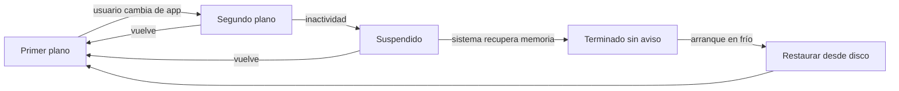
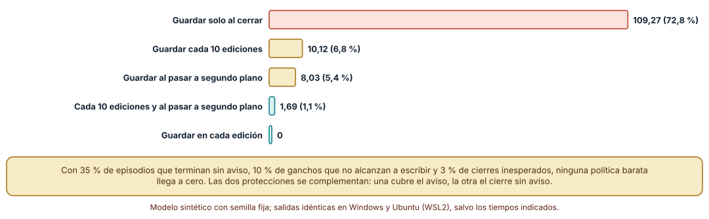
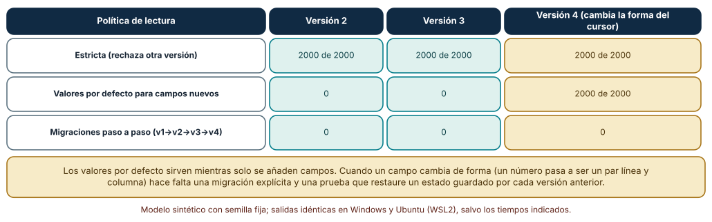
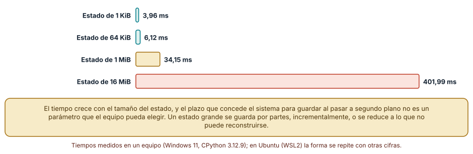

# SE-254 — Ciclo de vida, suspensión y reanudación

[← SE-253 — Modelos de aplicación móvil y de escritorio](https://github.com/vladimiracunadev-create/modern-software-engineering-program/blob/main/classes/part-21-software-movil-escritorio-y-multiplataforma/se-253-modelos-de-aplicacion-movil-y-de-escritorio/README.md) · [↑ Parte 21](https://github.com/vladimiracunadev-create/modern-software-engineering-program/blob/main/classes/part-21-software-movil-escritorio-y-multiplataforma/README.md) · [📚 Índice completo](https://github.com/vladimiracunadev-create/modern-software-engineering-program/blob/main/classes/README.md) · [🌐 Portal](https://vladimiracunadev-create.github.io/modern-software-engineering-program/classes/SE-254.html) · [SE-255 — Nativo, híbrido, web wrapper y cross-platform →](https://github.com/vladimiracunadev-create/modern-software-engineering-program/blob/main/classes/part-21-software-movil-escritorio-y-multiplataforma/se-255-nativo-hibrido-web-wrapper-y-cross-platform/README.md)

## Punto profesional y fundamento pedagógico

**Punto profesional.** La clase existe para que decidas qué se guarda, cuándo y con qué formato en cada transición del ciclo de vida, y para que midas cuántas ediciones pierde una política de guardado antes de depender de ella.

**Por qué aparece aquí.** Se sitúa después de **Modelos de aplicación móvil y de escritorio** y antes de **Nativo, híbrido, web wrapper y cross-platform**: la clase anterior fijó que el sistema decide cuánto vive el proceso; esta convierte esa restricción en una máquina de estados con ganchos, políticas de guardado y restauración tras una actualización. Deja el artefacto que `SE-256` usará para decidir dónde vive el estado.

**Error conceptual que debe corregir.** Creer que existe un evento de cierre que siempre se entrega y en el que basta guardar: el sistema puede terminar un proceso suspendido sin ejecutar nada, y un gancho de pausa dispone de un tiempo que el equipo no fija.

**Secuencia de aprendizaje.** Antes de leer la solución, predices cuántas ediciones pierde cada política de guardado en 10 000 sesiones sintéticas, qué políticas de lectura sobreviven a una actualización de la forma del estado y cuánto cuesta guardar un estado de 16 MiB; después ejecutas los tres experimentos. La secuencia usa predicción, explicación propia, contraste y recuperación. [ICAP](https://icap.education.asu.edu/research) distingue participación de construcción de conocimiento; [How People Learn II](https://nap.nationalacademies.org/catalog/24783/how-people-learn-ii-learners-contexts-and-cultures) exige conectar conocimiento previo, contexto y transferencia; la [práctica de recuperación](https://pubmed.ncbi.nlm.nih.gov/16507066/) respalda producir de nuevo la explicación tras una demora; y [Education for Life and Work](https://nap.nationalacademies.org/resource/13398/dbasse_084153.pdf) exige devolución que explique la causa del error.

**Evidencia de aprendizaje.** `lifecycle-log.md` con la máquina de estados del cliente con sus ganchos, la tabla de pérdidas por política, la tabla de restauración tras cada versión, la medición del coste de guardar y una nota de qué hallazgo cambiaría la política. Debe contener predicción previa, observación, explicación causal, contraejemplo y qué hallazgo haría abandonar la decisión.

**Límite de la conclusión.** Los porcentajes de terminación sin aviso, de ganchos que no alcanzan a escribir y de cierres inesperados son supuestos del autor; no se midió ningún sistema operativo móvil. El coste de guardar es el de un equipo con un disco y un sistema de archivos concretos.

### Trazabilidad fuente → afirmación

| Fuente primaria u oficial | Afirmación que respalda | Lo que no prueba |
|---|---|---|
| [Android Developers, «The activity lifecycle»](https://developer.android.com/guide/components/activities/activity-lifecycle) | Describe las transiciones de una actividad y advierte que no se debe confiar en que un método concreto se ejecute antes de que el proceso termine. | No dice con qué frecuencia termina un proceso ni cuánto tiempo dispone un gancho. |
| [Android Developers, «Save UI states»](https://developer.android.com/topic/libraries/architecture/saving-states) | Distingue el estado de interfaz que debe sobrevivir a la terminación del proceso del que puede reconstruirse y propone dónde guardar cada uno. | No fija un tamaño ni un formato adecuados para el borrador del cliente. |
| [Apple Developer, «Preserving your app's UI across launches»](https://developer.apple.com/documentation/uikit/view_controllers/preserving_your_app_s_ui_across_launches) | Explica que el sistema puede terminar una aplicación en segundo plano y que la interfaz se restaura desde información guardada. | No describe plataformas distintas de las de Apple. |

## Antes de empezar

Recupera `SE-253`: el sistema decide cuánto vive el proceso. La pregunta activa es: **¿qué debe estar en disco en cada transición, y cómo lo leerá la versión siguiente de la aplicación?**

## Prerrequisitos

- Haber completado `SE-253` o poder explicar qué evidencia produjo.
- Poder describir la tabla de supuestos de `SE-253`.
- Saber escribir y leer un archivo JSON desde Python.
- Python 3.11 o posterior y un terminal; los experimentos usan solo la biblioteca estándar y datos sintéticos, sin cuentas de tienda, emuladores ni dispositivos.

## Problema auténtico

Una estudiante escribe un borrador de 800 palabras, cambia de aplicación para consultar un enunciado y vuelve cuatro horas después: el borrador está vacío. Otra actualiza el cliente con un borrador guardado y la nueva versión se cierra al abrir porque el estado guardado no tiene un campo nuevo. Ninguna de las dos pérdidas fue un error de escritura: faltó una decisión sobre el momento de guardar y sobre la lectura de lo guardado.

## Objetivos observables

Al terminar podrás:

1. dibujar la máquina de estados del cliente (primer plano, segundo plano, suspendido, terminado) e indicar qué ganchos se entregan y cuáles no están garantizados;
2. medir cuántas ediciones pierde cada política de guardado bajo supuestos explícitos y combinarlas;
3. comparar tres políticas de lectura del estado guardado frente a cuatro versiones de su forma y escribir migraciones;
4. medir el coste de guardar con escritura atómica según el tamaño y deducir cuándo un gancho no alcanza;
5. justificar la política de guardado y de restauración del cliente con evidencia propia y declarar su límite.

## Mapa conceptual



El diagrama se lee como un ciclo: las flechas hacia el estado terminado no pasan por ningún gancho que el equipo controle, de modo que lo que se guarda debe guardarse antes. La restauración es el camino normal de regreso, no una excepción.

## Temas y por qué importan

| Tema | Por qué cambia una decisión profesional | Evidencia mínima |
|---|---|---|
| Estados del ciclo de vida | Dar nombre a cada estado permite decidir qué hacer en cada transición y no suponer un único evento de cierre. | Predicción, traza causal y contraejemplo de **Estados del ciclo de vida** en `lifecycle-log.md` |
| Ganchos y plazos | Un gancho que no se ejecuta, o que se ejecuta con un plazo corto, no es un lugar fiable donde guardar todo. | Predicción, traza causal y contraejemplo de **Ganchos y plazos** en `lifecycle-log.md` |
| Políticas de guardado | Guardar en cada edición, cada N ediciones o al pasar a segundo plano tiene costes y pérdidas distintos, y se combinan. | Predicción, traza causal y contraejemplo de **Políticas de guardado** en `lifecycle-log.md` |
| Restauración y versiones | El estado guardado por la versión anterior es una entrada que la versión nueva debe leer. | Predicción, traza causal y contraejemplo de **Restauración y versiones** en `lifecycle-log.md` |
| Escritura atómica | Guardar a medias deja el estado corrupto justo cuando más hace falta. | Predicción, traza causal y contraejemplo de **Escritura atómica** en `lifecycle-log.md` |

## Conceptos y decisiones

### 1. Estados del ciclo de vida

Una aplicación de cliente pasa por primer plano (visible e interactiva), segundo plano (no visible, proceso vivo), suspendido (proceso congelado o sin ejecución) y terminado. Las plataformas nombran los estados de forma distinta y no todas los entregan igual, pero la secuencia es común. El error más frecuente es tratar cerrar, suspender y terminar como el mismo evento: solo el primero lo provoca el usuario, y los otros los provoca el sistema sin consultar.

### 2. Ganchos y plazos

Los ganchos de pausa y de paso a segundo plano son avisos de que la aplicación dejará de ejecutarse pronto. La documentación de Android advierte que no se debe confiar en que ciertos métodos se invoquen antes de terminar el proceso. Un plazo implícito significa que el gancho debe hacer poco y hacerlo rápido: guardar un estado pequeño, no sincronizar con un servidor. Lo largo se hace antes, de forma incremental.

### 3. Políticas de guardado

La política más simple guarda al cerrar, la más segura en cada edición. Entre ambas hay guardado periódico, guardado al pasar a segundo plano y combinaciones. Cada una se evalúa con dos números: ediciones que se pierden y coste de escritura. La elección depende de cuánto cuesta perder una edición para quien escribe y de cuánto cuesta escribir cada vez; ninguna política barata llega a cero pérdidas bajo supuestos realistas.

### 4. Restauración y versiones

Restaurar es leer un estado escrito por otra versión del código, y las versiones se suceden. Añadir un campo se resuelve con un valor por defecto; cambiar la forma de uno existente exige una migración que lo transforme. Rechazar por versión distinta, la política estricta, equivale a perder el estado en cada actualización. Una prueba que restaura un estado guardado por cada versión anterior es la única evidencia de que la restauración funciona.

### 5. Escritura atómica

Escribir encima del archivo y ser interrumpido deja un archivo parcial. El patrón conocido escribe un archivo temporal, fuerza su sincronización y lo reemplaza de una vez; el estado anterior sigue válido hasta el reemplazo. Tiene un coste que crece con el tamaño del estado, y ese coste decide qué cabe en un gancho de pausa y qué debe guardarse antes.

### Cuántas ediciones pierde cada política

Se simulan 10 000 sesiones de seis episodios de entre 10 y 40 ediciones. Al pasar a segundo plano, el 35 % de los episodios termina sin aviso; el gancho de pausa solo escribe con probabilidad 0,90; y el 3 % de los episodios sufre un cierre inesperado en un punto aleatorio. Una edición no guardada en ese momento se pierde. Se comparan cinco políticas.

```python
def session(rnd, strat, kill=0.35, hook_fail=0.10, crash=0.03):
    unsaved = lost = total = 0
    for ep in range(6):
        n = rnd.randint(10, 40); crash_at = rnd.randrange(n) if rnd.random() < crash else -1
        for k in range(n):
            total += 1; unsaved += 1
            if strat == 'cada_edicion': unsaved = 0
            if 'cada_10' in strat and total % 10 == 0: unsaved = 0
            if k == crash_at: lost += unsaved; unsaved = 0
        if 'segundo_plano' in strat and rnd.random() >= hook_fail: unsaved = 0
        if rnd.random() < kill: lost += unsaved; unsaved = 0
    return lost, total
```

Resultado, idéntico en Windows y en Ubuntu: guardar solo al cerrar pierde **109,27** ediciones por sesión (72,8 % de las ediciones); guardar cada diez, **10,12** (6,8 %); guardar al pasar a segundo plano, **8,03** (5,4 %) y afecta al 32,8 % de las sesiones; combinar ambas, **1,69** (1,1 %); y guardar en cada edición, 0. La política de segundo plano pierde menos ediciones en total pero deja a un tercio de las sesiones con alguna pérdida; la periódica pierde en el 91 %, pero poco cada vez. Las dos protecciones cubren fallos distintos.



**Cómo leer la figura.** Cada barra es la media de ediciones perdidas en 10 000 sesiones; la coral es guardar solo al cerrar y las verdes son las políticas que combinan o guardan siempre. **Dónde deja de valer:** los tres porcentajes son supuestos del autor, no medidas de ningún sistema. El resultado enseña que un gancho y un guardado periódico se complementan, no cuánto pierde un sistema real; guardar en cada edición tiene un coste de escritura que esta simulación no incluye.

### Restaurar el estado que escribió otra versión

El estado de la versión 1 es un borrador y un cursor numérico. La versión 2 añade una lista de adjuntos, la 3 un modo de color y la 4 cambia el cursor a un par línea y columna. Se restauran 2000 estados generados con semilla fija con tres políticas: estricta (exige la misma versión), valores por defecto para campos nuevos y migraciones encadenadas.

```python
MIGS = {1: mig2, 2: mig3, 3: mig4}
def leer(blob, ver, politica):
    s = json.loads(blob)
    if politica == 'estricta' and s['v'] != ver: raise ValueError('version')
    if politica == 'defaults':
        if ver >= 2: s.setdefault('adjuntos', [])
        if ver >= 3: s.setdefault('modo', 'claro')
    if politica == 'migraciones':
        while s['v'] < ver: s = MIGS[s['v']](s)
    if ver >= 4 and not isinstance(s['cursor'], dict): raise TypeError('cursor')
    return s
```

Resultado: la política estricta falla en **2000 de 2000** restauraciones con las versiones 2, 3 y 4; los valores por defecto funcionan con las versiones 2 y 3 (**0 fallos**) pero fallan en **2000 de 2000** con la 4, porque cambia la forma de un campo existente; las migraciones no fallan nunca. Las dos primeras políticas parecen correctas hasta el día en que alguien cambia un campo.



**Cómo leer la figura.** Cada fila es una política y cada columna la versión que restaura el estado de la versión 1; las celdas verdes no fallan y la dorada marca el cambio de forma de un campo existente. **Dónde deja de valer:** las migraciones del experimento son tres funciones puras sobre un diccionario. Un estado real tiene archivos adjuntos, referencias y datos grandes que no se migran con una función; y solo se probó la ruta de la versión 1 a cada versión, no cualquier combinación.

### Lo que cuesta guardar

Se mide, con CPython en Windows, el tiempo de escribir un estado en JSON a un archivo temporal, vaciar el búfer, sincronizar con el disco y reemplazar el archivo final, para estados de 1 KiB, 64 KiB, 1 MiB y 16 MiB. Se toma la mediana de cinco repeticiones.

```python
tmp = ruta + '.tmp'
with open(tmp, 'w') as fh:
    json.dump(datos, fh); fh.flush(); os.fsync(fh.fileno())
os.replace(tmp, ruta)
```

Resultado en Windows: **3,96 ms** con 1 KiB, **6,12 ms** con 64 KiB, **34,15 ms** con 1 MiB y **401,99 ms** con 16 MiB. En Ubuntu bajo WSL2 fueron 3,78, 5,73, 17,91 y 228,74 ms. El tiempo no es proporcional al tamaño en los extremos pequeños, donde domina la sincronización, y casi lo es en los grandes. Un estado de 16 MiB tarda cuatrocientos milisegundos en un equipo de escritorio: en un teléfono con otro almacenamiento será otro número.



**Cómo leer la figura.** Cada barra es la mediana de cinco repeticiones en Windows; el color pasa de verde a coral cuando el guardado supera lo que parece razonable para un gancho. **Dónde deja de valer:** la medición es de un equipo de escritorio con su disco; no se midió ningún teléfono ni el plazo real de ningún sistema. El umbral que separa verde de coral es un criterio del autor, no un límite documentado.

## Definiciones de trabajo

- **ciclo de vida:** secuencia de estados por los que pasa una aplicación (primer plano, segundo plano, suspendido, terminado) y de transiciones que el sistema o la persona provocan.
- **gancho:** función que el sistema invoca al cambiar el estado de la aplicación y que dispone de un plazo limitado y no siempre garantizado.
- **restauración:** lectura del estado guardado para reconstruir la aplicación tras un arranque en frío o una actualización.
- **migración:** transformación explícita de un estado guardado por una versión anterior a la forma que espera la versión actual.
- **escritura atómica:** guardado que deja siempre el estado anterior o el nuevo completos, nunca uno parcial, mediante un archivo temporal sincronizado y un reemplazo.

Las definiciones son operativas para el cliente de la plataforma de entregas. No convierten términos con una historia técnica más amplia en sinónimos y deben contrastarse con la documentación primaria enlazada al final.

## Ejemplo mínimo

El fragmento restaura el estado de la versión 1 con una lectura que exige la versión actual. Antes de ejecutarlo, predice qué ocurre.

```python
import json
guardado = json.dumps({"v": 1, "borrador": "Hola", "cursor": 4})

def leer_estricto(blob, version_actual=2):
    s = json.loads(blob)
    if s["v"] != version_actual:
        raise ValueError("estado de otra versión")
    return s

try:
    leer_estricto(guardado)
except ValueError as e:
    print("pierde el borrador:", e)
```

La actualización convierte un estado válido en uno inutilizable. Cambia la lectura para que añada un campo por defecto y predice si funciona cuando el cursor cambia de forma.

## Ejemplo profesional

El equipo del cliente define la política de guardado en una tabla con tres columnas: qué estado (borrador, adjuntos pendientes, posición), cuándo se guarda (al editar tras una pausa de un segundo, al pasar a segundo plano) y cómo se restaura (con la versión de formato en el archivo). La restauración se prueba con un estado de cada versión anterior almacenado en el repositorio, y el arranque en frío se fuerza en las pruebas de integración. El guardado en el gancho solo escribe el borrador; los adjuntos se suben antes.

Compara el caso de una persona que escribe 800 palabras sin conexión, el de quien actualiza la aplicación con un borrador abierto y el de quien rota el teléfono. Una política es apropiada cuando esos tres casos tienen respuesta escrita y prueba.

## Práctica guiada

1. Dibuja la máquina de estados del cliente y marca qué transiciones no pasan por ningún gancho.
2. Predice cuántas ediciones perdería cada política y anota el número antes de ejecutar.
3. Implementa la simulación con los tres parámetros y repite con 10 000 semillas.
4. Escribe las migraciones de tres versiones y la prueba que restaura un estado de cada una.
5. Mide el coste de guardar con escritura atómica para cuatro tamaños en tu sistema.
6. Decide qué estado se guarda en el gancho y qué debe guardarse antes, con la medición como argumento.
7. Entrega `lifecycle-log.md` y pide a otra persona que reconstruya la política solo desde él.

## Ejercicios

1. **Gancho:** sube la probabilidad de que el gancho falle a 0,3 y calcula cuánto cambia la pérdida de la política combinada.
2. **Versión:** añade una versión 5 que renombra un campo y escribe la migración y una prueba que falle sin ella.
3. **Coste:** calcula a partir de la medición cuántas escrituras de 64 KiB por segundo soportaría tu equipo y qué significa para guardar en cada edición.
4. **Plazo:** elige un plazo hipotético para el gancho, indica qué tamaño de estado cabe y justifica qué guardar antes.

## Reto verificable

Entrega `lifecycle-log.md` con la máquina de estados, la tabla de pérdidas por política, la tabla de restauración por versión y la medición del coste de guardar. Se aprueba si otra persona ejecuta el código desde un checkout limpio, obtiene las mismas cifras con las mismas semillas y puede indicar qué medición en un dispositivo real cambiaría la política. No se aprueba por la longitud del documento.

## Caso conductor

El cliente de entregas de la Parte 21 deja aquí su política de guardado y de restauración: qué estado se guarda en cada transición y cómo se lee tras una actualización. `SE-255` compara formas de construir el cliente, `SE-256` decide dónde vive el estado y `SE-260` qué ocurre cuando dos dispositivos lo modifican. Cambia después una sola decisión, guardar cada diez ediciones en lugar de cada veinte, y revisa qué cifras hay que repetir.

## Preguntas frecuentes

### ¿Basta con guardar en el gancho de pausa?

No. El gancho puede no ejecutarse, tener poco tiempo o fallar; el 10 % de fallos supuesto deja a un tercio de las sesiones con pérdida. Se complementa con guardado incremental durante la edición.

### ¿Por qué no guardar en cada edición?

Porque tiene un coste de escritura y de desgaste que crece con el tamaño del estado. Si el estado es pequeño y la pérdida es inaceptable, guardar siempre es razonable; si es grande, se guarda por partes.

### ¿Cuándo basta con valores por defecto al leer?

Mientras los cambios solo añadan campos opcionales. En cuanto un campo existente cambia de forma, el valor por defecto lo deja pasar y falla más tarde: hace falta una migración y una prueba.

### ¿El estado guardado y la base de datos local son lo mismo?

No. El estado de interfaz (posición, borrador sin enviar) es efímero y pequeño; los datos del dominio viven en el almacenamiento local de `SE-256`, con su propia migración.

## Fallo controlado y diagnóstico

Reproduce el fallo clásico de la clase: **suponer que cerrar, suspender y terminar una aplicación son el mismo evento**. Simula el paso a segundo plano seguido de una terminación sin aviso con la política «guardar solo al cerrar».

Registra síntoma, hipótesis, observación que descarta cada una, causa, corrección y regresión. **Síntoma:** el borrador de 800 palabras vuelve vacío. **Hipótesis rivales:** (a) el guardado falló; (b) el guardado nunca se ejecutó porque no hubo evento de cierre. **Prueba:** registra los eventos entregados; si no hay evento de cierre antes de la terminación, la hipótesis (b) explica la pérdida. **Conclusión:** la causa es guardar en un evento que el sistema no garantiza. **Regresión:** fuerza el arranque en frío tras la pausa y exige el borrador completo; no cambies a la vez la política y el formato del estado.

## Errores comunes y cómo corregirlos

| Síntoma | Causa probable | Corrección |
|---|---|---|
| El borrador vuelve vacío tras cambiar de aplicación | Se guardaba solo en un evento de cierre que no se entregó | Guardar al pasar a segundo plano y de forma periódica durante la edición |
| La aplicación se cierra al abrirla tras actualizar | La lectura estricta rechaza el estado de la versión anterior | Versión en el archivo, migraciones y prueba por versión |
| El archivo de estado queda corrupto tras un cierre inesperado | Se escribió encima del archivo sin temporal | Escribir un temporal sincronizado y reemplazar |
| El gancho de pausa tarda y el sistema lo corta | Guarda un estado grande o sincroniza con el servidor | Guardar solo lo mínimo en el gancho y el resto antes |
| Las pruebas pasan y la restauración falla en uso real | Nunca se probó el arranque en frío ni un estado antiguo | Forzar el arranque en frío y conservar un estado de cada versión |

## Entorno y archivos clave

```text
work/SE-254/
├── README.md
├── lifecycle/
│   ├── politicas.py
│   ├── restauracion.py
│   └── coste.py
├── tests/test_ciclo.py
└── evidence/lifecycle-log.md
```

El `README` declara plataforma, versión de Python, semillas y comandos. Los experimentos usan solo la biblioteca estándar (`random`, `json`, `os`, `tempfile`, `time`) y se ejecutaron con CPython 3.12.9 en Windows 11 y 3.12.3 en Ubuntu bajo WSL2: las salidas fueron idénticas salvo los tiempos de escritura, que se informan como medidas de un equipo.

## Seguridad, ética y accesibilidad

- un estado guardado puede contener texto de la persona: decide dónde vive, si se cifra y cuándo se borra;
- no guardes tokens ni secretos en el estado restaurable;
- las pruebas usan texto sintético, nunca borradores reales;
- una pérdida de texto escrito es una pérdida de trabajo de una persona: define qué pérdida es aceptable y comunícala en la interfaz;
- al restaurar, indica claramente qué se recuperó y qué no, con texto accesible.

## Puente hacia el trabajo con agentes

Un agente al que se le pide «guarda el estado de la app» añadirá un gancho de cierre y dará la tarea por hecha. Pídele que dibuje los estados, que indique qué transiciones no entregan evento, que escriba una prueba que fuerce una terminación sin aviso y que migre un estado de la versión anterior. Revisa especialmente si guarda en un evento no garantizado: es el mismo supuesto que borró el borrador.

## Transferencia

Traslada el experimento a otro dominio persistente (una aplicación de reparto con un pedido en curso): cambia el estado, conserva el procedimiento de medir pérdidas por política y restaurar por versión. La transferencia está lograda cuando puedes explicar qué parte del método dependía del borrador y cuál no.

## Evaluación y evidencia

| Criterio | Evidencia para aprobar |
|---|---|
| comprensión | explicación de la diferencia entre cerrar, suspender y terminar con los ganchos que se entregan en cada caso |
| corrección | cifras reproducibles de pérdidas, restauración y coste con las mismas semillas |
| diseño | política de guardado y de restauración con el estado que cabe en el gancho |
| diagnóstico | reproducción del fallo «un único evento de cierre» con regresión |
| incertidumbre | declaración de los porcentajes supuestos y de lo que no se midió en dispositivos |
| reproducibilidad | versiones, comandos, salida y límites declarados |

## Fuentes

- [Android Developers, «The activity lifecycle»](https://developer.android.com/guide/components/activities/activity-lifecycle) — estados y transiciones de una actividad; autoridad: Google.
- [Android Developers, «Save UI states»](https://developer.android.com/topic/libraries/architecture/saving-states) — qué estado guardar y dónde; autoridad: Google.
- [Android Developers, «Processes and app lifecycle»](https://developer.android.com/guide/components/activities/process-lifecycle) — prioridad de procesos y cuándo el sistema los termina; autoridad: Google.
- [Apple Developer, «Managing your app's life cycle»](https://developer.apple.com/documentation/uikit/app_and_environment/managing_your_app_s_life_cycle) — estados de una aplicación de iOS; autoridad: Apple.
- [Apple Developer, «Preserving your app's UI across launches»](https://developer.apple.com/documentation/uikit/view_controllers/preserving_your_app_s_ui_across_launches) — preservar y restaurar la interfaz; autoridad: Apple.
- [SQLite, «Atomic Commit In SQLite»](https://www.sqlite.org/atomiccommit.html) — cómo se logra un guardado atómico; autoridad: SQLite.

Cada fuente respalda el mecanismo indicado; ninguna demuestra que las probabilidades de terminación o de fallo del gancho de los experimentos coincidan con las de un sistema real ni cuánto plazo concede cada plataforma. Esa afirmación depende de medir en el dispositivo.

- [Python: `os.replace`](https://docs.python.org/3/library/os.html) — reemplazo de archivo usado en la escritura atómica.
- [Python: `json`](https://docs.python.org/3/library/json.html) — serialización del estado.

## Límites y siguiente paso

Se ejecutaron tres experimentos con datos sintéticos en Windows y Ubuntu (WSL2) con resultados idénticos salvo los tiempos. No se midió ningún dispositivo móvil ni el plazo real de ningún gancho: los porcentajes son del autor. La siguiente clase compara formas de construir el cliente.

## Glosario

- **ciclo de vida:** secuencia de estados por los que pasa una aplicación (primer plano, segundo plano, suspendido, terminado) y de transiciones que el sistema o la persona provocan.
- **gancho:** función que el sistema invoca al cambiar el estado de la aplicación y que dispone de un plazo limitado y no siempre garantizado.
- **restauración:** lectura del estado guardado para reconstruir la aplicación tras un arranque en frío o una actualización.
- **migración:** transformación explícita de un estado guardado por una versión anterior a la forma que espera la versión actual.
- **escritura atómica:** guardado que deja siempre el estado anterior o el nuevo completos, nunca uno parcial, mediante un archivo temporal sincronizado y un reemplazo.

---

[← SE-253 — Modelos de aplicación móvil y de escritorio](https://github.com/vladimiracunadev-create/modern-software-engineering-program/blob/main/classes/part-21-software-movil-escritorio-y-multiplataforma/se-253-modelos-de-aplicacion-movil-y-de-escritorio/README.md) · [↑ Parte 21](https://github.com/vladimiracunadev-create/modern-software-engineering-program/blob/main/classes/part-21-software-movil-escritorio-y-multiplataforma/README.md) · [📚 Índice completo](https://github.com/vladimiracunadev-create/modern-software-engineering-program/blob/main/classes/README.md) · [🌐 Portal](https://vladimiracunadev-create.github.io/modern-software-engineering-program/classes/SE-254.html) · [SE-255 — Nativo, híbrido, web wrapper y cross-platform →](https://github.com/vladimiracunadev-create/modern-software-engineering-program/blob/main/classes/part-21-software-movil-escritorio-y-multiplataforma/se-255-nativo-hibrido-web-wrapper-y-cross-platform/README.md)
