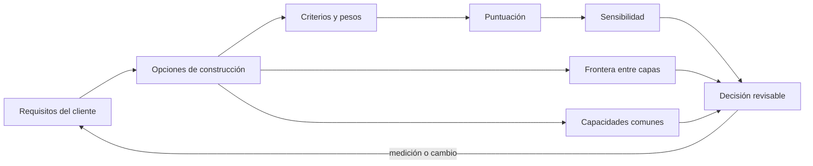
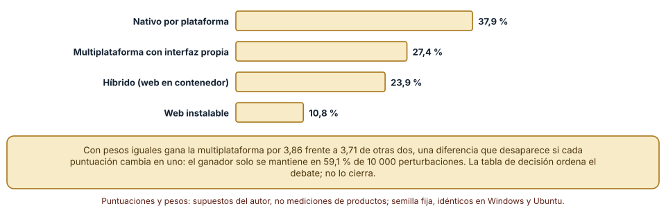
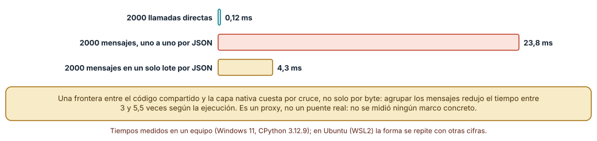
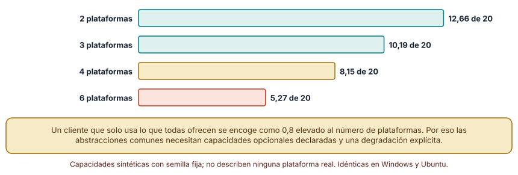

# SE-255 — Nativo, híbrido, web wrapper y cross-platform

[← SE-254 — Ciclo de vida, suspensión y reanudación](https://github.com/vladimiracunadev-create/modern-software-engineering-program/blob/main/classes/part-21-software-movil-escritorio-y-multiplataforma/se-254-ciclo-de-vida-suspension-y-reanudacion/README.md) · [↑ Parte 21](https://github.com/vladimiracunadev-create/modern-software-engineering-program/blob/main/classes/part-21-software-movil-escritorio-y-multiplataforma/README.md) · [📚 Índice completo](https://github.com/vladimiracunadev-create/modern-software-engineering-program/blob/main/classes/README.md) · [🌐 Portal](https://vladimiracunadev-create.github.io/modern-software-engineering-program/classes/SE-255.html) · [SE-256 — Almacenamiento local y sincronización →](https://github.com/vladimiracunadev-create/modern-software-engineering-program/blob/main/classes/part-21-software-movil-escritorio-y-multiplataforma/se-256-almacenamiento-local-y-sincronizacion/README.md)

## Punto profesional y fundamento pedagógico

**Punto profesional.** La clase existe para que elijas cómo construir el cliente (nativo, multiplataforma, híbrido o web instalable) con una decisión que muestre sus pesos, su sensibilidad y su coste de frontera, en lugar de una preferencia de marca.

**Por qué aparece aquí.** Se sitúa después de **Ciclo de vida, suspensión y reanudación** y antes de **Almacenamiento local y sincronización**: ya se sabe qué debe sobrevivir; ahora se decide con qué construir el cliente. Fija el criterio de elección que `SE-263` aplicará al adaptar el producto a dos plataformas.

**Error conceptual que debe corregir.** Creer que la herramienta correcta se deduce de una tabla de puntuaciones: los pesos y las puntuaciones son juicios, y un cambio pequeño de cualquiera de los dos suele cambiar al ganador.

**Secuencia de aprendizaje.** Antes de leer la solución, predices qué opción gana cuando los pesos son aleatorios, cuánto cuesta cruzar una frontera entre capas con mensajes sueltos y cuántas capacidades quedan comunes entre varias plataformas; después ejecutas los tres experimentos. La secuencia usa predicción, explicación propia, contraste y recuperación. [ICAP](https://icap.education.asu.edu/research) distingue participación de construcción de conocimiento; [How People Learn II](https://nap.nationalacademies.org/catalog/24783/how-people-learn-ii-learners-contexts-and-cultures) exige conectar conocimiento previo, contexto y transferencia; la [práctica de recuperación](https://pubmed.ncbi.nlm.nih.gov/16507066/) respalda producir de nuevo la explicación tras una demora; y [Education for Life and Work](https://nap.nationalacademies.org/resource/13398/dbasse_084153.pdf) exige devolución que explique la causa del error.

**Evidencia de aprendizaje.** `stack-decision-log.md` con la tabla de opciones y criterios con sus puntuaciones, el análisis de sensibilidad a los pesos, la medición de la frontera y el cálculo de capacidades comunes, con una nota de qué hallazgo cambiaría la decisión. Debe contener predicción previa, observación, explicación causal, contraejemplo y qué hallazgo haría abandonar la decisión.

**Límite de la conclusión.** Las puntuaciones son supuestos del autor sobre categorías de enfoque, no mediciones de ningún marco ni producto concreto; la medición de frontera es un proxy de serialización, no un puente real.

### Trazabilidad fuente → afirmación

| Fuente primaria u oficial | Afirmación que respalda | Lo que no prueba |
|---|---|---|
| [Flutter, «Architectural overview»](https://docs.flutter.dev/resources/architectural-overview) | Describe un enfoque multiplataforma con interfaz propia dibujada por el marco y una capa de integración con cada plataforma. | No compara el rendimiento ni el coste con el enfoque nativo. |
| [React Native, «Architecture overview»](https://reactnative.dev/architecture/overview) | Describe un enfoque que usa elementos nativos de interfaz gobernados desde código compartido y una comunicación entre ambos mundos. | No mide cuánto cuesta esa comunicación en una aplicación concreta. |
| [MDN, «Progressive web apps»](https://developer.mozilla.org/en-US/docs/Web/Progressive_web_apps) | Describe las aplicaciones web instalables y las capacidades que ofrecen y que les faltan frente a las nativas. | No dice cuáles capacidades concretas están disponibles en cada navegador y sistema hoy. |

## Antes de empezar

Recupera `SE-254`: ya se sabe qué estado guardar y cuándo. La pregunta activa es: **¿qué opción de construcción deja el mejor equilibrio para el cliente, y cuánto depende esa respuesta de pesos que alguien eligió?**

## Prerrequisitos

- Haber completado `SE-254` o poder explicar qué evidencia produjo.
- Poder describir la política de guardado de `SE-254`.
- Saber leer una tabla de decisión con pesos.
- Python 3.11 o posterior y un terminal; los experimentos usan solo la biblioteca estándar y datos sintéticos, sin cuentas de tienda, emuladores ni dispositivos.

## Problema auténtico

El equipo debe elegir cómo construir el cliente de entregas. Una persona propone el enfoque nativo por plataforma, otra una interfaz propia compartida, otra una web en contenedor. Cada una presenta una tabla donde su opción gana; las tablas puntúan lo mismo y pesan distinto. Nadie mintió: el ganador era función de los pesos.

## Objetivos observables

Al terminar podrás:

1. distinguir cuatro enfoques de construcción (nativo, multiplataforma con interfaz propia, híbrido en contenedor web, web instalable) por dónde corre la interfaz y quién la dibuja;
2. medir con qué frecuencia gana cada opción cuando se sortean los pesos y cuándo el ganador es estable frente a cambios de una unidad en las puntuaciones;
3. medir cuánto cuesta cruzar una frontera entre capas con mensajes sueltos frente a un lote y deducir una regla de diseño;
4. calcular cuántas capacidades comunes quedan al exigir lo que todas las plataformas ofrecen y explicar la necesidad de capacidades opcionales;
5. justificar una decisión con la sensibilidad y los límites medidos y declarar qué evidencia la cambiaría.

## Mapa conceptual



El mapa se lee de izquierda a derecha: las opciones se puntúan, pero la puntuación solo es una parte; la sensibilidad, el coste de la frontera y las capacidades comunes completan la decisión. La flecha de retorno indica que una medición reabre los requisitos.

## Temas y por qué importan

| Tema | Por qué cambia una decisión profesional | Evidencia mínima |
|---|---|---|
| Enfoques de construcción | Cada enfoque decide dónde corre la interfaz y quién la dibuja, y de eso derivan acceso, rendimiento y coste. | Predicción, traza causal y contraejemplo de **Enfoques de construcción** en `stack-decision-log.md` |
| Criterios y pesos | Los pesos son una decisión sobre qué importa; esconderlos en una suma es esconder la decisión. | Predicción, traza causal y contraejemplo de **Criterios y pesos** en `stack-decision-log.md` |
| Sensibilidad | Una decisión que cambia con una unidad en una puntuación no es robusta. | Predicción, traza causal y contraejemplo de **Sensibilidad** en `stack-decision-log.md` |
| Frontera entre capas | Cruzar de código compartido a código de plataforma cuesta por cruce, no solo por dato. | Predicción, traza causal y contraejemplo de **Frontera entre capas** en `stack-decision-log.md` |
| Capacidades comunes | Exigir lo que todas las plataformas ofrecen reduce lo disponible tan rápido como crece el número de plataformas. | Predicción, traza causal y contraejemplo de **Capacidades comunes** en `stack-decision-log.md` |

## Conceptos y decisiones

### 1. Enfoques de construcción

El enfoque nativo escribe cada cliente con las herramientas de su plataforma. El multiplataforma con interfaz propia, como el que describe la arquitectura de Flutter, dibuja la interfaz con un motor propio. El que usa elementos nativos gobernados desde código compartido, como describe React Native, delega el dibujo a la plataforma. El híbrido en contenedor ejecuta una web dentro de una aplicación, y la web instalable corre en el navegador con capacidades limitadas. Son categorías de enfoque, no veredictos sobre marcas: dentro de cada una hay mucha variedad.

### 2. Criterios y pesos

Una tabla de decisión multiplica puntuaciones por pesos. Las puntuaciones son juicios sobre una opción; los pesos, juicios sobre el proyecto. Dos personas razonables que pesan distinto obtienen ganadores distintos de la misma tabla. La disciplina es mostrar los pesos, preguntar qué cambiaría si los de otra persona fueran los de la tabla, y registrar quién los decidió.

### 3. Sensibilidad

El análisis de sensibilidad repite la decisión variando los supuestos: sortea pesos, perturba puntuaciones, y mira con qué frecuencia el ganador sigue siendo el mismo. Si el ganador cambia con perturbaciones pequeñas, la tabla no decide y la decisión debe apoyarse en un criterio adicional, una medición o un experimento barato.

### 4. Frontera entre capas

Los enfoques con capa compartida y capa de plataforma tienen una frontera: cada cruce serializa, copia y cambia de contexto. Cuando se cruza mucho y con mensajes pequeños, el coste domina. La regla práctica es agrupar el trabajo en el lado donde ocurre y cruzar con mensajes gruesos y poco frecuentes, y medir en el marco concreto antes de confiar en ella.

### 5. Capacidades comunes

Una abstracción común expone solo lo que todas las plataformas ofrecen, y esa intersección se encoge con cada plataforma añadida. La salida habitual es una capacidad opcional: la abstracción declara qué ofrece y cuándo falta, y el cliente decide cómo degradar. Una abstracción que oculta la ausencia produce errores en tiempo de ejecución.

### Quién gana cuando los pesos se sortean

Se puntúan cuatro opciones del 1 al 5 en siete criterios (acceso a capacidades, rendimiento, coste de mantener, velocidad de entrega, apariencia nativa, equipo existente y distribución en tiendas). Las puntuaciones son supuestos del autor. Se sortean 10 000 vectores de pesos uniformes sobre el simplex (semilla 255) y se anota quién gana; después, con pesos iguales, se perturba cada puntuación en −1, 0 o +1 y se mira si el ganador se mantiene.

```python
def score(w, o): return sum(a*b for a, b in zip(w, OPT[o])) / sum(w)
for _ in range(10000):
    w = [rnd.expovariate(1) for _ in CRIT]          # pesos Dirichlet(1,...,1)
    wins[max(names, key=lambda o: score(w, o))] += 1
```

Resultado, idéntico en Windows (CPython 3.12.9) y Ubuntu (3.12.3): gana la opción nativa en **37,9 %** de los sorteos, la multiplataforma con interfaz propia en **27,4 %**, la híbrida en **23,9 %** y la web instalable en **10,8 %**. Con pesos iguales ganan la multiplataforma (3,86) con las demás cerca (3,71, 3,71 y 3,43), y al perturbar las puntuaciones el ganador se mantiene solo en el **59,1 %** de 10 000 intentos. La tabla ordena la discusión, pero un solo cambio de una unidad, en cualquier criterio, desplaza al ganador casi cuatro veces de diez.



**Cómo leer la figura.** Cada barra es el porcentaje de 10 000 vectores de pesos aleatorios con los que gana esa opción; ninguna supera el 40 %, de modo que ninguna es el ganador para todos los pesos. **Dónde deja de valer:** las puntuaciones son supuestos del autor sobre categorías; con otras puntuaciones el reparto cambia. El experimento no dice qué opción es mejor sino que la elección depende de los pesos y de las puntuaciones más de lo que sugiere un número final.

### Cruzar una frontera mensaje a mensaje

Como proxy de una frontera entre capas se mide solo la serialización: 2000 mensajes pequeños se leen directamente, se serializan y se leen uno a uno con JSON, o se serializan juntos en un lote. No se usa ningún marco ni puente real. Se toma la mediana de cinco repeticiones.

```python
msgs = [dict(id=i, texto='x'*20, ok=True) for i in range(2000)]
directo = lambda: [m['texto'] for m in msgs]
uno_a_uno = lambda: [json.loads(json.dumps(m))['texto'] for m in msgs]
lote = lambda: [m['texto'] for m in json.loads(json.dumps(msgs))]
```

Resultado en Windows: **0,12 ms** directo, **23,8 ms** uno a uno y **4,3 ms** en un lote. En cuatro ejecuciones la razón entre uno a uno y lote varió entre 3,0 y 5,5, y en Ubuntu fue de 5,2. El orden es estable (directo ≪ lote < uno a uno) y la razón no: ese rango es lo que se informa, no un único valor.



**Cómo leer la figura.** Cada barra es la mediana de cinco repeticiones; la verde es la llamada directa, la coral los mensajes sueltos y la dorada el lote. **Dónde deja de valer:** el proxy mide serialización de JSON en Python, no un puente de ningún marco, ni hilos, ni cambios de contexto. Dice que el coste por cruce existe y que agrupar ayuda; no dice cuánto en una aplicación real.

### Capacidades comunes entre plataformas

Veinte capacidades abstractas (notificaciones, archivos, cámara, etc.) y plataformas que ofrecen cada una con probabilidad 0,8 de forma independiente. Para 2, 3, 4 y 6 plataformas se cuenta cuántas capacidades ofrecen todas, con 1000 semillas.

```python
for k in (2, 3, 4, 6):
    res = []
    for s in range(1000):
        r = random.Random(s)
        sets = [{c for c in caps if r.random() < 0.8} for _ in range(k)]
        res.append(len(set.intersection(*sets)))
```

Resultado: las capacidades comunes son **12,66** de 20 con dos plataformas, **10,19** con tres, **8,15** con cuatro y **5,27** con seis, muy cerca del valor esperado 20 · 0,8 elevado a k (12,8; 10,24; 8,19 y 5,24). Cada plataforma añadida quita una quinta parte de lo que quedaba. El resultado es una consecuencia aritmética de las probabilidades supuestas, que se informa porque pone cifras a un argumento que suele hacerse a mano.



**Cómo leer la figura.** Cada barra es la media de 1000 sorteos de cuántas de las veinte capacidades están en todas las plataformas; el color pasa de verde a coral a medida que se encoge la intersección. **Dónde deja de valer:** las capacidades se sortean de forma independiente con una probabilidad supuesta; las reales están correlacionadas y esa correlación puede hacer la intersección mayor. No describe ninguna plataforma real.

## Definiciones de trabajo

- **enfoque de construcción:** forma de producir el cliente que determina dónde corre la interfaz, quién la dibuja y qué capa de código se comparte entre plataformas.
- **análisis de sensibilidad:** repetición de una decisión variando sus supuestos para medir con qué frecuencia el resultado se mantiene.
- **frontera entre capas:** punto donde el código compartido se comunica con el de una plataforma y cada cruce serializa, copia y cambia de contexto.
- **capacidad opcional:** función que una abstracción común declara disponible solo en algunas plataformas y que obliga al cliente a decidir cómo degradar si falta.
- **intersección de capacidades:** conjunto de funciones que ofrecen todas las plataformas elegidas; se encoge al añadir plataformas.

Las definiciones son operativas para el cliente de la plataforma de entregas. No convierten términos con una historia técnica más amplia en sinónimos y deben contrastarse con la documentación primaria enlazada al final.

## Ejemplo mínimo

El fragmento puntúa dos opciones con dos conjuntos de pesos. Antes de ejecutarlo, predice si ganan la misma.

```python
puntos = {"nativo": [5, 2], "multiplataforma": [3, 5]}   # (acceso, coste de mantener)

def ganador(pesos):
    return max(puntos, key=lambda o: sum(p * w for p, w in zip(puntos[o], pesos)))

assert ganador([3, 1]) == "nativo"
assert ganador([1, 3]) == "multiplataforma"
```

Con los mismos números, cambiar los pesos cambia al ganador. Registra los pesos usados y quién los decidió; predice qué pasa si ambos pesos son iguales.

## Ejemplo profesional

El equipo del cliente documenta la elección en cuatro artefactos enlazados: la tabla de criterios con puntuaciones y su fuente, el análisis de sensibilidad (frecuencia con que gana cada opción al sortear pesos), un prototipo de la frontera más sensible (la que cruza más veces por segundo) con su medición, y la lista de capacidades que el cliente necesita y que cada opción ofrece, como disponibles, opcionales o ausentes. La decisión queda con una fecha, un responsable y el hallazgo que la reabriría, por ejemplo, que una capacidad requerida no exista en una plataforma elegida.

Compara el caso de una función solo de lectura, el de una que usa la cámara y el de una que sincroniza en segundo plano. Una decisión es apropiada cuando esos tres casos tienen una opción defendida con evidencia; es peligrosa cuando la evidencia es una preferencia.

## Práctica guiada

1. Escribe los criterios que importan al cliente de entregas y asígnales pesos con una persona que no los vio.
2. Predice qué opción ganará con pesos aleatorios y anota el número antes de ejecutar.
3. Sortea 10 000 vectores de pesos y perturba las puntuaciones; registra la estabilidad del ganador.
4. Mide la serialización de 2000 mensajes sueltos y en lote, y anota el rango de varias ejecuciones.
5. Calcula las capacidades comunes para dos, tres y cuatro plataformas con tus propias capacidades.
6. Declara qué capacidades serán opcionales y cómo degrada el cliente cuando falten.
7. Entrega `stack-decision-log.md` y pide a otra persona que lo rebata solo con ese archivo.

## Ejercicios

1. **Pesos:** elige tres pesos iniciales distintos y calcula el ganador de cada uno; indica qué criterio decide la diferencia.
2. **Sensibilidad:** perturba solo una puntuación por vez y averigua cuál cambia al ganador con más frecuencia.
3. **Frontera:** calcula cuántos mensajes por segundo cruzan la frontera en una pantalla de edición y qué ahorra agruparlos cada 100 ms.
4. **Capacidades:** con probabilidad 0,9 en lugar de 0,8, recalcula la tabla y explica qué cambia.

## Reto verificable

Entrega `stack-decision-log.md` con la tabla de criterios, la sensibilidad a los pesos, la medición de la frontera y las capacidades comunes. Se aprueba si otra persona obtiene las mismas cifras con las mismas semillas y puede señalar la evidencia que cambiaría la decisión. No se aprueba por proclamar una opción ganadora.

## Caso conductor

El cliente de entregas de la Parte 21 deja aquí la decisión sobre cómo construirlo y su sensibilidad. `SE-256` decide dónde vive el estado, `SE-257` qué capacidades del dispositivo se pedirán y `SE-263` aplica esta decisión al adaptar el producto a dos plataformas. Cambia después un solo peso, el del equipo existente, y revisa qué decisión sobrevive.

## Preguntas frecuentes

### ¿Hay una opción mejor en general?

No. Con pesos aleatorios, ninguna gana más del 38 % de las veces. La mejor depende de qué importa al proyecto y de las puntuaciones, que son juicios.

### ¿Las puntuaciones del experimento describen frameworks reales?

No. Son supuestos del autor sobre categorías de enfoque. Dentro de cada categoría hay marcos con puntuaciones muy distintas; el procedimiento se aplica a los marcos concretos que el equipo evalúe.

### ¿Un prototipo sustituye a la tabla?

Se complementan. La tabla ordena el debate y el prototipo mide lo que más duele, como la frontera o una capacidad crítica. Si el prototipo contradice a la tabla, manda el prototipo.

### ¿Por qué importa agrupar mensajes?

Porque cada cruce cuesta aunque el dato sea pequeño. Agrupar convierte muchos cruces en pocos y suele reducir el coste varias veces; el valor exacto se mide en el marco elegido.

## Fallo controlado y diagnóstico

Reproduce el fallo clásico de la clase: **decidir con una tabla cuyos pesos nadie discutió**. Presenta la tabla con un solo conjunto de pesos y pide a otra persona que proponga los suyos.

Registra síntoma, hipótesis, observación que descarta cada una, causa, corrección y regresión. **Síntoma:** dos personas puntúan lo mismo y recomiendan opciones distintas. **Hipótesis rivales:** (a) una puntuó mal; (b) pesan distinto lo que importa. **Prueba:** intercambia los pesos entre ambos y recalcula; si cada ganador sigue a los pesos y no a la persona, la hipótesis (b) explica la diferencia. **Conclusión:** la causa es el peso, no la puntuación. **Regresión:** añade al registro la sensibilidad a los pesos y el responsable de cada uno; no cambies a la vez pesos y puntuaciones.

## Errores comunes y cómo corregirlos

| Síntoma | Causa probable | Corrección |
|---|---|---|
| La tabla de decisión elige la opción del autor de la tabla | Los pesos se escogieron conociendo el ganador deseado | Fijar pesos antes de puntuar y mostrar la sensibilidad |
| La decisión cambia al cambiar una puntuación en un punto | Las puntuaciones son juicios con incertidumbre no declarada | Perturbar las puntuaciones y reportar la estabilidad |
| La pantalla de edición va lenta en la capa compartida | Se cruza la frontera una vez por tecla o por elemento | Agrupar mensajes y medir en el marco concreto |
| Una función necesaria no existe en una plataforma elegida | Se aceptó la abstracción común sin listar capacidades opcionales | Declarar capacidades por plataforma y la degradación |
| Se elige un marco porque lo usa otra empresa | La evidencia es una anécdota, no una medición | Pedir qué medición del propio producto lo respalda |

## Entorno y archivos clave

```text
work/SE-255/
├── README.md
├── stack/
│   ├── pesos.py
│   ├── frontera.py
│   └── capacidades.py
├── tests/test_stack.py
└── evidence/stack-decision-log.md
```

El `README` declara plataforma, versión de Python, semillas y comandos. Los experimentos usan solo la biblioteca estándar (`random`, `json`, `time`) y se ejecutaron con CPython 3.12.9 en Windows 11 y 3.12.3 en Ubuntu bajo WSL2: las salidas fueron idénticas salvo los tiempos de serialización, que se informan como medidas de un equipo y con su rango.

## Seguridad, ética y accesibilidad

- no incluyas credenciales ni datos reales en prototipos de comparación;
- una decisión que deja fuera plataformas deja fuera a las personas que las usan: declara a quién excluye;
- los marcos tienen licencias y condiciones de la tienda: verifícalas antes de adoptar;
- ofrece una alternativa textual a la tabla de decisión y no uses color como única señal;
- documenta quién decidió los pesos y por qué, para que la responsabilidad no se disuelva en «la tabla lo dice».

## Puente hacia el trabajo con agentes

Un agente al que se le pide «elige el mejor framework» dará una recomendación con convicción y tablas de apariencia objetiva. Pídele que muestre los pesos que usó, que repita la decisión con otros pesos y que indique qué dato de tu proyecto la cambiaría. Revisa especialmente si ocultó un peso: es la misma discrepancia que separó a las dos propuestas.

## Transferencia

Traslada el análisis a otra decisión de herramienta (por ejemplo, el almacenamiento de un servicio): cambia criterios y puntuaciones, conserva el procedimiento de sortear pesos y perturbar puntuaciones. La transferencia está lograda cuando puedes explicar qué parte del método dependía del cliente y cuál no.

## Evaluación y evidencia

| Criterio | Evidencia para aprobar |
|---|---|
| comprensión | explicación de cuatro enfoques por dónde corre y quién dibuja la interfaz |
| corrección | cifras reproducibles de la sensibilidad, la frontera y las capacidades comunes |
| diseño | tabla con pesos, sensibilidad y capacidades opcionales declaradas |
| diagnóstico | reproducción del fallo «pesos que nadie discutió» con regresión |
| incertidumbre | declaración de las puntuaciones supuestas y del carácter de proxy de la frontera |
| reproducibilidad | versiones, comandos, salida y límites declarados |

## Fuentes

- [Flutter, «Architectural overview»](https://docs.flutter.dev/resources/architectural-overview) — capas de un marco multiplataforma con interfaz propia; autoridad: Google.
- [React Native, «Architecture overview»](https://reactnative.dev/architecture/overview) — arquitectura con interfaz nativa y código compartido; autoridad: Meta.
- [Capacitor, documentación](https://capacitorjs.com/docs) — aplicación web empaquetada con acceso a capacidades nativas; autoridad: Ionic.
- [Kotlin Multiplatform](https://kotlinlang.org/docs/multiplatform.html) — código compartido con interfaz y capacidades por plataforma; autoridad: JetBrains.
- [MDN, «Progressive web apps»](https://developer.mozilla.org/en-US/docs/Web/Progressive_web_apps) — aplicaciones web instalables y sus capacidades; autoridad: Mozilla.
- [Electron, «Process Model»](https://www.electronjs.org/docs/latest/tutorial/process-model) — aplicación de escritorio construida con tecnología web; autoridad: OpenJS Foundation.

Cada fuente respalda el mecanismo indicado; ninguna demuestra que las puntuaciones del experimento o el coste de la frontera correspondan a un marco real. Esa afirmación depende de evaluar el marco concreto con el producto concreto.

- [Python: `json`](https://docs.python.org/3/library/json.html) — serialización usada como proxy de la frontera.
- [Python: `random`](https://docs.python.org/3/library/random.html) — generador con semilla de los sorteos.

## Límites y siguiente paso

Se ejecutaron tres experimentos con datos sintéticos en Windows y Ubuntu (WSL2) con resultados idénticos salvo los tiempos. No se evaluó ningún marco ni producto: las puntuaciones son del autor y la frontera es un proxy. La siguiente clase decide dónde vive el estado y cómo se sincroniza.

## Glosario

- **enfoque de construcción:** forma de producir el cliente que determina dónde corre la interfaz, quién la dibuja y qué capa de código se comparte entre plataformas.
- **análisis de sensibilidad:** repetición de una decisión variando sus supuestos para medir con qué frecuencia el resultado se mantiene.
- **frontera entre capas:** punto donde el código compartido se comunica con el de una plataforma y cada cruce serializa, copia y cambia de contexto.
- **capacidad opcional:** función que una abstracción común declara disponible solo en algunas plataformas y que obliga al cliente a decidir cómo degradar si falta.
- **intersección de capacidades:** conjunto de funciones que ofrecen todas las plataformas elegidas; se encoge al añadir plataformas.

---

[← SE-254 — Ciclo de vida, suspensión y reanudación](https://github.com/vladimiracunadev-create/modern-software-engineering-program/blob/main/classes/part-21-software-movil-escritorio-y-multiplataforma/se-254-ciclo-de-vida-suspension-y-reanudacion/README.md) · [↑ Parte 21](https://github.com/vladimiracunadev-create/modern-software-engineering-program/blob/main/classes/part-21-software-movil-escritorio-y-multiplataforma/README.md) · [📚 Índice completo](https://github.com/vladimiracunadev-create/modern-software-engineering-program/blob/main/classes/README.md) · [🌐 Portal](https://vladimiracunadev-create.github.io/modern-software-engineering-program/classes/SE-255.html) · [SE-256 — Almacenamiento local y sincronización →](https://github.com/vladimiracunadev-create/modern-software-engineering-program/blob/main/classes/part-21-software-movil-escritorio-y-multiplataforma/se-256-almacenamiento-local-y-sincronizacion/README.md)
