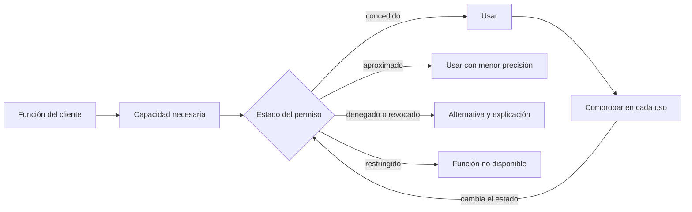
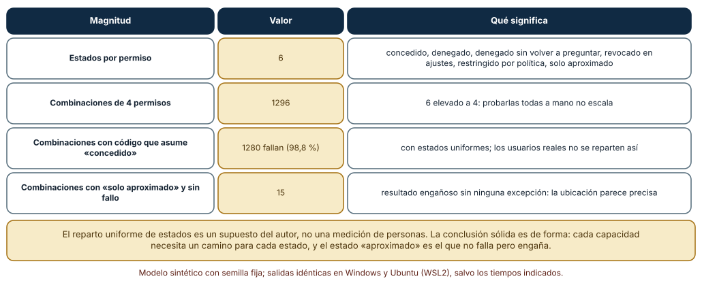
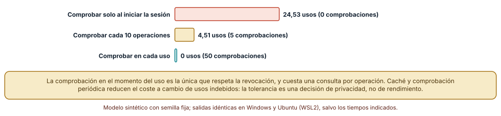
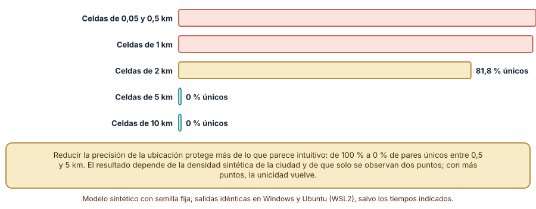

# SE-257 — Permisos, sensores y capacidades del dispositivo

[← SE-256 — Almacenamiento local y sincronización](https://github.com/vladimiracunadev-create/modern-software-engineering-program/blob/main/classes/part-21-software-movil-escritorio-y-multiplataforma/se-256-almacenamiento-local-y-sincronizacion/README.md) · [↑ Parte 21](https://github.com/vladimiracunadev-create/modern-software-engineering-program/blob/main/classes/part-21-software-movil-escritorio-y-multiplataforma/README.md) · [📚 Índice completo](https://github.com/vladimiracunadev-create/modern-software-engineering-program/blob/main/classes/README.md) · [🌐 Portal](https://vladimiracunadev-create.github.io/modern-software-engineering-program/classes/SE-257.html) · [SE-258 — Interacción táctil, teclado, mouse y accesibilidad →](https://github.com/vladimiracunadev-create/modern-software-engineering-program/blob/main/classes/part-21-software-movil-escritorio-y-multiplataforma/se-258-interaccion-tactil-teclado-mouse-y-accesibilidad/README.md)

## Punto profesional y fundamento pedagógico

**Punto profesional.** La clase existe para que trates un permiso como un estado que cambia fuera de tu control (concedido, denegado, revocado, aproximado), diseñes un camino para cada estado y recortes lo que pides a lo que el cliente usa, midiendo qué ocurre cuando el estado cambia en mitad de la sesión.

**Por qué aparece aquí.** Se sitúa después de **Almacenamiento local y sincronización** y antes de **Interacción táctil, teclado, mouse y accesibilidad**: ya se sabe qué datos guarda el cliente; ahora se decide qué capacidades del dispositivo (ubicación, cámara, notificaciones, archivos) se piden, cuándo y qué ocurre si la persona dice que no o cambia de opinión. Prepara la seguridad del cliente de `SE-262`.

**Error conceptual que debe corregir.** Creer que un permiso es un dato que se pide una vez y se tiene para siempre: la persona puede denegarlo, concederlo solo en parte, revocarlo desde los ajustes en mitad de la sesión o estar sujeta a una política que lo restringe, y el código que asume «concedido» falla o, peor, funciona mal sin avisar.

**Secuencia de aprendizaje.** Antes de leer la solución, predices cuántas combinaciones de estados de cuatro permisos hay y qué fracción rompe un código ingenuo, cuántos usos de una capacidad ocurren después de una revocación según cuándo se comprueba, y cuánta precisión de ubicación puede reducirse sin que el par casa-trabajo identifique a una persona; después ejecutas los tres experimentos. La secuencia usa predicción, explicación propia, contraste y recuperación. [ICAP](https://icap.education.asu.edu/research) distingue participación de construcción de conocimiento; [How People Learn II](https://nap.nationalacademies.org/catalog/24783/how-people-learn-ii-learners-contexts-and-cultures) exige conectar conocimiento previo, contexto y transferencia; la [práctica de recuperación](https://pubmed.ncbi.nlm.nih.gov/16507066/) respalda producir de nuevo la explicación tras una demora; y [Education for Life and Work](https://nap.nationalacademies.org/resource/13398/dbasse_084153.pdf) exige devolución que explique la causa del error.

**Evidencia de aprendizaje.** `permissions-log.md` con la tabla de capacidades del cliente con su justificación, la matriz de estados con el comportamiento esperado, la medición de revocación en mitad de la sesión y la curva de precisión de ubicación y unicidad. Debe contener predicción previa, observación, explicación causal, contraejemplo y qué hallazgo haría abandonar la decisión.

**Límite de la conclusión.** El reparto uniforme de estados, la probabilidad de revocación y la ciudad sintética son supuestos del autor; no se midieron personas, dispositivos ni tiendas. El análisis de ubicación muestra la forma del problema con dos puntos por persona.

### Trazabilidad fuente → afirmación

| Fuente primaria u oficial | Afirmación que respalda | Lo que no prueba |
|---|---|---|
| [Android Developers, «Permissions on Android»](https://developer.android.com/guide/topics/permissions/overview) | Explica el modelo de permisos, que se piden en tiempo de ejecución, que el usuario puede revocarlos y que la aplicación debe poder funcionar sin ellos. | No dice con qué frecuencia la gente deniega o revoca. |
| [Android Developers, «Request location permissions»](https://developer.android.com/training/location/permissions) | Describe que la ubicación puede concederse como aproximada o precisa y que la aplicación debe manejar ambas. | No fija qué precisión necesita un caso de uso concreto. |
| [W3C, «Permissions»](https://www.w3.org/TR/permissions/) | Define el modelo de permisos de la plataforma web con estados concedido, denegado y por preguntar, y una forma de consultarlos. | No cubre las aplicaciones nativas ni garantiza que todos los navegadores lo implementen igual. |

## Antes de empezar

Recupera `SE-256`: se decidió dónde vive cada dato. La pregunta activa es: **¿qué capacidad del dispositivo necesita el cliente de entregas, cuándo la pide y qué hace en cada estado posible del permiso?**

## Prerrequisitos

- Haber completado `SE-256` o poder explicar qué evidencia produjo.
- Poder describir el inventario de datos de `SE-256`.
- Entender qué es un sensor o una capacidad del dispositivo (cámara, ubicación, notificaciones, archivos).
- Python 3.11 o posterior y un terminal; los experimentos usan solo la biblioteca estándar y datos sintéticos, sin cuentas de tienda, emuladores ni dispositivos.

## Problema auténtico

El cliente de entregas quiere adjuntar una foto de la tarea escrita a mano. Pide la cámara al arrancar. Una estudiante lo deniega y la aplicación se cierra; otra lo concede, lo revoca a la semana desde los ajustes y la aplicación sigue intentando usar la cámara hasta que falla; una tercera concede solo ubicación aproximada y el cliente muestra «entrega recibida desde el campus» con una precisión que no tiene.

## Objetivos observables

Al terminar podrás:

1. clasificar los estados de un permiso (concedido, denegado, denegado sin volver a preguntar, revocado, restringido, aproximado) y escribir el comportamiento esperado de cada uno;
2. contar las combinaciones de estados de varios permisos y explicar por qué un camino por capacidad y estado es más barato que probar todas;
3. medir cuántos usos indebidos ocurren tras una revocación según cuándo se comprueba el permiso;
4. calcular cómo la precisión de ubicación cambia la identificabilidad de un par de lugares y decidir cuánta se pide;
5. justificar con la mínima capacidad necesaria qué se pide, cuándo y con qué alternativa si se deniega.

## Mapa conceptual



El diagrama se lee de arriba hacia abajo: cada función declara su capacidad, el estado del permiso decide el camino, y el estado se vuelve a comprobar en el uso porque puede cambiar. No es un proceso obligatorio sino un contrato: ningún estado queda sin camino.

## Temas y por qué importan

| Tema | Por qué cambia una decisión profesional | Evidencia mínima |
|---|---|---|
| Estados de un permiso | El permiso es una máquina de estados que la persona o una política mueven sin avisar. | Predicción, traza causal y contraejemplo de **Estados de un permiso** en `permissions-log.md` |
| Pedir con motivo y en contexto | Pedir un permiso cuando se necesita, con una explicación, es más honesto y más probable de entender que pedir todo al arrancar. | Predicción, traza causal y contraejemplo de **Pedir con motivo y en contexto** en `permissions-log.md` |
| Mínimo necesario | Cada capacidad que se pide es una superficie de ataque y una carga de confianza. | Predicción, traza causal y contraejemplo de **Mínimo necesario** en `permissions-log.md` |
| Revocación y comprobación en el uso | Un permiso comprobado una vez al iniciar la sesión puede dejar de valer a los diez minutos. | Predicción, traza causal y contraejemplo de **Revocación y comprobación en el uso** en `permissions-log.md` |
| Datos derivados y reidentificación | Un dato poco preciso puede seguir siendo identificador si se combina con otro. | Predicción, traza causal y contraejemplo de **Datos derivados y reidentificación** en `permissions-log.md` |

## Conceptos y decisiones

### 1. Estados de un permiso

Un permiso no es un booleano. Puede estar sin preguntar, concedido, concedido solo en parte (ubicación aproximada), denegado, denegado de forma que ya no se vuelve a preguntar, revocado desde los ajustes o restringido por una política de la organización o del dispositivo. La documentación de Android indica que los permisos se piden en tiempo de ejecución y que el usuario puede cambiarlos; el modelo web define estados análogos. Cada estado necesita una respuesta del cliente.

### 2. Pedir con motivo y en contexto

Pedir al arrancar un permiso que se usará dentro de tres pantallas obliga a decidir sin contexto. Pedirlo cuando la persona toca «Adjuntar foto» liga la petición a su intención. Si la deniega, el cliente conserva la función sin cámara (elegir de la galería) y explica qué se perdió. Esta es una decisión de diseño, no una garantía de aceptación; no se midió qué enfoque acepta más gente.

### 3. Mínimo necesario

Pedir menos reduce lo que puede filtrarse, abusarse o exigirse en una revisión de tienda. Si la función solo necesita saber que se entregó en la ciudad, la ubicación aproximada alcanza; si solo adjunta una imagen, el selector del sistema puede evitar pedir acceso a toda la galería. La pregunta es qué función falla sin la capacidad, no qué dato podría ser útil.

### 4. Revocación y comprobación en el uso

La revocación ocurre fuera de la aplicación y puede llegar en cualquier momento. Comprobar el permiso al iniciar la sesión y asumirlo después produce usos tras la revocación. Comprobar en cada uso lo evita y cuesta una consulta; comprobar periódicamente reduce el coste y deja una ventana. La tolerancia de esa ventana es una decisión de privacidad.

### 5. Datos derivados y reidentificación

Reducir la precisión de la ubicación protege, pero dos lugares aproximados (casa y trabajo) pueden identificar a una persona entre miles. La literatura sobre movilidad humana muestra que unos pocos puntos bastan para singularizar a la mayoría. El cliente decide qué guarda y por cuánto tiempo, no solo qué pide al sistema.

### Seis estados, cuatro permisos

Seis estados por permiso (concedido, denegado, denegado sin volver a preguntar, revocado en ajustes, restringido por política, solo aproximado) y cuatro capacidades (ubicación, cámara, notificaciones, archivos) dan 6 elevado a 4 combinaciones. Un código ingenuo trata «concedido» y «solo aproximado» como éxito y todo lo demás como excepción; uno defensivo tiene un camino para cada estado.

```python
ESTADOS = ['concedido', 'denegado', 'denegado_y_no_preguntar', 'revocado_en_ajustes', 'restringido_por_politica', 'solo_aproximado']
def naive(est):
    if est == 'concedido': return 'ok'
    if est == 'solo_aproximado': return 'ok'        # asume precisa
    raise Err(est)
for combo in itertools.product(ESTADOS, repeat=4):
    try:
        for e in combo: naive(e)
    except Err: crash += 1
```

Resultado: **1296** combinaciones; el código ingenuo falla en **1280** (98,8 %) con un reparto uniforme de estados, y en **15** combinaciones con «solo aproximado» y el resto concedido no falla pero tampoco hace lo correcto: trata una ubicación aproximada como precisa. El código con un camino por estado cubre las 1296 sin excepción. Como las capacidades son independientes, 24 pruebas (4 capacidades por 6 estados) ejercen cada camino, frente a 1296 combinaciones.



**Cómo leer la figura.** Cada fila es una magnitud; la columna central da el valor y la derecha qué significa. La última fila marca el caso que no lanza error pero engaña. **Dónde deja de valer:** el reparto uniforme de estados no describe a ninguna población real; con estados concentrados en «concedido», el código ingenuo falla menos veces y de forma más sorpresiva. Que 24 pruebas ejerzan cada camino supone que las capacidades no interactúan, algo que debe verificarse.

### Usos de una capacidad tras revocarla

Se simulan 10 000 sesiones de 50 operaciones que usan una capacidad. En un punto al azar de cada sesión la persona la revoca. Se comparan tres políticas: comprobar solo al iniciar, comprobar cada diez operaciones y comprobar en cada uso. Se cuentan los usos después de la revocación y las comprobaciones realizadas.

```python
for i in range(ops):
    real = i <= rev                                  # el permiso real
    if politica == 'al_iniciar': ok = concedido_en_cache
    elif politica == 'cada_uso': ok = real; chequeos += 1
    elif politica == 'cada_10':
        if i % 10 == 0: concedido_en_cache = real
        ok = concedido_en_cache; chequeos += (i % 10 == 0)
    if ok and not real: usos_indebidos += 1
```

Resultado: comprobar solo al iniciar deja **24,53** usos indebidos por sesión con 0 comprobaciones; comprobar cada diez operaciones, **4,51** con 5 comprobaciones; y comprobar en cada uso, **0** con 50. El coste es lineal en el número de comprobaciones y la ventana indebida, en el intervalo; la elección es qué tolerancia de uso tras revocar acepta el producto, y la respuesta para cámara y ubicación suele ser cero.



**Cómo leer la figura.** Cada barra es la media de usos indebidos por sesión de 50 operaciones; la coral es comprobar solo al iniciar y la verde es comprobar en cada uso. **Dónde deja de valer:** una consulta de permiso real cuesta lo que cuesta el sistema y puede no ser trivial; el modelo cuenta comprobaciones, no tiempo. Y supone que la revocación se aplica de forma instantánea al consultar, algo que depende de la plataforma.

### Cuánta precisión pide la ubicación

Se generan 2000 personas ficticias con una casa y un trabajo en posiciones aleatorias de una ciudad sintética de 20 por 20 kilómetros. Se discretiza cada posición en celdas de 0,05 a 10 km de lado y se cuenta cuántas personas tienen un par (celda de casa, celda de trabajo) que ninguna otra comparte.

```python
def celda(p, size): return (int(p[0]//size), int(p[1]//size))
for size in (0.05, 0.5, 1, 2, 5, 10):
    pares = {}
    for h, w in P:
        k = (celda(h, size), celda(w, size)); pares[k] = pares.get(k, 0) + 1
    unicos = sum(1 for v in pares.values() if v == 1)
```

Resultado: con celdas de 0,05 y de 0,5 km, **2000 de 2000** pares son únicos (100 %); con 1 km, **1982** (99,1 %); con 2 km, **1635** (81,8 %); con 5 y 10 km, **0**. Con celdas de 1 km el par casa-trabajo ya identifica a casi todas; con 5 km, a ninguna. La conclusión es que el dato aproximado protege solo cuando la celda es grande respecto de la densidad, y que dos puntos bastan para singularizar.



**Cómo leer la figura.** Cada barra es el porcentaje de las 2000 personas con un par único para ese tamaño de celda; las coral son tamaños que no protegen y las verdes los que sí. **Dónde deja de valer:** la ciudad es uniforme y sintética, con casa y trabajo independientes; las reales tienen ciudades densas, personas que comparten trabajo y trayectorias con más de dos puntos, que aumentan la unicidad. Los resultados muestran la forma, no un umbral de seguridad.

## Definiciones de trabajo

- **permiso:** autorización que el sistema o la persona concede, deniega o revoca para que la aplicación use una capacidad protegida; es un estado que cambia, no un booleano.
- **capacidad:** función del dispositivo que el sistema protege (ubicación, cámara, notificaciones, archivos) y que exige una autorización.
- **mínimo necesario:** criterio de pedir solo la capacidad, con la precisión y el alcance más pequeños, sin los cuales una función falla.
- **revocación:** retirada de un permiso concedido, normalmente desde los ajustes del sistema y sin que la aplicación participe.
- **reidentificación:** recuperación de la identidad de una persona a partir de datos que no la nombran, combinando atributos como lugares frecuentes.

Las definiciones son operativas para el cliente de la plataforma de entregas. No convierten términos con una historia técnica más amplia en sinónimos y deben contrastarse con la documentación primaria enlazada al final.

## Ejemplo mínimo

El fragmento trata un permiso de ubicación como booleano. Antes de ejecutarlo, predice qué muestra cuando el estado es «solo aproximado».

```python
def mensaje(estado):
    if estado in ("concedido", "solo_aproximado"):       # versión ingenua
        return "Entregado desde el campus"
    return "Sin ubicación"

assert mensaje("solo_aproximado") == "Entregado desde el campus"   # afirma más de lo que sabe
```

El mensaje afirma una precisión que el permiso no concede. Corrige la función para que el estado aproximado diga «en la ciudad» y predice cuántos casos de prueba necesitas.

## Ejemplo profesional

El equipo del cliente escribe una tabla de capacidades con una fila por función: qué capacidad necesita, con qué precisión, cuándo la pide, qué hace si se deniega o revoca y cuánto tiempo guarda el dato. «Adjuntar foto» usa el selector del sistema o la cámara, y si se deniega, ofrece la galería. «Notificar vencimiento» usa notificaciones y, si se deniega, muestra un aviso dentro de la aplicación. «Registrar lugar de entrega» no existe: el equipo decidió que no lo necesitaba y no pidió ubicación. Cada fila tiene una prueba por estado del permiso.

Compara el caso de quien concede todo, el de quien deniega cámara y el de quien revoca notificaciones a mitad de la semana. Una tabla es apropiada cuando esos tres casos tienen un comportamiento escrito; es peligrosa cuando la función se cae si el permiso falta.

## Práctica guiada

1. Lista las funciones del cliente y la capacidad mínima que necesita cada una.
2. Predice cuántas combinaciones hay y cuántas pruebas necesitas, y anota los números antes de ejecutar.
3. Escribe el camino para cada estado de cada capacidad y comprueba que ninguno queda sin respuesta.
4. Simula la revocación en mitad de una sesión con tres políticas de comprobación.
5. Calcula la unicidad de un par de lugares con tres tamaños de celda y decide qué precisión guardas.
6. Revisa la lista y elimina las capacidades que ninguna función necesita.
7. Entrega `permissions-log.md` y pide a otra persona que reconstruya el comportamiento de un estado solo con él.

## Ejercicios

1. **Estados:** añade el estado «pendiente de decisión del administrador» y recalcula combinaciones y pruebas.
2. **Revocación:** calcula el intervalo de comprobación máximo que deja menos de un uso indebido por sesión en el modelo.
3. **Ubicación:** añade un tercer lugar frecuente (gimnasio) y estima cómo cambia la unicidad con celdas de 2 km.
4. **Mínimo:** elige tres capacidades que el cliente pide hoy y justifica con la función que falla si se eliminan.

## Reto verificable

Entrega `permissions-log.md` con la tabla de capacidades, la matriz de estados con su comportamiento, la simulación de revocación y la curva de precisión de ubicación. Se aprueba si otra persona obtiene las mismas cifras con las mismas semillas y puede señalar qué capacidad eliminaría. No se aprueba por una lista larga de permisos justificados con «podría servir».

## Caso conductor

El cliente de entregas de la Parte 21 deja aquí su tabla de capacidades y su matriz de estados. `SE-258` pasa a las formas de interactuar con el cliente, `SE-262` analiza la superficie de seguridad que cada capacidad añade, y `SE-263` decide qué capacidades difieren entre las dos plataformas del taller. Cambia después una sola decisión, pedir la cámara al arrancar en lugar de al adjuntar, y revisa qué pruebas y textos cambian.

## Preguntas frecuentes

### ¿Por qué no pedir todos los permisos al arrancar?

Porque la persona decide sin contexto, se piden capacidades que quizá nunca se usen y cada una añade superficie. Pedir en contexto liga la petición a la función; qué enfoque acepta más personas no se midió aquí.

### ¿Qué hago si la persona deniega un permiso esencial?

Ofrece una alternativa (elegir de la galería, mostrar un aviso dentro de la aplicación) y explica qué se pierde. Si ninguna alternativa existe, di claramente que la función no está disponible y cómo reactivarla.

### ¿Es suficiente la ubicación aproximada para proteger a las personas?

Depende de la densidad y de cuántos puntos se guardan. Con celdas de 1 km el par casa-trabajo identificó a casi todas las personas del modelo; con 5 km a ninguna. Es una indicación de forma, no un umbral.

### ¿Comprobar el permiso en cada uso es caro?

Cuesta una consulta por operación. En operaciones frecuentes se comprueba al inicio de cada bloque de trabajo y se reacciona a los errores del sistema; la tolerancia es una decisión de privacidad.

## Fallo controlado y diagnóstico

Reproduce el fallo clásico de la clase: **asumir que un permiso concedido sigue concedido**. Revoca la cámara a mitad de la sesión simulada y observa qué hace el cliente al usarla.

Registra síntoma, hipótesis, observación que descarta cada una, causa, corrección y regresión. **Síntoma:** la cámara falla con un error críptico en la mitad de las sesiones de prueba. **Hipótesis rivales:** (a) un fallo del hardware; (b) el permiso cambió. **Prueba:** consulta el estado del permiso en el momento del fallo; si ya no está concedido, la hipótesis (b) explica el error. **Conclusión:** la causa es comprobar solo al iniciar. **Regresión:** comprueba en cada uso, cambia el estado en mitad de la prueba y exige un mensaje comprensible y una alternativa; no cambies a la vez la política y los textos.

## Errores comunes y cómo corregirlos

| Síntoma | Causa probable | Corrección |
|---|---|---|
| La aplicación se cierra al denegar la cámara | No existe camino para el estado denegado | Alternativa funcional y explicación |
| La cámara falla con un error críptico a mitad de la sesión | Se comprobó el permiso solo al iniciar | Comprobar en el uso y manejar la revocación |
| El cliente muestra una ubicación precisa con permiso aproximado | Se trata «aproximado» como «concedido» | Camino propio para el estado aproximado |
| La revisión de la tienda rechaza el permiso solicitado | Se pidió una capacidad que ninguna función usa | Eliminar capacidades sin función que las necesite |
| Se guarda la ubicación de cada entrega con precisión completa | No se decidió qué dato derivado se conserva | Reducir la precisión y la duración de lo que se guarda |

## Entorno y archivos clave

```text
work/SE-257/
├── README.md
├── permisos/
│   ├── estados.py
│   ├── revocacion.py
│   └── ubicacion.py
├── tests/test_permisos.py
└── evidence/permissions-log.md
```

El `README` declara plataforma, versión de Python, semillas y comandos. Los experimentos usan solo la biblioteca estándar (`itertools`, `random`, `math`) y se ejecutaron con CPython 3.12.9 en Windows 11 y 3.12.3 en Ubuntu bajo WSL2: las salidas fueron idénticas. No se pidió ningún permiso real ni se usó ningún dispositivo o emulador.

## Seguridad, ética y accesibilidad

- no registres coordenadas ni imágenes reales en la evidencia: usa personas y lugares sintéticos;
- cada capacidad que pides debe tener una función visible que la use y una forma de retirarla;
- explica con lenguaje comprensible por qué se pide, en el momento de pedirlo, y no uses el texto para presionar;
- una función no disponible por permiso debe tener una alternativa accesible para quien no puede o no quiere concederlo;
- respeta las normas de protección de datos aplicables a la ubicación: este material no es asesoría legal.

## Puente hacia el trabajo con agentes

Un agente al que se le pide «agrega la función de adjuntar foto» pedirá la cámara y el almacenamiento al arrancar, usará el permiso sin comprobarlo y supondrá que fue concedido. Pídele la tabla de capacidades con la mínima necesaria, un camino por estado, una prueba que revoque el permiso a mitad de la sesión y una alternativa si se deniega. Revisa especialmente cuántos permisos pidió: cada uno de más es superficie que nadie justificó.

## Transferencia

Traslada el análisis a otro dominio persistente (una aplicación de reparto que usa la ubicación del repartidor): cambia la capacidad y el dato derivado, conserva el procedimiento de enumerar estados, comprobar en el uso y medir la identificabilidad. La transferencia está lograda cuando puedes explicar qué parte del método dependía de la cámara y cuál no.

## Evaluación y evidencia

| Criterio | Evidencia para aprobar |
|---|---|
| comprensión | explicación de los estados de un permiso con un ejemplo de cada uno en el cliente |
| corrección | cifras reproducibles de combinaciones, revocación y unicidad de ubicación |
| diseño | tabla de capacidades con mínimo necesario, camino por estado y alternativa |
| diagnóstico | reproducción del fallo «permiso concedido para siempre» con regresión |
| incertidumbre | declaración de los supuestos de reparto de estados y de ciudad sintética |
| reproducibilidad | versiones, comandos, salida y límites declarados |

## Fuentes

- [Android Developers, «Permissions on Android»](https://developer.android.com/guide/topics/permissions/overview) — modelo de permisos en tiempo de ejecución; autoridad: Google.
- [Android Developers, «Request location permissions»](https://developer.android.com/training/location/permissions) — ubicación aproximada y precisa; autoridad: Google.
- [Apple Developer, «Requesting access to protected resources»](https://developer.apple.com/documentation/uikit/protecting_the_user_s_privacy/requesting_access_to_protected_resources) — solicitud de acceso a recursos protegidos en iOS; autoridad: Apple.
- [W3C, «Permissions»](https://www.w3.org/TR/permissions/) — modelo de permisos de la plataforma web; autoridad: W3C.
- [OWASP, «MASVS»](https://mas.owasp.org/MASVS/) — requisitos de seguridad y privacidad para aplicaciones móviles; autoridad: OWASP.
- [de Montjoye et al., «Unique in the Crowd» (Scientific Reports, 2013)](https://doi.org/10.1038/srep01376) — cuatro puntos espacio-temporales bastan para singularizar a la mayoría de las personas en datos de movilidad; autoridad: Scientific Reports.
- [Golle y Partridge, «On the Anonymity of Home/Work Location Pairs» (Pervasive 2009)](https://doi.org/10.1007/978-3-642-01516-8_26) — el par casa-trabajo reduce el anonimato de una persona; autoridad: Lecture Notes in Computer Science.

Cada fuente respalda el mecanismo indicado; ninguna demuestra que los estados, la tasa de revocación o la ciudad sintética de los experimentos correspondan a una población o a un dispositivo reales. Esa afirmación depende de medir con consentimiento y de la normativa aplicable.

- [Python: `itertools.product`](https://docs.python.org/3/library/itertools.html#itertools.product) — producto cartesiano usado para enumerar combinaciones.
- [Python: `random`](https://docs.python.org/3/library/random.html) — generador con semilla de las simulaciones.

## Límites y siguiente paso

Se ejecutaron tres experimentos con datos sintéticos en Windows y Ubuntu (WSL2) con resultados idénticos. No se pidió ningún permiso ni se midió ninguna persona: los estados, la revocación y la ciudad son construcciones del autor. La siguiente clase pasa a las formas de interactuar con el cliente.

## Glosario

- **permiso:** autorización que el sistema o la persona concede, deniega o revoca para que la aplicación use una capacidad protegida; es un estado que cambia, no un booleano.
- **capacidad:** función del dispositivo que el sistema protege (ubicación, cámara, notificaciones, archivos) y que exige una autorización.
- **mínimo necesario:** criterio de pedir solo la capacidad, con la precisión y el alcance más pequeños, sin los cuales una función falla.
- **revocación:** retirada de un permiso concedido, normalmente desde los ajustes del sistema y sin que la aplicación participe.
- **reidentificación:** recuperación de la identidad de una persona a partir de datos que no la nombran, combinando atributos como lugares frecuentes.

---

[← SE-256 — Almacenamiento local y sincronización](https://github.com/vladimiracunadev-create/modern-software-engineering-program/blob/main/classes/part-21-software-movil-escritorio-y-multiplataforma/se-256-almacenamiento-local-y-sincronizacion/README.md) · [↑ Parte 21](https://github.com/vladimiracunadev-create/modern-software-engineering-program/blob/main/classes/part-21-software-movil-escritorio-y-multiplataforma/README.md) · [📚 Índice completo](https://github.com/vladimiracunadev-create/modern-software-engineering-program/blob/main/classes/README.md) · [🌐 Portal](https://vladimiracunadev-create.github.io/modern-software-engineering-program/classes/SE-257.html) · [SE-258 — Interacción táctil, teclado, mouse y accesibilidad →](https://github.com/vladimiracunadev-create/modern-software-engineering-program/blob/main/classes/part-21-software-movil-escritorio-y-multiplataforma/se-258-interaccion-tactil-teclado-mouse-y-accesibilidad/README.md)
