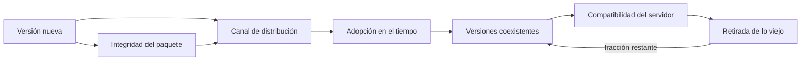
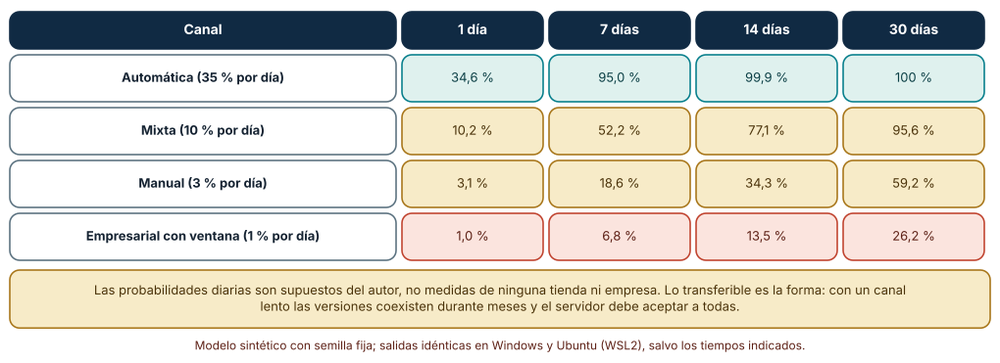
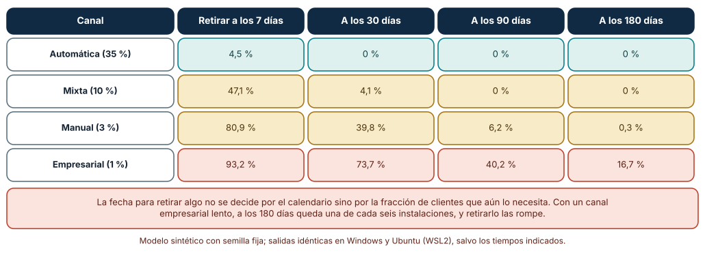
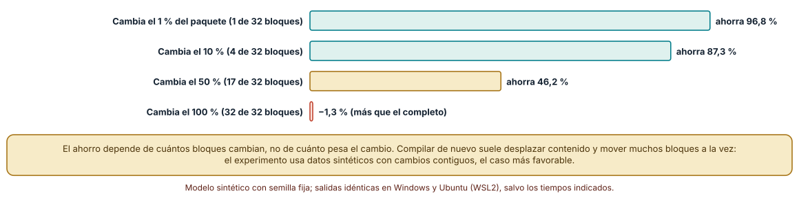

# SE-259 — Actualizaciones, tiendas y distribución empresarial

[← SE-258 — Interacción táctil, teclado, mouse y accesibilidad](https://github.com/vladimiracunadev-create/modern-software-engineering-program/blob/main/classes/part-21-software-movil-escritorio-y-multiplataforma/se-258-interaccion-tactil-teclado-mouse-y-accesibilidad/README.md) · [↑ Parte 21](https://github.com/vladimiracunadev-create/modern-software-engineering-program/blob/main/classes/part-21-software-movil-escritorio-y-multiplataforma/README.md) · [📚 Índice completo](https://github.com/vladimiracunadev-create/modern-software-engineering-program/blob/main/classes/README.md) · [🌐 Portal](https://vladimiracunadev-create.github.io/modern-software-engineering-program/classes/SE-259.html) · [SE-260 — Offline-first y resolución de conflictos →](https://github.com/vladimiracunadev-create/modern-software-engineering-program/blob/main/classes/part-21-software-movil-escritorio-y-multiplataforma/se-260-offline-first-y-resolucion-de-conflictos/README.md)

## Punto profesional y fundamento pedagógico

**Punto profesional.** La clase existe para que planifiques cómo llega una versión a los dispositivos (tiendas, actualización automática, distribución empresarial), cuántas versiones coexisten durante cuánto tiempo y cuándo es seguro retirar algo del servidor, con fechas que salgan de la adopción medida y no del calendario.

**Por qué aparece aquí.** Se sitúa después de **Interacción táctil, teclado, mouse y accesibilidad** y antes de **Offline-first y resolución de conflictos**: ya se sabe cómo se maneja el cliente; ahora se decide cómo llega una corrección a quien lo tiene instalado. La coexistencia de versiones es el supuesto que `SE-260` y el proyecto de `SE-264` heredan: el servidor atiende siempre a más de una.

**Error conceptual que debe corregir.** Creer que publicar una versión es actualizar a todo el mundo: el canal decide la velocidad, hay clientes que no se actualizan nunca, y retirar un campo en una fecha fija rompe a quienes siguen en una versión vieja.

**Secuencia de aprendizaje.** Antes de leer la solución, predices qué fracción de la base instalada tiene la versión nueva a los siete y a los treinta días con cuatro canales, qué fracción rompe retirar un campo en una fecha dada y cuánto ahorra descargar solo los bloques que cambiaron; después ejecutas los tres experimentos. La secuencia usa predicción, explicación propia, contraste y recuperación. [ICAP](https://icap.education.asu.edu/research) distingue participación de construcción de conocimiento; [How People Learn II](https://nap.nationalacademies.org/catalog/24783/how-people-learn-ii-learners-contexts-and-cultures) exige conectar conocimiento previo, contexto y transferencia; la [práctica de recuperación](https://pubmed.ncbi.nlm.nih.gov/16507066/) respalda producir de nuevo la explicación tras una demora; y [Education for Life and Work](https://nap.nationalacademies.org/resource/13398/dbasse_084153.pdf) exige devolución que explique la causa del error.

**Evidencia de aprendizaje.** `distribution-log.md` con la tabla de canales con su velocidad de adopción supuesta, la tabla de clientes viejos al retirar un campo, la comparación de descarga completa y por bloques y una regla de retirada basada en la fracción restante. Debe contener predicción previa, observación, explicación causal, contraejemplo y qué hallazgo haría abandonar la decisión.

**Límite de la conclusión.** Las probabilidades diarias de actualización son supuestos del autor, no medidas de ninguna tienda ni empresa; el paquete es sintético y los cambios son contiguos, el caso más favorable a los bloques. No se publicó ninguna aplicación ni se usó una cuenta de tienda.

### Trazabilidad fuente → afirmación

| Fuente primaria u oficial | Afirmación que respalda | Lo que no prueba |
|---|---|---|
| [Google Play Console Help, «Release app updates with staged rollouts»](https://support.google.com/googleplay/android-developer/answer/6346149) | Describe cómo publicar una actualización para un porcentaje de usuarios y aumentarlo después. | No da las tasas de adopción que se observan en el tiempo. |
| [Apple Developer, «Release a version update in phases»](https://developer.apple.com/help/app-store-connect/update-your-app/release-a-version-update-in-phases/) | Describe un lanzamiento en fases de una actualización automática a lo largo de siete días. | No cubre a quienes tienen desactivadas las actualizaciones automáticas. |
| [Samuel et al., «Survivable key compromise in software update systems» (CCS 2010)](https://doi.org/10.1145/1866307.1866315) | Analiza amenazas de los sistemas de actualización y propone un diseño con claves que sobrevive al compromiso de algunas. | No describe el sistema de ninguna tienda concreta. |

## Antes de empezar

Recupera `SE-258`: se decidió cómo se maneja el cliente. La pregunta activa es: **¿cuántas versiones del cliente están en uso a la vez, y qué le puedo cambiar al servidor sin romper a las que siguen?**

## Prerrequisitos

- Haber completado `SE-258` o poder explicar qué evidencia produjo.
- Poder describir el inventario de datos de `SE-256` y la política de guardado de `SE-254`.
- Conocer la idea de versionado semántico.
- Python 3.11 o posterior y un terminal; los experimentos usan solo la biblioteca estándar y datos sintéticos, sin cuentas de tienda, emuladores ni dispositivos.

## Problema auténtico

El equipo corrige un error del cliente un martes. El jueves decide retirar del servidor un campo antiguo que «ya nadie usa». El viernes llegan quejas: en un departamento, los equipos del aula están gestionados con una ventana de actualización mensual y siguen en la versión vieja; en una familia, un teléfono con el almacenamiento lleno tiene las actualizaciones automáticas desactivadas. Nadie se equivocó con la corrección: se equivocó la fecha de retirada.

## Objetivos observables

Al terminar podrás:

1. distinguir los canales de distribución (tienda con actualización automática, tienda manual, distribución empresarial, paquete propio) por quién decide la fecha de actualización;
2. calcular qué fracción de la base instalada tiene la versión nueva a lo largo del tiempo con una probabilidad diaria supuesta, y cómo cambia con el canal;
3. calcular qué fracción de clientes rompe retirar un campo a los 7, 30, 90 y 180 días y fijar una regla de retirada;
4. medir cuánto ahorra descargar solo los bloques cuya huella cambió y cuándo deja de ahorrar;
5. justificar un plan de lanzamiento con lanzamiento por fases, versión mínima soportada y fecha de retirada por fracción restante.

## Mapa conceptual



El mapa se lee de izquierda a derecha: el canal determina la curva de adopción, la curva determina cuántas versiones conviven, y esa convivencia decide qué se puede retirar. La retirada se decide por la fracción restante de clientes, no por la fecha.

## Temas y por qué importan

| Tema | Por qué cambia una decisión profesional | Evidencia mínima |
|---|---|---|
| Canales de distribución | Quién decide cuándo se actualiza determina qué tan rápido llega una corrección. | Predicción, traza causal y contraejemplo de **Canales de distribución** en `distribution-log.md` |
| Lanzamiento por fases | Publicar a un porcentaje limita el daño de un error que se descubre tarde. | Predicción, traza causal y contraejemplo de **Lanzamiento por fases** en `distribution-log.md` |
| Coexistencia y versión mínima | El servidor atiende a todas las versiones que sigan en uso, y debe declarar cuál es la más vieja que soporta. | Predicción, traza causal y contraejemplo de **Coexistencia y versión mínima** en `distribution-log.md` |
| Retirada de lo viejo | La fecha de retirada se calcula con la fracción de clientes que aún necesita lo viejo. | Predicción, traza causal y contraejemplo de **Retirada de lo viejo** en `distribution-log.md` |
| Integridad y entrega incremental | Un paquete que solo envía lo que cambió ahorra ancho de banda, pero necesita huellas que permitan verificarlo. | Predicción, traza causal y contraejemplo de **Integridad y entrega incremental** en `distribution-log.md` |

## Conceptos y decisiones

### 1. Canales de distribución

En una tienda con actualización automática, el sistema decide la fecha; en una tienda con actualización manual, la persona; en una distribución empresarial, el administrador, que puede fijar ventanas mensuales. Un paquete propio fuera de tienda exige que el propio cliente implemente la actualización. Cada canal tiene condiciones de publicación y de revisión distintas, y esas condiciones se verifican en su documentación vigente.

### 2. Lanzamiento por fases

Las tiendas permiten un lanzamiento escalonado: primero una fracción pequeña, luego más. Si la fracción pequeña revela un error grave, se detiene antes de llegar a todos. Es una red de seguridad, no una prueba: solo ve los fallos que aparecen en esa fracción y en el tiempo de espera. El lanzamiento por fases necesita una forma de detectar fallos, como errores y cierres inesperados por versión.

### 3. Coexistencia y versión mínima

Durante semanas o meses conviven varias versiones. El servidor puede sostener la compatibilidad (aceptar formatos viejos y nuevos), declarar una versión mínima por debajo de la cual el cliente debe actualizar, o ambas. La versión mínima necesita una pantalla de actualización obligatoria que no pierda el trabajo de la persona, y una fecha anunciada.

### 4. Retirada de lo viejo

Retirar un campo cuando su uso baja del umbral que el producto acepta es una decisión medible. La tabla de adopción muestra que, con un canal lento, a los 180 días aún queda una fracción apreciable: el umbral decide si se espera, se avisa dentro de la aplicación o se acepta romper a esa fracción. Mientras tanto, el servidor registra qué versiones llegan.

### 5. Integridad y entrega incremental

Dividir un paquete en bloques con huella permite descargar solo los distintos. El ahorro depende de cuántos bloques cambian, que no es lo mismo que cuánto cambia el contenido: una recompilación puede desplazar los bytes y cambiar casi todos los bloques. La verificación de integridad y la firma, que `SE-262` desarrolla, son lo que impide aceptar un bloque manipulado.

### Cuánta base instalada tiene la versión nueva

Se parte de 10 000 instalaciones sintéticas. Cada día, cada instalación pendiente se actualiza con una probabilidad p que depende del canal: 0,35 para actualización automática, 0,10 para un canal mixto, 0,03 para uno manual y 0,01 para uno empresarial con ventana. Se anota el porcentaje actualizado a 1, 7, 14 y 30 días (y a 3 y 60 en el registro completo).

```python
def adopcion(p_dia, dias, n=10000, seed=259):
    r = random.Random(seed); done = 0; pending = n
    for d in range(1, dias + 1):
        k = sum(1 for _ in range(pending) if r.random() < p_dia)
        pending -= k; done += k
```

Resultado, idéntico en Windows (CPython 3.12.9) y en Ubuntu (3.12.3): con p = 0,35, **34,6 %** a un día, **95,0 %** a siete y **99,9 %** a catorce; con p = 0,10, **10,2 %**, **52,2 %** y **77,1 %**, y **95,6 %** a treinta; con p = 0,03, **3,1 %**, **18,6 %**, **34,3 %** y **59,2 %** a treinta; con p = 0,01, **1,0 %**, **6,8 %**, **13,5 %** y **26,2 %** a treinta, y **45,9 %** a sesenta. La misma versión tarda una semana o un trimestre según quién decida la fecha.



**Cómo leer la figura.** Cada fila es un canal y cada columna un plazo en días; las celdas verdes son adopciones cercanas al total y las coral las que dejan a la mayoría en la versión vieja. **Dónde deja de valer:** una probabilidad diaria constante no describe a nadie: las poblaciones reales tienen una cola larga de instalaciones que no se actualizan nunca y picos tras una notificación. Los valores de p son supuestos del autor; se mide con la telemetría propia.

### Cuántos clientes rompe retirar un campo

Con las mismas cuatro probabilidades, se calcula qué fracción de 10 000 clientes no se ha actualizado cuando el servidor retira un campo a los 7, 30, 90 y 180 días de publicar la versión que ya no lo necesita.

```python
def rotos(p, dias_hasta_retirar, n=10000, seed=2592):
    r = random.Random(seed); pend = n
    for d in range(dias_hasta_retirar):
        pend -= sum(1 for _ in range(pend) if r.random() < p)
    return pend
```

Resultado: con el canal automático se rompen **4,5 %** si se retira a los 7 días y **0 %** a partir de 30; con el mixto, **47,1 %**, **4,1 %** y **0 %**; con el manual, **80,9 %**, **39,8 %**, **6,2 %** y **0,3 %** a 180 días; con el empresarial, **93,2 %**, **73,7 %**, **40,2 %** y **16,7 %** a 180 días. Retirar a los 30 días rompe a casi tres de cada cuatro clientes de un canal empresarial lento.



**Cómo leer la figura.** Cada celda es el porcentaje de clientes que seguiría necesitando el campo en la fecha de retirada; las verdes son retiradas seguras y las coral rompen a una fracción grande. **Dónde deja de valer:** el modelo supone que todo cliente se actualiza más tarde o más temprano; en la práctica hay instalaciones que no lo hacen, y una cola del 1 % puede ser un departamento entero. La decisión se toma con la distribución de versiones reales del servidor.

### Descargar solo los bloques que cambiaron

Un paquete sintético de 2 MiB (16 símbolos aleatorios, comprime a cerca de 1,19 MB) se divide en 32 bloques de 64 KiB con una huella SHA-256 cada uno. Se cambia una región contigua del 1, 10, 50 o 100 % del paquete. Se comparan la descarga completa comprimida con la de los bloques cuya huella cambió.

```python
K = 65536
bloques = lambda b: [b[i:i+K] for i in range(0, len(b), K)]
cambiados = [b for a, b in zip(bb, nb) if hashlib.sha256(a).digest() != hashlib.sha256(b).digest()]
delta = sum(len(zlib.compress(b, 6)) for b in cambiados)
```

Resultado: con un 1 % de cambio, **1 de 32** bloques cambia y la descarga baja de 1 194 682 a **37 841** bytes (ahorro **96,8 %**); con un 10 %, **4 de 32**, ahorro **87,3 %**; con un 50 %, **17 de 32**, ahorro **46,2 %**; y con un 100 %, **32 de 32**, y la descarga por bloques es un **1,3 %** mayor que la completa. El ahorro depende de cuántos bloques cambian y no de cuántos bytes pesa el cambio.



**Cómo leer la figura.** Cada barra es el ahorro frente a la descarga completa comprimida; las verdes son cambios pequeños, la dorada un cambio grande y la coral un cambio total. **Dónde deja de valer:** los cambios son contiguos y los datos sintéticos, el caso más favorable; una recompilación desplaza el contenido y cambia muchos bloques. No se midió ningún paquete real ni se probó un algoritmo de diferencias binarias que no dependa de la alineación en bloques.

## Definiciones de trabajo

- **canal de distribución:** vía por la que una versión llega al dispositivo (tienda con actualización automática o manual, distribución empresarial o paquete propio) y que fija quién decide la fecha.
- **lanzamiento por fases:** publicación de una versión a una fracción creciente de la base instalada para limitar el efecto de un error.
- **versión mínima soportada:** versión más antigua que el servidor acepta; por debajo, el cliente debe actualizar.
- **adopción:** fracción de la base instalada que ya tiene una versión en un momento dado.
- **huella de bloque:** resumen criptográfico de un bloque de bytes que permite saber si cambió sin compararlo byte a byte.

Las definiciones son operativas para el cliente de la plataforma de entregas. No convierten términos con una historia técnica más amplia en sinónimos y deben contrastarse con la documentación primaria enlazada al final.

## Ejemplo mínimo

El fragmento calcula qué fracción de una base sigue en la versión vieja tras cierto número de días. Antes de ejecutarlo, predice si con p = 0,03 queda menos de la mitad a los 14 días.

```python
import math
def fraccion_vieja(p_dia, dias):
    return (1 - p_dia) ** dias       # valor esperado

assert round(fraccion_vieja(0.03, 14) * 100, 1) == 65.3
assert round(fraccion_vieja(0.35, 7) * 100, 1) == 4.9
```

El valor esperado coincide con la simulación de la clase (34,3 % actualizado a los 14 días con p = 0,03, es decir, 65,7 % en la versión vieja) salvo por el ruido del muestreo. Calcula cuántos días hacen falta con p = 0,01 para que quede menos del 5 %.

## Ejemplo profesional

El equipo del cliente escribe un plan de lanzamiento: publicar al 5 % en el canal automático y observar errores durante dos días; subir a 25, 50 y 100 % si no hay regresión; declarar una versión mínima soportada con un anuncio dentro de la aplicación; y retirar un campo del servidor solo cuando la telemetría muestre que menos del 1 % de las peticiones lo usa durante 14 días seguidos. Para el canal empresarial, el plan incluye avisar al administrador con 60 días de antelación y publicar una guía de despliegue.

Compara el caso de una corrección urgente, el de un cambio de formato del borrador y el de una versión mínima nueva. Un plan es apropiado cuando esos tres casos tienen un calendario y un criterio de parada escritos; es peligroso cuando la fecha de retirada es una fecha.

## Práctica guiada

1. Lista los canales por los que llega el cliente y quién decide cuándo se actualiza en cada uno.
2. Predice la adopción a 7 y 30 días para cada canal y anota los números antes de ejecutar.
3. Simula la adopción con cuatro probabilidades y compara con tus predicciones.
4. Calcula la fracción rota al retirar un campo a distintos plazos y fija el umbral de retirada.
5. Divide un paquete en bloques y mide el ahorro con distintos porcentajes de cambio.
6. Escribe el plan de lanzamiento con fases, criterios de parada y versión mínima.
7. Entrega `distribution-log.md` y pide a otra persona que decida la fecha de retirada solo con él.

## Ejercicios

1. **Adopción:** calcula cuántos días tarda cada canal en alcanzar el 90 % y compáralo con una cola del 5 % que nunca se actualiza.
2. **Retirada:** con p = 0,03, calcula la fecha en que la fracción restante baja de 1 % y qué haría el cliente con esa fracción.
3. **Bloques:** reduce el tamaño de bloque a 16 KiB y recalcula el ahorro con un cambio disperso del 10 %.
4. **Fases:** diseña los criterios de parada de un lanzamiento por fases con tres métricas y sus umbrales.

## Reto verificable

Entrega `distribution-log.md` con la tabla de canales, la adopción simulada, la tabla de retirada y la comparación de descarga por bloques. Se aprueba si otra persona obtiene las mismas cifras con las mismas semillas y puede indicar con qué telemetría real sustituiría las probabilidades supuestas. No se aprueba por proponer una fecha sin la fracción restante.

## Caso conductor

El cliente de entregas de la Parte 21 deja aquí su plan de lanzamiento y su regla de retirada. `SE-260` desarrolla el trabajo sin conexión, donde un cliente viejo puede volver con operaciones atrasadas, `SE-262` firma y verifica los paquetes, y `SE-264` integra el plan en el proyecto. Cambia después una sola decisión, el umbral de retirada de 1 % a 0,1 %, y revisa cuánto se retrasa.

## Preguntas frecuentes

### ¿Por qué no obligar a actualizar siempre?

Porque una actualización obligatoria interrumpe el trabajo y excluye a quien no puede actualizar (almacenamiento lleno, administrador que no libera la versión). Se reserva para correcciones de seguridad o cambios incompatibles, con un aviso y sin perder el trabajo.

### ¿El lanzamiento por fases garantiza que no haya errores graves?

No. Limita el número de personas afectadas si el error aparece en la fracción inicial. Un error que solo ocurre en una configuración rara puede no aparecer hasta llegar a todos.

### ¿Cómo sé qué versiones siguen en uso?

Con telemetría mínima y consentida que registre la versión en cada petición al servidor. Sin ella, la fecha de retirada es una conjetura. La telemetría debe cumplir las normas de privacidad aplicables.

### ¿Descargar por bloques siempre ahorra?

No. Si el contenido se desplaza, muchos bloques cambian a la vez, y el costo de las huellas puede superar el ahorro. Con un cambio total, la descarga por bloques fue un 1,3 % mayor.

## Fallo controlado y diagnóstico

Reproduce el fallo clásico de la clase: **retirar un campo en una fecha fija sin mirar quién sigue en la versión vieja**. Retira el campo a los 30 días con el canal empresarial.

Registra síntoma, hipótesis, observación que descarta cada una, causa, corrección y regresión. **Síntoma:** un departamento no puede entregar tras la retirada. **Hipótesis rivales:** (a) un error del servidor; (b) su cliente es de una versión que aún usaba el campo. **Prueba:** busca la versión que envía esas peticiones; si es anterior a la que dejó de usar el campo, la hipótesis (b) explica el fallo. **Conclusión:** la causa es una fecha sin criterio de fracción. **Regresión:** registra versiones por petición y retira solo bajo un umbral; no cambies a la vez el campo y la versión mínima.

## Errores comunes y cómo corregirlos

| Síntoma | Causa probable | Corrección |
|---|---|---|
| Un grupo no puede entregar tras retirar un campo | La fecha de retirada ignoró a quienes siguen en versiones viejas | Retirar por fracción de uso y versión mínima anunciada |
| Una corrección urgente tarda semanas en llegar a la mayoría | El canal es lento y se supuso uno rápido | Medir la adopción por canal y planear en consecuencia |
| Un error se descubre tras llegar al 100 % de la base | Lanzamiento sin fases ni métricas de parada | Lanzamiento por fases con errores y cierres por versión |
| La actualización obligatoria borra el trabajo de la persona | No se guardó el estado antes de exigirla | Guardar el borrador y restaurar tras actualizar (`SE-254`) |
| La descarga incremental pesa igual que la completa | Cambió casi todo el contenido y los bloques se desplazaron | Medir con un paquete real y elegir el algoritmo según los cambios |

## Entorno y archivos clave

```text
work/SE-259/
├── README.md
├── distribucion/
│   ├── adopcion.py
│   ├── retirada.py
│   └── bloques.py
├── tests/test_distribucion.py
└── evidence/distribution-log.md
```

El `README` declara plataforma, versión de Python, semillas y comandos. Los experimentos usan solo la biblioteca estándar (`random`, `zlib`, `hashlib`) y se ejecutaron con CPython 3.12.9 en Windows 11 y 3.12.3 en Ubuntu bajo WSL2: las salidas fueron idénticas. No se publicó ninguna aplicación ni se usó una cuenta de tienda; las condiciones de cada tienda se verifican en su documentación vigente.

## Seguridad, ética y accesibilidad

- la telemetría de versiones debe ser mínima, informada y conforme a la normativa aplicable: no registres identificadores personales;
- una actualización obligatoria debe comunicarse con lenguaje comprensible y respetar a quien no puede actualizar;
- un canal empresarial es de otra organización: respeta sus ventanas y su proceso de aprobación;
- verifica la integridad de lo que se descarga: un canal de actualización es un vector de ataque;
- las condiciones de cada tienda cambian: consulta la documentación vigente antes de planificar.

## Puente hacia el trabajo con agentes

Un agente al que se le pide «publica la nueva versión y limpia lo que ya no se usa» eliminará el campo antiguo del servidor porque ningún código del repositorio lo usa. Pídele la distribución de versiones activas, la fracción que aún usa el campo y la fecha en que bajaría del umbral, y que no borre nada hasta que lo apruebes. Revisa especialmente qué telemetría usó: sin ella, «ya nadie lo usa» es una conjetura con apariencia de dato.

## Transferencia

Traslada el análisis a otro dominio persistente (una aplicación de reparto con un cambio de protocolo): cambia los canales y las probabilidades, conserva el procedimiento de simular la adopción, calcular la fracción rota y fijar el umbral. La transferencia está lograda cuando puedes explicar qué parte del método dependía del cliente de entregas y cuál no.

## Evaluación y evidencia

| Criterio | Evidencia para aprobar |
|---|---|
| comprensión | explicación de cómo el canal determina la velocidad de adopción y la coexistencia de versiones |
| corrección | cifras reproducibles de adopción, clientes rotos y ahorro por bloques |
| diseño | plan de lanzamiento con fases, criterios de parada, versión mínima y regla de retirada |
| diagnóstico | reproducción del fallo «fecha de retirada fija» con regresión |
| incertidumbre | declaración de las probabilidades supuestas y de la cola de instalaciones que nunca se actualizan |
| reproducibilidad | versiones, comandos, salida y límites declarados |

## Fuentes

- [Google Play Console Help, «Release app updates with staged rollouts»](https://support.google.com/googleplay/android-developer/answer/6346149) — lanzamiento escalonado en Google Play; autoridad: Google.
- [Apple Developer, «Release a version update in phases»](https://developer.apple.com/help/app-store-connect/update-your-app/release-a-version-update-in-phases/) — lanzamiento en fases en App Store Connect; autoridad: Apple.
- [Microsoft, «What is MSIX?»](https://learn.microsoft.com/en-us/windows/msix/overview) — formato de empaquetado y actualización para aplicaciones de Windows; autoridad: Microsoft.
- [Electron, «autoUpdater»](https://www.electronjs.org/docs/latest/api/auto-updater) — actualización automática de una aplicación de escritorio; autoridad: OpenJS Foundation.
- [The Update Framework](https://theupdateframework.io/) — marco para proteger sistemas de actualización; autoridad: TUF / Linux Foundation.
- [Samuel et al., «Survivable key compromise in software update systems» (CCS 2010)](https://doi.org/10.1145/1866307.1866315) — amenazas a los sistemas de actualización y diseño de claves; autoridad: ACM CCS.
- [Preston-Werner, «Versionado semántico 2.0.0»](https://semver.org/lang/es/) — convención para numerar versiones según la compatibilidad; autoridad: semver.org.

Cada fuente respalda el mecanismo indicado; ninguna demuestra que las probabilidades de actualización del experimento correspondan a una tienda o a una organización reales. Esa afirmación depende de medir la telemetría propia.

- [Python: `zlib`](https://docs.python.org/3/library/zlib.html) — compresión usada para estimar el tamaño de descarga.
- [Python: `hashlib`](https://docs.python.org/3/library/hashlib.html) — huellas SHA-256 de los bloques.

## Límites y siguiente paso

Se ejecutaron tres experimentos con datos sintéticos en Windows y Ubuntu (WSL2) con resultados idénticos. No se publicó ninguna aplicación ni se midió ninguna base instalada: las probabilidades y el paquete son construcciones del autor. La siguiente clase pregunta qué ocurre cuando el cliente trabaja sin conexión.

## Glosario

- **canal de distribución:** vía por la que una versión llega al dispositivo (tienda con actualización automática o manual, distribución empresarial o paquete propio) y que fija quién decide la fecha.
- **lanzamiento por fases:** publicación de una versión a una fracción creciente de la base instalada para limitar el efecto de un error.
- **versión mínima soportada:** versión más antigua que el servidor acepta; por debajo, el cliente debe actualizar.
- **adopción:** fracción de la base instalada que ya tiene una versión en un momento dado.
- **huella de bloque:** resumen criptográfico de un bloque de bytes que permite saber si cambió sin compararlo byte a byte.

---

[← SE-258 — Interacción táctil, teclado, mouse y accesibilidad](https://github.com/vladimiracunadev-create/modern-software-engineering-program/blob/main/classes/part-21-software-movil-escritorio-y-multiplataforma/se-258-interaccion-tactil-teclado-mouse-y-accesibilidad/README.md) · [↑ Parte 21](https://github.com/vladimiracunadev-create/modern-software-engineering-program/blob/main/classes/part-21-software-movil-escritorio-y-multiplataforma/README.md) · [📚 Índice completo](https://github.com/vladimiracunadev-create/modern-software-engineering-program/blob/main/classes/README.md) · [🌐 Portal](https://vladimiracunadev-create.github.io/modern-software-engineering-program/classes/SE-259.html) · [SE-260 — Offline-first y resolución de conflictos →](https://github.com/vladimiracunadev-create/modern-software-engineering-program/blob/main/classes/part-21-software-movil-escritorio-y-multiplataforma/se-260-offline-first-y-resolucion-de-conflictos/README.md)
