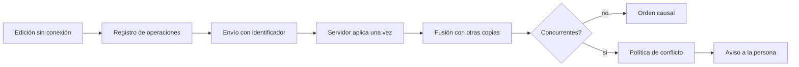
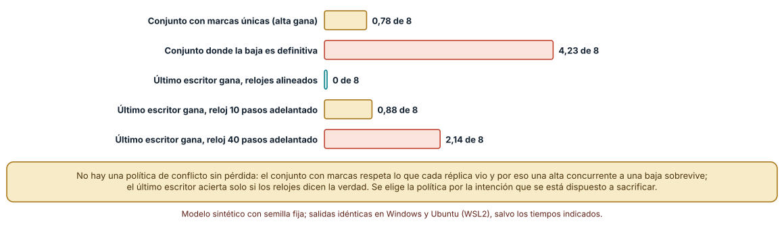
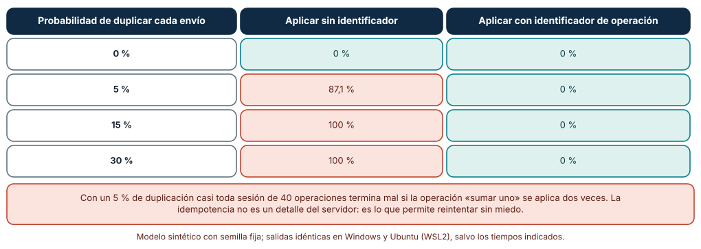
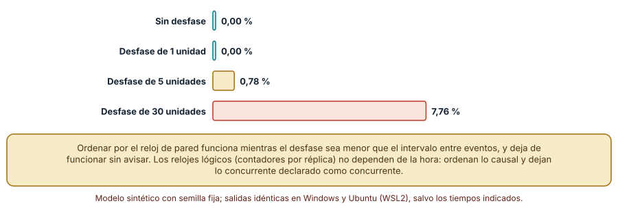

# SE-260 — Offline-first y resolución de conflictos

[← SE-259 — Actualizaciones, tiendas y distribución empresarial](https://github.com/vladimiracunadev-create/modern-software-engineering-program/blob/main/classes/part-21-software-movil-escritorio-y-multiplataforma/se-259-actualizaciones-tiendas-y-distribucion-empresarial/README.md) · [↑ Parte 21](https://github.com/vladimiracunadev-create/modern-software-engineering-program/blob/main/classes/part-21-software-movil-escritorio-y-multiplataforma/README.md) · [📚 Índice completo](https://github.com/vladimiracunadev-create/modern-software-engineering-program/blob/main/classes/README.md) · [🌐 Portal](https://vladimiracunadev-create.github.io/modern-software-engineering-program/classes/SE-260.html) · [SE-261 — Rendimiento, batería y recursos limitados →](https://github.com/vladimiracunadev-create/modern-software-engineering-program/blob/main/classes/part-21-software-movil-escritorio-y-multiplataforma/se-261-rendimiento-bateria-y-recursos-limitados/README.md)

## Punto profesional y fundamento pedagógico

**Punto profesional.** La clase existe para que diseñes el cliente para trabajar sin conexión como caso normal, elijas una estructura de datos y una política de conflicto sabiendo qué intención sacrifica cada una, y hagas que reintentar sea seguro con operaciones idempotentes.

**Por qué aparece aquí.** Se sitúa después de **Actualizaciones, tiendas y distribución empresarial** y antes de **Rendimiento, batería y recursos limitados**: ya se sabe que varias versiones y varios dispositivos conviven; ahora se decide qué pasa cuando editan el mismo dato sin verse. Desarrolla las políticas de fusión que `SE-256` introdujo y prepara el protocolo de sincronización del proyecto `SE-264`.

**Error conceptual que debe corregir.** Creer que sincronizar es copiar el último estado, o que reintentar una operación que falló es inocuo: sin identificadores de operación, un reintento suma dos veces, y sin relojes lógicos, un reloj adelantado decide quién gana.

**Secuencia de aprendizaje.** Antes de leer la solución, predices cuántos elementos difieren de la intención de la persona con cuatro tipos de conjuntos replicados, cuántas sesiones terminan mal si se aplica dos veces una operación duplicada y qué porcentaje de pares de eventos ordena mal un reloj de pared desfasado; después ejecutas los tres experimentos. La secuencia usa predicción, explicación propia, contraste y recuperación. [ICAP](https://icap.education.asu.edu/research) distingue participación de construcción de conocimiento; [How People Learn II](https://nap.nationalacademies.org/catalog/24783/how-people-learn-ii-learners-contexts-and-cultures) exige conectar conocimiento previo, contexto y transferencia; la [práctica de recuperación](https://pubmed.ncbi.nlm.nih.gov/16507066/) respalda producir de nuevo la explicación tras una demora; y [Education for Life and Work](https://nap.nationalacademies.org/resource/13398/dbasse_084153.pdf) exige devolución que explique la causa del error.

**Evidencia de aprendizaje.** `offline-log.md` con la comparación de estructuras replicadas con su pérdida medida, la tabla de duplicados con y sin identificador, la tabla de desfase de reloj y la política de conflicto elegida con la intención que sacrifica. Debe contener predicción previa, observación, explicación causal, contraejemplo y qué hallazgo haría abandonar la decisión.

**Límite de la conclusión.** Las estructuras replicadas se implementaron de forma mínima con operaciones sintéticas y semilla fija; no se usó ninguna biblioteca de producción. La intención «correcta» se definió como la última operación en tiempo real, algo que en un sistema real no se conoce, y las probabilidades de duplicado y de reordenamiento son supuestos del autor.

### Trazabilidad fuente → afirmación

| Fuente primaria u oficial | Afirmación que respalda | Lo que no prueba |
|---|---|---|
| [Shapiro et al., «Conflict-Free Replicated Data Types» (SSS 2011)](https://doi.org/10.1007/978-3-642-24550-3_29) | Define tipos de datos replicados cuyas copias convergen sin coordinación si cumplen ciertas propiedades de fusión. | No elige cuál tipo conviene a un producto ni mide la pérdida de intención. |
| [Lamport, «Time, clocks, and the ordering of events in a distributed system» (CACM, 1978)](https://doi.org/10.1145/359545.359563) | Muestra que el orden de eventos en un sistema distribuido se define por causalidad y no por relojes físicos, y propone relojes lógicos. | No resuelve qué hacer con eventos concurrentes. |
| [Kleppmann et al., «Local-first software» (Onward! 2019)](https://doi.org/10.1145/3359591.3359737) | Propone aplicaciones que trabajan primero sobre datos locales y sincronizan después, con sus ventajas y dificultades. | No evalúa una implementación concreta del cliente de entregas. |

## Antes de empezar

Recupera `SE-259`: varias versiones y varios dispositivos conviven. La pregunta activa es: **¿qué estado final obtengo cuando dos dispositivos editan sin verse y se reconcilian después, y qué intención se pierde?**

## Prerrequisitos

- Haber completado `SE-259` o poder explicar qué evidencia produjo.
- Poder describir la política de fusión de `SE-256` y la regla de retirada de `SE-259`.
- Entender la idea de operación idempotente.
- Python 3.11 o posterior y un terminal; los experimentos usan solo la biblioteca estándar y datos sintéticos, sin cuentas de tienda, emuladores ni dispositivos.

## Problema auténtico

Una estudiante añade tres comentarios a su borrador en el teléfono, sin conexión, en el metro. Otra copia, en el portátil, borra uno de esos comentarios que había sincronizado antes. Al volver la conexión, el sistema aplica la última operación que llegó: dos comentarios, uno nuevo faltante, y un contador de revisiones que cuenta 3 cuando se hicieron 6 cambios. Nadie programó un error: no se decidió qué significa «el mismo estado» cuando dos copias divergen.

## Objetivos observables

Al terminar podrás:

1. describir el trabajo sin conexión como un registro de operaciones que se aplica después y distinguir estado, operación y orden;
2. comparar cuatro estructuras (conjunto con marcas únicas, conjunto con baja definitiva, último escritor gana con reloj alineado y con reloj desfasado) por los elementos que difieren de la intención;
3. medir cuántas sesiones terminan mal al aplicar operaciones duplicadas con y sin identificador de operación;
4. medir cuántos pares de eventos ordena mal un reloj de pared desfasado y por qué un reloj lógico no depende de la hora;
5. justificar una política de conflicto por la intención que sacrifica y por cómo se comunica a la persona.

## Mapa conceptual



El mapa se lee de izquierda a derecha: toda edición sin conexión se vuelve una operación con identificador; el servidor la aplica una sola vez; si no hay concurrencia el orden es causal; si la hay, una política decide y la persona se entera.

## Temas y por qué importan

| Tema | Por qué cambia una decisión profesional | Evidencia mínima |
|---|---|---|
| Offline-first | El caso sin conexión es el normal y la conexión es una optimización. | Predicción, traza causal y contraejemplo de **Offline-first** en `offline-log.md` |
| Operaciones idempotentes | Una operación que se puede aplicar dos veces sin cambiar el resultado permite reintentar sin miedo. | Predicción, traza causal y contraejemplo de **Operaciones idempotentes** en `offline-log.md` |
| Estructuras replicadas | Cada estructura decide a priori qué ocurre con las operaciones concurrentes. | Predicción, traza causal y contraejemplo de **Estructuras replicadas** en `offline-log.md` |
| Relojes lógicos | El orden causal no depende de la hora de ningún dispositivo. | Predicción, traza causal y contraejemplo de **Relojes lógicos** en `offline-log.md` |
| Política de conflicto y comunicación | Toda política pierde una intención, y la decisión de producto es cuál y si se avisa. | Predicción, traza causal y contraejemplo de **Política de conflicto y comunicación** en `offline-log.md` |

## Conceptos y decisiones

### 1. Offline-first

Un cliente offline-first lee y escribe en su almacenamiento local y sincroniza en segundo plano; la red solo reconcilia. Eso invierte el diseño habitual en el que la red es la fuente de verdad y la caché una ayuda. La ventaja es que la aplicación responde sin esperar; el coste es que dos copias pueden divergir y alguien debe decidir qué hacer. Kleppmann y colaboradores describen la propuesta y sus dificultades abiertas.

### 2. Operaciones idempotentes

Cuando la red falla, el cliente no sabe si el servidor recibió la operación. Reintentar es la única opción, y solo es segura si aplicar la misma operación dos veces equivale a aplicarla una. Se logra con un identificador único por operación que el servidor recuerda. RFC 9110 define la idempotencia de los métodos HTTP como propiedad del efecto, no de la forma de la petición: `PUT` lo es, `POST` no por defecto.

### 3. Estructuras replicadas

Un conjunto con marcas únicas conserva una alta aunque otra copia haya borrado un elemento previo que no vio, y se dice que gana la alta. Un conjunto en el que la baja es definitiva impide volver a añadir un elemento borrado. Un registro de último escritor gana según una marca de tiempo. Un contador por réplica suma las partes de cada una. Shapiro y colaboradores formalizan las condiciones para que las copias converjan; la convergencia no garantiza que el resultado sea lo que la persona quería.

### 4. Relojes lógicos

Lamport mostró que lo que importa es si un evento pudo influir en otro. Un contador por réplica, que se incrementa con cada evento y se fusiona con el máximo, ordena lo causal y detecta lo concurrente. La hora de pared sirve para mostrar a la persona cuándo ocurrió algo, no para decidir quién gana: cualquier desfase entre dispositivos puede invertir el orden de eventos próximos.

### 5. Política de conflicto y comunicación

Elegir «gana el último», «gana la alta», «se fusiona por campo» o «se pregunta a la persona» es elegir qué se sacrifica. Perder en silencio es la peor combinación: la persona descubre después que su trabajo no está. Una política razonable conserva una copia de lo descartado durante un plazo y muestra un aviso con una forma de recuperarlo.

### Cuatro estructuras frente a la intención

Se simulan tres réplicas y 60 operaciones sobre ocho elementos; cada operación es añadir (55 %) o quitar. La «intención» de la persona es el resultado de aplicar las operaciones en el orden real del tiempo. Se comparan un conjunto con marcas únicas (la baja elimina solo las marcas vistas), un conjunto con baja definitiva y un registro de último escritor gana, con el reloj de una réplica adelantado 0, 10 o 40 pasos. Se anota cuántos de los ocho elementos difieren de la intención, con 2000 semillas.

```python
if tipo == '2p':     # la baja es definitiva
    final = {e for _, _, e, a in ops if a} - {e for _, _, e, a in ops if not a}
else:                # último escritor gana; la réplica 1 va adelantada
    for t, rep, e, add in ops:
        m = t + (skew if rep == 1 else 0)
        if e not in mejor or m > mejor[e][0]: mejor[e] = (m, add)
    final = {e for e, (m, add) in mejor.items() if add}
error = len(final ^ quiere)
```

Resultado, idéntico en Windows (CPython 3.12.9) y en Ubuntu (3.12.3): el conjunto con marcas únicas difiere en **0,78** elementos de media (45,2 % de las sesiones exactas), porque una alta concurrente a una baja sobrevive; el de baja definitiva, en **4,23** (0,2 % exactas); el último escritor con relojes alineados, en **0** (100 % exactas), con diez pasos de desfase en **0,88** y con cuarenta en **2,14** (9,1 % exactas). Además, un contador implementado como «el último valor gana» pierde **40,0** de 60,0 incrementos de media, y uno por réplica, ninguno.



**Cómo leer la figura.** Cada barra es la media de elementos (de ocho) que difieren del resultado de aplicar las operaciones en su orden real; verdes son las que casi coinciden y coral las que más se alejan. **Dónde deja de valer:** la intención se define como el orden real del tiempo, algo que el sistema no ve; el conjunto con marcas se aleja por diseño (una alta concurrente gana), no por error. Un sistema real elige la semántica que prefiere, y aquí solo se muestra cuánto se aleja cada una de un criterio.

### Aplicar dos veces una operación

Se envían 40 operaciones «sumar uno» en orden aleatorio; cada envío se duplica con probabilidad 0, 0,05, 0,15 o 0,30 (puede duplicarse más de una vez). Se compara aplicar todo lo recibido con aplicar solo la primera aparición de cada identificador, con 1000 semillas por probabilidad.

```python
def aplica(ops, dedup):
    estado = 0; vistos = set()
    for oid, delta in ops:
        if dedup and oid in vistos: continue
        vistos.add(oid); estado += delta
    return estado
```

Resultado: sin duplicados las dos formas dan el estado correcto; con **5 %** de duplicación, aplicar sin identificador deja el estado errado en el **87,1 %** de las sesiones; con **15 %** y **30 %**, en el **100 %**; con identificador de operación, **0 %** en todos los casos. Una sesión de 40 operaciones tiene tantas oportunidades de duplicarse que incluso un 5 % arruina casi todas.



**Cómo leer la figura.** Cada fila es una probabilidad de duplicar; las celdas coral son la aplicación sin identificador y las verdes la aplicación con identificador de operación. **Dónde deja de valer:** la operación «sumar uno» es la más sensible a la duplicación; una operación idempotente por naturaleza (asignar un valor) no lo sería. El modelo no incluye ventanas de olvido de identificadores ni el coste de recordarlos.

### Relojes de pared desfasados

Se generan 30 eventos alternados entre dos dispositivos, separados por entre 1 y 10 unidades de tiempo reales. Un dispositivo tiene el reloj adelantado 0, 1, 5 o 30 unidades. Se ordenan por la hora de cada dispositivo y se cuenta el porcentaje de pares de eventos que quedan invertidos respecto del orden real, con 1000 semillas.

```python
marcas = [(t + (skew if d == 'B' else 0), i) for i, (t, d) in enumerate(ev)]
orden = [i for _, i in sorted(marcas)]
inv = sum(1 for a in range(len(orden)) for b in range(a+1, len(orden)) if orden[a] > orden[b])
```

Resultado: con desfase **0** y **1** unidades, **0,00 %** de pares invertidos; con **5**, **0,78 %**; con **30**, **7,76 %**. Hasta que el desfase supera el intervalo mínimo entre eventos, el orden es correcto; después se degrada y no avisa. Un reloj lógico con contadores por réplica ordena lo causal sin depender de ese desfase y señala lo concurrente en lugar de ordenarlo por una hora.



**Cómo leer la figura.** Cada barra es el porcentaje de pares invertidos en 1000 secuencias de 30 eventos; las verdes no invierten ninguno y la coral invierte casi uno de cada trece. **Dónde deja de valer:** el desfase es constante y los eventos están separados por entre 1 y 10 unidades; los relojes reales derivan, se corrigen a saltos y se desfasan por zonas. El experimento no incluye relojes lógicos implementados, solo explica por qué la hora no sirve para ordenar.

## Definiciones de trabajo

- **offline-first:** estilo de diseño en el que el cliente lee y escribe en su almacenamiento local y la red solo reconcilia las copias.
- **idempotencia:** propiedad de una operación cuyo efecto es el mismo si se aplica una vez o varias.
- **réplica:** copia de un dato que un dispositivo edita de forma independiente y se reconcilia después con las demás.
- **reloj lógico:** contador que ordena eventos según su causalidad sin depender de la hora física de ningún dispositivo.
- **conflicto:** situación en que dos réplicas modificaron el mismo dato sin ver el cambio de la otra y existen varios estados finales razonables.

Las definiciones son operativas para el cliente de la plataforma de entregas. No convierten términos con una historia técnica más amplia en sinónimos y deben contrastarse con la documentación primaria enlazada al final.

## Ejemplo mínimo

El fragmento aplica una operación duplicada con y sin identificador. Antes de ejecutarlo, predice el valor final de cada una.

```python
ops = [("a", 1), ("b", 1), ("b", 1), ("c", 1)]      # la operación «b» llegó dos veces

def aplica(ops, dedup):
    visto, total = set(), 0
    for oid, d in ops:
        if dedup and oid in visto:
            continue
        visto.add(oid)
        total += d
    return total

assert aplica(ops, False) == 4
assert aplica(ops, True) == 3
```

Sin identificador, la operación duplicada cuenta dos veces. Registra cuántos identificadores recuerda el servidor y durante cuánto tiempo; predice qué pasa si olvida uno antes de que llegue el reintento.

## Ejemplo profesional

El equipo del cliente documenta una política de conflicto por tipo de dato. Los comentarios son un conjunto con marcas únicas: nunca se pierde uno añadido, a costa de que una baja concurrente a un alta no gane. El título del borrador usa último escritor con un contador por réplica para decidir y guarda la versión descartada 30 días con un aviso. El contador de revisiones se calcula a partir del registro de operaciones, no se sincroniza como número. Cada operación lleva un identificador y el servidor recuerda los de las últimas dos semanas.

Compara el caso de tres comentarios añadidos sin conexión, el de un título editado en ambos lados y el de una operación reintentada tres veces. Una política es apropiada cuando esos tres casos tienen un resultado escrito y una prueba, y es peligrosa cuando la fusión pierde una edición sin avisar.

## Práctica guiada

1. Lista los datos que el cliente edita sin conexión y marca los que pueden editarse en dos copias a la vez.
2. Predice la pérdida de cada estructura y anota los números antes de ejecutar.
3. Simula las estructuras con 2000 semillas y compara con tus predicciones.
4. Aplica operaciones duplicadas con y sin identificador y mide el estado errado.
5. Ordena eventos de dos dispositivos por la hora de cada uno con varios desfases.
6. Escribe la política de conflicto por tipo de dato con la intención que sacrifica y el aviso.
7. Entrega `offline-log.md` y pide a otra persona que reconstruya la política solo con él.

## Ejercicios

1. **Estructura:** añade una cuarta réplica y calcula si cambia la diferencia entre el conjunto con marcas y el de baja definitiva.
2. **Duplicados:** calcula cuántos identificadores debe recordar el servidor si llegan 50 operaciones por minuto y se retiene dos semanas.
3. **Reloj:** implementa un reloj lógico por réplica y comprueba que ordena igual con cualquier desfase.
4. **Aviso:** diseña el texto y la forma de recuperar una edición descartada por la política de título.

## Reto verificable

Entrega `offline-log.md` con la política de conflicto por tipo de dato, la comparación de estructuras, la tabla de duplicados y la de desfase de reloj. Se aprueba si otra persona obtiene las mismas cifras con las mismas semillas, entiende qué intención sacrifica cada política y puede indicar qué sistema real habría que medir. No se aprueba por afirmar que los datos «convergen».

## Caso conductor

El cliente de entregas de la Parte 21 deja aquí su política de conflicto por dato y su regla de operaciones idempotentes. `SE-261` mide el coste en recursos de sincronizar, `SE-262` firma y valida lo que viaja, y `SE-264` integra el protocolo en el proyecto. Cambia después una sola decisión, el título pasa de último escritor a conservar ambas versiones, y revisa qué pantallas y qué pruebas cambian.

## Preguntas frecuentes

### ¿Los tipos replicados garantizan que no se pierde nada?

No. Garantizan que las copias convergen al mismo estado, pero ese estado puede no ser el que la persona esperaba. En la simulación, el conjunto con marcas difiere de la intención en 0,78 elementos de media.

### ¿Por qué no usar siempre la hora para decidir quién gana?

Porque los relojes de dos dispositivos difieren. Con un desfase de 30 unidades, el 7,76 % de los pares de eventos quedó invertido. La hora es útil para mostrarla, no para decidir.

### ¿Cuánto tiempo debe recordar el servidor los identificadores?

El que permita que el último reintento posible de un cliente llegue. Si olvida antes, una operación retrasada se aplica dos veces. El plazo se decide por la duración máxima de la desconexión que el producto tolera.

### ¿Es necesario implementar yo mismo la fusión?

Rara vez. Existen bibliotecas, pero hay que entender qué semántica ofrecen, qué sacrifican y cómo se comunica a la persona. Este material no evalúa ninguna.

## Fallo controlado y diagnóstico

Reproduce el fallo clásico de la clase: **sincronizar copiando el último estado que llegó**. Haz que dos réplicas editen el mismo conjunto y quédate con la que llegó última.

Registra síntoma, hipótesis, observación que descarta cada una, causa, corrección y regresión. **Síntoma:** un comentario añadido sin conexión desaparece al reconectar. **Hipótesis rivales:** (a) el comentario nunca se guardó; (b) la copia que llegó última lo sobrescribió. **Prueba:** busca el comentario en el registro de operaciones local; si está, la hipótesis (b) explica la pérdida. **Conclusión:** la causa es copiar el estado en lugar de fusionar operaciones. **Regresión:** reproduce con dos réplicas y exige que los dos comentarios sobrevivan; no cambies a la vez la estructura y la política de aviso.

## Errores comunes y cómo corregirlos

| Síntoma | Causa probable | Corrección |
|---|---|---|
| Un comentario añadido sin conexión desaparece | Se copió el estado de la última réplica en llegar | Fusionar operaciones y usar una estructura que conserve altas |
| Un contador cuenta la mitad de los cambios | Se sincroniza el valor con «el último gana» | Contador por réplica o recalcular del registro de operaciones |
| Un reintento duplica un cambio | La operación no tiene identificador | Identificador único por operación y deduplicación en el servidor |
| El dispositivo con la hora adelantada siempre gana | Se ordena por la hora física | Relojes lógicos y hora solo para mostrar |
| La persona descubre días después que su edición se perdió | La política descarta en silencio | Guardar lo descartado y avisar con una forma de recuperarlo |

## Entorno y archivos clave

```text
work/SE-260/
├── README.md
├── offline/
│   ├── replicas.py
│   ├── idempotencia.py
│   └── relojes.py
├── tests/test_offline.py
└── evidence/offline-log.md
```

El `README` declara plataforma, versión de Python, semillas y comandos. Los experimentos usan solo la biblioteca estándar (`random`) y se ejecutaron con CPython 3.12.9 en Windows 11 y 3.12.3 en Ubuntu bajo WSL2: las salidas fueron idénticas. No se usó ninguna biblioteca de datos replicados ni un servidor de sincronización.

## Seguridad, ética y accesibilidad

- una copia local con ediciones pendientes es un dato personal: define cifrado, retención y borrado al cerrar sesión;
- una política que descarta ediciones afecta el trabajo de personas: comunícalo y deja recuperar;
- no uses identificadores de operación que revelen datos de la persona;
- una operación aplicada dos veces puede significar un cobro o un envío doble: la idempotencia es una propiedad de seguridad, no solo de comodidad;
- ofrece una alternativa textual a las tablas y no uses color como única señal.

## Puente hacia el trabajo con agentes

Un agente al que se le pide «haz que funcione sin conexión» guardará una cola de peticiones y las reenviará al reconectar. Pídele los identificadores de operación, la deduplicación en el servidor, la política de conflicto por tipo de dato con la intención que sacrifica y una prueba con dos réplicas que editan a la vez. Revisa especialmente si reenvía sin identificador: es el mismo error que sumó dos veces.

## Transferencia

Traslada el análisis a otro dominio persistente (una lista de compras compartida entre dos teléfonos): cambia los datos y las operaciones, conserva el procedimiento de comparar estructuras, duplicados y relojes. La transferencia está lograda cuando puedes explicar qué parte del método dependía del borrador y cuál no.

## Evaluación y evidencia

| Criterio | Evidencia para aprobar |
|---|---|
| comprensión | explicación de la diferencia entre convergencia y conservar la intención |
| corrección | cifras reproducibles de estructuras, duplicados y desfase con las mismas semillas |
| diseño | política de conflicto por tipo de dato con la intención que sacrifica y el aviso |
| diagnóstico | reproducción del fallo «copiar el último estado» con regresión |
| incertidumbre | declaración de que la intención se definió con el orden real y de que no se usó una biblioteca real |
| reproducibilidad | versiones, comandos, salida y límites declarados |

## Fuentes

- [Shapiro et al., «Conflict-Free Replicated Data Types» (SSS 2011)](https://doi.org/10.1007/978-3-642-24550-3_29) — tipos de datos replicados que convergen; autoridad: Lecture Notes in Computer Science.
- [Lamport, «Time, clocks, and the ordering of events in a distributed system» (CACM, 1978)](https://doi.org/10.1145/359545.359563) — relojes lógicos y orden causal; autoridad: Communications of the ACM.
- [Kleppmann et al., «Local-first software» (Onward! 2019)](https://doi.org/10.1145/3359591.3359737) — propuesta de aplicaciones con datos locales primero; autoridad: ACM SIGPLAN Onward!.
- [Ink & Switch, «Local-first software»](https://www.inkandswitch.com/local-first/) — versión extendida del ensayo con siete ideales; autoridad: Ink & Switch.
- [IETF, «RFC 9110: HTTP Semantics» (métodos idempotentes)](https://www.rfc-editor.org/rfc/rfc9110) — definición de idempotencia de los métodos HTTP; autoridad: IETF.

Cada fuente respalda el mecanismo indicado; ninguna demuestra que las probabilidades de duplicado o el desfase de los experimentos correspondan a una red o un dispositivo reales ni que una estructura conserve la intención de una persona. Esa afirmación depende de probar con el producto.

- [Python: `random`](https://docs.python.org/3/library/random.html) — generador con semilla de las simulaciones.

## Límites y siguiente paso

Se ejecutaron tres experimentos con datos sintéticos en Windows y Ubuntu (WSL2) con resultados idénticos. No se usó ninguna biblioteca de datos replicados, servidor ni red real: las probabilidades y la intención son construcciones del autor. La siguiente clase mide el coste en recursos de todo esto.

## Glosario

- **offline-first:** estilo de diseño en el que el cliente lee y escribe en su almacenamiento local y la red solo reconcilia las copias.
- **idempotencia:** propiedad de una operación cuyo efecto es el mismo si se aplica una vez o varias.
- **réplica:** copia de un dato que un dispositivo edita de forma independiente y se reconcilia después con las demás.
- **reloj lógico:** contador que ordena eventos según su causalidad sin depender de la hora física de ningún dispositivo.
- **conflicto:** situación en que dos réplicas modificaron el mismo dato sin ver el cambio de la otra y existen varios estados finales razonables.

---

[← SE-259 — Actualizaciones, tiendas y distribución empresarial](https://github.com/vladimiracunadev-create/modern-software-engineering-program/blob/main/classes/part-21-software-movil-escritorio-y-multiplataforma/se-259-actualizaciones-tiendas-y-distribucion-empresarial/README.md) · [↑ Parte 21](https://github.com/vladimiracunadev-create/modern-software-engineering-program/blob/main/classes/part-21-software-movil-escritorio-y-multiplataforma/README.md) · [📚 Índice completo](https://github.com/vladimiracunadev-create/modern-software-engineering-program/blob/main/classes/README.md) · [🌐 Portal](https://vladimiracunadev-create.github.io/modern-software-engineering-program/classes/SE-260.html) · [SE-261 — Rendimiento, batería y recursos limitados →](https://github.com/vladimiracunadev-create/modern-software-engineering-program/blob/main/classes/part-21-software-movil-escritorio-y-multiplataforma/se-261-rendimiento-bateria-y-recursos-limitados/README.md)
