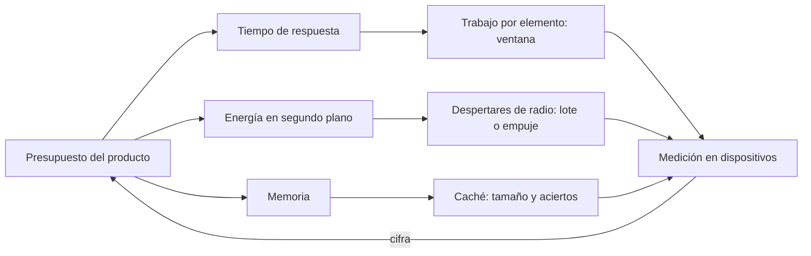
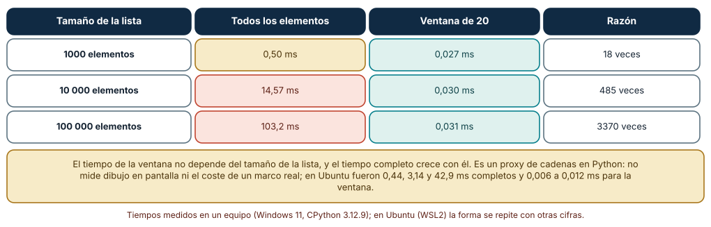
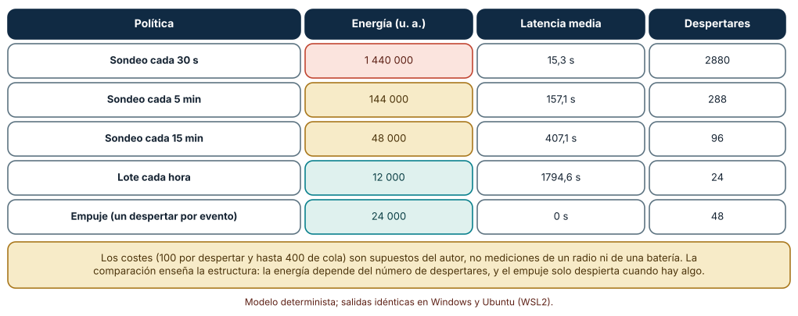
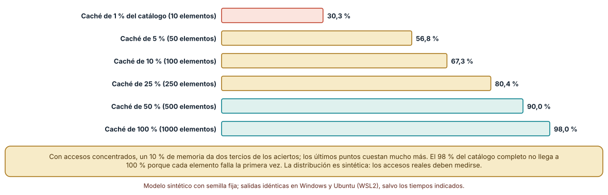

# SE-261 — Rendimiento, batería y recursos limitados

[← SE-260 — Offline-first y resolución de conflictos](https://github.com/vladimiracunadev-create/modern-software-engineering-program/blob/main/classes/part-21-software-movil-escritorio-y-multiplataforma/se-260-offline-first-y-resolucion-de-conflictos/README.md) · [↑ Parte 21](https://github.com/vladimiracunadev-create/modern-software-engineering-program/blob/main/classes/part-21-software-movil-escritorio-y-multiplataforma/README.md) · [📚 Índice completo](https://github.com/vladimiracunadev-create/modern-software-engineering-program/blob/main/classes/README.md) · [🌐 Portal](https://vladimiracunadev-create.github.io/modern-software-engineering-program/classes/SE-261.html) · [SE-262 — Firma, sandbox y seguridad del cliente →](https://github.com/vladimiracunadev-create/modern-software-engineering-program/blob/main/classes/part-21-software-movil-escritorio-y-multiplataforma/se-262-firma-sandbox-y-seguridad-del-cliente/README.md)

## Punto profesional y fundamento pedagógico

**Punto profesional.** La clase existe para que trates el rendimiento, la batería y la memoria de un cliente como presupuestos que se miden y se reparten, no como adjetivos: cuánto trabajo hace la interfaz por elemento, cuántas veces despierta la radio y cuánta memoria compra cada punto de aciertos de una caché.

**Por qué aparece aquí.** Se sitúa después de **Offline-first y resolución de conflictos** y antes de **Firma, sandbox y seguridad del cliente**: la sincronización de la clase anterior trabaja en segundo plano y despierta la radio; esta clase mide su coste. Deja las cifras de presupuesto que el proyecto `SE-264` usará para decidir cuándo sincronizar.

**Error conceptual que debe corregir.** Creer que optimizar es hacer más rápido lo que el código ya hace, o que la batería se ahorra con código eficiente: lo que más cuesta es hacer trabajo que no hacía falta y despertar hardware caro, y eso se decide por política, no por micro-optimización.

**Secuencia de aprendizaje.** Antes de leer la solución, predices cómo crece el coste de construir una lista de 100 000 elementos frente a mostrar solo los 20 visibles, cómo se reparte la energía entre sondeo, lote y empuje en un modelo explícito y cuánta memoria de caché compra cada punto de aciertos; después ejecutas los tres experimentos. La secuencia usa predicción, explicación propia, contraste y recuperación. [ICAP](https://icap.education.asu.edu/research) distingue participación de construcción de conocimiento; [How People Learn II](https://nap.nationalacademies.org/catalog/24783/how-people-learn-ii-learners-contexts-and-cultures) exige conectar conocimiento previo, contexto y transferencia; la [práctica de recuperación](https://pubmed.ncbi.nlm.nih.gov/16507066/) respalda producir de nuevo la explicación tras una demora; y [Education for Life and Work](https://nap.nationalacademies.org/resource/13398/dbasse_084153.pdf) exige devolución que explique la causa del error.

**Evidencia de aprendizaje.** `resources-log.md` con el presupuesto de recursos del cliente, las mediciones de lista completa y ventana con su sistema, el modelo de energía con sus supuestos y la curva de caché con su distribución de accesos. Debe contener predicción previa, observación, explicación causal, contraejemplo y qué hallazgo haría abandonar la decisión.

**Límite de la conclusión.** El modelo de energía usa costes del autor en unidades arbitrarias, no mediciones de un radio ni de una batería; la medición de lista es un proxy de cadenas en Python, no un dibujo en pantalla; los accesos de la caché siguen una distribución de Zipf supuesta. No se midió ningún teléfono.

### Trazabilidad fuente → afirmación

| Fuente primaria u oficial | Afirmación que respalda | Lo que no prueba |
|---|---|---|
| [Android Developers, «Optimize for Doze and App Standby»](https://developer.android.com/training/monitoring-device-state/doze-standby) | Explica que el sistema restringe la actividad en segundo plano para ahorrar batería y cómo agrupar el trabajo para cooperar con esa política. | No da los costes de energía de ninguna operación. |
| [Balasubramanian et al., «Energy consumption in mobile phones» (IMC 2009)](https://doi.org/10.1145/1644893.1644927) | Mide que una parte importante de la energía de una transferencia pequeña se gasta en la fase de cola de la radio y no en los datos. | Mide dispositivos y redes de la época; no sirve para estimar uno actual. |
| [Pathak et al., «Where is the energy spent inside my app?» (EuroSys 2012)](https://doi.org/10.1145/2168836.2168841) | Muestra que una fracción apreciable de la energía de aplicaciones populares se gasta en código de terceros y en la red. | No mide el cliente de entregas ni da proporciones transferibles. |

## Antes de empezar

Recupera `SE-260`: el cliente sincroniza en segundo plano. La pregunta activa es: **¿cuánto recurso cuesta cada decisión, y cuál es el presupuesto que el producto acepta?**

## Prerrequisitos

- Haber completado `SE-260` o poder explicar qué evidencia produjo.
- Poder describir la política de conflicto de `SE-260`.
- Entender qué es una distribución de accesos y una caché.
- Python 3.11 o posterior y un terminal; los experimentos usan solo la biblioteca estándar y datos sintéticos, sin cuentas de tienda, emuladores ni dispositivos.

## Problema auténtico

El cliente de entregas va fluido con 30 tareas y se arrastra con 3000 de un curso de varios años. La batería de un teléfono antiguo baja un tercio en una tarde con la aplicación en segundo plano, que sondea al servidor cada 30 segundos. La memoria de las miniaturas hace que el sistema cierre el proceso con más frecuencia. Cada síntoma tiene una causa distinta: trabajo por elemento, despertares de radio, tamaño de caché.

## Objetivos observables

Al terminar podrás:

1. enunciar un presupuesto de recursos del cliente (tiempo de respuesta, energía en segundo plano, memoria) con la medición que lo respalda;
2. medir cómo crece el coste de construir una lista completa frente a una ventana de elementos visibles;
3. comparar sondeo, lote y empuje en un modelo explícito de energía y de latencia y declarar qué supuestos contiene;
4. calcular la tasa de aciertos de una caché LRU según su tamaño con accesos concentrados y decidir cuánta memoria asignar;
5. justificar un presupuesto y la medición en dispositivos que lo contrastaría.

## Mapa conceptual



El mapa se lee de izquierda a derecha: el presupuesto se reparte entre tiempo, energía y memoria, cada uno se controla con una decisión distinta (ventana, lote o empuje, caché) y se contrasta con una medición en dispositivos reales. La cifra medida reabre el presupuesto.

## Temas y por qué importan

| Tema | Por qué cambia una decisión profesional | Evidencia mínima |
|---|---|---|
| Presupuesto de recursos | Un presupuesto convierte «rápido» y «ligero» en números con un responsable. | Predicción, traza causal y contraejemplo de **Presupuesto de recursos** en `resources-log.md` |
| Trabajo proporcional a lo visible | Hacer trabajo por cada elemento de la lista, y no por cada elemento visible, es la causa más común de una pantalla lenta. | Predicción, traza causal y contraejemplo de **Trabajo proporcional a lo visible** en `resources-log.md` |
| Energía y despertares | La radio cuesta más por despertar que por dato. | Predicción, traza causal y contraejemplo de **Energía y despertares** en `resources-log.md` |
| Cachés y distribución de accesos | Una caché ayuda tanto como se concentren los accesos. | Predicción, traza causal y contraejemplo de **Cachés y distribución de accesos** en `resources-log.md` |
| Medir en el dispositivo | Una cifra de un equipo de escritorio no describe un teléfono modesto. | Predicción, traza causal y contraejemplo de **Medir en el dispositivo** en `resources-log.md` |

## Conceptos y decisiones

### 1. Presupuesto de recursos

El presupuesto fija cuánto tiempo puede tardar en responder cada pantalla, cuánta energía puede gastar en segundo plano y cuánta memoria puede ocupar, medidos en un dispositivo de referencia modesto. Sin un número, nadie puede decidir si un cambio empeora la situación. El presupuesto se mide y se revisa, y su cifra depende del dispositivo: la de un equipo de escritorio no sirve para un teléfono.

### 2. Trabajo proporcional a lo visible

Una lista de 100 000 tareas muestra veinte a la vez. Construir las etiquetas de todas crece con el tamaño de la lista; construir las de la ventana visible, no. Las plataformas ofrecen listas virtualizadas que reciclan elementos. El principio es general: el trabajo debe depender de lo que se ve, no de lo que existe.

### 3. Energía y despertares

Medidas clásicas muestran que, tras transmitir, la radio permanece activa un tiempo y que ese tiempo puede costar más energía que la transferencia. Por eso diez despertares pequeños cuestan más que uno grande. Las plataformas agrupan el trabajo en segundo plano y restringen el que no cooperan. Las estrategias son sondear con menos frecuencia, agrupar en lotes y recibir un empuje del servidor solo cuando hay algo.

### 4. Cachés y distribución de accesos

Si pocos elementos reciben la mayoría de los accesos, una caché pequeña da muchos aciertos y duplicarla da cada vez menos. Si los accesos son uniformes, la caché ayuda proporcionalmente a su tamaño. La política de reemplazo (menos usado recientemente, por ejemplo) importa menos que el tamaño con accesos concentrados. Se decide con los accesos reales del producto.

### 5. Medir en el dispositivo

El rendimiento depende del procesador, la memoria, el almacenamiento y la red del dispositivo. Los perfiles de las plataformas miden consumo y tiempos en el dispositivo real. Los experimentos de esta clase son proxies y modelos que muestran la forma del problema, y sirven para decidir qué medir, no para sustituir la medición.

### Todas las etiquetas o solo las visibles

Se construyen las etiquetas de texto de listas de 1000, 10 000 y 100 000 tareas (concatenación de título y número), una vez para todos los elementos y otra solo para una ventana de 20. Se toma la mediana de siete repeticiones.

```python
items = [{'t': 'Entrega %d' % i, 'n': i % 100} for i in range(n)]
completa = lambda: ['%s · %d' % (x['t'], x['n']) for x in items]
ventana = lambda: ['%s · %d' % (x['t'], x['n']) for x in items[5000 % n:5000 % n + 20]]
```

Resultado en Windows: **0,50 ms**, **14,57 ms** y **103,2 ms** para todos los elementos (1000, 10 000 y 100 000), frente a **0,027**, **0,030** y **0,031 ms** para la ventana de 20: razones de 18, 485 y 3370 veces. En Ubuntu bajo WSL2 fueron 0,44, 3,14 y 42,9 ms completos y de 0,006 a 0,012 ms para la ventana. El tiempo de la ventana no depende del tamaño de la lista y el de la lista completa crece casi linealmente.



**Cómo leer la figura.** Cada fila es un tamaño de lista; la segunda columna es el tiempo de todos los elementos, la tercera el de la ventana y la cuarta la razón entre ambos. **Dónde deja de valer:** es un proxy de concatenación de cadenas en Python: no mide dibujo, diseño ni memoria. Una lista real tiene un coste por elemento visible mucho mayor, así que la ventana cuesta más y la razón es menor; la forma (el coste de la ventana es constante) se mantiene.

### Sondeo, lote y empuje

Se simulan 48 eventos repartidos al azar en 24 horas (semilla fija). Cada política despierta la radio en momentos distintos: sondeo cada 30 s, 5 min o 15 min, un lote por hora o un despertar por evento (empuje). Cada despertar cuesta 100 unidades más una cola de 400 si pasaron al menos 20 s desde el anterior, o 20 por segundo si pasaron menos. La latencia es el tiempo hasta el siguiente despertar.

```python
for t in despertares:
    gap = t - ult
    e += 100 + (400 if gap >= 20 else gap * 20); ult = t
lat = [min((t for t in despertares if t >= x), default=horas*3600) - x for x in ev]
```

Resultado: el sondeo cada 30 s cuesta **1 440 000** unidades con **15,3 s** de latencia media y 2880 despertares; cada 5 min, **144 000** con **157,1 s** y 288; cada 15 min, **48 000** con **407,1 s** y 96; el lote por hora, **12 000** con **1794,6 s** y 24; el empuje, **24 000** con **0 s** y 48 despertares. El empuje es el doble de caro que el lote pero entrega al instante; el sondeo frecuente es sesenta veces más caro que el empuje.



**Cómo leer la figura.** Cada fila es una política; las celdas coral son las más caras y las verdes las más baratas o con menos latencia. **Dónde deja de valer:** los costes son supuestos del autor en unidades arbitrarias; no se midió ningún radio, red ni batería. El modelo ignora que un empuje requiere un servicio del fabricante y que las plataformas pueden retrasar el trabajo en segundo plano.

### Cuánta memoria compra una caché

Un catálogo de 1000 miniaturas se consulta 50 000 veces con probabilidades que siguen una distribución de Zipf de exponente 1,1 (semilla fija). Una caché LRU guarda las últimas usadas y se evalúa con tamaños del 1 % al 100 % del catálogo.

```python
w = [1/(i+1)**1.1 for i in range(1000)]
c = collections.OrderedDict(); hits = 0
for _ in range(50000):
    k = bisect.bisect_left(cum, r.random())
    if k in c: c.move_to_end(k); hits += 1
    else:
        c[k] = 1
        if len(c) > cap: c.popitem(last=False)
```

Resultado: con el **1 %** del catálogo la tasa de aciertos es **30,3 %**; con **5 %**, **56,8 %**; con **10 %**, **67,3 %**; con **25 %**, **80,4 %**; con **50 %**, **90,0 %**; con **100 %**, **98,0 %** (el resto son las primeras lecturas). Con un 10 % de la memoria se consiguen dos tercios de los aciertos; pasar del 50 % al 100 % cuesta el doble de memoria para ocho puntos.



**Cómo leer la figura.** Cada barra es el porcentaje de accesos servidos desde la caché; el color pasa de coral a verde a medida que la caché crece. **Dónde deja de valer:** la distribución de Zipf es una suposición; los accesos reales del cliente pueden ser más uniformes o más concentrados. También se ignora el tamaño de cada elemento y el coste de reconstruirlo.

## Definiciones de trabajo

- **presupuesto de recursos:** conjunto de límites medibles de tiempo de respuesta, energía y memoria que el producto acepta en un dispositivo de referencia.
- **virtualización de lista:** técnica que construye solo los elementos visibles de una lista larga y recicla los demás.
- **cola de radio:** tiempo durante el cual la radio sigue activa tras transmitir y que puede costar más energía que la transmisión.
- **caché LRU:** caché que, al llenarse, descarta el elemento menos usado recientemente.
- **tasa de aciertos:** fracción de los accesos que se sirven desde la caché sin reconstruir o descargar el elemento.

Las definiciones son operativas para el cliente de la plataforma de entregas. No convierten términos con una historia técnica más amplia en sinónimos y deben contrastarse con la documentación primaria enlazada al final.

## Ejemplo mínimo

El fragmento compara construir las etiquetas de toda la lista con las de una ventana. Antes de ejecutarlo, predice cuántas veces es más lenta la lista completa con 100 000 elementos.

```python
import time
items = [("Entrega %d" % i, i % 100) for i in range(100000)]

def medir(f):
    t = time.perf_counter(); f(); return (time.perf_counter() - t) * 1000

todas = medir(lambda: ["%s · %d" % x for x in items])
ventana = medir(lambda: ["%s · %d" % x for x in items[5000:5020]])
print(round(todas, 2), "ms frente a", round(ventana, 4), "ms")
```

El tiempo de la ventana no depende del tamaño de la lista. Registra el sistema y repite cinco veces, porque el tiempo absoluto cambia entre ejecuciones; predice cuánto cambia la razón.

## Ejemplo profesional

El equipo del cliente define su presupuesto en un dispositivo de referencia modesto: la lista de tareas responde en menos de 100 ms con 3000 elementos, la sincronización en segundo plano no despierta la radio más de 24 veces al día y las miniaturas ocupan menos de 30 MB. Cada cifra tiene un nombre de responsable y una prueba automática que mide en una ejecución de referencia. La sincronización usa un empuje con lote de respaldo cada hora, y la caché de miniaturas tiene un tamaño fijado por la curva de aciertos y no por costumbre.

Compara el caso de una estudiante con 30 tareas, el de un docente con 3000 y el de un teléfono antiguo con poca memoria. Un presupuesto es apropiado cuando esos tres casos cumplen sus cifras; es peligroso cuando nadie sabe cuánto cuesta una pantalla.

## Práctica guiada

1. Escribe el presupuesto del cliente con tres cifras y el dispositivo de referencia.
2. Predice la razón entre lista completa y ventana para tres tamaños y anota los números antes de ejecutar.
3. Mide la lista completa y la ventana en tu sistema con siete repeticiones.
4. Calcula la energía y la latencia de sondeo, lote y empuje en el modelo y cambia los costes para ver qué conclusión sobrevive.
5. Simula la caché con tres exponentes de Zipf y compara las curvas.
6. Decide el tamaño de la caché y la política de sincronización con su justificación.
7. Entrega `resources-log.md` y pide a otra persona que rebata el presupuesto solo con él.

## Ejercicios

1. **Ventana:** calcula cuántos elementos debe construir una lista que muestra 20 y precarga 10 por lado, y cómo cambia el coste.
2. **Energía:** cambia la cola de 400 a 100 y recalcula; indica si el orden de las políticas cambia.
3. **Caché:** con exponente 0,5 (accesos más uniformes), recalcula la curva y compara.
4. **Presupuesto:** elige tres cifras de tu presupuesto y diseña la medición en un dispositivo que las contrastaría.

## Reto verificable

Entrega `resources-log.md` con el presupuesto, las mediciones de lista, el modelo de energía con sus supuestos y la curva de caché. Se aprueba si otra persona obtiene las mismas cifras deterministas con las mismas semillas, entiende que los tiempos son de un equipo y puede indicar qué medición en un teléfono sustituiría cada supuesto. No se aprueba por afirmar que el cliente es «eficiente».

## Caso conductor

El cliente de entregas de la Parte 21 deja aquí su presupuesto de recursos y sus decisiones de lista, sincronización y caché. `SE-262` revisa la superficie de seguridad que cada una añade, `SE-263` mide diferencias entre dos plataformas y `SE-264` integra el presupuesto en el proyecto. Cambia después una sola decisión, el sondeo cada 5 minutos por empuje, y revisa qué cifras cambian.

## Preguntas frecuentes

### ¿Por qué no basta con optimizar el código?

Porque el mayor coste suele ser trabajo que no hacía falta (construir lo que no se ve) o hardware que se despierta sin necesidad. Eso se decide por diseño y política, no por micro-optimización.

### ¿El empuje siempre ahorra batería?

No siempre. En el modelo cuesta el doble que un lote por hora, pero entrega al instante y es sesenta veces más barato que sondear cada 30 s. Depende de la frecuencia de eventos y de la latencia que el producto tolere.

### ¿Qué tamaño de caché es el correcto?

El que equilibra la curva de aciertos con la memoria disponible en el dispositivo más modesto soportado. La curva se mide con los accesos reales: la de Zipf del experimento es una suposición.

### ¿Las cifras de tiempo de la clase sirven para un teléfono?

No. Son de un equipo de escritorio con Python. Sirven para ver la forma (la ventana es constante; la lista, lineal) y para decidir qué medir en un dispositivo real.

## Fallo controlado y diagnóstico

Reproduce el fallo clásico de la clase: **construir todos los elementos aunque se vean veinte**. Aumenta la lista a 100 000 elementos y mide el tiempo hasta mostrar la primera pantalla.

Registra síntoma, hipótesis, observación que descarta cada una, causa, corrección y regresión. **Síntoma:** la pantalla tarda más de 100 ms con 3000 tareas. **Hipótesis rivales:** (a) el dibujo es lento; (b) se construyen elementos que no se ven. **Prueba:** cuenta los elementos construidos; si es igual al tamaño de la lista y no a lo visible, la hipótesis (b) explica el tiempo. **Conclusión:** la causa es trabajo proporcional a la lista. **Regresión:** limita la construcción a la ventana y exige un tiempo constante al crecer la lista; no cambies a la vez el tamaño de la caché.

## Errores comunes y cómo corregirlos

| Síntoma | Causa probable | Corrección |
|---|---|---|
| La lista se vuelve lenta al crecer | Se construye cada elemento aunque no se vea | Virtualizar la lista y medir con 100 000 elementos |
| La batería baja mucho con la aplicación en segundo plano | Sondeo frecuente que despierta la radio | Empuje o lote y agrupar trabajo |
| El sistema cierra el proceso por memoria | Caché sin límite o de tamaño arbitrario | Tamaño fijado por la curva de aciertos y el dispositivo modesto |
| Las cifras del equipo de desarrollo no se reproducen en un teléfono | Se midió en un dispositivo no representativo | Medir en un dispositivo de referencia modesto |
| Se optimiza sin saber qué es lo lento | No hay presupuesto ni perfil | Medir, ordenar los costes y optimizar el mayor |

## Entorno y archivos clave

```text
work/SE-261/
├── README.md
├── recursos/
│   ├── lista.py
│   ├── energia.py
│   └── cache.py
├── tests/test_recursos.py
└── evidence/resources-log.md
```

El `README` declara plataforma, versión de Python, semillas y comandos. Los experimentos usan solo la biblioteca estándar (`time`, `random`, `collections`, `bisect`) y se ejecutaron con CPython 3.12.9 en Windows 11 y 3.12.3 en Ubuntu bajo WSL2. Las cifras del modelo de energía y de la caché fueron idénticas; los tiempos de lista se informan por sistema.

## Seguridad, ética y accesibilidad

- un cliente que consume mucha batería afecta más a quien tiene un dispositivo antiguo o poca carga: es un asunto de equidad;
- no midas el consumo de personas reales sin consentimiento y sin minimizar los datos;
- el sondeo frecuente también aumenta la carga del servidor y la superficie de ataque;
- una caché de miniaturas puede guardar contenido de la persona: define su duración y su borrado;
- documenta los supuestos del modelo de energía y no los presentes como mediciones.

## Puente hacia el trabajo con agentes

Un agente al que se le pide «optimiza el rendimiento» cambiará una estructura de datos y reportará una mejora medida en el equipo de desarrollo. Pídele el presupuesto, el dispositivo de referencia, la medición antes y después en él y qué supuesto del modelo de energía usa. Revisa especialmente si midió en un entorno representativo: una mejora de 3370 veces en un proxy no es una mejora en un teléfono.

## Transferencia

Traslada el análisis a otro dominio persistente (una aplicación de reparto que sondea la posición): cambia los eventos y los costes, conserva el procedimiento de comparar políticas en un modelo y contrastar con una medición. La transferencia está lograda cuando puedes explicar qué parte del método dependía del borrador y cuál no.

## Evaluación y evidencia

| Criterio | Evidencia para aprobar |
|---|---|
| comprensión | explicación de por qué el trabajo debe depender de lo visible y de los despertares de radio |
| corrección | cifras reproducibles del modelo de energía y de la caché y tiempos por sistema |
| diseño | presupuesto con dispositivo de referencia, política de sincronización y tamaño de caché |
| diagnóstico | reproducción del fallo «construir todos los elementos» con regresión |
| incertidumbre | declaración de que el modelo de energía y los accesos son supuestos y los tiempos son de un equipo |
| reproducibilidad | versiones, comandos, salida y límites declarados |

## Fuentes

- [Android Developers, «Optimize for Doze and App Standby»](https://developer.android.com/training/monitoring-device-state/doze-standby) — restricciones de segundo plano y cómo agrupar trabajo; autoridad: Google.
- [Android Developers, «App performance»](https://developer.android.com/topic/performance) — medición y mejora del rendimiento en Android; autoridad: Google.
- [Apple Developer, «Energy Efficiency Guide for iOS Apps»](https://developer.apple.com/library/archive/documentation/Performance/Conceptual/EnergyGuide-iOS/) — principios de eficiencia energética en iOS; autoridad: Apple.
- [Electron, «Performance»](https://www.electronjs.org/docs/latest/tutorial/performance) — lista de comprobaciones de rendimiento en aplicaciones de escritorio; autoridad: OpenJS Foundation.
- [Balasubramanian et al., «Energy consumption in mobile phones» (IMC 2009)](https://doi.org/10.1145/1644893.1644927) — consumo de la radio y fase de cola; autoridad: ACM IMC.
- [Pathak et al., «Where is the energy spent inside my app?» (EuroSys 2012)](https://doi.org/10.1145/2168836.2168841) — reparto de la energía dentro de aplicaciones móviles; autoridad: ACM EuroSys.

Cada fuente respalda el mecanismo indicado; ninguna demuestra que los costes de energía, la distribución de accesos o los tiempos de los experimentos correspondan a un dispositivo o a un producto reales. Esa afirmación depende de medir en el dispositivo.

- [Python: `collections.OrderedDict`](https://docs.python.org/3/library/collections.html#collections.OrderedDict) — estructura usada para la caché LRU.
- [Python: `time.perf_counter`](https://docs.python.org/3/library/time.html#time.perf_counter) — reloj usado en las mediciones.

## Límites y siguiente paso

Se ejecutaron tres experimentos con datos sintéticos en Windows y Ubuntu (WSL2): las cifras deterministas fueron idénticas y los tiempos se informan por sistema. No se midió ningún teléfono ni batería: los costes de energía y los accesos son del autor. La siguiente clase revisa la seguridad del cliente.

## Glosario

- **presupuesto de recursos:** conjunto de límites medibles de tiempo de respuesta, energía y memoria que el producto acepta en un dispositivo de referencia.
- **virtualización de lista:** técnica que construye solo los elementos visibles de una lista larga y recicla los demás.
- **cola de radio:** tiempo durante el cual la radio sigue activa tras transmitir y que puede costar más energía que la transmisión.
- **caché LRU:** caché que, al llenarse, descarta el elemento menos usado recientemente.
- **tasa de aciertos:** fracción de los accesos que se sirven desde la caché sin reconstruir o descargar el elemento.

---

[← SE-260 — Offline-first y resolución de conflictos](https://github.com/vladimiracunadev-create/modern-software-engineering-program/blob/main/classes/part-21-software-movil-escritorio-y-multiplataforma/se-260-offline-first-y-resolucion-de-conflictos/README.md) · [↑ Parte 21](https://github.com/vladimiracunadev-create/modern-software-engineering-program/blob/main/classes/part-21-software-movil-escritorio-y-multiplataforma/README.md) · [📚 Índice completo](https://github.com/vladimiracunadev-create/modern-software-engineering-program/blob/main/classes/README.md) · [🌐 Portal](https://vladimiracunadev-create.github.io/modern-software-engineering-program/classes/SE-261.html) · [SE-262 — Firma, sandbox y seguridad del cliente →](https://github.com/vladimiracunadev-create/modern-software-engineering-program/blob/main/classes/part-21-software-movil-escritorio-y-multiplataforma/se-262-firma-sandbox-y-seguridad-del-cliente/README.md)
