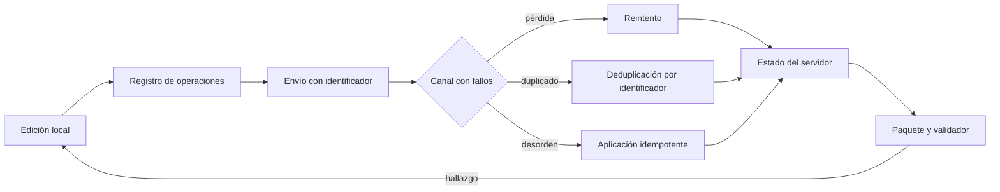
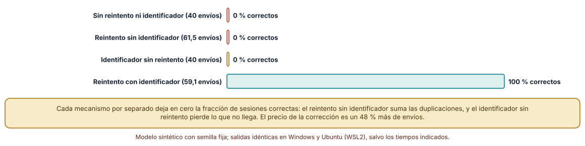
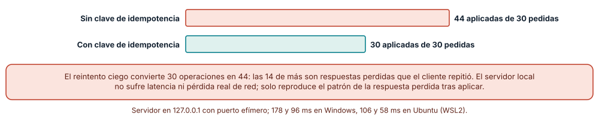
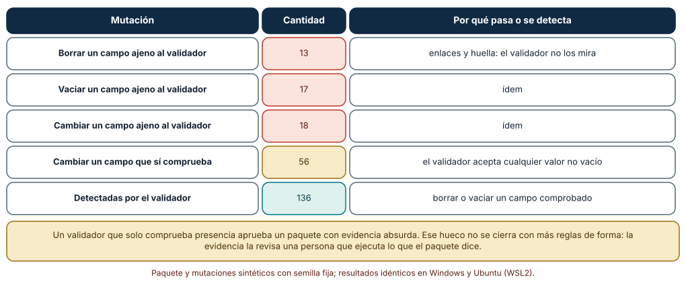

# SE-264 — Proyecto: cliente multiplataforma con sincronización

[← SE-263 — Taller: adaptar un producto a dos plataformas](https://github.com/vladimiracunadev-create/modern-software-engineering-program/blob/main/classes/part-21-software-movil-escritorio-y-multiplataforma/se-263-taller-adaptar-un-producto-a-dos-plataformas/README.md) · [↑ Parte 21](https://github.com/vladimiracunadev-create/modern-software-engineering-program/blob/main/classes/part-21-software-movil-escritorio-y-multiplataforma/README.md) · [📚 Índice completo](https://github.com/vladimiracunadev-create/modern-software-engineering-program/blob/main/classes/README.md) · [🌐 Portal](https://vladimiracunadev-create.github.io/modern-software-engineering-program/classes/SE-264.html) · [SE-265 — Hardware, firmware y software embebido →](https://github.com/vladimiracunadev-create/modern-software-engineering-program/blob/main/classes/part-22-embedded-iot-y-tiempo-real/se-265-hardware-firmware-y-software-embebido/README.md)

## Punto profesional y fundamento pedagógico

**Punto profesional.** El proyecto existe para entregar un paquete que otra persona pueda revisar sin pedir contexto: el cliente de la plataforma de entregas con su ciclo de vida, su almacenamiento, su protocolo de sincronización con operaciones idempotentes, sus permisos, su plan de distribución y su modelo de amenazas, con evidencia medida y un validador cuyos límites se conocen.

**Por qué aparece aquí.** Cierra la **Parte 21** después de **Taller: adaptar un producto a dos plataformas**: las once clases anteriores dejaron una tabla de modelos, una política de guardado, una decisión de construcción, un inventario de datos, una tabla de capacidades, una tabla de entradas, un plan de lanzamiento, una política de conflicto, un presupuesto, un modelo de amenazas y un inventario de diferencias. El proyecto los reúne en un paquete con trazabilidad y con una prueba de extremo a extremo de la sincronización. Deja la base que la Parte 22 usará al pasar a dispositivos con recursos todavía más limitados.

**Error conceptual que debe corregir.** Creer que un paquete con muchos documentos y un validador en verde está terminado: el validador comprueba presencia y forma, no que la evidencia diga algo, y una sincronización que funciona sin fallos no prueba que funcione con duplicados, pérdidas y reordenamientos.

**Secuencia de aprendizaje.** Antes de leer la solución, predices qué combinación de reintento e identificador deja correcto el estado de una sincronización con pérdidas, duplicados y desorden, cuántas operaciones aplica un servidor real que pierde cada tercera respuesta con y sin clave de idempotencia y qué mutaciones de un paquete detectará un validador de presencia; después ejecutas los tres experimentos y reúnes el paquete. La secuencia usa predicción, explicación propia, contraste y recuperación. [ICAP](https://icap.education.asu.edu/research) distingue participación de construcción de conocimiento; [How People Learn II](https://nap.nationalacademies.org/catalog/24783/how-people-learn-ii-learners-contexts-and-cultures) exige conectar conocimiento previo, contexto y transferencia; la [práctica de recuperación](https://pubmed.ncbi.nlm.nih.gov/16507066/) respalda producir de nuevo la explicación tras una demora; y [Education for Life and Work](https://nap.nationalacademies.org/resource/13398/dbasse_084153.pdf) exige devolución que explique la causa del error.

**Evidencia de aprendizaje.** `client-package-log.md` con el paquete del cliente (matriz de ciclo de vida, decisión de construcción, esquema local, protocolo de sincronización, política de conflicto, permisos, plan de distribución y modelo de amenazas), la simulación de sincronización con fallos, la prueba con un servidor local, las 240 mutaciones del paquete y las decisiones humanas abiertas. Debe contener predicción previa, observación, explicación causal, contraejemplo y qué hallazgo haría abandonar la decisión.

**Límite de la conclusión.** El canal con fallos es una simulación con probabilidades del autor y el servidor es un proceso local en 127.0.0.1 que reproduce solo el patrón de la respuesta perdida; el paquete tiene once campos sintéticos y el validador comprueba presencia. No se compiló, firmó ni publicó ningún cliente y no se midió ninguna persona ni dispositivo.

### Trazabilidad fuente → afirmación

| Fuente primaria u oficial | Afirmación que respalda | Lo que no prueba |
|---|---|---|
| [IETF, «RFC 9110: HTTP Semantics»](https://www.rfc-editor.org/rfc/rfc9110) | Define qué métodos HTTP son idempotentes y qué significa que repetir una petición tenga el mismo efecto que hacerla una vez. | No dice cómo implementar la deduplicación ni cuánto tiempo recordar los identificadores. |
| [Kleppmann et al., «Local-first software» (Onward! 2019)](https://doi.org/10.1145/3359591.3359737) | Plantea el objetivo de aplicaciones con datos locales, trabajo sin conexión y sincronización, y enumera dificultades abiertas. | No evalúa el protocolo del cliente de entregas. |
| [SQLite, «Atomic Commit In SQLite»](https://www.sqlite.org/atomiccommit.html) | Describe cómo se logran las transacciones atómicas que sostienen el registro local de operaciones. | No garantiza durabilidad en un dispositivo cuyo almacenamiento no cumple sus supuestos. |

## Antes de empezar

Recupera `SE-263`: se midieron diferencias y se escribió un contrato de adaptadores. La pregunta activa es: **¿puede otra persona reconstruir las decisiones del cliente, repetir sus comprobaciones y ver qué quedó sin comprobar?**

## Prerrequisitos

- Haber completado `SE-263` o poder explicar qué evidencia produjo.
- Tener los artefactos de `SE-253` a `SE-263` o poder explicar cuáles faltan.
- Saber ejecutar un servidor HTTP local de la biblioteca estándar.
- Python 3.11 o posterior y un terminal; los experimentos usan solo la biblioteca estándar y datos sintéticos, sin cuentas de tienda, emuladores ni dispositivos.

## Problema auténtico

El equipo entrega el cliente de la plataforma de entregas. Funciona en la demostración: el borrador se guarda, se sincroniza y se ve en el otro dispositivo. En uso real, la red pierde algunas peticiones, el sistema reintenta otras, una respuesta se pierde después de aplicarse y algunas operaciones llegan fuera de orden. El estado de un servidor queda con 44 operaciones aplicadas cuando se pidieron 30. Además, el paquete que acompaña el cliente tiene todos los documentos, y falta la evidencia de varios.

## Objetivos observables

Al terminar podrás:

1. reunir los artefactos de la parte en un paquete con identificadores, enlaces y límites declarados;
2. simular una sincronización con pérdidas, duplicados y reordenamientos y medir cuándo el estado final es correcto según se combinen reintento e identificador de operación;
3. reproducir con un servidor HTTP local real que pierde cada tercera respuesta cuántas operaciones se aplican con y sin clave de idempotencia;
4. escribir un validador de presencia, mutar el paquete 240 veces y medir qué detecta y qué no;
5. defender el paquete con evidencia medida, límites explícitos y las decisiones humanas que quedan abiertas.

## Mapa conceptual



El mapa se lee de izquierda a derecha: toda edición local se vuelve una operación con identificador; el canal puede perder, duplicar y reordenar; reintento, deduplicación y aplicación idempotente llevan al estado del servidor; el paquete y su validador cierran el ciclo. El retorno indica que un hallazgo reabre la edición.

## Temas y por qué importan

| Tema | Por qué cambia una decisión profesional | Evidencia mínima |
|---|---|---|
| Paquete del cliente | Un paquete es una promesa revisable: qué se decidió, con qué evidencia y qué queda abierto. | Predicción, traza causal y contraejemplo de **Paquete del cliente** en `client-package-log.md` |
| Protocolo de sincronización | El protocolo es lo que sobrevive a todas las fallas del canal. | Predicción, traza causal y contraejemplo de **Protocolo de sincronización** en `client-package-log.md` |
| Clave de idempotencia | Una clave enviada con la petición hace seguro reintentar una operación cuya respuesta se perdió. | Predicción, traza causal y contraejemplo de **Clave de idempotencia** en `client-package-log.md` |
| Validación del paquete | Un validador de presencia detecta lo que falta, no lo que está mal. | Predicción, traza causal y contraejemplo de **Validación del paquete** en `client-package-log.md` |
| Decisiones humanas abiertas | Lo que ninguna herramienta decide queda con nombre y fecha. | Predicción, traza causal y contraejemplo de **Decisiones humanas abiertas** en `client-package-log.md` |

## Conceptos y decisiones

### 1. Paquete del cliente

El paquete del proyecto reúne la matriz de ciclo de vida de `SE-254`, la decisión de construcción de `SE-255`, el esquema local de `SE-256`, la tabla de capacidades de `SE-257`, la tabla de entradas de `SE-258`, el plan de distribución de `SE-259`, el protocolo y la política de conflicto de `SE-260`, el presupuesto de `SE-261`, el modelo de amenazas de `SE-262` y el inventario de `SE-263`. Cada artefacto lleva un identificador, enlaces a los que lo sustentan y la fecha de su última verificación.

### 2. Protocolo de sincronización

Un protocolo mínimo asigna a cada operación local un identificador único, la guarda en el registro, la envía y espera confirmación; si no llega, la reenvía. El servidor aplica cada identificador una sola vez y confirma siempre, incluso cuando ya lo había aplicado. Esa combinación (reintento más deduplicación) es lo que convierte un canal que pierde y duplica en uno que entrega «al menos una vez, aplicada una vez».

### 3. Clave de idempotencia

Cuando el servidor aplica una operación y la respuesta se pierde, el cliente no puede distinguir ese caso de aquel en que la petición no llegó. Sin clave, reintentar aplica dos veces. Con clave, el servidor reconoce el reintento y devuelve el resultado sin repetir el efecto. RFC 9110 define la idempotencia por el efecto; la clave la implementa para operaciones que por naturaleza no lo son.

### 4. Validación del paquete

Comprobar que cada campo existe y no está vacío detecta borrados y vaciados de los campos que comprueba. No detecta un valor absurdo, un enlace roto, un campo que no mira ni una evidencia que no demuestra lo que dice. Medir qué fracción de mutaciones detecta es la única forma de conocer su alcance, y declarar el resto es parte del paquete.

### 5. Decisiones humanas abiertas

El paquete lista lo que sigue pendiente: qué pérdida de intención es aceptable en un conflicto, qué plazo de desconexión se tolera, qué capacidades se excluyen en una plataforma, qué telemetría se considera aceptable. Cada decisión abierta tiene un responsable, una fecha y la evidencia que la cerraría; sin ellas, el paquete aparenta estar cerrado.

### Sincronizar por un canal que pierde, duplica y reordena

El cliente tiene 40 operaciones (cada una suma un valor a uno de cinco borradores). El canal pierde cada envío con probabilidad 0,2, lo duplica con 0,1 (puede repetirse) y reordena el lote con probabilidad 0,5; cada confirmación también puede perderse. Se comparan cuatro combinaciones: sin reintento ni identificador, reintento sin identificador, identificador sin reintento y reintento con identificador (hasta 30 rondas). Se repite con 1000 semillas y se compara el estado final con el esperado.

```python
for ronda in range(1 if not retry else 30):
    lote = [o for o in pendientes if o[0] not in ack]
    if not lote: break
    msgs = []
    for o in lote:
        enviadas += 1
        if r.random() < drop: continue
        msgs.append(o)
        while r.random() < dup: msgs.append(o)
    if r.random() < reorder: r.shuffle(msgs)
    for o in msgs:
        if idem and o[0] in vistos: ack.add(o[0]); continue
        vistos.add(o[0]); srv[o[1]] += o[2]
        if r.random() > drop: ack.add(o[0])
```

Resultado, idéntico en Windows (CPython 3.12.9) y en Ubuntu (3.12.3): sin reintento ni identificador, el estado final es correcto en **0,0 %** de las sesiones (40 envíos); con reintento sin identificador, **0,0 %** (61,5 envíos en media); con identificador sin reintento, **0,0 %** (40 envíos); con reintento e identificador, **100,0 %** (59,1 envíos). Cada mecanismo por separado deja el estado correcto en cero sesiones de 1000: el reintento sin identificador suma las repeticiones y el identificador sin reintento no recupera lo perdido. Combinados cuestan un 48 % más de envíos.



**Cómo leer la figura.** Cada barra es el porcentaje de 1000 sincronizaciones sintéticas de 40 operaciones cuyo estado final coincide con el esperado; las coral y la dorada son combinaciones incompletas y la verde la completa. **Dónde deja de valer:** las probabilidades de pérdida, duplicado y desorden son supuestos del autor, y las operaciones son sumas; una operación que asigna un valor no se rompe igual. Con probabilidades menores, los mecanismos por separado aciertan algunas sesiones, pero siguen fallando en las demás.

### El mismo patrón contra un servidor local real

Un servidor HTTP de la biblioteca estándar escucha en 127.0.0.1 con un puerto efímero. Cada tercera petición se aplica y se cierra la conexión sin responder. El cliente envía 30 operaciones y reintenta hasta cinco veces ante un error, con y sin una cabecera `Idempotency-Key` por operación.

```python
if peticiones['n'] % 3 == 0:               # se aplica y la respuesta se pierde
    if oid not in vistos or oid is None: estado['n'] += 1; vistos.add(oid)
    self.close_connection = True; self.connection.close(); return
if oid is None or oid not in vistos: estado['n'] += 1; vistos.add(oid)
self.send_response(200); self.end_headers(); self.wfile.write(b'ok')
```

Resultado: sin clave de idempotencia, el servidor aplica **44** operaciones de las 30 pedidas, con 44 peticiones; con clave, aplica exactamente **30**, con 44 peticiones. Las 14 operaciones de más son las respuestas perdidas que el cliente repitió, y la clave las convierte en reintentos inocuos. Los tiempos fueron 178 y 96 ms en Windows y 106 y 58 ms en Ubuntu; no son lo que importa.



**Cómo leer la figura.** Cada barra es el número de operaciones aplicadas de las 30 pedidas; la coral es el reintento sin clave y la verde con clave. **Dónde deja de valer:** el servidor local no tiene latencia ni pérdida real de red y solo reproduce el patrón de la respuesta perdida tras aplicar; no incluye varios clientes concurrentes ni el olvido de claves antiguas.

### Qué detecta un validador de presencia

El paquete sintético tiene once campos: siete artefactos (matriz de ciclo de vida, decisión de construcción, esquema local, protocolo de sincronización, política de conflicto, permisos, plan de distribución), evidencia, límites, enlaces y una huella. El validador comprueba que los siete artefactos, la evidencia y los límites existan y no estén vacíos. Se aplican 240 mutaciones con semilla fija: borrar un campo, vaciarlo o cambiar su contenido.

```python
def valida(p):
    errs = []
    for k in ('matriz_ciclo_de_vida', 'decision_de_stack', 'esquema_local', 'protocolo_de_sync',
              'politica_de_conflictos', 'permisos_declarados', 'plan_de_distribucion'):
        if not p.get(k): errs.append('falta ' + k)
    if not p.get('evidencia'): errs.append('sin evidencia')
    if not p.get('limites'): errs.append('sin límites')
    return errs
```

Resultado: de **240** mutaciones, el validador detecta **136** y deja pasar **104**. De las que pasan, **48** tocan campos que no comprueba (13 borrados, 17 vaciados y 18 cambios de `enlaces` o `huella`) y **56** cambian el contenido de un campo comprobado por otro valor no vacío, que el validador acepta. Detecta bien lo que mira (borrar o vaciar) y es ciego a los cambios de sentido y a los campos que no mira; aprobar el paquete por el validador es aprobar la presencia.



**Cómo leer la figura.** Cada fila es un tipo de mutación; la columna central es la cantidad y la derecha por qué pasa o se detecta: coral si pasa sin ser vista, dorada si cambia un campo comprobado y verde si se detecta. **Dónde deja de valer:** las mutaciones son sencillas y las genera el autor; un cambio de sentido sutil (una cifra distinta, un enlace a otra fuente) no está representado. El validador del experimento no calcula huellas ni sigue enlaces, algo que un validador real sí haría.

## Definiciones de trabajo

- **paquete trazable:** conjunto de artefactos con identificadores, enlaces entre ellos, evidencia y límites declarados que otra persona puede revisar sin pedir contexto.
- **clave de idempotencia:** valor único por operación que el cliente envía y el servidor recuerda para no aplicar dos veces un reintento.
- **registro de operaciones:** lista persistente de los cambios locales pendientes de sincronizar, cada uno con su identificador.
- **validador de presencia:** comprobación automática de que ciertos campos existen y no están vacíos; no juzga su contenido.
- **decisión abierta:** punto que ninguna herramienta decide y que queda registrado con responsable, fecha y la evidencia que lo cerraría.

Las definiciones son operativas para el cliente de la plataforma de entregas. No convierten términos con una historia técnica más amplia en sinónimos y deben contrastarse con la documentación primaria enlazada al final.

## Ejemplo mínimo

El fragmento aplica una operación con y sin clave de idempotencia cuando el cliente reintenta. Antes de ejecutarlo, predice cuántas veces se aplica.

```python
aplicadas = []
vistas = set()

def servidor(op_id, delta, con_clave):
    if con_clave and op_id in vistas:
        return "ok"                      # reintento reconocido
    vistas.add(op_id); aplicadas.append(delta)
    return "ok"

for _ in range(3):                       # el cliente reintenta tres veces
    servidor("op-1", 1, con_clave=True)
assert len(aplicadas) == 1

aplicadas.clear(); vistas.clear()
for _ in range(3):
    servidor("op-1", 1, con_clave=False)
assert len(aplicadas) == 3
```

Sin clave, tres reintentos aplican tres veces. Registra cuánto tiempo recordaría el servidor `vistas` y predice qué ocurre si olvida una clave antes del último reintento.

## Ejemplo profesional

El equipo del cliente de entregas arma el paquete con una carpeta por artefacto y un índice con identificadores. Una prueba de extremo a extremo lanza un servidor local, desconecta el cliente, hace cuarenta ediciones, reconecta con un canal que pierde y duplica y exige que el estado del servidor coincida con el esperado. Un validador comprueba presencia, enlaces entre artefactos y huellas; las mutaciones del propio paquete miden su alcance. El paquete termina con una lista de decisiones abiertas: la pérdida de intención aceptable en un conflicto del título, el plazo máximo de desconexión y las capacidades excluidas en una plataforma, cada una con responsable y fecha.

Compara el caso de una estudiante que entrega sin conexión y reconecta con la red inestable, el de un docente que actualiza el cliente con operaciones pendientes y el de quien cambia de dispositivo a mitad del borrador. Un proyecto es apropiado cuando esos tres casos tienen un resultado escrito y una prueba; es peligroso cuando «funciona en la demostración» es la evidencia.

## Práctica guiada

1. Reúne los artefactos de `SE-253` a `SE-263` en un paquete con un índice y un identificador por artefacto.
2. Predice qué combinación de reintento e identificador deja correcto el estado y anota la predicción antes de ejecutar.
3. Simula la sincronización con las cuatro combinaciones y 1000 semillas.
4. Lanza el servidor local, pierde cada tercera respuesta y cuenta las operaciones con y sin clave.
5. Escribe el validador, muta el paquete 240 veces y clasifica lo que pasa sin ser visto.
6. Lista las decisiones humanas abiertas con responsable, fecha y la evidencia que las cerraría.
7. Entrega `client-package-log.md` y pide a otra persona que reconstruya una decisión y repita una comprobación solo con él.

## Ejercicios

1. **Canal:** sube la pérdida a 0,5 y calcula cuántas rondas de reintento hacen falta para llegar al 100 %; indica qué ocurre con el coste en envíos.
2. **Clave:** diseña el plazo durante el que el servidor recuerda las claves a partir de la desconexión máxima que el producto tolera.
3. **Validador:** añade una comprobación de enlaces y de huella y repite las 240 mutaciones; indica cuáles siguen pasando.
4. **Decisiones:** elige una decisión abierta y escribe el experimento que la cerraría.

## Reto verificable

Entrega `client-package-log.md` con el paquete, la simulación de sincronización, la prueba con el servidor local, las 240 mutaciones del paquete y las decisiones abiertas. Se aprueba si otra persona ejecuta el código desde un checkout limpio, obtiene las mismas cifras deterministas con las mismas semillas, puede indicar qué decisión humana falta y qué comprobación no se hizo. No se aprueba por la cantidad de documentos ni por el verde del validador.

## Caso conductor

El cliente de la plataforma de entregas de tareas cierra aquí la Parte 21: un paquete con las decisiones del ciclo de vida, la construcción, el almacenamiento, los permisos, la interacción, la distribución, la sincronización, los recursos, la seguridad y las diferencias entre plataformas. La Parte 22 lleva el razonamiento a dispositivos con recursos y plazos aún más estrictos. Cambia después una sola decisión, pasar de «el título gana el último escritor» a «conservar ambas versiones», y revisa qué artefactos, qué pruebas y qué decisiones abiertas se mueven.

## Preguntas frecuentes

### ¿Por qué el reintento y el identificador no bastan por separado?

Porque resuelven problemas distintos. El reintento recupera lo perdido; el identificador evita aplicar dos veces lo repetido. Sin identificador, el reintento suma las repeticiones; sin reintento, el identificador no recupera nada. Con ambos, el estado fue correcto en las 1000 sesiones simuladas.

### ¿Un servidor local demuestra que el protocolo funciona en producción?

No. Reproduce el patrón de la respuesta perdida tras aplicar, con un solo cliente y sin latencia ni red real. Demuestra que la clave de idempotencia convierte 44 aplicaciones en 30 en ese patrón.

### ¿Qué le falta a un validador de presencia?

Seguir enlaces, calcular huellas y, sobre todo, juzgar el sentido. De 240 mutaciones, 56 cambiaron el contenido de un campo comprobado y pasaron. Lo que nadie puede automatizar se anota como decisión abierta.

### ¿Cuándo se considera terminado el paquete?

Cuando otra persona puede reconstruir cada decisión, repetir una comprobación y ver qué quedó sin comprobar, no cuando el validador pasa. Un paquete terminado conserva su fecha y se revisa con cada cambio de plataforma.

## Fallo controlado y diagnóstico

Reproduce el fallo clásico de la clase: **dar por buena una sincronización porque funciona sin fallos**. Ejecuta el protocolo con un canal perfecto y después con pérdidas y duplicados.

Registra síntoma, hipótesis, observación que descarta cada una, causa, corrección y regresión. **Síntoma:** el servidor tiene 44 operaciones aplicadas cuando se pidieron 30. **Hipótesis rivales:** (a) el cliente envió operaciones de más; (b) el cliente reintentó operaciones cuya respuesta se perdió. **Prueba:** cuenta las peticiones por identificador; si 14 identificadores aparecen dos veces y el servidor aplicó ambas, la hipótesis (b) explica el exceso. **Conclusión:** la causa es reintentar sin clave de idempotencia. **Regresión:** envía la clave, repite con la respuesta perdida y exige 30 aplicaciones; no cambies a la vez la política de conflicto.

## Errores comunes y cómo corregirlos

| Síntoma | Causa probable | Corrección |
|---|---|---|
| El servidor aplica más operaciones de las pedidas | Reintento sin clave de idempotencia | Identificador único por operación y deduplicación en el servidor |
| Se pierden operaciones tras una desconexión larga | No hay registro persistente ni reintento | Registro de operaciones en almacenamiento local y reintento |
| El validador aprueba un paquete con evidencia absurda | Solo comprueba presencia | Medir qué mutaciones detecta y declarar el resto como revisión humana |
| El estado difiere según el orden de llegada | Las operaciones no son idempotentes ni conmutativas | Diseñar operaciones aplicables en cualquier orden o ordenar por causalidad |
| Se declara el proyecto terminado por la demostración | No se probó con pérdidas, duplicados y desorden | Prueba de extremo a extremo con un canal con fallos |

## Entorno y archivos clave

```text
work/SE-264/
├── README.md
├── cliente/
│   ├── registro.py
│   ├── sync.py
│   └── servidor_local.py
├── paquete/
│   ├── indice.md
│   └── validador.py
├── tests/test_proyecto.py
└── evidence/client-package-log.md
```

El `README` declara plataforma, versión de Python, semillas y comandos. Los experimentos usan solo la biblioteca estándar (`random`, `http.server`, `urllib`, `json`, `threading`) y se ejecutaron con CPython 3.12.9 en Windows 11 y 3.12.3 en Ubuntu bajo WSL2: las salidas deterministas fueron idénticas y los tiempos del servidor local se informan por sistema. El servidor escucha solo en 127.0.0.1.

## Seguridad, ética y accesibilidad

- el servidor local escucha únicamente en la interfaz de bucle local; no lo expongas ni uses datos reales;
- una operación aplicada dos veces puede ser un cobro o un envío doble: la idempotencia es una propiedad de seguridad;
- el paquete no debe contener rutas, usuarios, nombres de equipo ni secretos reales;
- la lista de decisiones abiertas debe incluir las que afectan a las personas (qué ediciones se pierden, qué plataformas se excluyen);
- ofrece una alternativa textual a las figuras y las tablas y no uses color como única señal.

## Puente hacia el trabajo con agentes

Un agente al que se le pide «integra la sincronización» producirá un cliente que funciona en la demostración, reenviará sin clave y entregará un paquete con todos los documentos. Pídele la prueba de extremo a extremo con pérdidas y duplicados, la clave de idempotencia por operación, el validador con sus mutaciones medidas y la lista de decisiones abiertas. Revisa especialmente qué no pudo comprobar: la diferencia entre «el validador pasa» y «la evidencia demuestra» es la que separa un paquete de una carpeta.

## Transferencia

Traslada el proyecto a otro dominio persistente (una aplicación de reparto con pedidos en curso): cambia los artefactos y las operaciones, conserva el procedimiento de armar un paquete, probar la sincronización con fallos y medir el alcance del validador. La transferencia está lograda cuando puedes explicar qué parte del método dependía del cliente de entregas y cuál no.

## Evaluación y evidencia

| Criterio | Evidencia para aprobar |
|---|---|
| comprensión | explicación de por qué reintento e identificador se necesitan juntos y qué pierde cada política de conflicto |
| corrección | cifras reproducibles de la sincronización, del servidor local y de las 240 mutaciones |
| diseño | paquete con identificadores, enlaces, límites y decisiones abiertas con responsable |
| diagnóstico | reproducción del fallo «funciona sin fallos» con regresión |
| incertidumbre | declaración de que el canal y el servidor son modelos y de lo que el validador no ve |
| reproducibilidad | versiones, comandos, salidas por sistema y límites declarados |

## Fuentes

- [IETF, «RFC 9110: HTTP Semantics»](https://www.rfc-editor.org/rfc/rfc9110) — métodos idempotentes y semántica de los reintentos; autoridad: IETF.
- [Kleppmann et al., «Local-first software» (Onward! 2019)](https://doi.org/10.1145/3359591.3359737) — datos locales, trabajo sin conexión y sincronización; autoridad: ACM SIGPLAN Onward!.
- [Shapiro et al., «Conflict-Free Replicated Data Types»](https://doi.org/10.1007/978-3-642-24550-3_29) — tipos de datos replicados que convergen; autoridad: Lecture Notes in Computer Science.
- [SQLite, «Atomic Commit In SQLite»](https://www.sqlite.org/atomiccommit.html) — transacciones atómicas del registro local; autoridad: SQLite.
- [OWASP, «MASVS»](https://mas.owasp.org/MASVS/) — requisitos de seguridad para aplicaciones móviles; autoridad: OWASP.
- [W3C, «WCAG 2.2»](https://www.w3.org/TR/WCAG22/) — pautas de accesibilidad aplicadas a la interfaz del cliente; autoridad: W3C.

Cada fuente respalda el mecanismo indicado; ninguna demuestra que las probabilidades del canal, el servidor local o el paquete sintético correspondan a un producto o una red reales. Esa afirmación depende de medir con un cliente y una red verdaderos.

- [Python: `http.server`](https://docs.python.org/3/library/http.server.html) — servidor HTTP local usado en la prueba.
- [Python: `urllib.request`](https://docs.python.org/3/library/urllib.request.html) — cliente HTTP usado en la prueba.

## Límites y siguiente paso

Se ejecutaron tres experimentos con datos sintéticos en Windows y Ubuntu (WSL2): las cifras deterministas fueron idénticas y los tiempos del servidor local se informan por sistema. No se compiló, firmó ni publicó ningún cliente y no se midió ninguna persona ni dispositivo. La siguiente parte lleva el razonamiento a software embebido y de tiempo real.

## Glosario

- **paquete trazable:** conjunto de artefactos con identificadores, enlaces entre ellos, evidencia y límites declarados que otra persona puede revisar sin pedir contexto.
- **clave de idempotencia:** valor único por operación que el cliente envía y el servidor recuerda para no aplicar dos veces un reintento.
- **registro de operaciones:** lista persistente de los cambios locales pendientes de sincronizar, cada uno con su identificador.
- **validador de presencia:** comprobación automática de que ciertos campos existen y no están vacíos; no juzga su contenido.
- **decisión abierta:** punto que ninguna herramienta decide y que queda registrado con responsable, fecha y la evidencia que lo cerraría.

---

[← SE-263 — Taller: adaptar un producto a dos plataformas](https://github.com/vladimiracunadev-create/modern-software-engineering-program/blob/main/classes/part-21-software-movil-escritorio-y-multiplataforma/se-263-taller-adaptar-un-producto-a-dos-plataformas/README.md) · [↑ Parte 21](https://github.com/vladimiracunadev-create/modern-software-engineering-program/blob/main/classes/part-21-software-movil-escritorio-y-multiplataforma/README.md) · [📚 Índice completo](https://github.com/vladimiracunadev-create/modern-software-engineering-program/blob/main/classes/README.md) · [🌐 Portal](https://vladimiracunadev-create.github.io/modern-software-engineering-program/classes/SE-264.html) · [SE-265 — Hardware, firmware y software embebido →](https://github.com/vladimiracunadev-create/modern-software-engineering-program/blob/main/classes/part-22-embedded-iot-y-tiempo-real/se-265-hardware-firmware-y-software-embebido/README.md)
