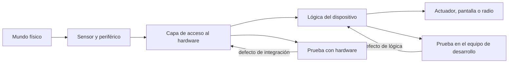
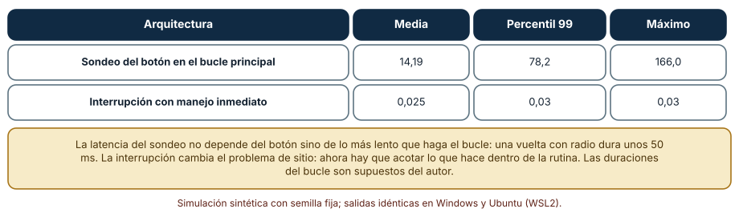
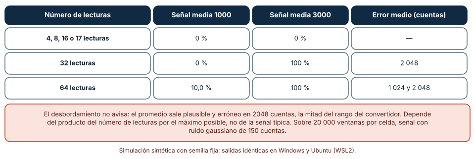
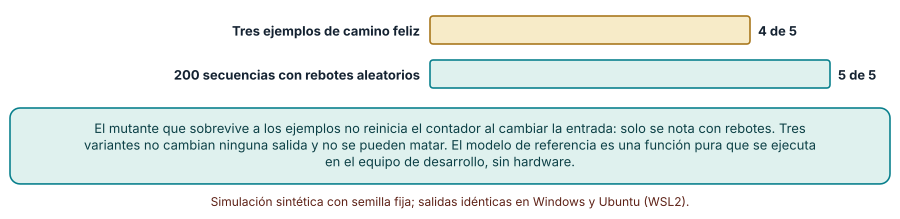

# SE-265 — Hardware, firmware y software embebido

[← SE-264 — Proyecto: cliente multiplataforma con sincronización](https://github.com/vladimiracunadev-create/modern-software-engineering-program/blob/main/classes/part-21-software-movil-escritorio-y-multiplataforma/se-264-proyecto-cliente-multiplataforma-con-sincronizacion/README.md) · [↑ Parte 22](https://github.com/vladimiracunadev-create/modern-software-engineering-program/blob/main/classes/part-22-embedded-iot-y-tiempo-real/README.md) · [📚 Índice completo](https://github.com/vladimiracunadev-create/modern-software-engineering-program/blob/main/classes/README.md) · [🌐 Portal](https://vladimiracunadev-create.github.io/modern-software-engineering-program/classes/SE-265.html) · [SE-266 — Microcontroladores, periféricos y buses →](https://github.com/vladimiracunadev-create/modern-software-engineering-program/blob/main/classes/part-22-embedded-iot-y-tiempo-real/se-266-microcontroladores-perifericos-y-buses/README.md)

## Punto profesional y fundamento pedagógico

**Punto profesional.** La clase existe para que distingas qué decide el hardware, qué decide el firmware y qué puede probarse sin ninguno de los dos, y para que elijas una arquitectura de firmware por lo que garantiza sobre la respuesta a un evento, no por costumbre.

**Por qué aparece aquí.** Abre la **Parte 22** después de **Proyecto: cliente multiplataforma con sincronización**: la Parte 21 llevó el software a clientes que corren en sistemas operativos completos; ahora el programa corre sin sistema operativo, con memoria medida en kilobytes y con un mundo físico que no espera. La clase fija el vocabulario y el caso conductor de la parte: un nodo ambiental de una sala de estudio, simulado.

**Error conceptual que debe corregir.** Creer que el software embebido es «software normal en un dispositivo pequeño»: las garantías de tiempo, el ancho de los enteros y el estado compartido con las interrupciones cambian lo que significa que un programa sea correcto.

**Secuencia de aprendizaje.** Antes de leer los resultados, predices cuánto tarda un botón en ser atendido en un bucle principal con tareas lentas; después mides esa latencia, calculas cuándo un acumulador de 16 bits desborda sin avisar y mides qué mutantes de un antirrebote matan unos ejemplos y unas secuencias con rebotes. La secuencia usa predicción, explicación propia, contraste y recuperación. [ICAP](https://icap.education.asu.edu/research) distingue participación de construcción de conocimiento; [How People Learn II](https://nap.nationalacademies.org/catalog/24783/how-people-learn-ii-learners-contexts-and-cultures) exige conectar conocimiento previo, contexto y transferencia; la [práctica de recuperación](https://pubmed.ncbi.nlm.nih.gov/16507066/) respalda producir de nuevo la explicación tras una demora; y [Education for Life and Work](https://nap.nationalacademies.org/resource/13398/dbasse_084153.pdf) exige devolución que explique la causa del error.

**Evidencia de aprendizaje.** `embedded-log.md` con la predicción, la latencia por arquitectura, la tabla del acumulador, la salida de la suite de mutantes y una nota que diga qué parte del firmware se comprobó en el equipo de desarrollo y cuál exige hardware.

**Límite de la conclusión.** Las duraciones del bucle, el ruido de las lecturas y las variantes del antirrebote son construcciones del autor. Ningún experimento corrió en un microcontrolador: son simulaciones de aritmética y de tiempo en CPython, que muestran mecanismos, no cifras de un chip.

### Trazabilidad fuente → afirmación

| Fuente primaria u oficial | Afirmación que respalda | Lo que no prueba |
|---|---|---|
| [Lee y Seshia, «Introduction to Embedded Systems: A Cyber-Physical Systems Approach»](https://ptolemy.berkeley.edu/books/leeseshia/) | Trata los sistemas embebidos como computación en interacción con procesos físicos, con el tiempo como parte de la semántica y no solo como rendimiento. | No fija una arquitectura de firmware ni cifras de ningún microcontrolador. |
| [Barr Group, «Embedded C Coding Standard»](https://barrgroup.com/embedded-systems/books/embedded-c-coding-standard) | Reúne reglas de codificación orientadas a reducir defectos en firmware, entre ellas tipos de ancho fijo y el cuidado con datos compartidos con interrupciones. | Un estándar de estilo no demuestra por sí mismo que reduzca los defectos de un proyecto concreto. |
| [Python: `struct`](https://docs.python.org/3/library/struct.html) | Documenta cómo empaquetar enteros con ancho y orden de bytes definidos, útil para simular el ancho de un registro. | No reproduce el comportamiento de un compilador ni de una arquitectura concreta. |

## Antes de empezar

Recupera lo aprendido en la Parte 21 sobre ciclo de vida: un cliente móvil se suspende y se reanuda; un nodo embebido simplemente sigue corriendo, o deja de hacerlo. La pregunta activa es: **¿qué garantiza este firmware sobre la respuesta a un evento, y qué parte de esa garantía puedo comprobar sin el dispositivo?**

## Prerrequisitos

- Haber completado `SE-264` o poder explicar qué estado persistía un cliente entre sesiones.
- Python 3.11 o posterior y un terminal; todo el código usa solo la biblioteca estándar.
- Leer enteros con y sin signo y operaciones de bits a nivel básico.

## Problema auténtico

El equipo de la plataforma de entregas instala en una sala de estudio un nodo que mide temperatura, humedad y CO₂ y tiene un botón para marcar «aire cargado». Un primer prototipo lee los sensores, actualiza una pantalla, envía datos por radio cada diez vueltas y consulta el botón al final de cada vuelta. Al probarlo en la mesa, funciona. En la sala, el botón «a veces no responde», el promedio de CO₂ se ve a veces cero y el contador de pulsaciones cuenta de más. Cada síntoma tiene una causa distinta que no se ve leyendo el código como software normal.

## Objetivos observables

Al terminar podrás:

1. distinguir hardware, firmware y software embebido con un ejemplo y un contraejemplo del nodo de la sala;
2. medir con una simulación la latencia de un evento según el firmware lo sondee en un bucle principal o lo atienda con una interrupción;
3. calcular cuándo un acumulador de ancho fijo desborda y qué error produce, y escribirlo como una condición verificable;
4. separar la lógica del dispositivo de su acceso al hardware para comprobarla en el equipo de desarrollo, y medir qué defectos encuentra cada tipo de prueba;
5. declarar qué parte del firmware solo puede comprobarse con el dispositivo y cómo se reduce esa parte.

## Mapa conceptual



El mapa separa la **lógica**, que se comprueba con una función pura y entradas simuladas, de la **capa de acceso al hardware**, que exige el dispositivo. La mayor parte del esfuerzo de calidad consiste en empujar defectos hacia el lado barato.

## Temas y por qué importan

| Tema | Por qué cambia una decisión profesional | Evidencia mínima |
|---|---|---|
| Hardware, firmware y software | Decide quién es dueño de cada defecto y dónde puede probarse. | Predicción, traza causal y contraejemplo de **Hardware, firmware y software** en `embedded-log.md` |
| Arquitectura del firmware | El bucle principal, las interrupciones y un planificador dan garantías de tiempo distintas. | Predicción, traza causal y contraejemplo de **Arquitectura del firmware** en `embedded-log.md` |
| Capa de acceso al hardware | Aislar los registros permite comprobar la lógica sin dispositivo. | Predicción, traza causal y contraejemplo de **Capa de acceso al hardware** en `embedded-log.md` |
| Aritmética de ancho fijo | Los desbordamientos no avisan y producen valores plausibles. | Predicción, traza causal y contraejemplo de **Aritmética de ancho fijo** en `embedded-log.md` |
| Qué exige el dispositivo | Reconocer la parte irreductible orienta la inversión en bancos de prueba. | Predicción, traza causal y contraejemplo de **Qué exige el dispositivo** en `embedded-log.md` |

## Conceptos y decisiones

### 1. Hardware, firmware y software

El **hardware** es el microcontrolador, los sensores, los buses y la alimentación; fija qué es posible y qué cuesta. El **firmware** es el programa que vive en la memoria del dispositivo y habla con ese hardware; se actualiza con más dificultad que una aplicación y su fallo suele dejar el dispositivo mudo. El **software embebido** es el conjunto: firmware y componentes que corren junto al dispositivo. Un defecto puede ser de cualquiera de los tres y el síntoma casi nunca lo dice: un promedio erróneo puede venir de un sensor ruidoso, de un acumulador que desborda o de un cableado. Diagnosticar es separar capas, igual que en una red.

### 2. Arquitectura del firmware

La arquitectura más simple es un bucle principal que repite sensor, pantalla y radio. Su garantía es débil: un evento espera a que termine la vuelta. Una interrupción atiende el evento al instante y solo hace lo mínimo, dejando el resto para el bucle. Un planificador de tiempo real asigna prioridades y plazos (`SE-268`). Lee y Seshia insisten en que el tiempo es parte de la semántica: un resultado correcto entregado tarde puede ser un resultado incorrecto. Por eso la pregunta de arquitectura es qué plazo se necesita para cada evento, y cuál es la peor vuelta posible.

### 3. Capa de acceso al hardware

Si la lógica lee directamente un registro, no se puede ejecutar sin el chip. Una capa fina de acceso (leer un canal del convertidor, escribir un pin) con una interfaz que el equipo de desarrollo puede reemplazar por datos simulados permite comprobar el antirrebote, el promedio y las alarmas con pruebas automáticas rápidas. La capa no elimina las pruebas con hardware: reduce lo que solo ellas pueden ver (tiempos reales, ruido, consumo). Es el mismo principio de contratos y dobles de `SE-166`, aplicado a un chip.

### 4. Aritmética de ancho fijo

Un entero de 16 bits sin signo vale de 0 a 65 535 y da la vuelta. Sumar 32 lecturas de 12 bits (máximo 4095) puede llegar a 131 040 y desbordar. El resultado no es una excepción sino un número plausible, y el promedio sale entre 0 y 2047 cuando la señal está cerca del máximo. Las reglas de codificación para firmware (como las del estándar de Barr Group) piden tipos de ancho fijo y razonar sobre el rango; la condición verificable es «el producto del número de lecturas por el máximo del convertidor cabe en el acumulador».

### 5. Qué exige el dispositivo

Quedan siempre cosas que solo el dispositivo muestra: el ruido real de un sensor, el tiempo de arranque de la radio, el consumo, la interferencia entre periféricos, las rutinas de interrupción que alteran el tiempo. El equipo decide cuánto de eso mover a un banco con hardware en el bucle y cuánto aceptar como riesgo declarado. Una buena práctica es medir la proporción: de las líneas del firmware, ¿cuántas se ejecutaron en las pruebas en el equipo de desarrollo y cuántas tocan registros?

### Cuánto espera un botón: sondeo frente a interrupción

El bucle del nodo tiene sensor (2 ms), pantalla (8 ms) y, cada diez vueltas, un envío de radio de mediana 40 ms con cola larga (σ = 0,4). El botón se consulta al final de cada vuelta. Se simulan 100 000 pulsaciones en instantes uniformes sobre 200 000 vueltas y se mide la espera hasta la siguiente consulta. Como contraste, una interrupción que atiende el botón en 20 a 30 µs.

```python
k = bisect.bisect_right(bounds, a)      # siguiente fin de vuelta tras la pulsación
latencia_sondeo = bounds[k] - a
```

| Arquitectura | Media (ms) | Percentil 99 | Máximo |
|---|---:|---:|---:|
| Sondeo en el bucle principal | 14,19 | 78,2 | 166,0 |
| Interrupción con manejo inmediato | 0,025 | 0,03 | 0,03 |

Resultado, idéntico en Windows (CPython 3.12.9) y en Ubuntu bajo WSL2 (3.12.3). El sondeo da una espera media de 14 ms y un peor caso de 166 ms, determinado por la vuelta más lenta, no por el botón.



**Cómo leer la figura.** Cada fila es una arquitectura; las columnas dan la espera en milisegundos. **Dónde deja de valer:** las duraciones del bucle son supuestos. Una interrupción mueve el problema: un manejador largo retrasa a todas las demás y deja el bucle sin avanzar. La figura no dice que toda lógica deba estar en interrupciones, sino que el sondeo no tiene una latencia acotada por diseño.

### Un acumulador de 16 bits que desborda en silencio

Se promedian N lecturas de 12 bits (señal con ruido gaussiano de 150 cuentas alrededor de 1000 o de 3000), acumulando en 16 bits con `& 0xFFFF`. Se comparan con el promedio correcto en 20 000 ventanas por celda.

```python
acc = 0
for x in lecturas:
    acc = (acc + x) & 0xFFFF
promedio = acc // n
```

| Número de lecturas | Señal media 1000 | Señal media 3000 | Error medio (cuentas) |
|---|---:|---:|---:|
| 4, 8, 16 o 17 | 0 % | 0 % | — |
| 32 | 0 % | 100 % | 2 048 |
| 64 | 10,0 % | 100 % | 1 024 y 2 048 |

Con señal media de 3000, 32 lecturas suman unos 96 000 y desbordan siempre: el error es 65 536 / 32 = 2048 cuentas. Con señal 1000, 64 lecturas suman unos 64 000, cerca del borde, y desbordan el 10 % de las veces.



**Cómo leer la figura.** Cada fila agrupa un número de lecturas; las dos columnas centrales son el porcentaje de ventanas erróneas. **Dónde deja de valer:** el modelo emula la vuelta con una máscara; un compilador puede promover tipos y ocultar o cambiar el desbordamiento, y un procesador de 32 bits no lo sufriría. Lo que enseña es la condición: lecturas × máximo ≤ 65 535, comprobable antes de ejecutar nada.

### Mutantes de un antirrebote: ejemplos frente a rebotes

Un antirrebote cambia de estado cuando la entrada difiere del estado durante K = 3 muestras seguidas. Se generan ocho variantes con un defecto cada una (umbral de 2, umbral de 4, contador que no se reinicia, desfase de una muestra, estado inicial invertido y tres cambios que no alteran ninguna salida). Se comparan con el modelo de referencia con tres ejemplos de camino feliz y con 200 secuencias con rebotes aleatorios.

```python
def killed(mut, tests):
    f = make(mut)
    return any(f(t) != ref(t) for t in tests)
```

Tres de las ocho variantes son equivalentes y no se pueden matar. De las cinco distinguibles, los **tres ejemplos de camino feliz matan 4** y las **200 secuencias con rebotes matan las 5**. El mutante que escapa a los ejemplos no reinicia el contador al volver a un valor igual: solo se nota con rebotes que entran y salen.



**Cómo leer la figura.** Cada barra es el número de las cinco variantes distinguibles que la suite detecta. **Dónde deja de valer:** el modelo de referencia es la propia especificación del autor; si el rebote real de un interruptor tiene otra forma, la secuencia aleatoria no la cubre. Y todo corre en el equipo de desarrollo: no demuestra que el antirrebote funcione con el interruptor físico.

## Definiciones de trabajo

- **firmware:** programa almacenado en la memoria no volátil de un dispositivo que controla su hardware y se actualiza con procedimientos propios.
- **capa de acceso al hardware:** módulo que aísla los registros y periféricos detrás de una interfaz que puede reemplazarse por datos simulados.
- **latencia de un evento:** tiempo entre que ocurre un evento y el firmware empieza a atenderlo.
- **desbordamiento:** resultado de una operación que no cabe en el ancho del tipo y da la vuelta sin avisar.
- **mutante equivalente:** variante del código que no cambia ninguna salida y no se puede matar con ninguna prueba.

Las definiciones son operativas para el nodo de la sala. No convierten términos con una historia más amplia en sinónimos y deben contrastarse con la documentación primaria enlazada al final.

## Ejemplo mínimo

El fragmento calcula si un acumulador cabe. Antes de ejecutarlo, predice si 32 lecturas de 12 bits caben en 16 bits.

```python
n, maximo, ancho = 32, 4095, 16
peor_caso = n * maximo
assert peor_caso == 131040 and peor_caso > 2 ** ancho - 1
assert 16 * maximo <= 2 ** ancho - 1      # 16 lecturas sí caben
```

16 lecturas caben (65 520 ≤ 65 535) y 32 no. Registra versión, comando y salida; cambia a lecturas de 10 bits y predice cuántas caben.

## Ejemplo profesional

El equipo de la plataforma separa el firmware del nodo en dos módulos. `hal.py` (simulado aquí) expone `leer_canal(n)` y `leer_boton()`; `logica.py` contiene el antirrebote, el promedio con acumulador de 32 bits, la alarma de CO₂ y la decisión de cuándo enviar. Las pruebas en el equipo de desarrollo ejecutan `logica.py` con secuencias generadas, incluidas las de rebotes y las de lecturas al máximo. En el dispositivo real solo se comprueban la latencia del botón con una interrupción y el consumo. Documentan además la condición del acumulador como una aserción en tiempo de compilación.

Compara con el primer prototipo: el botón responde en menos de un milisegundo, el promedio de CO₂ nunca da cero y el contador no cuenta de más. Un diseño es adecuado cuando sus defectos de lógica se encuentran en segundos; es frágil cuando solo se ven en la sala.

## Práctica guiada

1. Dibuja el nodo en tres capas (hardware, acceso al hardware, lógica) y marca qué módulo se puede ejecutar en el equipo de desarrollo.
2. Predice cuánto espera el botón con el sondeo y escribe el número antes de simular.
3. Simula la latencia con el bucle del nodo y con una interrupción.
4. Calcula para cada acumulador del firmware el máximo que alcanza y compáralo con el ancho.
5. Escribe un antirrebote, ocho variantes y un modelo de referencia, y mide qué suite las mata.
6. Lista lo que solo se puede comprobar con el dispositivo y cómo lo medirías.
7. Entrega `embedded-log.md` y pide a otra persona que identifique la lógica que no pasó por el equipo de desarrollo.

## Ejercicios

1. **Bucle:** añade una tarea de 25 ms cada cinco vueltas y recalcula la latencia máxima del botón; explica qué parte del cambio viene de la tarea.
2. **Ancho:** calcula el número máximo de lecturas de 10 bits que cabe en un acumulador de 16 bits sin signo y con signo.
3. **Rebotes:** diseña una secuencia de cinco muestras que distinga el mutante que no reinicia el contador de la referencia.
4. **Frontera:** elige tres líneas de un firmware que toquen registros y propone cómo comprobar su lógica sin ellos.

## Reto verificable

Entrega `embedded-log.md` con la predicción, la tabla de latencia, la del acumulador, la salida de la suite de mutantes y la lista de lo que exige el dispositivo. Se aprueba si otra persona ejecuta el código desde un checkout limpio, obtiene los mismos números y puede decir qué condición cambiaría si las lecturas fueran de 10 bits. No se aprueba por describir los tres niveles ni por afirmar que algo funciona sin una prueba en el dispositivo.

## Caso conductor

El nodo ambiental de una sala de estudio es el caso conductor de la Parte 22. Esta clase deja el primer artefacto: el nodo en tres capas con su latencia de botón medida y sus condiciones de ancho escritas. `SE-266` añadirá los periféricos y los buses por los que el nodo habla con sus sensores. Cambia después una sola decisión, sondear o interrumpir, y observa qué garantías de tiempo cambian.

## Preguntas frecuentes

### ¿Siempre hay que usar interrupciones para los botones?

No: si el plazo es de decenas de milisegundos y el bucle es corto, el sondeo basta y es más simple. Se elige por el peor caso del bucle y el plazo del evento, que hay que medir.

### ¿Se puede probar firmware sin hardware?

La lógica sí, con una capa de acceso que se simule. No se puede probar sin hardware el tiempo real, el ruido ni el consumo. Declarar la frontera es parte del trabajo.

### ¿Por qué no usar siempre enteros de 32 bits?

Cuesta memoria y, en algunos procesadores, tiempo. Y no elimina el problema: lo traslada a un rango mayor. Lo que importa es razonar sobre el máximo.

### ¿Qué es un mutante equivalente y por qué importa?

Es una variante que se comporta igual y por eso ninguna prueba la mata. Importa para no interpretar «no matamos todos» como una suite floja: parte de los supervivientes no son defectos.

## Fallo controlado y diagnóstico

Reproduce el fallo clásico de la clase: **promediar muchas lecturas con un acumulador estrecho y no ver el error hasta la sala**. Simula 32 lecturas con señal media de 3000 y compara con el promedio de 32 bits.

Registra síntoma, entrada mínima, hipótesis, observación que descarta cada hipótesis, causa, corrección y prueba de regresión. **Síntoma:** el CO₂ se muestra como un valor cercano a 1000 cuando en la sala hay más de 3000. **Hipótesis rivales:** (a) el sensor está mal calibrado; (b) la conversión a ppm tiene un error; (c) el acumulador desborda. **Prueba:** calcula el promedio con un acumulador de 32 bits sobre las mismas lecturas; si difiere en 2048 cuentas, la causa es el desbordamiento. **Conclusión:** 32 × 3000 = 96 000 > 65 535. **Regresión:** cambia el acumulador a 32 bits, añade la aserción «lecturas × máximo cabe» y una prueba con lecturas al máximo. No cambies a la vez el ancho y el número de lecturas.

## Errores comunes y cómo corregirlos

| Síntoma | Causa probable | Corrección |
|---|---|---|
| El botón «a veces» no responde | Sondeo en un bucle con tareas lentas | Medir la vuelta más larga y atender el botón por interrupción o acotar el bucle |
| Un promedio sale en cero o muy bajo con señales altas | Desbordamiento del acumulador | Escribir la condición de rango y usar un tipo más ancho |
| El contador cuenta más pulsaciones de las que hubo | Antirrebote ausente o con un defecto de reinicio | Comprobarlo con secuencias de rebotes contra un modelo de referencia |
| Las pruebas pasan en el equipo y fallan en el dispositivo | La lógica lee registros directamente | Aislar el acceso al hardware y probar la lógica con datos simulados |
| Se confía en que «funciona en la mesa» | Las pruebas no incluyen tiempos ni extremos | Añadir casos de peor vuelta y de lecturas al máximo |

## Entorno y archivos clave

```text
work/SE-265/
├── README.md
├── nodo/
│   ├── hal.py
│   ├── logica.py
│   └── latencia.py
├── tests/test_nodo.py
└── evidence/embedded-log.md
```

El `README` declara plataforma, versión de Python, semillas y comandos. Los experimentos usan solo la biblioteca estándar (`random`, `statistics`, `bisect`, `math`) y se ejecutaron con CPython 3.12.9 en Windows 11 y 3.12.3 en Ubuntu bajo WSL2: las salidas fueron idénticas. Si añades una dependencia, fija procedencia y versión.

## Seguridad, ética y accesibilidad

- un nodo que mide la calidad del aire de una sala debe indicar su incertidumbre y no sustituir una medición regulada;
- la alarma debe ser perceptible por más de un canal (luz y sonido, o pantalla y aviso) para personas con distintas capacidades;
- los datos de una sala no deben identificar a las personas presentes;
- documenta qué se comprobó en el equipo y qué en el dispositivo, para que el límite sea visible;
- respeta las licencias de los estándares de código y atribuye lo adaptado.

## Puente hacia el trabajo con agentes

Un agente al que se le pide «escribe el firmware del nodo» producirá un bucle que llama a funciones de biblioteca de un fabricante concreto y mezclará lógica con registros. Pídele en cambio que separe el acceso al hardware de la lógica, que escriba las condiciones de rango de cada acumulador y que entregue pruebas con secuencias de rebotes contra un modelo de referencia. Revisa especialmente si acumula en un tipo estrecho o si da por supuesto que una llamada es atómica: son los dos defectos que esta clase mostró sin aviso.

## Transferencia

Traslada el análisis a otro dispositivo (por ejemplo, un temporizador de riego): cambia el evento y los tipos, y conserva el procedimiento de medir la latencia, calcular el rango y probar la lógica contra un modelo. La transferencia está lograda cuando puedes explicar qué parte dependía del chip y cuál no, no cuando el código se parece.

## Evaluación y evidencia

| Criterio | Evidencia para aprobar |
|---|---|
| comprensión | explicación de la diferencia entre hardware, firmware y software embebido con ejemplos del nodo |
| corrección | latencia, desbordamiento y mutantes reproducibles con las mismas semillas |
| diseño | nodo en tres capas con condiciones de rango y frontera con el dispositivo |
| diagnóstico | reproducción del fallo «acumulador estrecho» con regresión |
| incertidumbre | declaración de que ningún experimento corrió en un microcontrolador |
| reproducibilidad | versiones, comandos, salida y límites declarados |

## Fuentes

- [Lee y Seshia, «Introduction to Embedded Systems»](https://ptolemy.berkeley.edu/books/leeseshia/) — sistemas embebidos y ciberfísicos con el tiempo en la semántica; autoridad: autores del libro (UC Berkeley).
- [Barr Group, «Embedded C Coding Standard»](https://barrgroup.com/embedded-systems/books/embedded-c-coding-standard) — reglas de codificación para firmware; autoridad: Barr Group.
- [SWEBOK Guide v4.0a](https://www.computer.org/education/bodies-of-knowledge/software-engineering) — áreas de conocimiento de ingeniería de software; autoridad: IEEE Computer Society.
- [Python: `struct`](https://docs.python.org/3/library/struct.html) — empaquetado de enteros con ancho definido; autoridad: documentación de Python.
- [Python: `random`](https://docs.python.org/3/library/random.html) — generador con semilla para las simulaciones; autoridad: documentación de Python.

Cada fuente respalda el mecanismo indicado; ninguna demuestra que los 14 ms de latencia, el 100 % de desbordamientos o el 4 de 5 mutantes se observen en el nodo real. Esa afirmación depende del chip, del compilador y del interruptor físico.

## Límites y siguiente paso

Se ejecutaron tres simulaciones con datos sintéticos en Windows y Ubuntu (WSL2) con resultados idénticos. No se usó ningún microcontrolador, compilador de firmware ni banco de pruebas: las duraciones del bucle, el ruido de las lecturas y las variantes del antirrebote son construcciones del autor. La siguiente clase baja a los periféricos y buses por los que el nodo habla con sus sensores.

## Glosario

- **firmware:** programa almacenado en la memoria no volátil de un dispositivo que controla su hardware y se actualiza con procedimientos propios.
- **capa de acceso al hardware:** módulo que aísla los registros y periféricos detrás de una interfaz que puede reemplazarse por datos simulados.
- **latencia de un evento:** tiempo entre que ocurre un evento y el firmware empieza a atenderlo.
- **desbordamiento:** resultado de una operación que no cabe en el ancho del tipo y da la vuelta sin avisar.
- **mutante equivalente:** variante del código que no cambia ninguna salida y no se puede matar con ninguna prueba.

---

[← SE-264 — Proyecto: cliente multiplataforma con sincronización](https://github.com/vladimiracunadev-create/modern-software-engineering-program/blob/main/classes/part-21-software-movil-escritorio-y-multiplataforma/se-264-proyecto-cliente-multiplataforma-con-sincronizacion/README.md) · [↑ Parte 22](https://github.com/vladimiracunadev-create/modern-software-engineering-program/blob/main/classes/part-22-embedded-iot-y-tiempo-real/README.md) · [📚 Índice completo](https://github.com/vladimiracunadev-create/modern-software-engineering-program/blob/main/classes/README.md) · [🌐 Portal](https://vladimiracunadev-create.github.io/modern-software-engineering-program/classes/SE-265.html) · [SE-266 — Microcontroladores, periféricos y buses →](https://github.com/vladimiracunadev-create/modern-software-engineering-program/blob/main/classes/part-22-embedded-iot-y-tiempo-real/se-266-microcontroladores-perifericos-y-buses/README.md)
