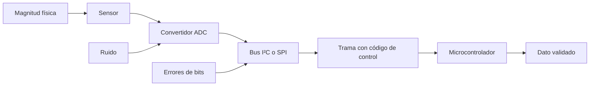
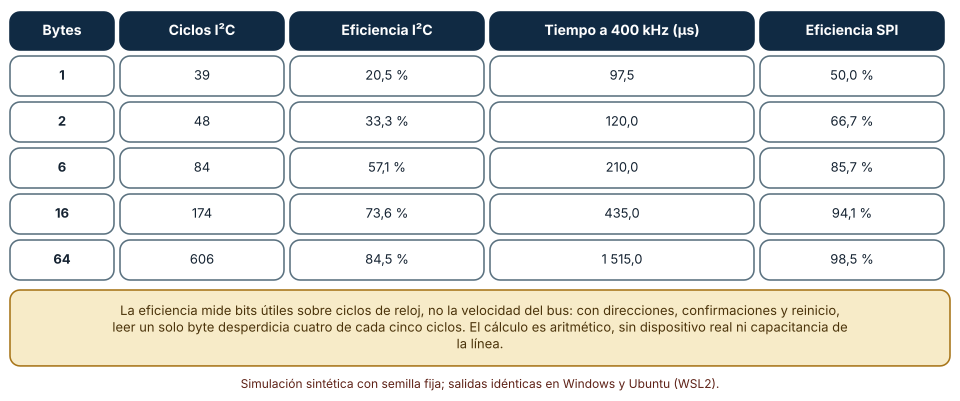
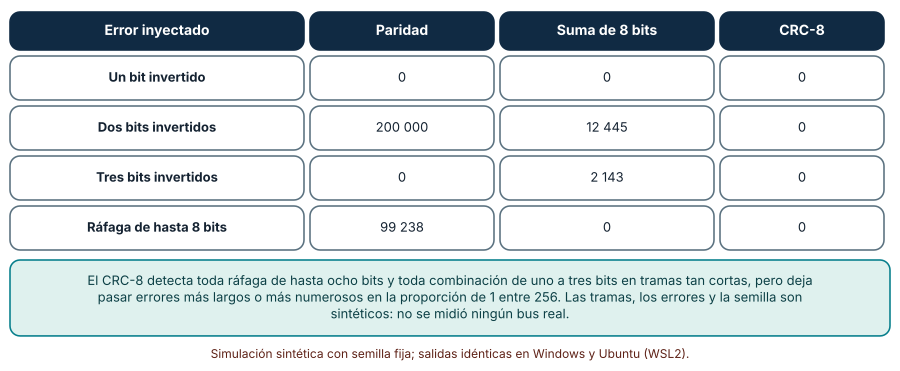
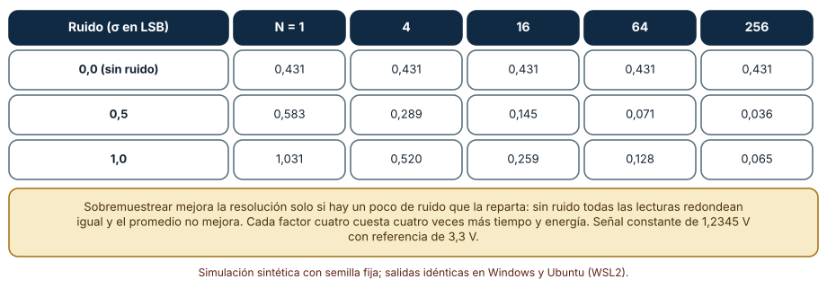

# SE-266 — Microcontroladores, periféricos y buses

[← SE-265 — Hardware, firmware y software embebido](https://github.com/vladimiracunadev-create/modern-software-engineering-program/blob/main/classes/part-22-embedded-iot-y-tiempo-real/se-265-hardware-firmware-y-software-embebido/README.md) · [↑ Parte 22](https://github.com/vladimiracunadev-create/modern-software-engineering-program/blob/main/classes/part-22-embedded-iot-y-tiempo-real/README.md) · [📚 Índice completo](https://github.com/vladimiracunadev-create/modern-software-engineering-program/blob/main/classes/README.md) · [🌐 Portal](https://vladimiracunadev-create.github.io/modern-software-engineering-program/classes/SE-266.html) · [SE-267 — Restricciones de memoria, energía y cómputo →](https://github.com/vladimiracunadev-create/modern-software-engineering-program/blob/main/classes/part-22-embedded-iot-y-tiempo-real/se-267-restricciones-de-memoria-energia-y-computo/README.md)

## Punto profesional y fundamento pedagógico

**Punto profesional.** La clase existe para que razones sobre lo que ocurre entre el microcontrolador y un sensor: cuánto cuesta realmente leer un dato por un bus, qué errores de bits detecta cada código de control y cuánta resolución de verdad aporta un convertidor, de modo que elijas un periférico por sus números y no por su hoja de marketing.

**Por qué aparece aquí.** Se sitúa después de **Hardware, firmware y software embebido** y antes de **Restricciones de memoria, energía y cómputo**: la clase anterior separó la lógica del acceso al hardware; esta entra en esa capa de acceso y mide tres de sus mecanismos (el bus, el código de control y el convertidor analógico-digital), que la siguiente clase usará para hablar de energía.

**Error conceptual que debe corregir.** Creer que un bus rápido lee rápido, que un bit de paridad protege una trama o que doce bits de convertidor dan doce bits de información: el bus gasta ciclos en direcciones y confirmaciones, la paridad no ve errores de dos bits y la resolución efectiva depende del ruido.

**Secuencia de aprendizaje.** Antes de leer los resultados, predices la eficiencia de leer un byte por I²C; después calculas la eficiencia para seis tamaños, inyectas errores de uno, dos y tres bits y ráfagas en 200 000 tramas y mides el error de un convertidor al promediar lecturas con y sin ruido. La secuencia usa predicción, explicación propia, contraste y recuperación. [ICAP](https://icap.education.asu.edu/research) distingue participación de construcción de conocimiento; [How People Learn II](https://nap.nationalacademies.org/catalog/24783/how-people-learn-ii-learners-contexts-and-cultures) exige conectar conocimiento previo, contexto y transferencia; la [práctica de recuperación](https://pubmed.ncbi.nlm.nih.gov/16507066/) respalda producir de nuevo la explicación tras una demora; y [Education for Life and Work](https://nap.nationalacademies.org/resource/13398/dbasse_084153.pdf) exige devolución que explique la causa del error.

**Evidencia de aprendizaje.** `bus-log.md` con la predicción, la tabla de eficiencia por tamaño, la tabla de errores no detectados por código, la tabla de error eficaz del convertidor y una nota que diga qué código y qué factor de sobremuestreo elegirías para el nodo y por qué.

**Límite de la conclusión.** El cálculo del bus es aritmético sobre la estructura de la trama; no incluye la capacitancia de la línea, el estiramiento de reloj ni el tiempo de los dispositivos. Los errores y el ruido son sintéticos. Ningún experimento usó un bus, un sensor o un convertidor reales.

### Trazabilidad fuente → afirmación

| Fuente primaria u oficial | Afirmación que respalda | Lo que no prueba |
|---|---|---|
| [Koopman y Chakravarty, «Cyclic redundancy code (CRC) polynomial selection for embedded networks» (DSN, 2004)](https://doi.org/10.1109/DSN.2004.1311885) | Estudia qué polinomios CRC detectan más errores en redes embebidas para longitudes de trama dadas y muestra que la elección del polinomio importa. | No evalúa el polinomio 0x07 de la clase para una longitud de 8 bytes con otros tipos de error. |
| [Texas Instruments, nota de aplicación SLVA704 sobre el bus I²C](https://www.ti.com/lit/an/slva704/slva704.pdf) | Describe la estructura de una transacción I²C con condición de inicio, dirección, confirmaciones y parada. | No da el tiempo real de una transacción con un dispositivo y una línea concretos. |
| [Python: `zlib`](https://docs.python.org/3/library/zlib.html) | Documenta la función `crc32` para comparar con el CRC implementado a mano. | Un CRC de 32 bits no tiene las propiedades del CRC-8 de la clase. |

## Antes de empezar

Recupera la capa de acceso al hardware de `SE-265`: ahora se mira lo que hay debajo de `leer_canal(n)`. La pregunta activa es: **¿cuánto cuesta realmente cada lectura, qué errores deja pasar el control de la trama y cuánta resolución aporta el convertidor?**

## Prerrequisitos

- Haber completado `SE-265` o poder explicar la diferencia entre lógica y acceso al hardware.
- Python 3.11 o posterior y un terminal; todo el código usa solo la biblioteca estándar.
- Manejar operaciones de bits y la idea de ruido gaussiano a nivel básico.

## Problema auténtico

El nodo de la sala lee un sensor de CO₂ por I²C a 100 kHz, la temperatura de otro por SPI y la batería con el convertidor del microcontrolador. El sensor de CO₂ devuelve 2 bytes y una suma de comprobación. En una semana de pruebas se descartan tramas «sin motivo» y otras llegan con valores absurdos que pasaron el control. La batería se lee con ruido que parece de más de un bit. Nadie ha calculado cuántos ciclos de reloj cuesta una lectura ni qué errores puede detectar el control que se eligió.

## Objetivos observables

Al terminar podrás:

1. calcular los ciclos y la eficiencia de una transacción I²C y de una SPI para distintos tamaños de lectura;
2. medir qué errores de bits detectan una paridad, una suma de 8 bits y un CRC-8 sobre tramas de ocho bytes, y por qué;
3. medir cómo cambia el error eficaz de un convertidor al sobremuestrear con y sin ruido, y cuánto cuesta;
4. elegir un bus, un código de control y un factor de sobremuestreo para una lectura con sus supuestos;
5. declarar qué no cubre un cálculo aritmético sin el dispositivo.

## Mapa conceptual



El mapa recorre el camino de un dato: del sensor al microcontrolador. Cada tramo tiene su propio enemigo (ruido en el convertidor, errores de bits en el bus) y su propio coste (tiempo, energía), que esta clase mide.

## Temas y por qué importan

| Tema | Por qué cambia una decisión profesional | Evidencia mínima |
|---|---|---|
| Microcontroladores y periféricos | Un periférico hace en hardware lo que el firmware haría con ciclos y energía. | Predicción, traza causal y contraejemplo de **Microcontroladores y periféricos** en `bus-log.md` |
| Buses I²C y SPI | Cada uno tiene una estructura de trama y una eficiencia distintas. | Predicción, traza causal y contraejemplo de **Buses I²C y SPI** en `bus-log.md` |
| Códigos de control | Paridad, suma y CRC detectan clases de error distintas. | Predicción, traza causal y contraejemplo de **Códigos de control** en `bus-log.md` |
| Convertidores analógico-digitales | Resolución nominal y efectiva no coinciden; el ruido decide. | Predicción, traza causal y contraejemplo de **Convertidores analógico-digitales** en `bus-log.md` |
| Cálculo frente a medición | Un cálculo da el techo; el dispositivo da la realidad. | Predicción, traza causal y contraejemplo de **Cálculo frente a medición** en `bus-log.md` |

## Conceptos y decisiones

### 1. Microcontroladores y periféricos

Un microcontrolador integra un procesador, memoria y periféricos: temporizadores, convertidores, controladores de bus. El periférico hace por hardware lo que el procesador haría con instrucciones: genera la secuencia de un bus, cuenta pulsos, convierte una tensión. Su ventaja es que trabaja en paralelo y gasta menos energía. Su coste es que hay que configurarlo bien: un registro mal escrito produce un comportamiento incorrecto sin ningún error de compilación. La capa de acceso de `SE-265` es el lugar donde esa configuración vive y se comprueba.

### 2. Buses I²C y SPI

I²C usa dos cables compartidos por varios dispositivos y direcciones: cada transacción lleva condición de inicio, dirección con bit de lectura o escritura, confirmación de cada byte y condición de parada. SPI usa líneas separadas y una selección por dispositivo, sin direcciones ni confirmaciones. Por eso SPI es más eficiente y consume más cables. Leer un registro por I²C requiere una escritura de la dirección del registro, un reinicio y la lectura: 39 ciclos de reloj para un solo byte, de los cuales 8 son datos.

### 3. Códigos de control

Un código de control añade bits redundantes para detectar errores. La paridad es un bit que hace par el número de unos: detecta cualquier cantidad impar de bits invertidos y ninguna cantidad par. La suma de 8 bits detecta muchos errores pero puede cancelarse: dos bits invertidos en posiciones iguales de dos bytes, en sentidos opuestos, dejan la suma igual. Un CRC trata la trama como un polinomio y divide por uno generador: con un polinomio de grado 8 detecta toda ráfaga de hasta 8 bits y, para tramas cortas, todo error de uno a tres bits. Koopman y Chakravarty muestran que la elección del polinomio decide cuántos errores de varios bits detecta.

### 4. Convertidores analógico-digitales

Un convertidor de 10 bits parte el rango en 1024 niveles; con una referencia de 3,3 V, cada nivel (LSB) es de 3,2 mV. La resolución efectiva es menor por el ruido. Paradójicamente, un poco de ruido permite mejorar: si la señal ruidosa cruza varios niveles, el promedio de muchas lecturas converge al valor real, y cada factor cuatro de sobremuestreo agrega un bit. Sin ruido todas las lecturas dan el mismo nivel y promediar no ayuda. La técnica cuesta tiempo y energía: cuatro veces más lecturas por bit.

### 5. Cálculo frente a medición

Un cálculo aritmético da la cota que ningún dispositivo mejora (la eficiencia máxima de una trama), pero ignora la capacitancia de la línea, los tiempos de estiramiento de reloj y los tiempos propios del sensor, que suelen dominar. Una simulación de errores de bits da la capacidad de detección en un modelo de errores, pero un canal real tiene ráfagas, interferencias y fallos de contacto con otra distribución. El valor del cálculo es ordenar decisiones; la medición decide.

### Cuánto cuesta leer N bytes: I²C frente a SPI

Una lectura de registro por I²C es: inicio (1 ciclo), dirección y escritura con confirmación (9), registro con confirmación (9), reinicio (1), dirección y lectura con confirmación (9), N bytes con su confirmación (9 por byte) y parada (1). Por SPI: un byte de comando y N bytes (8 ciclos cada uno).

```python
def i2c_bits(n):
    return 1 + 9 + 9 + 1 + 9 + 9 * n + 1
def spi_bits(n):
    return 8 + 8 * n
```

| Bytes | Ciclos I²C | Eficiencia I²C | Tiempo a 400 kHz (µs) | Eficiencia SPI |
|---:|---:|---:|---:|---:|
| 1 | 39 | 20,5 % | 97,5 | 50,0 % |
| 2 | 48 | 33,3 % | 120,0 | 66,7 % |
| 6 | 84 | 57,1 % | 210,0 | 85,7 % |
| 16 | 174 | 73,6 % | 435,0 | 94,1 % |
| 64 | 606 | 84,5 % | 1 515,0 | 98,5 % |

Resultado, idéntico en Windows (CPython 3.12.9) y en Ubuntu bajo WSL2 (3.12.3). Leer un byte por I²C desperdicia cuatro de cada cinco ciclos; a 100 kHz esa lectura tarda 390 µs.



**Cómo leer la figura.** Cada fila es un tamaño de lectura; la eficiencia es bits de datos sobre ciclos de reloj. **Dónde deja de valer:** es una cuenta de ciclos de la trama; no incluye el estiramiento de reloj, el tiempo de conversión del sensor ni la subida de la señal por la capacitancia, que en una línea larga limitan la velocidad. La figura sirve para ver el efecto del tamaño, no para predecir una lectura real.

### Qué errores deja pasar cada código

Tramas de 8 bytes aleatorios, 200 000 por caso. Se invierten uno, dos o tres bits al azar, o una ráfaga contigua de 8 posiciones en la que cada bit se invierte con probabilidad 0,5 (con al menos uno). Se cuentan las tramas con error que cada código acepta: paridad de la trama completa, suma módulo 256 y CRC-8 de polinomio 0x07.

```python
def crc8(data, poly=0x07):
    c = 0
    for b in data:
        c ^= b
        for _ in range(8):
            c = ((c << 1) ^ poly) & 0xFF if c & 0x80 else (c << 1) & 0xFF
    return c
```

| Error inyectado | Paridad | Suma de 8 bits | CRC-8 |
|---|---:|---:|---:|
| Un bit invertido | 0 | 0 | 0 |
| Dos bits invertidos | 200 000 | 12 445 | 0 |
| Tres bits invertidos | 0 | 2 143 | 0 |
| Ráfaga de hasta 8 bits | 99 238 | 0 | 0 |

La paridad no detecta ningún error de dos bits y deja pasar la mitad de las ráfagas (los errores de bits pares). La suma de 8 bits deja pasar el 6,2 % de los errores de dos bits y el 1,1 % de los de tres. El CRC-8 no deja pasar ninguno de estos casos.



**Cómo leer la figura.** Cada fila es un tipo de error inyectado sobre 200 000 tramas; las cifras son las que cada código no detectó. **Dónde deja de valer:** el CRC-8 detecta con certeza los errores de longitud acotada de este modelo, pero un error cualquiera más largo pasa con probabilidad de 1 entre 256. Y un canal real no inyecta bits al azar: tiene ráfagas largas y fallos de contacto. Se usó el orden de bits con el más significativo primero.

### Cuánto mejora el sobremuestreo y cuándo no

Un convertidor de 10 bits mide una señal constante de 1,2345 V con referencia de 3,3 V (383,1 niveles). Cada lectura suma ruido gaussiano de desviación 0, 0,5 o 1,0 LSB y se redondea hacia abajo. Se promedian 1, 4, 16, 64 o 256 lecturas y se calcula el error eficaz respecto de la señal sobre 4000 repeticiones.

```python
v = true_lsb + rng.gauss(0, noise)
tot += min(1023, max(0, math.floor(v)))
```

| Ruido (σ en LSB) | N = 1 | 4 | 16 | 64 | 256 |
|---|---:|---:|---:|---:|---:|
| 0,0 (sin ruido) | 0,431 | 0,431 | 0,431 | 0,431 | 0,431 |
| 0,5 | 0,583 | 0,289 | 0,145 | 0,071 | 0,036 |
| 1,0 | 1,031 | 0,520 | 0,259 | 0,128 | 0,065 |

Con ruido, el error baja a la mitad por cada factor cuatro de lecturas (0,583 → 0,289 → 0,145 → 0,071 → 0,036). Sin ruido se queda en 0,431 con cualquier número de lecturas.



**Cómo leer la figura.** Cada fila es un nivel de ruido; cada columna, un factor de sobremuestreo; el valor es el error eficaz en LSB. **Dónde deja de valer:** el ruido gaussiano blanco es un modelo; un ruido real con deriva o con interferencia periódica no se promedia así. Cada factor cuatro cuesta cuatro veces más tiempo y energía, y la señal debe ser estable durante todo el promedio.

## Definiciones de trabajo

- **eficiencia de un bus:** fracción de los ciclos de reloj de una transacción que transportan datos útiles.
- **código de control:** bits redundantes añadidos a una trama para detectar errores; la paridad, la suma y el CRC son ejemplos.
- **CRC:** código de redundancia cíclica; resto de dividir la trama, vista como un polinomio, por un polinomio generador.
- **LSB:** valor del bit menos significativo de un convertidor; tamaño de un nivel de cuantización.
- **sobremuestreo:** promedio de varias lecturas de una señal estable para reducir el ruido de cuantización y de medición.

Las definiciones son operativas para el nodo de la sala. No convierten términos con una historia más amplia en sinónimos y deben contrastarse con la documentación primaria enlazada al final.

## Ejemplo mínimo

El fragmento muestra que una paridad no detecta dos bits invertidos. Antes de ejecutarlo, predice si la paridad cambia.

```python
trama = 0b10110010
buena = bin(trama).count("1") & 1
mala = bin(trama ^ 0b00000011).count("1") & 1     # dos bits invertidos
assert buena == mala
```

Invertir dos bits cambia el número de unos en un número par: la paridad es igual y el error pasa. Registra versión, comando y salida; invierte uno y tres bits y predice qué ocurre.

## Ejemplo profesional

El equipo de la plataforma decide tres cosas con los números de la clase. Para el sensor de CO₂ lee 6 bytes por lectura de una vez, no uno por uno, para pasar de 20,5 % a 57,1 % de eficiencia. Para las tramas de radio y de bus cambia la suma de 8 bits por un CRC-8 porque la suma deja pasar el 6 % de los errores de dos bits y el CRC ninguno en tramas de ocho bytes. Para la batería promedia 16 lecturas, que reducen el error eficaz de 0,58 a 0,15 LSB con el ruido que el convertidor ya tiene, y verifica en el dispositivo que ese ruido existe antes de confiar en el resultado.

Compara con el primer prototipo: menos transacciones, ninguna trama absurda aceptada en el banco de errores y una lectura de batería estable. Una decisión de bus es adecuada cuando sale de la estructura de la trama y de una prueba; es débil cuando se apoya en «I²C es lento».

## Práctica guiada

1. Dibuja la transacción I²C de tu lectura y cuenta los ciclos; calcula la eficiencia.
2. Predice cuántos errores de dos bits deja pasar una suma de 8 bits y escribe el número antes de simular.
3. Implementa paridad, suma y CRC-8 y compáralos con errores de uno, dos y tres bits.
4. Simula el sobremuestreo con ruido de 0, 0,5 y 1,0 LSB.
5. Elige código y factor de sobremuestreo para el nodo y justifica el coste.
6. Escribe qué mediría con el dispositivo para confirmar cada cálculo.
7. Entrega `bus-log.md` y pide a otra persona que identifique el supuesto más débil.

## Ejercicios

1. **Eficiencia:** calcula el tamaño de lectura con que I²C alcanza el 90 % de eficiencia y compáralo con SPI.
2. **Códigos:** añade un CRC-16 y mide los errores de cuatro bits que deja pasar cada código sobre 200 000 tramas.
3. **Sobremuestreo:** calcula cuántas lecturas hacen falta para ganar tres bits con ruido de 1 LSB y cuánta energía cuesta con 15 mA durante 20 µs por lectura.
4. **Cálculo y medición:** elige tres supuestos de la clase y propone cómo medirlos con un analizador lógico.

## Reto verificable

Entrega `bus-log.md` con la predicción, las tres tablas, el código y el factor elegidos con su coste y la lista de supuestos a medir. Se aprueba si otra persona ejecuta el código desde un checkout limpio, obtiene los mismos números y puede decir qué error dejaría pasar el código elegido. No se aprueba por la cantidad de buses descritos ni por afirmar una velocidad sin la cuenta de ciclos.

## Caso conductor

El nodo ambiental de una sala de estudio continúa como caso conductor de la Parte 22. Esta clase deja el segundo artefacto: la lectura de cada sensor con su eficiencia de bus, su código de control y su factor de sobremuestreo justificados. `SE-267` convertirá esas decisiones en energía y memoria. Cambia después una sola cosa, el tamaño de lectura del sensor de CO₂, y observa cuánto cambia el tiempo despierto.

## Preguntas frecuentes

### ¿Cuándo conviene SPI en lugar de I²C?

Cuando se necesita eficiencia y velocidad y hay pines de sobra; I²C conviene con muchos dispositivos y pocos cables. La decisión se apoya en la tabla de eficiencia y en los pines disponibles.

### ¿Un CRC lo detecta todo?

No: detecta con certeza clases de errores definidas por el polinomio y la longitud, y deja pasar el resto con probabilidad de 1 entre 2^n. Por eso se dice qué errores cubre, no que «protege».

### ¿Sobremuestrear siempre mejora?

Solo si hay ruido que reparta la señal entre niveles y la señal es estable durante el promedio. Sin ruido, no mejora; con una señal que cambia, el promedio la difumina.

### ¿Por qué simular errores de bits al azar si un canal real no los produce así?

Porque da un punto de partida comparable entre códigos. Un canal real exige otro modelo (ráfagas, interferencias) y, sobre todo, medir con el dispositivo.

## Fallo controlado y diagnóstico

Reproduce el fallo clásico de la clase: **proteger una trama con paridad y creer que se detectan los errores**. Inyecta errores de dos bits en 200 000 tramas con paridad y cuenta los aceptados.

Registra síntoma, entrada mínima, hipótesis, observación que descarta cada hipótesis, causa, corrección y prueba de regresión. **Síntoma:** tramas con valores absurdos se aceptan como válidas. **Hipótesis rivales:** (a) el control no se está ejecutando; (b) el sensor envía datos corruptos con el control correcto; (c) el control no puede ver ese tipo de error. **Prueba:** inyecta errores de dos bits; con paridad se aceptan los 200 000. **Conclusión:** la causa es la elección de un código que no ve los errores pares. **Regresión:** sustituye por CRC-8, repite con uno, dos y tres bits y con ráfagas, y registra que ninguno pasa. No cambies a la vez el código y la longitud de la trama.

## Errores comunes y cómo corregirlos

| Síntoma | Causa probable | Corrección |
|---|---|---|
| El bus «es lento» aunque el reloj es alto | Lecturas de un byte con mucho encabezado | Leer varios bytes por transacción y calcular la eficiencia |
| Tramas absurdas pasan el control | Paridad o suma para errores de varios bits | Usar un CRC y declarar qué errores cubre |
| Se descartan tramas buenas | Control mal calculado o temporización del bus | Comparar con una implementación de referencia y medir con un analizador |
| El promedio de lecturas no mejora la resolución | Sin ruido o señal inestable | Verificar el ruido real y estabilizar la señal |
| El cálculo de velocidad no coincide con la medida | Se ignoró la capacitancia y los tiempos del sensor | Medir con el dispositivo y ajustar el modelo |

## Entorno y archivos clave

```text
work/SE-266/
├── README.md
├── bus/
│   ├── eficiencia.py
│   ├── codigos.py
│   └── adc.py
├── tests/test_bus.py
└── evidence/bus-log.md
```

El `README` declara plataforma, versión de Python, semillas y comandos. Los experimentos usan solo la biblioteca estándar (`random`, `statistics`, `math`) y se ejecutaron con CPython 3.12.9 en Windows 11 y 3.12.3 en Ubuntu bajo WSL2: las salidas fueron idénticas. Si añades una dependencia, fija procedencia y versión.

## Seguridad, ética y accesibilidad

- un bus sin autenticación permite que un dispositivo malicioso conectado suplante a un sensor: el CRC detecta errores accidentales, no manipulaciones;
- un valor absurdo aceptado de un sensor de calidad del aire puede activar o suprimir una alarma: la validación de rango es parte del diseño;
- los diagnósticos del bus no deben exponer identificadores de personas;
- documenta qué cálculo se confirmó con medición y cuál no;
- respeta las licencias de las notas de aplicación y atribuye lo adaptado.

## Puente hacia el trabajo con agentes

Un agente al que se le pide «lee el sensor por I²C» producirá código con una biblioteca concreta y una lectura byte a byte. Pídele que calcule los ciclos de la transacción, que justifique el código de control con los errores que cubre y que indique qué mediría con un analizador lógico. Revisa especialmente si propone una suma o una paridad «para validar»: es el control que los errores de dos bits dejan pasar.

## Transferencia

Traslada el análisis a otro sensor (por ejemplo, un acelerómetro por SPI): cambia el tamaño de lectura y el tipo de error esperado, y conserva el procedimiento de contar ciclos, comparar códigos y comprobar el ruido. La transferencia está lograda cuando puedes explicar qué parte del cálculo dependía del bus y cuál no, no cuando las tablas se parecen.

## Evaluación y evidencia

| Criterio | Evidencia para aprobar |
|---|---|
| comprensión | explicación de por qué leer un byte por I²C es ineficiente y por qué la paridad no ve dos bits |
| corrección | tablas reproducibles con las mismas semillas |
| diseño | bus, código y factor de sobremuestreo elegidos con su coste |
| diagnóstico | reproducción del fallo «paridad y errores de dos bits» con regresión |
| incertidumbre | declaración de qué no cubre el cálculo sin dispositivo |
| reproducibilidad | versiones, comandos, salida y límites declarados |

## Fuentes

- [Koopman y Chakravarty, «CRC polynomial selection for embedded networks» (DSN, 2004)](https://doi.org/10.1109/DSN.2004.1311885) — selección de polinomios CRC; autoridad: IEEE DSN.
- [Texas Instruments, nota de aplicación SLVA704 sobre I²C](https://www.ti.com/lit/an/slva704/slva704.pdf) — estructura de la transacción I²C; autoridad: Texas Instruments.
- [Lee y Seshia, «Introduction to Embedded Systems»](https://ptolemy.berkeley.edu/books/leeseshia/) — periféricos y modelos de sistemas embebidos; autoridad: autores del libro (UC Berkeley).
- [Python: `zlib`](https://docs.python.org/3/library/zlib.html) — `crc32` para comparar con una implementación propia; autoridad: documentación de Python.
- [Python: `random`](https://docs.python.org/3/library/random.html) — generador con semilla y ruido gaussiano; autoridad: documentación de Python.

Cada fuente respalda el mecanismo indicado; ninguna demuestra que el 20,5 % de eficiencia, los 12 445 errores de suma o los 0,036 LSB se observen en el nodo real. Esa afirmación depende del bus, del sensor y del ruido de la placa.

## Límites y siguiente paso

Se ejecutaron tres simulaciones con datos sintéticos en Windows y Ubuntu (WSL2) con resultados idénticos. No se usó ningún bus, sensor ni convertidor: la cuenta de ciclos, los errores inyectados y el ruido gaussiano son construcciones del autor. La siguiente clase pasa de la lectura de un dato a su coste en memoria, energía y cómputo.

## Glosario

- **eficiencia de un bus:** fracción de los ciclos de reloj de una transacción que transportan datos útiles.
- **código de control:** bits redundantes añadidos a una trama para detectar errores; la paridad, la suma y el CRC son ejemplos.
- **CRC:** código de redundancia cíclica; resto de dividir la trama, vista como un polinomio, por un polinomio generador.
- **LSB:** valor del bit menos significativo de un convertidor; tamaño de un nivel de cuantización.
- **sobremuestreo:** promedio de varias lecturas de una señal estable para reducir el ruido de cuantización y de medición.

---

[← SE-265 — Hardware, firmware y software embebido](https://github.com/vladimiracunadev-create/modern-software-engineering-program/blob/main/classes/part-22-embedded-iot-y-tiempo-real/se-265-hardware-firmware-y-software-embebido/README.md) · [↑ Parte 22](https://github.com/vladimiracunadev-create/modern-software-engineering-program/blob/main/classes/part-22-embedded-iot-y-tiempo-real/README.md) · [📚 Índice completo](https://github.com/vladimiracunadev-create/modern-software-engineering-program/blob/main/classes/README.md) · [🌐 Portal](https://vladimiracunadev-create.github.io/modern-software-engineering-program/classes/SE-266.html) · [SE-267 — Restricciones de memoria, energía y cómputo →](https://github.com/vladimiracunadev-create/modern-software-engineering-program/blob/main/classes/part-22-embedded-iot-y-tiempo-real/se-267-restricciones-de-memoria-energia-y-computo/README.md)
