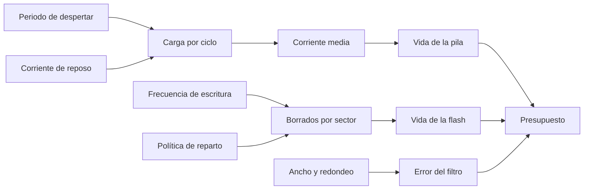
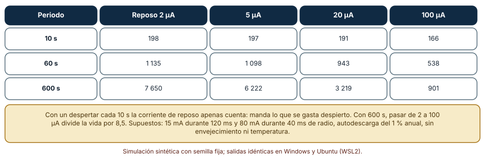
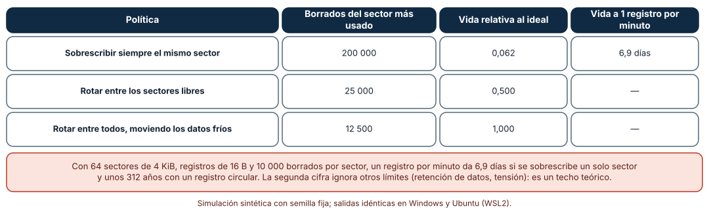
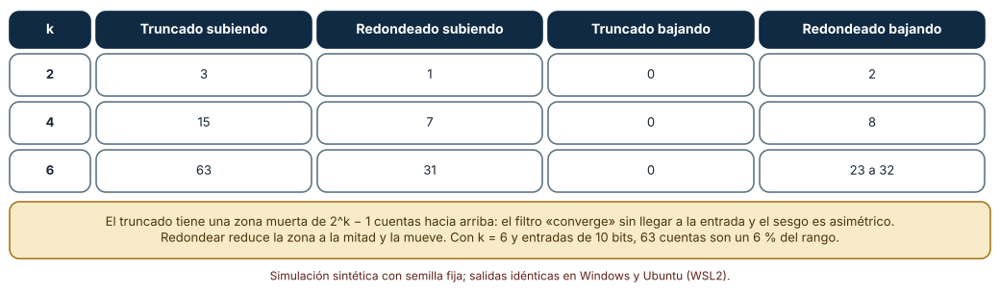

# SE-267 — Restricciones de memoria, energía y cómputo

[← SE-266 — Microcontroladores, periféricos y buses](https://github.com/vladimiracunadev-create/modern-software-engineering-program/blob/main/classes/part-22-embedded-iot-y-tiempo-real/se-266-microcontroladores-perifericos-y-buses/README.md) · [↑ Parte 22](https://github.com/vladimiracunadev-create/modern-software-engineering-program/blob/main/classes/part-22-embedded-iot-y-tiempo-real/README.md) · [📚 Índice completo](https://github.com/vladimiracunadev-create/modern-software-engineering-program/blob/main/classes/README.md) · [🌐 Portal](https://vladimiracunadev-create.github.io/modern-software-engineering-program/classes/SE-267.html) · [SE-268 — Sistemas de tiempo real y deadlines →](https://github.com/vladimiracunadev-create/modern-software-engineering-program/blob/main/classes/part-22-embedded-iot-y-tiempo-real/se-268-sistemas-de-tiempo-real-y-deadlines/README.md)

## Punto profesional y fundamento pedagógico

**Punto profesional.** La clase existe para que presupuestes un dispositivo con tres recursos escasos —energía, memoria no volátil y precisión numérica— y descubras cuál de ellos manda antes de escribir código: cuántos años dura una pila, cuánto dura una flash y cuánto error introduce un filtro de enteros.

**Por qué aparece aquí.** Se sitúa después de **Microcontroladores, periféricos y buses** y antes de **Sistemas de tiempo real y deadlines**: la clase anterior costó cada lectura en ciclos; esta traduce ciclos y bytes en vida útil, y la siguiente los traduce en plazos.

**Error conceptual que debe corregir.** Creer que el consumo de un nodo es la corriente de cuando trabaja, que una flash «aguanta años» sin mirar dónde se escribe, o que un filtro de enteros converge como uno de coma flotante: el reposo domina cuando el nodo despierta poco, el desgaste depende de la política de escritura y el truncado deja una zona muerta.

**Secuencia de aprendizaje.** Antes de calcular, predices cuántos días dura una pila de 2400 mAh si el nodo despierta cada minuto; después calculas la vida según el periodo y la corriente de reposo, simulas el desgaste de una flash con tres políticas y mides el error final de un filtro de enteros con truncado y con redondeo. La secuencia usa predicción, explicación propia, contraste y recuperación. [ICAP](https://icap.education.asu.edu/research) distingue participación de construcción de conocimiento; [How People Learn II](https://nap.nationalacademies.org/catalog/24783/how-people-learn-ii-learners-contexts-and-cultures) exige conectar conocimiento previo, contexto y transferencia; la [práctica de recuperación](https://pubmed.ncbi.nlm.nih.gov/16507066/) respalda producir de nuevo la explicación tras una demora; y [Education for Life and Work](https://nap.nationalacademies.org/resource/13398/dbasse_084153.pdf) exige devolución que explique la causa del error.

**Evidencia de aprendizaje.** `budget-log.md` con la predicción, la tabla de vida de pila, la tabla de desgaste, la tabla de error del filtro y un presupuesto del nodo con sus tres recursos y el supuesto que, si falla, más lo cambia.

**Límite de la conclusión.** Las corrientes (15 mA activo, 80 mA en radio, 2 a 100 µA en reposo), la autodescarga de 1 % anual, los 10 000 borrados por sector y los registros de 16 B son supuestos del autor. No se midió consumo, no se usó una pila ni una flash reales, y no se modeló temperatura ni envejecimiento.

### Trazabilidad fuente → afirmación

| Fuente primaria u oficial | Afirmación que respalda | Lo que no prueba |
|---|---|---|
| [Gal y Toledo, «Algorithms and data structures for flash memories» (ACM Computing Surveys, 2005)](https://doi.org/10.1145/1089733.1089735) | Explica que una flash se borra por bloques, que cada bloque soporta un número limitado de borrados y que las estructuras de datos y el reparto del desgaste deben tenerlo en cuenta. | No da la resistencia de ninguna memoria concreta ni su dependencia de la temperatura. |
| [Lee y Seshia, «Introduction to Embedded Systems»](https://ptolemy.berkeley.edu/books/leeseshia/) | Trata la memoria, el consumo y la aritmética de punto fijo como restricciones de diseño de sistemas embebidos. | No fija las corrientes ni los tamaños de un nodo concreto. |
| [Barr Group, «Embedded C Coding Standard»](https://barrgroup.com/embedded-systems/books/embedded-c-coding-standard) | Incluye reglas sobre el uso de enteros de ancho fijo y la prudencia con las operaciones de desplazamiento y redondeo en firmware. | Un estándar de estilo no cuantifica el error de un filtro. |

## Antes de empezar

Recupera el nodo de `SE-265` y los costes de lectura de `SE-266`: aquí cada ciclo gasta carga de una pila y cada registro, un borrado de flash. La pregunta activa es: **¿qué recurso se agota primero y qué decisión de diseño lo alarga?**

## Prerrequisitos

- Haber completado `SE-266` o poder calcular la eficiencia de una transacción.
- Python 3.11 o posterior y un terminal; todo el código usa solo la biblioteca estándar.
- Manejar corrientes, cargas (mAh) y desplazamientos de bits a nivel básico.

## Problema auténtico

La dirección quiere que el nodo de la sala funcione «tres años con una pila». El prototipo despierta cada diez segundos, mide, transmite por radio y guarda un registro de 16 bytes en una flash de 64 sectores. A las seis semanas la pila está a la mitad y el registro de configuración, que se reescribe en cada lectura, ya muestra errores. El promedio de temperatura se ve «pegado» cerca de la entrada. Los tres síntomas parecen independientes y vienen de tres restricciones distintas.

## Objetivos observables

Al terminar podrás:

1. calcular la vida de una pila a partir del periodo de despertar, el consumo activo y el de reposo, y localizar qué término domina;
2. estimar y simular el desgaste de una flash según la política de escritura y la presencia de datos fríos;
3. medir el error final de un filtro de enteros con truncado y con redondeo y explicar su zona muerta;
4. escribir un presupuesto de energía, memoria y precisión con sus supuestos;
5. identificar el supuesto cuyo error cambiaría la decisión de diseño.

## Mapa conceptual



El mapa tiene tres ramas independientes que convergen en un presupuesto: energía, memoria no volátil y precisión numérica. Cada una se calcula por separado y se compara con lo que el producto promete.

## Temas y por qué importan

| Tema | Por qué cambia una decisión profesional | Evidencia mínima |
|---|---|---|
| Presupuesto de energía | La corriente media, no la activa, fija la vida; el reposo domina si se despierta poco. | Predicción, traza causal y contraejemplo de **Presupuesto de energía** en `budget-log.md` |
| Ciclo de trabajo | Despertar menos y hacer más por despertar cambia la carga más que optimizar el código. | Predicción, traza causal y contraejemplo de **Ciclo de trabajo** en `budget-log.md` |
| Memoria no volátil | La flash se borra por bloques y cada bloque se gasta: dónde se escribe decide la vida. | Predicción, traza causal y contraejemplo de **Memoria no volátil** en `budget-log.md` |
| Aritmética de punto fijo | Truncar y redondear dejan errores sistemáticos distintos. | Predicción, traza causal y contraejemplo de **Aritmética de punto fijo** en `budget-log.md` |
| Presupuestar con supuestos | El presupuesto vale por sus supuestos declarados y revisables. | Predicción, traza causal y contraejemplo de **Presupuestar con supuestos** en `budget-log.md` |

## Conceptos y decisiones

### 1. Presupuesto de energía

La vida de una pila es su capacidad dividida por la corriente media. La corriente media es la carga de cada ciclo (activo, radio, reposo) dividida por el periodo. Con 15 mA durante 120 ms y 80 mA durante 40 ms de radio, un ciclo cuesta 5,0 mA·s de actividad; el reposo añade microamperios durante casi todo el periodo. Cuando el periodo es corto, manda lo activo; cuando es largo, manda el reposo, y entonces 2 µA frente a 100 µA es una diferencia de casi nueve veces en vida. Hay que añadir la autodescarga de la pila y, en la práctica, la temperatura y el envejecimiento, que aquí no se modelan.

### 2. Ciclo de trabajo

El ciclo de trabajo es la fracción del tiempo que el dispositivo está despierto. Bajarlo es la palanca principal: despertar menos veces, hacer más por cada despertar (agrupar lecturas y envíos, como en `SE-266`), apagar periféricos que no se usan y elegir el modo de reposo adecuado. Cada despertar tiene un coste fijo de arranque del reloj y de la radio que no depende de cuánto se haga, lo que favorece agrupar. La contrapartida es la latencia: un dato espera hasta el siguiente envío.

### 3. Memoria no volátil

Una flash se programa por bytes o páginas pero se borra por sectores completos, y cada sector soporta un número limitado de borrados. Escribir siempre en el mismo sector convierte cada registro en un borrado. El reparto del desgaste (wear leveling) rota las escrituras: el **dinámico** reparte entre los sectores libres y deja los de datos fríos intactos; el **estático** también mueve los datos fríos para usar todos. Gal y Toledo describen estructuras con registro circular que borran un sector solo cuando se llena. La vida pasa de días a décadas, con la advertencia de que existen otros límites como la retención de datos.

### 4. Aritmética de punto fijo

Sin unidad de coma flotante, un filtro de paso bajo `y += (x − y) >> k` es barato y suele bastar. Pero el desplazamiento a la derecha trunca hacia menos infinito: hacia arriba, cuando `x − y` es menor que 2^k, la diferencia desplazada es cero y el filtro se detiene antes de la entrada, con una zona muerta de 2^k − 1 cuentas. Hacia abajo trunca a más negativo y llega exacto. Redondear (sumando la mitad antes de desplazar) reduce la zona y la hace simétrica en teoría; en la práctica deja un error residual de otro signo. La conclusión es elegir con conocimiento del sesgo.

### 5. Presupuestar con supuestos

Un presupuesto de recursos es una lista de supuestos con su consecuencia: «el reposo es de 5 µA», «la flash soporta 10 000 borrados por sector», «la señal cambia menos de 2^k cuentas entre lecturas». Cada supuesto se mide con el dispositivo cuando se pueda y se revisa cuando cambie un proveedor. El valor de escribirlo es que, cuando el consumo real difiere del calculado, la diferencia apunta a un supuesto y no a una discusión.

### Cuántos días dura una pila según el periodo y el reposo

Una pila de 2400 mAh con autodescarga del 1 % anual; el nodo gasta 15 mA durante 120 ms y 80 mA durante 40 ms de radio por despertar, y la corriente de reposo varía de 2 a 100 µA. Se calcula la corriente media y la vida para periodos de 10, 60 y 600 s.

```python
q_ciclo = 15 * 0.120 + 80 * 0.040 + (sleep_ua / 1000) * (periodo - 0.160)   # mA·s
avg_ma = q_ciclo / periodo
horas = capacidad / (avg_ma + capacidad * 0.01 / 8760)
```

| Periodo | Reposo 2 µA | 5 µA | 20 µA | 100 µA |
|---|---:|---:|---:|---:|
| 10 s | 198 | 197 | 191 | 166 |
| 60 s | 1 135 | 1 098 | 943 | 538 |
| 600 s | 7 650 | 6 222 | 3 219 | 901 |

Resultado, idéntico en Windows (CPython 3.12.9) y en Ubuntu bajo WSL2 (3.12.3). A 10 s la vida es de unos 200 días casi sin importar el reposo; a 600 s pasar de 2 a 100 µA la divide por 8,5. «Tres años» (1095 días) exige, con estos supuestos, despertar cada minuto como mucho y un reposo de unos 5 µA.



**Cómo leer la figura.** Cada fila es un periodo; cada columna, una corriente de reposo; el valor es la vida en días. **Dónde deja de valer:** las corrientes y los tiempos de actividad son supuestos; una pila real pierde capacidad con el frío, con corrientes de pico altas y con el tiempo. A 600 s, 7650 días (21 años) supera la vida útil de cualquier pila: la cifra es un techo aritmético, no una promesa.

### Dónde se escribe decide cuánto dura la flash

Una flash de 16 sectores, la mitad con datos fríos que nunca cambian, recibe 200 000 escrituras. Se comparan tres políticas: sobrescribir siempre el mismo sector, rotar entre los sectores libres y rotar entre todos moviendo los datos fríos. Se mide el máximo de borrados de un sector, que fija la vida.

```python
if policy == "fijo":      erases[cold] += 1
elif policy == "dinamico": erases[hot[i % len(hot)]] += 1
else:                      erases[i % sectors] += 1      # estatico
```

| Política | Borrados del sector más usado | Vida relativa al ideal |
|---|---:|---:|
| Sobrescribir siempre el mismo sector | 200 000 | 0,062 |
| Rotar entre los sectores libres | 25 000 | 0,500 |
| Rotar entre todos, moviendo los datos fríos | 12 500 | 1,000 |

Con 64 sectores de 4 KiB, registros de 16 B y 10 000 borrados por sector, un registro por minuto da 10 000 / (525 600 registros por año) = **6,9 días** si cada registro borra un sector y unos **312 años** con un registro circular que borra un sector cada 256 registros.



**Cómo leer la figura.** Cada fila es una política; la vida relativa compara con el reparto ideal entre todos los sectores. **Dónde deja de valer:** el modelo cuenta borrados y nada más. Los 312 años ignoran la retención de datos, la tensión y la temperatura, que acotan la vida mucho antes; y una flash real puede degradar sectores de forma desigual. Lo que enseña es la proporción entre políticas, no una vida.

### El filtro de enteros se detiene antes de la entrada

Un filtro `y += (x − y) >> k` con enteros se ejecuta 2000 pasos hacia una entrada de 1000 y de 1023 partiendo de 0, y hacia entradas de 1000 y 5 partiendo de 1023. Se comparan truncar y redondear (sumando 2^(k−1) antes de desplazar) y una versión de coma flotante.

```python
y += (d + (1 << (k - 1))) >> k if rounding else d >> k
```

| k | Truncado subiendo | Redondeado subiendo | Truncado bajando | Redondeado bajando |
|---:|---:|---:|---:|---:|
| 2 | 3 | 1 | 0 | 2 |
| 4 | 15 | 7 | 0 | 8 |
| 6 | 63 | 31 | 0 | 23 a 32 |

Los valores son el error final en cuentas de un convertidor de 10 bits. Subiendo, el truncado se queda a 2^k − 1 cuentas de la entrada (3, 15, 63); redondear lo deja en la mitad (1, 7, 31). Bajando, el truncado converge exactamente y el redondeado se queda a entre 2 y 32 cuentas. Con coma flotante el error es cero.



**Cómo leer la figura.** Cada fila es un valor de k; las columnas son el error final en cuentas según la dirección y el método. **Dónde deja de valer:** el error es de un filtro con ganancia 2^−k y entrada constante; con una señal que cambia, la zona muerta se mezcla con la dinámica. Y 63 cuentas son el 6 % del rango de 10 bits: importa o no según la precisión que el producto necesite.

## Definiciones de trabajo

- **corriente media:** carga consumida en un ciclo dividida por su duración; determina la vida de una pila.
- **ciclo de trabajo:** fracción del tiempo que un dispositivo permanece despierto.
- **reparto del desgaste:** política que distribuye las escrituras entre los bloques de una flash para igualar sus borrados.
- **zona muerta:** intervalo de la entrada en que un filtro no cambia su salida, por truncado.
- **presupuesto de recursos:** lista de supuestos de energía, memoria y precisión con las consecuencias de cada uno.

Las definiciones son operativas para el nodo de la sala. No convierten términos con una historia más amplia en sinónimos y deben contrastarse con la documentación primaria enlazada al final.

## Ejemplo mínimo

El fragmento calcula la vida de una pila con un solo modo de trabajo. Antes de ejecutarlo, predice si dura más o menos de un año.

```python
capacidad_mah = 2400
corriente_media_ma = 0.0883        # 88,3 µA
dias = capacidad_mah / corriente_media_ma / 24
assert round(dias) == 1133
```

Con 88,3 µA de media la pila dura unos 1133 días sin contar la autodescarga (1098 con ella). Registra versión, comando y salida; duplica la corriente media y predice cuánto baja la vida.

## Ejemplo profesional

El equipo de la plataforma reescribe el presupuesto del nodo. Para la energía, pasa de despertar cada 10 s a cada 60 s y agrupa seis lecturas en un envío: la vida estimada pasa de unos 200 a más de 1000 días con 5 µA de reposo, y los 5 µA se validan con un medidor antes de aceptarlos. Para la flash, guarda los registros en un anillo sobre todos los sectores libres y deja la configuración, que casi no cambia, en un sector aparte con una copia. Para el filtro de temperatura, usa k = 3 con redondeo y documenta que el error final hacia arriba puede ser de 3 cuentas, aceptable porque el sensor tiene una incertidumbre mayor.

Compara con el primer prototipo: la pila ya no se agota en seis semanas, el registro de configuración no se reescribe en cada lectura y la temperatura sigue la entrada. Un presupuesto es adecuado cuando cada cifra lleva su supuesto y su forma de medirla; es frágil cuando solo da un resultado final.

## Práctica guiada

1. Escribe el ciclo del nodo (corriente y duración de cada fase) y calcula la corriente media.
2. Predice la vida de la pila con un despertar cada minuto y escribe el número antes de calcular.
3. Calcula la vida para tres periodos y tres corrientes de reposo.
4. Simula el desgaste de la flash con las tres políticas.
5. Simula el filtro con truncado y con redondeo y mide la zona muerta.
6. Escribe el presupuesto con sus supuestos y cómo medir cada uno.
7. Entrega `budget-log.md` y pide a otra persona que identifique el supuesto con más efecto.

## Ejercicios

1. **Pila:** calcula el periodo máximo de despertar para que la pila dure dos años con 5 µA de reposo.
2. **Flash:** calcula cuántos registros por minuto puede guardar un anillo de 64 sectores durante 20 años con 10 000 borrados por sector y registros de 16 B.
3. **Filtro:** busca el k máximo para que la zona muerta quede por debajo de 4 cuentas con redondeo.
4. **Supuestos:** elige los tres supuestos de tu presupuesto con menos evidencia y propón cómo medirlos.

## Reto verificable

Entrega `budget-log.md` con la predicción, las tres tablas, el presupuesto con supuestos y el supuesto más sensible. Se aprueba si otra persona ejecuta el código desde un checkout limpio, obtiene los mismos números y puede decir qué cambiaría si el reposo fuera de 20 µA. No se aprueba por una cifra de vida sin sus supuestos.

## Caso conductor

El nodo ambiental de una sala de estudio continúa como caso conductor de la Parte 22. Esta clase deja el tercer artefacto: el presupuesto de energía, memoria no volátil y precisión del nodo, con sus supuestos. `SE-268` añadirá los plazos que esas decisiones deben respetar. Cambia después una sola cosa, el periodo de despertar, y observa qué otros términos del presupuesto cambian.

## Preguntas frecuentes

### ¿Cuánta autodescarga debo considerar?

La de la hoja del fabricante de tu pila a la temperatura de uso; aquí se usó el 1 % anual como supuesto. Para vidas de años es un término que cuenta.

### ¿El reparto del desgaste lo hace el hardware?

A veces lo hace un controlador de memoria; en un microcontrolador sencillo lo hace el firmware. Hay que saber cuál es tu caso antes de confiar en la vida de la flash.

### ¿Cuándo uso coma flotante en lugar de enteros?

Cuando el procesador tiene unidad de coma flotante y el coste es aceptable, o cuando el rango dinámico lo exige. Si usas enteros, calcula el error de truncado y la zona muerta.

### ¿Un presupuesto no queda obsoleto en cuanto se mide?

Se actualiza con la medición: la diferencia entre lo calculado y lo medido es la información. Por eso conviene guardar los supuestos y no solo el resultado.

## Fallo controlado y diagnóstico

Reproduce el fallo clásico de la clase: **sobrescribir siempre el mismo sector y descubrirlo a los pocos días**. Simula 200 000 escrituras con la política fija y compara con el anillo.

Registra síntoma, entrada mínima, hipótesis, observación que descarta cada hipótesis, causa, corrección y prueba de regresión. **Síntoma:** el registro de configuración muestra errores de lectura a las seis semanas. **Hipótesis rivales:** (a) la flash vino defectuosa; (b) hay interferencia en la alimentación; (c) se agotaron los borrados de un sector. **Prueba:** cuenta los borrados por sector; un sector con 200 000 y los demás en cero indica (c). **Conclusión:** la causa es la política de escritura, no el componente. **Regresión:** pasa a un anillo con la configuración en un sector aparte, registra los borrados por sector semanalmente y alerta al llegar al 50 % de la resistencia. No cambies a la vez la política y el tamaño del registro.

## Errores comunes y cómo corregirlos

| Síntoma | Causa probable | Corrección |
|---|---|---|
| La pila dura una fracción de lo calculado | Se usó la corriente activa o se ignoró la radio | Calcular la corriente media con todas las fases y medir con un medidor |
| La vida calculada de la pila supera la de la propia pila | Se ignoró la autodescarga y el envejecimiento | Añadir la autodescarga y acotar con la vida útil de la pila |
| Una flash falla en semanas | Se reescribe siempre el mismo sector | Usar un registro circular y contar los borrados |
| El filtro «se pega» cerca de la entrada | Zona muerta del truncado | Redondear o aumentar la resolución interna |
| El presupuesto no coincide con la medición | Supuestos no documentados | Escribir cada supuesto y compararlo con la medición |

## Entorno y archivos clave

```text
work/SE-267/
├── README.md
├── presupuesto/
│   ├── energia.py
│   ├── flash.py
│   └── filtro.py
├── tests/test_presupuesto.py
└── evidence/budget-log.md
```

El `README` declara plataforma, versión de Python, semillas y comandos. Los cálculos usan solo la biblioteca estándar y se ejecutaron con CPython 3.12.9 en Windows 11 y 3.12.3 en Ubuntu bajo WSL2: las salidas fueron idénticas. Si añades una dependencia, fija procedencia y versión.

## Seguridad, ética y accesibilidad

- una pila que se agota antes de lo prometido deja un nodo de seguridad sin aviso: define qué hace el dispositivo al bajar de cierta tensión;
- las pilas son residuos peligrosos: el plan de operación debe incluir su cambio y su reciclaje;
- un registro que se desgasta puede perder datos de configuración de seguridad: protégelos con copias;
- documenta quién midió cada supuesto y con qué instrumento;
- respeta las licencias de las hojas de datos y atribuye lo adaptado.

## Puente hacia el trabajo con agentes

Un agente al que se le pide «optimiza el consumo» suele proponer microoptimizaciones de código sin calcular el presupuesto. Pídele que calcule la corriente media con todas las fases, que indique qué término domina, que reparta las escrituras de la flash y que calcule el error de cada operación de punto fijo. Revisa especialmente si da una vida en años sin listar sus supuestos: es la cifra que mejor se cree y menos se mide.

## Transferencia

Traslada el análisis a otro dispositivo (por ejemplo, un rastreador de activos con GPS): cambia las corrientes y el periodo, y conserva el procedimiento de calcular la corriente media, repartir las escrituras y declarar los supuestos. La transferencia está lograda cuando puedes explicar qué parte del presupuesto dependía del dispositivo y cuál no, no cuando las tablas se parecen.

## Evaluación y evidencia

| Criterio | Evidencia para aprobar |
|---|---|
| comprensión | explicación de por qué el reposo domina a periodos largos |
| corrección | tablas reproducibles con las mismas semillas y fórmulas |
| diseño | presupuesto con supuestos, formas de medirlos y supuesto más sensible |
| diagnóstico | reproducción del fallo «mismo sector» con regresión |
| incertidumbre | declaración de lo que el cálculo ignora (temperatura, envejecimiento, retención) |
| reproducibilidad | versiones, comandos, salida y límites declarados |

## Fuentes

- [Gal y Toledo, «Algorithms and data structures for flash memories» (ACM Computing Surveys, 2005)](https://doi.org/10.1145/1089733.1089735) — borrado por bloques y reparto del desgaste; autoridad: ACM Computing Surveys.
- [Lee y Seshia, «Introduction to Embedded Systems»](https://ptolemy.berkeley.edu/books/leeseshia/) — restricciones de diseño de sistemas embebidos; autoridad: autores del libro (UC Berkeley).
- [Barr Group, «Embedded C Coding Standard»](https://barrgroup.com/embedded-systems/books/embedded-c-coding-standard) — reglas de codificación para firmware; autoridad: Barr Group.
- [SWEBOK Guide v4.0a](https://www.computer.org/education/bodies-of-knowledge/software-engineering) — áreas de conocimiento de ingeniería de software; autoridad: IEEE Computer Society.
- [Python: `random`](https://docs.python.org/3/library/random.html) — generador con semilla para las simulaciones; autoridad: documentación de Python.

Cada fuente respalda el mecanismo indicado; ninguna demuestra que los 1135 días, los 6,9 días o los 63 cuentas de zona muerta se observen en el nodo real. Esa afirmación depende de la pila, de la flash y del filtro.

## Límites y siguiente paso

Se ejecutaron tres cálculos y simulaciones con datos sintéticos en Windows y Ubuntu (WSL2) con resultados idénticos. No se midió consumo, no se usó una pila ni una flash reales: las corrientes, la autodescarga, la resistencia de los sectores y el tamaño de los registros son supuestos del autor. La siguiente clase añade los plazos que el firmware debe cumplir.

## Glosario

- **corriente media:** carga consumida en un ciclo dividida por su duración; determina la vida de una pila.
- **ciclo de trabajo:** fracción del tiempo que un dispositivo permanece despierto.
- **reparto del desgaste:** política que distribuye las escrituras entre los bloques de una flash para igualar sus borrados.
- **zona muerta:** intervalo de la entrada en que un filtro no cambia su salida, por truncado.
- **presupuesto de recursos:** lista de supuestos de energía, memoria y precisión con las consecuencias de cada uno.

---

[← SE-266 — Microcontroladores, periféricos y buses](https://github.com/vladimiracunadev-create/modern-software-engineering-program/blob/main/classes/part-22-embedded-iot-y-tiempo-real/se-266-microcontroladores-perifericos-y-buses/README.md) · [↑ Parte 22](https://github.com/vladimiracunadev-create/modern-software-engineering-program/blob/main/classes/part-22-embedded-iot-y-tiempo-real/README.md) · [📚 Índice completo](https://github.com/vladimiracunadev-create/modern-software-engineering-program/blob/main/classes/README.md) · [🌐 Portal](https://vladimiracunadev-create.github.io/modern-software-engineering-program/classes/SE-267.html) · [SE-268 — Sistemas de tiempo real y deadlines →](https://github.com/vladimiracunadev-create/modern-software-engineering-program/blob/main/classes/part-22-embedded-iot-y-tiempo-real/se-268-sistemas-de-tiempo-real-y-deadlines/README.md)
