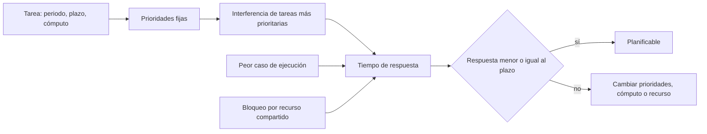
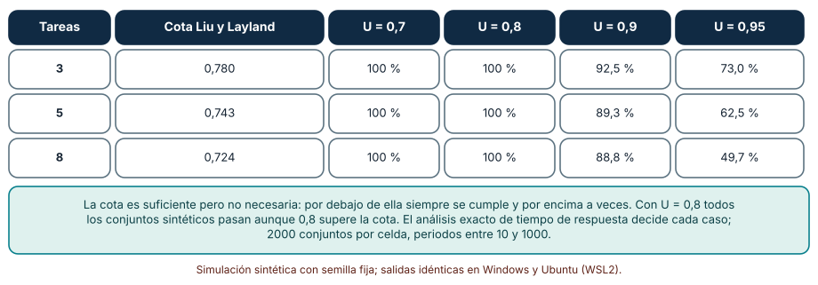
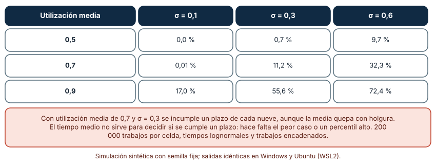
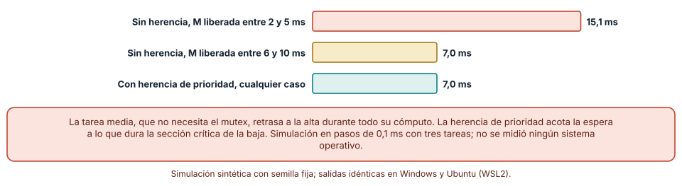

# SE-268 — Sistemas de tiempo real y deadlines

[← SE-267 — Restricciones de memoria, energía y cómputo](https://github.com/vladimiracunadev-create/modern-software-engineering-program/blob/main/classes/part-22-embedded-iot-y-tiempo-real/se-267-restricciones-de-memoria-energia-y-computo/README.md) · [↑ Parte 22](https://github.com/vladimiracunadev-create/modern-software-engineering-program/blob/main/classes/part-22-embedded-iot-y-tiempo-real/README.md) · [📚 Índice completo](https://github.com/vladimiracunadev-create/modern-software-engineering-program/blob/main/classes/README.md) · [🌐 Portal](https://vladimiracunadev-create.github.io/modern-software-engineering-program/classes/SE-268.html) · [SE-269 — Interrupciones, concurrencia y estado compartido →](https://github.com/vladimiracunadev-create/modern-software-engineering-program/blob/main/classes/part-22-embedded-iot-y-tiempo-real/se-269-interrupciones-concurrencia-y-estado-compartido/README.md)

## Punto profesional y fundamento pedagógico

**Punto profesional.** La clase existe para que decidas si un conjunto de tareas cumple sus plazos con un análisis y no con una impresión: sabrás distinguir una cota suficiente de una condición exacta, reconocer por qué el tiempo medio de ejecución no sirve y explicar cómo una tarea que nada pide puede retrasar a la más importante.

**Por qué aparece aquí.** Se sitúa después de **Restricciones de memoria, energía y cómputo** y antes de **Interrupciones, concurrencia y estado compartido**: la clase anterior fijó cuánto cómputo cabe en el presupuesto; esta pregunta si cabe a tiempo, y la siguiente enseña a compartir estado entre contextos que se interrumpen unos a otros.

**Error conceptual que debe corregir.** Creer que «tiempo real» significa «rápido», que una utilización baja garantiza los plazos o que la prioridad más alta siempre responde primero: lo que importa es el plazo, el peor caso de ejecución y el bloqueo por recursos compartidos.

**Secuencia de aprendizaje.** Antes de simular, predices a qué utilización un conjunto de tres tareas deja de ser planificable por prioridades fijas; después generas conjuntos aleatorios y los analizas con el método exacto, mides cuántos plazos incumple una tarea cuya duración varía y simulas una inversión de prioridad con y sin herencia. La secuencia usa predicción, explicación propia, contraste y recuperación. [ICAP](https://icap.education.asu.edu/research) distingue participación de construcción de conocimiento; [How People Learn II](https://nap.nationalacademies.org/catalog/24783/how-people-learn-ii-learners-contexts-and-cultures) exige conectar conocimiento previo, contexto y transferencia; la [práctica de recuperación](https://pubmed.ncbi.nlm.nih.gov/16507066/) respalda producir de nuevo la explicación tras una demora; y [Education for Life and Work](https://nap.nationalacademies.org/resource/13398/dbasse_084153.pdf) exige devolución que explique la causa del error.

**Evidencia de aprendizaje.** `rt-log.md` con la predicción, la tabla de planificabilidad por utilización, la tabla de plazos incumplidos por variabilidad, la respuesta de la tarea de alta prioridad con y sin herencia y un análisis de las tareas del nodo con su peor caso declarado.

**Límite de la conclusión.** Los conjuntos de tareas son generados con un algoritmo que reparte la utilización al azar, los tiempos de ejecución son lognormales y la inversión de prioridad se simula con tres tareas en pasos de 0,1 ms. No se midió ningún sistema operativo de tiempo real, ningún planificador ni un peor caso de ejecución de un programa real.

### Trazabilidad fuente → afirmación

| Fuente primaria u oficial | Afirmación que respalda | Lo que no prueba |
|---|---|---|
| [Liu y Layland, «Scheduling algorithms for multiprogramming in a hard-real-time environment» (JACM, 1973)](https://doi.org/10.1145/321738.321743) | Establece que la planificación por prioridades por periodo es óptima entre las de prioridad fija y da la cota de utilización n(2^(1/n) − 1) por debajo de la cual se cumplen todos los plazos. | La cota es suficiente, no necesaria: no dice qué conjuntos por encima de ella son planificables. |
| [Joseph y Pandya, «Finding response times in a real-time system» (The Computer Journal, 1986)](https://doi.org/10.1093/comjnl/29.5.390) | Da un cálculo exacto del tiempo de respuesta de cada tarea con prioridades fijas, iterando sobre las interferencias de las tareas más prioritarias. | No incluye bloqueos ni variaciones de la ejecución. |
| [Sha, Rajkumar y Lehoczky, «Priority inheritance protocols» (IEEE Transactions on Computers, 1990)](https://doi.org/10.1109/12.57058) | Define los protocolos de herencia y de techo de prioridad que acotan el tiempo que una tarea de alta prioridad espera por un recurso que retiene una de baja. | No cubre todos los recursos ni los sistemas multiprocesador. |
| [Audsley et al., «Applying new scheduling theory to static priority pre-emptive scheduling» (Software Engineering Journal, 1993)](https://doi.org/10.1049/sej.1993.0034) | Aplica el análisis de tiempo de respuesta a sistemas con bloqueo, jitter y plazos arbitrarios. | No sustituye la medición del peor caso de ejecución. |

## Antes de empezar

Recupera el presupuesto de `SE-267` y la latencia de `SE-265`: ahora cada tarea tiene un periodo, un plazo y un tiempo de cómputo. La pregunta activa es: **¿puedo demostrar, con el peor caso, que cada tarea cumple su plazo, y qué rompe esa demostración?**

## Prerrequisitos

- Haber completado `SE-267` o poder calcular la corriente media de un ciclo.
- Python 3.11 o posterior y un terminal; todo el código usa solo la biblioteca estándar.
- Manejar periodos, utilización (cómputo/periodo) y el redondeo hacia arriba a nivel básico.

## Problema auténtico

El nodo de la sala tiene tres tareas: leer sensores cada 100 ms, actualizar la pantalla cada 200 ms y enviar por radio cada 500 ms. La suma de utilizaciones es del 70 %. El equipo concluye «sobra capacidad». Sin embargo, de vez en cuando la lectura llega tarde y la alarma de CO₂ se retrasa un segundo. Al añadir un registro en flash protegido por un mutex, la tarea más importante empieza a incumplir plazos que antes cumplía, y nadie toca su código.

## Objetivos observables

Al terminar podrás:

1. explicar la diferencia entre plazo, periodo y tiempo de respuesta y calcular el tiempo de respuesta de una tarea con prioridades fijas;
2. medir qué fracción de conjuntos de tareas aleatorios es planificable por utilización y compararla con la cota suficiente;
3. calcular cuántos plazos incumple una tarea con tiempo de ejecución variable aunque su media quepa;
4. reproducir una inversión de prioridad y medir el efecto de la herencia;
5. escribir un análisis de plazos de un conjunto de tareas con el peor caso declarado y el supuesto que lo sostiene.

## Mapa conceptual



El mapa muestra que el tiempo de respuesta se compone de tres términos: el cómputo propio, la interferencia de las tareas más prioritarias y el bloqueo por recursos. Planificable significa que el resultado cabe en el plazo con el peor caso de cada término.

## Temas y por qué importan

| Tema | Por qué cambia una decisión profesional | Evidencia mínima |
|---|---|---|
| Plazos y tipos de tiempo real | Un plazo duro tiene consecuencias que uno blando no tiene; cambia cuánto margen se exige. | Predicción, traza causal y contraejemplo de **Plazos y tipos de tiempo real** en `rt-log.md` |
| Planificación por prioridades fijas | Da un orden simple y un análisis exacto, con una cota suficiente de utilización. | Predicción, traza causal y contraejemplo de **Planificación por prioridades fijas** en `rt-log.md` |
| Tiempo de ejecución y peor caso | El promedio no decide un plazo; el peor caso o un percentil alto sí. | Predicción, traza causal y contraejemplo de **Tiempo de ejecución y peor caso** en `rt-log.md` |
| Inversión de prioridad | Una tarea media puede retrasar a la alta si la baja retiene un recurso. | Predicción, traza causal y contraejemplo de **Inversión de prioridad** en `rt-log.md` |
| Análisis y medición | El análisis da la demostración y la medición alimenta sus datos. | Predicción, traza causal y contraejemplo de **Análisis y medición** en `rt-log.md` |

## Conceptos y decisiones

### 1. Plazos y tipos de tiempo real

Una tarea periódica tiene un periodo (cada cuánto se activa), un tiempo de cómputo y un plazo (cuándo debe haber terminado, a menudo igual al periodo). En un sistema de tiempo real duro, incumplir un plazo es un fallo del sistema (un freno, un marcapasos); en uno blando, degrada la calidad (una pantalla que se refresca tarde). «Tiempo real» no es «rápido»: es «predecible con respecto a un plazo». Una alarma de CO₂ que llega en 100 ms siempre es de tiempo real; una que llega en 10 ms casi siempre y en 2 s a veces no lo es.

### 2. Planificación por prioridades fijas

Con prioridades fijas, la tarea más prioritaria que está lista ejecuta, y expulsa a las demás. La asignación por periodo (rate-monotonic: menor periodo, mayor prioridad) es óptima entre las de prioridad fija cuando el plazo es igual al periodo (Liu y Layland). Para n tareas, si la utilización total no supera n(2^(1/n) − 1) (0,78 para 3, 0,693 para infinitas), todos los plazos se cumplen. Por encima, puede ocurrir o no. Joseph y Pandya dan la condición exacta: el tiempo de respuesta de la tarea i es el menor punto fijo de R = C_i + Σ ⌈R/T_j⌉ C_j sobre las tareas j más prioritarias; es planificable si R ≤ T_i.

### 3. Tiempo de ejecución y peor caso

El tiempo de cómputo del análisis es el peor caso (WCET), no el medio. Lo obtienen el análisis estático y la medición con entradas extremas, y ambos tienen incertidumbre: caches, ramas poco frecuentes, esperas de periféricos. Cuando el tiempo varía y se usa la media, un plazo se incumple con una frecuencia que depende de la variabilidad. Si un trabajo se pasa de su periodo, retrasa al siguiente y la sobrecarga se encadena. Por eso la utilización media no basta: importa la cola de la distribución.

### 4. Inversión de prioridad

Una tarea de alta prioridad que necesita un recurso que tiene una de baja queda bloqueada. Si en ese momento una tarea de prioridad media, que no necesita el recurso, se libera, expulsa a la baja y la alta espera además todo el cómputo de la media: es la inversión de prioridad sin acotar. La herencia de prioridad hace que la tarea de baja ejecute con la prioridad de la alta mientras la bloquea, de modo que la media no puede expulsarla y el bloqueo se acota a la sección crítica. Sha, Rajkumar y Lehoczky formalizaron estos protocolos.

### 5. Análisis y medición

El análisis demuestra que, dados los tiempos de cómputo máximos y los periodos, todos los plazos se cumplen. Su honestidad depende de los datos: si el cómputo máximo es optimista o falta un bloqueo, la demostración es correcta sobre un modelo falso. La medición alimenta el modelo (el peor caso observado con entradas extremas) y lo verifica con una traza del planificador. Audsley y otros extienden el análisis a bloqueos, jitter y plazos distintos del periodo, que son los que aparecen en un sistema real.

### Cuántos conjuntos son planificables a cada utilización

Se generan conjuntos de n = 3, 5 y 8 tareas con utilización total U (repartida al azar con el algoritmo UUniFast), periodos entre 10 y 1000 (uniformes en escala logarítmica) y plazo igual al periodo. Cada conjunto se analiza con el tiempo de respuesta exacto y prioridades por periodo; se simulan 2000 conjuntos por celda.

```python
r = c
while True:
    nr = c + sum(math.ceil(r / tj) * cj for cj, tj in tareas[:i])
    if nr == r: break
    r = nr
    if r > t: return False
```

| Tareas | Cota de Liu y Layland | U = 0,7 | U = 0,8 | U = 0,9 | U = 0,95 |
|---:|---:|---:|---:|---:|---:|
| 3 | 0,780 | 100 % | 100 % | 92,5 % | 73,0 % |
| 5 | 0,743 | 100 % | 100 % | 89,3 % | 62,5 % |
| 8 | 0,724 | 100 % | 100 % | 88,8 % | 49,7 % |

Resultado, idéntico en Windows (CPython 3.12.9) y en Ubuntu bajo WSL2 (3.12.3). Todos los conjuntos con U ≤ 0,8 son planificables aunque 0,8 supere la cota; entre 0,9 y 0,95 la fracción cae del 92,5 % al 49,7 % según el número de tareas.



**Cómo leer la figura.** Cada fila es un tamaño de conjunto; cada columna, una utilización total; el valor es el porcentaje de los 2000 conjuntos que cumplen todos los plazos. **Dónde deja de valer:** los periodos aleatorios en escala logarítmica rara vez son armónicos, y los conjuntos armónicos son planificables hasta U = 1; los reales tienen periodos relacionados y bloqueos. La tabla no autoriza a sobrepasar la cota: muestra que el análisis exacto sabe decidir caso por caso.

### Un plazo con tiempo de ejecución variable

Una tarea con periodo y plazo de 10 ms. El tiempo de ejecución es lognormal con media igual a una fracción de 0,5, 0,7 o 0,9 del periodo y dispersión σ de 0,1, 0,3 o 0,6. Un trabajo que se pasa retrasa al siguiente (los trabajos se encadenan). Se simulan 200 000 trabajos por celda.

```python
fin = max(liberacion, fin) + c
incumple = fin > liberacion + 10
```

| Utilización media | σ = 0,1 | σ = 0,3 | σ = 0,6 |
|---:|---:|---:|---:|
| 0,5 | 0,0 % | 0,7 % | 9,7 % |
| 0,7 | 0,01 % | 11,2 % | 32,3 % |
| 0,9 | 17,0 % | 55,6 % | 72,4 % |

Con utilización media del 70 % y variabilidad moderada (σ = 0,3), se incumple un plazo de cada nueve. Con 90 % de utilización, incluso con poca variabilidad se incumple el 17 %.



**Cómo leer la figura.** Cada fila es una utilización media; cada columna, una dispersión; el valor es el porcentaje de trabajos que terminan después de su plazo. **Dónde deja de valer:** la distribución lognormal es un supuesto; algunos programas tienen dos modos (camino rápido y lento) y su cola es otra. Y el encadenamiento (un trabajo largo retrasa al siguiente) es el comportamiento de una tarea sin abortar; un sistema que aborta trabajos tardíos tiene otro perfil. Lo que muestra es que la media no decide un plazo.

### La inversión de prioridad y la herencia

Tres tareas: H (alta; 2 ms de trabajo y necesita un mutex al empezar), M (media; 8 ms, no usa el mutex) y L (baja; toma el mutex en t = 0 y lo retiene 6 ms de cómputo, más 2 ms después). H se libera en t = 1 ms. M se libera en un instante variable entre 2 y 10 ms. Se simula en pasos de 0,1 ms con y sin herencia de prioridad y se mide el tiempo de respuesta de H.

```python
if inherit and h_waiting:
    eff["L"] = 3          # L hereda la prioridad de H mientras la bloquea
```

Sin herencia, si M se libera entre 2 y 5 ms (mientras L aún tiene el mutex), H responde en **15,1 ms**; si se libera entre 6 y 10 ms, en **7,0 ms**. Con herencia, H responde siempre en **7,0 ms**: la espera se acota a lo que dura la sección crítica de L.



**Cómo leer la figura.** Cada barra es el tiempo de respuesta de H en milisegundos para un caso; la coral es la inversión sin acotar. **Dónde deja de valer:** el modelo tiene tres tareas, un solo mutex y cómputos fijos; en un sistema con cadenas de bloqueo, la herencia no basta y hace falta el protocolo de techo de prioridad. Tampoco se midió ningún sistema operativo: la figura muestra el mecanismo, no la implementación de uno.

## Definiciones de trabajo

- **plazo:** instante límite, relativo a la activación de una tarea, en el que debe haber terminado.
- **utilización:** fracción del procesador que consume una tarea, igual a su cómputo dividido por su periodo.
- **tiempo de respuesta:** tiempo desde la activación de una tarea hasta su terminación, incluida la interferencia de otras.
- **peor caso de ejecución (WCET):** cota superior del tiempo de cómputo de una tarea sobre todas las entradas y estados posibles.
- **inversión de prioridad:** situación en que una tarea de alta prioridad espera por una de menor mientras una intermedia se ejecuta.

Las definiciones son operativas para el nodo de la sala. No convierten términos con una historia más amplia en sinónimos y deben contrastarse con la documentación primaria enlazada al final.

## Ejemplo mínimo

El fragmento calcula el tiempo de respuesta de la tarea de menor prioridad de un conjunto de dos. Antes de ejecutarlo, predice si cumple su plazo de 10.

```python
import math
alta = (1, 4)        # (cómputo, periodo)
c, t = 4, 10
r = c
while True:
    nr = c + math.ceil(r / alta[1]) * alta[0]
    if nr == r: break
    r = nr
assert r == 6 and r <= t
```

La respuesta es 6 ms (4 propios más dos activaciones de la alta), menor que 10. Registra versión, comando y salida; sube el cómputo de la baja a 7 y predice si sigue cumpliendo.

## Ejemplo profesional

El equipo de la plataforma analiza las tres tareas del nodo con los mejores peores casos medidos: lectura de sensores 8 ms cada 100, pantalla 20 ms cada 200 y radio 60 ms cada 500. La utilización de peor caso es 0,08 + 0,10 + 0,12 = 0,30, muy por debajo de la cota de 0,78. Con las prioridades por periodo, el análisis da tiempos de respuesta de 8, 28 y 88 ms, todos dentro del plazo. Al añadir el registro en flash protegido por un mutex, activan herencia de prioridad y acotan la sección crítica a 3 ms, de modo que el bloqueo máximo de la tarea de sensores es de 3 ms. La alarma de CO₂ tiene un plazo de 100 ms y un tiempo de respuesta de peor caso de 11 ms.

Compara con el prototipo: los retrasos de un segundo desaparecen porque ninguna tarea comparte un mutex sin herencia y el análisis cubre el peor caso, no la media. Un análisis es adecuado cuando sus entradas son peores casos medidos y sus bloqueos están acotados; es una ilusión cuando se calcula con la media.

## Práctica guiada

1. Lista las tareas del nodo con periodo, plazo y cómputo de peor caso medido o estimado.
2. Predice cuál es la primera tarea que dejaría de cumplir si el cómputo de una crece un 50 % y escribe la respuesta.
3. Calcula el tiempo de respuesta de cada tarea con el método exacto.
4. Genera 2000 conjuntos aleatorios y mide la fracción planificable por utilización.
5. Simula la variabilidad del tiempo de ejecución y mide los plazos incumplidos.
6. Simula la inversión de prioridad con y sin herencia.
7. Entrega `rt-log.md` y pide a otra persona que identifique la tarea con menos margen.

## Ejercicios

1. **Respuesta:** calcula los tiempos de respuesta de tres tareas (1,4), (2,6) y (3,12) con prioridades por periodo y decide si son planificables.
2. **Cota:** encuentra un conjunto de tres tareas con U = 0,85 que sea planificable y otro que no, y explica la diferencia.
3. **Variabilidad:** calcula la utilización media máxima para que una tarea con σ = 0,3 incumpla menos del 1 % de sus plazos.
4. **Bloqueo:** añade un bloqueo de 3 ms a la tarea de mayor prioridad y recalcula su tiempo de respuesta.

## Reto verificable

Entrega `rt-log.md` con la predicción, la tabla de planificabilidad, la de plazos incumplidos, la simulación de la inversión y el análisis de las tareas del nodo con su peor caso declarado. Se aprueba si otra persona ejecuta el código desde un checkout limpio, obtiene los mismos números y puede decir qué dato, si fuera optimista, rompería el análisis. No se aprueba por un análisis hecho con tiempos medios.

## Caso conductor

El nodo ambiental de una sala de estudio continúa como caso conductor de la Parte 22. Esta clase deja el cuarto artefacto: el análisis de plazos de las tareas del nodo con su peor caso, sus prioridades y el bloqueo del mutex de la flash. `SE-269` entra en cómo esas tareas y las interrupciones comparten estado. Cambia después una sola cosa, el cómputo de la radio, y observa qué plazos pierden margen.

## Preguntas frecuentes

### ¿Rate-monotonic es siempre la mejor asignación?

Es óptima entre las de prioridad fija cuando el plazo es igual al periodo. Con plazos menores que el periodo conviene la asignación por plazo, y con prioridades dinámicas (el plazo más cercano primero) se puede llegar a utilización 1, a costa de un planificador más complejo.

### ¿Cómo obtengo el peor caso de ejecución?

Con análisis estático de rutas, con mediciones sobre entradas extremas y con márgenes. Ninguna es perfecta: se declara la incertidumbre y se mide con el hardware real.

### ¿La herencia de prioridad resuelve todos los bloqueos?

Acota la inversión pero no evita los bloqueos mutuos ni las cadenas de bloqueo. El protocolo de techo de prioridad evita lo segundo y lo primero a costa de restringir cómo se asignan los recursos.

### ¿Un sistema de tiempo real necesita un sistema operativo?

No siempre: un bucle principal con interrupciones puede ser de tiempo real si se analiza. Un sistema operativo de tiempo real ayuda a organizar las tareas y a aplicar herencia, pero no sustituye el análisis.

## Fallo controlado y diagnóstico

Reproduce el fallo clásico de la clase: **añadir un mutex y ver cómo la tarea más importante incumple plazos**. Simula la inversión sin herencia con M liberada a los 3 ms y mide la respuesta de H.

Registra síntoma, entrada mínima, hipótesis, observación que descarta cada hipótesis, causa, corrección y prueba de regresión. **Síntoma:** la tarea de sensores incumple un plazo de 7 ms una de cada pocas activaciones tras añadir un registro en flash. **Hipótesis rivales:** (a) el código de sensores se volvió más lento; (b) la flash es lenta; (c) una tarea media retrasa a la alta mientras la baja retiene el mutex. **Prueba:** traza los instantes en que cada tarea ejecuta; si M corre mientras H espera, es (c). **Conclusión:** inversión de prioridad no acotada: 15,1 ms en lugar de 7,0. **Regresión:** activa herencia de prioridad, acota la sección crítica y repite la traza. No cambies a la vez la herencia y el cómputo de la media.

## Errores comunes y cómo corregirlos

| Síntoma | Causa probable | Corrección |
|---|---|---|
| Un plazo se incumple a veces con baja utilización media | Tiempo de ejecución variable y análisis con la media | Usar el peor caso o un percentil alto y medir la cola |
| Una tarea importante se retrasa tras añadir un mutex | Inversión de prioridad | Activar herencia o techo de prioridad y acotar la sección crítica |
| Se confía en la cota de utilización como condición necesaria | Se confunde suficiente con necesaria | Aplicar el análisis exacto de tiempo de respuesta |
| El análisis aprueba y el sistema falla | Entradas optimistas o bloqueos omitidos | Medir el peor caso con entradas extremas y contar los bloqueos |
| La sobrecarga ocasional se propaga a varios plazos | Trabajos que se pasan retrasan a los siguientes | Abortar o degradar trabajos tardíos y vigilar el encadenamiento |

## Entorno y archivos clave

```text
work/SE-268/
├── README.md
├── rt/
│   ├── respuesta.py
│   ├── variabilidad.py
│   └── inversion.py
├── tests/test_rt.py
└── evidence/rt-log.md
```

El `README` declara plataforma, versión de Python, semillas y comandos. Los experimentos usan solo la biblioteca estándar (`random`, `statistics`, `math`) y se ejecutaron con CPython 3.12.9 en Windows 11 y 3.12.3 en Ubuntu bajo WSL2: las salidas fueron idénticas. Si añades una dependencia, fija procedencia y versión.

## Seguridad, ética y accesibilidad

- una alarma de aire que llega tarde puede exponer a personas a concentraciones peligrosas: declara su plazo y su peor caso;
- las alarmas deben tener más de un canal y ser perceptibles por personas con distintas capacidades;
- un sistema de tiempo real duro con consecuencias para la salud exige normas y revisión que esta clase no sustituye;
- documenta el peor caso de cada tarea, cómo se obtuvo y su fecha de revisión;
- respeta las licencias de los planificadores y atribuye lo adaptado.

## Puente hacia el trabajo con agentes

Un agente al que se le pide «asegura que la alarma se cumpla a tiempo» propondrá subir la prioridad de la tarea o reducir el periodo sin análisis. Pídele que calcule el tiempo de respuesta con el peor caso medido, que identifique los recursos compartidos y su protocolo, y que indique qué dato cambiaría su conclusión. Revisa especialmente si usa tiempos medios o si omite el mutex: son los dos huecos que esta clase mostró.

## Transferencia

Traslada el análisis a otro sistema (por ejemplo, un controlador de motor con un lazo de 1 kHz): cambia las tareas y el plazo, y conserva el procedimiento de calcular el tiempo de respuesta con peor caso, acotar bloqueos y comprobar con una traza. La transferencia está lograda cuando puedes explicar qué parte del análisis dependía del sistema y cuál no, no cuando las tablas se parecen.

## Evaluación y evidencia

| Criterio | Evidencia para aprobar |
|---|---|
| comprensión | explicación de por qué la media no decide un plazo y de qué es una inversión de prioridad |
| corrección | tablas reproducibles con las mismas semillas |
| diseño | análisis de las tareas del nodo con peor caso, prioridades y bloqueos |
| diagnóstico | reproducción del fallo «mutex e inversión» con regresión |
| incertidumbre | declaración de cómo se obtuvo el peor caso y de lo que el modelo omite |
| reproducibilidad | versiones, comandos, salida y límites declarados |

## Fuentes

- [Liu y Layland, «Scheduling algorithms for multiprogramming in a hard-real-time environment» (JACM, 1973)](https://doi.org/10.1145/321738.321743) — planificación por prioridades por periodo y cota de utilización; autoridad: Journal of the ACM.
- [Joseph y Pandya, «Finding response times in a real-time system» (The Computer Journal, 1986)](https://doi.org/10.1093/comjnl/29.5.390) — cálculo exacto del tiempo de respuesta; autoridad: The Computer Journal.
- [Sha, Rajkumar y Lehoczky, «Priority inheritance protocols» (IEEE Transactions on Computers, 1990)](https://doi.org/10.1109/12.57058) — herencia y techo de prioridad; autoridad: IEEE Transactions on Computers.
- [Audsley et al., «Applying new scheduling theory to static priority pre-emptive scheduling» (Software Engineering Journal, 1993)](https://doi.org/10.1049/sej.1993.0034) — análisis con bloqueo y jitter; autoridad: Software Engineering Journal.
- [Lee y Seshia, «Introduction to Embedded Systems»](https://ptolemy.berkeley.edu/books/leeseshia/) — planificación de tiempo real en sistemas embebidos; autoridad: autores del libro (UC Berkeley).

Cada fuente respalda el mecanismo indicado; ninguna demuestra que el 11,2 % de plazos incumplidos, el 15,1 ms de respuesta o el 92,5 % de planificables se observen en el nodo real. Esa afirmación depende del peor caso medido y de los recursos compartidos.

## Límites y siguiente paso

Se ejecutaron tres simulaciones con datos sintéticos en Windows y Ubuntu (WSL2) con resultados idénticos. No se midió ningún peor caso de ejecución ni se usó un sistema operativo de tiempo real: los conjuntos de tareas, las duraciones lognormales y la inversión de tres tareas son construcciones del autor. La siguiente clase trata cómo las interrupciones y las tareas comparten estado sin romperlo.

## Glosario

- **plazo:** instante límite, relativo a la activación de una tarea, en el que debe haber terminado.
- **utilización:** fracción del procesador que consume una tarea, igual a su cómputo dividido por su periodo.
- **tiempo de respuesta:** tiempo desde la activación de una tarea hasta su terminación, incluida la interferencia de otras.
- **peor caso de ejecución (WCET):** cota superior del tiempo de cómputo de una tarea sobre todas las entradas y estados posibles.
- **inversión de prioridad:** situación en que una tarea de alta prioridad espera por una de menor mientras una intermedia se ejecuta.

---

[← SE-267 — Restricciones de memoria, energía y cómputo](https://github.com/vladimiracunadev-create/modern-software-engineering-program/blob/main/classes/part-22-embedded-iot-y-tiempo-real/se-267-restricciones-de-memoria-energia-y-computo/README.md) · [↑ Parte 22](https://github.com/vladimiracunadev-create/modern-software-engineering-program/blob/main/classes/part-22-embedded-iot-y-tiempo-real/README.md) · [📚 Índice completo](https://github.com/vladimiracunadev-create/modern-software-engineering-program/blob/main/classes/README.md) · [🌐 Portal](https://vladimiracunadev-create.github.io/modern-software-engineering-program/classes/SE-268.html) · [SE-269 — Interrupciones, concurrencia y estado compartido →](https://github.com/vladimiracunadev-create/modern-software-engineering-program/blob/main/classes/part-22-embedded-iot-y-tiempo-real/se-269-interrupciones-concurrencia-y-estado-compartido/README.md)
