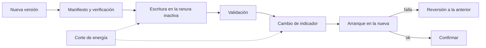
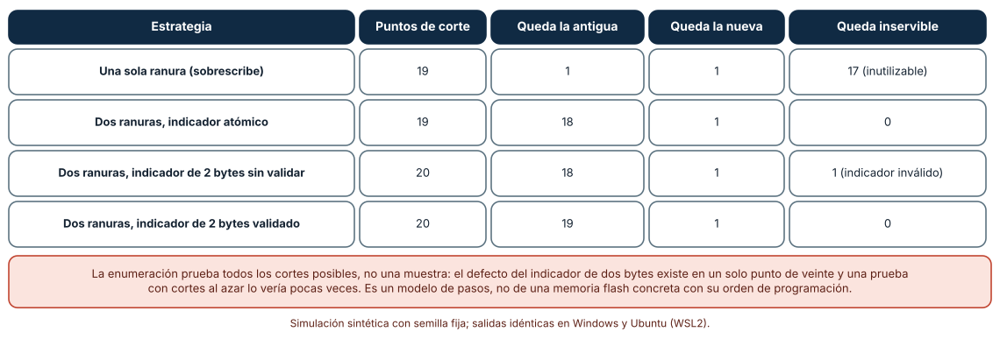
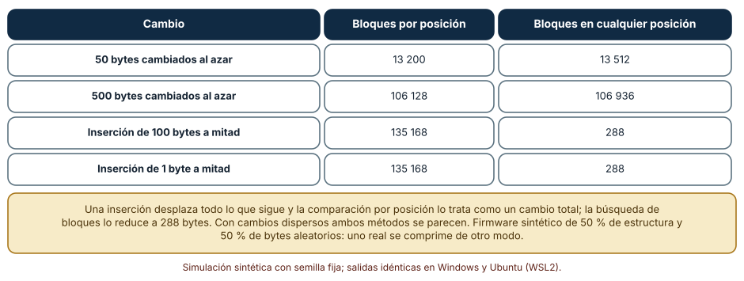
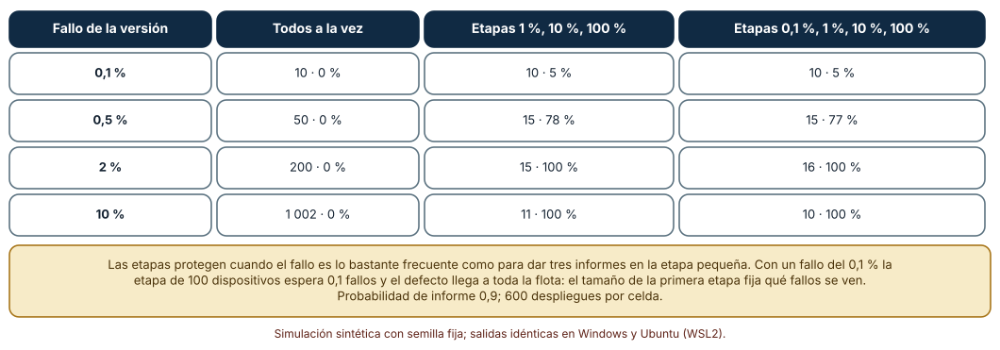

# SE-271 — Actualizaciones OTA y recuperación

[← SE-270 — Protocolos IoT y conectividad intermitente](https://github.com/vladimiracunadev-create/modern-software-engineering-program/blob/main/classes/part-22-embedded-iot-y-tiempo-real/se-270-protocolos-iot-y-conectividad-intermitente/README.md) · [↑ Parte 22](https://github.com/vladimiracunadev-create/modern-software-engineering-program/blob/main/classes/part-22-embedded-iot-y-tiempo-real/README.md) · [📚 Índice completo](https://github.com/vladimiracunadev-create/modern-software-engineering-program/blob/main/classes/README.md) · [🌐 Portal](https://vladimiracunadev-create.github.io/modern-software-engineering-program/classes/SE-271.html) · [SE-272 — Identidad de dispositivo y gestión de claves →](https://github.com/vladimiracunadev-create/modern-software-engineering-program/blob/main/classes/part-22-embedded-iot-y-tiempo-real/se-272-identidad-de-dispositivo-y-gestion-de-claves/README.md)

## Punto profesional y fundamento pedagógico

**Punto profesional.** La clase existe para que diseñes una actualización de firmware que sobreviva a un corte de energía en cualquier paso, que transmita lo mínimo y que se despliegue por etapas con una regla para detenerse, de modo que una versión defectuosa no deje inservible a una flota entera.

**Por qué aparece aquí.** Se sitúa después de **Protocolos IoT y conectividad intermitente** y antes de **Identidad de dispositivo y gestión de claves**: la clase anterior hizo llegar datos por una red que se corta; esta usa esa red para llevar código, que es el dato más peligroso, y la siguiente pregunta cómo el dispositivo sabe que ese código es legítimo. Retoma lo aprendido en `SE-164` y `SE-259` sobre ventanas de versiones y distribución.

**Error conceptual que debe corregir.** Creer que una actualización «o funciona o no» y que basta probarla con un corte al azar: el defecto está en un paso concreto, una prueba de cortes al azar casi nunca cae en él, y una versión que falla en pocos dispositivos solo se ve si la primera etapa es lo bastante grande.

**Secuencia de aprendizaje.** Antes de simular, predices en cuántos de los puntos de corte una actualización que sobrescribe deja el dispositivo inservible; después enumeras todos los cortes en cuatro estrategias, calculas el tamaño de actualizaciones diferenciales con dos métodos y simulas el despliegue por etapas de una versión defectuosa. La secuencia usa predicción, explicación propia, contraste y recuperación. [ICAP](https://icap.education.asu.edu/research) distingue participación de construcción de conocimiento; [How People Learn II](https://nap.nationalacademies.org/catalog/24783/how-people-learn-ii-learners-contexts-and-cultures) exige conectar conocimiento previo, contexto y transferencia; la [práctica de recuperación](https://pubmed.ncbi.nlm.nih.gov/16507066/) respalda producir de nuevo la explicación tras una demora; y [Education for Life and Work](https://nap.nationalacademies.org/resource/13398/dbasse_084153.pdf) exige devolución que explique la causa del error.

**Evidencia de aprendizaje.** `ota-log.md` con la predicción, la enumeración de cortes por estrategia, la tabla de tamaños de actualización, la tabla de despliegue por etapas y un plan de actualización del nodo (ranuras, validación, reversión, etapas, criterio de parada).

**Límite de la conclusión.** Los pasos de la actualización son un modelo de dieciséis trozos y un indicador; las imágenes de firmware son sintéticas (mitad estructura, mitad bytes aleatorios); la probabilidad de informe y de fallo son supuestos. No se actualizó ningún dispositivo real ni se usó un cargador de arranque.

### Trazabilidad fuente → afirmación

| Fuente primaria u oficial | Afirmación que respalda | Lo que no prueba |
|---|---|---|
| [Moran et al., RFC 9019: A Firmware Update Architecture for Internet of Things](https://www.rfc-editor.org/rfc/rfc9019) | Describe una arquitectura de actualización de firmware para IoT con requisitos de integridad, autenticidad, recuperación de fallos y actualización de dispositivos con restricciones. | No prescribe la estrategia de ranuras ni el tamaño de las etapas. |
| [Moran et al., RFC 9124: A Manifest Information Model for Firmware Updates in IoT Devices](https://www.rfc-editor.org/rfc/rfc9124) | Define qué información debe llevar el manifiesto de una actualización (versión, dependencias, condiciones, resumen del firmware). | No define un formato concreto ni mide su coste. |
| [The Update Framework (TUF)](https://theupdateframework.io/) | Propone un marco para distribuir actualizaciones de forma segura frente al compromiso de claves o de servidores. | No es una garantía de que una implementación concreta sea correcta. |
| [Tridgell y Mackerras, «The rsync algorithm»](https://rsync.samba.org/tech_report/) | Describe cómo calcular una diferencia entre dos versiones sin conocer sus posiciones, con sumas de comprobación que se actualizan al desplazarse. | No evalúa el algoritmo sobre imágenes de firmware. |

## Antes de empezar

Recupera lo aprendido sobre versiones y ventanas de deprecación en `SE-164`: aquí la «versión vieja» es un dispositivo físico que no se puede recoger. La pregunta activa es: **¿en qué paso de la actualización un corte me deja sin dispositivo, cuánto tengo que enviar y cuándo me detengo?**

## Prerrequisitos

- Haber completado `SE-270` o poder explicar la política de comunicación del nodo.
- Python 3.11 o posterior y un terminal; todo el código usa solo la biblioteca estándar.
- Manejar sumas de comprobación y la idea de enumerar casos a nivel básico.

## Problema auténtico

El equipo de la plataforma prepara la primera actualización remota del firmware de 200 nodos instalados en salas de estudio. La imagen ocupa 256 KiB y la red del nodo es lenta y cara. El prototipo de actualización borra la imagen actual, escribe la nueva por trozos y marca la nueva como válida. En una prueba en la mesa funciona. En un nodo instalado, un corte de energía durante la escritura lo deja mudo; recuperarlo exige ir a la sala. Y la versión 1.1 tiene un defecto que afecta a unos pocos nodos que nadie detecta hasta que ya se actualizaron todos.

## Objetivos observables

Al terminar podrás:

1. enumerar los puntos de corte de una actualización y decir en cuáles queda el dispositivo inservible según la estrategia;
2. diseñar una actualización con dos ranuras, validación y reversión, y detectar el defecto de un indicador que no se valida;
3. calcular el tamaño de una actualización diferencial con comparación por posición y con búsqueda de bloques y explicar cuándo difieren;
4. simular un despliegue por etapas y estimar qué defectos detecta según el tamaño de la primera etapa;
5. escribir un plan de actualización del nodo con ranuras, validación, reversión, etapas y criterio de parada.

## Mapa conceptual



El mapa muestra el camino seguro: se escribe en la ranura que no está en uso, se valida y solo entonces se cambia el indicador; si la nueva no arranca, se vuelve a la anterior. Los cortes (líneas punteadas) pueden ocurrir en cualquier paso y el diseño debe tolerarlos todos.

## Temas y por qué importan

| Tema | Por qué cambia una decisión profesional | Evidencia mínima |
|---|---|---|
| Actualización segura | Una actualización es un procedimiento con pasos que pueden interrumpirse. | Predicción, traza causal y contraejemplo de **Actualización segura** en `ota-log.md` |
| Ranuras y reversión | Dos ranuras convierten cualquier corte en «antigua o nueva». | Predicción, traza causal y contraejemplo de **Ranuras y reversión** en `ota-log.md` |
| Actualización diferencial | Enviar solo lo que cambió ahorra ancho de banda y energía, salvo que el cambio desplace todo. | Predicción, traza causal y contraejemplo de **Actualización diferencial** en `ota-log.md` |
| Despliegue por etapas | Limitar la exposición de una versión nueva acota el daño si falla. | Predicción, traza causal y contraejemplo de **Despliegue por etapas** en `ota-log.md` |
| Criterios de parada | Sin una regla previa, nadie detiene un despliegue a tiempo. | Predicción, traza causal y contraejemplo de **Criterios de parada** en `ota-log.md` |

## Conceptos y decisiones

### 1. Actualización segura

El RFC 9019 resume los requisitos de una actualización de firmware de dispositivos con restricciones: debe ser íntegra y auténtica, tolerar fallos durante la instalación y permitir recuperar un dispositivo que no arranca. La actualización es una secuencia de pasos (descargar, verificar, escribir, validar, activar, confirmar) y cada paso puede interrumpirse por un corte de energía, un reinicio o una pérdida de red. El diseño se prueba enumerando los puntos de corte, no sorteándolos.

### 2. Ranuras y reversión

Con dos ranuras, la nueva imagen se escribe en la inactiva y la activa no se toca hasta que la nueva está completa y validada. El cambio de ranura es un único indicador, cuya escritura debe ser atómica o validable: si ocupa dos bytes y se corta entre ambos, el cargador de arranque encuentra un valor inválido. El cargador arranca la nueva en modo de prueba y, si no confirma en un plazo (con un temporizador de vigilancia, `SE-274`), vuelve a la anterior. El coste es el doble de memoria para firmware.

### 3. Actualización diferencial

Enviar la diferencia entre versiones ahorra bytes y energía de radio, que suele costar más que el cálculo. Comparar bloques por posición es simple y falla cuando una inserción desplaza el resto: todos los bloques posteriores «cambian». Buscar bloques en cualquier posición (con sumas de comprobación que se actualizan al desplazar una ventana, como en rsync) los reconoce aunque se hayan movido. El coste es más cálculo en el dispositivo o en el servidor y un formato de diferencias que el cargador debe aplicar con seguridad, también ante cortes.

### 4. Despliegue por etapas

Publicar a toda la flota a la vez expone a todos a un defecto. Un despliegue por etapas (1 %, 10 %, 100 %) limita el daño, siempre que cada etapa sea lo bastante grande para ver el defecto y el sistema recoja informes de fallo. Si un defecto afecta a una fracción f de los dispositivos, una etapa de n dispositivos espera n·f fallos; con n·f menor que el umbral de informes, el defecto no se ve y el despliegue avanza.

### 5. Criterios de parada

Un criterio de parada se fija antes de empezar: «detener si tres dispositivos informan fallo en la etapa», «detener si el porcentaje de arranques fallidos supera el 1 %». Sin él, la decisión se toma bajo presión, con información parcial. Un criterio útil tiene umbral, ventana y responsable, igual que un disparador de replanificación (`SE-192`), y se acompaña de la capacidad de revertir a los dispositivos ya actualizados, que es lo que convierte una parada en una recuperación.

### Cortar la energía en cada paso

Una actualización tiene 16 trozos. Se enumeran todos los puntos de corte posibles (antes de cada paso y al final) para cuatro estrategias y se clasifica el estado tras el reinicio: queda la versión antigua, la nueva o un dispositivo inservible.

```python
def single_slot(cut):
    steps = ["borrar"] + [f"trozo {i}" for i in range(16)] + ["indicador"]
    if cut == 0: return "antigua"
    if "indicador" in steps[:cut]: return "nueva"
    return "ladrillo"        # se borró la antigua y la nueva está incompleta
```

| Estrategia | Puntos de corte | Queda la antigua | Queda la nueva | Queda inservible |
|---|---:|---:|---:|---:|
| Una sola ranura (sobrescribe) | 19 | 1 | 1 | 17 |
| Dos ranuras, indicador atómico | 19 | 18 | 1 | 0 |
| Dos ranuras, indicador de 2 bytes sin validar | 20 | 18 | 1 | 1 |
| Dos ranuras, indicador de 2 bytes validado | 20 | 19 | 1 | 0 |

Resultado, idéntico en Windows (CPython 3.12.9) y en Ubuntu bajo WSL2 (3.12.3). Una sola ranura deja inservible el dispositivo en 17 de 19 puntos de corte. Con dos ranuras, un indicador de dos bytes sin validar deja un punto de corte (uno de veinte) con un valor inválido; validarlo lo elimina.



**Cómo leer la figura.** Cada fila es una estrategia; las columnas suman los puntos de corte posibles y clasifican el resultado. **Dónde deja de valer:** es un modelo de pasos; una flash real programa páginas con un orden y un tiempo propios, y un corte puede dejar bits a medias. Aun así, la enumeración encuentra el defecto del indicador en un punto de veinte, que una prueba con cortes al azar vería en uno de cada veinte intentos.

### Cuántos bytes hay que enviar

Se genera una imagen sintética de 262 144 bytes (la mitad con estructura repetitiva y la mitad con bytes aleatorios) y cuatro versiones nuevas: 50 bytes cambiados al azar, 500 bytes cambiados, inserción de 100 bytes a la mitad e inserción de un solo byte a la mitad. Se calcula la diferencia comparando bloques de 256 bytes por posición y buscando bloques en cualquier posición (con `zlib.adler32` y verificación exacta).

```python
h = zlib.adler32(nueva[i:i + 256])
if h in tabla and any(vieja[j:j + 256] == nueva[i:i + 256] for j in tabla[h]):
    ...   # el bloque ya existe en la versión anterior, aunque esté desplazado
```

| Cambio | Bloques por posición | Bloques en cualquier posición |
|---|---:|---:|
| 50 bytes cambiados al azar | 13 200 | 13 512 |
| 500 bytes cambiados al azar | 106 128 | 106 936 |
| Inserción de 100 bytes a mitad | 135 168 | 288 |
| Inserción de 1 byte a mitad | 135 168 | 288 |

Con cambios dispersos, ambos métodos envían unos 264 bytes por bloque tocado. Con una inserción, la comparación por posición envía 135 168 bytes (la mitad de la imagen) y la búsqueda de bloques, 288. Como referencia, la imagen nueva comprimida con zlib ocupa unos 184 000 bytes.



**Cómo leer la figura.** Cada fila es un cambio; las columnas son los bytes que hay que enviar con cada método. **Dónde deja de valer:** la imagen sintética no se parece a un firmware real, donde un cambio de código mueve direcciones y desplaza llamadas; allí los cambios dispersos son frecuentes y los bloques de 256 bytes demasiado grandes. Y el cálculo de la diferencia puede costar más memoria de la que tiene el dispositivo.

### Qué ve cada etapa de un despliegue

Una versión nueva falla en una fracción f de los dispositivos; cada dispositivo fallido informa con probabilidad 0,9. El despliegue se detiene si una etapa produce al menos tres informes antes del 100 %. Se simulan 600 despliegues de 10 000 dispositivos por celda con tres políticas: todos a la vez, etapas de 1 %, 10 % y 100 %, y etapas de 0,1 %, 1 %, 10 % y 100 %. Cada celda es «dispositivos dañados de media · porcentaje de despliegues detenidos antes del 100 %».

```python
fails = sum(rng.random() < f for _ in range(batch))
reports = sum(rng.random() < 0.9 for _ in range(fails))
if reports >= 3 and frac < 1.0: detenido = True
```

| Fallo de la versión | Todos a la vez | Etapas 1 %, 10 %, 100 % | Etapas 0,1 %, 1 %, 10 %, 100 % |
|---:|---:|---:|---:|
| 0,1 % | 10 · 0 % | 10 · 5 % | 10 · 5 % |
| 0,5 % | 50 · 0 % | 15 · 78 % | 15 · 77 % |
| 2 % | 200 · 0 % | 15 · 100 % | 16 · 100 % |
| 10 % | 1 002 · 0 % | 11 · 100 % | 10 · 100 % |

Con un fallo del 2 %, publicar a todos daña 200 dispositivos y las etapas, 15. Con un fallo del 0,1 %, las etapas no ayudan: la etapa de 100 dispositivos espera 0,1 fallos, el defecto casi nunca se ve y el despliegue llega a los 10 000.



**Cómo leer la figura.** Cada celda muestra el daño medio y el porcentaje de despliegues que se detuvieron a tiempo para una fracción de fallo y una política. **Dónde deja de valer:** el 0,9 de probabilidad de informe, los umbrales de tres informes y los fallos independientes son supuestos; un fallo concentrado en un modelo de hardware se ve en una etapa si esa etapa incluye ese modelo, y no se ve si no. Los defectos raros exigen una primera etapa grande o una detección activa (telemetría de arranque).

## Definiciones de trabajo

- **actualización inalámbrica (OTA):** actualización del firmware de un dispositivo a través de una red, sin acceso físico.
- **ranura:** región de memoria que contiene una imagen de firmware completa; con dos, una está activa y la otra recibe la actualización.
- **reversión:** regreso automático a la imagen anterior cuando la nueva no confirma su arranque correcto.
- **actualización diferencial:** envío de las diferencias entre dos versiones del firmware en lugar de la imagen completa.
- **despliegue por etapas:** publicación de una versión a fracciones crecientes de la flota con una regla para detenerla.

Las definiciones son operativas para el nodo de la sala. No convierten términos con una historia más amplia en sinónimos y deben contrastarse con la documentación primaria enlazada al final.

## Ejemplo mínimo

El fragmento calcula cuántos fallos espera una etapa. Antes de ejecutarlo, predice si una etapa de 100 dispositivos verá tres informes con un fallo del 0,5 %.

```python
n, f, p_informe = 100, 0.005, 0.9
fallos_esperados = n * f
assert fallos_esperados == 0.5 and fallos_esperados * p_informe < 3
```

Se esperan 0,5 fallos: la etapa casi nunca llega a tres informes. Registra versión, comando y salida; calcula el tamaño de etapa para esperar tres fallos y compáralo con la flota de 200 nodos.

## Ejemplo profesional

El equipo de la plataforma define el plan para sus 200 nodos. El firmware tiene dos ranuras de 256 KiB con un indicador de un byte atómico y un cargador que arranca la nueva en modo de prueba y vuelve a la anterior si no confirma en 60 s. La actualización es diferencial por bloques de 256 B con búsqueda en cualquier posición, con un tamaño típico de unos pocos kilobytes. El despliegue es por etapas de 2, 20 y 200 nodos; con 200 nodos, un fallo del 1 % espera 0,2 fallos en la segunda etapa y dos en la última, de modo que la flota es demasiado pequeña para que un fallo raro se vea por informes y el criterio de parada es «un informe de fallo o cualquier nodo que no confirme en 60 s». La telemetría de arranque se envía en el primer minuto tras activar.

Compara con el prototipo: un corte durante la actualización deja el nodo con la versión anterior, la actualización diferencial no envía la mitad de la imagen por insertar una línea y un defecto raro se detecta por telemetría y no por la queja de una sala. Un plan es adecuado cuando cada paso tolera un corte; es frágil cuando funciona solo si nada falla.

## Práctica guiada

1. Dibuja los pasos de la actualización del nodo y marca cuáles pueden interrumpirse.
2. Predice en cuántos puntos de corte queda inservible una actualización que sobrescribe y escribe el número.
3. Enumera los cortes con una ranura, con dos y con dos más indicador de dos bytes.
4. Genera dos versiones de una imagen y calcula la diferencia con ambos métodos.
5. Simula el despliegue por etapas con tu flota y tus umbrales.
6. Escribe el plan de actualización con criterio de parada y reversión.
7. Entrega `ota-log.md` y pide a otra persona que identifique el paso más frágil.

## Ejercicios

1. **Cortes:** añade a la estrategia de dos ranuras un paso de «verificar firma» y enumera de nuevo los puntos de corte.
2. **Diferencia:** calcula el tamaño de la diferencia con bloques de 64 bytes y compáralo con el de 256 para 500 bytes cambiados.
3. **Etapas:** calcula el tamaño de la primera etapa para ver tres informes con un fallo del 0,2 % y decide si es viable con tu flota.
4. **Parada:** escribe el criterio de parada de tu despliegue con umbral, ventana y responsable.

## Reto verificable

Entrega `ota-log.md` con la predicción, la enumeración de cortes, la tabla de tamaños, la simulación de etapas y el plan de actualización. Se aprueba si otra persona ejecuta el código desde un checkout limpio, obtiene los mismos números y puede decir qué fallo no vería la primera etapa. No se aprueba por afirmar «lo probamos y funciona» sin enumerar los cortes.

## Caso conductor

El nodo ambiental de una sala de estudio continúa como caso conductor de la Parte 22. Esta clase deja el séptimo artefacto: el plan de actualización del nodo con ranuras, validación, reversión, etapas y criterio de parada. `SE-272` pregunta cómo el nodo sabe que lo que recibe es legítimo. Cambia después una sola cosa, el tamaño de la primera etapa, y observa qué defectos deja de ver.

## Preguntas frecuentes

### ¿Siempre necesito dos ranuras?

No si la memoria no alcanza o el firmware es pequeño: se puede usar una ranura con una pequeña copia de recuperación. Pero cada atajo debe pasar la enumeración de cortes y declarar qué ocurre si falla.

### ¿Una actualización diferencial es más arriesgada?

Añade un paso (aplicar la diferencia) que también debe tolerar cortes y verificar el resultado con un resumen de la imagen final. Se ahorra radio, que es lo caro, a cambio de complejidad.

### ¿Qué hago con dispositivos que están desconectados mucho tiempo?

Se actualizan cuando se conectan; el servidor debe aceptar versiones antiguas durante una ventana (`SE-164`) y declarar hasta cuándo.

### ¿Cómo detecto un fallo que no tiene informe?

Con telemetría de arranque: que cada dispositivo confirme tras actualizar y que su ausencia cuente como señal. Un dispositivo que no responde después de actualizarse es un fallo que no informa.

## Fallo controlado y diagnóstico

Reproduce el fallo clásico de la clase: **sobrescribir la imagen actual y perder el dispositivo ante un corte**. Enumera los 19 puntos de corte de la estrategia de una sola ranura y cuenta los inservibles.

Registra síntoma, entrada mínima, hipótesis, observación que descarta cada hipótesis, causa, corrección y prueba de regresión. **Síntoma:** un nodo instalado no arranca después de una actualización con un corte de energía. **Hipótesis rivales:** (a) la imagen nueva estaba corrupta; (b) la memoria falló; (c) la actualización dejó la imagen a medias. **Prueba:** enumera los cortes; 17 de 19 dejan la imagen incompleta. **Conclusión:** la causa es el diseño sin ranura de respaldo, no la imagen. **Regresión:** cambia a dos ranuras con indicador atómico, repite la enumeración y comprueba que no queda ninguno inservible. No cambies a la vez la estrategia y el formato del indicador.

## Errores comunes y cómo corregirlos

| Síntoma | Causa probable | Corrección |
|---|---|---|
| Un corte durante la actualización deja el dispositivo mudo | Sobrescritura de la imagen activa | Dos ranuras y cambio de indicador al final |
| Un indicador inválido tras un corte | Indicador de varios bytes sin validación | Hacerlo atómico o validarlo con una suma |
| La actualización diferencial envía la mitad de la imagen | Comparación por posición con una inserción | Buscar bloques en cualquier posición |
| Una versión defectuosa llega a toda la flota | Despliegue sin etapas o con primera etapa pequeña | Etapas con tamaño suficiente y telemetría de arranque |
| Nadie detiene un despliegue defectuoso | Sin criterio de parada previo | Fijar umbral, ventana y responsable antes de empezar |

## Entorno y archivos clave

```text
work/SE-271/
├── README.md
├── ota/
│   ├── cortes.py
│   ├── diferencia.py
│   └── etapas.py
├── tests/test_ota.py
└── evidence/ota-log.md
```

El `README` declara plataforma, versión de Python, semillas y comandos. Los experimentos usan solo la biblioteca estándar (`random`, `statistics`, `zlib`) y se ejecutaron con CPython 3.12.9 en Windows 11 y 3.12.3 en Ubuntu bajo WSL2: las salidas fueron idénticas. Si añades una dependencia, fija procedencia y versión.

## Seguridad, ética y accesibilidad

- una actualización sin verificación de autenticidad permite instalar código ajeno: la firma y el manifiesto no son opcionales (`SE-272`);
- una versión que desactiva una alarma de aire en una sala ocupada es un riesgo para las personas: la parada debe ser más rápida que la exposición;
- la telemetría de arranque no debe contener datos personales;
- documenta quién aprueba cada etapa y quién puede detener el despliegue;
- respeta las licencias de los cargadores y las bibliotecas de diferencias y atribuye lo adaptado.

## Puente hacia el trabajo con agentes

Un agente al que se le pide «implementa la actualización remota» escribirá una descarga y una escritura de la imagen sobre la activa, con un reinicio al final. Pídele que enumere los puntos de corte, que use dos ranuras con un indicador validado y que defina etapas con un criterio de parada. Revisa especialmente si el cambio de versión es un solo paso sin reversión: es la actualización que un corte inutiliza.

## Transferencia

Traslada el análisis a otro dispositivo (por ejemplo, una cerradura con un microcontrolador): cambia el tamaño de la imagen, la memoria y la flota, y conserva el procedimiento de enumerar cortes, calcular la diferencia y dimensionar las etapas. La transferencia está lograda cuando puedes explicar qué parte del plan dependía del dispositivo y cuál no, no cuando las tablas se parecen.

## Evaluación y evidencia

| Criterio | Evidencia para aprobar |
|---|---|
| comprensión | explicación de por qué dos ranuras tolera cualquier corte y por qué las etapas no ven fallos raros |
| corrección | enumeración, tamaños y etapas reproducibles con las mismas semillas |
| diseño | plan de actualización con ranuras, validación, reversión, etapas y parada |
| diagnóstico | reproducción del fallo «sobrescribir» con regresión |
| incertidumbre | declaración de lo que el modelo no cubre (flash real, firmware real) |
| reproducibilidad | versiones, comandos, salida y límites declarados |

## Fuentes

- [Moran et al., RFC 9019: A Firmware Update Architecture for Internet of Things](https://www.rfc-editor.org/rfc/rfc9019) — arquitectura de actualización de firmware; autoridad: IETF.
- [Moran et al., RFC 9124: A Manifest Information Model for Firmware Updates in IoT Devices](https://www.rfc-editor.org/rfc/rfc9124) — modelo de información del manifiesto; autoridad: IETF.
- [The Update Framework (TUF)](https://theupdateframework.io/) — distribución segura de actualizaciones; autoridad: proyecto TUF (CNCF).
- [Uptane](https://uptane.org/) — marco de actualización segura de software para vehículos; autoridad: proyecto Uptane.
- [Tridgell y Mackerras, «The rsync algorithm»](https://rsync.samba.org/tech_report/) — diferencia de archivos con sumas de comprobación móviles; autoridad: proyecto rsync.
- [Python: `zlib`](https://docs.python.org/3/library/zlib.html) — `adler32` y compresión usados en el cálculo de diferencias; autoridad: documentación de Python.

Cada fuente respalda el mecanismo indicado; ninguna demuestra que los 17 puntos de corte, los 288 bytes de diferencia o el 5 % de detección se observen en el nodo real. Esa afirmación depende de la memoria, del cargador y del firmware.

## Límites y siguiente paso

Se ejecutaron tres simulaciones con datos sintéticos en Windows y Ubuntu (WSL2) con resultados idénticos. No se actualizó ningún dispositivo ni se usó un cargador de arranque: los pasos de la actualización, las imágenes sintéticas, el 0,9 de informe y los fallos independientes son construcciones del autor. La siguiente clase pregunta cómo el nodo sabe que la actualización que recibe es legítima.

## Glosario

- **actualización inalámbrica (OTA):** actualización del firmware de un dispositivo a través de una red, sin acceso físico.
- **ranura:** región de memoria que contiene una imagen de firmware completa; con dos, una está activa y la otra recibe la actualización.
- **reversión:** regreso automático a la imagen anterior cuando la nueva no confirma su arranque correcto.
- **actualización diferencial:** envío de las diferencias entre dos versiones del firmware en lugar de la imagen completa.
- **despliegue por etapas:** publicación de una versión a fracciones crecientes de la flota con una regla para detenerla.

---

[← SE-270 — Protocolos IoT y conectividad intermitente](https://github.com/vladimiracunadev-create/modern-software-engineering-program/blob/main/classes/part-22-embedded-iot-y-tiempo-real/se-270-protocolos-iot-y-conectividad-intermitente/README.md) · [↑ Parte 22](https://github.com/vladimiracunadev-create/modern-software-engineering-program/blob/main/classes/part-22-embedded-iot-y-tiempo-real/README.md) · [📚 Índice completo](https://github.com/vladimiracunadev-create/modern-software-engineering-program/blob/main/classes/README.md) · [🌐 Portal](https://vladimiracunadev-create.github.io/modern-software-engineering-program/classes/SE-271.html) · [SE-272 — Identidad de dispositivo y gestión de claves →](https://github.com/vladimiracunadev-create/modern-software-engineering-program/blob/main/classes/part-22-embedded-iot-y-tiempo-real/se-272-identidad-de-dispositivo-y-gestion-de-claves/README.md)
