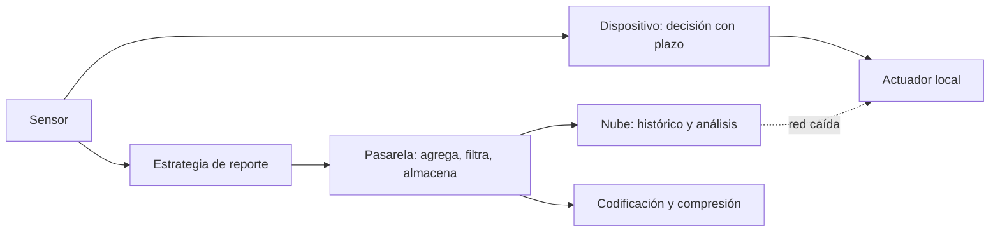
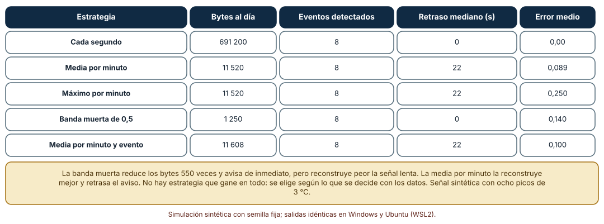
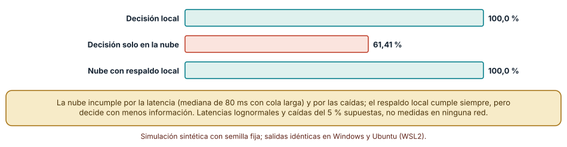
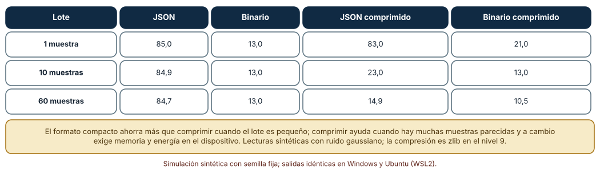

# SE-273 — Edge, gateways y procesamiento local

[← SE-272 — Identidad de dispositivo y gestión de claves](https://github.com/vladimiracunadev-create/modern-software-engineering-program/blob/main/classes/part-22-embedded-iot-y-tiempo-real/se-272-identidad-de-dispositivo-y-gestion-de-claves/README.md) · [↑ Parte 22](https://github.com/vladimiracunadev-create/modern-software-engineering-program/blob/main/classes/part-22-embedded-iot-y-tiempo-real/README.md) · [📚 Índice completo](https://github.com/vladimiracunadev-create/modern-software-engineering-program/blob/main/classes/README.md) · [🌐 Portal](https://vladimiracunadev-create.github.io/modern-software-engineering-program/classes/SE-273.html) · [SE-274 — Safety, seguridad y vida útil prolongada →](https://github.com/vladimiracunadev-create/modern-software-engineering-program/blob/main/classes/part-22-embedded-iot-y-tiempo-real/se-274-safety-seguridad-y-vida-util-prolongada/README.md)

## Punto profesional y fundamento pedagógico

**Punto profesional.** La clase existe para que decidas qué se procesa en el dispositivo, qué en una pasarela local y qué en la nube por lo que se pierde y se gana en cada sitio: bytes enviados, eventos que dejan de verse, plazos que se cumplen y coste de cada formato de datos.

**Por qué aparece aquí.** Se sitúa después de **Identidad de dispositivo y gestión de claves** y antes de **Safety, seguridad y vida útil prolongada**: las clases anteriores llevaron datos y código entre dispositivo y servidor con garantías y claves; esta pregunta cuánto de esa comunicación es necesaria y qué decisiones deben tomarse sin ella. Es la aplicación a un nodo de lo medido en `SE-270` (intermitencia) y `SE-268` (plazos).

**Error conceptual que debe corregir.** Creer que enviar todo a la nube es lo más simple y lo más seguro, o que el procesamiento local siempre pierde información: una estrategia de reporte intercambia bytes por detalle, y una decisión que depende de la red incumple su plazo cuando la red falla.

**Secuencia de aprendizaje.** Antes de simular, predices cuántos bytes ahorra enviar solo cambios frente a enviar cada segundo y qué eventos se pierden; después comparas cinco estrategias de reporte de una señal con ocho eventos, mides el cumplimiento de un plazo de 100 ms para una decisión local y para otra en la nube y comparas los bytes por muestra de dos codificaciones con y sin compresión. La secuencia usa predicción, explicación propia, contraste y recuperación. [ICAP](https://icap.education.asu.edu/research) distingue participación de construcción de conocimiento; [How People Learn II](https://nap.nationalacademies.org/catalog/24783/how-people-learn-ii-learners-contexts-and-cultures) exige conectar conocimiento previo, contexto y transferencia; la [práctica de recuperación](https://pubmed.ncbi.nlm.nih.gov/16507066/) respalda producir de nuevo la explicación tras una demora; y [Education for Life and Work](https://nap.nationalacademies.org/resource/13398/dbasse_084153.pdf) exige devolución que explique la causa del error.

**Evidencia de aprendizaje.** `edge-log.md` con la predicción, la tabla de estrategias de reporte, la comparación local frente a nube, la tabla de codificaciones y una asignación de cada decisión del nodo a un nivel (dispositivo, pasarela, nube) con su razón.

**Límite de la conclusión.** La señal de temperatura con ocho picos, las latencias lognormales con caídas del 5 % y las lecturas con ruido gaussiano son sintéticas. No se midió ninguna pasarela, red ni nube reales; los tamaños de las codificaciones son de estos datos y de zlib en el nivel 9.

### Trazabilidad fuente → afirmación

| Fuente primaria u oficial | Afirmación que respalda | Lo que no prueba |
|---|---|---|
| [Bormann, Ersue y Keränen, RFC 7228: Terminology for Constrained-Node Networks](https://www.rfc-editor.org/rfc/rfc7228) | Describe las restricciones de los nodos y las redes limitadas (energía, caudal, pérdidas), que justifican reducir lo que se transmite. | No fija umbrales de reporte ni qué debe procesarse localmente. |
| [Hartke, RFC 8576: Internet of Things (IoT) Security: State of the Art and Challenges](https://www.rfc-editor.org/rfc/rfc8576) | Resume desafíos de seguridad del IoT, entre ellos el papel de las pasarelas y la limitación de recursos, que condicionan dónde procesar y proteger. | No prescribe una arquitectura de pasarela. |
| [Lee y Seshia, «Introduction to Embedded Systems»](https://ptolemy.berkeley.edu/books/leeseshia/) | Trata la latencia y la determinación del tiempo como parte del diseño de sistemas ciberfísicos, lo que fundamenta decidir localmente lo que tiene plazo. | No da cifras de redes ni de pasarelas concretas. |
| [Python: `json`](https://docs.python.org/3/library/json.html) y [`struct`](https://docs.python.org/3/library/struct.html) | Documentan la serialización textual y el empaquetado binario con ancho y orden definidos usados en la comparación. | No miden el coste de procesamiento en un microcontrolador. |

## Antes de empezar

Recupera la política de comunicación de `SE-270`: cada byte enviado cuesta energía y tiene riesgo de pérdida. La pregunta activa es: **¿qué decisión debe tomarse sin red, qué dato merece viajar y en qué formato?**

## Prerrequisitos

- Haber completado `SE-272` o poder explicar la política de identidad del nodo.
- Python 3.11 o posterior y un terminal; todo el código usa solo la biblioteca estándar.
- Manejar señales muestreadas, promedios y percentiles a nivel básico.

## Problema auténtico

Los nodos de las salas envían una lectura por segundo a la nube por la red de la biblioteca. Una pasarela por piso agrupa los nodos y reenvía. La factura de datos y el consumo de la radio son altos; las lecturas casi no cambian durante horas. Una alarma de ventilación que debe activarse en menos de 100 ms depende de que la nube responda, y cuando la red se corta la ventilación no arranca. El equipo propone «enviar solo el promedio por minuto» sin saber qué se pierde.

## Objetivos observables

Al terminar podrás:

1. comparar estrategias de reporte (cada muestra, promedio, máximo, banda muerta) por bytes, detección de eventos y error de reconstrucción;
2. medir qué fracción de decisiones cumple un plazo si se toman localmente, en la nube o en la nube con respaldo local;
3. comparar el tamaño de una muestra en JSON y en binario con y sin compresión según el tamaño del lote;
4. asignar cada decisión del nodo al dispositivo, a la pasarela o a la nube con su razón;
5. declarar qué información se pierde con cada reducción y quién la necesita.

## Mapa conceptual



El mapa separa tres niveles: el **dispositivo** decide lo que tiene plazo; la **pasarela** agrega, filtra y almacena durante cortes; la **nube** guarda el histórico y analiza. La estrategia de reporte y la codificación fijan lo que viaja entre ellos.

## Temas y por qué importan

| Tema | Por qué cambia una decisión profesional | Evidencia mínima |
|---|---|---|
| Niveles de procesamiento | Cada decisión vive donde su plazo y su dato se cumplen. | Predicción, traza causal y contraejemplo de **Niveles de procesamiento** en `edge-log.md` |
| Estrategias de reporte | Reducen bytes a cambio de detalle y de retraso en el aviso. | Predicción, traza causal y contraejemplo de **Estrategias de reporte** en `edge-log.md` |
| Decisiones con plazo | Una decisión con plazo corto no puede depender de la red. | Predicción, traza causal y contraejemplo de **Decisiones con plazo** en `edge-log.md` |
| Codificación y compresión | El formato compacto ahorra más que comprimir en lotes pequeños. | Predicción, traza causal y contraejemplo de **Codificación y compresión** en `edge-log.md` |
| Pasarelas | Concentran confianza, almacenamiento y un punto único de fallo. | Predicción, traza causal y contraejemplo de **Pasarelas** en `edge-log.md` |

## Conceptos y decisiones

### 1. Niveles de procesamiento

El **dispositivo** conoce el dato crudo y puede decidir sin red, pero tiene poca memoria y energía. La **pasarela** (un equipo local con más recursos) agrega varios nodos, traduce protocolos, almacena durante cortes y puede decidir con datos de varios sensores. La **nube** guarda el histórico, entrena modelos y atiende a las personas. La regla práctica: lo que tiene un plazo corto o debe funcionar sin red va al dispositivo; lo que necesita varios sensores o almacenamiento temporal, a la pasarela; lo que necesita el histórico, a la nube. Cada nivel añade un punto de fallo y una superficie de seguridad.

### 2. Estrategias de reporte

Enviar cada muestra conserva todo y cuesta lo máximo. Enviar el promedio por minuto reduce unos 60 veces los bytes y suaviza los picos. Enviar el máximo por minuto conserva los picos y pierde la forma de la señal. La banda muerta (enviar solo si cambia más de un umbral) ahorra más en señales estables y envía en cuanto hay un cambio. Cada estrategia fija qué se puede reconstruir y qué eventos se ven. La elección depende de la decisión que se toma con los datos, no de los bytes.

### 3. Decisiones con plazo

Si la ventilación debe arrancar en menos de 100 ms tras superar un umbral, la decisión no puede depender de una ida y vuelta a la nube, cuya latencia tiene cola larga y a veces no hay. La decisión se toma en el dispositivo y se informa a la nube después. La nube puede ajustar umbrales y reglas con calma, y el dispositivo debe tener valores seguros por defecto cuando no recibe nada. Es el mismo principio de `SE-268` (el plazo decide dónde vive el cómputo) llevado a la red.

### 4. Codificación y compresión

JSON es legible y verboso: nombres de campo y números en texto. Un formato binario con campos de ancho fijo es compacto y exige que ambos lados conozcan el esquema. La compresión ayuda cuando hay muchas muestras parecidas en un lote, pero exige memoria y energía en el dispositivo y casi no ayuda con una sola muestra (puede incluso aumentarla por sus cabeceras). La elección combina el tamaño del lote, la memoria disponible y el coste de mantener el esquema compartido.

### 5. Pasarelas

La pasarela es un punto de concentración de confianza y de fallo: si cae, todos los nodos de su piso quedan incomunicados; si se compromete, expone todos sus datos. Necesita sus propias actualizaciones, identidad, almacenamiento con política y monitorización. Por eso los nodos no deben depender de ella para decisiones críticas, y la pasarela debe poder funcionar sin la nube. La arquitectura se decide por qué debe seguir funcionando cuando cada nivel cae.

### Cuánto cuesta cada estrategia de reporte y qué se pierde

Una señal de 1 Hz durante un día (86 400 muestras): temperatura con una oscilación lenta de ±1,5 °C, ruido de 0,1 °C y ocho eventos de +3 °C de entre 60 y 300 s. Se comparan cinco estrategias. Un evento se detecta si algún reporte de su ventana (hasta dos minutos tras su fin) supera en 1,5 °C el valor lento esperado. Se mide también el pico que el reporte transmite y el error medio de reconstruir la señal manteniendo el último valor.

```python
rep = [(0, signal[0])]; lastv = signal[0]
for i in range(1, N):
    if abs(signal[i] - lastv) > 0.5:
        rep.append((i, signal[i])); lastv = signal[i]       # banda muerta
```

| Estrategia | Bytes al día | Eventos detectados | Retraso mediano (s) | Error medio |
|---|---:|---:|---:|---:|
| Cada segundo | 691 200 | 8 | 0 | 0,00 |
| Media por minuto | 11 520 | 8 | 22 | 0,089 |
| Máximo por minuto | 11 520 | 8 | 22 | 0,250 |
| Banda muerta de 0,5 | 1 250 | 8 | 0 | 0,140 |
| Media por minuto y evento | 11 608 | 8 | 22 | 0,100 |

Resultado, idéntico en Windows (CPython 3.12.9) y en Ubuntu bajo WSL2 (3.12.3). La banda muerta reduce los bytes 550 veces respecto de enviar cada segundo y avisa de inmediato; la media por minuto reconstruye mejor la señal lenta y retrasa el aviso 22 s de mediana. El pico notificado queda 0,28 °C por debajo del real con la media por minuto y 0,01 con el máximo.



**Cómo leer la figura.** Cada fila es una estrategia; las columnas muestran lo que cuesta y lo que se conserva. **Dónde deja de valer:** los picos de 3 °C y las 8 apariciones son supuestos; un evento breve de pocos segundos, o una señal con muchas oscilaciones, rompería la banda muerta (muchos envíos) o la media (picos invisibles). La figura no dice qué estrategia usar: dice que cada una responde a una decisión distinta.

### Una decisión de 100 ms: local frente a nube

Se simulan 100 000 decisiones con plazo de 100 ms. La decisión local tarda una mediana de 3 ms (lognormal, σ = 0,3). La decisión en la nube requiere una ida y vuelta de mediana 80 ms (lognormal, σ = 0,5) más 5 ms de proceso, y la nube está caída en el 5 % de los tramos de 1000 decisiones. Una tercera variante usa la nube pero, si no responde a tiempo, cae a una decisión local que tarda 20 ms adicionales.

```python
cloud = float("inf") if outage else rtt() + 5
ok_local += local <= 100
ok_mixed += min(cloud, local + 20) <= 100
```

| Estrategia | Decisiones que cumplen el plazo |
|---|---:|
| Decisión local | 100,0 % |
| Solo en la nube | 61,41 % |
| Nube con respaldo local | 100,0 % |

El percentil 99 de la ida y vuelta a la nube es de 256,7 ms. Decidir en la nube cumple el plazo en el 61,41 % de los casos: por la latencia y por las caídas.



**Cómo leer la figura.** Cada barra es el porcentaje de 100 000 decisiones que cumplen el plazo. **Dónde deja de valer:** las latencias lognormales y las caídas del 5 % son supuestos, no medidas de ninguna red. La decisión local cumple siempre, pero decide con menos información: la figura no dice que la nube sea inútil, sino que lo que tiene plazo no debe depender de ella.

### Cuántos bytes ocupa una muestra

Cada muestra tiene cinco magnitudes (temperatura, humedad, CO₂, tensión de batería y señal de radio), identificador y marca de tiempo. Se codifican como JSON compacto y como binario de 13 bytes (`struct`), en lotes de 1, 10 y 60 muestras, con y sin compresión zlib en el nivel 9.

```python
js = json.dumps(samples, separators=(",", ":")).encode()
binp = b"".join(struct.pack("<IhHhHb", ...) for s in samples)
```

| Lote | JSON | Binario | JSON comprimido | Binario comprimido |
|---|---:|---:|---:|---:|
| 1 muestra | 85,0 | 13,0 | 83,0 | 21,0 |
| 10 muestras | 84,9 | 13,0 | 23,0 | 13,0 |
| 60 muestras | 84,7 | 13,0 | 14,9 | 10,5 |

(Bytes por muestra.) El binario ahorra 6,5 veces frente a JSON. Comprimir un lote de 60 reduce el JSON a 14,9 bytes por muestra, pero con una sola muestra el JSON casi no baja y el binario empeora (21,0 por las cabeceras).



**Cómo leer la figura.** Cada fila es un tamaño de lote; las columnas son los bytes por muestra según el formato y la compresión. **Dónde deja de valer:** las lecturas sintéticas con ruido gaussiano se comprimen de una manera; datos reales con tendencias o saltos se comprimen distinto. El coste de comprimir en un microcontrolador (memoria y energía) no se midió. El binario exige que el servidor conozca el esquema y que se versione (`SE-164`).

## Definiciones de trabajo

- **borde de la red (edge):** conjunto de dispositivos y pasarelas cercanos a la fuente de los datos, donde se procesa antes de enviar a la nube.
- **pasarela (gateway):** equipo que conecta dispositivos de una red local con una red mayor, traduciendo protocolos y agregando datos.
- **banda muerta:** umbral de variación por debajo del cual no se envía una nueva lectura.
- **decisión con plazo:** decisión que debe tomarse en un tiempo acotado, sin depender de recursos remotos.
- **carga útil (payload):** datos de aplicación transportados por un mensaje, sin las cabeceras del protocolo.

Las definiciones son operativas para el nodo de la sala. No convierten términos con una historia más amplia en sinónimos y deben contrastarse con la documentación primaria enlazada al final.

## Ejemplo mínimo

El fragmento calcula el ahorro de enviar un promedio por minuto en lugar de cada segundo. Antes de ejecutarlo, predice el factor.

```python
bytes_por_muestra = 8
cada_segundo = 86400 * bytes_por_muestra
por_minuto = 1440 * bytes_por_muestra
assert cada_segundo // por_minuto == 60
```

El ahorro es de 60 veces (691 200 frente a 11 520 bytes por día). Registra versión, comando y salida; calcula el ahorro con banda muerta si hay 125 envíos de 10 bytes al día en lugar de 86 400 de 8.

## Ejemplo profesional

El equipo de la plataforma asigna cada decisión a un nivel. La alarma de ventilación se decide en el nodo con un umbral guardado en memoria y un valor seguro por defecto; el nodo informa del evento cuando hay red. La pasarela del piso agrupa los 20 nodos, aplica la banda muerta de 0,5 °C a la temperatura y el promedio por minuto al CO₂ más un evento si hay un pico, almacena hasta tres horas por si cae la nube y envía en lotes de 60 muestras en binario comprimido. La nube guarda el histórico y ajusta umbrales, que la pasarela distribuye a los nodos con firma (`SE-272`). La pasarela tiene su propia identidad, su plan de actualización y una alarma si deja de recibir datos de un nodo.

Compara con el diseño inicial: los bytes bajan de 690 KB a unos pocos KB por nodo al día, la ventilación arranca aunque la red se corte y la nube sigue recibiendo los eventos. Un diseño es adecuado cuando cada nivel sabe qué hace si el siguiente cae; es frágil cuando todo depende de la nube.

## Práctica guiada

1. Lista las decisiones del nodo y, para cada una, su plazo y los datos que necesita.
2. Predice cuántos bytes ahorra una banda muerta de 0,5 y qué eventos se perderían; escribe la respuesta.
3. Simula tres estrategias de reporte con tu señal y compara bytes, eventos y error.
4. Simula una decisión con plazo local, en la nube y con respaldo.
5. Mide el tamaño de tus muestras en JSON y en binario con distintos lotes.
6. Asigna cada decisión a dispositivo, pasarela o nube con su razón.
7. Entrega `edge-log.md` y pide a otra persona que identifique la decisión que no debería depender de la red.

## Ejercicios

1. **Banda muerta:** calcula el umbral que reduce los bytes 100 veces sin perder ninguno de los ocho eventos.
2. **Plazo:** modifica el plazo a 300 ms y calcula el cumplimiento de la decisión en la nube.
3. **Formato:** calcula el tamaño por muestra de un formato binario que añade un campo de 4 bytes y compáralo con JSON.
4. **Pasarela:** diseña qué debe hacer la pasarela si la nube cae seis horas con almacenamiento para tres.

## Reto verificable

Entrega `edge-log.md` con la predicción, las tres tablas y la asignación de decisiones a niveles. Se aprueba si otra persona ejecuta el código desde un checkout limpio, obtiene los mismos números y puede decir qué se pierde con cada estrategia de reporte. No se aprueba por proponer «procesar en el borde» sin decir qué decisión.

## Caso conductor

El nodo ambiental de una sala de estudio continúa como caso conductor de la Parte 22. Esta clase deja el noveno artefacto: la asignación de las decisiones del nodo al dispositivo, la pasarela y la nube con su estrategia de reporte y su formato. `SE-274` pregunta qué ocurre con la seguridad y la vida útil de esa arquitectura. Cambia después una sola cosa, el umbral de la banda muerta, y observa qué eventos pasan a verse tarde o a no verse.

## Preguntas frecuentes

### ¿Procesar en el borde es siempre más barato?

Ahorra transmisión y plazo, y añade equipos que mantener, actualizar y asegurar. Se compara el coste total, no solo los bytes.

### ¿Qué hago con los datos que descarto?

Declara qué se pierde y quién podría necesitarlo. Si hay una obligación de conservar, el dato crudo debe almacenarse localmente o enviarse; reducir no equivale a borrar.

### ¿Un modelo de aprendizaje automático puede ejecutarse en el dispositivo?

Si cabe en la memoria y el consumo lo permite, sí; se evalúa con el presupuesto de `SE-267` y se actualiza con el plan de `SE-271`. La decisión por plazo y por privacidad suele favorecer lo local.

### ¿Y si la pasarela es el único punto de conexión?

Entonces su caída aísla al piso: diseña su redundancia o haz que los nodos críticos decidan sin ella.

## Fallo controlado y diagnóstico

Reproduce el fallo clásico de la clase: **una decisión con plazo que depende de la nube**. Simula 100 000 decisiones con plazo de 100 ms que viajan a la nube y cuenta las que cumplen.

Registra síntoma, entrada mínima, hipótesis, observación que descarta cada hipótesis, causa, corrección y prueba de regresión. **Síntoma:** la ventilación arranca con retrasos de segundos y a veces no arranca. **Hipótesis rivales:** (a) el actuador es lento; (b) el umbral está mal configurado; (c) la decisión espera a la nube. **Prueba:** mide el tiempo entre la superación del umbral y la orden; si incluye una ida y vuelta a la nube, es (c); en la simulación, 61,41 % cumple. **Conclusión:** la decisión con plazo depende de un recurso sin plazo. **Regresión:** mueve la decisión al nodo con umbral local y valor por defecto seguro, mide el 100 % y registra que la nube solo ajusta el umbral. No cambies a la vez el nivel de la decisión y el umbral.

## Errores comunes y cómo corregirlos

| Síntoma | Causa probable | Corrección |
|---|---|---|
| Una alarma no actúa cuando se corta la red | Decisión en la nube | Decidir en el dispositivo con valores por defecto seguros |
| La factura de datos es alta con datos casi constantes | Envío de cada muestra | Banda muerta o promedios con evento |
| Se pierden picos tras «enviar el promedio» | Reducción que suaviza eventos | Añadir máximo o evento por umbral |
| El mensaje binario no se decodifica tras un cambio | Esquema no versionado | Versionar el esquema y compatibilidad (`SE-164`) |
| Una pasarela caída silencia un piso | Punto único de fallo | Redundancia y alarma de silencio de nodos |

## Entorno y archivos clave

```text
work/SE-273/
├── README.md
├── edge/
│   ├── reporte.py
│   ├── plazo.py
│   └── codificacion.py
├── tests/test_edge.py
└── evidence/edge-log.md
```

El `README` declara plataforma, versión de Python, semillas y comandos. Los experimentos usan solo la biblioteca estándar (`random`, `statistics`, `math`, `json`, `struct`, `zlib`) y se ejecutaron con CPython 3.12.9 en Windows 11 y 3.12.3 en Ubuntu bajo WSL2: las salidas fueron idénticas. Si añades una dependencia, fija procedencia y versión.

## Seguridad, ética y accesibilidad

- una pasarela concentra datos y credenciales: aplícale identidad, actualizaciones y almacenamiento con política (`SE-271` y `SE-272`);
- reducir datos en el borde reduce la privacidad en riesgo, pero no la elimina: define qué se conserva y por cuánto tiempo;
- una alarma local debe funcionar sin red y ser perceptible por más de un canal;
- documenta qué decisión se toma en cada nivel y quién puede cambiarla;
- respeta las licencias de las pasarelas y los formatos y atribuye lo adaptado.

## Puente hacia el trabajo con agentes

Un agente al que se le pide «optimiza el tráfico del nodo» propondrá enviar menos datos sin decir qué eventos se pierden, y quizá comprimir con una biblioteca pesada. Pídele que compare estrategias con bytes, eventos detectados y retraso, que mantenga en el dispositivo las decisiones con plazo y que calcule el tamaño por muestra con y sin compresión. Revisa especialmente si una decisión crítica queda esperando una respuesta de la nube: es el defecto que la red intermitente expone.

## Transferencia

Traslada el análisis a otro dispositivo (por ejemplo, un contador de agua con alarma de fuga): cambia la señal y el plazo, y conserva el procedimiento de comparar estrategias de reporte, decidir lo que tiene plazo localmente y medir la codificación. La transferencia está lograda cuando puedes explicar qué parte de la asignación dependía de la señal y cuál no, no cuando las tablas se parecen.

## Evaluación y evidencia

| Criterio | Evidencia para aprobar |
|---|---|
| comprensión | explicación de qué se gana y qué se pierde con cada estrategia de reporte |
| corrección | tablas reproducibles con las mismas semillas |
| diseño | asignación de decisiones a niveles con razones y comportamiento ante caídas |
| diagnóstico | reproducción del fallo «decisión con plazo en la nube» con regresión |
| incertidumbre | declaración de lo que se pierde al reducir y de lo que no se midió |
| reproducibilidad | versiones, comandos, salida y límites declarados |

## Fuentes

- [Bormann, Ersue y Keränen, RFC 7228: Terminology for Constrained-Node Networks](https://www.rfc-editor.org/rfc/rfc7228) — restricciones de nodos y redes; autoridad: IETF.
- [Hartke, RFC 8576: IoT Security: State of the Art and Challenges](https://www.rfc-editor.org/rfc/rfc8576) — desafíos de seguridad del IoT; autoridad: IETF.
- [Lee y Seshia, «Introduction to Embedded Systems»](https://ptolemy.berkeley.edu/books/leeseshia/) — latencia y plazos en sistemas ciberfísicos; autoridad: autores del libro (UC Berkeley).
- [Python: `struct`](https://docs.python.org/3/library/struct.html) — empaquetado binario; autoridad: documentación de Python.
- [Python: `zlib`](https://docs.python.org/3/library/zlib.html) — compresión usada en la comparación; autoridad: documentación de Python.

Cada fuente respalda el mecanismo indicado; ninguna demuestra que los 550 veces de ahorro, el 61,41 % de cumplimiento en la nube o los 10,5 bytes por muestra se observen en el nodo real. Esa afirmación depende de la señal, de la red y de la pasarela.

## Límites y siguiente paso

Se ejecutaron tres simulaciones con datos sintéticos en Windows y Ubuntu (WSL2) con resultados idénticos. No se midió ninguna pasarela, red ni nube: la señal de temperatura, las latencias, las caídas del 5 % y las lecturas con ruido son construcciones del autor. La siguiente clase pregunta qué ocurre con la seguridad, la safety y una vida útil de años.

## Glosario

- **borde de la red (edge):** conjunto de dispositivos y pasarelas cercanos a la fuente de los datos, donde se procesa antes de enviar a la nube.
- **pasarela (gateway):** equipo que conecta dispositivos de una red local con una red mayor, traduciendo protocolos y agregando datos.
- **banda muerta:** umbral de variación por debajo del cual no se envía una nueva lectura.
- **decisión con plazo:** decisión que debe tomarse en un tiempo acotado, sin depender de recursos remotos.
- **carga útil (payload):** datos de aplicación transportados por un mensaje, sin las cabeceras del protocolo.

---

[← SE-272 — Identidad de dispositivo y gestión de claves](https://github.com/vladimiracunadev-create/modern-software-engineering-program/blob/main/classes/part-22-embedded-iot-y-tiempo-real/se-272-identidad-de-dispositivo-y-gestion-de-claves/README.md) · [↑ Parte 22](https://github.com/vladimiracunadev-create/modern-software-engineering-program/blob/main/classes/part-22-embedded-iot-y-tiempo-real/README.md) · [📚 Índice completo](https://github.com/vladimiracunadev-create/modern-software-engineering-program/blob/main/classes/README.md) · [🌐 Portal](https://vladimiracunadev-create.github.io/modern-software-engineering-program/classes/SE-273.html) · [SE-274 — Safety, seguridad y vida útil prolongada →](https://github.com/vladimiracunadev-create/modern-software-engineering-program/blob/main/classes/part-22-embedded-iot-y-tiempo-real/se-274-safety-seguridad-y-vida-util-prolongada/README.md)

