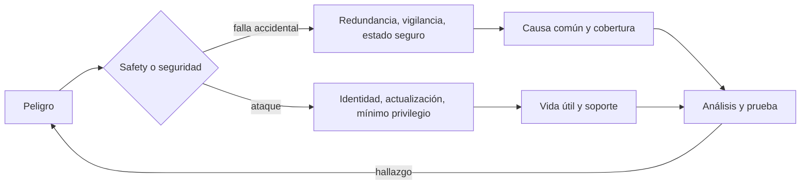
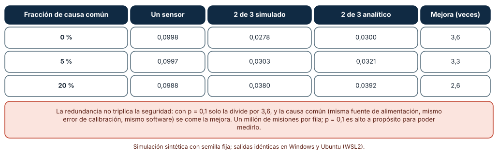
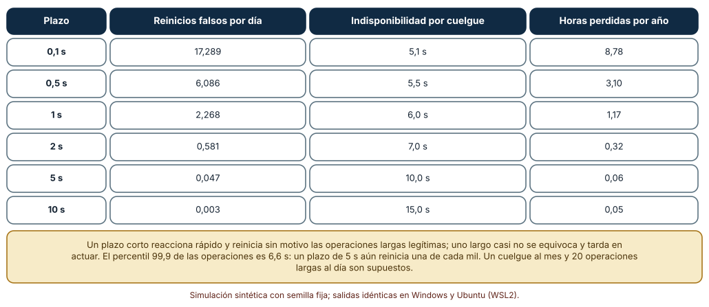
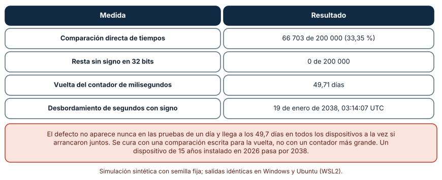

# SE-274 — Safety, seguridad y vida útil prolongada

[← SE-273 — Edge, gateways y procesamiento local](https://github.com/vladimiracunadev-create/modern-software-engineering-program/blob/main/classes/part-22-embedded-iot-y-tiempo-real/se-273-edge-gateways-y-procesamiento-local/README.md) · [↑ Parte 22](https://github.com/vladimiracunadev-create/modern-software-engineering-program/blob/main/classes/part-22-embedded-iot-y-tiempo-real/README.md) · [📚 Índice completo](https://github.com/vladimiracunadev-create/modern-software-engineering-program/blob/main/classes/README.md) · [🌐 Portal](https://vladimiracunadev-create.github.io/modern-software-engineering-program/classes/SE-274.html) · [SE-275 — Taller: modelar fallos físicos y digitales →](https://github.com/vladimiracunadev-create/modern-software-engineering-program/blob/main/classes/part-22-embedded-iot-y-tiempo-real/se-275-taller-modelar-fallos-fisicos-y-digitales/README.md)

## Punto profesional y fundamento pedagógico

**Punto profesional.** La clase existe para que distingas dos preguntas que se confunden —qué pasa si el dispositivo falla (safety) y qué pasa si alguien lo ataca (seguridad)— y para que calcules tres defensas de un dispositivo que debe funcionar años: la redundancia con votación y su límite por causa común, el temporizador de vigilancia y su plazo, y los contadores de tiempo que dan la vuelta.

**Por qué aparece aquí.** Se sitúa después de **Edge, gateways y procesamiento local** y antes del **Taller: modelar fallos físicos y digitales**: las clases anteriores diseñaron un nodo que mide, comunica, se actualiza y se autentica; esta pregunta cómo se comporta cuando algo falla o cuando pasan quince años. El taller siguiente modela esos fallos de forma sistemática.

**Error conceptual que debe corregir.** Creer que redundar triplica la seguridad, que un temporizador de vigilancia «reinicia lo que se cuelga» sin costo o que un contador de 32 bits «dura de sobra»: la causa común anula la redundancia, un plazo corto reinicia operaciones legítimas y el contador da la vuelta en un día concreto, a todos a la vez.

**Secuencia de aprendizaje.** Antes de simular, predices cuánto reduce una votación dos de tres el fallo peligroso de un sensor; después simulas tres fracciones de causa común, calculas los reinicios falsos y las horas perdidas de seis plazos de vigilancia y mides cuántos temporizadores se equivocan al dar la vuelta un contador de 32 bits con dos comparaciones. La secuencia usa predicción, explicación propia, contraste y recuperación. [ICAP](https://icap.education.asu.edu/research) distingue participación de construcción de conocimiento; [How People Learn II](https://nap.nationalacademies.org/catalog/24783/how-people-learn-ii-learners-contexts-and-cultures) exige conectar conocimiento previo, contexto y transferencia; la [práctica de recuperación](https://pubmed.ncbi.nlm.nih.gov/16507066/) respalda producir de nuevo la explicación tras una demora; y [Education for Life and Work](https://nap.nationalacademies.org/resource/13398/dbasse_084153.pdf) exige devolución que explique la causa del error.

**Evidencia de aprendizaje.** `safety-log.md` con la predicción, la tabla de votación por causa común, la tabla de plazos de vigilancia, la comprobación de la vuelta del contador y un análisis de peligros del nodo con la defensa de cada uno y su supuesto.

**Límite de la conclusión.** Las probabilidades de fallo (0,1 por sensor, a propósito alta para poder medirla), el cuelgue al mes, las 20 operaciones largas al día y los tiempos lognormales son supuestos del autor. Esta clase no sustituye una norma de seguridad funcional ni un análisis formal de un producto concreto: muestra mecanismos.

### Trazabilidad fuente → afirmación

| Fuente primaria u oficial | Afirmación que respalda | Lo que no prueba |
|---|---|---|
| [ETSI EN 303 645: ciberseguridad para IoT de consumo](https://www.etsi.org/deliver/etsi_en/303600_303699/303645/) | Fija requisitos como actualizaciones de software, ausencia de contraseñas por defecto y mantenimiento de la seguridad durante un periodo de soporte declarado. | No define un periodo de soporte ni mide su cumplimiento. |
| [NIST, NISTIR 8259A: IoT Device Cybersecurity Capability Core Baseline](https://csrc.nist.gov/pubs/ir/8259/a/final) | Enumera capacidades básicas de un dispositivo IoT: identificación, configuración, protección de datos, interfaz lógica, actualización y registro. | No certifica un producto ni prescribe cómo implementarlas. |
| [OWASP, Internet of Things Project](https://owasp.org/www-project-internet-of-things/) | Reúne riesgos frecuentes de seguridad en dispositivos IoT, entre ellos componentes inseguros y falta de gestión de actualizaciones. | Es una lista de riesgos; no cuantifica su frecuencia en un producto. |
| [Hsueh, Tsai e Iyer, «Fault injection techniques and tools» (IEEE Computer, 1997)](https://doi.org/10.1109/2.585157) | Describe técnicas para introducir fallos deliberadamente y evaluar la tolerancia de un sistema. | No da tasas de fallo de ningún componente. |
| [Python: `datetime`](https://docs.python.org/3/library/datetime.html) | Permite calcular y mostrar la fecha de desbordamiento de segundos con signo de 32 bits. | No reproduce el comportamiento de una biblioteca de tiempo de un microcontrolador. |

## Antes de empezar

Recupera la actualización de `SE-271` y la identidad de `SE-272`: ambas son defensas que deben seguir funcionando años. La pregunta activa es: **¿cuál es el peor daño que este dispositivo puede causar o sufrir, qué defensa lo cubre y qué la hace fallar?**

## Prerrequisitos

- Haber completado `SE-273` o poder explicar qué decisión del nodo debe tomarse localmente.
- Python 3.11 o posterior y un terminal; todo el código usa solo la biblioteca estándar.
- Manejar probabilidades de fallo y aritmética módulo 2^32 a nivel básico.

## Problema auténtico

El nodo de la sala controla la ventilación: si el CO₂ supera un umbral, enciende un extractor. Debe funcionar quince años. Un sensor único falla de vez en cuando y, atascado en un valor bajo, deja el aire sin ventilar sin que nada lo note. El firmware se cuelga de forma ocasional; el temporizador de vigilancia reinicia el nodo, pero también reinicia durante cada borrado de flash largo. Y a los 49,7 días de arrancar todos los nodos a la vez, algunos temporizadores del firmware se comportan de forma extraña. Tres defectos de la misma familia: asumir que nada falla durante demasiado tiempo.

## Objetivos observables

Al terminar podrás:

1. distinguir safety y seguridad con un ejemplo y un contraejemplo del nodo y relacionar sus requisitos;
2. calcular la reducción de un fallo peligroso con votación dos de tres y cómo la causa común la limita;
3. elegir el plazo de un temporizador de vigilancia por sus reinicios falsos y su tiempo de recuperación;
4. detectar los defectos de vuelta de contadores de tiempo y escribir una comparación segura;
5. escribir un análisis de peligros del nodo con la defensa, su supuesto y su comprobación.

## Mapa conceptual



El mapa recorre un peligro hasta su defensa: si el origen es un fallo accidental, la defensa es redundancia, vigilancia y un estado seguro; si es un ataque, identidad, actualización y mínimo privilegio. Ambas se examinan con su causa común y con la vida útil.

## Temas y por qué importan

| Tema | Por qué cambia una decisión profesional | Evidencia mínima |
|---|---|---|
| Safety y seguridad | Una evita daño por fallo; la otra por ataque; comparten defensas y también chocan. | Predicción, traza causal y contraejemplo de **Safety y seguridad** en `safety-log.md` |
| Redundancia y causa común | La votación reduce fallos independientes y no los de causa común. | Predicción, traza causal y contraejemplo de **Redundancia y causa común** en `safety-log.md` |
| Temporizador de vigilancia | Recupera de cuelgues a cambio de reinicios falsos si el plazo es corto. | Predicción, traza causal y contraejemplo de **Temporizador de vigilancia** en `safety-log.md` |
| Estado seguro | Cada fallo debe llevar a un estado de menor daño definido de antemano. | Predicción, traza causal y contraejemplo de **Estado seguro** en `safety-log.md` |
| Vida útil prolongada | Contadores, certificados y componentes se agotan en fechas conocidas. | Predicción, traza causal y contraejemplo de **Vida útil prolongada** en `safety-log.md` |

## Conceptos y decisiones

### 1. Safety y seguridad

La *safety* protege a las personas y al entorno de los fallos del sistema: una ventilación que no arranca, un actuador que no se detiene. La *seguridad* (security) protege al sistema de acciones deliberadas: alguien que apaga el extractor. Comparten mecanismos (validar entradas, mínimo privilegio, actualizaciones) y a veces chocan: una actualización remota mejora la seguridad y es un riesgo de safety si puede dejar el dispositivo inservible (`SE-271`). Un análisis serio trata ambas con el mismo método: peligros, causas, defensas y comprobaciones.

### 2. Redundancia y causa común

Triplicar un sensor y votar por mayoría tolera el fallo de uno: el voto se equivoca solo si fallan dos. Con una probabilidad de fallo p por sensor, la probabilidad de un voto erróneo es 3p² (menos 2p³), mucho menor que p. Pero si los tres comparten una causa (misma alimentación, misma calibración, mismo software), la probabilidad de fallo conjunto es de orden β·p, y para fracciones β moderadas domina. La redundancia reduce la probabilidad de fallos independientes; la diversidad (sensores de principio distinto, firmware distinto) ataca la causa común.

### 3. Temporizador de vigilancia

Un temporizador de vigilancia (watchdog) reinicia el dispositivo si el firmware no lo «alimenta» a tiempo. Recupera de cuelgues y de bucles infinitos. Su plazo es un intercambio: corto, recupera rápido y reinicia sin motivo durante operaciones largas legítimas; largo, casi no se equivoca y deja al dispositivo colgado mucho tiempo. Por eso se fija con la distribución del tiempo de las operaciones más largas y no con la intuición, y la alimentación se hace solo cuando varias comprobaciones de salud pasan, no desde una interrupción que sigue viva aunque el programa principal esté colgado.

### 4. Estado seguro

Un fallo detectado debe llevar a un estado definido de antemano cuyo daño sea menor: el extractor encendido si no se sabe el nivel de CO₂, la puerta desbloqueada o bloqueada según el riesgo, el actuador parado. El estado seguro no siempre es «apagado». Se decide por peligro y se documenta, porque quien programa bajo presión elige el estado que facilita probar. Y debe probarse: forzar el fallo (`SE-275`) y comprobar que se alcanza.

### 5. Vida útil prolongada

Un dispositivo de quince años cruza fechas que el desarrollo olvida: un contador de milisegundos de 32 bits da la vuelta a los 49,7 días; los segundos con signo de 32 bits se desbordan en 2038; los certificados caducan; los proveedores dejan de dar soporte. ETSI EN 303 645 pide declarar el periodo de soporte de seguridad. La defensa es tratar cada contador, cada certificado y cada componente con fecha como una condición con su prueba: «el firmware se comporta bien al pasar por la vuelta del contador».

### Cuánto reduce el fallo una votación dos de tres

Cada sensor falla de forma peligrosa durante una misión con probabilidad p = 0,1 (valor alto a propósito, para medirlo con un millón de misiones). Una fracción β de los fallos tiene causa común y afecta a los tres sensores a la vez. Se compara un sensor con la votación dos de tres.

```python
common = rng.random() < beta * p
f = [common or (rng.random() < p * (1 - beta)) for _ in range(3)]
twoo3 += sum(f) >= 2
```

| Fracción de causa común | Un sensor | 2 de 3 simulado | 2 de 3 analítico | Mejora (veces) |
|---:|---:|---:|---:|---:|
| 0 % | 0,0998 | 0,0278 | 0,0300 | 3,6 |
| 5 % | 0,0997 | 0,0303 | 0,0321 | 3,3 |
| 20 % | 0,0988 | 0,0380 | 0,0392 | 2,6 |

Resultado, idéntico en Windows (CPython 3.12.9) y en Ubuntu bajo WSL2 (3.12.3). Con fallos independientes la votación reduce el fallo 3,6 veces; con el 20 % de causa común, 2,6 veces. La simulación queda algo por debajo de la aproximación analítica (el término 2p³ que se ignora y el tamaño de la muestra).



**Cómo leer la figura.** Cada fila es una fracción de causa común; las columnas comparan un sensor con la votación y dan la mejora. **Dónde deja de valer:** p = 0,1 es muy alto: con probabilidades pequeñas el efecto de la causa común es todavía mayor en proporción, porque el término β·p domina al 3p². El modelo supone independencia fuera de la causa común, un voto perfecto y fallos que el voto no detecta de otro modo. No es un cálculo de integridad de seguridad.

### El plazo del temporizador de vigilancia

Las operaciones largas del firmware (borrados de flash, envíos) son 20 por día con mediana de 0,3 s y cola larga (lognormal, σ = 1,0). Hay un cuelgue al mes. Un reinicio tarda 5 s en volver a servir. Se calculan, para cada plazo, los reinicios falsos por día (operaciones que superan el plazo), la indisponibilidad por cuelgue (plazo más arranque) y las horas perdidas por año.

```python
false_resets_day = 20 * sum(o > T for o in ops) / len(ops)
downtime_hang = T + 5.0
```

| Plazo | Reinicios falsos por día | Indisponibilidad por cuelgue | Horas perdidas por año |
|---:|---:|---:|---:|
| 0,1 s | 17,289 | 5,1 s | 8,78 |
| 0,5 s | 6,086 | 5,5 s | 3,10 |
| 1 s | 2,268 | 6,0 s | 1,17 |
| 2 s | 0,581 | 7,0 s | 0,32 |
| 5 s | 0,047 | 10,0 s | 0,06 |
| 10 s | 0,003 | 15,0 s | 0,05 |

Con un plazo de 0,1 s hay 17 reinicios falsos al día y casi 9 horas perdidas al año; con 5 s casi ninguno, y un cuelgue tarda 10 s en resolverse. La operación más larga de las 200 000 fue de 35,3 s y el percentil 99,9 es de 6,6 s: incluso 5 s reinicia una de cada mil operaciones largas.



**Cómo leer la figura.** Cada fila es un plazo; las dos primeras columnas son los costes de equivocarse y de tardar, y la última las suma. **Dónde deja de valer:** los tiempos lognormales y los 20 eventos largos al día son supuestos; con operaciones que se pueden partir (borrar un sector a la vez), el plazo puede bajar. Un reinicio falso en mitad de una escritura de flash tiene un costo mayor que 5 s y no se modeló.

### La vuelta de un contador de 32 bits

Un contador de milisegundos de 32 bits da la vuelta a los 49,71 días. Se arman 200 000 temporizadores en los dos minutos previos a la vuelta, con un retardo de 1 ms a 60 s, y se comprueba tras un tiempo transcurrido aleatorio si deben haber vencido con dos comparaciones: la directa `ahora >= límite` y la resta sin signo `(ahora − límite) mod 2³² < 2³¹`.

```python
naive = t >= deadline
signed = (((t - deadline) & MASK) < 2 ** 31)
```

| Medida | Resultado |
|---|---:|
| Comparación directa, decisiones erróneas | 66 703 de 200 000 (33,35 %) |
| Resta sin signo en 32 bits | 0 de 200 000 |
| Vuelta del contador de milisegundos | 49,71 días |
| Desbordamiento de segundos con signo de 32 bits | 19 de enero de 2038, 03:14:07 UTC |

Entre los temporizadores armados justo antes de la vuelta, la comparación directa decide mal una de cada tres veces; la resta sin signo, ninguna. Un dispositivo instalado en 2026 con vida de quince años pasa por 2038.



**Cómo leer la figura.** Cada fila es una medida; la primera compara las dos formas de decidir un vencimiento. **Dónde deja de valer:** la muestra se concentra en los dos minutos previos a la vuelta, donde el defecto vive; en un uso normal ocurre una vez cada 49,7 días por temporizador. El defecto no aparece en pruebas de un día y llega a todos los dispositivos que arrancaron juntos el mismo día. La comparación segura supone intervalos menores que la mitad del rango.

## Definiciones de trabajo

- **safety:** propiedad de un sistema de no causar daño inaceptable a personas o al entorno ante fallos accidentales.
- **seguridad (security):** propiedad de un sistema de resistir acciones deliberadas de personas que buscan usarlo de forma no autorizada.
- **causa común:** origen único de fallos que afecta a varios componentes redundantes a la vez.
- **temporizador de vigilancia (watchdog):** temporizador que reinicia el sistema si el firmware no lo reinicia periódicamente.
- **estado seguro:** estado en que un sistema con un fallo causa el menor daño posible, definido de antemano.

Las definiciones son operativas para el nodo de la sala. No convierten términos con una historia más amplia en sinónimos y deben contrastarse con la documentación primaria enlazada al final.

## Ejemplo mínimo

El fragmento compara dos formas de decidir un vencimiento al dar la vuelta un contador de 8 bits. Antes de ejecutarlo, predice cuál acierta.

```python
MASK = 0xFF
ahora, limite = (250 + 10) & MASK, (250 + 5) & MASK     # ahora=4, limite=255
directa = ahora >= limite
con_resta = ((ahora - limite) & MASK) < 128
assert directa is False and con_resta is True
```

El límite se alcanzó (pasaron 10 de los 5 necesarios), pero la comparación directa dice que no; la resta sin signo acierta. Registra versión, comando y salida; cambia a un contador de 32 bits y repite.

## Ejemplo profesional

El equipo de la plataforma escribe el análisis de peligros del nodo con cuatro filas. Peligro: el extractor no arranca con CO₂ alto. Defensa: dos sensores de principios distintos con comparación, estado seguro «extractor encendido» si discrepan, y prueba por inyección de fallos. Peligro: el firmware se cuelga. Defensa: temporizador de vigilancia con plazo de 5 s, alimentado solo tras una comprobación de salud, y operaciones largas partidas en pasos de 200 ms. Peligro: un contador de tiempo da la vuelta. Defensa: toda comparación de tiempos usa resta sin signo, y una prueba simula el arranque a 49 días. Peligro: un atacante apaga el extractor. Defensa: identidad por dispositivo, actualizaciones firmadas (`SE-271` y `SE-272`) y un periodo de soporte declarado de quince años.

Compara con el prototipo: cada defensa tiene su supuesto (la independencia de los sensores, la distribución de las operaciones, la longitud de los intervalos) y una prueba. Un análisis es adecuado cuando cada peligro tiene su estado seguro y su comprobación; es frágil cuando solo enumera componentes.

## Práctica guiada

1. Lista los peligros del nodo y clasifícalos como de safety, de seguridad o de ambos.
2. Predice cuánto reduce el fallo una votación dos de tres y escribe el número antes de simular.
3. Simula la votación con varias fracciones de causa común.
4. Mide la distribución de tus operaciones largas y elige el plazo del temporizador de vigilancia.
5. Escribe una prueba que arme temporizadores justo antes de la vuelta del contador.
6. Define el estado seguro de cada peligro y cómo lo forzarías.
7. Entrega `safety-log.md` y pide a otra persona que identifique la causa común más probable de tu diseño.

## Ejercicios

1. **Votación:** calcula la probabilidad de fallo de una votación dos de tres con p = 0,01 y β = 0,1 y compárala con la de un sensor.
2. **Vigilancia:** calcula el plazo mínimo para menos de un reinicio falso al año con tu distribución de operaciones.
3. **Contador:** escribe una función `vencido(ahora, limite)` correcta para 32 bits y una prueba que cubra la vuelta.
4. **Vida útil:** lista tres fechas de caducidad de tu diseño (certificados, contadores, soporte) y cómo las probarías.

## Reto verificable

Entrega `safety-log.md` con la predicción, las tres tablas y el análisis de peligros con defensa, supuesto y comprobación. Se aprueba si otra persona ejecuta el código desde un checkout limpio, obtiene los mismos números y puede decir qué causa común rompería la redundancia. No se aprueba por afirmar «es redundante» sin hablar de causa común.

## Caso conductor

El nodo ambiental de una sala de estudio continúa como caso conductor de la Parte 22. Esta clase deja el décimo artefacto: el análisis de peligros del nodo con estado seguro, defensa, supuesto y comprobación. `SE-275` lo convierte en un taller de modelado de fallos. Cambia después una sola cosa, el plazo del temporizador de vigilancia, y observa qué reinicios y qué indisponibilidad cambian.

## Preguntas frecuentes

### ¿Safety y seguridad son lo mismo?

No: la primera protege de fallos accidentales y la segunda de ataques. Se tratan juntas porque comparten defensas y porque una puede romper la otra.

### ¿Cuántos sensores necesito?

Los que haga falta para llevar la probabilidad de fallo peligroso por debajo de lo que el peligro tolera, con un análisis de causa común. Una norma de seguridad funcional fija el objetivo; esta clase solo muestra el mecanismo.

### ¿El temporizador de vigilancia puede ser externo?

Sí, y conviene cuando el procesador puede fallar de forma que también detenga su propio temporizador: uno externo, con su propio reloj, no depende de él.

### ¿Qué hago con el 2038?

Usa tiempos de 64 bits o representaciones que no se desborden y prueba el firmware con fechas posteriores a 2038. Un dispositivo de quince años instalado hoy ya tiene el problema.

## Fallo controlado y diagnóstico

Reproduce el fallo clásico de la clase: **una comparación de tiempos que falla al dar la vuelta el contador**. Arma 200 000 temporizadores en los dos minutos previos a la vuelta y compara las dos formas de decidir.

Registra síntoma, entrada mínima, hipótesis, observación que descarta cada hipótesis, causa, corrección y prueba de regresión. **Síntoma:** a los 49 días algunos nodos reinician el ciclo de ventilación sin motivo. **Hipótesis rivales:** (a) el sensor falló; (b) una actualización cambió el ciclo; (c) un temporizador vence mal al dar la vuelta el contador. **Prueba:** arma un temporizador a 49,7 días y compara; la comparación directa decide mal el 33,35 % de los casos. **Conclusión:** la causa es la comparación directa. **Regresión:** cambia a la resta sin signo, añade una prueba que arranque el contador cerca de la vuelta y compruébala con intervalos largos. No cambies a la vez la comparación y el ancho del contador.

## Errores comunes y cómo corregirlos

| Síntoma | Causa probable | Corrección |
|---|---|---|
| «Tenemos tres sensores» y fallan los tres | Causa común | Diversidad de principio, alimentación y software; analizar la causa común |
| El dispositivo se reinicia en operaciones largas | Plazo del temporizador demasiado corto | Fijarlo con la distribución de las operaciones y partir las largas |
| Un cuelgue dura minutos | Plazo demasiado largo o temporizador alimentado desde una interrupción | Plazo medido y alimentación tras comprobaciones de salud |
| Un fallo aparece a los 49 días en toda la flota | Comparación directa de tiempos | Resta sin signo y pruebas cerca de la vuelta |
| A los diez años caducan los certificados | Fechas de caducidad no tratadas | Lista de fechas con prueba y plan de rotación |

## Entorno y archivos clave

```text
work/SE-274/
├── README.md
├── safety/
│   ├── votacion.py
│   ├── vigilancia.py
│   └── vuelta.py
├── tests/test_safety.py
└── evidence/safety-log.md
```

El `README` declara plataforma, versión de Python, semillas y comandos. Los experimentos usan solo la biblioteca estándar (`random`, `statistics`, `math`, `datetime`) y se ejecutaron con CPython 3.12.9 en Windows 11 y 3.12.3 en Ubuntu bajo WSL2: las salidas fueron idénticas. Si añades una dependencia, fija procedencia y versión.

## Seguridad, ética y accesibilidad

- un sistema cuyo fallo puede dañar a personas exige normas de seguridad funcional y revisión independiente que esta clase no sustituye;
- una alarma que depende de un único sensor sin plausibilidad es un riesgo para las personas de la sala: documenta el estado seguro;
- el periodo de soporte debe comunicarse con claridad a quien compra el dispositivo, y los dispositivos sin soporte deben poder desconectarse de forma segura;
- documenta quién aprueba el análisis de peligros y quién puede cambiar una defensa;
- respeta las licencias de los estándares y atribuye lo adaptado.

## Puente hacia el trabajo con agentes

Un agente al que se le pide «haz el nodo más robusto» propondrá un temporizador de vigilancia con un plazo arbitrario y quizá «sensores redundantes» sin hablar de causa común. Pídele que calcule los reinicios falsos con tu distribución de operaciones, que identifique las causas comunes de la redundancia y que escriba las comparaciones de tiempo con resta sin signo y una prueba cerca de la vuelta. Revisa especialmente si compara tiempos con `>=` sobre un contador que da la vuelta: es el defecto que aparece a las siete semanas.

## Transferencia

Traslada el análisis a otro dispositivo (por ejemplo, un detector de humo conectado): cambia el peligro y la vida útil, y conserva el procedimiento de calcular la redundancia con causa común, fijar el temporizador con datos y probar la vuelta de los contadores. La transferencia está lograda cuando puedes explicar qué parte del análisis dependía del dispositivo y cuál no, no cuando las tablas se parecen.

## Evaluación y evidencia

| Criterio | Evidencia para aprobar |
|---|---|
| comprensión | explicación de la diferencia entre safety y seguridad y del límite de la redundancia |
| corrección | tablas reproducibles con las mismas semillas |
| diseño | análisis de peligros con estado seguro, defensa, supuesto y comprobación |
| diagnóstico | reproducción del fallo «comparación directa de tiempos» con regresión |
| incertidumbre | declaración de las probabilidades supuestas y de lo que no sustituye una norma |
| reproducibilidad | versiones, comandos, salida y límites declarados |

## Fuentes

- [ETSI EN 303 645](https://www.etsi.org/deliver/etsi_en/303600_303699/303645/) — requisitos de ciberseguridad para IoT de consumo, incluido el periodo de soporte; autoridad: ETSI.
- [NISTIR 8259A: IoT Device Cybersecurity Capability Core Baseline](https://csrc.nist.gov/pubs/ir/8259/a/final) — capacidades básicas de un dispositivo IoT; autoridad: NIST.
- [OWASP, Internet of Things Project](https://owasp.org/www-project-internet-of-things/) — riesgos frecuentes en IoT; autoridad: OWASP.
- [Hsueh, Tsai e Iyer, «Fault injection techniques and tools» (IEEE Computer, 1997)](https://doi.org/10.1109/2.585157) — inyección de fallos; autoridad: IEEE Computer.
- [Python: `datetime`](https://docs.python.org/3/library/datetime.html) — cálculo de la fecha de desbordamiento; autoridad: documentación de Python.

Cada fuente respalda el mecanismo indicado; ninguna demuestra que el 3,6 de mejora, las 8,78 horas perdidas o el 33,35 % de decisiones erróneas se observen en el nodo real. Esa afirmación depende de los componentes, del firmware y de la distribución real de las operaciones.

## Límites y siguiente paso

Se ejecutaron tres simulaciones con datos sintéticos en Windows y Ubuntu (WSL2) con resultados idénticos. No se usó ningún sensor, temporizador ni microcontrolador y no se hizo ningún análisis de seguridad funcional: las probabilidades, los tiempos lognormales y los contadores son construcciones del autor. La siguiente clase convierte estos peligros en un taller de modelado de fallos.

## Glosario

- **safety:** propiedad de un sistema de no causar daño inaceptable a personas o al entorno ante fallos accidentales.
- **seguridad (security):** propiedad de un sistema de resistir acciones deliberadas de personas que buscan usarlo de forma no autorizada.
- **causa común:** origen único de fallos que afecta a varios componentes redundantes a la vez.
- **temporizador de vigilancia (watchdog):** temporizador que reinicia el sistema si el firmware no lo reinicia periódicamente.
- **estado seguro:** estado en que un sistema con un fallo causa el menor daño posible, definido de antemano.

---

[← SE-273 — Edge, gateways y procesamiento local](https://github.com/vladimiracunadev-create/modern-software-engineering-program/blob/main/classes/part-22-embedded-iot-y-tiempo-real/se-273-edge-gateways-y-procesamiento-local/README.md) · [↑ Parte 22](https://github.com/vladimiracunadev-create/modern-software-engineering-program/blob/main/classes/part-22-embedded-iot-y-tiempo-real/README.md) · [📚 Índice completo](https://github.com/vladimiracunadev-create/modern-software-engineering-program/blob/main/classes/README.md) · [🌐 Portal](https://vladimiracunadev-create.github.io/modern-software-engineering-program/classes/SE-274.html) · [SE-275 — Taller: modelar fallos físicos y digitales →](https://github.com/vladimiracunadev-create/modern-software-engineering-program/blob/main/classes/part-22-embedded-iot-y-tiempo-real/se-275-taller-modelar-fallos-fisicos-y-digitales/README.md)

