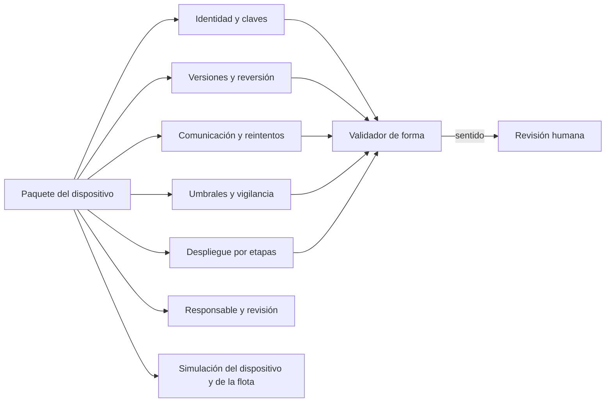
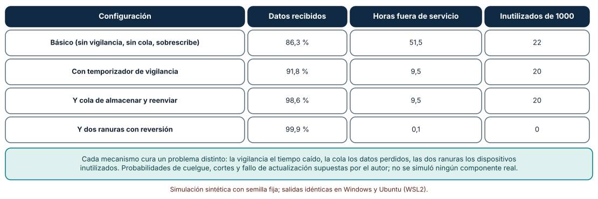
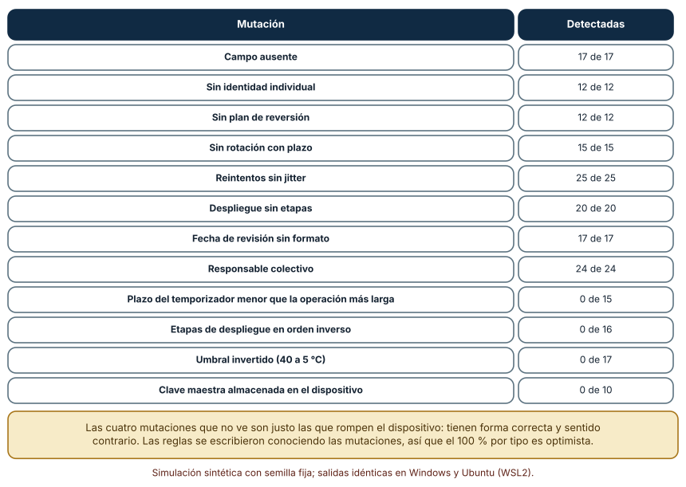
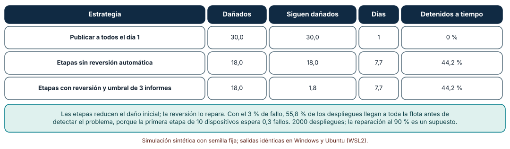

# SE-276 — Proyecto: dispositivo simulado operable y actualizable

[← SE-275 — Taller: modelar fallos físicos y digitales](https://github.com/vladimiracunadev-create/modern-software-engineering-program/blob/main/classes/part-22-embedded-iot-y-tiempo-real/se-275-taller-modelar-fallos-fisicos-y-digitales/README.md) · [↑ Parte 22](https://github.com/vladimiracunadev-create/modern-software-engineering-program/blob/main/classes/part-22-embedded-iot-y-tiempo-real/README.md) · [📚 Índice completo](https://github.com/vladimiracunadev-create/modern-software-engineering-program/blob/main/classes/README.md) · [🌐 Portal](https://vladimiracunadev-create.github.io/modern-software-engineering-program/classes/SE-276.html) · [SE-277 — Software científico y reproducibilidad →](https://github.com/vladimiracunadev-create/modern-software-engineering-program/blob/main/classes/part-23-software-especializado-y-dominios/se-277-software-cientifico-y-reproducibilidad/README.md)

## Punto profesional y fundamento pedagógico

**Punto profesional.** El proyecto entrega un dispositivo simulado que se puede operar y actualizar: un paquete que reúne identidad, versiones, reversión, reintentos, despliegue por etapas, umbrales y un responsable, un validador que dice qué cubre y qué no, y una simulación de un mes y de una flota que muestra qué aporta cada defensa.

**Por qué aparece aquí.** Cierra la **Parte 22**: reúne el nodo y su firmware (`SE-265` y `SE-266`), el presupuesto (`SE-267`), los plazos y los datos compartidos (`SE-268` y `SE-269`), la comunicación (`SE-270`), la actualización (`SE-271`), la identidad (`SE-272`), el procesamiento en el borde (`SE-273`), las defensas (`SE-274`) y el modelo de fallos (`SE-275`). La Parte 23 pasa del dispositivo a los dominios especializados.

**Error conceptual que debe corregir.** Creer que un dispositivo es operable porque funciona en la mesa, o que un paquete que pasa un validador de forma está bien: el dispositivo es operable cuando tolera fallos de red, cuelgues y actualizaciones, y el paquete puede ser coherente en forma y peligroso en sentido.

**Secuencia de aprendizaje.** Antes de simular, predices cuánto aporta cada defensa a un dispositivo durante un mes; después simulas mil dispositivos con cuatro configuraciones, pasas un paquete por un validador con 200 mutaciones y repites un despliegue a mil dispositivos con una versión defectuosa. La secuencia usa predicción, explicación propia, contraste y recuperación. [ICAP](https://icap.education.asu.edu/research) distingue participación de construcción de conocimiento; [How People Learn II](https://nap.nationalacademies.org/catalog/24783/how-people-learn-ii-learners-contexts-and-cultures) exige conectar conocimiento previo, contexto y transferencia; la [práctica de recuperación](https://pubmed.ncbi.nlm.nih.gov/16507066/) respalda producir de nuevo la explicación tras una demora; y [Education for Life and Work](https://nap.nationalacademies.org/resource/13398/dbasse_084153.pdf) exige devolución que explique la causa del error.

**Evidencia de aprendizaje.** `device-package-log.md` con el paquete en nueve secciones, la predicción, las tres tablas, la configuración elegida con su costo y la lista de lo que el validador no ve.

**Límite de la conclusión.** Las probabilidades de cuelgue, los cortes de red, el fallo de la actualización del 3 %, el informe del 90 %, la reparación del 90 % y las 200 mutaciones son construcciones del autor. No se simuló ningún componente real ni se actualizó ningún dispositivo; el validador se afinó con los mismos casos que lo evalúan.

### Trazabilidad fuente → afirmación

| Fuente primaria u oficial | Afirmación que respalda | Lo que no prueba |
|---|---|---|
| [Moran et al., RFC 9019: A Firmware Update Architecture for Internet of Things](https://www.rfc-editor.org/rfc/rfc9019) | Fija los requisitos de una arquitectura de actualización de firmware: integridad, autenticidad, tolerancia a fallos y recuperación. | No fija la estrategia concreta del paquete. |
| [NISTIR 8259A: IoT Device Cybersecurity Capability Core Baseline](https://csrc.nist.gov/pubs/ir/8259/a/final) | Enumera capacidades que un dispositivo IoT debería ofrecer: identificación, configuración, protección de datos, actualización y registro. | No certifica un paquete ni prescribe valores. |
| [ETSI EN 303 645](https://www.etsi.org/deliver/etsi_en/303600_303699/303645/) | Fija requisitos básicos de ciberseguridad para IoT de consumo, como credenciales únicas, actualización segura y periodo de soporte. | Un requisito no es una prueba de cumplimiento. |
| [Nygard, «Documenting architecture decisions» (2011)](https://cognitect.com/blog/2011/11/15/documenting-architecture-decisions) | Propone registros breves de decisiones con contexto y consecuencias, útiles para el paquete. | No mide su efecto en la operación. |

## Antes de empezar

El proyecto usa como insumos los artefactos de la parte: el nodo con su latencia y condiciones de ancho, el presupuesto, el análisis de plazos y datos compartidos, la política de comunicación, el plan de actualización, la política de identidad, la asignación al borde, el análisis de peligros y el modelo de fallos. La pregunta activa es: **¿puede otra persona operar y actualizar este dispositivo sin pedirme contexto, y qué le hace falta saber que ningún validador le dirá?**

## Prerrequisitos

- Haber completado `SE-275` o poder explicar el modelo de fallos del nodo.
- Python 3.11 o posterior y un terminal; todo el código usa solo la biblioteca estándar.
- Disponer de los artefactos de las clases anteriores o de datos sintéticos equivalentes.

## Problema auténtico

La plataforma de entregas debe pasar de un prototipo de mesa a 200 nodos operados por personas que no los construyeron. Cada nodo tiene mil decisiones pequeñas escritas en lugares distintos: el esquema de claves en un documento, los reintentos en el código, el plan de actualización en la cabeza de alguien, los umbrales en una hoja. La persona de operaciones pregunta qué hacer si un nodo no responde, si una versión falla o si caduca una clave. Nadie tiene un solo lugar donde mirar.

## Objetivos observables

Al terminar podrás:

1. reunir las decisiones de un dispositivo en un paquete con identidad, versiones, reversión, claves, umbrales, reintentos, despliegue, vigilancia, responsable y revisión;
2. medir con una simulación qué aporta cada defensa (vigilancia, cola, dos ranuras) a un dispositivo durante un mes;
3. validar la forma del paquete con mutaciones y declarar lo que el validador no ve;
4. separar, en un despliegue simulado, el efecto de las etapas del efecto de la reversión automática;
5. entregar un paquete que otra persona pueda operar y reproducir.

## Mapa conceptual



El mapa muestra el paquete como el punto donde confluyen las decisiones de la parte. El validador comprueba la forma; la revisión humana, el sentido; la simulación, el efecto de cada defensa.

## Temas y por qué importan

| Tema | Por qué cambia una decisión profesional | Evidencia mínima |
|---|---|---|
| Paquete del dispositivo | Reúne decisiones dispersas en un lugar revisable. | Predicción, traza causal y contraejemplo de **Paquete del dispositivo** en `device-package-log.md` |
| Operabilidad | Un dispositivo operable tolera cortes, cuelgues y actualizaciones sin visita. | Predicción, traza causal y contraejemplo de **Operabilidad** en `device-package-log.md` |
| Validación de forma | Libera la revisión humana para el sentido. | Predicción, traza causal y contraejemplo de **Validación de forma** en `device-package-log.md` |
| Efecto de cada defensa | Cada defensa cura un problema distinto y tiene un costo. | Predicción, traza causal y contraejemplo de **Efecto de cada defensa** en `device-package-log.md` |
| Despliegue y reversión | Etapas y reversión son decisiones separadas con efectos separables. | Predicción, traza causal y contraejemplo de **Despliegue y reversión** en `device-package-log.md` |

## Conceptos y decisiones

### 1. Paquete del dispositivo

El paquete es un documento que dice, en nueve secciones, cómo se identifica el dispositivo, qué versión corre y cómo vuelve atrás, cómo rota sus claves, qué umbrales usa, cómo reintenta, cómo se despliega una versión, cuál es el plazo de su temporizador de vigilancia, quién responde por él y cuándo se revisa. No sustituye al código: lo hace revisable. Sigue el espíritu de NISTIR 8259A, que enumera capacidades que un dispositivo debe ofrecer, y de los registros breves de decisión de Nygard.

### 2. Operabilidad

Un dispositivo es operable si una persona que no lo construyó puede mantenerlo vivo durante años: sabe cómo se actualiza, qué pasa cuando falla, cómo se retira una clave y cómo se detecta que dejó de enviar. Operabilidad es el conjunto de las defensas de la parte vistas desde quien las usa. Sin ella, cada incidente exige a quien lo construyó.

### 3. Validación de forma

Un validador de forma comprueba que cada sección existe y tiene la estructura esperada: un identificador único, una ranura de reversión, un plazo de rotación, umbrales numéricos, reintentos con jitter, etapas con porcentajes, un plazo de vigilancia, un responsable con nombre y una fecha de revisión. No sabe si el plazo de vigilancia es menor que la operación más larga, si las etapas están en orden creciente ni si el secreto maestro vive en el dispositivo. Esas son las comprobaciones de sentido y requieren leer.

### 4. Efecto de cada defensa

Cada defensa cura una enfermedad distinta: el temporizador de vigilancia reduce el tiempo caído; la cola de almacenar y reenviar, los datos perdidos por cortes de red; las dos ranuras, los dispositivos inutilizados por una actualización. Medirlas en conjunto, de forma acumulativa, muestra qué aporta cada una y cuánto falta. La simulación no tiene valor de predicción: tiene valor de comparación, y sus parámetros se declaran.

### 5. Despliegue y reversión

Las etapas limitan cuántos dispositivos ven una versión defectuosa antes de que se detenga. La reversión automática repara a los que ya la recibieron. Son dos decisiones: se pueden tener etapas sin reversión (se detiene pero los dañados siguen dañados) o reversión sin etapas (se repara después de dañar a todos). Medirlas por separado evita atribuir a las etapas lo que hizo la reversión.

### Un mes de mil dispositivos con cuatro configuraciones

Cada dispositivo simulado vive 30 días con un minuto como paso. La red alterna entre conectada (media 600 min) y caída (media 45 min); un cuelgue ocurre en promedio una vez al mes; la actualización del día 10 tiene un 3 % de probabilidad de dejar inservible un dispositivo sin dos ranuras. Se comparan cuatro configuraciones acumulativas: básica, con temporizador de vigilancia de 6 min, con cola de almacenar y reenviar de hasta 240 muestras y con dos ranuras con reversión.

```python
if m > hung_until and rng.random() < 1 / (30 * 1440):
    hung_until = m + (cfg["wd"] if cfg["wd"] else 2 * 1440)
```

| Configuración | Datos recibidos | Horas fuera de servicio | Inutilizados de 1000 |
|---|---:|---:|---:|
| Básico (sin vigilancia, sin cola, sobrescribe) | 86,3 % | 51,5 | 22 |
| Con temporizador de vigilancia | 91,8 % | 9,5 | 20 |
| Y cola de almacenar y reenviar | 98,6 % | 9,5 | 20 |
| Y dos ranuras con reversión | 99,9 % | 0,1 | 0 |

Resultado, idéntico en Windows (CPython 3.12.9) y en Ubuntu bajo WSL2 (3.12.3). La vigilancia reduce las horas fuera de servicio de 51,5 a 9,5; la cola sube los datos recibidos de 91,8 % a 98,6 %; las dos ranuras eliminan los dispositivos inutilizados.



**Cómo leer la figura.** Cada fila añade una defensa a la anterior; las columnas muestran qué mejora cada una. **Dónde deja de valer:** las probabilidades (cuelgue mensual, cortes de red, fallo de la actualización del 3 %) son supuestos; con otros valores las proporciones cambian. Cada defensa tiene además costos que la simulación no cuenta: memoria para dos ranuras, energía para la cola, reinicios falsos de la vigilancia (`SE-274`).

### Un validador de paquetes y las cuatro mutaciones que no ve

Se construye un paquete correcto con nueve secciones y un validador de forma. Se generan 200 mutaciones con semilla fija de doce tipos: ocho de forma (campo ausente, sin identidad individual, sin plan de reversión, sin rotación con plazo, reintentos sin jitter, despliegue sin etapas, fecha sin formato, responsable colectivo) y cuatro de sentido.

```python
if "Reintentos" in p and not re.search(r"jitter", p["Reintentos"], re.I): e.add("reintentos sin jitter")
if "Despliegue" in p and not re.search(r"\d+\s*%", p["Despliegue"]): e.add("despliegue sin etapas")
```

| Mutación | Detectadas |
|---|---:|
| Campo ausente | 17 de 17 |
| Sin identidad individual | 12 de 12 |
| Sin plan de reversión | 12 de 12 |
| Sin rotación con plazo | 15 de 15 |
| Reintentos sin jitter | 25 de 25 |
| Despliegue sin etapas | 20 de 20 |
| Fecha de revisión sin formato | 17 de 17 |
| Responsable colectivo | 24 de 24 |
| Plazo del temporizador menor que la operación más larga | 0 de 15 |
| Etapas de despliegue en orden inverso | 0 de 16 |
| Umbral invertido (40 a 5 °C) | 0 de 17 |
| Clave maestra almacenada en el dispositivo | 0 de 10 |

El validador detecta 142 de 200 mutaciones y ninguna de las 58 que cambian el sentido. Las cuatro categorías no detectadas rompen el dispositivo: un temporizador que reinicia durante una operación legítima, etapas que empiezan por el 100 %, un umbral que nunca se cumple, una clave maestra al alcance de quien abre un nodo.



**Cómo leer la figura.** Cada fila es un tipo de mutación y las veces que el validador la detectó. **Dónde deja de valer:** las 200 mutaciones son sintéticas y repartidas al azar entre doce tipos; las reglas se escribieron conociendo las mutaciones, así que el 100 % por tipo es optimista. Un paquete real falla de maneras que nadie previó. El 71 % de detección es una cifra de este montaje.

### Mil dispositivos y una versión defectuosa

Una versión nueva daña al 3 % de 1000 dispositivos; cada dispositivo dañado informa con probabilidad 0,9. Tres estrategias: publicar a todos el día 1; etapas de 1 %, 10 % y 100 % cada tres días que se detienen con tres informes; y esas mismas etapas con reversión automática que repara al 90 % de los dañados. Se simulan 2000 despliegues.

```python
reports = sum(rng.random() < 0.9 for _ in range(fails))
if reports >= 3 and fr < 1.0: return harmed, day, True
```

| Estrategia | Dañados | Siguen dañados | Días | Detenidos a tiempo |
|---|---:|---:|---:|---:|
| Publicar a todos el día 1 | 30,0 | 30,0 | 1 | 0 % |
| Etapas sin reversión automática | 18,0 | 18,0 | 7,7 | 44,2 % |
| Etapas con reversión y umbral de 3 informes | 18,0 | 1,8 | 7,7 | 44,2 % |

Las etapas bajan el daño inicial de 30 a 18 y la reversión baja los que siguen dañados a 1,8. Aun así, el 55,8 % de los despliegues llegan a toda la flota antes de detectarse, porque la primera etapa de 10 dispositivos espera 0,3 fallos con un 3 % de fallo.



**Cómo leer la figura.** Cada fila es una estrategia; la comparación entre las dos últimas aísla el efecto de la reversión. **Dónde deja de valer:** el 3 % de fallo, el informe del 90 %, la reparación del 90 % y la independencia de los fallos son supuestos; una flota de 200 nodos tiene etapas aún menores. La figura no dice que las etapas basten: dice que sin una primera etapa suficiente y sin reversión, el daño llega y queda.

## Definiciones de trabajo

- **paquete del dispositivo:** documento que reúne las decisiones de identidad, versiones, reversión, claves, umbrales, reintentos, despliegue, vigilancia, responsabilidad y revisión de un dispositivo.
- **operabilidad:** capacidad de un dispositivo de ser mantenido durante su vida útil por personas que no lo construyeron.
- **reversión automática:** regreso a la versión anterior sin intervención humana cuando la nueva no confirma su arranque.
- **validador de forma:** programa que comprueba la estructura de un documento sin entender su sentido.
- **gemelo simulado:** modelo ejecutable de un dispositivo o una flota usado para comparar decisiones sin hardware.

Las definiciones son operativas para el nodo de la sala. No convierten términos con una historia más amplia en sinónimos y deben contrastarse con la documentación primaria enlazada al final.

## Ejemplo mínimo

El fragmento valida que una lista de etapas es creciente y termina en el 100 %. Antes de ejecutarlo, predice si el paquete con etapas invertidas lo pasa.

```python
def etapas_validas(etapas):
    return etapas == sorted(etapas) and etapas[-1] == 100
assert etapas_validas([1, 10, 100]) and not etapas_validas([100, 10, 1])
```

El validador de forma de la clase no incluye esta regla y no ve el orden inverso; añadirla es el siguiente paso. Registra versión, comando y salida; añade una regla para el plazo del temporizador y una mutación que la ponga a prueba.

## Ejemplo profesional

El equipo de la plataforma entrega el paquete de los 200 nodos con nueve secciones. La identidad es una clave derivada por dispositivo desde un secreto maestro que nunca está en el nodo. El firmware tiene dos ranuras con reversión a los 60 s. Las claves se rotan cada doce meses con una lista de revocación. Los umbrales son de 5 a 40 °C con variación máxima de 3 °C por muestra y una referencia independiente de CO₂. Los reintentos usan espera exponencial con jitter completo entre 5 y 320 s. El despliegue es por etapas de 2, 20 y 200 nodos con parada ante un informe o un nodo que no confirma. El temporizador de vigilancia tiene un plazo de 5 s y las operaciones largas se parten en pasos de 200 ms. La persona responsable es la de operaciones de flota; la revisión es el 1 de diciembre. El validador de forma pasa el paquete, y una revisión humana confirma las cuatro comprobaciones de sentido.

Compara con el prototipo: la persona de operaciones sabe qué hacer si un nodo no responde, si una versión falla o si caduca una clave. Un paquete es adecuado cuando puede operarse sin su autor; es incompleto si su validación solo mira la forma.

## Práctica guiada

1. Reúne las decisiones de los artefactos de la parte en las nueve secciones del paquete.
2. Predice qué defensa aporta más a un dispositivo durante un mes y escribe la respuesta.
3. Simula un mes de mil dispositivos con las cuatro configuraciones.
4. Pasa el paquete por el validador y escribe tres mutaciones de sentido que no detecte.
5. Simula el despliegue de una versión defectuosa con y sin reversión.
6. Escribe una revisión humana de las comprobaciones de sentido.
7. Entrega `device-package-log.md` y pide a otra persona que encuentre una decisión del paquete sin comprobación.

## Ejercicios

1. **Defensas:** añade a la simulación una cuarta defensa (referencia independiente del sensor) y mide qué fallos silenciosos se detectan.
2. **Validador:** añade tres reglas de sentido (orden de etapas, plazo de vigilancia frente a la operación más larga, umbral no invertido) y mide cuántas mutaciones nuevas detecta.
3. **Despliegue:** calcula el tamaño de la primera etapa para que un fallo del 1 % se vea con tres informes y decide si es viable con 200 nodos.
4. **Operación:** escribe el procedimiento para un nodo que deja de enviar durante tres horas.

## Reto verificable

Entrega `device-package-log.md` con el paquete en nueve secciones, la predicción, las tres tablas, la configuración elegida con su costo y la lista de lo que el validador no ve. Se aprueba si otra persona ejecuta el código desde un checkout limpio, obtiene los mismos números y puede operar un incidente simulado solo con el paquete. No se aprueba por un paquete largo ni por una afirmación de que el validador garantiza el sentido.

## Caso conductor

El nodo ambiental de una sala de estudio cierra aquí su caso conductor de la Parte 22. El proyecto deja el duodécimo artefacto: el paquete del dispositivo operable y actualizable, con su validador, su simulación y sus límites, que reúne los once anteriores. La Parte 23 deja el dispositivo y pasa a los dominios especializados, empezando por el software científico y la reproducibilidad. Cambia después una sola decisión, el tamaño de la primera etapa, y observa qué fallos dejan de detectarse.

## Preguntas frecuentes

### ¿Un paquete no duplica la documentación?

Reúne y referencia las decisiones; no las reescribe. Su valor es que está en un solo lugar, con responsable y revisión, y que se valida.

### ¿Cuánto cuesta tener dos ranuras?

El doble de memoria de firmware, y a cambio ningún dispositivo inutilizable por una actualización. Se decide con el presupuesto de `SE-267` y el costo de una visita física.

### ¿Cómo mantengo el paquete actualizado?

Con una revisión fechada, una regla que obligue a actualizarlo con cada cambio de versión y un validador que falle si falta una sección.

### ¿Qué hago con lo que el validador no ve?

Lo revisa una persona con una lista de comprobaciones de sentido y, cuando sea posible, una prueba que lo cubra (por ejemplo, una prueba que ejecute el despliegue con etapas simuladas).

## Fallo controlado y diagnóstico

Reproduce el fallo clásico de la clase: **un paquete que pasa el validador y tiene las etapas al revés**. Genera el paquete con etapas «100 %, 10 %, 1 %» y pásalo por el validador de forma.

Registra síntoma, entrada mínima, hipótesis, observación que descarta cada hipótesis, causa, corrección y prueba de regresión. **Síntoma:** una versión defectuosa llega a toda la flota antes de que nadie pueda detenerla. **Hipótesis rivales:** (a) el criterio de parada no funcionó; (b) los informes llegaron tarde; (c) las etapas estaban en orden inverso y el paquete lo permitía. **Prueba:** revisa el campo de despliegue: `etapas 100 %, 10 %, 1 %`; el validador de forma lo aprobó (0 de 16 detectadas). **Conclusión:** la causa es una regla de sentido que el validador no tiene. **Regresión:** añade la regla de orden creciente, una mutación que la pruebe y una revisión humana del campo. No cambies a la vez la regla y el criterio de parada.

## Errores comunes y cómo corregirlos

| Síntoma | Causa probable | Corrección |
|---|---|---|
| El paquete pasa el validador y falla en la flota | Validador de forma sin reglas de sentido | Añadir reglas de sentido y una revisión humana |
| Nadie sabe qué hacer ante un nodo mudo | Sin procedimiento operativo | Escribir los procedimientos de los incidentes frecuentes |
| Una versión defectuosa llega a toda la flota | Primera etapa pequeña o sin reversión | Dimensionar la etapa por el fallo a detectar y automatizar la reversión |
| El paquete queda obsoleto | Sin revisión fechada | Revisar con cada cambio de versión y validar |
| La simulación se toma como predicción | Parámetros supuestos | Declarar los supuestos y compararlos con la operación real |

## Entorno y archivos clave

```text
work/SE-276/
├── README.md
├── paquete/
│   ├── paquete.md
│   ├── validador.py
│   └── simulacion.py
├── tests/test_paquete.py
└── evidence/device-package-log.md
```

El `README` declara plataforma, versión de Python, semillas y comandos. Los experimentos usan solo la biblioteca estándar (`random`, `statistics`, `re`, `collections`) y se ejecutaron con CPython 3.12.9 en Windows 11 y 3.12.3 en Ubuntu bajo WSL2: las salidas fueron idénticas. Si añades una dependencia, fija procedencia y versión.

## Seguridad, ética y accesibilidad

- el paquete no debe contener secretos ni claves reales: referencia dónde viven, no su valor;
- el periodo de soporte debe comunicarse a quien usa el dispositivo y debe haber una forma de desconectarlo de forma segura al terminar;
- las alarmas deben ser perceptibles por más de un canal y funcionar sin red;
- documenta quién puede detener un despliegue y quién aprueba una excepción;
- respeta las licencias de las herramientas de simulación y atribuye lo adaptado.

## Puente hacia el trabajo con agentes

Un agente al que se le pide «prepara el dispositivo para producción» generará una configuración plausible y un paquete que pasa un validador de forma. Pídele que aplique también las reglas de sentido (orden de etapas, plazo de vigilancia frente a la operación más larga, umbral coherente, ubicación del secreto), que simule el efecto de cada defensa y que liste lo que no pudo comprobar. Revisa especialmente si la clave maestra aparece en el firmware o si las etapas empiezan por el 100 %: son dos fallos que la forma no ve.

## Transferencia

Traslada el proyecto a otro dispositivo (por ejemplo, un medidor de agua con red de largo alcance): cambia el hardware, la red y el plazo de vida, y conserva el procedimiento de reunir el paquete, validar su forma, revisar su sentido y simular el efecto de cada defensa. La transferencia está lograda cuando puedes explicar qué parte del paquete dependía del dispositivo y cuál no, no cuando las secciones se parecen.

## Evaluación y evidencia

| Criterio | Evidencia para aprobar |
|---|---|
| comprensión | explicación de qué aporta cada defensa y de qué mide un validador de forma |
| corrección | tablas y mutaciones reproducibles con las mismas semillas |
| diseño | paquete en nueve secciones operable por otra persona |
| diagnóstico | reproducción del fallo «etapas al revés» con regresión |
| incertidumbre | declaración de los supuestos de la simulación y de lo que el validador no ve |
| reproducibilidad | versiones, comandos, salida y límites declarados |

## Fuentes

- [Moran et al., RFC 9019: A Firmware Update Architecture for Internet of Things](https://www.rfc-editor.org/rfc/rfc9019) — requisitos de una arquitectura de actualización; autoridad: IETF.
- [NISTIR 8259A: IoT Device Cybersecurity Capability Core Baseline](https://csrc.nist.gov/pubs/ir/8259/a/final) — capacidades de un dispositivo IoT; autoridad: NIST.
- [ETSI EN 303 645](https://www.etsi.org/deliver/etsi_en/303600_303699/303645/) — requisitos básicos de ciberseguridad para IoT de consumo; autoridad: ETSI.
- [Nygard, «Documenting architecture decisions» (2011)](https://cognitect.com/blog/2011/11/15/documenting-architecture-decisions) — registros breves de decisiones; autoridad: autor de la práctica.
- [SWEBOK Guide v4.0a](https://www.computer.org/education/bodies-of-knowledge/software-engineering) — áreas de conocimiento de ingeniería de software; autoridad: IEEE Computer Society.
- [Python: `re`](https://docs.python.org/3/library/re.html) — expresiones regulares del validador; autoridad: documentación de Python.

Cada fuente respalda el mecanismo indicado; ninguna demuestra que el 99,9 % de datos recibidos, el 71 % de detección del validador o los 1,8 dispositivos que siguen dañados se observen en la plataforma de entregas. Esa afirmación depende del hardware, de la red y de las decisiones de quien opera.

## Límites y siguiente paso

Se ejecutaron tres simulaciones con datos sintéticos en Windows y Ubuntu (WSL2) con resultados idénticos. No se simuló ningún componente real ni se actualizó un dispositivo: las probabilidades de cuelgue, de corte y de fallo, el informe y la reparación del 90 % y las 200 mutaciones son construcciones del autor, y el validador se afinó con los mismos casos que lo evalúan. La Parte 23 pasa del dispositivo a los dominios especializados, y empieza por el software científico y la reproducibilidad.

## Glosario

- **paquete del dispositivo:** documento que reúne las decisiones de identidad, versiones, reversión, claves, umbrales, reintentos, despliegue, vigilancia, responsabilidad y revisión de un dispositivo.
- **operabilidad:** capacidad de un dispositivo de ser mantenido durante su vida útil por personas que no lo construyeron.
- **reversión automática:** regreso a la versión anterior sin intervención humana cuando la nueva no confirma su arranque.
- **validador de forma:** programa que comprueba la estructura de un documento sin entender su sentido.
- **gemelo simulado:** modelo ejecutable de un dispositivo o una flota usado para comparar decisiones sin hardware.

---

[← SE-275 — Taller: modelar fallos físicos y digitales](https://github.com/vladimiracunadev-create/modern-software-engineering-program/blob/main/classes/part-22-embedded-iot-y-tiempo-real/se-275-taller-modelar-fallos-fisicos-y-digitales/README.md) · [↑ Parte 22](https://github.com/vladimiracunadev-create/modern-software-engineering-program/blob/main/classes/part-22-embedded-iot-y-tiempo-real/README.md) · [📚 Índice completo](https://github.com/vladimiracunadev-create/modern-software-engineering-program/blob/main/classes/README.md) · [🌐 Portal](https://vladimiracunadev-create.github.io/modern-software-engineering-program/classes/SE-276.html) · [SE-277 — Software científico y reproducibilidad →](https://github.com/vladimiracunadev-create/modern-software-engineering-program/blob/main/classes/part-23-software-especializado-y-dominios/se-277-software-cientifico-y-reproducibilidad/README.md)

