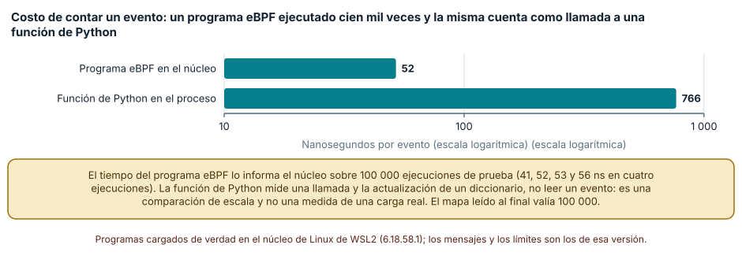

# SE-279 — eBPF: observabilidad, red y seguridad en el kernel

[← SE-278 — WebAssembly en servidor y borde: component model](https://github.com/vladimiracunadev-create/modern-software-engineering-program/blob/main/classes/part-23-runtimes-y-plataformas-modernas/se-278-webassembly-en-servidor-y-borde-component-model/README.md) · [↑ Parte 23](https://github.com/vladimiracunadev-create/modern-software-engineering-program/blob/main/classes/part-23-runtimes-y-plataformas-modernas/README.md) · [📚 Índice completo](https://github.com/vladimiracunadev-create/modern-software-engineering-program/blob/main/classes/README.md) · [🌐 Portal](https://vladimiracunadev-create.github.io/modern-software-engineering-program/classes/SE-279.html) · [SE-280 — GPU y aceleradores: modelo de ejecución →](https://github.com/vladimiracunadev-create/modern-software-engineering-program/blob/main/classes/part-23-runtimes-y-plataformas-modernas/se-280-gpu-y-aceleradores-modelo-de-ejecucion/README.md)

## Punto profesional y fundamento pedagógico

**Punto profesional.** La clase existe para que entiendas eBPF como lo que es en la práctica: un mecanismo para cargar programas pequeños en el núcleo de Linux sin recompilarlo ni reiniciarlo, con un verificador que decide antes de ejecutar si el programa es seguro. De ahí salen la observabilidad sin modificar la aplicación, el filtrado de paquetes a velocidad de línea y buena parte de la seguridad en tiempo de ejecución de plataformas de contenedores. Quien lo usa sin entender el verificador escribe programas que «funcionan en mi máquina» y fallan al cargarlos en otro núcleo; quien lo entiende sabe qué puede pedirle, qué no puede y qué sigue dependiendo de la confianza en quien carga.

**Por qué aparece aquí.** Sigue a `SE-278` con un runtime de naturaleza distinta: no aísla a un tercero dentro de tu proceso sino que te deja ejecutar tu propio código dentro del sistema operativo. Retoma `SE-019` (procesos, interrupciones y entrada/salida) y `SE-493` (señales y observabilidad útil) solo como idea, y prepara `SE-282` (aislamiento) y `SE-286` (confianza cero), porque muchas implementaciones de ambos usan eBPF.

**Error conceptual que debe corregir.** Creer que el verificador «detecta los bucles infinitos». No los detecta: explora todos los caminos posibles del programa con un presupuesto de complejidad y rechaza lo que no puede demostrar acotado. En el experimento, un bucle sin salida no recibió un mensaje de «bucle infinito» sino «el programa es demasiado grande: se procesaron 1 000 001 instrucciones» con un límite de un millón. Y un programa que parecía inseguro (leer un valor de un mapa sin comprobar si es nulo) fue aceptado, porque el verificador sabía que con esa clave constante la búsqueda no puede fallar.

**Secuencia de aprendizaje.** Antes de ejecutar, predices qué programas rechazará el verificador y con qué mensaje. Después cargas en un núcleo real nueve programas de ensamblador escritos a mano, lees el mensaje del verificador de cada uno, ejecutas el que acepta cien mil veces con el servicio de pruebas del núcleo y lees el contador desde el espacio de usuario.

**Evidencia de aprendizaje.** `ebpf-verificador.md` con el programa de cada caso, el veredicto, el mensaje literal del verificador, la lectura del mapa y el tiempo medio por ejecución, más una lista de lo que no se ejecutó.

**Límite de la conclusión.** El experimento corrió como administrador en WSL2 (núcleo `6.18.58.1-microsoft-standard-WSL2`, x86-64, Python 3.12.3), cargando programas de tipo filtro de socket con la llamada de sistema `bpf` y ejecutándolos con `BPF_PROG_TEST_RUN`. **No se ejecutó** ningún programa enlazado a un punto real de tráfico, de rastreo o de seguridad (XDP, kprobes, tracepoints, LSM), ningún programa compilado desde C con `clang`, ninguna herramienta como `bpftrace` o `bcc`, ni ningún despliegue en un clúster. Los mensajes del verificador son los de ese núcleo y varían entre versiones. No se invocó ningún modelo de lenguaje.

### Trazabilidad fuente → afirmación

| Fuente primaria u oficial | Afirmación que respalda | Lo que no prueba |
|---|---|---|
| [ebpf.io: «What is eBPF?»](https://ebpf.io/what-is-ebpf/) | Describe eBPF como programas ejecutados en el núcleo tras una verificación, con mapas y ayudantes. | No describe una versión concreta del núcleo. |
| [Documentación del núcleo: verificador de BPF](https://docs.kernel.org/bpf/verifier.html) | Define qué comprueba el verificador (registros inicializados, acceso a memoria, límites de complejidad, retorno). | No enumera los mensajes de todas las versiones. |
| [Documentación del núcleo: BPF](https://docs.kernel.org/bpf/) y [mapas](https://docs.kernel.org/bpf/maps.html) | Documenta los tipos de programa y de mapa. | No dice qué programa conviene a tu carga. |
| [`bpf(2)`](https://man7.org/linux/man-pages/man2/bpf.2.html) | Documenta las órdenes `BPF_PROG_LOAD`, `BPF_MAP_CREATE`, `BPF_MAP_LOOKUP_ELEM` y `BPF_PROG_TEST_RUN`. | No garantiza que tu núcleo las permita. |
| [`seccomp_filter`](https://docs.kernel.org/userspace-api/seccomp_filter.html) | Muestra que el filtrado de llamadas de sistema usa un lenguaje BPF clásico, ligado al tema del aislamiento. | No describe eBPF extendido. |

## Antes de empezar

Recupera lo aprendido en `SE-019`: una llamada de sistema cruza de espacio de usuario a espacio de núcleo y eso tiene un costo. La pregunta activa es: **si pudieras ejecutar un fragmento de código dentro del núcleo en cada paquete o en cada llamada de sistema, ¿qué tendría que garantizarte el sistema para que no se cayera toda la máquina cuando tu fragmento tuviera un error?**

## Prerrequisitos

- Haber completado `SE-277` y `SE-278`, y conocer de `SE-019` la frontera entre espacio de usuario y de núcleo.
- Poder abrir WSL2 con una distribución Linux o tener un Linux con permisos de administrador. Sin eso el experimento imprime `NO EJECUTADO` y la clase se estudia con la salida incluida.
- Leer un ensamblador mínimo: registros, saltos, carga y almacenamiento. Las instrucciones eBPF son de 8 bytes y se ensamblan a mano en el laboratorio sin compilador.
- Python 3.11 o posterior; el experimento usa solo `ctypes` de la biblioteca estándar.

## Problema auténtico

Una universidad cliente de *Avisos* reporta que, por la noche, algunas entregas de avisos llegan con retraso. El equipo sospecha del servicio de correo, pero no puede añadir trazas al servicio sin desplegarlo, y el problema no se reproduce fuera de producción. Pregunta: ¿cuántos paquetes salen hacia el servidor de correo por minuto y cuántos se reintentan? Con herramientas tradicionales hay dos caminos malos: modificar la aplicación o capturar todos los paquetes y analizarlos después. Con eBPF hay un tercero: cargar en el núcleo un programa de unas decenas de instrucciones que cuenta lo que interesa en un mapa y leer ese mapa desde fuera, sin reiniciar nada.

La clase hace una versión mínima de ese tercer camino sobre un núcleo real: ensambla programas, pide al verificador que los acepte o los rechace, lee sus mensajes, ejecuta uno cien mil veces y lee el contador. Con eso se ve de dónde viene la promesa (seguridad comprobada antes de ejecutar) y dónde están sus límites (presupuesto de complejidad, dependencia del núcleo, privilegios necesarios).

## Objetivos observables

Al terminar podrás:

1. describir el ciclo de vida de un programa eBPF (carga, verificación, compilación a código nativo, enganche, mapas, lectura desde el espacio de usuario);
2. leer un mensaje del verificador y relacionarlo con la regla que viola (registro sin inicializar, acceso fuera de rango, falta de comprobación de nulo, falta de salida, exceso de complejidad);
3. explicar por qué el verificador no «detecta bucles infinitos» sino que impone un presupuesto de análisis, y qué consecuencia tiene para escribir bucles;
4. explicar qué permite y qué no permite un mapa, y por qué las búsquedas devuelven un puntero posiblemente nulo;
5. decidir cuándo eBPF es la herramienta adecuada frente a un cambio en la aplicación, un módulo del núcleo o una captura de paquetes, y qué privilegios exige.

## Mapa conceptual


El único camino hacia la ejecución pasa por el verificador. Los mapas son el canal de datos entre el núcleo y el espacio de usuario; el programa nunca llama a una función arbitraria del núcleo, solo a un conjunto de ayudantes conocidos.

## Temas y por qué importan

| Tema | Por qué cambia una decisión profesional | Evidencia mínima |
|---|---|---|
| Verificador | Es la garantía de seguridad: se comprueba antes de ejecutar. | Nueve programas con su mensaje |
| Presupuesto de complejidad | Un bucle «correcto» puede rechazarse por exceso de caminos. | Rechazo a 1 000 001 instrucciones |
| Mapas y nulos | Toda búsqueda puede fallar y el programa debe comprobarlo. | Rechazo sin comprobación de nulo |
| Aceptación por conocimiento | El verificador acepta lo que puede demostrar, aunque parezca inseguro. | Caso con clave constante aceptado |
| Costo por ejecución | Justifica o no el uso frente a una llamada desde el espacio de usuario. | Nanosegundos por ejecución |
| Privilegios | Cargar exige capacidades del sistema, y eso es una decisión de seguridad. | Ejecución como administrador |
| Qué no se ejecutó | Evita afirmar sobre XDP, rastreo o seguridad sin evidencia. | Lista de lo no ejecutado |

## Conceptos y decisiones

### 1. El ciclo de vida de un programa

Un programa eBPF es una secuencia de instrucciones de 8 bytes (con una excepción de 16 para cargar constantes de 64 bits) para una máquina de registros: diez registros de 64 bits, `r0` para el valor de retorno, `r1` a `r5` para los argumentos, `r10` como puntero de solo lectura a una pila de 512 bytes. Se carga con la llamada de sistema `bpf` y la orden `BPF_PROG_LOAD`, que recibe el tipo de programa, las instrucciones, la licencia y un búfer donde el núcleo escribe el registro del verificador. Si el verificador acepta, el núcleo compila el programa a instrucciones nativas (compilación JIT, habilitada en el núcleo del laboratorio) y devuelve un descriptor de archivo. Después se *engancha* a un punto (un socket, una interfaz de red, una función del núcleo, un punto de rastreo) y se ejecuta cada vez que ese punto se activa. El laboratorio usa el tipo «filtro de socket» y la orden `BPF_PROG_TEST_RUN`, que ejecuta el programa sobre un paquete de prueba sin enganchar nada a tráfico real: es la forma más segura de probar una carga y la razón por la que el experimento no toca la red.

### 2. Qué comprueba el verificador

La documentación del núcleo lo describe como un análisis estático que recorre todos los caminos de ejecución posibles y mantiene, para cada registro, qué tipo de valor puede contener y en qué rango. Comprueba que ningún registro se lea antes de escribirse, que cada acceso a memoria caiga dentro de la región a la que el puntero tiene derecho, que todo camino termine en una salida, que solo se llamen ayudantes permitidos para ese tipo de programa y que el número de instrucciones exploradas no supere un límite. En el laboratorio se cargaron nueve programas y el núcleo respondió así.

- `r0 = r2; salir`, leyendo `r2` sin inicializar: rechazado con `R2 !read_ok` (el registro no se puede leer todavía), tras procesar 1 instrucción.
- Un programa sin instrucción de salida: rechazado con `last insn is not an exit or jmp`.
- Una búsqueda en un mapa con una clave variable y desreferencia sin comprobar el resultado: rechazado con `R0 invalid mem access 'map_value_or_null'`, tras 7 instrucciones. La búsqueda puede devolver nulo y el programa no lo comprobó.
- La misma búsqueda comprobando nulo pero leyendo en el desplazamiento 4 de un valor de 4 bytes: rechazado con `R0 min value is outside of the allowed memory range`.
- Un bucle `r0 = 0; r0 += 1; saltar atrás`: rechazado por complejidad (sección 3).
- Leer `ctx->len` de un paquete de prueba de 100 bytes: aceptado; el núcleo devolvió 86, no 100 (86 = 100 − 14, el tamaño de una cabecera Ethernet; la explicación es una hipótesis que no se contrastó con el código del núcleo).
- La desreferencia sin comprobar nulo con la clave constante 0 sobre un mapa de una entrada: **aceptada**, 7 instrucciones procesadas (se explica en la sección 4).
- El programa trivial `r0 = 42; salir`: aceptado, 2 instrucciones procesadas; el núcleo, al ejecutarlo, devolvió 42.
- Un contador con búsqueda y comprobación de nulo: aceptado, 10 instrucciones procesadas.

La enseñanza no es memorizar mensajes sino ver que cada uno nombra un registro y una regla. Leer el registro del verificador es la herramienta principal para escribir programas eBPF.

### 3. Un presupuesto de complejidad, no un detector de bucles

El programa `r0 = 0; r0 += 1; saltar a la instrucción anterior` es un bucle sin salida. El núcleo no respondió «bucle infinito»: respondió `BPF program is too large. Processed 1000001 insn` con un límite de 1 000 000. El verificador exploró el bucle iteración tras iteración hasta agotar su presupuesto. Dos consecuencias para el diseño. Primera: los bucles sí existen en eBPF moderno, pero solo los que el verificador logra demostrar acotados con el número de iteraciones que su análisis alcance; un bucle con un contador que el verificador no puede acotar se rechaza aunque el programador sepa que termina. Segunda: los programas deben pensarse con cotas explícitas (recorrer como máximo 16 elementos, con la cota escrita en el código), porque la cota que el programador «sabe» y la que el verificador puede demostrar son cosas distintas.

### 4. Los mapas y la comprobación de nulo

Un mapa es una estructura de datos del núcleo (arreglo, tabla hash, cola, entre otras) a la que el programa accede con ayudantes y el espacio de usuario con llamadas de sistema. La búsqueda en un mapa devuelve un puntero al valor *o nulo*. El verificador rastrea ese hecho: tras la búsqueda, `r0` tiene el tipo «valor de mapa o nulo» y cualquier desreferencia antes de compararlo con cero se rechaza. Es el mismo error que, en C, produce una caída en tiempo de ejecución; aquí se convierte en un rechazo en tiempo de carga. El caso que sorprende es el último de la lista: con una clave constante 0 sobre un mapa de arreglo de una entrada, la desreferencia sin comprobación fue **aceptada**. El núcleo del laboratorio sabe que la clave está dentro del rango del arreglo y que la búsqueda no puede fallar. Es un recordatorio de que lo que se acepta depende del análisis y de la versión; no conviene apoyarse en esa optimización, porque un cambio en la clave a un valor variable convierte el mismo programa en uno rechazado.

### 5. Costo por ejecución

El contador de la sección 2 se ejecutó 100 000 veces con `BPF_PROG_TEST_RUN`. El mapa, leído desde el espacio de usuario al terminar, valía 100 000: ninguna ejecución se perdió. El núcleo informa el tiempo medio por ejecución: 41, 52, 53 y 56 ns en cuatro ejecuciones del experimento, es decir, del orden de decenas de nanosegundos. Como referencia, la misma cuenta como llamada a una función de Python dentro de un proceso costó unos 770 ns. La comparación no es equivalente (el programa de eBPF no lee el paquete ni cruza de espacio) pero fija la escala: contar en el núcleo es órdenes de magnitud más barato que sacar el evento hacia el espacio de usuario para contarlo allí. Esa es la razón técnica de la observabilidad con eBPF: se agrega donde ocurre el evento y se exporta solo el resultado.

### 6. Qué exige y qué ofrece

Cargar programas eBPF exige capacidades del sistema (CAP_BPF y otras según el tipo; muchos sistemas desactivan además el uso por usuarios sin privilegios). El experimento corrió como administrador y el núcleo del laboratorio tenía desactivado el uso sin privilegios. Esa exigencia es una decisión de seguridad: un programa verificado no puede corromper la memoria del núcleo por un error propio, pero quien carga programas puede observar casi todo el sistema. Por eso las herramientas basadas en eBPF son una superficie de confianza que se audita: quién puede cargar, qué tipos de programa se permiten y cómo se firman o se registran las cargas. El verificador protege al sistema del programa; no protege al sistema de quien decide qué programa cargar.

### 7. Cuándo sí y cuándo no

eBPF es adecuado para observar o filtrar eventos de alta frecuencia donde sacarlos al espacio de usuario sería caro (paquetes, llamadas de sistema, eventos del planificador), para añadir comprobaciones de seguridad en puntos del núcleo sin escribir un módulo y para depurar en producción sin reiniciar. No es adecuado cuando el análisis exige estructuras complejas o bucles no acotados, cuando la versión de núcleo de la flota es heterogénea y no se puede garantizar el mismo comportamiento del verificador, o cuando el problema se resuelve más sencillo con una métrica en la aplicación. Tampoco es una caja de arena para código de terceros: eBPF protege al núcleo de programas verificados, no ofrece aislamiento entre inquilinos que escriben programas.

## Siete veredictos del verificador

La primera figura pone siete de los programas del laboratorio y cuántas instrucciones procesó el verificador en cada uno (se omiten el que no tiene salida, con 0 instrucciones procesadas, y el de `ctx->len`).


**Cómo leer la figura.** Cada barra es un programa y su longitud, en escala logarítmica, las instrucciones que el verificador procesó antes de decidir. Mira que los rechazos por reglas de seguridad ocurren en pocas instrucciones y que el bucle sin salida consume todo el presupuesto de un millón. **Dónde deja de valer:** el límite de un millón y los mensajes son los del núcleo del laboratorio; otra versión puede tener otro límite, otro análisis y otros textos. La figura no muestra qué se acepta o rechaza (eso está en el texto), solo cuánto trabajo costó decidirlo.

## El ciclo de una carga

La segunda figura es un diagrama del recorrido de un programa desde el bytecode hasta la lectura del contador.


**Cómo leer la figura.** Las cajas se leen de izquierda a derecha y de arriba abajo: primero la carga y el veredicto, después la compilación y el enganche, al final la ejecución y la lectura. Mira la caja del mapa: es el único canal por el que el resultado llega al espacio de usuario. **Dónde deja de valer:** el diagrama es el flujo general; cada tipo de programa tiene puntos de enganche, ayudantes permitidos y reglas de retorno propios, y el laboratorio ejercita un solo tipo.

## El costo de contar en el núcleo

La tercera figura compara el tiempo por evento del contador en el núcleo con el de una función de Python.



**Cómo leer la figura.** Cada barra es el costo medio de contar un evento y la escala es logarítmica: la diferencia entre las barras es de aproximadamente un orden de magnitud. **Dónde deja de valer:** el programa de eBPF se ejecutó con el servicio de pruebas del núcleo y sin recibir un paquete real; la función de Python mide la llamada y la actualización de un diccionario, no la lectura de un evento. Es una comparación de escala, no una afirmación sobre una carga real; los valores varían entre ejecuciones (41 a 56 ns en eBPF).

## Definiciones de trabajo

- **[eBPF](../../../glosario/entradas/e/ebpf.md):** máquina virtual dentro del núcleo de Linux que ejecuta programas cargados desde el espacio de usuario tras una verificación.
- **[Verificador](../../../glosario/entradas/v/verificador.md):** análisis estático que acepta o rechaza un programa antes de ejecutarlo.
- **[Mapa](../../../glosario/entradas/m/mapa.md):** estructura de datos del núcleo compartida entre programas y espacio de usuario.
- **Ayudante (*helper*):** función del núcleo que un programa puede llamar.
- **[Compilación JIT](../../../glosario/entradas/c/compilacion-jit.md):** traducción del bytecode a instrucciones nativas al cargar el programa.
- **[Tipo de programa](../../../glosario/entradas/t/tipo-de-programa.md):** categoría que fija dónde se engancha, qué recibe y qué ayudantes puede usar.
- **[`BPF_PROG_TEST_RUN`](../../../glosario/entradas/b/bpf-prog-test-run.md):** orden que ejecuta un programa sobre datos de prueba sin enganchar tráfico real.
- **[Presupuesto de complejidad](../../../glosario/entradas/p/presupuesto-de-complejidad.md):** límite de instrucciones que el verificador explora.

## Ejemplo mínimo

Un programa de dos instrucciones que devuelve 42, cargado y ejecutado desde Python con `ctypes`. Se muestra el esqueleto; el experimento completo está en `scripts/experiments_part23_ebpf_wsl.py`:

```python
import struct
# instrucción = código, registros, desplazamiento, inmediato (8 bytes)
mov_r0_42 = struct.pack("<BBhi", 0xB7, 0x00, 0, 42)   # r0 = 42
salir     = struct.pack("<BBhi", 0x95, 0x00, 0, 0)    # exit
programa  = mov_r0_42 + salir
# se pasa a la llamada de sistema bpf(BPF_PROG_LOAD, ...) con tipo SOCKET_FILTER
# y un búfer de registro; el núcleo responde "processed 2 insns" y devuelve un descriptor
```

Las dos instrucciones ocupan 16 bytes. El verificador procesó 2 instrucciones y el núcleo, al ejecutarlo con `BPF_PROG_TEST_RUN`, devolvió 42.

## Ejemplo profesional

*Escenario ilustrativo: las cifras y los resultados que aparecen en este ejemplo son supuestos de la narración, no mediciones.*

El equipo de *Avisos* necesita saber cuántas conexiones salientes hacia el servidor de correo se reintentan por minuto, sin tocar el servicio. Un ingeniero de plataforma propone un programa eBPF enganchado al punto donde el núcleo inicia una conexión TCP. El equipo de seguridad pide tres condiciones antes de aprobarlo: que solo cargue programas una cuenta de servicio con capacidades mínimas, que cada programa cargado quede registrado con su huella y su autor, y que el programa solo cuente (sin leer el contenido de los paquetes, que contienen datos de estudiantes). El programa se escribe en C, se compila a bytecode, se prueba primero con el servicio de pruebas del núcleo y luego se despliega en un nodo de preproducción. El verificador de la versión del núcleo de producción rechaza el programa porque un bucle de recorrido de una lista no tiene una cota que pueda demostrar; el programador añade una cota de 32 elementos y se acepta. El resultado muestra un patrón de reintentos a las tres de la madrugada que coincide con una tarea programada del servidor de correo. La causa no estaba en *Avisos*.

## Práctica guiada

1. En WSL2 como administrador, ejecuta `python3 scripts/experiments_part23_ebpf_wsl.py` y compara cada veredicto con tu predicción.
2. Cambia el programa del bucle para que recorra un contador con cota 8 (comparación y salto hacia adelante) y observa si el verificador lo acepta y cuántas instrucciones procesa.
3. En el programa del contador, quita la comparación con cero tras la búsqueda y usa una clave tomada del paquete; anota el mensaje.
4. Lee en `docs.kernel.org/bpf/verifier.html` la regla que explica el mensaje `!read_ok` y escríbela con tus palabras.
5. Escribe la política de quién puede cargar programas en una flota y cómo se registra cada carga.

## Ejercicios

1. **Básico.** Explica por qué el verificador acepta el programa con clave constante y rechaza el mismo con una clave variable, y qué te dice eso sobre depender de optimizaciones del análisis.
2. **Intermedio.** Diseña un programa que cuente paquetes por protocolo en un mapa de 256 entradas: indica el tipo de mapa, cómo acotas el índice y cómo lo comprobarías con el verificador.
3. **Avanzado.** Compara eBPF con un módulo del núcleo y con una captura de paquetes en espacio de usuario para medir reintentos a un servidor: costo por evento, riesgo si hay un error, privilegios necesarios y cómo se despliega en 200 nodos con versiones de núcleo distintas.

## Reto verificable

Entrega `ebpf-verificador.md` con al menos seis programas propios, el veredicto y el mensaje del verificador de cada uno, y una sección de privilegios y registro de cargas. Es válido si otra persona con un núcleo Linux y permisos reproduce los veredictos (con el mismo o similar mensaje) y el documento declara la versión del núcleo y lo que no se ejecutó.

## Caso conductor

*Avisos* obtiene visibilidad de producción sin desplegar cambios en el servicio. Esta clase muestra qué garantiza el verificador y qué privilegios exige. `SE-280` cambia de dominio de cómputo: aceleradores y GPU, donde la pregunta ya no es qué se aísla sino cómo se ejecuta el mismo trabajo en miles de hilos y qué memoria ve cada uno.

## Preguntas frecuentes

### ¿eBPF es seguro?

Protege al núcleo de errores *del programa verificado*: no puede leer memoria arbitraria ni quedarse en un bucle sin cota. No protege de que alguien con permiso de carga observe datos sensibles, ni de errores del propio verificador (que se han encontrado y corregido como en cualquier software). Es una garantía fuerte, no absoluta.

### ¿Hace falta C o clang?

Para trabajo real, sí o un lenguaje que apunte a eBPF; el laboratorio ensambla a mano para ver lo que el verificador ve. Herramientas como `bpftrace` y `bcc` generan los programas; no se ejecutaron aquí.

### ¿Funciona en Windows o en macOS?

El eBPF de esta clase es el del núcleo de Linux. Existen proyectos que lo llevan a otros sistemas, que no se evaluaron aquí; en el laboratorio se usó WSL2 por contener un núcleo Linux real.

### ¿Reemplaza a la observabilidad de la aplicación?

No. Mide lo que ocurre en el núcleo y en las llamadas; no sabe qué significa una entrega para el negocio. Complementa las métricas y trazas de la aplicación (`SE-493` a `SE-496`).

## Fallo controlado y diagnóstico

**Fallo.** Un programa eBPF que funcionaba en los nodos de preproducción se rechaza en producción con `invalid mem access` aunque el código no cambió.

**Diagnóstico paso a paso.** (1) Se compara la versión del núcleo de ambos entornos: producción tiene un núcleo anterior. (2) Se lee el registro del verificador del rechazo y se localiza la instrucción: una lectura de un campo del paquete que el análisis más antiguo no sabe acotar. (3) En preproducción el análisis, más reciente, deduce el rango y acepta. (4) El programa dependía de una optimización del verificador. (5) Se añade una comprobación explícita del rango antes de la lectura y se prueba contra la versión mínima de núcleo soportada.

**Lección.** El contrato de un programa eBPF incluye la versión del verificador. Se prueba con el núcleo más antiguo que se soporta y no se supone que lo aceptado en uno se acepta en todos.

## Errores comunes y cómo corregirlos

- **No comprobar el nulo tras una búsqueda en un mapa.** Se rechaza. Corrige comparando con cero antes de usar el puntero.
- **Bucles sin cota explícita.** Se rechazan por complejidad. Corrige con una cota que el verificador pueda demostrar.
- **Depender de que el verificador acepte algo sin comprobarlo.** Cambia con la versión. Corrige con comprobaciones explícitas y pruebas con el núcleo más antiguo.
- **Probar solo en tu máquina.** Corrige con una matriz de versiones de núcleo.
- **Cargar con privilegios amplios.** Corrige con una cuenta de servicio con las capacidades mínimas y registro de cargas.
- **Leer el contenido de los paquetes cuando basta contar.** Corrige con el mínimo de datos.

## Entorno y archivos clave

- `scripts/experiments_part23_ebpf_wsl.py`: ensamblador y cargador de programas con `ctypes`; se ejecuta como administrador en Linux o WSL2.
- `scripts/experiments_part23_a.py`: función `ebpf`, que lanza el anterior desde Windows con `wsl -u root`.
- `scripts/figures_part23_a.py`: las tres figuras de la clase.
- Núcleo con `CONFIG_BPF`, `CONFIG_BPF_SYSCALL` y `CONFIG_BPF_JIT`; Python 3.11 o posterior.

## Seguridad, ética y accesibilidad

Un programa eBPF con acceso a paquetes o a llamadas de sistema puede ver datos personales: cuenta, no copies. Define quién puede cargar, registra cada carga con su huella y su dueño, y revisa que los mapas no exporten contenido. Un programa de observabilidad desplegado a escondidas es vigilancia: debe estar en la política de la plataforma y comunicado a quien opera y a quien usa el sistema. Las figuras llevan texto alternativo completo y valores escritos.

## Puente hacia el trabajo con agentes

Un agente que te propone una herramienta de observabilidad «que no requiere cambiar nada» te está proponiendo, a menudo, un programa en el núcleo. Pregunta qué tipo de programa es, con qué privilegios se carga, qué datos puede ver y cómo se desinstala. Y cuando un agente escribe un programa eBPF, no aceptes «lo aceptó el verificador» como prueba de que es correcto: el verificador garantiza que no rompe el sistema, no que cuenta lo que querías contar.

## Transferencia

Elige un problema de observabilidad de tu sistema que hoy exija modificar una aplicación o capturar todo el tráfico. Decide si un programa en el núcleo lo resolvería, escribe qué contaría, con qué cota, qué privilegios exigiría y cómo se probaría en la versión de núcleo más antigua de tu flota. Si la flota es heterogénea o el problema necesita estructuras complejas, escribe por qué no es el caso.

## Evaluación y evidencia

| Criterio | Evidencia aceptable | Rechazo |
|---|---|---|
| Verificador | Veredicto y mensaje literal por programa | «El verificador lo aprueba» sin mensaje |
| Complejidad | Programa con cota demostrable y su conteo de instrucciones | Bucle sin cota |
| Mapas | Comprobación de nulo y lectura desde el espacio de usuario | Desreferencia directa |
| Privilegios | Cuenta, capacidades y registro de cargas | Carga con administrador amplio |
| Alcance | Versión del núcleo y lista de lo no ejecutado | Generalizar a otras versiones |

## Fuentes

- eBPF Foundation. [«What is eBPF?»](https://ebpf.io/what-is-ebpf/).
- Linux kernel documentation. [«BPF»](https://docs.kernel.org/bpf/), [«eBPF verifier»](https://docs.kernel.org/bpf/verifier.html) y [«BPF maps»](https://docs.kernel.org/bpf/maps.html).
- Linux man-pages. [`bpf(2)`](https://man7.org/linux/man-pages/man2/bpf.2.html).
- Linux kernel documentation. [«Seccomp BPF»](https://docs.kernel.org/userspace-api/seccomp_filter.html).

## Límites y siguiente paso

Se cargaron nueve programas de tipo filtro de socket en un núcleo de WSL2 y se ejecutaron con el servicio de pruebas; no se enganchó ningún programa a tráfico real ni se probó ninguna versión distinta de núcleo. El siguiente paso, `SE-280`, pasa a otra clase de runtime: los aceleradores, donde un mismo programa se ejecuta en miles de hilos y la memoria, no el cómputo, suele decidir el rendimiento. No hay GPU utilizable en la máquina de desarrollo, y la clase declara qué se midió con proxies.

## Glosario

| Término | Definición breve |
|---|---|
| eBPF | Máquina virtual del núcleo de Linux para programas verificados |
| Verificador | Análisis que acepta o rechaza un programa antes de ejecutarlo |
| Mapa | Estructura de datos compartida entre núcleo y espacio de usuario |
| Ayudante | Función del núcleo que un programa puede llamar |
| JIT | Compilación a código nativo al cargar |
| Tipo de programa | Categoría que fija enganche, entradas y ayudantes |
| `BPF_PROG_TEST_RUN` | Ejecución de prueba sin tráfico real |
| Presupuesto de complejidad | Límite de instrucciones exploradas por el verificador |

Conceptos de esta clase en el [glosario del programa](../../../glosario/README.md): [BPF_PROG_TEST_RUN](../../../glosario/entradas/b/bpf-prog-test-run.md) · [Compilación JIT](../../../glosario/entradas/c/compilacion-jit.md) · [EBPF](../../../glosario/entradas/e/ebpf.md) · [Mapa](../../../glosario/entradas/m/mapa.md) · [Presupuesto de complejidad](../../../glosario/entradas/p/presupuesto-de-complejidad.md) · [Tipo de programa](../../../glosario/entradas/t/tipo-de-programa.md) · [Verificador](../../../glosario/entradas/v/verificador.md).

---

[← SE-278 — WebAssembly en servidor y borde: component model](https://github.com/vladimiracunadev-create/modern-software-engineering-program/blob/main/classes/part-23-runtimes-y-plataformas-modernas/se-278-webassembly-en-servidor-y-borde-component-model/README.md) · [↑ Parte 23](https://github.com/vladimiracunadev-create/modern-software-engineering-program/blob/main/classes/part-23-runtimes-y-plataformas-modernas/README.md) · [📚 Índice completo](https://github.com/vladimiracunadev-create/modern-software-engineering-program/blob/main/classes/README.md) · [🌐 Portal](https://vladimiracunadev-create.github.io/modern-software-engineering-program/classes/SE-279.html) · [SE-280 — GPU y aceleradores: modelo de ejecución →](https://github.com/vladimiracunadev-create/modern-software-engineering-program/blob/main/classes/part-23-runtimes-y-plataformas-modernas/se-280-gpu-y-aceleradores-modelo-de-ejecucion/README.md)
