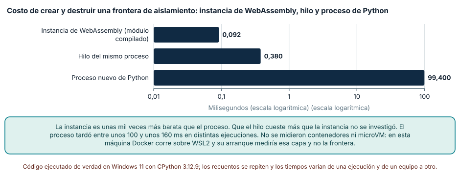

# SE-282 — Contenedores, microVM y sandboxes

[← SE-281 — Rendimiento y costo en aceleradores](https://github.com/vladimiracunadev-create/modern-software-engineering-program/blob/main/classes/part-23-runtimes-y-plataformas-modernas/se-281-rendimiento-y-costo-en-aceleradores/README.md) · [↑ Parte 23](https://github.com/vladimiracunadev-create/modern-software-engineering-program/blob/main/classes/part-23-runtimes-y-plataformas-modernas/README.md) · [📚 Índice completo](https://github.com/vladimiracunadev-create/modern-software-engineering-program/blob/main/classes/README.md) · [🌐 Portal](https://vladimiracunadev-create.github.io/modern-software-engineering-program/classes/SE-282.html) · [SE-283 — Hardware seguro: TEE y atestación →](https://github.com/vladimiracunadev-create/modern-software-engineering-program/blob/main/classes/part-23-runtimes-y-plataformas-modernas/se-283-hardware-seguro-tee-y-atestacion/README.md)

## Punto profesional y fundamento pedagógico

**Punto profesional.** La clase existe para que elijas una frontera de aislamiento con una pregunta de ingeniería y no con una marca: ¿qué código no confío, qué quiero que no pueda hacer, qué comparte con el resto de lo que corre en la misma máquina y cuánto cuesta crearla? Hilo, proceso, contenedor, sandbox de aplicación, módulo de WebAssembly, microVM y máquina virtual completa son puntos de una escala en la que la fuerza del aislamiento, el costo de crearlo y la superficie compartida con el anfitrión se compensan entre sí. Quien no distingue «aislar procesos que comparten núcleo» de «aislar con un núcleo propio» confunde un contenedor con una frontera de seguridad frente a código hostil.

**Por qué aparece aquí.** Reúne lo que `SE-277` y `SE-278` mostraron dentro del proceso y lo que `SE-279` mostró dentro del núcleo, y lo compara con las fronteras que `SE-398` (máquinas virtuales, contenedores y aislamiento) y `SE-262` (firma, sandbox y seguridad del cliente) introdujeron. Prepara `SE-283` (hardware seguro) y `SE-286` (confianza cero), que se apoyan en saber qué contiene cada capa.

**Error conceptual que debe corregir.** Creer que un contenedor es una máquina virtual pequeña. Un contenedor es un proceso (o varios) del anfitrión al que se le restringe lo que ve (espacios de nombres), cuánto consume (grupos de control) y qué llamadas de sistema puede hacer (filtros); el núcleo es el mismo. Una vulnerabilidad del núcleo alcanzable desde esas llamadas rompe todos los contenedores a la vez. En esta clase se mide algo de esa distancia: un `exec` de Python sin funciones integradas alcanza 393 clases del intérprete, entre ellas `Popen`, y un proceso hijo hereda por defecto todo el entorno del padre.

**Secuencia de aprendizaje.** Antes de ejecutar, predices cuánto cuesta crear cada frontera, qué hereda un proceso hijo, si un bucle infinito en un hilo se puede cortar desde fuera y si un `exec` con funciones integradas vacías es un sandbox. Después mides los costos, ejecutas las cuatro comprobaciones, calculas con un modelo la probabilidad de escape por capas independientes y por capas con un fallo común, y escribes la matriz de decisión.

**Evidencia de aprendizaje.** `fronteras-de-aislamiento.md` con la matriz de decisión (código en el que confías o no, inquilinos, costo de creación, qué se comparte), las cuatro comprobaciones ejecutadas y la lista de lo no ejecutado.

**Límite de la conclusión.** Se midió en Windows 11 con Python 3.12.9 y `wasmtime` 50.0.1: un hilo, una instancia de Wasm y un proceso de Python. **No se ejecutó ningún contenedor, ninguna microVM ni ninguna máquina virtual**, ni gVisor, ni Firecracker, ni Kata Containers; lo que se afirma de ellos viene de su documentación y de `NIST SP 800-190`. El modelo de probabilidades por capa usa valores del autor. Los tiempos varían entre ejecuciones (el proceso de Python tardó entre unos 100 y unos 160 ms). No se invocó ningún modelo de lenguaje.

### Trazabilidad fuente → afirmación

| Fuente primaria u oficial | Afirmación que respalda | Lo que no prueba |
|---|---|---|
| [NIST SP 800-190, «Application Container Security Guide»](https://csrc.nist.gov/pubs/sp/800/190/final) | Describe los contenedores como virtualización del sistema operativo y recopila los riesgos de imágenes, registros, orquestadores, contenedores y anfitrión. | No cubre una tecnología de aislamiento concreta. |
| [`namespaces(7)`](https://man7.org/linux/man-pages/man7/namespaces.7.html) | Documenta los espacios de nombres que restringen lo que un proceso ve (procesos, red, montajes, usuarios). | No dice que bastan como frontera de seguridad. |
| [Documentación del núcleo: `cgroup v2`](https://docs.kernel.org/admin-guide/cgroup-v2.html) | Documenta los grupos de control que limitan CPU, memoria y E/S. | No limita lo que el código puede intentar. |
| [`seccomp(2)`](https://man7.org/linux/man-pages/man2/seccomp.2.html) y [seccomp filter](https://docs.kernel.org/userspace-api/seccomp_filter.html) | Documentan el filtrado de llamadas de sistema por proceso. | No elimina las vulnerabilidades del núcleo en las llamadas permitidas. |
| [gVisor](https://gvisor.dev/docs/) | Describe un núcleo de aplicación en espacio de usuario (Sentry) que intercepta las llamadas de sistema de los contenedores. | No mide su costo en tu carga. |
| [Firecracker](https://firecracker-microvm.github.io/) | Describe microVM con un modelo de dispositivos mínimo para cargas sin servidor. | No fija sus garantías para tu amenaza. |
| [Kata Containers](https://katacontainers.io/) y [OCI runtime spec](https://github.com/opencontainers/runtime-spec) | Describen contenedores ejecutados dentro de una máquina virtual ligera y la especificación de ejecución de contenedores. | No sustituyen un análisis de amenazas. |

## Antes de empezar

Recupera lo aprendido en `SE-398`: una máquina virtual tiene un núcleo propio y un contenedor comparte el del anfitrión. La pregunta activa es: **si el código que ejecutas fuera hostil y tuviera un fallo explotable en una llamada de sistema, ¿qué se vería comprometido en cada una de estas fronteras: un hilo, un proceso, un contenedor y una máquina virtual?**

## Prerrequisitos

- Haber completado `SE-277` a `SE-281` y conocer de `SE-398` la diferencia entre máquina virtual y contenedor.
- Conocer de `SE-457` y `SE-459` el modelo de amenazas y el mínimo privilegio.
- Python 3.11 o posterior. Para la medición de Wasm: `pip install wasmtime==50.0.1` (sin él se omite esa fila).
- Una terminal con permiso para lanzar procesos hijos; el experimento no necesita Docker.

## Problema auténtico

*Avisos* ya ejecuta reglas de universidades como módulos de Wasm. Una cuarta universidad pide algo distinto: ejecutar un script de Python que prepara sus datos antes de cargarlos, con bibliotecas de terceros. No cabe en Wasm. La primera idea es un `exec` con los *builtins* vaciados «para que no pueda hacer nada»; la segunda, un proceso hijo con un tiempo máximo; la tercera, un contenedor por universidad. El equipo debe decidir con evidencia qué contiene cada una, cuánto cuesta crearla por tarea y qué comparte con el servicio principal, que guarda las claves de envío de correo.

La clase pone esas tres ideas a prueba con comprobaciones ejecutables y compara su costo con el de un hilo y una instancia de Wasm. Después las coloca en la escala de fronteras y deja la lista de lo que no pudo medir.

## Objetivos observables

Al terminar podrás:

1. describir qué restringe cada mecanismo (espacios de nombres, grupos de control, filtros de llamadas, núcleo de aplicación, hipervisor) y qué deja compartido;
2. ejecutar comprobaciones que muestren cuatro fallos típicos de un sandbox casero: entorno heredado, tiempo no acotado, bucle en un hilo incortable y escape por introspección;
3. comparar el costo de crear una frontera (hilo, instancia de Wasm, proceso) con una medición y leerla con sus límites;
4. calcular con un modelo la probabilidad de escape de capas independientes y por qué una causa común la degrada;
5. rellenar una matriz de decisión que elija frontera según la confianza en el código y los inquilinos, y nombre lo que haría que cambiara.

## Mapa conceptual


La pregunta de entrada es la confianza en el código; la segunda, quién más comparte la máquina; la tercera, qué superficie se comparte con el anfitrión. Los límites de recursos y de entorno valen en todas las ramas, porque ninguna frontera sustituye a no entregar secretos ni permisos innecesarios.

## Temas y por qué importan

| Tema | Por qué cambia una decisión profesional | Evidencia mínima |
|---|---|---|
| Amenaza y confianza | Define qué frontera es suficiente. | Matriz de decisión |
| Superficie compartida | Es lo que un escape alcanza. | Qué núcleo, qué dispositivos |
| Costo de creación | Limita cuántas fronteras por segundo se pueden crear. | Hilo, instancia, proceso medidos |
| Entorno heredado | Un proceso hijo hereda secretos si no se limpia. | Comprobación del entorno |
| Tiempo y CPU | Un límite de memoria no detiene un bucle. | Proceso terminado a los 0,5 s |
| Sandbox de lenguaje | No es frontera: se escapa por introspección. | `exec` sin funciones integradas |
| Capas y causa común | Las capas suman solo si fallan de forma independiente. | Modelo de probabilidades |

## Conceptos y decisiones

### 1. Una escala, no una lista

Las fronteras se ordenan por lo que comparten con el anfitrión. Un **hilo** comparte todo el proceso. Un **proceso** comparte el núcleo, pero tiene memoria virtual propia y puede restringirse con límites de CPU y memoria y un conjunto de llamadas de sistema permitidas. Un **contenedor** es un proceso con espacios de nombres (que limitan lo que ve: otros procesos, la red, los montajes, los usuarios), grupos de control (cuánto consume) y filtros de llamadas de sistema; comparte el núcleo. Un **núcleo de aplicación** como gVisor interpone en espacio de usuario un núcleo propio (el Sentry) que implementa las llamadas de sistema del contenedor y reduce las que llegan al núcleo real. Un **módulo de WebAssembly** comparte el proceso del anfitrión pero solo puede operar sobre su memoria y sus importaciones. Una **microVM** (Firecracker, Kata) ejecuta un núcleo invitado propio sobre un hipervisor con un modelo de dispositivos mínimo; lo que se comparte con el anfitrión es el hipervisor y los dispositivos que emula. Una **máquina virtual completa** hace lo mismo con más dispositivos. No existe un orden total de «seguridad»: depende de qué superficie quede compartida y de cuánto código la implemente.

### 2. Qué contiene y qué no contiene un contenedor

`NIST SP 800-190` describe los contenedores como virtualización del sistema operativo y organiza sus riesgos en cinco grupos: imágenes, registros, orquestadores, contenedores y sistema operativo del anfitrión. Un contenedor bien configurado contiene accidentes y abusos comunes: un proceso que no ve los demás, que no puede consumir toda la memoria, que no puede montar discos ni cargar módulos. No contiene una vulnerabilidad del núcleo alcanzable por las llamadas de sistema que se le permiten, porque el núcleo es el mismo. Por eso un contenedor es una buena frontera entre cargas de un mismo equipo y entre servicios en los que se confía razonablemente, y es una frontera discutible entre inquilinos que ejecutan código arbitrario: ahí se añaden filtros más estrictos, un núcleo de aplicación o una microVM. No se ejecutó ningún contenedor en esta clase; esta sección se apoya en la norma y en la documentación citadas.

### 3. Entorno heredado: lo que el hijo recibe sin pedirlo

La primera comprobación ejecutada es la más barata y la más frecuente en incidentes. Se definió una variable de entorno `PARTE48_VARIABLE_SECRETA` en el proceso padre y se lanzó un intérprete hijo que la imprime. Con el entorno heredado, el hijo imprimió `valor-de-ejemplo`; con un entorno vacío (solo la variable mínima que Windows exige), imprimió `None`. En producción, el entorno de un servicio suele contener credenciales de bases de datos, claves de APIs y tokens; lanzar un proceso hijo para código ajeno con el entorno heredado entrega todo eso. La regla es construir el entorno del hijo desde cero con una lista de lo permitido, no quitar lo prohibido de una copia.

### 4. Tiempo: lo que mata un proceso y lo que no mata un hilo

Un bucle infinito en un proceso hijo lanzado con un tiempo máximo de 0,5 s terminó a los 514 y 516 ms en dos ejecuciones: el sistema operativo permite terminar un proceso desde fuera. El mismo bucle en un hilo de Python seguía vivo tras esperar 0,3 s, y no existe una llamada para matarlo desde otro hilo; solo se puede pedirle que pare con una señal que él mismo debe consultar (en el experimento, un evento). La consecuencia es una regla de diseño: el código que no es de confianza no corre en hilos del servicio, porque no se puede cortar. Corre en un proceso (o en un módulo de Wasm con combustible, `SE-277`) con un tiempo máximo que el anfitrión impone.

### 5. Un sandbox de lenguaje no es una frontera

La tercera comprobación es la que más sorprende. Se ejecutó `exec` sobre un fragmento con un ámbito cuyo `__builtins__` estaba vacío: sin `len`, sin `open`, sin `import`. El fragmento `().__class__.__base__.__subclasses__()` llegó igualmente a la lista de las clases del intérprete: 393 en esa ejecución, entre ellas `Popen` (que lanza procesos) y `_wrap_close`, desde las cuales se alcanzan módulos con acceso al sistema. Una lista de nombres prohibidos tendría que anticipar atributos como `__class__`, `__base__` y `__subclasses__`, y cada nueva ruta de introspección exige otra entrada. El contraste con `SE-277` es el centro de la clase: la frontera de Wasm es *estructural* (el formato no puede expresar la operación), mientras que la de un lenguaje con introspección es *una lista de lo que se recordó quitar*. Un sandbox dentro del mismo intérprete es una restricción de cortesía; la frontera tiene que estar fuera del intérprete.

### 6. El costo de crear cada frontera

Mediana de varias repeticiones en la máquina del laboratorio: crear y destruir un hilo, unos 0,38 ms; crear e instanciar un módulo de Wasm ya compilado, unos 0,09 ms; lanzar un proceso de Python vacío, unos 100 a 160 ms. Que el hilo cueste más que la instancia no se investigó: no se debe inferir una causa de una medición. Una instancia de Wasm resulta unas mil veces más barata que un proceso de Python, y por eso es posible crear una por petición (`SE-278`). No se midieron contenedores ni microVM: el equipo tiene Docker Desktop, pero su arranque mide la capa de WSL2 y no la frontera aislada, de modo que un número obtenido así no sería honesto. Las comparaciones con esas fronteras quedan como preguntas para medir en el entorno de destino.

### 7. Capas: suman si son independientes

Un diseño común es poner varias fronteras en serie (módulo de Wasm dentro de un proceso con filtros dentro de un contenedor dentro de una microVM). Si la probabilidad de que un atacante cruce cada capa es `p` y las capas fallan de forma independiente, la probabilidad de cruzarlas todas es `p^k`: con `p = 0,10`, de 0,1 con una capa a 0,001 con tres; con `p = 0,02`, de 0,02 a 0,000008. Pero si dos capas comparten una causa de fallo (por ejemplo, el mismo núcleo, o el mismo error de configuración que las deja abiertas a la vez), la segunda no aporta: con `p = 0,02` y dos capas con un fallo común total la probabilidad queda en 0,02, igual que con una sola. La lectura de ingeniería: antes de apilar una capa, preguntar qué *no* comparte con las anteriores. Poner un contenedor dentro de otro contenedor del mismo anfitrión añade poco; poner un módulo de Wasm dentro de un proceso de un contenedor añade una frontera de otra naturaleza. Los valores `p` son del autor, no medidos: el modelo muestra la estructura de la cuenta, no una probabilidad real.

### 8. Los límites de recursos y de entorno van siempre

Ninguna frontera sustituye a lo básico: un entorno mínimo, un directorio de trabajo temporal y propio, un tiempo máximo, un límite de memoria, la red cerrada salvo destinos permitidos y el registro de cada ejecución con su dueño. En el laboratorio, el proceso hijo con tiempo máximo es el único de los tres intentos que contiene el bucle; el `exec` sin funciones integradas no contiene nada; el entorno heredado entrega todo. Los tres juntos (proceso, entorno vacío, tiempo máximo) forman una frontera modesta pero real; añadirle un contenedor o una microVM sube la fuerza frente a una vulnerabilidad del núcleo.

## Costo de crear cada frontera

La primera figura pone en escala el costo de crear un hilo, una instancia de Wasm y un proceso.



**Cómo leer la figura.** Cada barra es el costo de crear y destruir una frontera y la escala es logarítmica: la diferencia entre el proceso y la instancia es de tres órdenes de magnitud. **Dónde deja de valer:** son tres fronteras de una máquina, y no están todas las de la escala (faltan contenedor y microVM, que no se midieron); el proceso de Python carga un intérprete, de modo que un proceso mínimo escrito en otro lenguaje costaría menos. El valor del proceso varió entre unos 100 y unos 160 ms.

## Capas y causas comunes

La segunda figura muestra el modelo de probabilidad de escape.


**Cómo leer la figura.** El eje horizontal es el número de capas y el vertical la probabilidad de cruzarlas todas, en escala logarítmica. Mira la línea del fallo común: con dos capas sigue en 0,02, como si no hubiera segunda capa. **Dónde deja de valer:** las probabilidades por capa son supuestos del autor y las capas del modelo son perfectamente independientes o perfectamente correlacionadas; la realidad está entre ambas y no se midió.

## La escala de fronteras

La tercera figura es un diagrama de lo que se comparte con el anfitrión en cada frontera.


**Cómo leer la figura.** De izquierda a derecha, cada caja comparte menos con el anfitrión y suele costar más crear. Mira la nota: no es un orden total de seguridad. **Dónde deja de valer:** es una simplificación conceptual de la documentación citada; no mide fuerza de aislamiento, y cada tecnología tiene configuraciones que la acercan o la alejan de su caja.

## Definiciones de trabajo

- **[Frontera de aislamiento](../../../glosario/entradas/f/frontera-de-aislamiento.md):** mecanismo que limita lo que una carga puede ver, usar o alterar de otras.
- **[Espacio de nombres](../../../glosario/entradas/e/espacio-de-nombres.md):** vista restringida de un recurso del sistema (procesos, red, montajes, usuarios).
- **Grupo de control (*cgroup*):** límite de consumo de CPU, memoria o E/S para un conjunto de procesos.
- **Filtro de llamadas de sistema (*seccomp*):** lista de llamadas de sistema que un proceso puede hacer.
- **[Núcleo de aplicación](../../../glosario/entradas/n/nucleo-de-aplicacion.md):** núcleo en espacio de usuario que atiende las llamadas de un contenedor.
- **[microVM](../../../glosario/entradas/m/microvm.md):** máquina virtual con núcleo propio y un modelo mínimo de dispositivos.
- **[Superficie compartida](../../../glosario/entradas/s/superficie-compartida.md):** código y dispositivos del anfitrión alcanzables desde la carga.
- **[Causa común](../../../glosario/entradas/c/causa-comun.md):** fallo que afecta a varias capas a la vez.

## Ejemplo mínimo

Lanzar código ajeno con entorno propio y tiempo máximo:

```python
import subprocess, sys, tempfile

with tempfile.TemporaryDirectory() as trabajo:
    res = subprocess.run(
        [sys.executable, "-I", "-c", "print('hola')"],
        cwd=trabajo,                    # directorio propio y temporal
        env={},                         # entorno construido desde cero (en Windows puede exigir SYSTEMROOT)
        capture_output=True, text=True,
        timeout=2,                      # el anfitrión puede terminar el proceso
    )
print(res.stdout.strip())
```

Son cuatro decisiones en cuatro líneas: directorio, entorno, captura y tiempo. No es un sandbox completo (el proceso puede llamar a cualquier cosa que el usuario pueda), pero convierte una ejecución sin límites en una con tres.

## Ejemplo profesional

*Escenario ilustrativo: las cifras y los resultados que aparecen en este ejemplo son supuestos de la narración, no mediciones.*

El equipo de *Avisos* resuelve el caso del script de Python con una escala. Los scripts de una misma universidad corren en un proceso con entorno vacío, directorio temporal, tiempo máximo y límite de memoria, sin red, dentro de un contenedor con un perfil de llamadas de sistema restringido y por universidad. Antes de aceptar la solución, el equipo de seguridad pregunta qué comparte ese contenedor con el servicio de correo: el mismo anfitrión y el mismo núcleo. Como el script puede incluir bibliotecas de terceros y la amenaza incluye código arbitrario, deciden ejecutar esos contenedores en un conjunto de máquinas separado, sin las claves de correo, y evaluar un núcleo de aplicación en el siguiente trimestre. Dejan escrita la condición que cambiaría la decisión: si aparece una vulnerabilidad de escape de contenedor explotable con las llamadas permitidas, o si una universidad exige aislamiento contractual, se pasa a microVM. El documento tiene una fila por frontera con «qué comparte» y «qué no cubre».

## Práctica guiada

1. Ejecuta `python scripts/experiments_part23_a.py sandbox` y anota los cuatro resultados y los tres costos.
2. Cambia el entorno del hijo para dejar pasar solo `PATH` y comprueba qué variable sigue visible.
3. Escribe un script de prueba que intente leer un archivo fuera del directorio de trabajo y otro que abra un socket; observa qué contiene tu configuración y qué no.
4. Repite el cálculo de capas con tus propias `p` y con una causa común entre dos de las tres capas.
5. Rellena la matriz de decisión para tres cargas de tu sistema (código propio, código de un cliente, código arbitrario) con la frontera mínima suficiente.

## Ejercicios

1. **Básico.** Explica por qué un bucle infinito en un hilo no se puede terminar desde fuera y en un proceso sí.
2. **Intermedio.** Diseña el lanzador de scripts de universidades: qué recibe el hijo (entorno, directorio, red, memoria, tiempo), qué se registra de cada ejecución y qué prueba negativa demuestra que no puede leer los archivos de otra universidad.
3. **Avanzado.** Compara contenedor, núcleo de aplicación y microVM para el mismo lanzador: superficie compartida, costo de creación (qué medirías y cómo), operación y qué amenaza justificaría pagar la siguiente frontera.

## Reto verificable

Entrega `fronteras-de-aislamiento.md` con la matriz de decisión, las cuatro comprobaciones ejecutadas con su salida y el modelo de capas con tus valores de `p`. Es válido si otra persona reproduce las cuatro comprobaciones, el documento declara qué fronteras no se midieron y la conclusión no atribuye fuerza de aislamiento a un contenedor frente a una amenaza de código arbitrario sin cubrir la superficie compartida.

## Caso conductor

*Avisos* ejecuta código de varias universidades con una frontera elegida por amenaza y por costo. `SE-283` baja otro nivel: cuando ni el sistema operativo del anfitrión es de confianza (un proveedor de nube, un operador), el hardware puede ofrecer entornos de ejecución aislados y demostrar a distancia qué código corre en ellos.

## Preguntas frecuentes

### ¿Un contenedor es suficiente para código de clientes?

Depende de la amenaza. Contiene bien abusos y errores; frente a código arbitrario con un fallo del núcleo en las llamadas permitidas, comparte la superficie del núcleo. Para esa amenaza se añaden perfiles de llamadas estrictos, un núcleo de aplicación o una microVM.

### ¿Por qué no medir Docker?

Porque en esta máquina Docker corre sobre WSL2 y el tiempo de arranque de un contenedor mediría esa capa y no la frontera. Se declara como no medido.

### ¿Wasm reemplaza a los contenedores?

Resuelve otro problema: aísla *dentro de un proceso* código compilado para ese formato. No ejecuta un script de Python con sus bibliotecas ni una base de datos. Se complementan.

### ¿Cuántas capas son suficientes?

Las que cubran causas de fallo distintas. Dos capas que comparten núcleo y configuración suman poco; dos que no comparten nada suman mucho.

## Fallo controlado y diagnóstico

**Fallo.** Un script de una universidad lee, sin que nadie lo haya previsto, las credenciales del servicio de correo, aunque corre en un contenedor.

**Diagnóstico paso a paso.** (1) Se revisa qué ve el contenedor: el proceso hijo hereda las variables de entorno del lanzador, entre ellas una credencial de correo que el lanzador usaba para notificar. (2) El contenedor y el lanzador comparten el mismo conjunto de variables porque el entorno se pasa tal cual. (3) El perfil de llamadas de sistema y los espacios de nombres funcionan; el fallo es de configuración, no de la frontera. (4) Se corrige construyendo el entorno del hijo desde una lista de lo permitido, moviendo la credencial al servicio que notifica (que corre en otra máquina) y añadiendo una prueba negativa que ejecuta un script que imprime su entorno y falla si aparece cualquier variable fuera de la lista.

**Lección.** La mayoría de los escapes reales no rompen la frontera: entran por lo que se le pasó a través de ella. La prueba negativa del entorno es más valiosa que la sofisticación de la frontera.

## Errores comunes y cómo corregirlos

- **Heredar el entorno del padre.** Entrega secretos. Corrige con una lista de lo permitido.
- **Ejecutar código ajeno en hilos del servicio.** No se puede cortar. Corrige con procesos o módulos con combustible.
- **Confiar en `exec` con funciones integradas vacías.** Se escapa por introspección. Corrige con una frontera fuera del intérprete.
- **Apilar capas que comparten causa de fallo.** Corrige preguntando qué no comparten.
- **Tratar un contenedor como una máquina virtual.** Corrige con la matriz de qué comparte.
- **Atribuir a una frontera una medida que no se hizo.** Corrige declarando qué no se midió.

## Entorno y archivos clave

- `scripts/experiments_part23_a.py`: función `sandbox`; se ejecuta con `python scripts/experiments_part23_a.py sandbox`.
- `scripts/experiments_part23_lab.py`: utilidades de medición.
- `scripts/figures_part23_a.py` y `scripts/figures_part23_b.py`: figuras de la parte.
- Python 3.11 o posterior; `wasmtime==50.0.1` opcional para la fila de Wasm.

## Seguridad, ética y accesibilidad

Ejecutar código de terceros es tratar con datos y sistemas de otras personas: define quién responde por el código que corre, qué se registra y por cuánto tiempo, y asegúrate de que las pruebas negativas no usen datos reales. Una comprobación de escape en un entorno compartido es un ataque si se hace sin permiso: haz estas pruebas solo en máquinas tuyas. Las figuras tienen texto alternativo completo y valores escritos.

## Puente hacia el trabajo con agentes

Un agente que ejecuta comandos en tu máquina es, en el sentido de esta clase, código que no controlas corriendo en tu proceso. Aplica la matriz: ¿qué entorno hereda?, ¿qué directorio puede tocar?, ¿qué red?, ¿qué tiempo máximo? Muchas herramientas de agentes se apoyan en un sandbox de lenguaje o en una lista de comandos prohibidos; la comprobación de esta clase (introspección y entorno heredado) es el tipo de prueba que conviene hacerles. Si un agente te propone ejecutar «con sudo para que funcione», el mínimo privilegio ya se rompió.

## Transferencia

Elige un lugar donde tu sistema ejecuta código que no escribió su equipo (scripts de clientes, plugins, tareas de CI, herramientas de un agente). Rellena la matriz: confianza en el código, quién más comparte la máquina, qué entorno hereda, qué límites tiene, qué frontera usa y qué no comparte con el servicio principal. Escribe la prueba negativa que demostraría que no puede leer lo que no debe.

## Evaluación y evidencia

| Criterio | Evidencia aceptable | Rechazo |
|---|---|---|
| Matriz de decisión | Confianza, inquilinos, frontera, qué comparte | «Usamos contenedores» |
| Entorno | Lista de lo permitido y prueba negativa | Entorno heredado |
| Tiempo y recursos | Proceso terminado por el anfitrión | Hilo sin posibilidad de corte |
| Sandbox de lenguaje | Comprobación de escape ejecutada | Confianza en funciones integradas vacías |
| Alcance | Fronteras medidas y no medidas | Afirmar sobre lo no ejecutado |

## Fuentes

- NIST. [SP 800-190, «Application Container Security Guide»](https://csrc.nist.gov/pubs/sp/800/190/final).
- Linux man-pages. [`namespaces(7)`](https://man7.org/linux/man-pages/man7/namespaces.7.html) y [`seccomp(2)`](https://man7.org/linux/man-pages/man2/seccomp.2.html).
- Linux kernel documentation. [«Control Group v2»](https://docs.kernel.org/admin-guide/cgroup-v2.html) y [«Seccomp BPF»](https://docs.kernel.org/userspace-api/seccomp_filter.html).
- [gVisor](https://gvisor.dev/docs/), [Firecracker](https://firecracker-microvm.github.io/), [Kata Containers](https://katacontainers.io/) y [OCI runtime-spec](https://github.com/opencontainers/runtime-spec).
- Docker. [«Docker security»](https://docs.docker.com/engine/security/).

## Límites y siguiente paso

Se midieron tres fronteras y se ejecutaron cuatro comprobaciones de un sandbox casero; no se ejecutó ningún contenedor, microVM ni núcleo de aplicación, y las probabilidades del modelo de capas son del autor. El siguiente paso, `SE-283`, estudia el hardware seguro: entornos de ejecución aislados cuyo estado puede demostrarse a distancia, y lo que esa demostración no prueba.

## Glosario

| Término | Definición breve |
|---|---|
| Frontera de aislamiento | Mecanismo que limita lo que una carga ve, usa o altera |
| Espacio de nombres | Vista restringida de un recurso del sistema |
| Grupo de control | Límite de consumo para un conjunto de procesos |
| Filtro de llamadas | Lista de llamadas de sistema permitidas |
| Núcleo de aplicación | Núcleo en espacio de usuario que atiende las llamadas de un contenedor |
| microVM | Máquina virtual con núcleo propio y dispositivos mínimos |
| Superficie compartida | Código del anfitrión alcanzable desde la carga |
| Causa común | Fallo que afecta a varias capas a la vez |

Conceptos de esta clase en el [glosario del programa](../../../glosario/README.md): [Causa común](../../../glosario/entradas/c/causa-comun.md) · [Espacio de nombres](../../../glosario/entradas/e/espacio-de-nombres.md) · [Frontera de aislamiento](../../../glosario/entradas/f/frontera-de-aislamiento.md) · [MicroVM](../../../glosario/entradas/m/microvm.md) · [Núcleo de aplicación](../../../glosario/entradas/n/nucleo-de-aplicacion.md) · [Superficie compartida](../../../glosario/entradas/s/superficie-compartida.md).

---

[← SE-281 — Rendimiento y costo en aceleradores](https://github.com/vladimiracunadev-create/modern-software-engineering-program/blob/main/classes/part-23-runtimes-y-plataformas-modernas/se-281-rendimiento-y-costo-en-aceleradores/README.md) · [↑ Parte 23](https://github.com/vladimiracunadev-create/modern-software-engineering-program/blob/main/classes/part-23-runtimes-y-plataformas-modernas/README.md) · [📚 Índice completo](https://github.com/vladimiracunadev-create/modern-software-engineering-program/blob/main/classes/README.md) · [🌐 Portal](https://vladimiracunadev-create.github.io/modern-software-engineering-program/classes/SE-282.html) · [SE-283 — Hardware seguro: TEE y atestación →](https://github.com/vladimiracunadev-create/modern-software-engineering-program/blob/main/classes/part-23-runtimes-y-plataformas-modernas/se-283-hardware-seguro-tee-y-atestacion/README.md)
