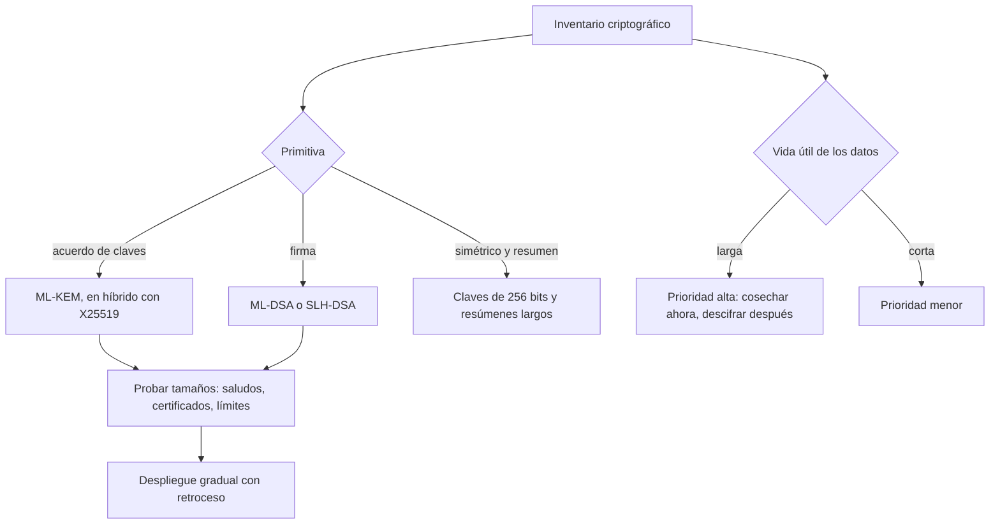
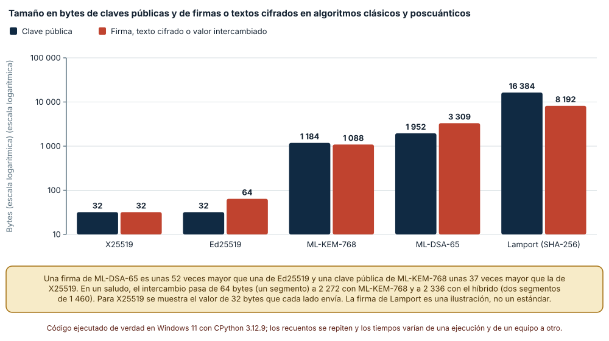
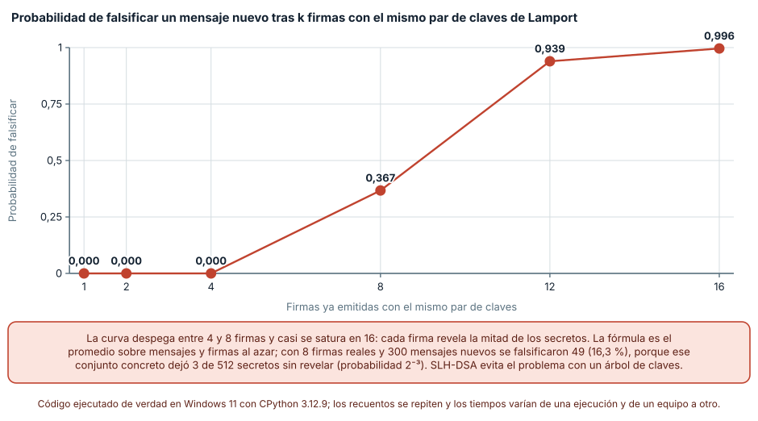
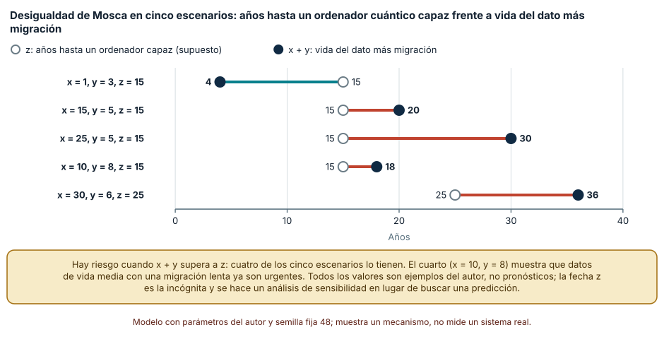

# SE-285 — Criptografía poscuántica y migración

[← SE-284 — Computación cuántica para ingenieros de software](https://github.com/vladimiracunadev-create/modern-software-engineering-program/blob/main/classes/part-23-runtimes-y-plataformas-modernas/se-284-computacion-cuantica-para-ingenieros-de-software/README.md) · [↑ Parte 23](https://github.com/vladimiracunadev-create/modern-software-engineering-program/blob/main/classes/part-23-runtimes-y-plataformas-modernas/README.md) · [📚 Índice completo](https://github.com/vladimiracunadev-create/modern-software-engineering-program/blob/main/classes/README.md) · [🌐 Portal](https://vladimiracunadev-create.github.io/modern-software-engineering-program/classes/SE-285.html) · [SE-286 — Confianza cero en la práctica →](https://github.com/vladimiracunadev-create/modern-software-engineering-program/blob/main/classes/part-23-runtimes-y-plataformas-modernas/se-286-confianza-cero-en-la-practica/README.md)

## Punto profesional y fundamento pedagógico

**Punto profesional.** La clase existe para que puedas planificar y ejecutar una migración criptográfica sin esperar a que exista un ordenador cuántico capaz de romper la criptografía actual. El problema ya es de ingeniería: hay algoritmos estandarizados que resisten los ataques cuánticos conocidos (ML-KEM para acordar claves, ML-DSA y SLH-DSA para firmar), tienen tamaños de claves, textos cifrados y firmas de entre diez y cien veces mayores que los de curvas elípticas, y viven en protocolos, certificados, dispositivos y formatos de archivo pensados para otros tamaños. La migración consiste en inventariar dónde se usa criptografía de clave pública, decidir qué datos tienen una vida útil que la amenaza «cosechar ahora, descifrar después» pone en riesgo, adoptar esquemas híbridos y verificar que nada se rompe por los bytes adicionales.

**Por qué aparece aquí.** Es la respuesta práctica a `SE-284` (qué puede y qué no puede un ordenador cuántico) y la continuación de `SE-461` (criptografía aplicada y gestión de claves). Se apoya en `SE-473` (firmas y verificación), `SE-472` (SBOM y atestaciones) y `SE-462` (secretos), y alimenta `SE-288`, donde el plan de migración entra en el expediente de la plataforma.

**Error conceptual que debe corregir.** Creer que la migración consiste en «cambiar el algoritmo». Cambiar el algoritmo es un parámetro; lo que se rompe son los límites que daban por supuesto un tamaño: campos de longitud fija, tamaños máximos de mensaje, el número de segmentos de un saludo de red, el almacenamiento de certificados, los dispositivos de poca memoria. En el laboratorio, el intercambio de claves de un saludo pasa de 64 bytes con X25519 a 2 272 con ML-KEM-768 y a 2 336 con un esquema híbrido: de un segmento a dos con segmentos de 1 460 bytes.

**Secuencia de aprendizaje.** Antes de ejecutar, predices cuántos bytes ocupan una clave pública, un texto cifrado y una firma de ML-KEM-768 y de ML-DSA-65, qué ocurre si se altera un bit de un texto cifrado de ML-KEM y qué pasa si se reutiliza una clave de firma de un solo uso. Después ejecutas implementaciones reales de los estándares, mides tamaños y tiempos, construyes una firma de Lamport basada en funciones de resumen y calculas la probabilidad de falsificarla tras k firmas, aplicas la desigualdad de Mosca a cinco escenarios y compruebas la lógica de un esquema híbrido.

**Evidencia de aprendizaje.** `plan-de-migracion-pqc.md` con el inventario (dónde, qué algoritmo, qué vida útil de los datos), la tabla de tamaños, la decisión por cada uso (migrar ya, híbrido, esperar), el cálculo de Mosca con tus valores y los riesgos de tamaño y de rendimiento.

**Límite de la conclusión.** Se ejecutaron `kyber-py` 1.2.0 (ML-KEM, FIPS 203) y `dilithium-py` 1.5.1 (ML-DSA, FIPS 204), **implementaciones puras de Python pensadas para estudio y no para producción**: sus tiempos (decenas de milisegundos) no representan las implementaciones optimizadas ni sirven para decidir rendimiento, y no se auditó su resistencia a canales laterales. Los tamaños sí corresponden a los estándares. **No se ejecutó** SLH-DSA (se estudió una firma de Lamport como ejemplo de las basadas en resumen), ningún saludo TLS real, ninguna biblioteca como liboqs ni ningún dispositivo con memoria limitada. Los valores de la desigualdad de Mosca son ejemplos del autor, no pronósticos. No se invocó ningún modelo de lenguaje.

### Trazabilidad fuente → afirmación

| Fuente primaria u oficial | Afirmación que respalda | Lo que no prueba |
|---|---|---|
| [NIST FIPS 203, ML-KEM](https://csrc.nist.gov/pubs/fips/203/final) | Estandariza el mecanismo de encapsulación de claves basado en retículos modulares, con sus tamaños por conjunto de parámetros. | No cubre la integración en protocolos. |
| [NIST FIPS 204, ML-DSA](https://csrc.nist.gov/pubs/fips/204/final) | Estandariza la firma digital basada en retículos modulares y sus tamaños. | No elige entre firmas para tu caso. |
| [NIST FIPS 205, SLH-DSA](https://csrc.nist.gov/pubs/fips/205/final) | Estandariza la firma sin estado basada en funciones de resumen. | No compara costos con las otras firmas en tu entorno. |
| [NIST: «Post-Quantum Cryptography»](https://csrc.nist.gov/projects/post-quantum-cryptography) y [anuncio de los primeros estándares](https://www.nist.gov/news-events/news/2024/08/nist-releases-first-3-finalized-post-quantum-encryption-standards) | Describe el proceso de estandarización y la publicación de los tres primeros estándares en agosto de 2024. | No predice la fecha de ningún ordenador cuántico. |
| [NIST IR 8547, «Transition to Post-Quantum Cryptography Standards»](https://csrc.nist.gov/pubs/ir/8547/ipd) | Describe el enfoque esperado de transición de los algoritmos vulnerables a los poscuánticos. | Es un borrador inicial; los plazos pueden cambiar. |
| [RFC 10024, «Post-Quantum Traditional (PQ/T) Hybrid Key Agreement Mechanisms for TLS 1.3»](https://datatracker.ietf.org/doc/rfc10024/) | Define tres mecanismos híbridos de acuerdo de claves para TLS 1.3 que combinan ML-KEM con un intercambio de curva elíptica. | No cubre la autenticación con firmas poscuánticas. |
| [NCSC (Reino Unido): «Preparing for quantum-safe cryptography»](https://www.ncsc.gov.uk/whitepaper/preparing-for-quantum-safe-cryptography) | Ofrece orientación sobre planificar la migración. | Es una guía de un organismo concreto. |
| [`kyber-py`](https://pypi.org/project/kyber-py/) y [`dilithium-py`](https://pypi.org/project/dilithium-py/) | Son las bibliotecas de Python usadas en el laboratorio; declaran ser implementaciones de referencia en Python. | No son aptas para producción. |

## Antes de empezar

Recupera lo aprendido en `SE-284`: la amenaza que obliga a actuar hoy es la de almacenar datos cifrados para descifrarlos después. La pregunta activa es: **¿qué datos que tu sistema cifra hoy seguirían siendo sensibles dentro de quince años, y quién tiene hoy la posibilidad de guardarlos?**

## Prerrequisitos

- Haber completado `SE-284` y conocer de `SE-461` cifrado, firma y gestión de claves.
- Conocer de `SE-473` cómo se verifica una firma y de `SE-462` cómo se separan los secretos.
- Python 3.11 o posterior. Para repetir el experimento: `pip install kyber-py==1.2.0 dilithium-py==1.5.1` (sin ellos el script imprime `NO EJECUTADO`).
- Nociones de TLS: un saludo intercambia claves y certificados antes de enviar datos.

## Problema auténtico

*Avisos* guarda historiales académicos que, por una norma de la universidad, se conservan veinticinco años. Se transmiten por TLS y se cifran en reposo con claves simétricas, que a su vez se protegen con claves públicas de un servicio de gestión de claves. El equipo de seguridad hace tres preguntas: ¿qué parte de ese diseño es vulnerable a un adversario con un ordenador cuántico?, ¿qué parte ya está expuesta porque el adversario puede grabar hoy y descifrar mañana?, ¿qué cambia en la plataforma al adoptar algoritmos cuyas claves y firmas son diez veces mayores?

La clase responde con una medición y un cálculo: tamaños reales de los estándares, el efecto en un saludo, una firma basada en resumen que muestra por qué las firmas de un solo uso exigen disciplina, la desigualdad de Mosca para decidir urgencia y una comprobación de que un esquema híbrido protege mientras uno de los dos componentes resista.

## Objetivos observables

Al terminar podrás:

1. distinguir qué primitivas son vulnerables a un ordenador cuántico (acuerdo de claves y firmas de clave pública) y cuáles no lo son tanto (cifrado simétrico y funciones de resumen, con claves más largas);
2. describir los tres estándares (ML-KEM, ML-DSA, SLH-DSA) y sus tamaños, y calcular el efecto en bytes de un saludo;
3. explicar el rechazo implícito de ML-KEM y por qué importa para no filtrar información por errores;
4. explicar por qué una firma basada en resumen de un solo uso no puede reutilizarse y cómo los estándares lo resuelven;
5. aplicar la desigualdad de Mosca a un uso concreto, diseñar un esquema híbrido y escribir un plan de migración con inventario, prioridad y riesgos de tamaño.

## Mapa conceptual



Lo que decide la prioridad es la vida útil de los datos, no el tipo de sistema. Lo que decide el riesgo operativo es el tamaño de los nuevos objetos. Lo que decide la forma del cambio es el esquema híbrido, que permite avanzar sin apostar todo a un algoritmo joven.

## Temas y por qué importan

| Tema | Por qué cambia una decisión profesional | Evidencia mínima |
|---|---|---|
| Inventario | Sin saber dónde hay criptografía asimétrica no hay plan. | Tabla de usos y vida útil |
| ML-KEM | Reemplaza el acuerdo de claves; mucho más grande. | Tamaños y secreto compartido |
| ML-DSA y SLH-DSA | Reemplazan firmas; tamaños de kilobytes. | Tamaños medidos |
| Rechazo implícito | Evita señales por errores de descifrado. | Texto cifrado alterado |
| Firmas basadas en resumen | Muestran por qué un solo uso exige disciplina. | Falsificación tras k firmas |
| Mosca | Convierte una fecha incierta en una decisión. | Cinco escenarios calculados |
| Híbrido | Protege si cualquiera de los dos resiste. | Combinación de secretos |
| Efecto en bytes | Rompe campos de tamaño fijo y saludos. | Segmentos de un saludo |

## Conceptos y decisiones

### 1. Qué cae y qué resiste

El algoritmo de Shor (`SE-284`) rompe los problemas matemáticos en que se apoyan RSA, Diffie-Hellman y las curvas elípticas: factorizar y calcular logaritmos discretos. Eso afecta al acuerdo de claves y a las firmas de clave pública, que son la base de TLS, de los certificados, de las firmas de software y de los tokens. El algoritmo de Grover solo da una ventaja cuadrática contra la búsqueda de claves simétricas y de preimágenes de resumen, que se compensa con claves y resúmenes del doble de longitud: AES-256 y SHA-256 o mayores se consideran adecuados. La migración se concentra, por tanto, en la criptografía de clave pública. Lo que no se migra por esta razón: el cifrado simétrico bien elegido y las funciones de resumen.

### 2. Los tres estándares y su tamaño

En agosto de 2024, NIST publicó los tres primeros estándares: FIPS 203 (ML-KEM, derivado de CRYSTALS-Kyber) para acordar claves; FIPS 204 (ML-DSA, derivado de CRYSTALS-Dilithium) para firmar; y FIPS 205 (SLH-DSA, derivado de SPHINCS+) como firma sin estado basada solo en funciones de resumen, con una base de seguridad distinta. Las implementaciones del laboratorio dieron, para ML-KEM-768: clave pública de 1 184 bytes, clave privada de 2 400, texto cifrado de 1 088 y secreto compartido de 32. Para ML-DSA-65: clave pública de 1 952, clave privada de 4 032 y firma de 3 309. Como referencia, X25519 usa claves públicas de 32 bytes, Ed25519 claves públicas de 32 y firmas de 64, y RSA-2048 claves y firmas de 256. Una firma de ML-DSA-65 es unas 52 veces mayor que una de Ed25519; una clave pública de ML-KEM-768, unas 37 veces mayor que la de X25519. Esas razones, y no el tiempo de cálculo, son las que rompen sistemas.

### 3. El efecto en un saludo

Un saludo de TLS intercambia, entre otras cosas, una clave pública del cliente y un texto cifrado o clave pública del servidor. Con X25519, el intercambio ocupa unos 64 bytes y cabe en un segmento de red. Con ML-KEM-768 solo, 1 184 + 1 088 = 2 272 bytes: dos segmentos de 1 460 bytes. Con el híbrido (X25519 más ML-KEM-768), 2 336 bytes: también dos. Dos segmentos en lugar de uno significa una probabilidad mayor de fragmentación y de pérdida, y en redes con dispositivos intermedios que esperan que el primer mensaje del saludo quepa en un paquete, errores reales de conexión. El RFC 10024 define tres mecanismos híbridos para TLS 1.3 (X25519MLKEM768, SecP256r1MLKEM768 y SecP384r1MLKEM1024) y es lo que los clientes y servidores modernos implementan. La conclusión de ingeniería: probar el saludo con dispositivos intermedios reales (cortafuegos, balanceadores, inspección de tráfico) antes de activar el híbrido para todos los clientes.

### 4. Rechazo implícito

En ML-KEM, descapsular un texto cifrado alterado no devuelve un error: devuelve otro secreto aparentemente válido. En el laboratorio, un bit cambiado en el primer byte del texto cifrado produjo un secreto distinto del original sin ninguna excepción. La razón es de seguridad: si el descifrado fallara con un error observable, un atacante podría usar esos fallos como oráculo para aprender información sobre la clave privada. El rechazo implícito vuelve inobservable la diferencia. Consecuencia para el software: la integración no puede apoyarse en «si falla, lo sabré»; la detección ocurre más adelante, cuando los dos extremos derivan claves distintas y la autenticación del canal falla. Es una razón para usar siempre los protocolos que autentican el canal y no inventar los propios.

### 5. Firmas basadas en resumen: la lección de un solo uso

SLH-DSA basa su seguridad solo en las propiedades de una función de resumen, lo que da una base de confianza distinta a la de los retículos. Para ver el mecanismo se implementó una firma de Lamport con SHA-256: la clave privada son 256 pares de secretos de 32 bytes; la pública, los resúmenes de cada uno (16 384 bytes); firmar un mensaje consiste en revelar, para cada bit de su resumen, el secreto correspondiente (8 192 bytes). Verifica con el mensaje original y falla con uno alterado. Pero cada firma *revela* la mitad de los secretos. Con k firmas del mismo par de claves, un atacante conoce, para cada posición, el secreto de un bit con probabilidad `1 − 2^−k`, y puede falsificar un mensaje nuevo con probabilidad `(1 − 2^−k)^256`: prácticamente 0 con 1, 2 o 4 firmas, 0,37 con 8, 0,94 con 12 y 0,996 con 16. En el laboratorio, con 8 firmas reales y 300 mensajes nuevos, 49 resultaron falsificables (16,3 %). La cifra es menor que el 36,7 % teórico porque la fórmula es un promedio sobre conjuntos de 8 firmas, y este conjunto concreto dejó 3 de los 512 secretos sin revelar: un mensaje nuevo es falsificable solo si evita los tres, con probabilidad 2⁻³ = 12,5 % (49 de 300 es coherente con eso). Lo que importa es la conclusión: una clave de un solo uso reutilizada ocho veces ya permite falsificar más de uno de cada ocho mensajes, y cada firma adicional empeora el caso. Por eso SLH-DSA organiza muchas claves de un solo uso en un árbol y *no tiene estado que llevar* (a diferencia de variantes anteriores como XMSS, donde hay que recordar qué hoja se usó). Nota de honestidad: no se ejecutó SLH-DSA; se ejecutó la primitiva que lo ilustra.

### 6. La desigualdad de Mosca

Para decidir urgencia sin una fecha del ordenador cuántico, la desigualdad de Mosca compara tres cantidades en años: `x`, cuánto debe permanecer secreto el dato; `y`, cuánto tardas en migrar; `z`, cuánto falta para un ordenador cuántico capaz. Hay riesgo si `x + y > z`. Con valores de ejemplo del autor (no pronósticos): `x = 1`, `y = 3`, `z = 15`: 4 años, sin riesgo. `x = 15`, `y = 5`, `z = 15`: 20, riesgo. `x = 25`, `y = 5`, `z = 15`: 30, riesgo. `x = 10`, `y = 8`, `z = 15`: 18, riesgo, aun con datos de vida media, porque la migración es lenta. `x = 30`, `y = 6`, `z = 25`: 36, riesgo. La utilidad de la fórmula está en dos hábitos: el riesgo depende de la vida útil de cada dato (no del sistema) y la migración lenta convierte datos de vida media en urgentes. La fecha `z` es la incógnita: se hace un análisis de sensibilidad (¿para qué `z` cambia la decisión?) en lugar de buscar un pronóstico.

### 7. El esquema híbrido

Un esquema híbrido combina un algoritmo clásico y uno poscuántico: ambos producen un secreto y la clave de sesión se deriva de los dos. En el laboratorio, la clave se derivó como `HMAC(secreto clásico ‖ secreto poscuántico)`. Un atacante que conozca solo uno de los dos secretos (porque rompió el clásico con un ordenador cuántico, o porque encontró una debilidad en el poscuántico, que es más joven) obtiene una clave distinta de la real. El costo es el de ambos algoritmos (en bytes y en cómputo); la ventaja es no apostar toda la seguridad a un algoritmo de pocos años de análisis. Para el acuerdo de claves, el RFC 10024 lo estandariza en TLS 1.3. Para firmas, las composiciones híbridas siguen en discusión y no hay una práctica tan asentada.

### 8. Migrar es ingeniería de cambio

Una migración criptográfica sigue las pautas de `SE-474` a `SE-476` (versionado, banderas de funcionalidad, canary y retroceso) aplicadas a un cambio con un riesgo especial: los tamaños. El plan mínimo: (1) inventariar usos y bibliotecas, incluyendo dependencias y dispositivos; (2) clasificar por vida útil de los datos; (3) añadir agilidad criptográfica (algoritmo identificado en los datos, no fijo en el código) antes de cambiar nada; (4) activar el híbrido en el acuerdo de claves de los servicios con datos de vida larga, con métricas de errores de conexión y de latencia; (5) probar los límites de tamaño (campos fijos, certificados, bases de datos, dispositivos); (6) planificar las firmas, que son más difíciles porque los certificados y las raíces de confianza tienen ciclos de vida largos; (7) mantener la lista de qué se migró, cuándo y con qué evidencia. Sin agilidad criptográfica, cada cambio de algoritmo es una reescritura.

## Los tamaños frente a lo clásico

La primera figura compara los tamaños de claves públicas y de firmas o textos cifrados.



**Cómo leer la figura.** Cada grupo es un algoritmo; la primera barra es su clave pública y la segunda su firma o texto cifrado, en bytes y en escala logarítmica. Mira la distancia entre los algoritmos clásicos y los poscuánticos: de uno a dos órdenes de magnitud. **Dónde deja de valer:** los tamaños de ML-KEM-768 y ML-DSA-65 son los de los estándares y los de las implementaciones ejecutadas; X25519 y Ed25519 son los de la definición de los algoritmos; la firma de Lamport es una ilustración, no un estándar. Hay otros conjuntos de parámetros con otros tamaños.

## Reutilizar una clave de un solo uso

La segunda figura muestra la probabilidad de falsificar un mensaje nuevo según las firmas emitidas.



**Cómo leer la figura.** El eje horizontal es el número de firmas ya emitidas con el mismo par de claves y el vertical la probabilidad de falsificar un mensaje nuevo; mira cómo la curva despega entre 4 y 8 firmas y casi se satura en 16. **Dónde deja de valer:** la fórmula `(1 − 2^−k)^256` vale para mensajes elegidos al azar y firmas de Lamport con resumen de 256 bits; un atacante que elige qué firmar y qué falsificar puede hacerlo mejor. Los estándares reales no tienen este problema de forma directa porque usan árboles de claves.

## Cuánto tiempo tienes

La tercera figura compara, para cinco escenarios, el tiempo que debe resistir el dato más la migración con los años supuestos hasta un ordenador capaz.



**Cómo leer la figura.** Cada fila es un escenario; un extremo es el tiempo supuesto hasta un ordenador capaz y el otro la suma de vida del dato y migración; si la suma queda a la derecha, hay riesgo. Mira el cuarto caso: datos de vida media pero migración lenta. **Dónde deja de valer:** todos los valores son ejemplos del autor, no pronósticos; la figura enseña la forma del razonamiento y se rehace con los valores de tu sistema.

## Definiciones de trabajo

- **Criptografía poscuántica (PQC):** algoritmos clásicos que se creen resistentes a ordenadores cuánticos.
- **ML-KEM:** mecanismo de encapsulación de claves basado en retículos modulares (FIPS 203).
- **ML-DSA:** firma digital basada en retículos modulares (FIPS 204).
- **SLH-DSA:** firma sin estado basada en funciones de resumen (FIPS 205).
- **Rechazo implícito:** devolver un secreto distinto en lugar de un error ante un texto cifrado inválido.
- **Híbrido:** combinación de un algoritmo clásico y uno poscuántico en una misma clave de sesión.
- **Agilidad criptográfica:** capacidad de cambiar de algoritmo sin reescribir el sistema.
- **Desigualdad de Mosca:** riesgo si vida del secreto más tiempo de migración supera el tiempo hasta un ordenador cuántico capaz.

## Ejemplo mínimo

Acordar una clave con ML-KEM-768 y comprobar el secreto compartido:

```python
from kyber_py.ml_kem import ML_KEM_768

clave_publica, clave_privada = ML_KEM_768.keygen()
secreto_emisor, texto_cifrado = ML_KEM_768.encaps(clave_publica)
secreto_receptor = ML_KEM_768.decaps(clave_privada, texto_cifrado)
print(len(clave_publica), len(texto_cifrado), secreto_emisor == secreto_receptor)   # 1184 1088 True
```

Tres llamadas: generar, encapsular y desencapsular. Los 1 184 y 1 088 bytes son los que el protocolo debe transportar. Esta biblioteca es para estudio: en producción se usa una implementación revisada y optimizada.

## Ejemplo profesional

*Escenario ilustrativo: las cifras y los resultados que aparecen en este ejemplo son supuestos de la narración, no mediciones.*

El equipo de *Avisos* hace el inventario y encuentra 31 usos de criptografía de clave pública: TLS entre cliente y servicio, TLS entre servicios, firmas de artefactos, tokens de sesión, certificados de dispositivos de aulas, cifrado de copias de seguridad con una clave pública y la firma de los informes que se entregan a las universidades. Clasifica por vida útil: las copias de seguridad y los historiales (25 años) son lo más urgente por la amenaza de almacenar ahora; los tokens de sesión (minutos) son lo menos urgente. El primer cambio es de agilidad: el formato de las copias identifica el algoritmo en una cabecera. El segundo, activar el híbrido para el acuerdo de claves entre cliente y servicio y entre servicios, con una bandera por inquilino y métricas de errores de conexión. En el despliegue canary, una universidad reporta fallos de conexión: su cortafuegos descarta el primer paquete del saludo cuando supera cierto tamaño. El equipo mantiene el algoritmo clásico para esa universidad con una excepción documentada y con fecha de revisión, y avisa a su equipo de redes. Las firmas de informes quedan para una segunda fase porque dependen de los certificados que emite un tercero. El plan se publica con hitos y responsables, y la próxima revisión será cuando cambie un estándar o un supuesto de la desigualdad de Mosca.

## Práctica guiada

1. Instala `kyber-py==1.2.0` y `dilithium-py==1.5.1` y ejecuta `python scripts/experiments_part23_b.py pqc`. Compara tus predicciones de tamaño con lo medido.
2. Cambia el conjunto de parámetros a ML-KEM-512 y ML-KEM-1024 y anota cómo cambian los tamaños.
3. Calcula el tamaño total de una cadena de certificados de tres niveles con firmas Ed25519 y con ML-DSA-65 y compáralos con un límite que conozcas (por ejemplo, un campo de 4 KiB).
4. Rehaz la tabla de Mosca con los valores `x`, `y` y `z` de tres usos de tu sistema y la sensibilidad a `z`.
5. Escribe el inventario de usos de criptografía de clave pública de un servicio tuyo con algoritmo, biblioteca, dueño y vida útil de los datos.

## Ejercicios

1. **Básico.** Explica por qué un texto cifrado alterado de ML-KEM no produce un error y qué consecuencia tiene para la forma de detectar fallos.
2. **Intermedio.** Calcula cuántos segmentos de 1 460 bytes ocupa un saludo con una firma de ML-DSA-65 y un certificado con una clave pública de ML-DSA-65 y compáralo con el clásico; decide qué parte del protocolo se rompería primero en tu red.
3. **Avanzado.** Diseña la agilidad criptográfica de un formato de archivo cifrado con una clave pública: cabecera, identificadores de algoritmo, compatibilidad hacia atrás, qué se hace con archivos antiguos y cómo se prueba la migración con un millón de archivos.

## Reto verificable

Entrega `plan-de-migracion-pqc.md` con el inventario, la tabla de tamaños, el cálculo de Mosca y el plan por fases con métricas y retroceso. Es válido si otra persona reproduce los tamaños con las mismas bibliotecas, el cálculo con tus valores y el plan nombra qué no se ejecutó (en particular, el rendimiento de implementaciones de producción).

## Caso conductor

*Avisos* tiene un plan de migración con prioridad por vida útil, agilidad criptográfica y un despliegue híbrido que ya encontró un problema real de tamaño. `SE-286` cierra el bloque técnico con una pregunta que atraviesa todo lo anterior: en un sistema donde ninguna frontera ni ninguna red es de confianza por defecto, ¿cómo se decide, petición por petición, quién puede hacer qué?

## Preguntas frecuentes

### ¿Hay que migrar el cifrado simétrico?

No por la amenaza cuántica: AES-256 y los resúmenes de 256 bits o más se consideran adecuados. Se migra la criptografía de clave pública.

### ¿Por qué un esquema híbrido y no solo poscuántico?

Porque los algoritmos poscuánticos tienen menos años de análisis. El híbrido protege si cualquiera de los dos resiste. Con el tiempo y más confianza, algunas recomendaciones pueden pasar a algoritmos solos.

### ¿Se puede usar estas bibliotecas en producción?

No las de Python del laboratorio. Para producción se usan implementaciones revisadas y optimizadas, y la elección depende del lenguaje, la plataforma y las certificaciones requeridas.

### ¿Y las firmas?

Son la parte más lenta de migrar: dependen de certificados, raíces de confianza y dispositivos con vida larga. Se empieza por inventariar y por añadir agilidad.

### ¿Esperar a la versión final de NIST IR 8547?

El borrador describe el enfoque esperado de transición, pero la parte más costosa (inventario y agilidad) no depende de los plazos finales. Se empieza ya y se ajusta.

## Fallo controlado y diagnóstico

**Fallo.** Tras activar el esquema híbrido en el acuerdo de claves, un porcentaje pequeño de clientes empieza a fallar al conectarse, siempre en el mismo tipo de red.

**Diagnóstico paso a paso.** (1) Se agrupan los fallos por red de origen: son clientes detrás de un mismo tipo de cortafuegos. (2) Se capturan los paquetes del saludo: el primer mensaje supera ahora un segmento, porque contiene la clave pública de ML-KEM-768. (3) Ese cortafuegos analiza solo el primer paquete del saludo y descarta lo que no entiende. (4) El saludo clásico cabía en un paquete. (5) Se mantiene el algoritmo clásico para las redes afectadas con una excepción registrada, se informa a los operadores del cortafuegos y se mide el porcentaje de clientes afectados antes de ampliar el despliegue.

**Lección.** El riesgo principal de la migración no está en la matemática sino en lo que asumía un tamaño. Se despliega por etapas, con métricas de errores de conexión y con la opción de retroceder por segmento.

## Errores comunes y cómo corregirlos

- **Esperar una fecha cuántica para empezar.** Corrige con la desigualdad de Mosca y la vida útil de los datos.
- **Migrar sin agilidad criptográfica.** Corrige identificando el algoritmo en los datos y no en el código.
- **Usar bibliotecas de estudio en producción.** Corrige con implementaciones revisadas.
- **Reutilizar una clave de firma de un solo uso.** Corrige con esquemas del estándar y gestión de estado si procede.
- **Ignorar los tamaños.** Corrige probando saludos, certificados, campos fijos y dispositivos.
- **Apostar solo a un algoritmo joven.** Corrige con híbridos donde estén estandarizados.

## Entorno y archivos clave

- `scripts/experiments_part23_b.py`: función `pqc`; se ejecuta con `python scripts/experiments_part23_b.py pqc`.
- `scripts/experiments_part23_lab.py`: versiones y utilidades.
- `scripts/figures_part23_b.py`: figuras de la parte.
- Python 3.11 o posterior; `kyber-py==1.2.0` y `dilithium-py==1.5.1` opcionales; sin ellas el script declara `NO EJECUTADO`.

## Seguridad, ética y accesibilidad

La criptografía propia es un riesgo: no implementes algoritmos para producción ni inventes protocolos; usa bibliotecas revisadas y protocolos estándar. Las claves privadas de ejemplo del laboratorio no se reutilizan nunca en sistemas reales. Migrar tiene un componente de equidad: dispositivos antiguos y redes con poca capacidad pueden quedar excluidos si el tamaño rompe su conexión; mide quién queda fuera y decide con ese dato. Las figuras tienen texto alternativo y valores escritos.

## Puente hacia el trabajo con agentes

Un agente que escribe código de cifrado tiende a producir llamadas a bibliotecas conocidas y puede proponer algoritmos obsoletos o parámetros fijos. Pide que el código identifique el algoritmo en los datos, que use una biblioteca revisada y que deje el inventario de dónde usa criptografía asimétrica. No aceptes «es resistente a ataques cuánticos» sin el nombre del estándar, el conjunto de parámetros y la biblioteca. Y si un agente te ofrece generar claves de ejemplo, no las uses en un entorno real.

## Transferencia

Elige un sistema tuyo y haz el inventario de criptografía de clave pública. Para tres usos, calcula la desigualdad de Mosca con tus valores, decide si hace falta un híbrido, escribe qué tamaño nuevo aparece (clave, texto cifrado, firma, certificado) y qué límite conocido podría romper. Entrega el plan por fases con la métrica que dirá si algo falla.

## Evaluación y evidencia

| Criterio | Evidencia aceptable | Rechazo |
|---|---|---|
| Inventario | Usos, algoritmos, dueños y vida útil | «Usamos TLS» |
| Tamaños | Medidos con el estándar y con límites revisados | Suponer que caben |
| Priorización | Mosca con sensibilidad | Fecha inventada |
| Híbrido y agilidad | Algoritmo identificado y plan de retroceso | Cambio de algoritmo en el código |
| Alcance | Qué no se ejecutó y qué es de estudio | Presentar bibliotecas de estudio como de producción |

## Fuentes

- NIST. [FIPS 203](https://csrc.nist.gov/pubs/fips/203/final), [FIPS 204](https://csrc.nist.gov/pubs/fips/204/final) y [FIPS 205](https://csrc.nist.gov/pubs/fips/205/final).
- NIST. [«Post-Quantum Cryptography»](https://csrc.nist.gov/projects/post-quantum-cryptography), [anuncio de agosto de 2024](https://www.nist.gov/news-events/news/2024/08/nist-releases-first-3-finalized-post-quantum-encryption-standards) y [NIST IR 8547](https://csrc.nist.gov/pubs/ir/8547/ipd).
- IETF. [RFC 10024](https://datatracker.ietf.org/doc/rfc10024/) y [RFC 8446 (TLS 1.3)](https://www.rfc-editor.org/info/rfc8446/).
- NCSC. [«Preparing for quantum-safe cryptography»](https://www.ncsc.gov.uk/whitepaper/preparing-for-quantum-safe-cryptography).
- PyPI. [`kyber-py`](https://pypi.org/project/kyber-py/) y [`dilithium-py`](https://pypi.org/project/dilithium-py/).

## Límites y siguiente paso

Se ejecutaron implementaciones de estudio de ML-KEM y ML-DSA con sus tamaños reales, una firma de Lamport y cálculos de Mosca con valores del autor; no se ejecutó SLH-DSA, ningún saludo TLS real ni rendimiento de producción. El siguiente paso, `SE-286`, aplica la confianza cero: decidir cada petición con identidad, contexto y política en lugar de confiar en la red, con tokens de vida corta y credenciales limitadas.

## Glosario

| Término | Definición breve |
|---|---|
| PQC | Criptografía clásica resistente a ordenadores cuánticos |
| ML-KEM | Encapsulación de claves basada en retículos (FIPS 203) |
| ML-DSA | Firma basada en retículos (FIPS 204) |
| SLH-DSA | Firma sin estado basada en resumen (FIPS 205) |
| Rechazo implícito | Secreto distinto en lugar de un error |
| Híbrido | Combinación de un algoritmo clásico y uno poscuántico |
| Agilidad criptográfica | Poder cambiar de algoritmo sin reescribir |
| Desigualdad de Mosca | Riesgo si x + y supera a z |

---

[← SE-284 — Computación cuántica para ingenieros de software](https://github.com/vladimiracunadev-create/modern-software-engineering-program/blob/main/classes/part-23-runtimes-y-plataformas-modernas/se-284-computacion-cuantica-para-ingenieros-de-software/README.md) · [↑ Parte 23](https://github.com/vladimiracunadev-create/modern-software-engineering-program/blob/main/classes/part-23-runtimes-y-plataformas-modernas/README.md) · [📚 Índice completo](https://github.com/vladimiracunadev-create/modern-software-engineering-program/blob/main/classes/README.md) · [🌐 Portal](https://vladimiracunadev-create.github.io/modern-software-engineering-program/classes/SE-285.html) · [SE-286 — Confianza cero en la práctica →](https://github.com/vladimiracunadev-create/modern-software-engineering-program/blob/main/classes/part-23-runtimes-y-plataformas-modernas/se-286-confianza-cero-en-la-practica/README.md)
