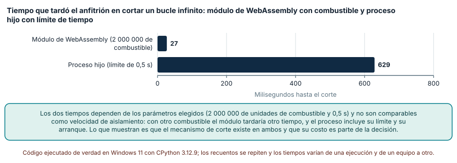

# SE-287 — Taller: elegir y aislar un runtime para una carga no confiable

[← SE-286 — Confianza cero en la práctica](https://github.com/vladimiracunadev-create/modern-software-engineering-program/blob/main/classes/part-23-runtimes-y-plataformas-modernas/se-286-confianza-cero-en-la-practica/README.md) · [↑ Parte 23](https://github.com/vladimiracunadev-create/modern-software-engineering-program/blob/main/classes/part-23-runtimes-y-plataformas-modernas/README.md) · [📚 Índice completo](https://github.com/vladimiracunadev-create/modern-software-engineering-program/blob/main/classes/README.md) · [🌐 Portal](https://vladimiracunadev-create.github.io/modern-software-engineering-program/classes/SE-287.html) · [SE-288 — Proyecto: plataforma de ejecución aislada con evidencia →](https://github.com/vladimiracunadev-create/modern-software-engineering-program/blob/main/classes/part-23-runtimes-y-plataformas-modernas/se-288-proyecto-plataforma-de-ejecucion-aislada-con-evidencia/README.md)

## Punto profesional y fundamento pedagógico

**Punto profesional.** El taller existe para que la elección de un runtime y de una frontera de aislamiento deje de ser una opinión y se convierta en un resultado que cualquiera puede repetir: seis comportamientos hostiles, tres formas de ejecutar código ajeno, una matriz de qué contiene cada una y una decisión por carga de trabajo con su costo. No se aprende leyendo qué debería pasar: se escribe el código hostil, se ejecuta contra cada candidato y se lee lo que ocurrió, incluidas las veces en que lo que se creía contenido no lo estaba.

**Por qué aparece aquí.** Es el taller de la [Parte 23](../README.md): aplica `SE-277` y `SE-278` (WebAssembly y su arranque), `SE-282` (fronteras de aislamiento), `SE-283` (qué demuestra la atestación) y `SE-286` (qué puede hacer una credencial robada), y prepara el proyecto `SE-288`. Usa el método de `SE-437` (medir con entorno declarado) y el mínimo privilegio de `SE-459`.

**Error conceptual que debe corregir.** Creer que el candidato más aislado es siempre el correcto. El módulo de WebAssembly contiene los seis comportamientos del taller, y sin embargo no ejecuta un script de Python con sus bibliotecas; el proceso hijo ejecuta cualquier cosa y contiene dos de seis. La decisión nace de un par: *qué necesita hacer la carga* y *qué no debe poder hacer*. Un runtime más fuerte que la necesidad produce una plataforma que nadie usa; uno más débil, una brecha.

**Secuencia de aprendizaje.** Antes de ejecutar, completas a mano la matriz de seis comportamientos por tres candidatos con tu predicción («contiene» o «no contiene») y la justificas. Después ejecutas el taller, comparas, anotas dónde te equivocaste, y aplicas el resultado a cuatro cargas de *Avisos* con una regla de decisión escrita.

**Evidencia de aprendizaje.** `taller-runtime.md` con la matriz predicha frente a la medida, las diferencias explicadas, la regla de decisión por carga, el costo medido de cada candidato, y lo que el taller no cubrió.

**Límite de la conclusión.** Se ejecutó en Windows 11 con Python 3.12.9 y `wasmtime` 50.0.1. El candidato «`exec` sin funciones integradas» solo se probó en las tres conductas que no pueden colgar el proceso (introspección, entorno y la existencia de la ruta a archivos y red); el bucle infinito y la bomba de memoria se declararon no ejecutados por la razón que enseñan (no se pueden acotar en el mismo proceso). El proceso hijo no tiene perfil de llamadas de sistema ni límite de memoria del sistema operativo (en Windows exigirían objetos de trabajo, que no se probaron). **No se ejecutó** ningún contenedor, microVM ni núcleo de aplicación. Los tiempos varían entre ejecuciones. No se invocó ningún modelo de lenguaje.

### Trazabilidad fuente → afirmación

| Fuente primaria u oficial | Afirmación que respalda | Lo que no prueba |
|---|---|---|
| [WebAssembly: Security](https://webassembly.org/docs/security/) | Un módulo solo accede a lo que el anfitrión le concede. | No cubre errores del runtime. |
| [Wasmtime: Security](https://docs.wasmtime.dev/security.html) | Declara el modelo de amenazas y los límites configurables del runtime. | No sustituye medir tu integración. |
| [NIST SP 800-190](https://csrc.nist.gov/pubs/sp/800/190/final) | Los contenedores comparten el núcleo del anfitrión y tienen riesgos propios. | No ejecuta ninguno aquí. |
| [`subprocess`](https://docs.python.org/3/library/subprocess.html) | Documenta el entorno del hijo, el tiempo máximo y la terminación del proceso. | No aísla archivos ni red. |
| [`socket`](https://docs.python.org/3/library/socket.html) | Documenta las conexiones que el hijo abre contra el servidor local del taller. | No garantiza ninguna política de red. |

## Antes de empezar

Recupera lo aprendido en `SE-282`: un proceso hijo con entorno vacío y tiempo máximo contiene el tiempo y el entorno. La pregunta activa es: **de los seis comportamientos hostiles (bucle, memoria, archivo, entorno, red, introspección), ¿cuáles esperas que contenga cada candidato, y cuál te sorprendería que no contuviera?** Escribe tu matriz antes de ejecutar nada.

## Prerrequisitos

- Haber completado `SE-277`, `SE-278`, `SE-282`, `SE-283`, `SE-285` y `SE-286`.
- Python 3.11 o posterior y `wasmtime==50.0.1` (sin él, la columna de Wasm sale como `NO EJECUTADO`).
- Permiso para abrir un socket en `127.0.0.1` (el taller solo conecta a su propio servidor local) y para lanzar procesos hijos.
- Una carpeta temporal: el taller crea y borra la suya con `tempfile`.

## Problema auténtico

*Avisos* ha acumulado cuatro cargas con código que no escribió su equipo: las reglas de aviso de las universidades (funciones puras de pocas instrucciones), los scripts de preparación de datos (Python con bibliotecas), el cálculo de riesgo con modelos de un proveedor (numérico, con CPU intensiva) y los filtros de tráfico que un cliente quiere cargar en los nodos. Cada una pide una frontera distinta y alguien tiene que decidirlas. El equipo de producto quiere «un solo mecanismo para todo» por simplicidad; el de seguridad quiere «el más fuerte para todo» por prudencia. El taller prueba si cualquiera de las dos posiciones sobrevive a la batería.

El trabajo es concreto: escribir seis comportamientos hostiles, ejecutarlos contra tres candidatos, explicar cada celda de la matriz, medir el costo de cada candidato, y producir una regla de decisión que asigne un candidato a cada carga y diga qué haría falta para cambiarla.

## Objetivos observables

Al terminar podrás:

1. diseñar una batería de comportamientos hostiles que ejerza cada propiedad de aislamiento (CPU, memoria, archivos, entorno, red, introspección) y ejecutarla de forma segura y local;
2. leer una matriz de contención e identificar qué mecanismo es responsable de cada celda y qué las dejaría abiertas;
3. contrastar una predicción con la medida y explicar cada diferencia;
4. asignar un candidato de aislamiento a cada carga con una regla escrita que incluya costo, capacidad y amenaza;
5. documentar lo que el taller no cubrió para que ninguna conclusión se extienda más allá de lo medido.

## Mapa conceptual

![Diagrama de flujo con 8 pasos. Recorrido: «Carga de trabajo»; luego «¿Se puede compilar a Wasm y no necesita bibliotecas del sistema?»; luego «Módulo Wasm: combustible, memoria, cero importaciones» y «¿Código de varios inquilinos o desconocido?»; luego «Proceso con entorno propio, directorio temporal y tiempo máximo» y «Proceso dentro de contenedor reforzado, núcleo de aplicación o microVM»; luego «Batería hostil: mismas seis pruebas»; luego «Matriz de contención y decisión con su condición de revisión».](../../../site/assets/figures/mermaid-ef0f3951ef.svg)

La primera pregunta es de capacidad (¿puede ese candidato ejecutar la carga?). La segunda es de amenaza. La batería no decide: confirma que la configuración elegida contiene lo que se esperaba, y se ejecuta de nuevo cada vez que cambia la configuración.

## Temas y por qué importan

| Tema | Por qué cambia una decisión profesional | Evidencia mínima |
|---|---|---|
| Batería de comportamientos | Convierte una creencia en una prueba repetible. | Seis casos ejecutados |
| Matriz de contención | Muestra qué mecanismo es responsable de cada propiedad. | Tabla de 6 × 3 |
| Predicción frente a medida | Detecta dónde el modelo mental estaba mal. | Diferencias explicadas |
| Capacidad frente a fuerza | La frontera más fuerte puede no ejecutar la carga. | Qué ejecuta cada candidato |
| Costo | Define cuántas fronteras por segundo caben. | Tiempos de crear y de cortar |
| Regla de decisión | Hace la elección revisable. | Regla por carga con condición de cambio |
| Alcance | Impide extender la conclusión. | Lista de no cubierto |

## Conceptos y decisiones

### 1. Diseñar la batería

Cada comportamiento hostil ejerce una propiedad distinta, para que la matriz muestre qué mecanismo contiene qué. El **bucle infinito** prueba el límite de CPU. La **bomba de memoria** (reservar 256 MiB, o intentar crecer la memoria mil veces) prueba el límite de memoria. **Leer un archivo ajeno** (un archivo con contenido reconocible en una carpeta temporal fuera del directorio del invitado) prueba el aislamiento del sistema de archivos. **Leer el entorno del servicio** (una variable con un valor de ejemplo) prueba que no se hereden secretos. **Abrir una conexión de red** (contra un servidor local del taller que registra si llegó algo) prueba el aislamiento de red. **Escapar por introspección** prueba que la restricción del lenguaje no sea la frontera. Dos precauciones de seguridad del taller: todo es local (el único servidor escucha en `127.0.0.1` con un puerto que asigna el sistema), y nada intenta dañar la máquina (no hay bomba de procesos ni escritura fuera de la carpeta temporal).

### 2. Candidato 1: `exec` con funciones integradas vacías

Es la solución que se suele proponer primero: ejecutar el código ajeno con `exec` y un ámbito cuyo `__builtins__` es un diccionario vacío, de modo que no existan `open`, `import` ni `len`. El taller prueba solo lo que no puede colgar el proceso. Resultado: el código `().__class__.__base__.__subclasses__()` llegó a 323 clases del intérprete en esta ejecución y, desde la clase `_wrap_close`, a las globales del módulo del sistema operativo (el módulo `os` con su función `system`). El bucle infinito y la bomba de memoria no se ejecutaron: en el mismo proceso, un bucle no se puede cortar desde fuera y una reserva de memoria no tiene límite. Marcar esas dos celdas como «no ejecutado» es parte del resultado; son las que *explican* por qué este candidato no es una frontera. Las de archivos y red son alcanzables por la misma ruta que el entorno y no se ejecutaron: no hacía falta demostrar lo que la introspección ya prueba.

### 3. Candidato 2: proceso hijo con entorno vacío y tiempo máximo

Es la solución que se suele proponer segunda: lanzar un intérprete aparte, con `-I`, un entorno construido desde cero, un directorio de trabajo temporal y un tiempo máximo. Resultados de la ejecución: el **bucle infinito** quedó contenido, con el hijo terminado a los 629 ms con un límite de 0,5 s. El **entorno** quedó contenido: la variable del servicio salió como `None`. La **bomba de memoria** no quedó contenida: el hijo reservó 256 MiB sin problema. La **lectura de un archivo ajeno** no quedó contenida: leyó el contenido del archivo del servicio, porque el hijo corre con los permisos del mismo usuario. La **conexión de red** no quedó contenida: el servidor local recibió la conexión. La introspección no aplica: el hijo es un intérprete completo, y todo lo que se pueda hacer desde Python se puede hacer. Dos de seis. Es una frontera modesta y útil: contiene lo que más ocurre por accidente (bucles y secretos heredados) y no contiene lo que haría un código hostil.

### 4. Candidato 3: módulo de WebAssembly con combustible y memoria acotados

El módulo del taller se instancia con 2 000 000 de unidades de combustible, memoria de una página (65 536 bytes) fijada por el anfitrión y cero importaciones. Resultados: el **bucle infinito** quedó contenido con una trampa por combustible agotado a los 27 ms. La **bomba de memoria** (mil llamadas a `memory.grow`) quedó contenida: la memoria sigue en una página. La **lectura de un archivo**: el módulo no tiene una llamada para abrir archivos; lo más parecido, leer fuera de su memoria, da una trampa `out of bounds memory access`. El **entorno**: cero importaciones, no hay forma de nombrarlo. La **red**: un módulo que importa una función de conexión que el anfitrión no define no se instancia. La **introspección**: no existe en el formato. Seis de seis, y con una advertencia: contiene porque no puede *expresar* esas operaciones; si el anfitrión define una importación que abre archivos o conexiones con lo que el módulo le pasa, el aislamiento desaparece en esa importación. Y solo ejecuta código compilado a Wasm.

### 5. Leer la matriz

La matriz se lee por filas y por columnas. Por filas: ninguna propiedad la contienen los tres candidatos; el bucle y el entorno los contienen dos, y la introspección solo la hace innecesaria quien no tiene introspección que ofrecer. Por columnas: el primer candidato no contiene lo que importa; el segundo contiene lo accidental; el tercero contiene todo lo probado pero a cambio de una capacidad limitada. La lectura profesional: *cada fila es una propiedad que alguien tiene que haber decidido*; una celda «no contenido» es aceptable si es una decisión explícita (el hijo lee archivos porque el script de preparación de datos necesita leer los datos de su universidad) y es un defecto si es un descuido. Y la matriz sale con el entorno y la versión: se vuelve a ejecutar tras cada cambio de configuración.

### 6. El costo de cada candidato

Medido en el taller y en `SE-282`: una instancia de Wasm con un módulo ya compilado cuesta unos 0,09 ms; cortar un bucle infinito por combustible tardó 27 ms (2 000 000 de unidades) frente a 629 ms con un proceso con límite de 0,5 s. Un proceso nuevo de Python cuesta entre unos 100 y 160 ms solo por arrancar. La consecuencia: Wasm permite una frontera por petición en el camino caliente; el proceso, una por tarea de segundos o minutos. Los contenedores y microVM no se midieron: la decisión que dependa de ellos queda con una condición de medir antes de comprometer.

### 7. De la matriz a la regla de decisión

La regla del taller tiene tres entradas por carga: ¿puede ejecutarla el candidato?, ¿qué amenaza hay (código propio, de un cliente, arbitrario)?, ¿cuánto cuesta crear la frontera frente al trabajo que protege? Aplicada a las cuatro cargas de *Avisos*: (a) las **reglas de aviso**, funciones puras de pocas instrucciones: módulo de Wasm, sin importaciones, una instancia por petición. (b) Los **scripts de preparación de datos** de una universidad, con bibliotecas: proceso hijo con entorno vacío, directorio propio y tiempo máximo *dentro de* una frontera más fuerte (contenedor reforzado o microVM), porque el hijo no contiene archivos ni red; esa frontera adicional no se midió y queda como condición. (c) El **cálculo de riesgo** de un proveedor: si el binario es de un proveedor con el que hay contrato, un proceso propio con límites; si el código es arbitrario, la misma frontera que (b); en ambos, el rendimiento se decide con `SE-281`. (d) Los **filtros de tráfico** de un cliente: no se ejecutan en nodos compartidos con otros clientes; el verificador de eBPF (`SE-279`) protege el núcleo del programa, no a un cliente de otro. Cada línea de la regla lleva su condición de revisión: qué evidencia nueva o qué incidente la cambiaría.

## La matriz de contención

La primera figura es la matriz de la ejecución: qué contuvo cada candidato.


**Cómo leer la figura.** Cada fila es un comportamiento y cada columna un candidato; la celda dice si lo contuvo (1), no lo contuvo (0) o no se ejecutó (guion). Mira cuántos unos tiene cada columna: es lo que cada candidato contiene de lo probado. **Dónde deja de valer:** es una ejecución en Windows con un proceso sin límites del sistema operativo; con un objeto de trabajo o un contenedor las celdas del proceso cambiarían. Las celdas del primer candidato que no se ejecutaron están como guion, no como cero.

## Cortar un bucle infinito

La segunda figura compara cuánto tardó cada candidato en cortar el bucle.



**Cómo leer la figura.** Cada barra es el tiempo que pasó entre lanzar el bucle y que el anfitrión lo detuviera. Mira que el proceso incluye su límite de 0,5 s y su arranque; el módulo, la cantidad de combustible que se le dio. **Dónde deja de valer:** los dos tiempos dependen de los parámetros elegidos (0,5 s y 2 000 000 de combustible) y no son comparables como «velocidad de aislamiento»: con otro combustible, el módulo tardaría otro tiempo. Muestran que el mecanismo de corte existe en ambos y que su costo es parte de la decisión.

## De la matriz a la decisión

La tercera figura es el árbol de decisión que usa el taller.


**Cómo leer la figura.** Se lee de arriba abajo: capacidad, amenaza y elección. Cada hoja es un candidato y todas pasan por la misma batería. Mira la nota final: la decisión se confirma cada vez, no una sola. **Dónde deja de valer:** es el árbol de este taller con tres candidatos; con contenedores, microVM y núcleo de aplicación el árbol tiene más hojas y sus costos hay que medirlos.

## Definiciones de trabajo

- **[Batería hostil](../../../glosario/entradas/b/bateria-hostil.md):** conjunto de comportamientos que ejercen una propiedad de aislamiento cada uno.
- **[Matriz de contención](../../../glosario/entradas/m/matriz-de-contencion.md):** tabla de qué mecanismo contiene qué comportamiento.
- **[Contención](../../../glosario/entradas/c/contencion.md):** el comportamiento no alcanza lo que no debería (tiempo, memoria, archivos, entorno, red).
- **[Predicción](../../../glosario/entradas/p/prediccion.md):** respuesta anotada antes de ejecutar para contrastarla.
- **[Capacidad](../../../glosario/entradas/c/capacidad.md):** lo que un candidato puede ejecutar.
- **[Condición de revisión](../../../glosario/entradas/c/condicion-de-revision.md):** hecho o medida que cambiaría una decisión.
- **[Falso sentido de aislamiento](../../../glosario/entradas/f/falso-sentido-de-aislamiento.md):** creer que algo contiene lo que no se ha probado.
- **[Regla de decisión](../../../glosario/entradas/r/regla-de-decision.md):** criterio escrito que asigna un candidato a una carga.

## Ejemplo mínimo

La prueba más simple de la batería, el entorno heredado, con un hijo y una variable:

```python
import os, subprocess, sys

os.environ["VARIABLE_DE_PRUEBA"] = "no-real"
codigo = "import os; print(os.environ.get('VARIABLE_DE_PRUEBA'))"
heredado = subprocess.run([sys.executable, "-I", "-c", codigo], capture_output=True, text=True).stdout.strip()
limpio = subprocess.run([sys.executable, "-I", "-c", codigo], capture_output=True, text=True,
                        env={"SYSTEMROOT": os.environ.get("SYSTEMROOT", "")}).stdout.strip()
print(heredado, limpio)   # no-real None
```

Una variable, dos ejecuciones, un resultado. Cada fila de la matriz del taller es una prueba así de pequeña. Lo difícil no es escribirlas: es recordar que hay que escribirlas.

## Ejemplo profesional

*Escenario ilustrativo: las cifras y los resultados que aparecen en este ejemplo son supuestos de la narración, no mediciones.*

El equipo de *Avisos* ejecuta el taller en una sesión de dos horas con producto y seguridad. Antes de ejecutar, cada persona anota su matriz; el responsable de producto predice que el proceso hijo contiene «casi todo» y el de seguridad que ningún candidato lo hace excepto la máquina virtual. Al ejecutar, el proceso hijo contiene dos de seis y el módulo contiene seis de seis. La conversación cambia de «¿cuál es el más seguro?» a «¿qué necesita cada carga?». Las reglas de aviso van a Wasm; los scripts de datos a un proceso dentro de una frontera más fuerte que se evaluará con una medición de arranque y de memoria; el cálculo de riesgo se decide con `SE-281`; los filtros de tráfico se retiran del alcance de la plataforma compartida. Alguien pregunta por qué el módulo «no cuenta» si no puede ejecutar los scripts de datos. La respuesta queda en el acta: contiene seis de seis *de lo que puede ejecutar*; la decisión incluye la capacidad. La batería pasa a formar parte de las pruebas del servicio y se repite con cada versión del runtime.

## Práctica guiada

1. Antes de ejecutar nada, escribe tu matriz de predicciones y una frase de justificación por celda.
2. Ejecuta `python scripts/experiments_part23_c.py taller` y marca las celdas donde te equivocaste.
3. Añade una séptima prueba a la batería (por ejemplo, escribir un archivo fuera de la carpeta temporal o consumir el espacio de disco hasta un límite pequeño y seguro) y ejecútala contra los tres candidatos.
4. Cambia el combustible del módulo a 200 000 y a 20 000 000 y anota el tiempo de corte y el trabajo útil que cabe.
5. Escribe la regla de decisión para las cuatro cargas de *Avisos* y, para cada una, la condición de revisión.

## Ejercicios

1. **Básico.** Explica por qué el proceso hijo contiene el entorno y no la lectura de archivos, aunque corra con el mismo directorio de trabajo temporal.
2. **Intermedio.** Propón cómo cerrarías las dos celdas más débiles del proceso hijo (memoria y red) con mecanismos del sistema operativo y qué prueba de la batería demostraría que funcionó.
3. **Avanzado.** Diseña la batería para un cuarto candidato (un contenedor reforzado o una microVM): qué pruebas añadirías que los tres actuales no ejercen (acceso a dispositivos, a la red del anfitrión, a otros procesos), cómo las ejecutarías de forma segura y qué resultado esperarías.

## Reto verificable

Entrega `taller-runtime.md` con la matriz predicha y la medida, las diferencias explicadas, la séptima prueba que añadiste, la regla de decisión para las cuatro cargas y una sección «lo que este taller no cubrió». Es válido si otra persona ejecuta tu batería y obtiene la misma matriz (con las mismas celdas contenidas y no contenidas) y las condiciones de revisión permiten saber qué evidencia cambiaría la decisión.

## Caso conductor

*Avisos* sale del taller con una regla de decisión por carga y una batería que se repite. `SE-288` los une en un proyecto: una plataforma de ejecución aislada con evidencia, que valida lo que sube, limita lo que ejecuta y registra lo que ocurre de forma verificable.

## Preguntas frecuentes

### ¿Por qué un candidato que no contiene casi nada entra en el taller?

Porque es el que se propone primero y el que más se despliega. Que la matriz lo muestre vale más que cualquier explicación.

### ¿Un módulo de Wasm que contiene seis de seis es completamente seguro?

Contiene esos seis *con esa configuración*. Una importación mal diseñada, una vulnerabilidad del runtime o un canal lateral quedan fuera. La batería se amplía a medida que se conocen más amenazas.

### ¿Se puede probar un contenedor con esta batería?

Sí, y se debe: es el ejercicio 3. El resultado depende del perfil de llamadas, de los grupos de control y de la red del contenedor; por eso no se asume.

### ¿Qué pasa si una celda cambia con una versión nueva del runtime?

Se investiga: puede ser una mejora, un cambio de configuración por defecto o una regresión. Por eso la batería forma parte de las pruebas, no de un informe único.

## Fallo controlado y diagnóstico

**Fallo.** La batería pasa en el entorno de desarrollo (todos los comportamientos contenidos) y falla en producción: el proceso hijo lee un archivo de configuración del servicio.

**Diagnóstico paso a paso.** (1) Se compara el entorno: en desarrollo, el servicio corre con un usuario sin acceso a ese archivo; en producción, con el mismo usuario que el servicio. (2) La lectura de archivos depende de los permisos del usuario con el que corre el hijo, no del hijo. (3) El candidato no tiene un mecanismo propio de aislamiento de archivos. (4) La batería de desarrollo no ejercía ese caso porque el archivo de prueba era legible en ambos entornos por azar. (5) Se corrige ejecutando los hijos con un usuario dedicado sin acceso al servicio, añadiendo un archivo canario con permisos solo del servicio a la batería y repitiéndola en cada entorno.

**Lección.** Una prueba de contención solo vale en el entorno donde se ejecuta. La batería se ejecuta en los entornos reales y con un archivo canario cuyos permisos reproduzcan el caso que se teme.

## Errores comunes y cómo corregirlos

- **No anotar la predicción antes de ejecutar.** Se pierde lo aprendido. Corrige escribiendo primero.
- **Probar solo lo que se espera que pase.** Corrige con comportamientos hostiles reales.
- **Elegir el candidato más fuerte para todo.** Corrige con capacidad y amenaza por carga.
- **Aceptar una celda abierta sin decidirlo.** Corrige escribiendo la decisión.
- **Ejecutar la batería una sola vez.** Corrige repitiéndola con cada cambio.
- **Ejecutar pruebas peligrosas en máquinas compartidas.** Corrige con pruebas locales, acotadas y con permiso.

## Entorno y archivos clave

- `scripts/experiments_part23_c.py`: función `taller`; se ejecuta con `python scripts/experiments_part23_c.py taller`.
- `scripts/experiments_part23_lab.py`: utilidades de medición y versiones.
- `scripts/figures_part23_b.py`: las tres figuras de la clase.
- Python 3.11 o posterior; `wasmtime==50.0.1`; solo conexiones a `127.0.0.1`.

## Seguridad, ética y accesibilidad

Las pruebas hostiles son código de ataque en miniatura: ejecútalas solo en tu máquina o en una de laboratorio autorizada, nunca contra sistemas ajenos. El taller no intenta dañar nada (no hay bomba de procesos ni escritura fuera de la carpeta temporal) y borra lo que crea. Una batería publicada es también una lista de lo que se probó y no se probó: ten el cuidado de que no sirva como guía para atacar una plataforma real. Las figuras tienen texto alternativo y valores escritos, y la matriz no depende solo del color: cada celda dice «contuvo» o «no contuvo».

## Puente hacia el trabajo con agentes

Pídele a un agente que escriba la batería hostil para una configuración dada y compara con la tuya: lo que él propone y tú no pensaste, y al revés, es información. Y cuando un agente afirme que «el código se ejecuta en un entorno aislado», pide la matriz: qué comportamientos se probaron, con qué resultado y en qué entorno. Un agente sin esa evidencia está repitiendo una descripción, no una medición.

## Transferencia

Elige una frontera de aislamiento de tu sistema (un contenedor, un sandbox de un plugin, un entorno de ejecución de un cliente). Escribe la batería de seis a ocho comportamientos que la pondrían a prueba, predice la matriz, ejecútala en un entorno controlado y escribe una decisión por cada celda abierta. Añade la batería a las pruebas del sistema.

## Evaluación y evidencia

| Criterio | Evidencia aceptable | Rechazo |
|---|---|---|
| Batería | Comportamientos que ejercen una propiedad cada uno | Pruebas que solo confirman |
| Predicción | Anotada antes y contrastada | «Ya lo sabía» |
| Matriz | Celdas con evidencia y no ejecutadas marcadas | Celdas supuestas |
| Decisión | Regla por carga con costo y condición de revisión | Un candidato para todo |
| Alcance | Qué no cubrió | Extender más allá de lo medido |

## Fuentes

- WebAssembly. [«Security»](https://webassembly.org/docs/security/). Bytecode Alliance. [«Wasmtime Security»](https://docs.wasmtime.dev/security.html).
- NIST. [SP 800-190](https://csrc.nist.gov/pubs/sp/800/190/final).
- Python Software Foundation. [`subprocess`](https://docs.python.org/3/library/subprocess.html) y [`socket`](https://docs.python.org/3/library/socket.html).

## Límites y siguiente paso

El taller probó tres candidatos con seis comportamientos en una máquina Windows; no probó contenedores, microVM, núcleo de aplicación, perfiles de llamadas de sistema ni límites de memoria del sistema operativo, y dos celdas del primer candidato quedaron sin ejecutar. El siguiente paso, `SE-288`, integra los candidatos en una plataforma con validación, límites, evidencia encadenada e informe firmado.

## Glosario

| Término | Definición breve |
|---|---|
| Batería hostil | Comportamientos que ejercen una propiedad de aislamiento cada uno |
| Matriz de contención | Qué mecanismo contiene qué comportamiento |
| Contención | El comportamiento no alcanza lo que no debe |
| Predicción | Respuesta anotada antes de ejecutar |
| Capacidad | Lo que un candidato puede ejecutar |
| Condición de revisión | Hecho que cambiaría una decisión |
| Falso sentido de aislamiento | Creer contenido lo que no se probó |
| Regla de decisión | Criterio escrito que asigna un candidato a una carga |

Conceptos de esta clase en el [glosario del programa](../../../glosario/README.md): [Alcance](../../../glosario/entradas/a/alcance.md) · [Batería hostil](../../../glosario/entradas/b/bateria-hostil.md) · [Capacidad](../../../glosario/entradas/c/capacidad.md) · [Condición de revisión](../../../glosario/entradas/c/condicion-de-revision.md) · [Contención](../../../glosario/entradas/c/contencion.md) · [Costo](../../../glosario/entradas/c/costo.md) · [Falso sentido de aislamiento](../../../glosario/entradas/f/falso-sentido-de-aislamiento.md) · [Matriz de contención](../../../glosario/entradas/m/matriz-de-contencion.md) · [Predicción](../../../glosario/entradas/p/prediccion.md) · [Regla de decisión](../../../glosario/entradas/r/regla-de-decision.md).

---

[← SE-286 — Confianza cero en la práctica](https://github.com/vladimiracunadev-create/modern-software-engineering-program/blob/main/classes/part-23-runtimes-y-plataformas-modernas/se-286-confianza-cero-en-la-practica/README.md) · [↑ Parte 23](https://github.com/vladimiracunadev-create/modern-software-engineering-program/blob/main/classes/part-23-runtimes-y-plataformas-modernas/README.md) · [📚 Índice completo](https://github.com/vladimiracunadev-create/modern-software-engineering-program/blob/main/classes/README.md) · [🌐 Portal](https://vladimiracunadev-create.github.io/modern-software-engineering-program/classes/SE-287.html) · [SE-288 — Proyecto: plataforma de ejecución aislada con evidencia →](https://github.com/vladimiracunadev-create/modern-software-engineering-program/blob/main/classes/part-23-runtimes-y-plataformas-modernas/se-288-proyecto-plataforma-de-ejecucion-aislada-con-evidencia/README.md)
