# Parte 23 — Software especializado y dominios

La Parte 22 llevó el software a dispositivos sin sistema operativo, donde el tiempo y los recursos son parte de lo correcto. La pregunta cambia de «qué hace el programa en un dispositivo» a «qué reglas trae el dominio en que trabajo y qué evidencia permite afirmar que mi software las respeta». Esta parte trabaja sobre una **plataforma educativa ficticia que incorpora, clase a clase, una pieza de un dominio especializado**: un modelo de entregas a tiempo, una cadena de datos de entregas, un aviso de riesgo con aprendizaje automático, un laboratorio de física, una sala virtual con voz y casco, el cobro de matrículas, un módulo de enfermería escolar, certificados verificables, un mapa de sedes con calendario, y una automatización de avisos. Recorre la reproducibilidad del software científico, la ingeniería de datos y el procesamiento analítico, el aprendizaje automático como componente de producto, los videojuegos y la simulación, los gráficos, el audio y la realidad extendida, las invariantes del dinero, los datos de salud y los sistemas regulados, las cadenas de bloques y los contratos inteligentes, los sistemas geoespaciales y temporales, el low-code, un taller de comparación de riesgos entre dominios y un proyecto de diseño profundo de un dominio elegido.

## Pregunta rectora

> ¿Qué afirmación de dominio se hace, qué validación permite sostenerla y qué defecto pasaría sin que ninguna comprobación lo notara?

## Antes del recorrido clase por clase

Esta parte no enseña un dominio completo ni una herramienta. Enseña a medir cuántos resultados distintos produce una suma según su orden y cuánto vale una estimación con varias semillas, a hacer idempotente una carga de datos y a medir qué pierde una ventana, a detectar una fuga de la etiqueta y a leer el valor predictivo de un aviso según la prevalencia, a fijar el paso de tiempo de una simulación y probar la colisión de lo que va rápido, a calcular el pliegue de un tono y el presupuesto de un fotograma, a representar el dinero con enteros y comparar un libro mayor con un oráculo, a medir la unicidad de un conjunto «anónimo» y los dos errores de fusionar fichas, a calcular la probabilidad de reescribir una cadena y ordenar una reentrada, a distinguir un instante de una hora civil, a probar los pares de decisiones de un flujo y a declarar quién responde por él. Cada clase ejecuta simulaciones con datos sintéticos que muestran un mecanismo (205 totales distintos con los mismos números, 442 filas duplicadas con un 5 % de lotes fallidos, una exactitud que cae de 0,899 a 0,515 en producción, 20 finales distintos con paso variable, un 38,68 % de facturas con un céntimo de diferencia, un 91,2 % de registros únicos tras quitar el nombre, 180 días de una tarea corrida una hora, un 43,9 % de defectos de interacción hallados con dos pruebas) y declara lo que esa simulación no demuestra.

```mermaid
flowchart LR
    A[Reproducibilidad científica] --> B[Datos y procesamiento analítico]
    B --> C[Aprendizaje automático en producto]
    C --> D[Juegos y simulación]
    D --> E[Gráficos, audio y realidad extendida]
    E --> F[Dinero e invariantes]
    F --> G[Salud y sistemas regulados]
    G --> H[Cadenas de bloques y contratos]
    H --> I[Espacio y tiempo]
    I --> J[Low-code]
    J --> K[Taller de riesgos entre dominios]
    K --> L[Diseño profundo de un dominio]
    L -->|hallazgo o supuesto cambiado| A
```

El diagrama se lee de izquierda a derecha y no es un proceso obligatorio. El retorno indica que un hallazgo en un dominio (un oráculo que discrepa, un supuesto que cambia el signo de una decisión) reabre la afirmación que se había dado por sostenida; un dosier verificado no cierra el diseño, lo fecha.

## Resultados acumulativos

Podrás medir cuántos totales distintos produce la suma de los mismos datos en otro orden, cuánto vale una estimación con muchas semillas y en cuántos pasos se separan dos trayectorias de un sistema caótico; comparar una carga que añade con una que escribe por clave, medir los eventos tardíos que descarta cada tolerancia y el desequilibrio de una clave popular; medir cuánto infla una fuga la métrica de prueba, el valor predictivo de un detector según la prevalencia y las alarmas de deriva según el tamaño de la ventana; comparar el paso variable con el fijo, la colisión discreta con la barrida y el bucle con y sin tope de pasos; medir la compensación entre la latencia de un búfer de audio y sus subcargas, el pliegue de un tono y los fotogramas fuera de presupuesto; comprobar el dinero con coma flotante, un libro mayor con invariantes y con oráculo y los cobros duplicados con y sin clave; medir la unicidad por generalización, las fusiones erróneas por umbral y los avisos de una alarma; contar los intentos de una prueba de trabajo, la probabilidad de un doble gasto y la extracción por reentrada; medir el error de la distancia plana, un año de reloj con cambio de hora y los candidatos de una rejilla; comparar pruebas aleatorias con pruebas de pares, los duplicados según la memoria y los flujos huérfanos; medir la estabilidad de un ranking de riesgos, el acuerdo entre evaluadores y la cobertura de los controles; y entregar un dosier de dominio con un validador, un análisis de sensibilidad y un manifiesto canónico.

Al finalizar podrás defender un diseño de dominio con su afirmación refutable, sus invariantes, su oráculo, sus experimentos reproducibles en dos sistemas, su sensibilidad a los supuestos y una lista de lo que ningún validador ve, y podrás indicar qué parte de tu conclusión es observación, cuál es inferencia y cuál es suposición.

## Prerrequisitos enlazados

- [Parte 4 — Pensamiento computacional](https://github.com/vladimiracunadev-create/modern-software-engineering-program/blob/main/classes/part-04-pensamiento-computacional-y-resolucion-de-problemas/): modelado, enumeración de casos y razonamiento sobre evidencia.
- [Parte 7 — Estructuras de datos y algoritmos](https://github.com/vladimiracunadev-create/modern-software-engineering-program/blob/main/classes/part-07-estructuras-de-datos-y-algoritmos/): medir, comparar y no confundir un resultado con un modelo.
- [Parte 13 — Especificaciones, contratos y modelos](https://github.com/vladimiracunadev-create/modern-software-engineering-program/blob/main/classes/part-13-especificaciones-contratos-y-modelos/): invariantes, contratos comprobables y modelos de referencia.
- [Parte 20 — Backend, APIs y procesamiento asíncrono](https://github.com/vladimiracunadev-create/modern-software-engineering-program/blob/main/classes/part-20-backend-apis-y-procesamiento-asincrono/): reintentos, idempotencia y entrega al menos una vez.
- [Parte 22 — Embedded, IoT y tiempo real](https://github.com/vladimiracunadev-create/modern-software-engineering-program/blob/main/classes/part-22-embedded-iot-y-tiempo-real/): plazos, simulaciones con semilla fija y la lista de lo que una simulación no demuestra.
- Python 3.11+ y terminal; los experimentos usan solo la biblioteca estándar y datos sintéticos.

## Bloques y progresión

1. **Ciencia, datos y aprendizaje:** las clases 277–279 hacen repetible un cálculo, una cadena de datos y la evaluación de un modelo, y separan lo que garantiza la repetición exacta de lo que exige variar semillas, reintentos y poblaciones.
2. **Tiempo real para las personas:** las clases 280–281 tratan el paso de tiempo de una simulación, la colisión de lo rápido, el muestreo de una señal y el presupuesto de un fotograma.
3. **Dominios donde el error se paga:** las clases 282–284 cubren el dinero, la salud y las cadenas de bloques, donde una comprobación tiene que decir lo que nunca debe pasar y lo que debe pasar.
4. **Espacio, tiempo y automatización:** las clases 285–286 tratan las coordenadas, los relojes y los flujos visuales, donde la convención oculta es la fuente del fallo.
5. **Aplicar e integrar:** las clases 287–288 comparan riesgos entre dominios y entregan el diseño profundo de uno.

## Evidencia medida y límites

Las figuras y los ejemplos de esta parte usan simulaciones ejecutadas con CPython 3.12.9 en Windows 11 y repetidas con CPython 3.12.3 en Ubuntu bajo WSL2. Los datos son **sintéticos** y las semillas están fijadas: las salidas de los doce experimentos fueron idénticas en ambos sistemas, salvo el orden de listado de los riesgos con la misma frecuencia en `SE-287` (el orden de un conjunto de cadenas no está definido) y la codificación de los acentos en la consola de Windows, sin diferencias en ninguna cifra. Ninguno mide tiempos de ejecución. Todo el código usa solo la biblioteca estándar.

Los experimentos son: el orden de la suma de veinte mil números, la dispersión de una estimación de π con doscientas semillas y el horizonte de divergencia de un mapa logístico (`SE-277`); una carga con reintentos que añade o escribe por clave, los eventos tardíos según la tolerancia de una ventana y la carga de la partición más cargada con y sin sal (`SE-278`); una variable que contiene la etiqueta, el valor predictivo según la prevalencia y las alarmas de un índice de deriva (`SE-279`); un resorte con paso variable y fijo, la colisión discreta y la barrida contra una pared fina y un bucle con y sin tope de pasos (`SE-280`); la latencia y las subcargas de un búfer de audio, el pliegue de tonos muestreados y los fotogramas fuera del presupuesto de una pantalla de 90 Hz (`SE-281`); seis comprobaciones del dinero con coma flotante, cinco defectos en un libro mayor y los cobros duplicados con y sin clave (`SE-282`); la unicidad de cinco mil registros por nivel de generalización, la fusión de fichas por umbral y los avisos de una alarma (`SE-283`); los intentos de una prueba de trabajo con SHA-256, la probabilidad de rehacer la cadena y una reentrada en un contrato de juguete (`SE-284`); el error de la distancia plana, un año de reloj con cambio de hora y los candidatos de un índice de rejilla (`SE-285`); las pruebas aleatorias frente a las de pares, los duplicados según la memoria de identificadores y los flujos sin responsable (`SE-286`); la estabilidad de un ranking, el acuerdo entre evaluadores y la cobertura de controles (`SE-287`); y un validador de dosier con ocho mutaciones, la sensibilidad de una decisión y las huellas de un paquete (`SE-288`).

Los parámetros (las magnitudes de 10⁻⁶ a 10⁸, el mapa logístico de r = 3,9, los fallos a mitad de lote, el retraso lognormal de mediana 5 s, la distribución de Zipf, la copia de la etiqueta correcta el 90 % de las veces, la sensibilidad de 0,90 y la especificidad de 0,95, el resorte de rigidez 40, la pared de 0,2 unidades, los costes de actualización con picos del 2 %, el coste de audio con picos lognormales, el coste de dibujo con σ = 0,25, el IVA del 19 %, el libro de tres cuentas, la población de cinco mil registros, los nombres de doce por doce combinaciones, los pacientes con deterioros del 2 %, los 12 a 16 bits de dificultad, la fracción de poder del atacante, la zona con dos cambios al año, los veinte mil puntos de la rejilla, las diez bifurcaciones, el 5 % de re-entregas con mediana de 30 s, el 15 % anual de salida de responsables, las puntuaciones de 1 a 5 de los diez dominios, los ocho controles, los rangos del modelo de coste y las ocho mutaciones del dosier) son supuestos del autor, no datos de un producto, una institución ni de personas reales. Las puntuaciones de riesgo de `SE-287` son un juicio ilustrativo, y los acuerdos entre evaluadores son ruido gaussiano simulado, no mediciones de personas. El validador de `SE-288` se escribió con las reglas que se le ocurrieron al autor: su alcance real es desconocido. Los generadores de números pseudoaleatorios de Python se usaron solo para simular; no son criptográficos. No se usó ningún código científico real, motor de procesamiento, biblioteca de aprendizaje automático, motor de juego, tarjeta gráfica, casco, procesador de pagos, banco, dato clínico, red de cadena de bloques ni base de datos de zonas horarias o espacial; no se midió confort ni percepción, no se evaluó ninguna norma y no se auditó ningún sistema. Esta parte no tiene laboratorio propio en `labs/`; el proyecto integrador `SE-288` define el dosier y la evidencia. Cada clase termina con un puente hacia el trabajo con agentes.

## Guía razonada clase por clase

La plataforma educativa ficticia mantiene un mismo caso mientras cambia el dominio. Cada clase explica qué incertidumbre reduce, qué simulación la muestra, qué no demuestra y qué evidencia permite abandonar la conclusión.

### Bloque 1 — Ciencia, datos y aprendizaje

#### SE-277 — Software científico y reproducibilidad

Repetir, reproducir y replicar son promesas distintas con fallos distintos. La clase mide cuántos totales produce la suma de los mismos datos en otro orden, cuánto varía una estimación con la semilla y cuántos pasos tarda un sistema caótico en separarse de una copia casi idéntica.

El estudiante entrega una declaración de reproducibilidad con versiones, semillas, tolerancia y límites. `SE-278` mueve esos datos por una cadena de procesamiento.

#### SE-278 — Ingeniería de datos y procesamiento analítico

Una cadena de datos es correcta cuando repetir una etapa no cambia el estado. La clase compara una carga que añade con una que escribe por clave tras fallos a mitad de lote, mide qué eventos tardíos pierde cada tolerancia y calcula el desequilibrio que una clave popular causa entre particiones.

El estudiante entrega la cadena con escritura idempotente, ventana y reparto medido. `SE-279` usa esas tablas como entrada de un modelo.

#### SE-279 — Machine learning como componente de producto

Una métrica solo vale si la prueba imita el uso. La clase mide cuánto infla la exactitud una variable que contiene la respuesta, cuántos avisos son falsos según la prevalencia y con qué frecuencia suena una alarma de deriva sin cambio real.

El estudiante entrega el aviso con línea base, revisión de variables, métricas con prevalencia y plan de respaldo. `SE-280` pasa a un dominio donde el tiempo es lo que debe ser correcto.

### Bloque 2 — Tiempo real para las personas

#### SE-280 — Videojuegos, loops, entidades y simulación

El paso de tiempo decide si una partida se puede repetir y si lo rápido atraviesa lo fino. La clase cuenta los finales distintos de una simulación con paso variable y fijo, mide a qué velocidad una colisión discreta pierde una pared y compara un bucle con y sin tope de pasos cuando actualizar cuesta más que el paso.

El estudiante entrega un laboratorio con paso fijo, colisión barrida y tope de pasos. `SE-281` baja el presupuesto a milisegundos de audio y de imagen.

#### SE-281 — Gráficos, audio, XR y experiencias inmersivas

Lo que una persona ve y oye es una señal muestreada con un plazo. La clase mide la compensación entre la latencia de un búfer de audio y sus subcargas, comprueba el pliegue de un tono sobre la mitad de la tasa de muestreo y cuenta los fotogramas fuera del presupuesto de una pantalla de 90 Hz.

El estudiante entrega la sala virtual con búfer adaptable, filtro previo, vigilancia del percentil alto y alternativas sensoriales. `SE-282` entra en un dominio donde el error se cobra.

### Bloque 3 — Dominios donde el error se paga

#### SE-282 — Fintech, contabilidad e invariantes monetarias

El dinero exige enteros, una regla de redondeo escrita y comprobaciones con oráculo. La clase hace seis comprobaciones con coma flotante, inyecta cinco defectos en un libro mayor y mide los cobros duplicados con y sin clave de idempotencia.

El estudiante entrega el cobro con importes enteros, libro de doble entrada y clave de idempotencia. `SE-283` pasa a datos todavía más delicados.

#### SE-283 — Salud, datos sensibles y sistemas regulados

Quitar el nombre no anonimiza, un umbral único fusiona historias y un exceso de avisos es un riesgo. La clase mide la unicidad de cinco mil registros por generalización, las fusiones correctas y erróneas por umbral y los avisos por deterioro de una alarma.

El estudiante entrega el módulo con tres almacenes, conjunto generalizado, fusión en tres zonas y alarma con persistencia. `SE-284` sustituye la institución por un protocolo.

#### SE-284 — Blockchain, consenso y contratos inteligentes

Una cadena hace detectable una alteración, no verdadero un dato. La clase cuenta los intentos de una prueba de trabajo, compara la probabilidad de rehacer la cadena por simulación y por fórmula y reproduce una reentrada en un contrato de juguete.

El estudiante entrega una decisión justificada entre firma, registro auditable y cadena. `SE-285` pasa al espacio y al tiempo.

### Bloque 4 — Espacio, tiempo y automatización

#### SE-285 — Sistemas geoespaciales y temporales

Una coordenada y una hora son datos con convención. La clase mide el error de tratar grados como un plano, cuenta las horas repetidas e inexistentes de un año con cambio de hora y los candidatos que examina un índice de rejilla según el tamaño de celda.

El estudiante entrega el mapa con haversine y prefiltro, y el calendario con instante UTC, zona y hora local. `SE-286` pasa a la automatización visual.

#### SE-286 — Low-code, no-code y automatización visual

Quitar el código no quita las decisiones. La clase compara pruebas aleatorias con pruebas de pares en un flujo de diez bifurcaciones, mide los duplicados que pasan una memoria corta de identificadores y cuántas automatizaciones quedan sin responsable.

El estudiante entrega la automatización con pruebas de pares, receptor idempotente, responsables y registro. `SE-287` pone los dominios uno al lado de otro.

### Bloque 5 — Aplicar e integrar

#### SE-287 — Taller: comparar riesgos entre dominios

Un ranking de riesgos sin su estabilidad es una opinión con números. El taller mide cuánto resiste el orden de diez dominios a otros pesos, cuánto discrepan dos evaluadores simulados y qué riesgos cubre una lista corta de controles.

El estudiante entrega la matriz con anclas, justificaciones, estabilidad, acuerdo, cobertura y la lista de lo que no se compara. `SE-288` aplica el método a un dominio.

#### SE-288 — Proyecto: diseño profundo de un dominio elegido

Un dosier completo no es un dosier correcto. El proyecto valida un dosier con ocho mutaciones, mide qué supuestos cambian el signo de una decisión de construir o comprar y compara una huella de bytes con una canónica. La Parte 24 vuelve al diseño del código.

El estudiante entrega el dosier, el validador, la sensibilidad, el manifiesto y la lista de lo que el validador no ve.

## Resumen operativo del recorrido

| Clase | Capacidad que construye | Pregunta que resuelve | Evidencia acumulativa |
|---|---|---|---|
| [SE-277](https://github.com/vladimiracunadev-create/modern-software-engineering-program/blob/main/classes/part-23-software-especializado-y-dominios/se-277-software-cientifico-y-reproducibilidad/) | Software científico y reproducibilidad | ¿Qué debo conservar para repetir mi cálculo y qué variar para saber qué vale? | `science-log.md` con orden, semillas y horizonte |
| [SE-278](https://github.com/vladimiracunadev-create/modern-software-engineering-program/blob/main/classes/part-23-software-especializado-y-dominios/se-278-ingenieria-de-datos-y-procesamiento-analitico/) | Ingeniería de datos y procesamiento analítico | ¿Qué garantiza la cadena si una etapa falla o un evento llega tarde? | `data-log.md` con idempotencia, ventana y reparto |
| [SE-279](https://github.com/vladimiracunadev-create/modern-software-engineering-program/blob/main/classes/part-23-software-especializado-y-dominios/se-279-machine-learning-como-componente-de-producto/) | Machine learning como componente de producto | ¿Qué dice la métrica y qué hace el producto si el modelo se equivoca? | `ml-log.md` con fuga, prevalencia y deriva |
| [SE-280](https://github.com/vladimiracunadev-create/modern-software-engineering-program/blob/main/classes/part-23-software-especializado-y-dominios/se-280-videojuegos-loops-entidades-y-simulacion/) | Videojuegos, loops, entidades y simulación | ¿Qué garantiza el bucle cuando cambia el tiempo entre fotogramas? | `game-log.md` con paso, colisión y tope de pasos |
| [SE-281](https://github.com/vladimiracunadev-create/modern-software-engineering-program/blob/main/classes/part-23-software-especializado-y-dominios/se-281-graficos-audio-xr-y-experiencias-inmersivas/) | Gráficos, audio, XR y experiencias inmersivas | ¿Qué límite de información y qué plazo impone el dispositivo? | `media-log.md` con búfer, pliegue y fotogramas |
| [SE-282](https://github.com/vladimiracunadev-create/modern-software-engineering-program/blob/main/classes/part-23-software-especializado-y-dominios/se-282-fintech-contabilidad-e-invariantes-monetarias/) | Fintech, contabilidad e invariantes monetarias | ¿Qué defecto pasaría sin que ninguna invariante lo notara? | `money-log.md` con redondeo, oráculo y clave |
| [SE-283](https://github.com/vladimiracunadev-create/modern-software-engineering-program/blob/main/classes/part-23-software-especializado-y-dominios/se-283-salud-datos-sensibles-y-sistemas-regulados/) | Salud, datos sensibles y sistemas regulados | ¿Quién puede reidentificar, mezclar o ignorar un dato de salud? | `health-log.md` con unicidad, fusión y alarma |
| [SE-284](https://github.com/vladimiracunadev-create/modern-software-engineering-program/blob/main/classes/part-23-software-especializado-y-dominios/se-284-blockchain-consenso-y-contratos-inteligentes/) | Blockchain, consenso y contratos inteligentes | ¿Qué garantiza el protocolo y qué depende del código y del atacante? | `chain-log.md` con trabajo, confirmaciones y reentrada |
| [SE-285](https://github.com/vladimiracunadev-create/modern-software-engineering-program/blob/main/classes/part-23-software-especializado-y-dominios/se-285-sistemas-geoespaciales-y-temporales/) | Sistemas geoespaciales y temporales | ¿Qué convención de espacio o de tiempo asume este dato? | `geo-log.md` con distancia, reloj e índice |
| [SE-286](https://github.com/vladimiracunadev-create/modern-software-engineering-program/blob/main/classes/part-23-software-especializado-y-dominios/se-286-low-code-no-code-y-automatizacion-visual/) | Low-code, no-code y automatización visual | ¿Qué decide este flujo y quién responde por él? | `flow-log.md` con pares, duplicados y propiedad |
| [SE-287](https://github.com/vladimiracunadev-create/modern-software-engineering-program/blob/main/classes/part-23-software-especializado-y-dominios/se-287-taller-comparar-riesgos-entre-dominios/) | Taller: comparar riesgos entre dominios | ¿Cuánto resiste el orden de riesgos a otros pesos y evaluadores? | `risk-compare-log.md` con estabilidad, acuerdo y cobertura |
| [SE-288](https://github.com/vladimiracunadev-create/modern-software-engineering-program/blob/main/classes/part-23-software-especializado-y-dominios/se-288-proyecto-diseno-profundo-de-un-dominio-elegido/) | Proyecto: diseño profundo de un dominio elegido | ¿Qué puede refutar otra persona sin preguntarme nada? | `domain-package-log.md`, dosier, validador y manifiesto |

## Proyecto integrador

El proyecto **SE-288** entrega un dosier de dominio con diez secciones (dominio, afirmación, invariantes, datos, experimentos, riesgos, límites, fuentes, decisiones y revisión), un validador de forma con sus mutaciones, un análisis de sensibilidad de la decisión, un manifiesto con huellas canónicas y la lista de afirmaciones que el validador no ve, firmada por quien revisó el contenido. Se acompaña de los límites declarados: qué parte del dosier no se comprobó con datos reales, con un proveedor real ni con una persona experta en el dominio.

## Criterios de salida

- las doce clases explican todos sus temas mediante mecanismos, ejemplos y límites;
- cada afirmación de dominio es refutable y enlaza con el experimento que la sostiene;
- cada escritura que se reintenta tiene una condición de idempotencia comprobada, no supuesta;
- cada invariante va acompañada de un oráculo independiente que cubre lo que la invariante no ve;
- cada convención de espacio o de tiempo (sistema de referencia, zona, redondeo) está declarada y probada en sus bordes;
- las probabilidades, los porcentajes y los parámetros se declaran como supuestos y nunca como mediciones de un producto;
- otra persona reproduce comandos y resultados desde un checkout limpio, en un segundo sistema;
- el informe declara lo observado, lo inferido y lo no ejecutado.

## Preguntas de control por bloque

- ¿Qué parte de este resultado se repite exactamente y qué parte exige variar semillas, órdenes o máquinas?
- ¿Qué pasa si esta etapa se ejecuta dos veces?
- ¿Qué métrica de prueba cambiaría si una variable no existiera al decidir?
- ¿Qué garantiza este bucle cuando el tiempo entre fotogramas cambia?
- ¿Qué defecto pasaría sin que ninguna invariante lo notara?
- ¿Qué convención de espacio o de tiempo está asumiendo este dato?
- ¿Qué parte del dosier depende de que una persona lea el sentido y no de una comprobación?

## Fuentes de la parte

- [Peng, «Reproducible Research in Computational Science» (Science, 2011)](https://doi.org/10.1126/science.1213847) — espectro de reproducibilidad; autoridad: Science.
- [Goldberg, «What every computer scientist should know about floating-point arithmetic» (ACM Computing Surveys, 1991)](https://doi.org/10.1145/103162.103163) — redondeo y no asociatividad; autoridad: ACM Computing Surveys.
- [Akidau et al., «The Dataflow Model» (VLDB, 2015)](https://doi.org/10.14778/2824032.2824076) — tiempo del evento, ventanas y marcas de agua; autoridad: Proceedings of the VLDB Endowment.
- [Kaufman et al., «Leakage in Data Mining» (ACM TKDD, 2012)](https://doi.org/10.1145/2382577.2382579) — fuga de datos; autoridad: ACM Transactions on Knowledge Discovery from Data.
- [Fiedler, «Fix Your Timestep!» (Gaffer On Games)](https://gafferongames.com/post/fix_your_timestep/) — paso fijo y espiral de la muerte; autoridad: autor del artículo.
- [Shannon, «Communication in the Presence of Noise» (Proceedings of the IRE, 1949)](https://doi.org/10.1109/JRPROC.1949.232969) — teorema del muestreo; autoridad: Proceedings of the IRE.
- [Python: `decimal`](https://docs.python.org/3/library/decimal.html) — aritmética decimal con redondeo explícito; autoridad: documentación de Python.
- [Sweeney, «k-anonymity: a model for protecting privacy» (2002)](https://doi.org/10.1142/S0218488502001648) — k-anonimato; autoridad: International Journal of Uncertainty, Fuzziness and Knowledge-Based Systems.
- [Nakamoto, «Bitcoin: A Peer-to-Peer Electronic Cash System» (2008)](https://bitcoin.org/bitcoin.pdf) — cadena de bloques con prueba de trabajo; autoridad: autor del documento.
- [IANA, Time Zone Database](https://www.iana.org/time-zones) — reglas de las zonas horarias; autoridad: IANA.
- [Kuhn, Kacker y Lei, NIST SP 800-142, «Practical Combinatorial Testing»](https://csrc.nist.gov/pubs/sp/800/142/final) — pruebas combinatorias; autoridad: NIST.
- [NIST SP 800-30 Rev. 1, «Guide for Conducting Risk Assessments»](https://nvlpubs.nist.gov/nistpubs/Legacy/SP/nistspecialpublication800-30r1.pdf) — evaluación de riesgos; autoridad: NIST.
- [SWEBOK Guide v4.0a](https://www.computer.org/education/bodies-of-knowledge/software-engineering) — áreas de conocimiento de ingeniería de software; autoridad: IEEE Computer Society.

Las fuentes se vinculan también dentro de cada clase. Definen vocabulario y mecanismos; la adecuación de las decisiones de la plataforma educativa ficticia se demuestra con el caso, la evidencia trazable y la revisión de otra persona, no con la autoridad de la fuente.
