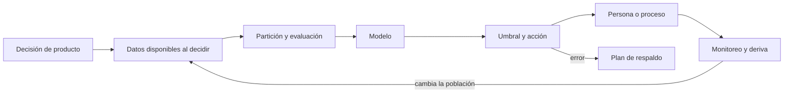
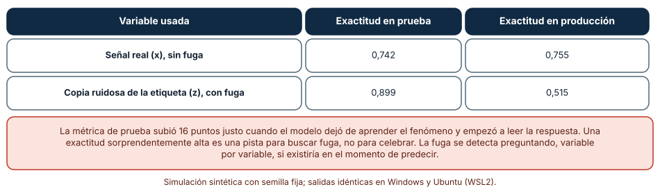
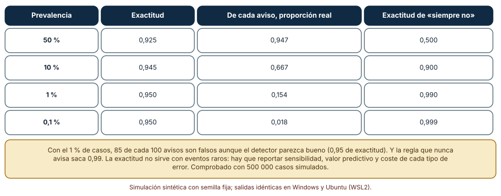
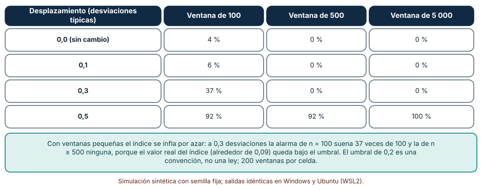

# SE-279 — Machine learning como componente de producto

[← SE-278 — Ingeniería de datos y procesamiento analítico](https://github.com/vladimiracunadev-create/modern-software-engineering-program/blob/main/classes/part-23-software-especializado-y-dominios/se-278-ingenieria-de-datos-y-procesamiento-analitico/README.md) · [↑ Parte 23](https://github.com/vladimiracunadev-create/modern-software-engineering-program/blob/main/classes/part-23-software-especializado-y-dominios/README.md) · [📚 Índice completo](https://github.com/vladimiracunadev-create/modern-software-engineering-program/blob/main/classes/README.md) · [🌐 Portal](https://vladimiracunadev-create.github.io/modern-software-engineering-program/classes/SE-279.html) · [SE-280 — Videojuegos, loops, entidades y simulación →](https://github.com/vladimiracunadev-create/modern-software-engineering-program/blob/main/classes/part-23-software-especializado-y-dominios/se-280-videojuegos-loops-entidades-y-simulacion/README.md)

## Punto profesional y fundamento pedagógico

**Punto profesional.** La clase existe para que trates un modelo de aprendizaje automático como un componente con contrato, límites y fallos propios dentro de un producto, y no como una caja que «tiene una exactitud». Quien lo integra responde por cómo se evaluó, qué pasa cuando se equivoca y cuándo deja de valer.

**Por qué aparece aquí.** Es la tercera clase de la **Parte 23**, después de **Ingeniería de datos y procesamiento analítico**: allí las tablas del tablero se volvieron repetibles; aquí esas tablas alimentan un modelo que decide a quién avisar. Un error de datos ya no mueve un número, mueve una decisión sobre personas. El caso conductor sigue siendo la plataforma educativa ficticia: un aviso temprano a docentes sobre estudiantes con riesgo de no completar un curso.

**Error conceptual que debe corregir.** Creer que una métrica alta en el conjunto de prueba prueba que el modelo servirá en producción. La métrica solo vale si la prueba imita las condiciones de uso: sin fuga de información, con la prevalencia real de lo que se predice y con datos del mismo tipo que los futuros.

**Secuencia de aprendizaje.** Antes de leer los resultados, predices cuánto sube la exactitud cuando una variable contiene una copia de la respuesta y qué proporción de los avisos de un detector serán falsos si el evento es raro; después mides ambos efectos y la frecuencia con que una alarma de deriva suena sin que nada haya cambiado. La secuencia usa predicción, explicación propia, contraste y recuperación. [ICAP](https://icap.education.asu.edu/research) distingue participación de construcción de conocimiento; [How People Learn II](https://nap.nationalacademies.org/catalog/24783/how-people-learn-ii-learners-contexts-and-cultures) exige conectar conocimiento previo, contexto y transferencia; la [práctica de recuperación](https://pubmed.ncbi.nlm.nih.gov/16507066/) respalda producir de nuevo la explicación tras una demora; y [Education for Life and Work](https://nap.nationalacademies.org/resource/13398/dbasse_084153.pdf) exige devolución que explique la causa del error.

**Evidencia de aprendizaje.** `ml-log.md` con la predicción, la exactitud en prueba y en producción simulada con y sin fuga, la tabla de valor predictivo por prevalencia, la tabla de alarmas de deriva por tamaño de ventana y una nota que separe lo que dice una métrica de lo que decide el producto.

**Límite de la conclusión.** Los datos, el clasificador por umbral y las distribuciones son construcciones del autor. No se entrenó ningún modelo real, no se usó ninguna biblioteca de aprendizaje automático y no se midió ninguna población de estudiantes: los experimentos muestran mecanismos de evaluación, no el rendimiento de un sistema.

### Trazabilidad fuente → afirmación

| Fuente primaria u oficial | Afirmación que respalda | Lo que no prueba |
|---|---|---|
| [Sculley et al., «Hidden Technical Debt in Machine Learning Systems» (NeurIPS, 2015)](https://papers.nips.cc/paper/2015/hash/86df7dcfd896fcaf2674f757a2463eba-Abstract.html) | Sostiene que el código del modelo es una parte pequeña de un sistema de aprendizaje automático y que el resto (datos, configuración, monitoreo) acumula deuda propia. | No cuantifica la deuda de ningún sistema concreto. |
| [Kaufman et al., «Leakage in Data Mining» (ACM TKDD, 2012)](https://doi.org/10.1145/2382577.2382579) | Formaliza la fuga: información en los datos de entrenamiento que no estará disponible al predecir y que infla el rendimiento estimado. | No da un procedimiento que detecte toda fuga. |
| [NIST, AI Risk Management Framework](https://www.nist.gov/itl/ai-risk-management-framework) | Organiza la gestión del riesgo de un sistema de inteligencia artificial en gobernar, mapear, medir y gestionar. | No sustituye una evaluación de impacto ni fija umbrales. |

## Antes de empezar

Recupera lo aprendido en `SE-278`: una cadena de datos declara qué es provisional y qué es definitivo. Un modelo añade una incertidumbre propia sobre cada salida. La pregunta activa es: **¿qué dice exactamente la métrica, bajo qué condiciones vale y qué hace el producto cuando el modelo se equivoca?**

## Prerrequisitos

- Haber completado `SE-278` o poder explicar qué hace idempotente una etapa de datos.
- Python 3.11 o posterior y un terminal; todo el código usa solo la biblioteca estándar.
- Conocer sensibilidad, especificidad y exactitud a nivel básico.

## Problema auténtico

La plataforma educativa ficticia quiere avisar a docentes de estudiantes con riesgo de no completar un curso. Un primer prototipo muestra 90 % de exactitud en el conjunto de prueba y se despliega. Un mes después los docentes dicen que «avisa por casi todos» y que «los que de verdad abandonan no estaban en la lista». El modelo no se rompió: se evaluó sobre una población con otra proporción de abandono, con una variable que no existe cuando hace falta avisar y con una exactitud que no mide lo que importa. Además, el curso cambió de formato y los datos de entrada ya no se parecen a los de entrenamiento.

## Objetivos observables

Al terminar podrás:

1. distinguir el problema de producto del problema de modelo con un ejemplo y un contraejemplo de la plataforma;
2. medir cuánto infla una fuga de información la métrica de prueba y cuánto cae en producción, y escribir la pregunta que la detecta;
3. calcular cuántos avisos son falsos para una sensibilidad, una especificidad y una prevalencia dadas, y elegir qué métricas reportar;
4. medir con qué frecuencia suena una alarma de deriva sin cambio real y con cambios pequeños, según el tamaño de la ventana;
5. declarar qué hace el producto cuando el modelo no sabe, se equivoca o ya no aplica.

## Mapa conceptual



El mapa conecta la decisión de producto con los datos que existen **en el momento de decidir**, no con los que existen después. La evaluación depende de esa frontera temporal; el umbral y la acción dependen del coste de cada error; y el monitoreo devuelve la información de que el entorno cambió.

## Temas y por qué importan

| Tema | Por qué cambia una decisión profesional | Evidencia mínima |
|---|---|---|
| Problema de producto y de modelo | Fija qué decisión se mejora y qué error cuesta más. | Predicción, traza causal y contraejemplo de **Problema de producto y de modelo** en `ml-log.md` |
| Datos, partición y fuga | Decide si la métrica de prueba se parece al uso real. | Predicción, traza causal y contraejemplo de **Datos, partición y fuga** en `ml-log.md` |
| Métricas y prevalencia | Evita celebrar una exactitud que no mide el valor del aviso. | Predicción, traza causal y contraejemplo de **Métricas y prevalencia** en `ml-log.md` |
| Deriva y monitoreo | Detecta cuándo el modelo ya no representa la población. | Predicción, traza causal y contraejemplo de **Deriva y monitoreo** en `ml-log.md` |
| Documentación y respaldo | Declara el uso previsto y qué ocurre cuando el modelo falla. | Predicción, traza causal y contraejemplo de **Documentación y respaldo** en `ml-log.md` |

## Conceptos y decisiones

### 1. Problema de producto y de modelo

El problema de producto es una decisión: a quién se avisa, con qué antelación, y qué hace la persona que recibe el aviso. El problema de modelo es una función de entradas a salidas. Entre ambos hay supuestos: que la acción tomada ante el aviso sirve, que el aviso llega a tiempo y que equivocarse en un sentido cuesta distinto que en el otro. Una regla simple (por ejemplo, «sin entregas en dos semanas») puede ser una línea base que el modelo debe superar de forma medible; si no la supera, el modelo no se justifica. Sculley et al. insisten en que el modelo es una parte pequeña del sistema y que la mayor parte del trabajo está en los datos, la configuración y el monitoreo.

### 2. Datos, partición y fuga

Los datos de entrenamiento y los de evaluación deben separarse de forma que imite el uso: si el modelo predice el futuro, la prueba debe ser posterior al entrenamiento, no una mezcla aleatoria. La **fuga** ocurre cuando una variable contiene información que no existirá al predecir: el resultado mismo, una copia derivada de él, un dato generado después. Kaufman et al. la formalizan. La pregunta que la detecta, variable por variable, es: **¿existiría este valor, tal como está, en el instante en que hay que decidir?** Una exactitud sorprendentemente alta suele ser la primera pista. También hay fuga por duplicados entre entrenamiento y prueba, o por normalizar con estadísticos de todo el conjunto.

### 3. Métricas y prevalencia

La exactitud cuenta aciertos sin distinguir cuál era la clase. Con un evento raro, una regla que siempre responde «no» acierta casi siempre. Las métricas que importan se leen en pares: **sensibilidad** (de los casos reales, cuántos detecta) y **valor predictivo positivo** (de los avisos, cuántos son reales). Este último depende de la prevalencia: con la misma sensibilidad y especificidad, el valor predictivo cae al bajar la prevalencia. El umbral de decisión convierte una puntuación en acción y se elige por el coste relativo de los errores, no por defecto. La métrica de un informe debe incluir la prevalencia del conjunto de evaluación y la de la población de uso.

### 4. Deriva y monitoreo

La población cambia: otro formato de curso, otra época del año, otro canal de entrada. La **deriva** de los datos de entrada se detecta comparando la distribución reciente con la de referencia; una medida habitual es el índice de estabilidad de población (PSI), que agrupa la variable en tramos y suma las diferencias de proporciones ponderadas por su logaritmo. Por convención, valores sobre 0,1 piden atención y sobre 0,2 acción, pero son convenciones, no leyes. Detectar deriva en la entrada no es lo mismo que detectar que el modelo empeoró: eso exige etiquetas que pueden llegar tarde. El monitoreo combina ambos y declara cuánto retraso tiene cada señal.

### 5. Documentación y respaldo

Una **tarjeta de modelo** (Mitchell et al.) documenta el uso previsto, los datos de evaluación, las métricas por subgrupo y las limitaciones conocidas. Sirve para que quien integra el modelo sepa para qué no sirve. El producto necesita además un **plan de respaldo**: qué se muestra cuando el modelo no tiene datos suficientes, cuando la confianza es baja o cuando está apagado; y un mecanismo para que la persona afectada o quien la atiende pueda cuestionar el aviso. El marco de gestión del riesgo del NIST ordena este trabajo en gobernar, mapear, medir y gestionar; no sustituye el criterio de dominio.

### Una variable que contiene la respuesta

Se generan 4 000 casos de entrenamiento y 4 000 de prueba: `y` es 1 con probabilidad 0,3; la señal real `x` es gaussiana con media `y` y desviación 1; la variable `z` es una copia de `y` correcta el 90 % de las veces (fuga). En «producción» `z` es ruido gaussiano, porque la copia no existe. Un clasificador por umbral elige el corte que maximiza la exactitud de entrenamiento.

```python
def fit_thr(train, idx):
    return max((i / 20 for i in range(-40, 80)),
               key=lambda t: sum((row[idx] > t) == row[2] for row in train))
```

| Variable usada | Exactitud en prueba | Exactitud en producción |
|---|---:|---:|
| Señal real (`x`), sin fuga | 0,742 | 0,755 |
| Copia ruidosa de la etiqueta (`z`), con fuga | 0,899 | 0,515 |

Resultado, idéntico en Windows (CPython 3.12.9) y en Ubuntu bajo WSL2 (3.12.3). La variable con fuga gana 16 puntos en prueba y pierde 38 en producción; ni siquiera supera la regla «siempre no», que acierta el 70 % de los casos.



**Cómo leer la figura.** Cada fila es una variable; la columna de prueba mide lo que el equipo ve y la de producción lo que ocurriría al usarla. **Dónde deja de valer:** la fuga de un caso real rara vez es una copia tan limpia de la etiqueta; suele ser una variable derivada o posterior. La figura no ofrece un detector automático de fuga: solo muestra el efecto cuando existe. Y el 0,515 depende de que `z` sea ruido sin relación con `y` en producción.

### Un detector bueno y cuántos avisos son falsos

Un detector con sensibilidad 0,90 y especificidad 0,95 se aplica a poblaciones con prevalencia 50 %, 10 %, 1 % y 0,1 %. Se calcula la exactitud, el valor predictivo positivo y la exactitud de la regla que siempre responde «no», y se comprueba el caso del 1 % con 500 000 casos simulados.

```python
tp = n * prev * sens; fp = n * (1 - prev) * (1 - spec)
vpp = tp / (tp + fp)
exactitud = (tp + n * (1 - prev) * spec) / n
```

| Prevalencia | Exactitud | De cada aviso, proporción real | Exactitud de «siempre no» |
|---:|---:|---:|---:|
| 50 % | 0,925 | 0,947 | 0,500 |
| 10 % | 0,945 | 0,667 | 0,900 |
| 1 % | 0,950 | 0,154 | 0,990 |
| 0,1 % | 0,950 | 0,018 | 0,999 |

La simulación con prevalencia 1 % dio un valor predictivo de 0,158, coherente con el cálculo (0,154). Con 1 % de casos, de cada cien avisos 85 son falsos.



**Cómo leer la figura.** Cada fila es una prevalencia; la tercera columna es la fracción de avisos que corresponde a casos reales. **Dónde deja de valer:** la sensibilidad y la especificidad se tomaron fijas y en la práctica dependen del umbral y de la población. La tabla no dice si 15 % de avisos reales es aceptable: eso depende de lo que cuesta atender un aviso falso frente a perder un caso, y es una decisión del producto.

### Una alarma de deriva que suena sola

Se toma una referencia de 5 000 valores gaussianos estándar y se generan ventanas de 100, 500 y 5 000 valores con la media desplazada en 0, 0,1, 0,3 y 0,5 desviaciones. Se calcula el PSI con 10 tramos de la referencia y se cuenta en cuántas de 200 ventanas supera 0,2.

```python
def psi(ref, ventana, tramos=10):
    ordenada = sorted(ref)
    cortes = [ordenada[int(len(ref) * i / tramos)] for i in range(1, tramos)]
    def proporciones(v):
        cuenta = [0] * tramos
        for x in v: cuenta[sum(x > c for c in cortes)] += 1
        return [max(c / len(v), 1e-4) for c in cuenta]
    pr, pv = proporciones(ref), proporciones(ventana)
    return sum((b - a) * math.log(b / a) for a, b in zip(pr, pv))
```

| Desplazamiento (desviaciones) | Ventana de 100 | Ventana de 500 | Ventana de 5 000 |
|---|---:|---:|---:|
| 0,0 | 4 % | 0 % | 0 % |
| 0,1 | 6 % | 0 % | 0 % |
| 0,3 | 37 % | 0 % | 0 % |
| 0,5 | 92 % | 92 % | 100 % |

El valor del índice con 200 000 puntos por lado (semilla 3) es 0,0001, 0,0104, 0,0905 y 0,2406 para los cuatro desplazamientos: sólo el de 0,5 supera el umbral de 0,2.



**Cómo leer la figura.** Cada fila es un desplazamiento real de la media; las columnas son el tamaño de la ventana observada. **Dónde deja de valer:** la distribución es gaussiana y el desplazamiento solo de la media; la deriva real cambia la forma, las correlaciones o la frecuencia de valores raros. El índice con ventanas pequeñas tiene un sesgo positivo por muestreo: una alarma a n = 100 mezcla cambio real y azar. Un umbral de 0,2 no es universal; en cada variable debería calibrarse con el ruido de ventanas sin cambio.

## Definiciones de trabajo

- **fuga de datos:** presencia en los datos de entrenamiento o prueba de información que no estará disponible en el momento de predecir y que infla el rendimiento estimado.
- **prevalencia:** proporción de casos positivos en la población considerada.
- **valor predictivo positivo:** proporción de los avisos que corresponden a casos reales.
- **deriva de los datos:** cambio en la distribución de las entradas respecto de la de entrenamiento.
- **tarjeta de modelo:** documento que declara el uso previsto, la evaluación y las limitaciones de un modelo.

Las definiciones son operativas para el aviso de riesgo. No convierten términos con una historia más amplia en sinónimos y deben contrastarse con la documentación primaria enlazada al final.

## Ejemplo mínimo

El fragmento calcula el valor predictivo de un detector. Antes de ejecutarlo, predice qué fracción de los avisos es real con prevalencia del 2 %.

```python
sens, spec, prev = 0.90, 0.95, 0.02
tp = prev * sens; fp = (1 - prev) * (1 - spec)
vpp = tp / (tp + fp)
assert round(vpp, 3) == 0.269      # 27 de cada 100 avisos son reales
```

Con 2 % de prevalencia, algo más de un cuarto de los avisos es real. Registra versión, comando y salida; cambia la especificidad a 0,99 y predice el nuevo valor.

## Ejemplo profesional

El equipo de la plataforma redefine el aviso como una decisión: «cada lunes, listar a los estudiantes con riesgo alto, con el motivo, para que el docente decida si escribe». Fija una línea base (sin entregas en dos semanas) y exige que el modelo la supere en sensibilidad con el mismo número de avisos. Separa entrenamiento y prueba por fecha, revisa cada variable con la pregunta de la fuga (descarta «nota final» y «fecha de baja»), reporta sensibilidad, valor predictivo y prevalencia, y documenta la tarjeta del modelo. El monitoreo calcula el PSI semanal sobre ventanas de al menos 500 estudiantes y avisa solo si dos semanas seguidas superan 0,2. Si el modelo está apagado o la variable principal falta, el producto vuelve a la línea base y lo dice en pantalla.

Compara con el prototipo: una exactitud única, partición aleatoria, sin línea base ni respaldo. Un diseño es adecuado cuando sus errores son visibles, acotados y reversibles; es frágil cuando el modelo es la única defensa y su fallo es silencioso.

## Práctica guiada

1. Escribe la decisión de producto en una frase con actor, momento y acción, y define la línea base sin aprendizaje automático.
2. Lista las variables disponibles y, para cada una, responde si existiría tal cual al decidir.
3. Predice la exactitud de prueba con y sin la variable sospechosa y simula ambas.
4. Calcula el valor predictivo para tres prevalencias y decide qué métrica reportarías al docente.
5. Genera ventanas sin cambio y con cambios pequeños y mide la tasa de alarmas de un índice de deriva para tres tamaños.
6. Escribe el plan de respaldo para tres situaciones: modelo apagado, entrada faltante y confianza baja.
7. Entrega `ml-log.md` y pide a otra persona que diga qué variable eliminaría y por qué.

## Ejercicios

1. **Fuga:** diseña una segunda variable con fuga indirecta (por ejemplo, un contador que se actualiza después del evento) y mide su efecto con el mismo procedimiento.
2. **Prevalencia:** calcula la sensibilidad mínima para que el valor predictivo supere 0,5 con prevalencia del 1 % y especificidad 0,99.
3. **Deriva:** calibra el umbral del índice con 200 ventanas sin cambio de n = 500 y propón un umbral que deje la tasa de falsas alarmas bajo el 5 %.
4. **Respaldo:** escribe qué verá el docente cuando el modelo no pueda calcular un riesgo y por qué esa pantalla es mejor que un riesgo por defecto.

## Reto verificable

Entrega `ml-log.md` con la predicción, la tabla de fuga, la de prevalencia, la de deriva y la tarjeta del modelo. Se aprueba si otra persona ejecuta el código desde un checkout limpio, obtiene los mismos números y puede decir qué variable elegiría quitar y qué métrica pediría antes de aceptar el modelo. No se aprueba por reportar una exactitud sin su prevalencia ni su línea base.

## Caso conductor

La plataforma educativa ficticia es el caso conductor de la Parte 23. Esta clase deja el tercer artefacto: el aviso de riesgo con línea base, revisión de fuga, métricas con prevalencia, alarma de deriva y respaldo. `SE-280` pasa a otro dominio, un juego educativo donde el tiempo y el estado de muchas entidades son lo que debe ser correcto. Cambia después una sola decisión, el umbral del aviso, y observa cuántos avisos nuevos son falsos.

## Preguntas frecuentes

### ¿Por qué no usar siempre la exactitud?

Porque con eventos raros una regla que nunca avisa acierta casi siempre. Reporta sensibilidad, valor predictivo y la prevalencia del conjunto de evaluación.

### ¿Cómo sé si una variable tiene fuga?

Pregunta si ese valor, tal como está, existiría en el instante de decidir. Desconfía de variables creadas por procesos posteriores al evento, de identificadores y de métricas demasiado buenas.

### ¿Un PSI alto significa que el modelo empeoró?

No: significa que la entrada cambió. El modelo puede seguir bien o no. Hace falta además una señal de resultado, con su retraso, para saberlo.

### ¿Hace falta un modelo de aprendizaje automático?

Solo si supera una línea base más simple en una métrica relevante para la decisión. Si no la supera, la línea base es el producto.

## Fallo controlado y diagnóstico

Reproduce el fallo clásico de la clase: **una métrica de prueba excelente que se desploma en producción**. Entrena el umbral sobre la variable con fuga y evalúalo en datos donde la copia no existe.

Registra síntoma, entrada mínima, hipótesis, observación que descarta cada hipótesis, causa, corrección y prueba de regresión. **Síntoma:** exactitud de 0,899 en prueba y 0,515 en producción. **Hipótesis rivales:** (a) la población de producción es distinta; (b) hay un error en el cálculo de la métrica; (c) una variable tiene fuga. **Prueba:** reentrena sin la variable sospechosa; si la exactitud de prueba baja a 0,742 y coincide con la de producción (0,755), la causa es (c). **Conclusión:** la variable `z` no existe al decidir. **Regresión:** añade a la revisión de variables la pregunta de existencia en el momento de decidir y una prueba que compare prueba y producción con una tolerancia declarada. No cambies a la vez las variables y la partición.

## Errores comunes y cómo corregirlos

| Síntoma | Causa probable | Corrección |
|---|---|---|
| Exactitud excelente en prueba y mala en uso | Fuga o partición que no imita el uso | Separar por fecha y revisar cada variable con la pregunta de existencia |
| «Avisa por casi todos» | Prevalencia baja con umbral por defecto | Reportar valor predictivo y elegir el umbral por coste de errores |
| El modelo se degrada sin que nadie lo note | Sin monitoreo de entradas ni de resultados | Calcular deriva y resultados con retraso declarado |
| Una alarma de deriva suena sola | Ventana pequeña y umbral sin calibrar | Calibrar con ventanas sin cambio y exigir persistencia |
| El producto no funciona si el modelo falla | Sin plan de respaldo | Definir la línea base y mostrarla cuando falta el modelo |

## Entorno y archivos clave

```text
work/SE-279/
├── README.md
├── riesgo/
│   ├── datos.py
│   ├── evaluar.py
│   └── deriva.py
├── tests/test_riesgo.py
└── evidence/ml-log.md
```

El `README` declara plataforma, versión de Python, semillas y comandos. Los experimentos usan solo la biblioteca estándar (`random`, `math`) y se ejecutaron con CPython 3.12.9 en Windows 11 y 3.12.3 en Ubuntu bajo WSL2: las salidas fueron idénticas. Si añades una dependencia, fija procedencia y versión.

## Seguridad, ética y accesibilidad

- un aviso sobre estudiantes es una decisión sobre personas: documenta quién puede verla, qué se hace con ella y cómo se cuestiona;
- evalúa el rendimiento por subgrupos relevantes antes de usar el modelo, y no uses atributos protegidos o sus sustitutos sin una justificación revisada;
- el aviso debe explicar su motivo en lenguaje comprensible y no sustituir el juicio del docente;
- usa datos sintéticos o anonimizados en las prácticas y aplica minimización;
- describe las tablas con texto y no uses color como única señal.

## Puente hacia el trabajo con agentes

Un agente al que se le pide «entrena un modelo que prediga abandono» usará todas las columnas disponibles, dividirá al azar y reportará la exactitud. Pídele en cambio que liste cada variable con la hora a la que existe, que separe por fecha, que reporte sensibilidad, valor predictivo y prevalencia junto a una línea base simple, y que escriba el plan de respaldo. Revisa especialmente si una variable se calcula con información posterior al evento y si la métrica aparece sin prevalencia: son los dos defectos que esta clase mostró.

## Transferencia

Traslada el análisis a otro componente (por ejemplo, una recomendación de lecturas): cambia la decisión y las variables, y conserva el procedimiento de separar por tiempo, revisar la fuga, reportar métricas con prevalencia y monitorear la entrada. La transferencia está lograda cuando puedes explicar qué parte de la evaluación dependía del dominio y cuál no, no cuando el código se parece.

## Evaluación y evidencia

| Criterio | Evidencia para aprobar |
|---|---|
| comprensión | explicación de la diferencia entre problema de producto y de modelo con ejemplos de la plataforma |
| corrección | fuga, valor predictivo y alarmas reproducibles con las mismas semillas |
| diseño | aviso con línea base, revisión de variables, métricas con prevalencia y respaldo |
| diagnóstico | reproducción del fallo «métrica que se desploma» con regresión |
| incertidumbre | declaración de que ningún experimento entrenó un modelo real ni usó personas |
| reproducibilidad | versiones, comandos, salida y límites declarados |

## Fuentes

- [Sculley et al., «Hidden Technical Debt in Machine Learning Systems» (NeurIPS, 2015)](https://papers.nips.cc/paper/2015/hash/86df7dcfd896fcaf2674f757a2463eba-Abstract.html) — deuda técnica específica de sistemas de aprendizaje automático; autoridad: NeurIPS.
- [Kaufman et al., «Leakage in Data Mining» (ACM TKDD, 2012)](https://doi.org/10.1145/2382577.2382579) — formulación de la fuga de datos; autoridad: ACM Transactions on Knowledge Discovery from Data.
- [Mitchell et al., «Model Cards for Model Reporting» (FAT*, 2019)](https://doi.org/10.1145/3287560.3287596) — documentación de uso previsto y límites de un modelo; autoridad: ACM FAT*.
- [Google, «Rules of Machine Learning»](https://developers.google.com/machine-learning/guides/rules-of-ml) — prácticas de ingeniería de aprendizaje automático en producción; autoridad: Google Developers.
- [NIST, AI Risk Management Framework](https://www.nist.gov/itl/ai-risk-management-framework) — marco de gestión del riesgo de sistemas de inteligencia artificial; autoridad: NIST.
- [Python: `random`](https://docs.python.org/3/library/random.html) — generador con semilla para las simulaciones; autoridad: documentación de Python.

Cada fuente respalda el mecanismo indicado; ninguna demuestra que los 16 puntos de inflación, el 15,4 % de avisos reales o el 37 % de alarmas se observen con un modelo real. Esa afirmación depende de los datos, de la población y del umbral.

## Límites y siguiente paso

Se ejecutaron tres simulaciones con datos sintéticos en Windows y Ubuntu (WSL2) con resultados idénticos. No se entrenó ningún modelo real, no se usó ninguna biblioteca de aprendizaje automático y no se midió ninguna población: los casos, el clasificador por umbral y las distribuciones son construcciones del autor. La siguiente clase pasa al dominio de los videojuegos, donde el tiempo y el estado de muchas entidades son lo que debe ser correcto.

## Glosario

- **fuga de datos:** presencia en los datos de entrenamiento o prueba de información que no estará disponible en el momento de predecir y que infla el rendimiento estimado.
- **prevalencia:** proporción de casos positivos en la población considerada.
- **valor predictivo positivo:** proporción de los avisos que corresponden a casos reales.
- **deriva de los datos:** cambio en la distribución de las entradas respecto de la de entrenamiento.
- **tarjeta de modelo:** documento que declara el uso previsto, la evaluación y las limitaciones de un modelo.

---

[← SE-278 — Ingeniería de datos y procesamiento analítico](https://github.com/vladimiracunadev-create/modern-software-engineering-program/blob/main/classes/part-23-software-especializado-y-dominios/se-278-ingenieria-de-datos-y-procesamiento-analitico/README.md) · [↑ Parte 23](https://github.com/vladimiracunadev-create/modern-software-engineering-program/blob/main/classes/part-23-software-especializado-y-dominios/README.md) · [📚 Índice completo](https://github.com/vladimiracunadev-create/modern-software-engineering-program/blob/main/classes/README.md) · [🌐 Portal](https://vladimiracunadev-create.github.io/modern-software-engineering-program/classes/SE-279.html) · [SE-280 — Videojuegos, loops, entidades y simulación →](https://github.com/vladimiracunadev-create/modern-software-engineering-program/blob/main/classes/part-23-software-especializado-y-dominios/se-280-videojuegos-loops-entidades-y-simulacion/README.md)
