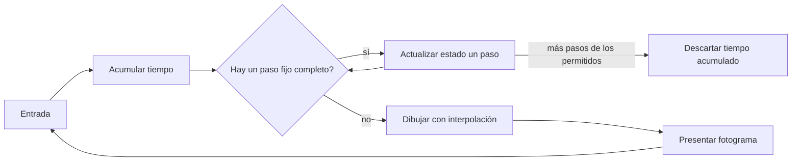
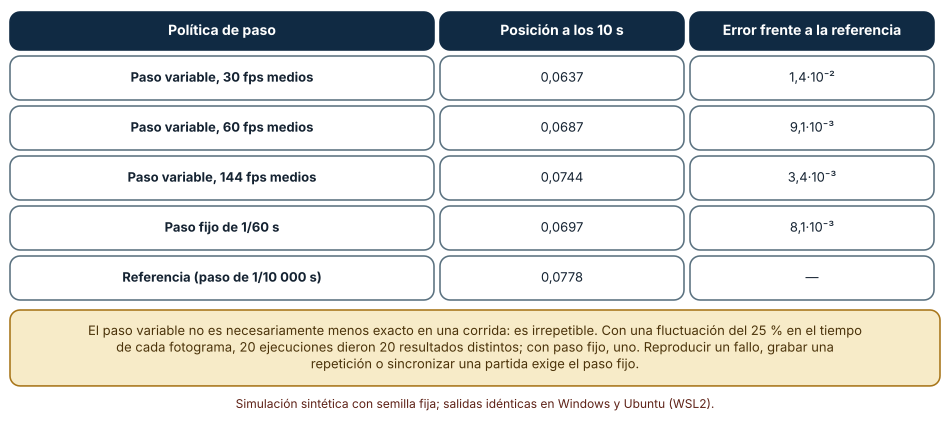
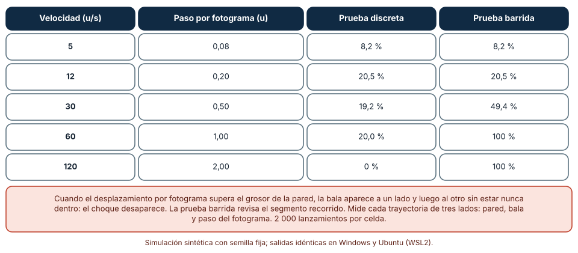
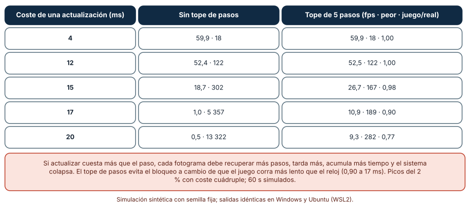

# SE-280 — Videojuegos, loops, entidades y simulación

[← SE-279 — Machine learning como componente de producto](https://github.com/vladimiracunadev-create/modern-software-engineering-program/blob/main/classes/part-23-software-especializado-y-dominios/se-279-machine-learning-como-componente-de-producto/README.md) · [↑ Parte 23](https://github.com/vladimiracunadev-create/modern-software-engineering-program/blob/main/classes/part-23-software-especializado-y-dominios/README.md) · [📚 Índice completo](https://github.com/vladimiracunadev-create/modern-software-engineering-program/blob/main/classes/README.md) · [🌐 Portal](https://vladimiracunadev-create.github.io/modern-software-engineering-program/classes/SE-280.html) · [SE-281 — Gráficos, audio, XR y experiencias inmersivas →](https://github.com/vladimiracunadev-create/modern-software-engineering-program/blob/main/classes/part-23-software-especializado-y-dominios/se-281-graficos-audio-xr-y-experiencias-inmersivas/README.md)

## Punto profesional y fundamento pedagógico

**Punto profesional.** La clase existe para que diseñes el bucle de un juego sabiendo qué promete sobre el tiempo, el determinismo y la colisión, y para que distingas un problema de rendimiento de un problema de corrección que solo se manifiesta cuando el rendimiento cae.

**Por qué aparece aquí.** Es la cuarta clase de la **Parte 23**, después de **Machine learning como componente de producto**: allí el riesgo era una métrica que no representaba el uso; aquí el riesgo es un programa interactivo cuyo estado debe avanzar de forma coherente aunque el tiempo entre fotogramas varíe. Un juego es una simulación con una persona dentro del bucle, y por eso concentra problemas de tiempo, estado compartido y presupuesto que otros dominios tratan por separado. El caso conductor sigue siendo la plataforma educativa ficticia: un juego de laboratorio de física para clase.

**Error conceptual que debe corregir.** Creer que mover los objetos «según el tiempo transcurrido» hace el juego independiente de la velocidad de la máquina. Escala la velocidad aparente, pero deja el resultado dependiente de cuánto duró cada fotograma, lo que vuelve irrepetibles las partidas y hace que los objetos rápidos atraviesen las paredes.

**Secuencia de aprendizaje.** Antes de leer los resultados, predices si dos ejecuciones de la misma simulación con tiempos de fotograma algo distintos terminan en el mismo estado; después mides cuántos finales distintos aparecen con paso variable y con paso fijo, a qué velocidad una bala atraviesa una pared fina y qué ocurre cuando actualizar cuesta más que el paso. La secuencia usa predicción, explicación propia, contraste y recuperación. [ICAP](https://icap.education.asu.edu/research) distingue participación de construcción de conocimiento; [How People Learn II](https://nap.nationalacademies.org/catalog/24783/how-people-learn-ii-learners-contexts-and-cultures) exige conectar conocimiento previo, contexto y transferencia; la [práctica de recuperación](https://pubmed.ncbi.nlm.nih.gov/16507066/) respalda producir de nuevo la explicación tras una demora; y [Education for Life and Work](https://nap.nationalacademies.org/resource/13398/dbasse_084153.pdf) exige devolución que explique la causa del error.

**Evidencia de aprendizaje.** `game-log.md` con la predicción, la tabla de finales según la política de paso, la tabla de colisiones detectadas por velocidad, la tabla de la espiral por coste de actualización y una nota que diga qué parte del juego se comprobó sin motor gráfico y cuál exige la máquina del jugador.

**Límite de la conclusión.** El resorte, la pared y los costes de actualización son construcciones del autor. No se usó ningún motor de juego, ninguna tarjeta gráfica ni ninguna medición de fotogramas reales: los experimentos son modelos en CPython de la lógica del tiempo y la colisión, no del rendimiento de un juego.

### Trazabilidad fuente → afirmación

| Fuente primaria u oficial | Afirmación que respalda | Lo que no prueba |
|---|---|---|
| [Fiedler, «Fix Your Timestep!» (Gaffer On Games)](https://gafferongames.com/post/fix_your_timestep/) | Compara el paso variable con el fijo y propone acumular el tiempo y avanzar en pasos fijos; advierte de la espiral de la muerte y de limitar el tiempo acumulado. | No mide ningún motor concreto y no es una norma. |
| [Nystrom, «Game Loop» (Game Programming Patterns)](https://gameprogrammingpatterns.com/game-loop.html) | Describe el bucle de juego, sus variantes de paso fijo y variable y el compromiso entre determinismo, suavidad y coste. | No fija números para ningún juego. |
| [Godot Engine, documentación](https://docs.godotengine.org/en/stable/) | Documenta cómo un motor concreto separa el procesamiento de física de un paso fijo del procesamiento por fotograma. | Describe una herramienta; otros motores lo resuelven de otra forma. |

## Antes de empezar

Recupera lo aprendido en `SE-279`: una métrica solo vale si la prueba imita el uso. En un juego, el «uso» incluye máquinas con velocidades distintas. La pregunta activa es: **¿qué garantiza este bucle cuando el tiempo entre fotogramas cambia, y qué parte de esa garantía puedo comprobar sin el motor gráfico?**

## Prerrequisitos

- Haber completado `SE-279` o poder explicar por qué una evaluación debe imitar el uso real.
- Python 3.11 o posterior y un terminal; todo el código usa solo la biblioteca estándar.
- Saber qué es una integración numérica sencilla (posición += velocidad × tiempo).

## Problema auténtico

La plataforma educativa ficticia crea un laboratorio de física para clase: una bola rebota sobre un resorte y el estudiante mide el periodo. El prototipo mueve todo según el tiempo del último fotograma. En el portátil del docente la bola oscila de una forma; en la sala de ordenadores, con una máquina más lenta, de otra; dos estudiantes con los mismos parámetros anotan resultados distintos. En un nivel posterior, un proyectil rápido «atraviesa» una pared sin tocarla, y cuando se carga un nivel pesado la aplicación se congela unos segundos y después va a cámara lenta. Son tres síntomas de un mismo diseño del tiempo.

## Objetivos observables

Al terminar podrás:

1. explicar las etapas del bucle de un juego y qué garantía da cada política de paso de tiempo, con un ejemplo y un contraejemplo del laboratorio;
2. medir cuántos estados finales distintos produce la misma simulación con paso variable y con paso fijo, y declarar qué determinismo necesitas;
3. medir a qué velocidad una detección de colisión discreta deja de ver una pared de un grosor dado y comprobar que una prueba barrida la detecta;
4. calcular cuándo el coste de actualizar supera el paso fijo y qué ocurre con y sin tope de pasos por fotograma;
5. declarar qué parte del juego se comprobó sin motor gráfico y qué exige la máquina real.

## Mapa conceptual



El mapa muestra el bucle de paso fijo con acumulador: el tiempo real se acumula y se consume en pasos de duración constante; el dibujo ocurre una vez por fotograma. El descarte del exceso es la válvula que evita que un fotograma lento provoque más trabajo y por tanto otro fotograma lento.

## Temas y por qué importan

| Tema | Por qué cambia una decisión profesional | Evidencia mínima |
|---|---|---|
| El bucle de juego | Define qué ocurre en cada fotograma y quién manda sobre el tiempo. | Predicción, traza causal y contraejemplo de **El bucle de juego** en `game-log.md` |
| Paso fijo y determinismo | Decide si una partida se puede repetir, grabar y sincronizar. | Predicción, traza causal y contraejemplo de **Paso fijo y determinismo** en `game-log.md` |
| Entidades y estado | Organiza qué se actualiza, en qué orden y quién posee cada dato. | Predicción, traza causal y contraejemplo de **Entidades y estado** en `game-log.md` |
| Colisiones continuas | Evita que lo rápido atraviese lo fino. | Predicción, traza causal y contraejemplo de **Colisiones continuas** en `game-log.md` |
| Presupuesto y degradación | Define qué se sacrifica cuando el tiempo no alcanza. | Predicción, traza causal y contraejemplo de **Presupuesto y degradación** en `game-log.md` |

## Conceptos y decisiones

### 1. El bucle de juego

Un juego repite tres etapas: leer la entrada, actualizar el estado del mundo y dibujarlo. Lo que distingue un diseño de otro es cómo se relaciona el tiempo real con el tiempo simulado. Nystrom describe las variantes: avanzar el estado una cantidad proporcional al tiempo que pasó desde el fotograma anterior (paso variable), avanzarlo siempre una cantidad constante (paso fijo) o combinar ambas con un acumulador. Cada una compra algo: el paso variable es simple y suave; el fijo da repetibilidad; el acumulador da ambas a cambio de interpolar al dibujar. La elección no es de gusto: depende de si una partida debe poder reproducirse, grabarse o sincronizarse con otra máquina.

### 2. Paso fijo y determinismo

Una simulación es **determinista** si, partiendo del mismo estado y las mismas entradas, llega siempre al mismo estado. Con paso variable el estado final depende de la secuencia de duraciones de los fotogramas, que cambia con la carga de la máquina; dos ejecuciones con las mismas entradas terminan en estados distintos. Con paso fijo la secuencia de pasos es la misma, y el resultado solo depende de las entradas. Para sincronizar dos máquinas, repetir una partida o encontrar un fallo con una grabación se necesita el paso fijo. El determinismo entre máquinas distintas exige además la misma aritmética (la no asociatividad de `SE-277` reaparece) y el mismo orden de actualización.

### 3. Entidades y estado

Un mundo de juego tiene muchas entidades con estado que cambia a cada paso. Dos formas de organizarlo son la jerarquía de clases (una bola «es un» objeto físico) y la composición de componentes (una entidad es un identificador al que se asocian posición, velocidad, aspecto). La composición facilita añadir comportamientos y recorrer solo lo necesario, pero repartir el estado exige decidir el **orden de actualización**: si la entidad A lee la posición de B antes o después de que B se mueva cambia el resultado. Fijar el orden, y escribir el estado nuevo en un búfer aparte para leerlo en el paso siguiente, evita dependencias ocultas.

### 4. Colisiones continuas

La detección **discreta** comprueba si dos formas se solapan en el instante del fotograma. Si un objeto se mueve más de su propio tamaño (o del grosor del obstáculo) entre dos fotogramas, puede estar de un lado en uno y del otro en el siguiente sin solaparse nunca en un instante muestreado: es el efecto de **túnel**. La detección **continua** o barrida comprueba el segmento recorrido entre ambos instantes. Alternativas: subdividir el paso cuando la velocidad es alta, o limitar la velocidad máxima. Cada una tiene un coste, y todas necesitan una prueba que lance objetos rápidos contra obstáculos finos.

### 5. Presupuesto y degradación

Con 60 fotogramas por segundo, cada fotograma dispone de 16,7 ms para entrada, actualización, dibujo y presentación. Un fotograma que lo excede no solo se ve mal: con paso fijo, el tiempo acumulado exige más pasos en el siguiente, que tarda aún más. Es la **espiral de la muerte**. La defensa es un tope: no ejecutar más de unos pocos pasos por fotograma y descartar el resto, a cambio de que el juego corra más lento que el reloj. Otras formas de degradar son bajar la resolución, simplificar la física o reducir entidades activas. Lo importante es decidir de antemano qué se sacrifica.

### La misma simulación, veinte finales distintos

Un resorte amortiguado (`a = −40·x − 0,5·v`, integración de Euler semiimplícita) se simula 10 s desde `x = 1`. Con paso variable la duración de cada fotograma es gaussiana en torno a `1/fps` con una fluctuación del 25 %; con paso fijo es `1/60`. Referencia: paso de `1/10 000`.

```python
def simular(pasos, T=10.0):
    x, v, t = 1.0, 0.0, 0.0
    while t < T - 1e-12:
        dt = min(pasos(), T - t)
        a = -40.0 * x - 0.5 * v
        v += a * dt; x += v * dt; t += dt
    return x
```

| Política de paso | Posición a los 10 s | Error frente a la referencia |
|---|---:|---:|
| Variable, 30 fps medios | 0,0637 | 1,4·10⁻² |
| Variable, 60 fps medios | 0,0687 | 9,1·10⁻³ |
| Variable, 144 fps medios | 0,0744 | 3,4·10⁻³ |
| Fijo de 1/60 s | 0,0697 | 8,1·10⁻³ |
| Referencia (1/10 000 s) | 0,0778 | — |

Con paso variable, 20 ejecuciones con semillas distintas dieron **20 finales distintos**; con paso fijo, uno. Resultado idéntico en Windows (CPython 3.12.9) y en Ubuntu bajo WSL2 (3.12.3).



**Cómo leer la figura.** Cada fila es una política; la columna de error mide la distancia a una simulación muy fina. **Dónde deja de valer:** el error de una corrida con paso variable puede ser menor o mayor que el del paso fijo según el azar de los tiempos; la tabla no dice que el variable sea peor en exactitud, sino que no es repetible. El paso fijo de 1/60 tampoco es «exacto»: tiene un error propio del integrador. La figura no mide ningún motor: los tiempos de fotograma son gaussianos supuestos.

### La bala y la pared fina

Una bala parte de una posición uniforme en el tramo de una unidad previo a una pared que ocupa [0; 0,2]. En cada fotograma (1/60 s) se evalúa si choca con la pared: una prueba **discreta** (¿está dentro de la pared al inicio o al final del paso?) y una **barrida** (¿el segmento recorrido toca la pared?). Se lanzan 2 000 balas por velocidad.

```python
def barrida(x0, x1, pared=(0.0, 0.2)):
    return x0 <= pared[1] and x1 >= pared[0]
def discreta(x0, x1, pared=(0.0, 0.2)):
    return pared[0] <= x1 <= pared[1] or pared[0] <= x0 <= pared[1]
```

| Velocidad (u/s) | Paso por fotograma (u) | Prueba discreta | Prueba barrida |
|---:|---:|---:|---:|
| 5 | 0,08 | 8,2 % | 8,2 % |
| 12 | 0,20 | 20,5 % | 20,5 % |
| 30 | 0,50 | 19,2 % | 49,4 % |
| 60 | 1,00 | 20,0 % | 100 % |
| 120 | 2,00 | 0 % | 100 % |

Las columnas son el porcentaje de lanzamientos que tocan la pared durante el fotograma. La prueba barrida es la verdad de referencia. Hasta que el paso iguala el grosor (0,2) coinciden; a 30 u/s la discreta detecta el 39 % de los choques reales (19,2 de 49,4); a 120 u/s, ninguno.



**Cómo leer la figura.** Cada fila es una velocidad; la prueba barrida marca los choques que ocurrieron durante el paso y la discreta, los que alcanzó a ver. **Dónde deja de valer:** la geometría es unidimensional y la pared fija; en dos o tres dimensiones con formas rotadas la prueba barrida es más cara y hay casos (rotaciones rápidas) que exigen otros métodos. Los porcentajes dependen del tramo de lanzamiento elegido; lo que no depende de él es que la discreta pierde choques cuando el paso supera el grosor.

### Cuando actualizar cuesta más que el paso

Se simula un bucle con acumulador de paso fijo de 16,7 ms durante 60 s. Cada actualización cuesta `c` ms, con un 2 % de picos de coste cuádruple; dibujar cuesta 2 ms y presentar espera al menos 16,7 ms. Se compara sin tope de pasos con un tope de 5 pasos por fotograma (el exceso se descarta).

```python
while real < 60_000:
    acc += prev                       # tiempo del fotograma anterior
    pasos, gastado = 0, 0.0
    while acc >= dt and pasos < tope:
        gastado += coste * (4 if r.random() < 0.02 else 1)
        acc -= dt; juego += dt; pasos += 1
    if pasos == tope and acc >= dt: acc = 0.0      # válvula
    fotograma = max(gastado + 2.0, dt)
    real += fotograma; prev = fotograma
```

| Coste de una actualización (ms) | Sin tope: fps · peor fotograma (ms) | Tope de 5 pasos: fps · peor (ms) · juego/real |
|---:|---|---|
| 4 | 59,9 · 18 | 59,9 · 18 · 1,00 |
| 12 | 52,4 · 122 | 52,5 · 122 · 1,00 |
| 15 | 18,7 · 302 | 26,7 · 167 · 0,98 |
| 17 | 1,0 · 5 357 | 10,9 · 189 · 0,90 |
| 20 | 0,5 · 13 322 | 9,3 · 282 · 0,77 |

Con un coste de 17 ms, apenas por encima del paso, el juego sin tope se bloquea (1 fotograma por segundo y uno de más de 5 s); con tope sigue respondiendo a 11 fps, con el juego al 90 % del reloj.



**Cómo leer la figura.** Cada fila es el coste de una actualización; las columnas comparan las dos políticas. La última cifra de la derecha es el tiempo de juego transcurrido por cada segundo real. **Dónde deja de valer:** los costes y los picos son supuestos; en un juego real la actualización y el dibujo comparten la unidad de proceso y la memoria. Un tope que descarta tiempo tampoco es gratis: el juego va más lento que el reloj, lo que en un juego en red o con música sincronizada es un fallo visible.

## Definiciones de trabajo

- **bucle de juego:** ciclo repetido de lectura de entrada, actualización del estado y dibujo.
- **paso fijo:** duración constante con que se avanza el estado, independiente del tiempo real del fotograma.
- **determinismo:** propiedad de una simulación que, con el mismo estado y las mismas entradas, llega siempre al mismo estado.
- **túnel:** efecto por el cual un objeto rápido atraviesa uno fino porque nunca se solapa en un instante muestreado.
- **espiral de la muerte:** realimentación en que un fotograma lento acumula más trabajo y provoca otro más lento.

Las definiciones son operativas para el laboratorio de física. No convierten términos con una historia más amplia en sinónimos y deben contrastarse con la documentación primaria enlazada al final.

## Ejemplo mínimo

El fragmento muestra que con paso fijo el resultado no depende de cuántos fotogramas se usen. Antes de ejecutarlo, predice si ambas ejecuciones coinciden.

```python
def mundo():
    return {"x": 1.0, "v": 0.0, "acc": 0.0}
def avanzar(m, dt_real, paso=1/60):
    m["acc"] += dt_real
    while m["acc"] >= paso - 1e-12:
        m["v"] += -40.0 * m["x"] * paso; m["x"] += m["v"] * paso; m["acc"] -= paso
a, b = mundo(), mundo()
avanzar(a, 1.0)
for _ in range(60): avanzar(b, 1/60)
assert a["x"] == b["x"], (a, b)
```

Con el mismo tiempo acumulado, el mismo número de pasos fijos da el mismo estado, sin importar si ese tiempo llegó en un fotograma de un segundo o en sesenta de 1/60 s. Registra versión, comando y salida; cambia `paso` a 1/30 y predice si cambia el estado.

## Ejemplo profesional

El equipo del laboratorio adopta el bucle de acumulador con paso fijo de 1/120 s para la física y un dibujo por fotograma con interpolación entre el estado anterior y el actual. Registra las entradas del estudiante con el número de paso, de modo que cualquier partida se puede reproducir paso a paso en una prueba automática sin pantalla. Los proyectiles usan prueba barrida y subdividen el paso por encima de una velocidad dada. El tope es de 5 pasos por fotograma; cuando se alcanza, se muestra un indicador de «ralentizado» y se registra en la telemetría local. Una prueba de regresión lanza 200 proyectiles a velocidades crecientes contra una pared fina y exige que ninguno la atraviese.

Compara con el prototipo: paso variable, colisión discreta, sin tope. Un diseño es adecuado cuando una partida se puede reproducir y cuando la degradación es visible y acotada; es frágil cuando el comportamiento depende de la velocidad de la máquina.

## Práctica guiada

1. Dibuja el bucle del laboratorio y marca dónde se lee la entrada, dónde se actualiza y dónde se dibuja.
2. Predice si dos ejecuciones con tiempos de fotograma distintos terminan igual con paso variable y con paso fijo.
3. Simula el resorte con ambas políticas y cuenta los finales distintos en 20 ejecuciones.
4. Lanza balas de velocidad creciente contra una pared fina con las dos pruebas de colisión y determina a qué velocidad la discreta empieza a fallar.
5. Simula el bucle con acumulador para cinco costes de actualización, con y sin tope.
6. Decide y escribe qué se sacrifica primero cuando el tiempo no alcanza.
7. Entrega `game-log.md` y pide a otra persona que reproduzca una partida a partir de las entradas registradas.

## Ejercicios

1. **Paso:** cambia el paso fijo a 1/120 y mide el error del resorte frente a la referencia; explica qué compraste y qué pagaste.
2. **Túnel:** calcula la velocidad máxima segura de una bala para una pared de 0,05 de grosor a 60 fps con prueba discreta.
3. **Espiral:** para un coste de actualización de 16 ms con picos del 5 % de coste doble, simula el bucle y decide un tope de pasos justificado.
4. **Orden:** diseña un caso con dos entidades donde el resultado cambie según el orden de actualización y propón cómo fijarlo.

## Reto verificable

Entrega `game-log.md` con la predicción, la tabla de finales por política de paso, la de colisiones por velocidad, la de la espiral y una grabación de entradas que reproduzca una partida. Se aprueba si otra persona ejecuta el código desde un checkout limpio, obtiene los mismos números y reproduce la partida con el mismo estado final. No se aprueba por describir el bucle ni por afirmar que el juego «va fluido» sin una medición.

## Caso conductor

La plataforma educativa ficticia es el caso conductor de la Parte 23. Esta clase deja el cuarto artefacto: el laboratorio de física con paso fijo, colisión barrida y tope de pasos. `SE-281` mira lo que sale por los altavoces y la pantalla: gráficos, audio y experiencias inmersivas, donde el presupuesto de tiempo es todavía más estricto. Cambia después una sola decisión, el paso fijo de 1/60 a 1/120, y observa qué garantía mejora y qué presupuesto empeora.

## Preguntas frecuentes

### ¿Siempre debo usar paso fijo?

No: un juego sin repeticiones ni sincronización puede usar paso variable con un tope razonable. Se elige por lo que necesita reproducirse; si lo necesita, el paso fijo.

### ¿Por qué mi bala atraviesa la pared solo en algunos ordenadores?

Porque la distancia por fotograma depende de la tasa de fotogramas: en una máquina lenta el paso es mayor y supera el grosor. Con colisión barrida o con paso fijo la distancia por paso es la misma en todas.

### ¿El determinismo entre máquinas es automático con paso fijo?

No: además hace falta la misma aritmética y el mismo orden de actualización. Los números en coma flotante pueden diferir entre arquitecturas, como se vio en `SE-277`.

### ¿Qué hago si no cabe en 16,7 ms?

Mide qué etapa gasta el tiempo, decide qué degradar y pon un tope. Lo peor es no decidir: la espiral decide por ti.

## Fallo controlado y diagnóstico

Reproduce el fallo clásico de la clase: **un proyectil rápido que atraviesa una pared sin que ningún error aparezca**. Lanza una bala a 120 u/s contra una pared de 0,2 con la prueba discreta.

Registra síntoma, entrada mínima, hipótesis, observación que descarta cada hipótesis, causa, corrección y prueba de regresión. **Síntoma:** la bala sale por el otro lado y el registro no muestra ningún choque. **Hipótesis rivales:** (a) la pared no está activa; (b) la geometría de la pared está mal; (c) el paso por fotograma supera el grosor. **Prueba:** calcula el paso (120/60 = 2) y compáralo con 0,2; con la prueba barrida, el choque aparece. **Conclusión:** el paso es diez veces el grosor. **Regresión:** cambia a la prueba barrida o subdivide el paso, y añade una prueba que lance 200 balas a velocidades crecientes. No cambies a la vez la prueba y el grosor de la pared.

## Errores comunes y cómo corregirlos

| Síntoma | Causa probable | Corrección |
|---|---|---|
| Dos máquinas dan resultados distintos con las mismas entradas | Paso variable | Paso fijo con acumulador y entradas con número de paso |
| Los objetos rápidos atraviesan las paredes | Colisión discreta con paso mayor que el grosor | Prueba barrida, subdivisión del paso o límite de velocidad |
| El juego se congela y luego va lento | Espiral de la muerte sin tope | Tope de pasos por fotograma y descarte del exceso, con aviso |
| El resultado depende del orden de las entidades | Lectura de estado ya modificado | Fijar el orden y escribir el estado nuevo en un búfer aparte |
| Una repetición se desincroniza al cabo de un rato | Aritmética o azar no deterministas | Misma aritmética, semilla en el estado y comprobación periódica del estado |

## Entorno y archivos clave

```text
work/SE-280/
├── README.md
├── laboratorio/
│   ├── bucle.py
│   ├── colision.py
│   └── presupuesto.py
├── tests/test_laboratorio.py
└── evidence/game-log.md
```

El `README` declara plataforma, versión de Python, semillas y comandos. Los experimentos usan solo la biblioteca estándar (`random`, `math`) y se ejecutaron con CPython 3.12.9 en Windows 11 y 3.12.3 en Ubuntu bajo WSL2: las salidas fueron idénticas. Si añades una dependencia, fija procedencia y versión.

## Seguridad, ética y accesibilidad

- un juego que graba entradas guarda datos de comportamiento: minimiza y separa lo que se envía de lo que queda en el equipo;
- los destellos y los cambios bruscos de brillo pueden dañar a personas con epilepsia fotosensible: ofrece una opción para reducirlos;
- permite reasignar los controles y jugar sin depender de un tiempo de reacción estricto cuando el objetivo educativo no lo exige;
- no uses color como única señal de estado y ofrece alternativa textual o sonora;
- documenta qué se comprobó sin motor y qué en la máquina real, para que el límite sea visible.

## Puente hacia el trabajo con agentes

Un agente al que se le pide «escribe el bucle del juego» usará el tiempo del último fotograma para mover los objetos y comprobará colisiones en cada fotograma. Pídele en cambio que use un acumulador con paso fijo y tope, que haga las colisiones con prueba barrida o subdivisión, que registre las entradas por número de paso y que incluya una prueba que reproduzca una partida. Revisa especialmente si el estado depende del tiempo real del fotograma y si una velocidad alta puede saltarse un obstáculo: son los dos defectos que esta clase mostró.

## Transferencia

Traslada el análisis a otra simulación interactiva (por ejemplo, un simulador de tráfico para clase): cambia las entidades y las reglas, y conserva el procedimiento de fijar el paso, medir los finales distintos y probar el caso rápido contra el obstáculo fino. La transferencia está lograda cuando puedes explicar qué parte del diseño dependía del motor y cuál no, no cuando el código se parece.

## Evaluación y evidencia

| Criterio | Evidencia para aprobar |
|---|---|
| comprensión | explicación de las etapas del bucle y de las políticas de paso con ejemplos del laboratorio |
| corrección | finales, colisiones y fotogramas reproducibles con las mismas semillas |
| diseño | bucle con paso fijo, colisión barrida, tope y registro de entradas |
| diagnóstico | reproducción del fallo «la bala atraviesa» con regresión |
| incertidumbre | declaración de que ningún experimento usó un motor ni una tarjeta gráfica |
| reproducibilidad | versiones, comandos, salida y límites declarados |

## Fuentes

- [Fiedler, «Fix Your Timestep!» (Gaffer On Games)](https://gafferongames.com/post/fix_your_timestep/) — paso fijo, acumulador y espiral de la muerte; autoridad: autor del artículo.
- [Nystrom, «Game Loop» (Game Programming Patterns)](https://gameprogrammingpatterns.com/game-loop.html) — variantes del bucle de juego; autoridad: autor del libro.
- [Godot Engine, documentación](https://docs.godotengine.org/en/stable/) — procesamiento de física con paso fijo en un motor concreto; autoridad: Godot Engine.
- [Python: `random`](https://docs.python.org/3/library/random.html) — generador con semilla para las simulaciones; autoridad: documentación de Python.
- [SWEBOK Guide v4.0a](https://www.computer.org/education/bodies-of-knowledge/software-engineering) — áreas de conocimiento de ingeniería de software; autoridad: IEEE Computer Society.

Cada fuente respalda el mecanismo indicado; ninguna demuestra que los 20 finales distintos, el 39 % de choques detectados a 30 u/s o los 11 fotogramas por segundo se observen en un juego real. Esa afirmación depende del motor, de la máquina y del contenido.

## Límites y siguiente paso

Se ejecutaron tres simulaciones con datos sintéticos en Windows y Ubuntu (WSL2) con resultados idénticos. No se usó ningún motor de juego, tarjeta gráfica ni medición de fotogramas reales: el resorte, la pared y los costes de actualización son construcciones del autor. La siguiente clase pasa a gráficos, audio y experiencias inmersivas.

## Glosario

- **bucle de juego:** ciclo repetido de lectura de entrada, actualización del estado y dibujo.
- **paso fijo:** duración constante con que se avanza el estado, independiente del tiempo real del fotograma.
- **determinismo:** propiedad de una simulación que, con el mismo estado y las mismas entradas, llega siempre al mismo estado.
- **túnel:** efecto por el cual un objeto rápido atraviesa uno fino porque nunca se solapa en un instante muestreado.
- **espiral de la muerte:** realimentación en que un fotograma lento acumula más trabajo y provoca otro más lento.

---

[← SE-279 — Machine learning como componente de producto](https://github.com/vladimiracunadev-create/modern-software-engineering-program/blob/main/classes/part-23-software-especializado-y-dominios/se-279-machine-learning-como-componente-de-producto/README.md) · [↑ Parte 23](https://github.com/vladimiracunadev-create/modern-software-engineering-program/blob/main/classes/part-23-software-especializado-y-dominios/README.md) · [📚 Índice completo](https://github.com/vladimiracunadev-create/modern-software-engineering-program/blob/main/classes/README.md) · [🌐 Portal](https://vladimiracunadev-create.github.io/modern-software-engineering-program/classes/SE-280.html) · [SE-281 — Gráficos, audio, XR y experiencias inmersivas →](https://github.com/vladimiracunadev-create/modern-software-engineering-program/blob/main/classes/part-23-software-especializado-y-dominios/se-281-graficos-audio-xr-y-experiencias-inmersivas/README.md)
