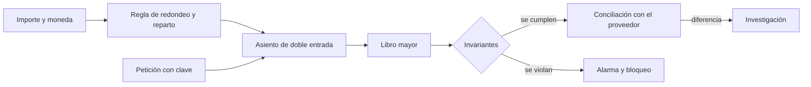
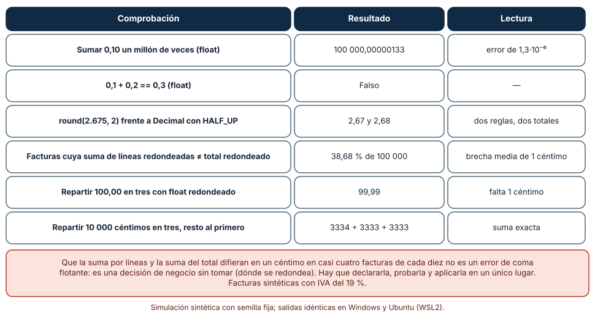
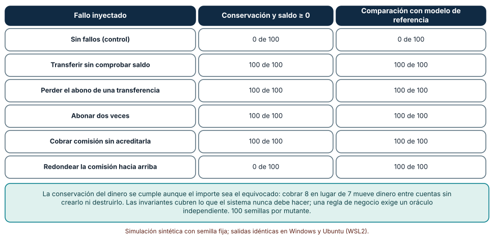
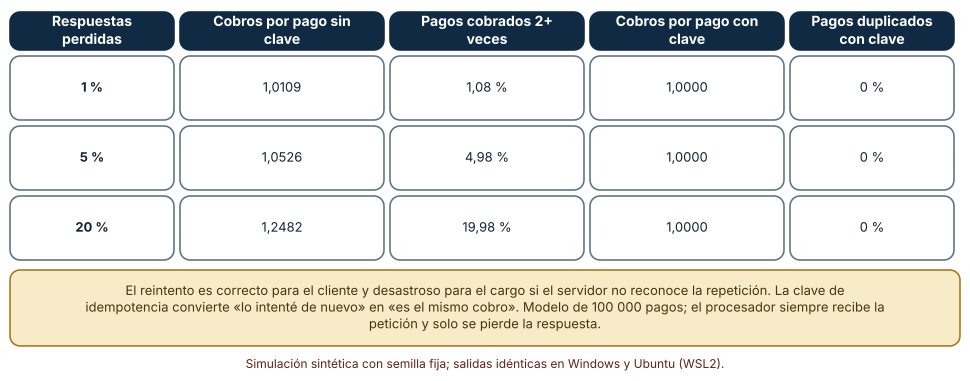

# SE-282 — Fintech, contabilidad e invariantes monetarias

[← SE-281 — Gráficos, audio, XR y experiencias inmersivas](https://github.com/vladimiracunadev-create/modern-software-engineering-program/blob/main/classes/part-23-software-especializado-y-dominios/se-281-graficos-audio-xr-y-experiencias-inmersivas/README.md) · [↑ Parte 23](https://github.com/vladimiracunadev-create/modern-software-engineering-program/blob/main/classes/part-23-software-especializado-y-dominios/README.md) · [📚 Índice completo](https://github.com/vladimiracunadev-create/modern-software-engineering-program/blob/main/classes/README.md) · [🌐 Portal](https://vladimiracunadev-create.github.io/modern-software-engineering-program/classes/SE-282.html) · [SE-283 — Salud, datos sensibles y sistemas regulados →](https://github.com/vladimiracunadev-create/modern-software-engineering-program/blob/main/classes/part-23-software-especializado-y-dominios/se-283-salud-datos-sensibles-y-sistemas-regulados/README.md)

## Punto profesional y fundamento pedagógico

**Punto profesional.** La clase existe para que representes el dinero como un dominio con reglas propias (cantidad entera, moneda, regla de redondeo, doble entrada, idempotencia) y para que sepas qué invariantes comprobar y qué defectos esas invariantes no ven. Quien programa dinero responde de cada céntimo y de cada cobro repetido.

**Por qué aparece aquí.** Es la sexta clase de la **Parte 23**, después de **Gráficos, audio, XR y experiencias inmersivas**: allí el error se oía o se sentía; aquí es una cifra que alguien paga o deja de cobrar, y que además puede auditarse. El dominio financiero hereda de las clases anteriores la no asociatividad de `SE-277`, la idempotencia de `SE-278` y la evaluación sin ilusiones de `SE-279`, y les añade la obligación de que todo cuadre. El caso conductor sigue siendo la plataforma educativa ficticia: el cobro de matrículas y cuotas.

**Error conceptual que debe corregir.** Creer que el dinero «es un decimal» y que si una suma cuadra, el sistema es correcto. Una cantidad en coma flotante pierde céntimos sin avisar, y un libro que conserva el total puede estar cobrando el importe equivocado; las invariantes dicen lo que nunca debe pasar, no lo que debe pasar.

**Secuencia de aprendizaje.** Antes de leer los resultados, predices cuántas facturas tienen una suma de líneas redondeadas distinta del total redondeado, y cuántos fallos inyectados en un libro mayor detecta la conservación del dinero; después mides ambos y la frecuencia con que un reintento cobra dos veces con y sin clave de idempotencia. La secuencia usa predicción, explicación propia, contraste y recuperación. [ICAP](https://icap.education.asu.edu/research) distingue participación de construcción de conocimiento; [How People Learn II](https://nap.nationalacademies.org/catalog/24783/how-people-learn-ii-learners-contexts-and-cultures) exige conectar conocimiento previo, contexto y transferencia; la [práctica de recuperación](https://pubmed.ncbi.nlm.nih.gov/16507066/) respalda producir de nuevo la explicación tras una demora; y [Education for Life and Work](https://nap.nationalacademies.org/resource/13398/dbasse_084153.pdf) exige devolución que explique la causa del error.

**Evidencia de aprendizaje.** `money-log.md` con la predicción, la tabla de comprobaciones de dinero, la tabla de mutantes detectados por cada tipo de comprobación, la tabla de cobros duplicados y una nota que separe lo que garantiza una invariante de lo que exige una regla de negocio comprobada contra un modelo de referencia.

**Límite de la conclusión.** Las facturas, el IVA, el libro mayor de tres cuentas y las tasas de respuestas perdidas son construcciones del autor. No se usó ningún banco, procesador de pagos, red de tarjetas ni dinero real, y no se hizo ninguna verificación contable ni regulatoria: los experimentos muestran mecanismos, no cumplimiento.

### Trazabilidad fuente → afirmación

| Fuente primaria u oficial | Afirmación que respalda | Lo que no prueba |
|---|---|---|
| [Python: `decimal`](https://docs.python.org/3/library/decimal.html) | Documenta la aritmética decimal con contexto y modos de redondeo explícitos (por ejemplo, `ROUND_HALF_UP` y `ROUND_HALF_EVEN`). | No dice qué modo exige una norma fiscal concreta. |
| [Fowler, «Money» (Patterns of Enterprise Application Architecture)](https://martinfowler.com/eaaCatalog/money.html) | Propone una clase que une cantidad y moneda y reparte sin perder unidades. | No es una norma ni cubre todas las monedas. |
| [Stripe, «Idempotent requests»](https://docs.stripe.com/api/idempotent_requests) | Describe el uso de una clave de idempotencia para reintentar una petición de forma segura. | Describe un proveedor; otros implementan la clave de otra forma. |

## Antes de empezar

Recupera lo aprendido en `SE-278`: una escritura es segura de repetir si es idempotente. Con dinero, repetir una escritura es repetir un cobro. La pregunta activa es: **¿qué debe ser siempre verdad en este sistema, qué verifica cada comprobación y qué defecto pasaría sin que ninguna lo notara?**

## Prerrequisitos

- Haber completado `SE-281` o poder explicar qué es un plazo y qué se pierde cuando se supera.
- Python 3.11 o posterior y un terminal; todo el código usa solo la biblioteca estándar (`decimal`, `random`).
- Conocer la diferencia entre enteros y coma flotante a nivel básico.

## Problema auténtico

La plataforma educativa ficticia cobra matrículas en cuotas con IVA del 19 %. El equipo de finanzas encuentra que el total de la factura no coincide con la suma de sus líneas «por un céntimo» en muchas facturas; que al repartir una beca de 100,00 entre tres familias desaparece un céntimo; y que un 5 % de los cobros de una semana se hicieron dos veces porque el servicio de pagos tardó en responder y el cliente reintentó. Una prueba de «el total de saldos no cambia» pasa en todos los casos, y aun así el cobro de la comisión estaba mal redondeado.

## Objetivos observables

Al terminar podrás:

1. representar un importe como cantidad entera de la unidad menor más una moneda y repartir sin perder unidades, con un ejemplo y un contraejemplo de la plataforma;
2. medir qué fracción de facturas tiene una discrepancia de redondeo según dónde se redondee y declarar la regla en un único lugar;
3. enunciar las invariantes de un libro de doble entrada y medir qué defectos inyectados detectan y cuáles exigen un modelo de referencia;
4. medir cuántos cobros se duplican con reintentos con y sin clave de idempotencia y escribir el contrato de la clave;
5. declarar qué cubre la prueba y qué corresponde a la conciliación, la auditoría y la normativa.

## Mapa conceptual



El mapa separa tres controles de naturaleza distinta: las **invariantes** del libro (lo que nunca debe pasar), la **conciliación** con una fuente externa (lo que debe coincidir con el mundo) y la **clave de idempotencia** (lo que evita repetir un efecto). Cada uno ve defectos que los otros no ven.

## Temas y por qué importan

| Tema | Por qué cambia una decisión profesional | Evidencia mínima |
|---|---|---|
| Representación del dinero | Evita perder céntimos por la forma de guardar un importe. | Predicción, traza causal y contraejemplo de **Representación del dinero** en `money-log.md` |
| Redondeo y reparto | Es una regla de negocio que debe declararse y aplicarse en un lugar. | Predicción, traza causal y contraejemplo de **Redondeo y reparto** en `money-log.md` |
| Doble entrada e invariantes | Garantiza que el dinero ni se crea ni se destruye. | Predicción, traza causal y contraejemplo de **Doble entrada e invariantes** en `money-log.md` |
| Idempotencia en pagos | Impide cobrar dos veces ante un reintento. | Predicción, traza causal y contraejemplo de **Idempotencia en pagos** en `money-log.md` |
| Conciliación, auditoría y regulación | Contrasta el libro con el mundo y deja rastro revisable. | Predicción, traza causal y contraejemplo de **Conciliación, auditoría y regulación** en `money-log.md` |

## Conceptos y decisiones

### 1. Representación del dinero

Un importe es una cantidad más una moneda, y la cantidad debe ser exacta. Guardarla como `float` introduce el error de representación binaria que Goldberg describe: 0,10 no tiene representación exacta, y sumarlo un millón de veces da 100 000,000 001 333. Las opciones seguras son un entero de la unidad menor (céntimos) o un tipo decimal con contexto explícito, como `decimal` de Python. Fowler propone unir cantidad y moneda en un valor que no permita sumar pesos con dólares. Cada moneda tiene su número de decimales y su regla de redondeo; no se asume que todas tengan dos.

### 2. Redondeo y reparto

Redondear es una decisión de negocio, no un detalle técnico. `round(2.675, 2)` da 2,67 porque 2,675 no es exactamente representable; el modo `ROUND_HALF_UP` sobre un decimal exacto da 2,68; el redondeo «al par» da otro resultado en otros casos. Una factura con varias líneas admite al menos dos reglas legítimas: redondear cada línea y sumar, o sumar y redondear el total. Dan resultados que difieren en un céntimo con frecuencia, y la norma o el contrato debe decir cuál. Repartir una cantidad entre `n` partes exige asignar el **resto**: 100,00 entre tres son 33,34; 33,33; 33,33, nunca tres veces 33,33.

### 3. Doble entrada e invariantes

En un libro de doble entrada cada movimiento es un asiento con al menos dos apuntes que suman cero: lo que sale de una cuenta entra en otra. Las invariantes naturales son: la suma de todos los saldos es constante (no se crea ni destruye dinero), ningún saldo de una cuenta que no admite descubierto es negativo, y cada asiento cuadra. Se comprueban como propiedades sobre secuencias aleatorias de operaciones, no solo con ejemplos. Pero una invariante expresa lo que nunca debe suceder; no sabe si el importe de una comisión era el correcto. Para eso hace falta un **oráculo**: un modelo de referencia independiente con el que comparar.

### 4. Idempotencia en pagos

Un cliente que no recibe respuesta no sabe si el servidor procesó la petición. Si reintenta y el servidor no reconoce la repetición, cobra dos veces. La solución habitual es una **clave de idempotencia** generada por el cliente para cada intención de pago: el servidor guarda el resultado asociado a la clave y, si la recibe de nuevo, devuelve ese resultado sin repetir el efecto. El contrato debe decir cuánto tiempo se guarda la clave, qué ocurre si la misma clave llega con parámetros distintos (debe rechazarse) y qué se devuelve mientras la primera petición aún se procesa. Existe además un borrador del IETF que estandariza una cabecera para esto.

### 5. Conciliación, auditoría y regulación

El libro interno no basta: se **concilia** con el estado que reporta el proveedor de pagos o el banco, y cada diferencia se investiga. La **auditoría** exige un historial inmutable de los movimientos, con quién y cuándo los hizo, y que las correcciones sean nuevos asientos y no ediciones. Las normas añaden obligaciones: el estándar PCI DSS regula cómo proteger los datos de tarjetas, y los estándares de mensajería financiera como ISO 20022 definen formatos de intercambio. Esta clase no enseña cumplimiento: enseña a diseñar de modo que cumplir sea posible, por ejemplo evitando guardar datos de tarjeta que no hace falta guardar.

### El dinero con coma flotante y las cuentas que no cuadran

Se hacen seis comprobaciones: sumar 0,10 un millón de veces con `float`; comparar `0,1 + 0,2` con `0,3`; redondear 2,675 con `round` y con `Decimal`; calcular, sobre 100 000 facturas sintéticas de 2 a 6 líneas (cantidad 1-20, precio 1,00-99,99, IVA del 19 %), si la suma de las líneas redondeadas coincide con el total redondeado; y repartir 100,00 entre tres con `float` y con enteros de céntimos.

```python
por_linea = sum((q * p * (1 + iva)).quantize(Decimal("0.01"), ROUND_HALF_UP) for q, p in lineas)
total = (sum(q * p for q, p in lineas) * (1 + iva)).quantize(Decimal("0.01"), ROUND_HALF_UP)
discrepa = por_linea != total
base, resto = divmod(10000, 3)            # 3333 y 1: el resto va al primero
reparto = [base + (1 if i < resto else 0) for i in range(3)]
```

| Comprobación | Resultado | Lectura |
|---|---|---|
| Sumar 0,10 un millón de veces (`float`) | 100 000,00000133 | error de 1,3·10⁻⁶ |
| `0,1 + 0,2 == 0,3` (`float`) | Falso | — |
| `round(2.675, 2)` frente a `Decimal` con `HALF_UP` | 2,67 y 2,68 | dos reglas, dos totales |
| Facturas con suma de líneas ≠ total redondeado | 38,68 % de 100 000 | brecha media de 1 céntimo |
| Repartir 100,00 en tres con `float` redondeado | 99,99 | falta 1 céntimo |
| Repartir 10 000 céntimos en tres, resto al primero | 3334 + 3333 + 3333 | suma exacta |

Resultado, idéntico en Windows (CPython 3.12.9) y en Ubuntu bajo WSL2 (3.12.3).



**Cómo leer la figura.** Cada fila es una comprobación independiente; la columna «Lectura» dice qué enseña. **Dónde deja de valer:** el 38,68 % depende de que las facturas sintéticas tengan precios con céntimos y de 2 a 6 líneas con IVA del 19 %; con precios redondos la discrepancia baja. No se trata de un error de coma flotante, y el mismo resultado se obtiene con `Decimal`: es una decisión de redondeo sin tomar. Ninguna norma fiscal concreta se evaluó.

### Cinco defectos en un libro mayor de tres cuentas

Un libro con cuentas `a`, `b`, `c` (1 000 cada una) y una cuenta `banco` de comisiones ejecuta 200 operaciones aleatorias por corrida (transferencias de 1 a 1 500 y, con probabilidad 0,3, una comisión del 1 % del importe). Se inyecta un defecto por vez y se comprueba en 100 corridas si lo detectan (a) la conservación del dinero y el saldo no negativo, o (b) la comparación con un modelo de referencia que ejecuta las mismas operaciones sin defecto.

```python
if sum(libro.values()) != 3000: viola.add("conservación")
if min(libro.values()) < 0:     viola.add("saldo negativo")
if libro != referencia:         viola.add("modelo de referencia")
```

| Fallo inyectado | Conservación y saldo ≥ 0 | Comparación con modelo de referencia |
|---|---:|---:|
| Sin fallos (control) | 0 de 100 | 0 de 100 |
| Transferir sin comprobar saldo | 100 de 100 | 100 de 100 |
| Perder el abono de una transferencia | 100 de 100 | 100 de 100 |
| Abonar dos veces | 100 de 100 | 100 de 100 |
| Cobrar comisión sin acreditarla | 100 de 100 | 100 de 100 |
| Redondear la comisión hacia arriba | 0 de 100 | 100 de 100 |

El control no da falsas alarmas. El defecto de la comisión mueve dinero entre cuentas sin crearlo ni destruirlo, y por eso las invariantes no lo ven.



**Cómo leer la figura.** Cada fila es un defecto distinto; las dos columnas comparan el tipo de comprobación que lo detecta. **Dónde deja de valer:** el modelo de referencia aquí es el mismo código sin el defecto, así que es independiente solo en el sentido de que no tiene el fallo; si la regla de negocio estuviera mal en ambos, tampoco la vería. El libro de tres cuentas no incluye varias monedas, comisiones fraccionarias ni concurrencia, que añaden sus propios fallos.

### Cobrar dos veces porque la respuesta se perdió

Se simulan 100 000 pagos. En cada intento el procesador recibe la petición, pero con probabilidad `p` la respuesta se pierde y el cliente reintenta, hasta tres reintentos. Sin clave de idempotencia cada intento cobra; con clave, solo el primero.

```python
for intento in range(reintentos + 1):
    if not (con_clave and cobrado):
        cobros += 1; cobrado = True
    if r.random() >= p: break          # llegó la respuesta
```

| Respuestas perdidas | Cobros por pago sin clave | Pagos cobrados 2+ veces | Cobros por pago con clave | Pagos duplicados con clave |
|---:|---:|---:|---:|---:|
| 1 % | 1,0109 | 1,08 % | 1,0000 | 0 % |
| 5 % | 1,0526 | 4,98 % | 1,0000 | 0 % |
| 20 % | 1,2482 | 19,98 % | 1,0000 | 0 % |

La tasa de pagos cobrados dos veces o más coincide con la de respuestas perdidas, porque cualquier pérdida de la primera respuesta fuerza un segundo cobro.



**Cómo leer la figura.** Cada fila es una tasa de respuestas perdidas; las columnas comparan el comportamiento sin clave y con clave. **Dónde deja de valer:** el modelo supone que la petición siempre llega y que solo se pierde la respuesta; también se pierden peticiones, y entonces el reintento es necesario y no duplica. Una clave solo protege si el servidor la guarda de forma atómica con el efecto (la carrera entre dos peticiones simultáneas con la misma clave exige un cierre) y por un tiempo mayor que el del reintento más tardío.

## Definiciones de trabajo

- **unidad menor:** la unidad mínima de una moneda en que se expresan los importes enteros, por ejemplo el céntimo.
- **asiento de doble entrada:** registro de un movimiento con apuntes que suman cero entre las cuentas implicadas.
- **invariante:** condición que debe cumplirse tras cualquier operación válida del sistema.
- **oráculo:** modelo de referencia independiente con el que se compara el resultado de una operación.
- **clave de idempotencia:** identificador de una intención de operación que permite repetir la petición sin repetir el efecto.

Las definiciones son operativas para el cobro de matrículas. No convierten términos con una historia más amplia en sinónimos y deben contrastarse con la documentación primaria enlazada al final.

## Ejemplo mínimo

El fragmento reparte un importe sin perder unidades. Antes de ejecutarlo, predice el reparto de 10,00 entre 3.

```python
def repartir(centimos, n):
    base, resto = divmod(centimos, n)
    return [base + (1 if i < resto else 0) for i in range(n)]
assert repartir(1000, 3) == [334, 333, 333] and sum(repartir(1000, 3)) == 1000
assert sum(repartir(1, 3)) == 1
```

Diez unidades entre tres dan 3,34; 3,33; 3,33. Registra versión, comando y salida; cambia a repartir 1 céntimo entre 3 y predice qué cuenta recibe el céntimo y si esa asignación es justa para el negocio.

## Ejemplo profesional

El equipo de la plataforma guarda los importes como enteros de céntimos con la moneda, declara en un documento que el IVA se calcula sobre el total de la factura y se redondea una sola vez con `ROUND_HALF_UP`, y concentra esa regla en una función con pruebas. El libro registra asientos de doble entrada inmutables; las correcciones son asientos de reverso. Cada pago lleva una clave de idempotencia generada por el cliente, el servidor la guarda 24 horas junto con el resultado y rechaza una clave repetida con otro importe. Una prueba de propiedades ejecuta miles de secuencias aleatorias y comprueba la conservación, el saldo no negativo y la igualdad con un modelo de referencia escrito aparte. Cada noche se concilia con el extracto del proveedor y las diferencias abren un caso.

Compara con la primera versión: importes en `float`, IVA por línea sin regla escrita, reintentos sin clave. Un diseño es adecuado cuando cada céntimo puede explicarse; es frágil cuando los totales cuadran por casualidad.

## Práctica guiada

1. Escribe la regla de redondeo de la factura en una frase y decide dónde se aplica.
2. Predice qué fracción de facturas tendrá una discrepancia entre las dos reglas y escribe el número.
3. Simula 100 000 facturas y mide la discrepancia con `Decimal`.
4. Implementa el libro de tres cuentas, tres invariantes y un modelo de referencia, e inyecta los cinco defectos.
5. Simula pagos con respuestas perdidas con y sin clave de idempotencia para tres tasas.
6. Escribe el contrato de la clave: duración, parámetros distintos, petición en curso.
7. Entrega `money-log.md` y pide a otra persona que diga qué defecto de comisión no vería la conservación.

## Ejercicios

1. **Reparto:** implementa el reparto de un importe entre `n` partes ponderadas (60 %, 30 %, 10 %) sin perder unidades y demuestra con una prueba de propiedades que la suma se conserva.
2. **Redondeo:** compara `ROUND_HALF_UP` con `ROUND_HALF_EVEN` sobre 100 000 importes de tres decimales y mide en qué fracción difieren.
3. **Invariante:** añade al libro la regla «ninguna cuenta supera un límite» e inyecta un defecto que solo ella detecte.
4. **Clave:** diseña un caso donde dos peticiones simultáneas con la misma clave cobren dos veces y propón el cierre que lo evita.

## Reto verificable

Entrega `money-log.md` con la predicción, la tabla de comprobaciones, la de mutantes, la de cobros duplicados y el contrato de la clave. Se aprueba si otra persona ejecuta el código desde un checkout limpio, obtiene los mismos números y puede decir qué defecto de la lista no detectaría ninguna invariante y por qué. No se aprueba por afirmar que «el total cuadra» sin un modelo de referencia ni una prueba de reintento.

## Caso conductor

La plataforma educativa ficticia es el caso conductor de la Parte 23. Esta clase deja el sexto artefacto: el cobro de matrículas con importes enteros, redondeo declarado, libro de doble entrada, clave de idempotencia y conciliación. `SE-283` pasa a datos todavía más delicados que el dinero: los de salud. Cambia después una sola decisión, dónde se redondea el IVA, y observa cuántas facturas cambian de total.

## Preguntas frecuentes

### ¿Basta con usar `Decimal`?

Evita el error binario, pero no decide el redondeo ni el reparto, ni evita los cobros duplicados. Es una pieza necesaria, no suficiente.

### ¿Cuántos decimales debo guardar?

Los de la unidad menor de la moneda para el importe final y los que la regla de cálculo exija para los intermedios. No todas las monedas usan dos decimales; la regla debe declararse por moneda.

### ¿La clave de idempotencia sustituye a la conciliación?

No: la clave evita repetir un efecto; la conciliación detecta diferencias con el mundo exterior, incluidas las que ninguna clave previó.

### ¿Con la conservación del dinero basta para probar el libro?

No: detecta lo que crea o destruye dinero, pero no los importes equivocados. Hace falta una comparación con un modelo de referencia o con reglas de negocio explícitas.

## Fallo controlado y diagnóstico

Reproduce el fallo clásico de la clase: **un libro que conserva el dinero y cobra una comisión mal redondeada**. Ejecuta el libro con el mutante de redondeo hacia arriba.

Registra síntoma, entrada mínima, hipótesis, observación que descarta cada hipótesis, causa, corrección y prueba de regresión. **Síntoma:** la conciliación con el proveedor muestra una diferencia pequeña y creciente en la cuenta de comisiones, y las invariantes no fallan. **Hipótesis rivales:** (a) el proveedor cobra una tarifa distinta; (b) hay un asiento perdido; (c) la comisión se redondea con una regla diferente. **Prueba:** compara el libro con el modelo de referencia; si difieren en la cuenta `banco` en un céntimo por operación, y la suma total coincide, la causa es (c). **Conclusión:** la comisión se redondea hacia arriba. **Regresión:** añade a la prueba de propiedades la comparación con el modelo y una prueba con importes que no son múltiplos de 100. No cambies a la vez la regla y la tarifa.

## Errores comunes y cómo corregirlos

| Síntoma | Causa probable | Corrección |
|---|---|---|
| Totales que difieren en un céntimo entre documentos | Regla de redondeo no declarada o repartida | Una regla escrita, aplicada en una función con pruebas |
| Se pierde un céntimo al repartir | División sin asignar el resto | Reparto con resto por el método del resto mayor o la regla declarada |
| Cobros duplicados tras un fallo de red | Reintento sin clave de idempotencia | Clave por intención, guardada con el resultado y con duración declarada |
| «Todas las pruebas pasan» y la comisión está mal | Solo se comprobaron invariantes | Añadir un modelo de referencia y reglas de negocio explícitas |
| Correcciones que borran el historial | Edición de asientos en lugar de reversos | Asientos inmutables y reversos con trazabilidad |

## Entorno y archivos clave

```text
work/SE-282/
├── README.md
├── cobros/
│   ├── dinero.py
│   ├── libro.py
│   └── pagos.py
├── tests/test_cobros.py
└── evidence/money-log.md
```

El `README` declara plataforma, versión de Python, semillas y comandos. Los experimentos usan solo la biblioteca estándar (`decimal`, `random`) y se ejecutaron con CPython 3.12.9 en Windows 11 y 3.12.3 en Ubuntu bajo WSL2: las salidas fueron idénticas. Si añades una dependencia, fija procedencia y versión.

## Seguridad, ética y accesibilidad

- no guardes números de tarjeta, claves ni datos de cuenta en registros ni en evidencias: usa datos sintéticos y, en producción, delega la captura en un proveedor certificado;
- un cobro erróneo afecta a personas con distinta capacidad de absorberlo: define un proceso claro de reclamación y devolución con plazos;
- muestra los importes con la moneda y el formato locales y con texto que un lector de pantalla pueda leer;
- registra quién hizo cada movimiento y mantén el acceso a los asientos con el mínimo privilegio;
- no uses datos reales de personas ni de cuentas en las prácticas.

## Puente hacia el trabajo con agentes

Un agente al que se le pide «implementa el cobro de cuotas» usará `float` para los importes, redondeará con `round` en cada línea y reintentará sin clave. Pídele en cambio que represente el dinero con enteros de la unidad menor y una moneda, que declare la regla de redondeo y la pruebe, que escriba pruebas de propiedades con un modelo de referencia aparte y que exija una clave de idempotencia por intención de pago. Revisa especialmente si el código redondea en varios lugares y si el reintento puede repetir un cobro: son los dos defectos que esta clase mostró.

## Transferencia

Traslada el análisis a otro dominio con cantidades exactas (por ejemplo, el inventario de una tienda): cambia la unidad y las operaciones, y conserva el procedimiento de representar enteros, escribir invariantes, añadir un modelo de referencia y hacer idempotentes los reintentos. La transferencia está lograda cuando puedes explicar qué parte del diseño dependía del dinero y cuál no, no cuando el código se parece.

## Evaluación y evidencia

| Criterio | Evidencia para aprobar |
|---|---|
| comprensión | explicación de la representación del dinero, del redondeo y de la doble entrada con ejemplos de la plataforma |
| corrección | discrepancias, mutantes y cobros duplicados reproducibles con las mismas semillas |
| diseño | importes enteros, regla de redondeo declarada, libro con invariantes y clave de idempotencia |
| diagnóstico | reproducción del fallo «comisión mal redondeada» con regresión |
| incertidumbre | declaración de que ningún experimento usó dinero, proveedores ni normas reales |
| reproducibilidad | versiones, comandos, salida y límites declarados |

## Fuentes

- [Python: `decimal`](https://docs.python.org/3/library/decimal.html) — aritmética decimal con modos de redondeo explícitos; autoridad: documentación de Python.
- [Fowler, «Money» (Patterns of Enterprise Application Architecture)](https://martinfowler.com/eaaCatalog/money.html) — patrón de valor para cantidad y moneda; autoridad: autor del catálogo.
- [Goldberg, «What every computer scientist should know about floating-point arithmetic» (ACM Computing Surveys, 1991)](https://doi.org/10.1145/103162.103163) — error de representación y redondeo en coma flotante; autoridad: ACM Computing Surveys.
- [Stripe, «Idempotent requests»](https://docs.stripe.com/api/idempotent_requests) — claves de idempotencia para reintentar peticiones; autoridad: documentación del proveedor.
- [IETF, borrador «The Idempotency-Key HTTP Header Field»](https://datatracker.ietf.org/doc/draft-ietf-httpapi-idempotency-key-header/) — cabecera propuesta para peticiones idempotentes; autoridad: IETF (documento en borrador, no es una norma).
- [PCI Security Standards Council](https://www.pcisecuritystandards.org/) — estándares de seguridad para datos de tarjetas; autoridad: PCI SSC.
- [Python: `random`](https://docs.python.org/3/library/random.html) — generador con semilla para las simulaciones; autoridad: documentación de Python.

Cada fuente respalda el mecanismo indicado; ninguna demuestra que el 38,68 % de discrepancia, el 100 % de mutantes detectados o el 4,98 % de pagos duplicados se observen en un sistema real. Esa afirmación depende de los datos, de la regla de negocio y del proveedor.

## Límites y siguiente paso

Se ejecutaron tres simulaciones con datos sintéticos en Windows y Ubuntu (WSL2) con resultados idénticos. No se usó ningún banco, procesador de pagos, red de tarjetas ni dinero real, y no se evaluó ninguna norma fiscal ni de seguridad: las facturas, el IVA, el libro de tres cuentas y las tasas de pérdida son construcciones del autor. La siguiente clase pasa a los datos de salud y a los sistemas regulados.

## Glosario

- **unidad menor:** la unidad mínima de una moneda en que se expresan los importes enteros, por ejemplo el céntimo.
- **asiento de doble entrada:** registro de un movimiento con apuntes que suman cero entre las cuentas implicadas.
- **invariante:** condición que debe cumplirse tras cualquier operación válida del sistema.
- **oráculo:** modelo de referencia independiente con el que se compara el resultado de una operación.
- **clave de idempotencia:** identificador de una intención de operación que permite repetir la petición sin repetir el efecto.

---

[← SE-281 — Gráficos, audio, XR y experiencias inmersivas](https://github.com/vladimiracunadev-create/modern-software-engineering-program/blob/main/classes/part-23-software-especializado-y-dominios/se-281-graficos-audio-xr-y-experiencias-inmersivas/README.md) · [↑ Parte 23](https://github.com/vladimiracunadev-create/modern-software-engineering-program/blob/main/classes/part-23-software-especializado-y-dominios/README.md) · [📚 Índice completo](https://github.com/vladimiracunadev-create/modern-software-engineering-program/blob/main/classes/README.md) · [🌐 Portal](https://vladimiracunadev-create.github.io/modern-software-engineering-program/classes/SE-282.html) · [SE-283 — Salud, datos sensibles y sistemas regulados →](https://github.com/vladimiracunadev-create/modern-software-engineering-program/blob/main/classes/part-23-software-especializado-y-dominios/se-283-salud-datos-sensibles-y-sistemas-regulados/README.md)
