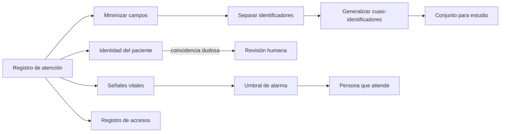
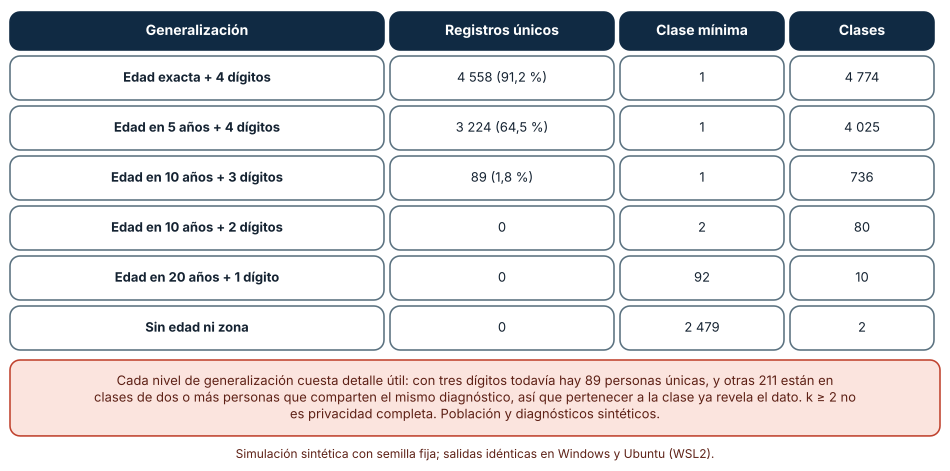
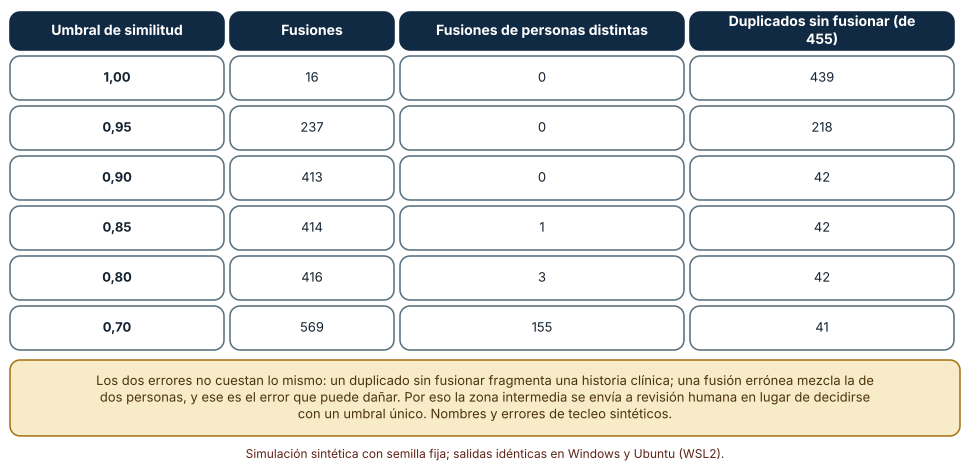
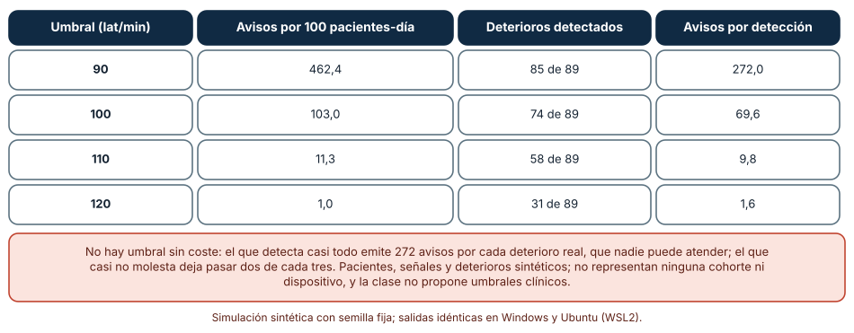

# SE-283 — Salud, datos sensibles y sistemas regulados

[← SE-282 — Fintech, contabilidad e invariantes monetarias](https://github.com/vladimiracunadev-create/modern-software-engineering-program/blob/main/classes/part-23-software-especializado-y-dominios/se-282-fintech-contabilidad-e-invariantes-monetarias/README.md) · [↑ Parte 23](https://github.com/vladimiracunadev-create/modern-software-engineering-program/blob/main/classes/part-23-software-especializado-y-dominios/README.md) · [📚 Índice completo](https://github.com/vladimiracunadev-create/modern-software-engineering-program/blob/main/classes/README.md) · [🌐 Portal](https://vladimiracunadev-create.github.io/modern-software-engineering-program/classes/SE-283.html) · [SE-284 — Blockchain, consenso y contratos inteligentes →](https://github.com/vladimiracunadev-create/modern-software-engineering-program/blob/main/classes/part-23-software-especializado-y-dominios/se-284-blockchain-consenso-y-contratos-inteligentes/README.md)

## Punto profesional y fundamento pedagógico

**Punto profesional.** La clase existe para que diseñes un sistema que maneja datos de salud sabiendo que un error de privacidad no se corrige después, que un error de identidad puede mezclar la historia de dos personas y que un exceso de alertas es en sí un riesgo para el paciente. Quien trabaja en este dominio responde por la minimización, la trazabilidad y la evidencia de cada decisión.

**Por qué aparece aquí.** Es la séptima clase de la **Parte 23**, después de **Fintech, contabilidad e invariantes monetarias**: allí el dato sensible era el dinero y se protegía con invariantes; aquí es la salud, donde el daño de un error es físico o irreversible y la ley condiciona qué se puede guardar, quién lo ve y cómo se demuestra. Aparecen juntas la privacidad, la identidad, el apoyo a la decisión y la regulación. El caso conductor sigue siendo la plataforma educativa ficticia: un módulo de enfermería escolar que registra atenciones de estudiantes.

**Error conceptual que debe corregir.** Creer que quitar el nombre y el documento basta para anonimizar. Una combinación de edad, sexo y código postal puede identificar a una persona sola; y creer que una regla de coincidencia con umbral decide bien si dos fichas son la misma persona, cuando equivocarse en un sentido mezcla historias clínicas.

**Secuencia de aprendizaje.** Antes de leer los resultados, predices cuántas personas quedan únicas tras quitar el nombre y cuántas fusiones erróneas produce un umbral permisivo; después mides la unicidad según el nivel de generalización, el equilibrio entre fusiones correctas y erróneas, y cuántos avisos por deterioro real emite una alarma según su umbral. La secuencia usa predicción, explicación propia, contraste y recuperación. [ICAP](https://icap.education.asu.edu/research) distingue participación de construcción de conocimiento; [How People Learn II](https://nap.nationalacademies.org/catalog/24783/how-people-learn-ii-learners-contexts-and-cultures) exige conectar conocimiento previo, contexto y transferencia; la [práctica de recuperación](https://pubmed.ncbi.nlm.nih.gov/16507066/) respalda producir de nuevo la explicación tras una demora; y [Education for Life and Work](https://nap.nationalacademies.org/resource/13398/dbasse_084153.pdf) exige devolución que explique la causa del error.

**Evidencia de aprendizaje.** `health-log.md` con la predicción, la tabla de unicidad por generalización, la tabla de fusiones por umbral, la tabla de avisos por umbral y una nota que diga qué decisión queda en manos de una persona y no de una regla.

**Límite de la conclusión.** La población, los nombres, las fichas, los signos vitales y los deterioros son sintéticos y no representan a ninguna persona ni a ninguna institución. No se usó ningún dato clínico real, ningún sistema de historia clínica ni ningún dispositivo, y no se propone ningún umbral clínico: los experimentos muestran mecanismos de privacidad, identidad y alarma, no práctica médica.

### Trazabilidad fuente → afirmación

| Fuente primaria u oficial | Afirmación que respalda | Lo que no prueba |
|---|---|---|
| [Sweeney, «k-anonymity: a model for protecting privacy» (2002)](https://doi.org/10.1142/S0218488502001648) | Define el k-anonimato: cada registro es indistinguible de al menos otros k−1 respecto de los atributos que identifican por combinación. | No garantiza privacidad frente a un atacante con conocimiento adicional ni frente a clases homogéneas. |
| [45 CFR § 164.514, desidentificación (eCFR)](https://www.ecfr.gov/current/title-45/subtitle-A/subchapter-C/part-164/subpart-E/section-164.514) | Recoge los dos métodos que la regla de privacidad de HIPAA reconoce para considerar desidentificada la información: determinación de un experto y eliminación de identificadores listados. | Es una norma de un país concreto; no se aplica a otros marcos legales. |
| [Sendelbach y Funk, «Alarm Fatigue» (AACN Advanced Critical Care, 2013)](https://doi.org/10.4037/NCI.0b013e3182a903f9) | Trata la fatiga de alarmas como un problema de seguridad del paciente en el que el exceso de avisos reduce la respuesta a los reales. | No fija un número aceptable de alarmas ni un umbral clínico. |

## Antes de empezar

Recupera lo aprendido en `SE-282`: un sistema cuyos errores se pagan define invariantes, reglas de negocio y un modelo de referencia. En salud se añade que el error puede ser irreversible y que quien lo sufre no está en la sala. La pregunta activa es: **¿qué dato se necesita de verdad, quién puede verlo, qué pasa si se asocia a la persona equivocada y cuántos avisos puede atender alguien sin dejar de atender?**

## Prerrequisitos

- Haber completado `SE-282` o poder explicar la diferencia entre una invariante y un modelo de referencia.
- Python 3.11 o posterior y un terminal; todo el código usa solo la biblioteca estándar.
- Conocer a nivel básico qué es un dato personal y la diferencia entre sensibilidad y especificidad.

## Problema auténtico

La plataforma educativa ficticia añade un módulo de enfermería escolar. El equipo quiere publicar un conjunto de datos «anónimo» de atenciones para un estudio interno: sin nombre ni documento, con edad, sexo, código postal y motivo de consulta. Al mismo tiempo, el registro de estudiantes tiene fichas duplicadas con errores de tecleo y se propone fusionarlas automáticamente, y una alerta por frecuencia cardíaca en el monitor de la enfermería «suena todo el día». Tres decisiones, tres riesgos: la reidentificación, la historia mezclada y la alarma que nadie atiende.

## Objetivos observables

Al terminar podrás:

1. clasificar un dato como identificador, cuasi-identificador o sensible, con un ejemplo y un contraejemplo de la plataforma;
2. medir cuántos registros quedan únicos según el nivel de generalización y explicar por qué un k mínimo no basta;
3. medir el equilibrio entre fusiones correctas, fusiones erróneas y duplicados sin fusionar según el umbral, y diseñar la zona de revisión humana;
4. medir cuántos avisos por deterioro real emite una alarma según su umbral y qué decisión queda fuera del software;
5. declarar qué evidencia exigiría un sistema regulado y qué parte de este ejercicio no la satisface.

## Mapa conceptual



El mapa muestra cuatro flujos de la misma atención: el que sale hacia un estudio (privacidad), el que decide a quién pertenece (identidad), el que dispara avisos (alarma) y el que registra quién vio qué (auditoría). Cada uno falla de un modo distinto.

## Temas y por qué importan

| Tema | Por qué cambia una decisión profesional | Evidencia mínima |
|---|---|---|
| Datos sensibles y minimización | Reduce lo que puede filtrarse y lo que hay que proteger. | Predicción, traza causal y contraejemplo de **Datos sensibles y minimización** en `health-log.md` |
| Anonimización y sus límites | Distingue seudonimizar de desidentificar y mide la reidentificación. | Predicción, traza causal y contraejemplo de **Anonimización y sus límites** en `health-log.md` |
| Identidad del paciente | Evita mezclar historias o fragmentarlas. | Predicción, traza causal y contraejemplo de **Identidad del paciente** en `health-log.md` |
| Alarmas y apoyo a la decisión | Equilibra detectar con no saturar. | Predicción, traza causal y contraejemplo de **Alarmas y apoyo a la decisión** en `health-log.md` |
| Sistemas regulados | Exige trazabilidad, validación y evidencia de cada cambio. | Predicción, traza causal y contraejemplo de **Sistemas regulados** en `health-log.md` |

## Conceptos y decisiones

### 1. Datos sensibles y minimización

Los datos de salud son sensibles porque su revelación puede causar discriminación, estigma o daño, y porque no pueden «devolverse» una vez conocidos. La primera defensa es **no recoger ni conservar** lo que no hace falta: cada campo debe responder a una pregunta de uso concreta. La segunda es separar los **identificadores directos** (nombre, documento) de los **cuasi-identificadores** (edad, sexo, código postal, fecha de ingreso), que identifican por combinación, y de los **atributos sensibles** (diagnóstico, medicación). Un diseño que guarda cada grupo con controles y retenciones distintos limita el daño de cada filtración.

### 2. Anonimización y sus límites

**Seudonimizar** sustituye el identificador por un código; quien tenga la tabla de equivalencias puede revertirlo, así que el conjunto sigue siendo dato personal. **Desidentificar** exige que no pueda reidentificarse con medios razonables; la regla de privacidad de HIPAA reconoce dos vías: la determinación de un experto y la eliminación de una lista de identificadores. El **k-anonimato** de Sweeney exige que cada combinación de cuasi-identificadores se repita en al menos k registros. Tiene límites: si todos los de una clase comparten el mismo diagnóstico, saber que alguien pertenece a la clase revela el diagnóstico, y un atacante con información adicional puede reducir la clase. Generalizar (tramos de edad, menos dígitos del código postal) aumenta k a cambio de detalle útil.

### 3. Identidad del paciente

Asociar un registro a la persona correcta parece trivial y no lo es: hay errores de tecleo, nombres comunes, fechas mal escritas. Los sistemas calculan una **puntuación de coincidencia** entre fichas y deciden por umbral. Hay dos errores: la **fusión errónea** (dos personas distintas quedan como una) y el **duplicado sin fusionar** (una persona queda como dos). El primero mezcla historias clínicas y puede causar daño directo; el segundo fragmenta y puede ocultar alergias. Los costes no son simétricos, de modo que la regla razonable no es un umbral único sino tres zonas: coincidencia segura (fusión automática), dudosa (revisión humana) y no coincidencia. Para limitar el número de pares que se comparan se agrupa por un atributo estable (**bloqueo**).

### 4. Alarmas y apoyo a la decisión

Una alarma es una decisión automática de interrumpir a una persona. Cada umbral compra sensibilidad con avisos: si baja, detecta más deterioros y avisa por muchos que no lo son; si sube, avisa poco y deja pasar algunos. La **fatiga de alarmas** es el fenómeno por el cual un exceso de avisos falsos reduce la respuesta a los reales, y se documenta como problema de seguridad del paciente. Las defensas son priorizar por gravedad, exigir persistencia antes de avisar, combinar señales y revisar con el personal qué avisos no sirven. El software de apoyo propone; la decisión clínica es de una persona.

### 5. Sistemas regulados

Cuando el software puede influir en una decisión clínica, entra en marcos regulatorios: la FDA trata como «software como dispositivo médico» al que cumple una función médica por sí mismo, y la norma IEC 62304 describe los procesos del ciclo de vida del software de dispositivos médicos. Lo común es exigir **trazabilidad** entre requisito, diseño, prueba y riesgo; **gestión del riesgo** documentada; **control de cambios**; y **registro de accesos** a datos personales. FHIR, el estándar de intercambio de HL7, define recursos y formatos para mover datos de salud entre sistemas con un significado común. Esta clase no enseña cumplimiento ni sustituye a un especialista regulatorio: enseña a diseñar de modo que la evidencia exista.

### Quitar el nombre no basta: unicidad según la generalización

Se genera una población sintética de 5 000 registros con edad (normal, media 45, desviación 20, entre 0 y 95), sexo, código postal de 4 dígitos (40 zonas por 10 sufijos) y diagnóstico (cinco categorías, con frecuencias 60, 20, 10, 6 y 4 %). Se agrupan por la tripleta (edad, sexo, zona) con distintos niveles y se cuentan las clases de tamaño 1.

```python
def generalizar(reg, tramo_edad, digitos_zona):
    edad, sexo, zona, dx = reg
    return ((edad // tramo_edad) * tramo_edad if tramo_edad else "*", sexo,
            zona[:digitos_zona] if digitos_zona else "*")
clases = collections.Counter(generalizar(x, tramo, digitos) for x in poblacion)
unicos = sum(1 for v in clases.values() if v == 1)
```

| Generalización | Registros únicos | Clase mínima | Clases |
|---|---:|---:|---:|
| Edad exacta + 4 dígitos | 4 558 (91,2 %) | 1 | 4 774 |
| Edad en 5 años + 4 dígitos | 3 224 (64,5 %) | 1 | 4 025 |
| Edad en 10 años + 3 dígitos | 89 (1,8 %) | 1 | 736 |
| Edad en 10 años + 2 dígitos | 0 | 2 | 80 |
| Edad en 20 años + 1 dígito | 0 | 92 | 10 |
| Sin edad ni zona | 0 | 2 479 | 2 |

Resultado, idéntico en Windows (CPython 3.12.9) y en Ubuntu bajo WSL2 (3.12.3). Además, con edad en 10 años y 3 dígitos, 211 personas están en clases de dos o más que comparten el mismo diagnóstico.



**Cómo leer la figura.** Cada fila es un nivel de generalización de los cuasi-identificadores; la segunda columna cuenta los registros que son únicos en su combinación. **Dónde deja de valer:** el cálculo supone que el atacante conoce edad, sexo y zona de la persona que busca; con más atributos (fecha de ingreso, centro) la unicidad sube de nuevo. La población sintética tiene 40 zonas uniformes; una real tiene zonas muy desiguales, con clases más pequeñas en las rurales. La figura no mide riesgo jurídico ni sustituye la determinación de un experto.

### Fusionar fichas: dos errores con costes distintos

Se generan 1 500 personas con nombre (combinación de 12 nombres y 12 apellidos) y fecha de nacimiento; el 30 % tiene una segunda ficha con un error de tecleo (sustitución, borrado o transposición de una letra) y el 10 % de esas con el día de nacimiento distinto. Resultan 1 955 fichas y 455 pares duplicados reales. Se comparan solo las fichas con el mismo año de nacimiento (bloqueo: 31 442 pares) con la puntuación `0,7·similitud_del_nombre + 0,3·(fechas iguales)`, y se varía el umbral.

```python
def puntuacion(a, b):
    s = difflib.SequenceMatcher(None, a.nombre, b.nombre).ratio()
    return 0.7 * s + (0.3 if a.fecha == b.fecha else 0.0)
```

| Umbral de similitud | Fusiones | Fusiones de personas distintas | Duplicados sin fusionar (de 455) |
|---:|---:|---:|---:|
| 1,00 | 16 | 0 | 439 |
| 0,95 | 237 | 0 | 218 |
| 0,90 | 413 | 0 | 42 |
| 0,85 | 414 | 1 | 42 |
| 0,80 | 416 | 3 | 42 |
| 0,70 | 569 | 155 | 41 |

Con 0,90 se fusionan 413 pares, todos correctos, pero quedan 42 duplicados; bajar el umbral a 0,70 solo rescata uno más y mezcla 155 historias.



**Cómo leer la figura.** Cada fila es un umbral; la tercera columna cuenta las fusiones que mezclan a dos personas y la cuarta, los duplicados reales que quedan sin unir. **Dónde deja de valer:** con 12 nombres y 12 apellidos las colisiones entre personas distintas son más frecuentes que en una población real; con nombres más variados el umbral permisivo sería menos dañino, y con nombres muy comunes más. Los errores de tecleo son de una letra; los reales (apellidos compuestos, nombres cambiados) escapan a esta puntuación.

### El umbral de una alarma: detectar o saturar

Se simulan 100 pacientes-día por corrida (50 corridas): cada uno tiene una frecuencia basal gaussiana (media 80, desviación 10) y 24 lecturas horarias con ruido gaussiano de 6; con probabilidad 0,02 sufre un deterioro con un pico de 35 ± 8 latidos sobre la basal en una hora. Se cuentan las horas que superan el umbral (avisos) y los deterioros cuya lectura máxima lo supera.

```python
serie = [r.gauss(base, 6) for _ in range(24)]
if deterioro: serie[r.randint(0, 23)] = base + r.gauss(35, 8)
avisos += sum(x > umbral for x in serie)
```

| Umbral (lat/min) | Avisos por 100 pacientes-día | Deterioros detectados | Avisos por detección |
|---:|---:|---:|---:|
| 90 | 462,4 | 85 de 89 | 272,0 |
| 100 | 103,0 | 74 de 89 | 69,6 |
| 110 | 11,3 | 58 de 89 | 9,8 |
| 120 | 1,0 | 31 de 89 | 1,6 |

A 90 lat/min el sistema detecta casi todos los deterioros a costa de 272 avisos por cada uno; a 120 lat/min avisa casi nunca y deja pasar dos de cada tres.



**Cómo leer la figura.** Cada fila es un umbral; la segunda columna es la carga de avisos para quien atiende y la tercera el beneficio en detección. **Dónde deja de valer:** los valores son inventados para mostrar el mecanismo y no representan a ninguna cohorte ni dispositivo; la clase no propone umbrales clínicos. La simulación avisa por cada lectura sobre el umbral; los sistemas reales exigen persistencia, agrupan avisos y ajustan por paciente, y eso cambia las cifras. No mide qué hace una persona ante cada aviso.

## Definiciones de trabajo

- **cuasi-identificador:** atributo que no identifica por sí solo pero sí en combinación con otros (edad, sexo, código postal).
- **seudonimización:** sustitución de un identificador por un código, reversible para quien posea la tabla de equivalencias.
- **k-anonimato:** propiedad por la cual cada combinación de cuasi-identificadores aparece en al menos k registros.
- **fusión errónea:** unión de las fichas de dos personas distintas como si fueran una.
- **fatiga de alarmas:** reducción de la respuesta a los avisos por exceso de avisos poco útiles.

Las definiciones son operativas para el módulo de enfermería escolar. No convierten términos con una historia más amplia en sinónimos y deben contrastarse con la documentación primaria enlazada al final.

## Ejemplo mínimo

El fragmento cuenta los registros únicos de un conjunto pequeño. Antes de ejecutarlo, predice cuántos son únicos.

```python
import collections
regs = [(12, "F", "1001"), (12, "F", "1002"), (13, "M", "1001"), (12, "F", "1001")]
def clase(r, digitos): return (r[0], r[1], r[2][:digitos])
c4 = collections.Counter(clase(r, 4) for r in regs)
c3 = collections.Counter(clase(r, 3) for r in regs)
assert sum(v == 1 for v in c4.values()) == 2      # (12,F,1002) y (13,M,1001)
assert sum(v == 1 for v in c3.values()) == 1      # solo (13,M,100) queda único
```

Con cuatro dígitos hay dos únicos; con tres, uno. Registra versión, comando y salida; cambia la edad a tramos de cinco años y predice cuántos quedan únicos.

## Ejemplo profesional

El equipo de la plataforma separa el módulo en tres almacenes: `identidad` (nombre y documento, acceso mínimo, retención larga), `atenciones` (seudónimo, edad, motivo, acceso por rol) y `estudio` (generalizado: tramos de 10 años y 2 dígitos, con una clase mínima de 5 y comprobación de que ninguna clase tenga un único diagnóstico). La fusión de fichas usa tres zonas: sobre 0,95 se fusiona, entre 0,85 y 0,95 va a revisión de una persona de secretaría con las fichas lado a lado, y bajo 0,85 no se une. El monitor de la enfermería exige que la lectura supere el umbral en dos horas consecutivas antes de avisar y permite al personal marcar un aviso como inútil. Todo acceso a atenciones queda en un registro que alguien revisa cada semana. El documento de riesgos enlaza cada control con el peligro que cubre.

Compara con el primer intento: un volcado sin nombre, fusión automática al 0,70 y una alarma por lectura. Un diseño es adecuado cuando cada riesgo tiene un control, una evidencia y un responsable; es frágil cuando todo depende de que nadie se equivoque.

## Práctica guiada

1. Clasifica cada campo del registro de atención como identificador, cuasi-identificador o sensible y decide cuáles no hacen falta.
2. Predice cuántos registros quedan únicos tras quitar el nombre y escribe el número.
3. Genera una población sintética y mide la unicidad para seis niveles de generalización.
4. Genera fichas con errores de tecleo y mide fusiones correctas, erróneas y duplicados restantes para seis umbrales.
5. Diseña las tres zonas de decisión y calcula cuántos pares irían a revisión humana con tus umbrales.
6. Simula la alarma con cuatro umbrales y decide qué combinación de persistencia y umbral propondrías al personal.
7. Entrega `health-log.md` y pide a otra persona que diga qué dato del conjunto de estudio todavía podría reidentificar a alguien.

## Ejercicios

1. **Clase homogénea:** diseña un conjunto donde k = 5 se cumpla y aun así el diagnóstico se revele a partir de la clase, y propón una medida adicional.
2. **Bloqueo:** compara el número de pares comparados y los duplicados perdidos al bloquear por año de nacimiento frente a por iniciales; explica el compromiso.
3. **Zonas:** con las puntuaciones del experimento, elige dos umbrales para tres zonas que dejen cero fusiones erróneas automáticas y calcula cuántos pares van a revisión.
4. **Persistencia:** modifica la alarma para que exija dos horas seguidas y mide el cambio en avisos y detecciones.

## Reto verificable

Entrega `health-log.md` con la predicción, la tabla de unicidad, la de fusiones, la de alarmas, las tres zonas de decisión y la clasificación de campos. Se aprueba si otra persona ejecuta el código desde un checkout limpio, obtiene los mismos números y puede decir qué decisión queda en manos de una persona y por qué. No se aprueba por afirmar que los datos están «anonimizados» sin medir la unicidad ni la homogeneidad de las clases.

## Caso conductor

La plataforma educativa ficticia es el caso conductor de la Parte 23. Esta clase deja el séptimo artefacto: el módulo de enfermería con tres almacenes, conjunto de estudio generalizado, fusión en tres zonas y alarma con persistencia. `SE-284` pasa a un dominio donde la confianza no la da una institución sino un protocolo: la cadena de bloques. Cambia después una sola decisión, el tramo de edad, y observa cuántos registros dejan de ser únicos y qué detalle útil pierdes.

## Preguntas frecuentes

### ¿Quitar el nombre y el documento es anonimizar?

No: es una seudonimización parcial. Los cuasi-identificadores pueden identificar por combinación, y la unicidad medida lo muestra. Para considerar un conjunto desidentificado hay que seguir un método reconocido por la norma aplicable.

### ¿Es suficiente un k mínimo?

No: si todas las personas de una clase comparten el mismo atributo sensible, la pertenencia a la clase lo revela. Además hay que revisar la diversidad del atributo sensible y la información adicional que podría tener quien ataca.

### ¿Por qué no fusionar siempre con el umbral que más duplicados une?

Porque fusionar a dos personas distintas es un error más grave que dejar un duplicado, y la proporción entre ambos cambia con el umbral. Se usa una zona intermedia de revisión humana.

### ¿Puede una alarma ser perjudicial?

Sí: un exceso de avisos poco útiles reduce la atención a los que importan. Diseñarla incluye medir su carga, no solo su sensibilidad.

## Fallo controlado y diagnóstico

Reproduce el fallo clásico de la clase: **un conjunto «anónimo» que identifica a personas**. Quita el nombre y publica edad exacta, sexo y código postal de cuatro dígitos.

Registra síntoma, entrada mínima, hipótesis, observación que descarta cada hipótesis, causa, corrección y prueba de regresión. **Síntoma:** alguien que conoce la edad, el sexo y el barrio de una persona localiza su fila y lee su motivo de consulta. **Hipótesis rivales:** (a) el nombre sigue en algún campo; (b) la tabla de equivalencias se filtró; (c) la combinación de cuasi-identificadores es única. **Prueba:** cuenta las clases de tamaño uno; si el 91,2 % de los registros son únicos, la causa es (c). **Conclusión:** el conjunto no está desidentificado. **Regresión:** generaliza hasta una clase mínima de 5, comprueba que ninguna clase tenga un único diagnóstico y añade una prueba que falle si la clase mínima baja de 5. No cambies a la vez la generalización y el conjunto de campos.

## Errores comunes y cómo corregirlos

| Síntoma | Causa probable | Corrección |
|---|---|---|
| Un conjunto sin nombre identifica a personas | Cuasi-identificadores sin generalizar | Medir la unicidad y generalizar hasta una clase mínima declarada |
| La pertenencia a una clase revela el diagnóstico | Clases homogéneas | Comprobar la diversidad del atributo sensible y suprimir o agrupar |
| Historias clínicas mezcladas | Fusión automática con umbral permisivo | Tres zonas con revisión humana y registro de cada fusión |
| El personal ignora las alarmas | Exceso de avisos poco útiles | Persistencia, prioridad por gravedad y revisión con el personal |
| No se puede demostrar quién vio un dato | Sin registro de accesos | Registro inmutable de accesos y revisión periódica |

## Entorno y archivos clave

```text
work/SE-283/
├── README.md
├── enfermeria/
│   ├── anonimizar.py
│   ├── identidad.py
│   └── alarmas.py
├── tests/test_enfermeria.py
└── evidence/health-log.md
```

El `README` declara plataforma, versión de Python, semillas y comandos. Los experimentos usan solo la biblioteca estándar (`random`, `difflib`, `collections`) y se ejecutaron con CPython 3.12.9 en Windows 11 y 3.12.3 en Ubuntu bajo WSL2: las salidas fueron idénticas. Si añades una dependencia, fija procedencia y versión.

## Seguridad, ética y accesibilidad

- usa solo datos sintéticos en las prácticas: nunca datos clínicos reales, ni siquiera «de ejemplo» obtenidos de un sistema;
- minimiza lo que se recoge, separa identificadores de atributos sensibles y define la retención de cada almacén;
- el consentimiento debe ser informado, revocable y comprensible, con lenguaje claro y alternativas accesibles;
- una fusión de fichas o una alarma automática deben poder cuestionarse y corregirse por una persona con un procedimiento conocido;
- evalúa si el sistema funciona peor para algún grupo (nombres de otras lenguas, edades extremas) antes de confiar en él.

## Puente hacia el trabajo con agentes

Un agente al que se le pide «anonimiza este conjunto de atenciones» eliminará las columnas de nombre y documento y declarará el trabajo terminado. Pídele en cambio que clasifique cada campo, que mida la unicidad y la homogeneidad de las clases, que proponga una generalización con una clase mínima declarada y que escriba qué ataque queda sin cubrir. Revisa especialmente si fusiona fichas con un único umbral y si da un umbral clínico como si estuviera validado: son los dos defectos que esta clase mostró.

## Transferencia

Traslada el análisis a otro conjunto sensible (por ejemplo, calificaciones con necesidades de apoyo): cambia los campos y conserva el procedimiento de clasificar, medir la unicidad, diseñar zonas de decisión y revisar la carga de avisos. La transferencia está lograda cuando puedes explicar qué parte del diseño dependía de la salud y cuál no, no cuando el código se parece.

## Evaluación y evidencia

| Criterio | Evidencia para aprobar |
|---|---|
| comprensión | explicación de identificador, cuasi-identificador y sensible con ejemplos del módulo |
| corrección | unicidad, fusiones y avisos reproducibles con las mismas semillas |
| diseño | tres almacenes, conjunto generalizado, tres zonas de fusión y alarma con persistencia |
| diagnóstico | reproducción del fallo «conjunto anónimo que identifica» con regresión |
| incertidumbre | declaración de que ningún experimento usó datos clínicos reales ni propone umbrales clínicos |
| reproducibilidad | versiones, comandos, salida y límites declarados |

## Fuentes

- [Sweeney, «k-anonymity: a model for protecting privacy» (2002)](https://doi.org/10.1142/S0218488502001648) — definición del k-anonimato; autoridad: International Journal of Uncertainty, Fuzziness and Knowledge-Based Systems.
- [45 CFR § 164.514, desidentificación (eCFR)](https://www.ecfr.gov/current/title-45/subtitle-A/subchapter-C/part-164/subpart-E/section-164.514) — métodos de desidentificación de la regla de privacidad de HIPAA; autoridad: Electronic Code of Federal Regulations.
- [Sendelbach y Funk, «Alarm Fatigue» (AACN Advanced Critical Care, 2013)](https://doi.org/10.4037/NCI.0b013e3182a903f9) — fatiga de alarmas como problema de seguridad del paciente; autoridad: AACN Advanced Critical Care.
- [HL7, FHIR](https://hl7.org/fhir/) — estándar de intercambio de datos de salud; autoridad: HL7 International.
- [FDA, Software as a Medical Device (SaMD)](https://www.fda.gov/medical-devices/digital-health-center-excellence/software-medical-device-samd) — software con función médica propia; autoridad: U.S. Food and Drug Administration.
- [ISO/IEC, IEC 62304 (software de dispositivos médicos)](https://www.iso.org/standard/71604.html) — procesos del ciclo de vida del software de dispositivos médicos; autoridad: ISO/IEC (la página responde 403 a clientes automatizados, por lo que el enlace no se pudo comprobar con `curl`).
- [Python: `difflib`](https://docs.python.org/3/library/difflib.html) — similitud entre secuencias de texto; autoridad: documentación de Python.

Cada fuente respalda el mecanismo indicado; ninguna demuestra que el 91,2 % de unicidad, los 155 pares mezclados o los 272 avisos por detección se observen en un sistema real. Esa afirmación depende de la población, de los nombres y de los dispositivos.

## Límites y siguiente paso

Se ejecutaron tres simulaciones con datos sintéticos en Windows y Ubuntu (WSL2) con resultados idénticos. No se usó ningún dato clínico real, sistema de historia clínica ni dispositivo, y no se evaluó el cumplimiento de ninguna norma: la población, los nombres, las fichas y los signos vitales son construcciones del autor y no representan a nadie. La siguiente clase pasa a la cadena de bloques, el consenso y los contratos inteligentes.

## Glosario

- **cuasi-identificador:** atributo que no identifica por sí solo pero sí en combinación con otros (edad, sexo, código postal).
- **seudonimización:** sustitución de un identificador por un código, reversible para quien posea la tabla de equivalencias.
- **k-anonimato:** propiedad por la cual cada combinación de cuasi-identificadores aparece en al menos k registros.
- **fusión errónea:** unión de las fichas de dos personas distintas como si fueran una.
- **fatiga de alarmas:** reducción de la respuesta a los avisos por exceso de avisos poco útiles.

---

[← SE-282 — Fintech, contabilidad e invariantes monetarias](https://github.com/vladimiracunadev-create/modern-software-engineering-program/blob/main/classes/part-23-software-especializado-y-dominios/se-282-fintech-contabilidad-e-invariantes-monetarias/README.md) · [↑ Parte 23](https://github.com/vladimiracunadev-create/modern-software-engineering-program/blob/main/classes/part-23-software-especializado-y-dominios/README.md) · [📚 Índice completo](https://github.com/vladimiracunadev-create/modern-software-engineering-program/blob/main/classes/README.md) · [🌐 Portal](https://vladimiracunadev-create.github.io/modern-software-engineering-program/classes/SE-283.html) · [SE-284 — Blockchain, consenso y contratos inteligentes →](https://github.com/vladimiracunadev-create/modern-software-engineering-program/blob/main/classes/part-23-software-especializado-y-dominios/se-284-blockchain-consenso-y-contratos-inteligentes/README.md)
