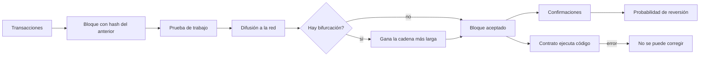
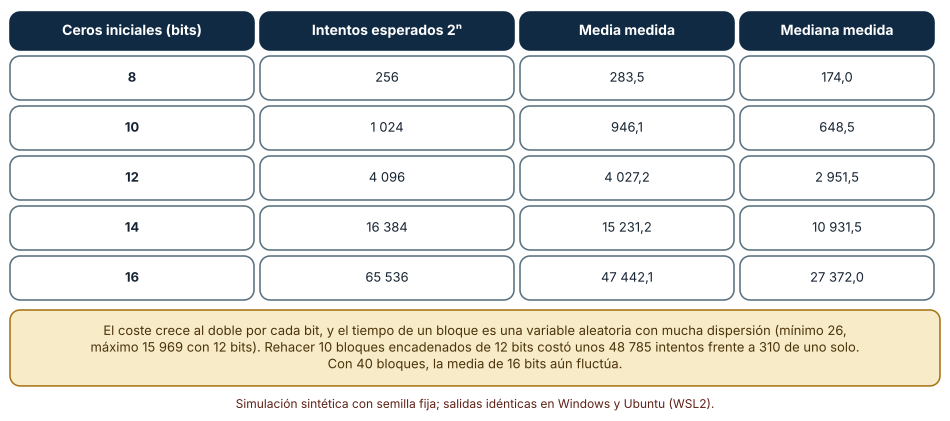
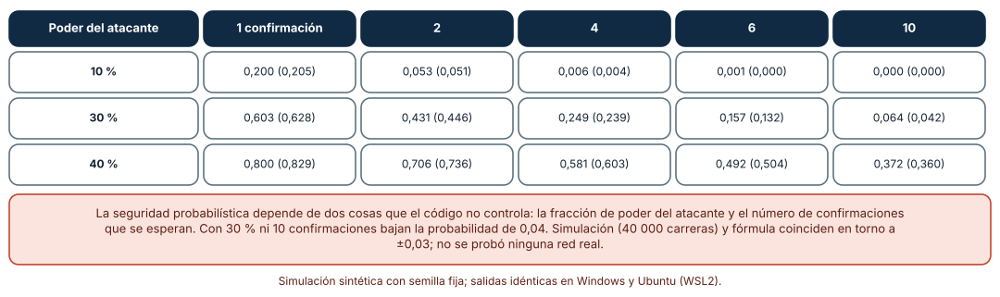
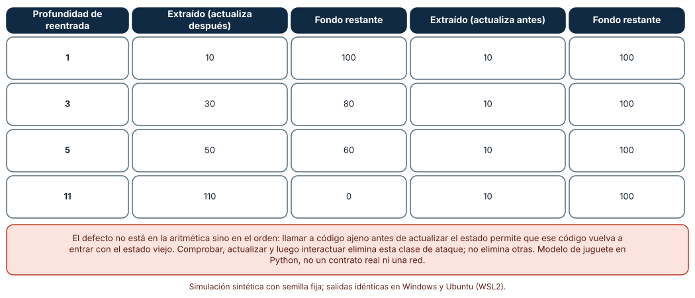

# SE-284 — Blockchain, consenso y contratos inteligentes

[← SE-283 — Salud, datos sensibles y sistemas regulados](https://github.com/vladimiracunadev-create/modern-software-engineering-program/blob/main/classes/part-23-software-especializado-y-dominios/se-283-salud-datos-sensibles-y-sistemas-regulados/README.md) · [↑ Parte 23](https://github.com/vladimiracunadev-create/modern-software-engineering-program/blob/main/classes/part-23-software-especializado-y-dominios/README.md) · [📚 Índice completo](https://github.com/vladimiracunadev-create/modern-software-engineering-program/blob/main/classes/README.md) · [🌐 Portal](https://vladimiracunadev-create.github.io/modern-software-engineering-program/classes/SE-284.html) · [SE-285 — Sistemas geoespaciales y temporales →](https://github.com/vladimiracunadev-create/modern-software-engineering-program/blob/main/classes/part-23-software-especializado-y-dominios/se-285-sistemas-geoespaciales-y-temporales/README.md)

## Punto profesional y fundamento pedagógico

**Punto profesional.** La clase existe para que distingas lo que una cadena de bloques garantiza (que un historial no se altera sin que se note, bajo ciertos supuestos de poder de cómputo) de lo que no garantiza (que el dato registrado sea verdad, que el código sea correcto o que un atacante no pueda ganar con probabilidad pequeña), y para que decidas con evidencia si un problema necesita una cadena o una base de datos con auditoría.

**Por qué aparece aquí.** Es la octava clase de la **Parte 23**, después de **Salud, datos sensibles y sistemas regulados**: allí la confianza descansaba en instituciones, controles de acceso y registros de auditoría; aquí se pregunta qué ocurre cuando no hay una autoridad central y la confianza se sustituye por un protocolo. Dinero, identidad y regulación reaparecen con una restricción nueva: lo que se escribe no se puede borrar. El caso conductor sigue siendo la plataforma educativa ficticia: certificados de curso verificables por terceros.

**Error conceptual que debe corregir.** Creer que «está en la cadena» equivale a «es verdad» o «es seguro». La cadena garantiza orden e inmutabilidad probabilística de lo escrito; no valida lo escrito, no protege un contrato mal programado y no elimina la necesidad de decidir quién escribe y por qué.

**Secuencia de aprendizaje.** Antes de leer los resultados, predices cuántos intentos cuesta encontrar un hash con ceros iniciales y cuántos bloques hacen falta para que un atacante con el 30 % del poder tenga una probabilidad pequeña de rehacer la cadena; después mides ambos y observas cuánto fondo extrae una reentrada según su profundidad. La secuencia usa predicción, explicación propia, contraste y recuperación. [ICAP](https://icap.education.asu.edu/research) distingue participación de construcción de conocimiento; [How People Learn II](https://nap.nationalacademies.org/catalog/24783/how-people-learn-ii-learners-contexts-and-cultures) exige conectar conocimiento previo, contexto y transferencia; la [práctica de recuperación](https://pubmed.ncbi.nlm.nih.gov/16507066/) respalda producir de nuevo la explicación tras una demora; y [Education for Life and Work](https://nap.nationalacademies.org/resource/13398/dbasse_084153.pdf) exige devolución que explique la causa del error.

**Evidencia de aprendizaje.** `chain-log.md` con la predicción, la tabla de intentos de la prueba de trabajo, la tabla de probabilidades de doble gasto, la tabla de extracción por reentrada y una nota que separe lo que garantiza el protocolo de lo que depende del código y de los datos.

**Límite de la conclusión.** Los bloques, las dificultades, las tasas de propagación y el contrato son modelos en CPython hechos por el autor. No se minó en ninguna red, no se desplegó ningún contrato, no se usó ninguna criptomoneda ni se midió nada en una cadena real: los experimentos muestran mecanismos probabilísticos y de orden de operaciones, no la seguridad de un sistema.

### Trazabilidad fuente → afirmación

| Fuente primaria u oficial | Afirmación que respalda | Lo que no prueba |
|---|---|---|
| [Nakamoto, «Bitcoin: A Peer-to-Peer Electronic Cash System» (2008)](https://bitcoin.org/bitcoin.pdf) | Propone una cadena de bloques con prueba de trabajo y calcula la probabilidad de que un atacante alcance a la cadena honesta en función de su fracción de poder y del número de confirmaciones. | No analiza todas las estrategias de ataque ni incentivos posteriores. |
| [Lamport, Shostak y Pease, «The Byzantine Generals Problem» (1982)](https://doi.org/10.1145/357172.357176) | Formula el problema de lograr acuerdo entre procesos cuando algunos pueden fallar de forma arbitraria o mentir. | No describe ninguna cadena de bloques ni un protocolo de producción. |
| [Atzei, Bartoletti y Cimoli, «A Survey of Attacks on Ethereum Smart Contracts (SoK)» (2017)](https://doi.org/10.1007/978-3-662-54455-6_8) | Cataloga ataques a contratos, entre ellos la reentrada, y los relaciona con características del lenguaje y de la plataforma. | Es una encuesta de 2017; no describe versiones actuales de las herramientas. |

## Antes de empezar

Recupera lo aprendido en `SE-283`: un sistema regulado deja evidencia y control de acceso. En una cadena pública no hay control de acceso a lo escrito, y borrar no es una opción. La pregunta activa es: **¿qué debe ser cierto para que este registro sea confiable sin una autoridad, y qué parte de esa certeza es una probabilidad que depende de supuestos que no controlo?**

## Prerrequisitos

- Haber completado `SE-283` o poder explicar la diferencia entre seudonimizar y desidentificar.
- Python 3.11 o posterior y un terminal; todo el código usa solo la biblioteca estándar (`hashlib`, `random`, `math`).
- Saber qué es una función hash a nivel básico (determinista, salida de tamaño fijo, difícil de invertir).

## Problema auténtico

La plataforma educativa ficticia quiere emitir certificados de curso que cualquiera pueda verificar sin llamar a la plataforma. Alguien propone registrarlos en una cadena de bloques. Tres preguntas aparecen en la primera reunión: si un certificado falso entra en la cadena, ¿quién lo detecta?; ¿cuántas confirmaciones hacen falta para dar un registro por definitivo?; y si se usa un contrato inteligente para emitirlos, ¿qué pasa si tiene un error, dado que no se puede modificar? Nadie sabe contestar con números, y la discusión se reduce a si la tecnología «es segura».

## Objetivos observables

Al terminar podrás:

1. explicar qué prueba una cadena de hashes y qué no, con un ejemplo y un contraejemplo de los certificados;
2. medir cuántos intentos cuesta una prueba de trabajo según su dificultad y qué dispersión tiene el coste de un bloque;
3. calcular, con la fórmula y con una simulación, la probabilidad de que un atacante rehaga el historial según su poder y las confirmaciones esperadas;
4. reproducir una reentrada en un contrato de juguete y corregirla con el orden comprobar–actualizar–interactuar;
5. decidir con criterios explícitos si el problema de los certificados necesita una cadena o basta una firma digital y un registro auditable.

## Mapa conceptual



El mapa tiene dos zonas de riesgo distintas: la **probabilística** (bifurcaciones y reversión, que dependen del poder del atacante y del tiempo) y la **determinista** (el código del contrato, que se ejecuta como fue escrito y no se puede reparar después de desplegado).

## Temas y por qué importan

| Tema | Por qué cambia una decisión profesional | Evidencia mínima |
|---|---|---|
| Cadena de hashes | Explica qué integridad aporta y qué no. | Predicción, traza causal y contraejemplo de **Cadena de hashes** en `chain-log.md` |
| Prueba de trabajo | Convierte el coste de cómputo en una medida de esfuerzo. | Predicción, traza causal y contraejemplo de **Prueba de trabajo** en `chain-log.md` |
| Consenso y confirmaciones | Define cuánto esperar antes de tratar un registro como final. | Predicción, traza causal y contraejemplo de **Consenso y confirmaciones** en `chain-log.md` |
| Contratos inteligentes | Fija que el código es la regla y que un error es permanente. | Predicción, traza causal y contraejemplo de **Contratos inteligentes** en `chain-log.md` |
| Cuándo no usar una cadena | Evita pagar el coste de la descentralización sin necesitarla. | Predicción, traza causal y contraejemplo de **Cuándo no usar una cadena** en `chain-log.md` |

## Conceptos y decisiones

### 1. Cadena de hashes

Cada bloque contiene el hash del anterior; cambiar un dato altera el hash de su bloque, lo que invalida el siguiente, y así hasta el final. Por eso una cadena de hashes hace **detectable** una alteración del historial. No la hace imposible, no valida el contenido y no dice quién escribió. Un certificado falso escrito en la cadena queda tan registrado como uno verdadero. La integridad se refiere al orden y a la no alteración posterior, no a la veracidad del dato original; para esa hace falta una firma de quien emite o una verificación fuera de la cadena.

### 2. Prueba de trabajo

En la prueba de trabajo, un bloque es válido solo si su hash, interpretado como un número, es menor que un objetivo. Como el hash no se puede dirigir, la única forma de hallar uno es probar valores (el *nonce*) hasta acertar. Con `b` ceros iniciales, la probabilidad de acertar en un intento es `2^−b`, de modo que el número de intentos sigue una distribución geométrica de media `2^b`; la mediana es menor que la media (alrededor de 0,69 veces) y la dispersión es grande. Rehacer un bloque pasado exige repetir el trabajo de ese bloque y el de todos los posteriores, y hacerlo antes de que la red añada más. Ese coste es la base de la garantía.

### 3. Consenso y confirmaciones

Cuando dos mineros hallan un bloque casi a la vez, la red se bifurca; el protocolo adopta la cadena más larga y el bloque perdedor queda **huérfano**. La probabilidad de que un bloque quede huérfano crece con el retraso de propagación respecto del intervalo entre bloques. Una transacción incluida en un bloque puede revertirse si una cadena alternativa más larga aparece; cada bloque posterior (**confirmación**) reduce esa probabilidad. Nakamoto calcula la probabilidad de que un atacante con una fracción `q` del poder alcance a la cadena honesta tras `z` confirmaciones. El problema de los generales bizantinos de Lamport, Shostak y Pease es el marco teórico: acordar un valor cuando algunos participantes mienten.

### 4. Contratos inteligentes

Un contrato inteligente es un programa que vive en la cadena y se ejecuta cuando se le invoca. Es **determinista** (todos los nodos deben llegar al mismo resultado), **público** (cualquiera puede leerlo y atacarlo) e **inmutable** una vez desplegado (salvo mecanismos de actualización diseñados de antemano). Sus errores son por eso costosos. La **reentrada** ocurre cuando el contrato llama a código ajeno antes de actualizar su propio estado: ese código puede volver a invocar al contrato y encontrar el estado viejo. La defensa es ordenar: comprobar condiciones, actualizar el estado y solo después interactuar con otros. La encuesta de Atzei et al. cataloga esta y otras clases de ataque.

### 5. Cuándo no usar una cadena

Una cadena cuesta: coste de cómputo o de capital para asegurarla, latencia hasta la confirmación, públicas por defecto, imposibilidad de borrar (en tensión con el derecho a la supresión de datos personales) y dependencia de supuestos de poder. Se justifica cuando varias partes que no confían entre sí deben compartir un registro sin una autoridad común. Si hay una institución que ya es la autoridad (la plataforma que emite los certificados), una firma digital verificable con una clave pública publicada y un registro con auditoría resuelve el problema de verificación a un coste mucho menor. La pregunta de decisión no es «¿es moderna?» sino «¿quién debe poder escribir y quién debe poder verificar sin confiar en quién?».

### Cuántos intentos cuesta un bloque

Se halla, para dificultades de 8 a 16 bits, un *nonce* tal que `SHA-256("bloque-i:nonce")`, interpretado como número, sea menor que `2^(256−b)`. Se repite con 100 bloques por dificultad (40 con 16 bits) y se cuentan los intentos.

```python
def minar(prefijo, bits):
    objetivo = 1 << (256 - bits)
    n = 0
    while True:
        h = hashlib.sha256(f"{prefijo}:{n}".encode()).digest()
        if int.from_bytes(h, "big") < objetivo:
            return n + 1
        n += 1
```

| Ceros iniciales (bits) | Intentos esperados 2ⁿ | Media medida | Mediana medida |
|---:|---:|---:|---:|
| 8 | 256 | 283,5 | 174,0 |
| 10 | 1 024 | 946,1 | 648,5 |
| 12 | 4 096 | 4 027,2 | 2 951,5 |
| 14 | 16 384 | 15 231,2 | 10 931,5 |
| 16 | 65 536 | 47 442,1 | 27 372,0 |

Con 12 bits, el mínimo fue de 26 intentos y el máximo de 15 969. Rehacer 10 bloques encadenados de 12 bits costó unos 48 785 hashes frente a 310 de rehacer uno. Resultado idéntico en Windows (CPython 3.12.9) y en Ubuntu bajo WSL2 (3.12.3).



**Cómo leer la figura.** Cada fila es una dificultad; la media medida se parece al valor esperado y la mediana queda por debajo. **Dónde deja de valer:** con 40 bloques en la fila de 16 bits la media todavía fluctúa (47 442 frente a 65 536 esperados); sin más muestras no se debe leer como un sesgo. El experimento no mide un minero real ni su consumo: cuenta intentos de SHA-256 en CPython y no dice nada sobre el coste en energía o dinero de una red.

### Bifurcaciones y doble gasto

Primero, se generan 200 000 bloques con intervalos exponenciales de media 1 y se cuenta la fracción que llega con otro bloque dentro de un retraso `d` (huérfanos). Segundo, se simula la carrera de un atacante con fracción `q` del poder: mientras la red honesta añade `z` bloques el atacante avanza con probabilidad `q` en cada bloque; si queda atrás por `k` bloques, continúa una carrera aleatoria. Se compara con la fórmula de Nakamoto.

```python
def nakamoto(q, z):
    p = 1 - q; lam = z * q / p
    s = 1.0
    for k in range(z + 1):
        poisson = math.exp(-lam) * lam ** k / math.factorial(k)
        s -= poisson * (1 - (q / p) ** (z - k))
    return s
```

Fracción de bloques huérfanos según el retraso relativo `d` (retraso de propagación / intervalo medio entre bloques):

| Retraso relativo | Huérfanos simulados | Teoría 1 − e^(−d) |
|---:|---:|---:|
| 0,001 | 0,0010 | 0,0010 |
| 0,010 | 0,0100 | 0,0100 |
| 0,050 | 0,0485 | 0,0488 |
| 0,200 | 0,1812 | 0,1813 |

Probabilidad de que el atacante rehaga la cadena, simulada (fórmula):

| Poder del atacante | 1 confirmación | 2 | 4 | 6 | 10 |
|---|---|---|---|---|---|
| 10 % | 0,200 (0,205) | 0,053 (0,051) | 0,006 (0,004) | 0,001 (0,000) | 0,000 (0,000) |
| 30 % | 0,603 (0,628) | 0,431 (0,446) | 0,249 (0,239) | 0,157 (0,132) | 0,064 (0,042) |
| 40 % | 0,800 (0,829) | 0,706 (0,736) | 0,581 (0,603) | 0,492 (0,504) | 0,372 (0,360) |

Simulación (40 000 carreras) y fórmula coinciden en torno a ±0,03. Con 10 % de poder, 6 confirmaciones dejan la probabilidad en torno a una milésima; con 30 %, ni 10 confirmaciones bajan de 0,04.



**Cómo leer la figura.** Cada fila es la fracción de poder del atacante y cada columna el número de confirmaciones; en cada celda aparece el valor simulado y, entre paréntesis, la fórmula. **Dónde deja de valer:** el modelo supone un solo atacante, bloques con ritmo constante y propagación instantánea; no incluye estrategias como la minería egoísta ni el alquiler de poder, ni las diferencias entre protocolos. La fórmula de Nakamoto usa una aproximación de Poisson y por eso difiere ligeramente de la simulación.

### Una reentrada en un contrato de juguete

Un fondo de 110 unidades tiene dos saldos: «víctima» 100 y «atacante» 10. La función `retirar` envía el saldo a quien llama ejecutando un código ajeno (`callback`) y, en la versión vulnerable, actualiza el saldo después; en la corregida, antes. El atacante, en su `callback`, vuelve a llamar a `retirar` hasta una profundidad dada.

```python
def retirar(banco, quien, callback):
    monto = banco.saldo[quien]
    if monto > 0 and banco.fondo >= monto:
        if banco.corregido: banco.saldo[quien] = 0        # actualizar antes
        banco.fondo -= monto
        callback(banco)                                    # interactuar
        if not banco.corregido: banco.saldo[quien] = 0    # actualizar después
```

| Profundidad de reentrada | Extraído (actualiza después) | Fondo restante | Extraído (actualiza antes) | Fondo restante |
|---:|---:|---:|---:|---:|
| 1 | 10 | 100 | 10 | 100 |
| 3 | 30 | 80 | 10 | 100 |
| 5 | 50 | 60 | 10 | 100 |
| 11 | 110 | 0 | 10 | 100 |

Con profundidad 11, el atacante, que solo tenía 10 de saldo, vacía el fondo entero (110).



**Cómo leer la figura.** Cada fila es cuántas veces vuelve a entrar el atacante; las dos mitades comparan el orden de las operaciones. **Dónde deja de valer:** es un modelo de juguete en Python, no un contrato ni una máquina virtual; las plataformas reales limitan el consumo por llamada, y los ataques reales combinan reentrada con otros defectos. El orden comprobar–actualizar–interactuar elimina esta clase de ataque concreta, no el resto de las vulnerabilidades de un contrato.

## Definiciones de trabajo

- **prueba de trabajo:** mecanismo por el cual un bloque solo es válido si su hash cumple una condición que exige muchos intentos.
- **confirmación:** bloque posterior a aquel en que se incluyó una transacción, que reduce la probabilidad de reversión.
- **bloque huérfano:** bloque válido que queda fuera de la cadena adoptada tras una bifurcación.
- **contrato inteligente:** programa desplegado en una cadena que se ejecuta de forma determinista cuando se invoca.
- **reentrada:** llamada que vuelve a entrar en una función antes de que esta haya actualizado su estado.

Las definiciones son operativas para los certificados verificables. No convierten términos con una historia más amplia en sinónimos y deben contrastarse con la documentación primaria enlazada al final.

## Ejemplo mínimo

El fragmento encadena tres bloques y detecta una alteración. Antes de ejecutarlo, predice qué bloque deja de verificar si se cambia el segundo.

```python
import hashlib
def hash_bloque(prev, dato): return hashlib.sha256(f"{prev}|{dato}".encode()).hexdigest()
cadena, prev = [], "0" * 64
for dato in ("certificado-1", "certificado-2", "certificado-3"):
    h = hash_bloque(prev, dato); cadena.append((prev, dato, h)); prev = h
def valida(c): return all(hash_bloque(p, d) == h and (i == 0 or p == c[i-1][2]) for i, (p, d, h) in enumerate(c))
assert valida(cadena)
cadena[1] = (cadena[1][0], "certificado-FALSO", cadena[1][2])
assert not valida(cadena)
```

La alteración del segundo bloque rompe su propio hash y, si se recalcula, el enlace del tercero. Registra versión, comando y salida; cambia el dato del tercero y predice cuántos bloques quedan inválidos si no recalculas nada.

## Ejemplo profesional

El equipo de la plataforma compara tres diseños para los certificados. (1) Un registro propio con firma digital de la plataforma y la clave pública publicada: cualquiera verifica sin llamar a la plataforma, el coste es mínimo y se puede revocar. (2) Una cadena pública donde se escribe el hash de cada certificado: añade un sello de fecha que la plataforma no puede alterar, a cambio de comisiones, latencia y un registro permanente. (3) Un contrato que emite certificados: añade lógica y un riesgo de error permanente. Con los números de la clase, el equipo elige el diseño 1 y, solo para quien necesite un sello de fecha independiente, publica un resumen diario (un solo hash) en una cadena, esperando seis confirmaciones antes de darlo por definitivo. Documenta qué ataques no cubre: si la plataforma firma un certificado falso, ninguna cadena lo detecta.

Compara con la propuesta inicial: todo en cadena «porque es seguro». Un diseño es adecuado cuando la confianza que se necesita está justificada por un riesgo concreto; es frágil cuando se adopta una tecnología por lo que simboliza.

## Práctica guiada

1. Escribe los actores de los certificados (emisor, titular, verificador) y de quién desconfía cada uno.
2. Predice cuántos intentos cuesta hallar un hash con 12 ceros iniciales y escribe el número.
3. Mide los intentos para cinco dificultades y compara la media con la mediana.
4. Calcula con la fórmula y con una simulación la probabilidad de doble gasto para tres fracciones de poder y cinco confirmaciones.
5. Implementa el contrato de juguete con ambos órdenes y mide lo extraído por profundidad.
6. Completa una tabla de decisión: firma digital, registro con auditoría o cadena, según quién escribe y quién verifica.
7. Entrega `chain-log.md` y pide a otra persona que diga cuántas confirmaciones esperaría y por qué.

## Ejercicios

1. **Dificultad:** calcula cuántos bits de dificultad hacen falta para que el intento medio supere un millón y comprueba la distribución con 20 bloques.
2. **Confirmaciones:** para q = 0,2, halla con la fórmula el número mínimo de confirmaciones que deja la probabilidad bajo 0,001 y verifícalo con una simulación.
3. **Reentrada:** añade al contrato un tope de profundidad y explica por qué eso no sustituye al orden correcto.
4. **Privacidad:** explica por qué escribir en una cadena pública el nombre del titular de un certificado choca con la supresión de datos y propón una alternativa.

## Reto verificable

Entrega `chain-log.md` con la predicción, la tabla de intentos, la de doble gasto, la de reentrada y la tabla de decisión para los certificados. Se aprueba si otra persona ejecuta el código desde un checkout limpio, obtiene los mismos números y puede decir qué garantiza y qué no garantiza el diseño elegido. No se aprueba por afirmar que la cadena «es inmutable» sin indicar el supuesto sobre el poder del atacante.

## Caso conductor

La plataforma educativa ficticia es el caso conductor de la Parte 23. Esta clase deja el octavo artefacto: los certificados con firma digital, un resumen diario sellado y una tabla de decisión que justifica por qué no se emiten con un contrato. `SE-285` pasa a un dominio donde las coordenadas y los relojes parecen simples y no lo son. Cambia después una sola decisión, el número de confirmaciones, y observa cómo cambia la probabilidad de reversión y el tiempo de espera.

## Preguntas frecuentes

### ¿«Inmutable» significa que nadie puede cambiarlo?

Significa que cambiarlo es detectable y que rehacerlo cuesta más trabajo del que el atacante dispone, bajo un supuesto sobre su fracción de poder. Es una probabilidad que baja con las confirmaciones, no una imposibilidad.

### ¿Cuántas confirmaciones son suficientes?

Depende del poder que se supone al atacante y de cuánto cueste una reversión. Con el 10 % de poder bastan unas pocas; con el 40 % ni diez dan seguridad. La respuesta debe salir de una cuenta, no de una costumbre.

### ¿Un contrato inteligente se puede corregir?

Solo si se diseñó de antemano un mecanismo de actualización, que añade confianza en quien lo controla. Por eso se audita antes de desplegar y se limita el valor que maneja.

### ¿Necesito una cadena para verificar certificados?

Si hay un emisor reconocido, una firma digital y una clave pública publicada bastan. Una cadena solo añade valor cuando varias partes sin una autoridad común deben compartir un registro.

## Fallo controlado y diagnóstico

Reproduce el fallo clásico de la clase: **un contrato que se deja vaciar por una llamada que vuelve a entrar**. Ejecuta el contrato vulnerable con un atacante de profundidad 11.

Registra síntoma, entrada mínima, hipótesis, observación que descarta cada hipótesis, causa, corrección y prueba de regresión. **Síntoma:** el fondo pasa de 110 a 0 aunque el atacante solo tenía 10 de saldo. **Hipótesis rivales:** (a) hay un error de aritmética en el saldo; (b) alguien con permisos retiró fondos; (c) la función llama a código ajeno antes de actualizar el saldo. **Prueba:** registra el saldo en cada llamada; si el saldo del atacante sigue en 10 durante las 11 llamadas, la causa es (c). **Conclusión:** el estado se actualiza después de interactuar. **Regresión:** reordena a comprobar–actualizar–interactuar y añade una prueba que simule un `callback` reentrante y exija que el total extraído no supere el saldo. No cambies a la vez el orden y el tope de profundidad.

## Errores comunes y cómo corregirlos

| Síntoma | Causa probable | Corrección |
|---|---|---|
| Se trata un registro como verdadero «porque está en la cadena» | Se confunde integridad con veracidad | Firmar en origen y verificar el dato fuera de la cadena |
| Un pago se revierte tras darlo por definitivo | Pocas confirmaciones para el poder del atacante | Calcular las confirmaciones con la fórmula y el supuesto declarado |
| Un contrato pierde fondos | Interacción antes de actualizar el estado | Comprobar, actualizar e interactuar, y auditar antes de desplegar |
| No se puede cumplir una petición de supresión | Datos personales escritos en una cadena pública | Escribir solo un hash o compromiso, o no usar cadena |
| Se adopta una cadena sin necesitarla | Se evalúa por el nombre y no por el problema | Tabla de decisión con quién escribe y quién verifica |

## Entorno y archivos clave

```text
work/SE-284/
├── README.md
├── certificados/
│   ├── cadena.py
│   ├── consenso.py
│   └── contrato.py
├── tests/test_certificados.py
└── evidence/chain-log.md
```

El `README` declara plataforma, versión de Python, semillas y comandos. Los experimentos usan solo la biblioteca estándar (`hashlib`, `random`, `math`) y se ejecutaron con CPython 3.12.9 en Windows 11 y 3.12.3 en Ubuntu bajo WSL2: las salidas fueron idénticas. Si añades una dependencia, fija procedencia y versión.

## Seguridad, ética y accesibilidad

- no escribas datos personales en una cadena pública: no podrán borrarse; usa solo compromisos (hashes con sal) o no uses cadena;
- no uses claves ni fondos reales en las prácticas ni en ninguna red de pruebas con valor;
- un contrato que maneja valor de otras personas debe auditarse por alguien ajeno al equipo y limitarse en importe antes de desplegarse;
- el consumo de energía de ciertos mecanismos de consenso es un impacto ambiental que debe declararse en la decisión;
- explica los certificados y su verificación en lenguaje claro y con alternativas que no exijan conocimientos técnicos.

## Puente hacia el trabajo con agentes

Un agente al que se le pide «escribe un contrato que emita certificados» generará código que llama a direcciones externas y actualiza el estado al final. Pídele en cambio que primero decida con una tabla si hace falta cadena, que ordene comprobar–actualizar–interactuar, que escriba una prueba con un `callback` reentrante y que explique qué ataques no cubre. Revisa especialmente si el contrato actualiza el estado después de llamar a código ajeno y si afirma que algo es «seguro» sin declarar el supuesto sobre el atacante: son los dos defectos que esta clase mostró.

## Transferencia

Traslada el análisis a otro registro compartido (por ejemplo, un libro de asistencia entre varias escuelas): cambia los participantes y conserva el procedimiento de decidir quién escribe, quién verifica y cuántas confirmaciones se esperan. La transferencia está lograda cuando puedes explicar qué parte del diseño dependía de la cadena y cuál no, no cuando el código se parece.

## Evaluación y evidencia

| Criterio | Evidencia para aprobar |
|---|---|
| comprensión | explicación de qué prueba y qué no prueba una cadena con ejemplos de los certificados |
| corrección | intentos, probabilidades y extracciones reproducibles con las mismas semillas |
| diseño | decisión justificada entre firma, registro auditable y cadena, con las confirmaciones calculadas |
| diagnóstico | reproducción del fallo «reentrada» con regresión |
| incertidumbre | declaración de que ningún experimento usó una red, un contrato real ni valor económico |
| reproducibilidad | versiones, comandos, salida y límites declarados |

## Fuentes

- [Nakamoto, «Bitcoin: A Peer-to-Peer Electronic Cash System» (2008)](https://bitcoin.org/bitcoin.pdf) — cadena de bloques con prueba de trabajo y análisis de la probabilidad de reversión; autoridad: autor del documento.
- [Lamport, Shostak y Pease, «The Byzantine Generals Problem» (ACM TOPLAS, 1982)](https://doi.org/10.1145/357172.357176) — acuerdo entre procesos con fallos arbitrarios; autoridad: ACM Transactions on Programming Languages and Systems.
- [Atzei, Bartoletti y Cimoli, «A Survey of Attacks on Ethereum Smart Contracts (SoK)» (2017)](https://doi.org/10.1007/978-3-662-54455-6_8) — catálogo de ataques a contratos; autoridad: Lecture Notes in Computer Science.
- [Solidity, consideraciones de seguridad](https://docs.soliditylang.org/en/latest/security-considerations.html) — reentrada y el patrón comprobar–efectos–interacciones; autoridad: documentación de Solidity.
- [Ethereum.org, seguridad de contratos inteligentes](https://ethereum.org/en/developers/docs/smart-contracts/security/) — prácticas y vulnerabilidades habituales; autoridad: Ethereum.org.
- [Python: `hashlib`](https://docs.python.org/3/library/hashlib.html) — funciones hash usadas en las simulaciones; autoridad: documentación de Python.

Cada fuente respalda el mecanismo indicado; ninguna demuestra que los 48 785 hashes de rehacer diez bloques, la probabilidad de 0,157 o los 110 extraídos se observen en una red real. Esa afirmación depende del protocolo, del poder de cómputo y del contrato.

## Límites y siguiente paso

Se ejecutaron tres simulaciones con datos sintéticos en Windows y Ubuntu (WSL2) con resultados idénticos. No se minó en ninguna red, no se desplegó ningún contrato ni se usó valor económico: los bloques, las dificultades, las tasas de propagación y el contrato son modelos del autor. La siguiente clase pasa a los sistemas geoespaciales y temporales.

## Glosario

- **prueba de trabajo:** mecanismo por el cual un bloque solo es válido si su hash cumple una condición que exige muchos intentos.
- **confirmación:** bloque posterior a aquel en que se incluyó una transacción, que reduce la probabilidad de reversión.
- **bloque huérfano:** bloque válido que queda fuera de la cadena adoptada tras una bifurcación.
- **contrato inteligente:** programa desplegado en una cadena que se ejecuta de forma determinista cuando se invoca.
- **reentrada:** llamada que vuelve a entrar en una función antes de que esta haya actualizado su estado.

---

[← SE-283 — Salud, datos sensibles y sistemas regulados](https://github.com/vladimiracunadev-create/modern-software-engineering-program/blob/main/classes/part-23-software-especializado-y-dominios/se-283-salud-datos-sensibles-y-sistemas-regulados/README.md) · [↑ Parte 23](https://github.com/vladimiracunadev-create/modern-software-engineering-program/blob/main/classes/part-23-software-especializado-y-dominios/README.md) · [📚 Índice completo](https://github.com/vladimiracunadev-create/modern-software-engineering-program/blob/main/classes/README.md) · [🌐 Portal](https://vladimiracunadev-create.github.io/modern-software-engineering-program/classes/SE-284.html) · [SE-285 — Sistemas geoespaciales y temporales →](https://github.com/vladimiracunadev-create/modern-software-engineering-program/blob/main/classes/part-23-software-especializado-y-dominios/se-285-sistemas-geoespaciales-y-temporales/README.md)
